# 使用Rust构建高性能软件系统：18：无畏并发 - 线程 part2

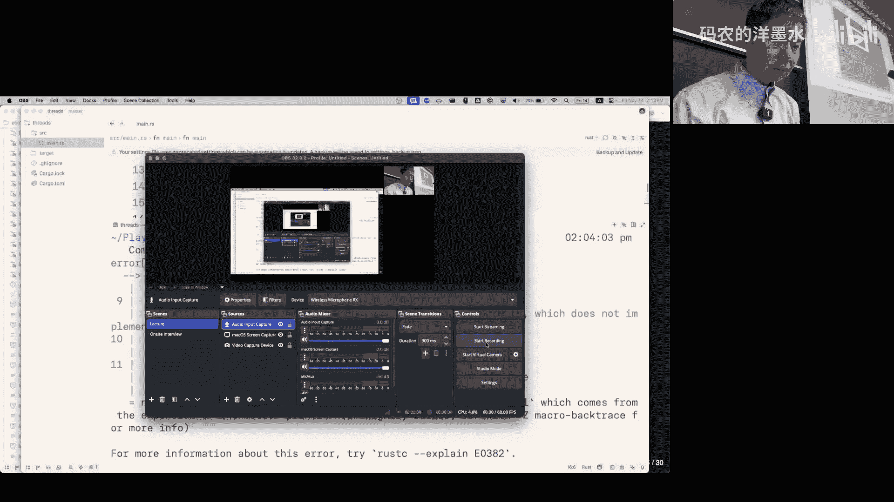

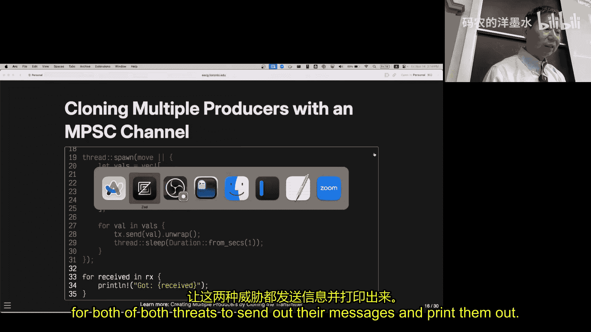

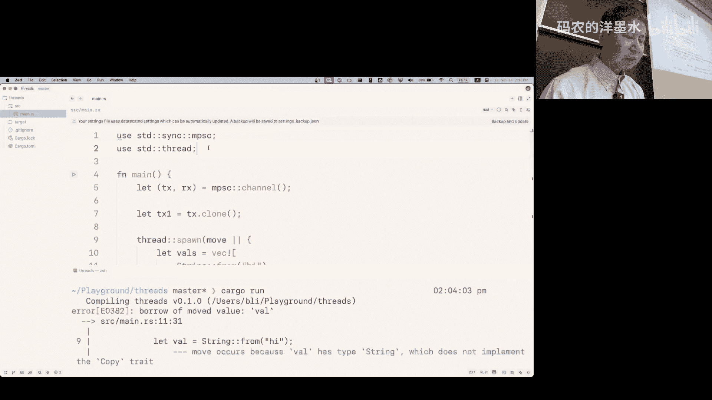

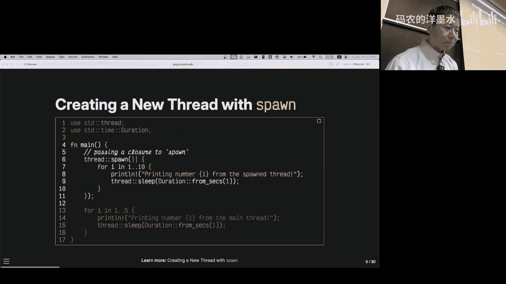


在本节课中，我们将继续探讨Rust中的并发编程，重点学习如何使用通道（`mpsc`）进行线程间通信，以及如何安全地共享内存（`Mutex`和`Arc`）。我们还将介绍原子类型以及`Send`和`Sync`这两个关键的标记trait。最后，我们会简要展望异步编程的优势。

## 多生产者，单消费者通道

上一节我们介绍了使用通道进行线程间通信。本节中，我们来看看如何创建多生产者、单消费者（`mpsc`）的通道，允许多个线程向同一个接收端发送消息。

以下是创建多生产者通道的步骤：
1.  使用 `std::sync::mpsc::channel()` 创建一个通道，它会返回一个发送端（`tx`）和一个接收端（`rx`）。
2.  由于发送端没有实现 `Copy` trait，我们需要通过 `clone()` 方法来创建新的发送端，以便传递给其他线程。
3.  每个新线程通过 `move` 关键字获取其发送端的所有权，然后使用 `send()` 方法发送消息。
4.  在主线程中，使用 `rx.recv()` 阻塞地等待并接收来自所有发送端的消息。

```rust
use std::sync::mpsc;
use std::thread;
use std::time::Duration;

fn main() {
    let (tx, rx) = mpsc::channel();
    let tx1 = tx.clone(); // 克隆发送端

    thread::spawn(move || {
        let vals = vec!["hi", "from", "the", "thread"];
        for val in vals {
            tx.send(val).unwrap();
            thread::sleep(Duration::from_secs(1));
        }
    });

    thread::spawn(move || {
        let vals = vec!["more", "messages", "for", "you"];
        for val in vals {
            tx1.send(val).unwrap();
            thread::sleep(Duration::from_secs(1));
        }
    });

    // 主线程接收并打印所有消息
    for received in rx {
        println!("Got: {}", received);
    }
}
```

运行此程序，主线程将按接收顺序打印出两个子线程发送的所有消息。这展示了使用通道进行线程间通信的典型模式：**不要通过共享内存来通信，而要通过通信来共享内存**。每个线程保持其状态私有，仅通过通道传递消息。

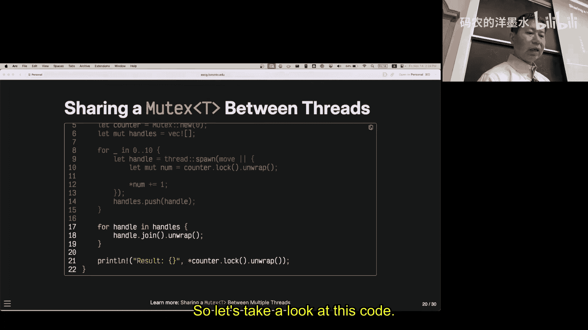

## 使用互斥锁共享内存

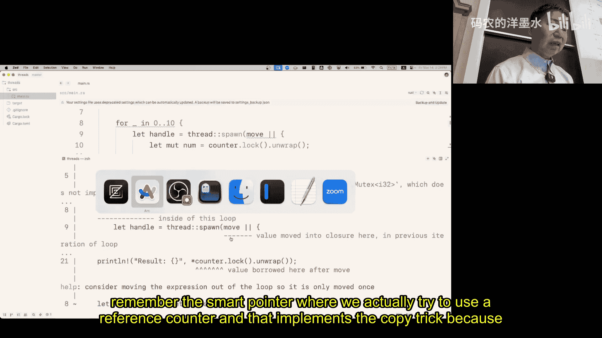

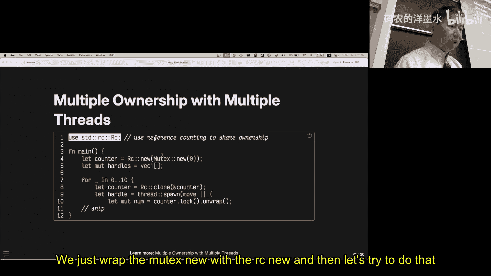

虽然通道是推荐的线程间通信方式，但有时出于性能考虑，我们仍需要共享内存。Rust通过 `Mutex<T>`（互斥锁）来支持安全的共享状态并发。

`Mutex<T>` 提供了内部可变性，允许我们在多个线程中安全地修改其内部数据。访问被锁保护的数据需要调用 `lock()` 方法，该方法会阻塞当前线程直到获取锁为止。成功获取锁后，它会返回一个名为 `MutexGuard` 的智能指针。

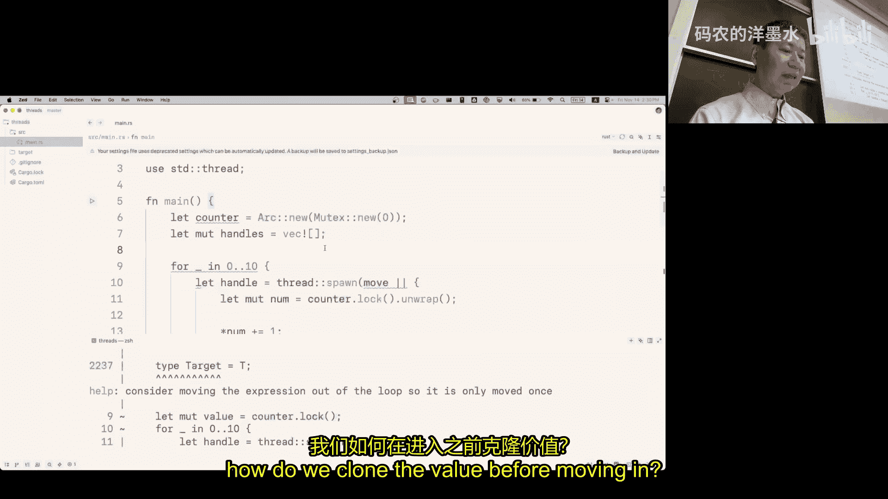

以下是使用 `Mutex` 的基本操作：
1.  使用 `Mutex::new(data)` 创建一个保护着数据的互斥锁。
2.  在需要访问或修改数据时，调用 `lock()` 方法获取锁。
3.  对返回的 `MutexGuard` 进行解引用（`*`）来访问或修改内部数据。
4.  当 `MutexGuard` 离开作用域被 `drop` 时，锁会自动释放，无需手动解锁。

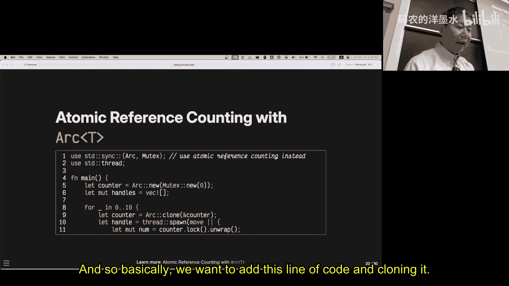

```rust
use std::sync::Mutex;

fn main() {
    let m = Mutex::new(5);
    {
        let mut num = m.lock().unwrap(); // 获取锁
        *num = 6; // 修改数据
    } // 此处 `num`（即 `MutexGuard`）离开作用域，锁被自动释放
    println!("m = {:?}", m);
}
```

## 在多线程间共享 `Mutex`

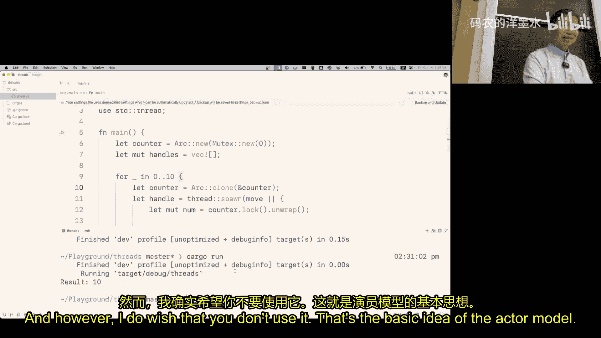

为了在多个线程间共享同一个 `Mutex`，我们需要解决所有权问题。由于 `Mutex` 本身没有实现 `Copy` trait，不能直接移动到多个线程中。此时，我们需要使用 `Arc<T>`（原子引用计数）。

`Arc<T>` 是 `Rc<T>` 的线程安全版本。它通过原子操作管理引用计数，因此可以安全地在多个线程间共享所有权。结合 `Mutex<T>`，就构成了 `Arc<Mutex<T>>` 的经典模式。

以下是创建多线程共享计数器的步骤：
1.  使用 `Arc::new(Mutex::new(data))` 创建被 `Arc` 包裹的 `Mutex`。
2.  在每个新线程中，通过 `Arc::clone(&counter)` 增加引用计数并获得一个新的 `Arc` 指针，然后通过 `move` 将其所有权移入线程闭包。
3.  在线程内部，通过 `lock()` 获取锁并修改数据。
4.  主线程等待所有子线程结束后，同样通过 `lock()` 获取锁并读取最终值。

```rust
use std::sync::{Arc, Mutex};
use std::thread;

fn main() {
    let counter = Arc::new(Mutex::new(0));
    let mut handles = vec![];

    for _ in 0..10 {
        let counter = Arc::clone(&counter); // 克隆 Arc
        let handle = thread::spawn(move || {
            let mut num = counter.lock().unwrap(); // 获取锁
            *num += 1; // 修改数据
        });
        handles.push(handle);
    }

    for handle in handles {
        handle.join().unwrap();
    }

    println!("Result: {}", *counter.lock().unwrap()); // 主线程获取锁并读取
}
```

## 原子类型

对于简单的原始类型（如整数、布尔值）的共享，使用完整的 `Mutex` 可能有些重量级。Rust标准库在 `std::sync::atomic` 模块中提供了一系列原子类型（如 `AtomicUsize`, `AtomicBool` 等）。

原子类型通过硬件级别的原子指令实现无锁（lock-free）的线程安全访问，性能通常高于互斥锁。它们提供了 `load()`, `store()`, `fetch_add()` 等方法进行操作。

以下是使用 `AtomicUsize` 的示例：
```rust
use std::sync::atomic::{AtomicUsize, Ordering};
use std::thread;

static GLOBAL_THREAD_COUNT: AtomicUsize = AtomicUsize::new(0);

fn main() {
    let mut handles = vec![];
    for _ in 0..10 {
        let handle = thread::spawn(|| {
            let old_count = GLOBAL_THREAD_COUNT.fetch_add(1, Ordering::Relaxed);
            println!("Previous thread count: {}, current: {}", old_count, old_count + 1);
        });
        handles.push(handle);
    }
    for handle in handles {
        handle.join().unwrap();
    }
}
```
其中 `Ordering::Relaxed` 表示最宽松的内存排序，只保证原子性，不保证操作顺序。

## `Send` 和 `Sync` 标记trait

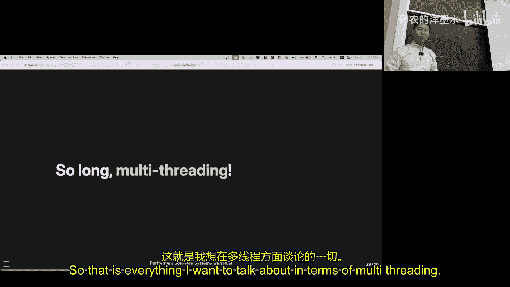


Rust编译器通过 `Send` 和 `Sync` 这两个标记trait（marker trait，即内部没有方法的trait）来在编译期保证线程安全。

*   **`Send`**：标记一个类型的所有权可以安全地在线程间传递。几乎所有类型都是 `Send`，一个显著的例外是 `Rc<T>`，因为其非原子化的引用计数操作不是线程安全的。
*   **`Sync`**：标记一个类型的引用可以安全地在多个线程间共享。一个类型 `T` 是 `Sync` 的，当且仅当其引用 `&T` 是 `Send` 的。`Mutex<T>` 是 `Sync` 的，而 `Rc<T>` 和 `RefCell<T>` 不是。

编译器会自动为合适的类型实现这些trait。当你在泛型约束中指定 `T: Send + Sync` 时，就要求类型 `T` 必须满足线程安全的条件。

## 迈向异步编程

最后，我们简要展望一下异步编程。在处理大量I/O密集型操作时，为每个阻塞操作创建线程（线程模型）会带来显著的上下文切换开销。现代解决方案是使用**异步编程**和**栈less协程**。

其核心思想是：
*   使用非阻塞的系统调用。
*   在等待I/O时，通过 `await` 关键字挂起当前任务。
*   由异步运行时（async runtime，如 `tokio` 或 `async-std`）在单个或少量线程内调度执行其他就绪的任务，实现极高的并发度。

Rust的异步实现基于栈less协程，是目前性能最高的并发模型之一。我们将在下一讲深入探讨。

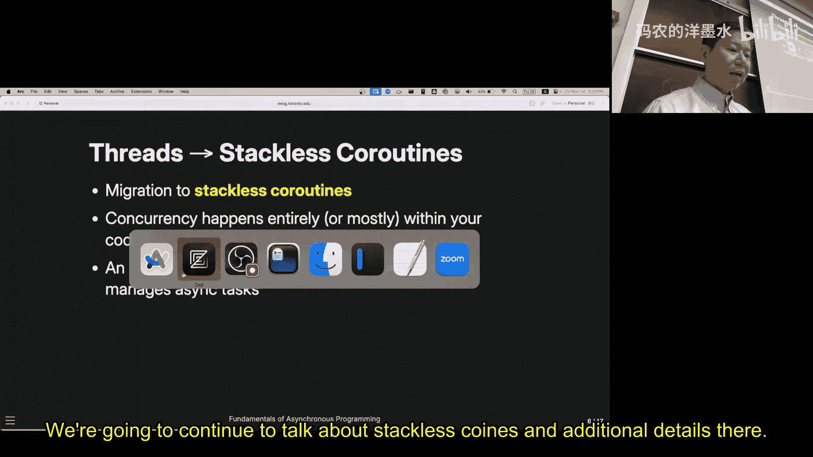

本节课中我们一起学习了Rust中更高级的并发工具：多生产者通道、用于安全共享内存的 `Mutex` 和 `Arc`、高性能的原子类型，以及保障线程安全的 `Send` 和 `Sync` trait。最后，我们了解了异步编程的基本动机和优势，为后续课程打下基础。记住，在Rust中，优先考虑使用通道的消息传递模型，仅在必要时才使用共享内存。