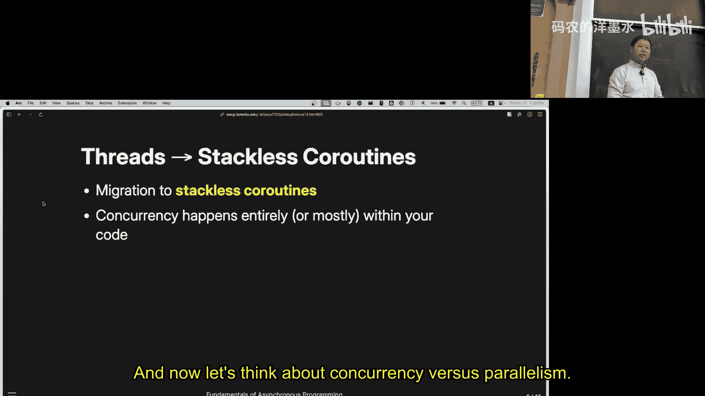
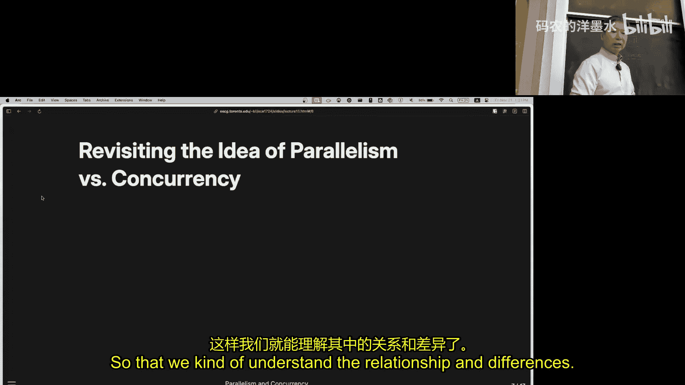
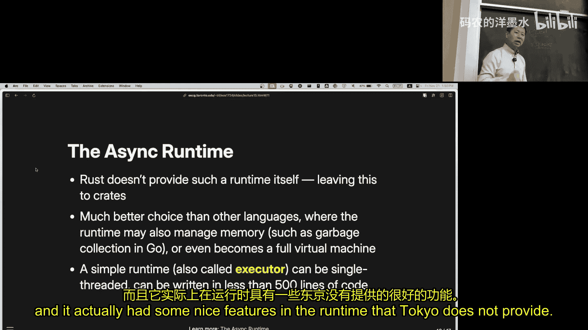
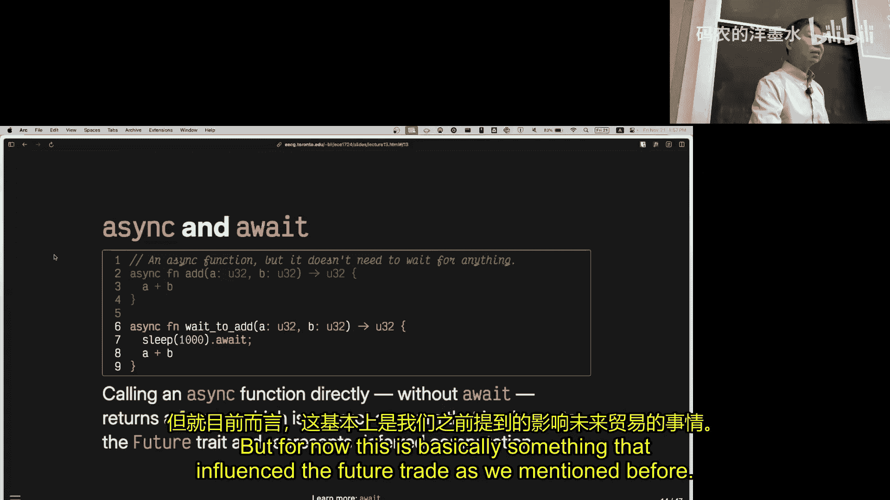
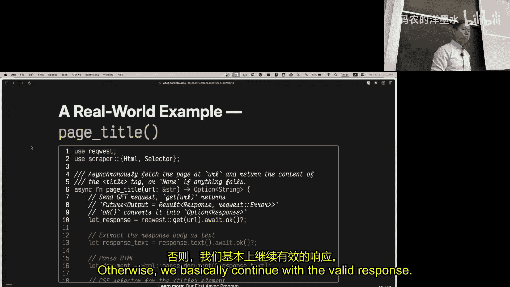
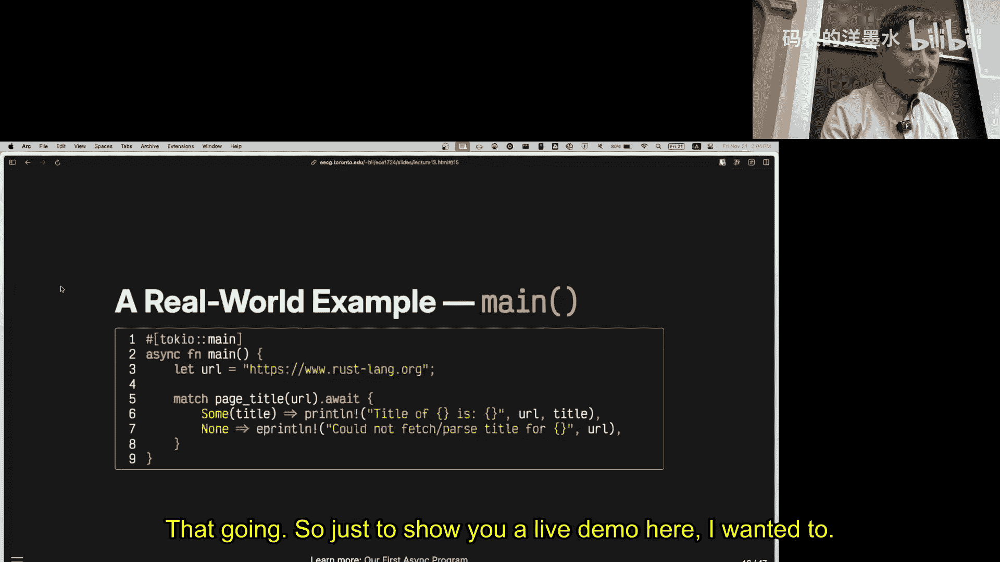
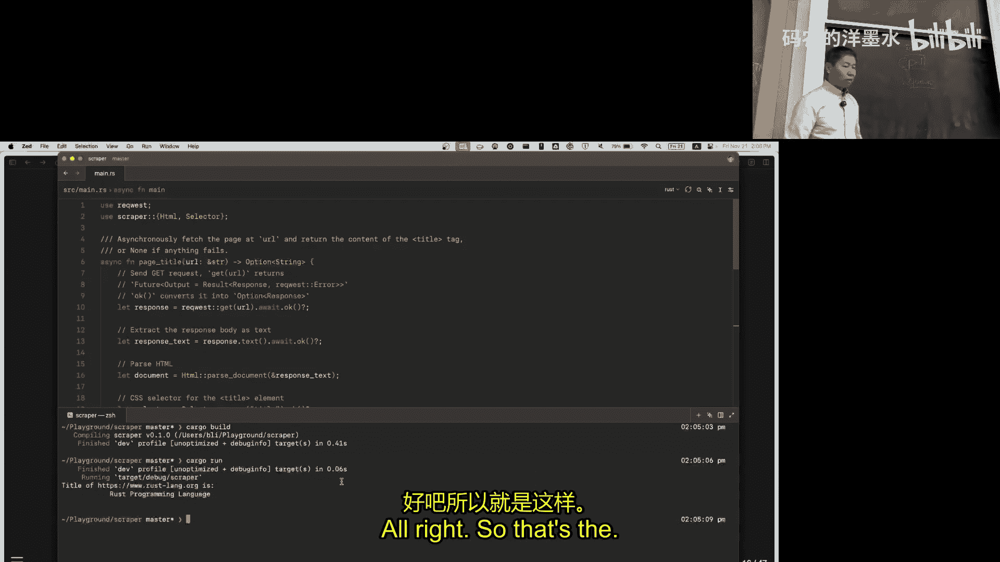
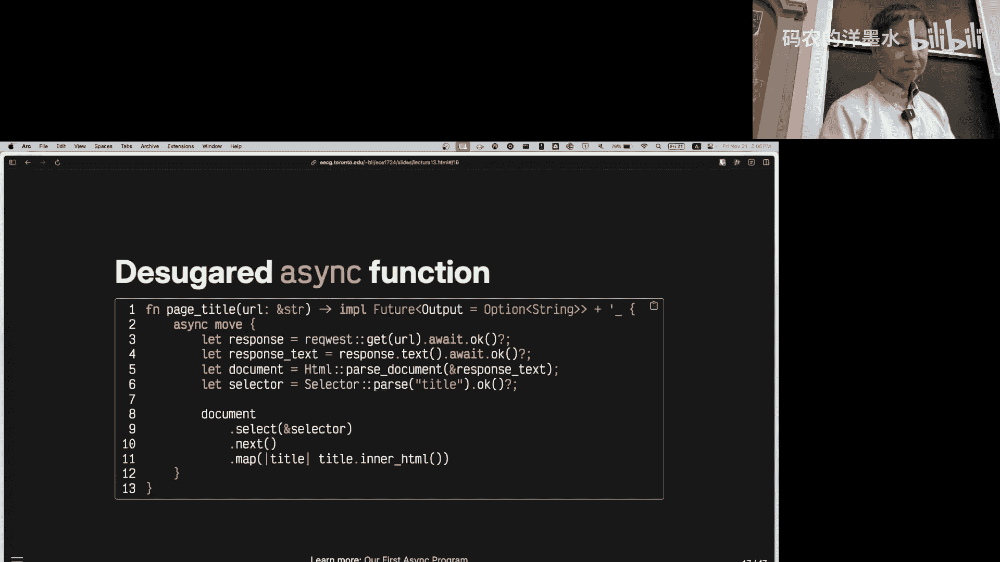

# 【全集 附课件】多伦多大学 使用Rust构建高性能软件系统 中英字幕 1080P p19 Lecture 19 - 异步Rust part1 -BV16V62BhEuf_p19-

So last time towards the end of the last lecture。We spend about 10 minutes talking about the asynchronous portion of rust。

 which is the main focus today。 So today we're going to go through some of the most challenging concepts in rust more challenging than any of the previous lectures and more challenging than the final lecture next week。

 So next week we're going to go easy， we're going to talk about simple things。

 but today we're going to go into more depth related to asynchronous rust and the reason for that is because this is very important。

 This is the foundation why rust is actually used for most of the modern web services and web infrastructure anywhere that requires concurrency and parallelism。

 anywhere that requires high performance delivering concurrency and parallelism It's all because of asynchronous rust We're not really using the multi-threading anymore We're just using asynchronous。

That's why we want to spend a major amount of time today talking about it。

And last time we got started talking about it in the final 10 minutes。

 we mentioned that Ru is able to move forward from multi threaded programming into asynchronous programming。

And。In asynchronous programming， the operations they may not finish sequentially in the order that they are actually started。

In the sense that these operations can actually interlieve with each other。

 very similar to multi threaded programming in that sense。

Now we mentioned last time a little bit of background related to CPU bound and IObound operations。

 some of the operations just like video exporting， you see 100 percent CPU。

 those are CPU bound operations and some of the others like using a web browser or downloading anything from the internet。

 they require waiting for IO and those IObound operations are ideal for asynchronous programming those CPU bound operations we can use asynchronous programming for those。

 but those are more kind of related to multithtic programming because we actually can have parallelism for the CPU bound operations。

So last time we also talked about system calls， two different kind of system calls。

 a lot of the system calls， these are just application programming interfaces provided by the operating system kernel。

 a lot of them， they are in the form of blocking system calls。

 these are blocking system calls in nature。And because they are blocking system calls。

We would have to use multithed programming。 We're gonna have to use our knowledge in the previous lecture。

 Sp brand new threads。 These are one to one mapping to the kernel threats。 In other words。

 they actually can use the blocking system calls without blocking the other threads。

 The other threads， they are concurrently running at the same time。

 most likely on a different CPU core， if possible， and they're scheduled by the operating system kernel。

But we actually mentioned that using this idea of multi threaded programming is not really that efficient。

 especially for Iobound workloads。These involve overhead and these are typically what we call context switching overhead。

 we're not。It's not that much overhead， it's actually less overhead compared to contact switching across different operating system processes。

But still we have some overhead， the reason for that is because every single thread in rustT or any other user level program is going to be having this one to one mapping with kernel threats and context switching across different kernel threads。

 there is some overhead。So it's not like a whole lot of overhead。 It's still quite fast。

 but it's not ideal。 If we wanted the best possible performance out of this web server。

 we might not want to have this kind of overhead。 So it's not a good idea。

 also to have too many threats because of the overhead actually is increasing as you have more threats imagine in the extreme case。

 you have way too many threats。 And the amount of time taken for the overhead。

Is going to be overwhelming and probably even exceeding the amount of time that we do real work。

 So that's probably not the best idea。So a better idea is to somehow convert。

A lot of these system calls from blocking system calls to non blocking system calls。

 somehow we're able to say， get started。 just call me back when you're ready， when you're done。

And that would be a major， major departure at the operating system kernel level because we would have to implement these system costs from the blocking version and reimplement them as a non blocklocking version。

 the operating system kernel will also have a way of calling back the user space and saying when it's done。

 this is ready， we're going to give you the results at this time。

And all of that has been implemented in modern operating system kernels。

There are only three modern operating system kernels。 There's Windows。 But by the way。

 Windows actually was the first in the world that actually implemented these callbacks。 It's。

 it's actually having a weird name called。Comleion ports。

 So it's called overlap I O with complex ports。 And that would be initially implemented by Windows N T back in 2000。

 Linux actually implemented in something called the Epo interface。

 So we actually have the Epo interface， which is the Linux version of this。

 This is actually the Linux variant of calling back the user space， when the system call is done。

 And Mac O also had something around the same time called the K Q interface。

 This is also another kind of operating system level service so that we can call back the user space when the system call is done。

 So Windows， basically， we have I O。😊，CP and overlap I O with completion port。

 And all of these are just facilities provided by modern operating system kernels since about 25 years ago。

 that we would actually have the ability to implement these non blocking system calls。As you can see。

 these are provided a long time ago，2000 to 2005， but the user space did not catch up。

 So we actually have very slow ramping up from C C plus plus and eventually down to rust。

 very slow ramping up in terms of using these ideas。So why do we actually have slow ramp up。 Well。

 we have slow ramp up， because this is hard to do at the user space at the user space。

 we're gonna have to think about how do we use these services from the operating system kernels since about 25 years ago。

 How do we use them。 It takes about 20 years for us to figure out exactly how do we use them。

 So today， we're gonna tell you， how do we use them in asynchronous rust in the rust programming language。

 What's the design over there in terms of using these non blocklocking versions of system calls。

So ideally， at the very top， at the very beginning， you can imagine ideally。

 it' would be great if we have something like， you know， get data from this particular URL。

 which is obviously a IO bound workload。 we want to probably wait for milliseconds。

 sometimes even seconds to get that particular piece of data from that URL。

 And hopefully we actually have something called dot a weight， you know， to really just wait for it。

 without leaving this particular threat。😊，Alright， so we're not really want to do a context with the difference thread。

 We just try to stay in this thread because maybe we have something else in the same thread that we can do while we're waiting for this downloading of this URL。

So rather than doing like a sp in a different thread and then join and waiting for that， you know。

 for that to be done， which is the blocking system call version。 Now we have the nonblocking version。

 Can we do something like this， Just stay in the same thread， you know。

 just not really trying to switch away because switching away had a lot of overhead as we mentioned。

So now we enter the rust way of doing this。 This is really hard to do。 Again。

 It takes about 20 years for people to understand and how to do this。 Ru， it took rust about 6。

7 years to figure out how do we do this in rust as well。 The design is really something that。

You know， challenges everybody in the core team。 this is absolutely the， the prime example。

 things that you cannot really do with large language models and things like that。 No。

 you cannot do that。 This is like a pure human endeavore。

 How do we actually design these things so that we could take advantage of these non blocklocking system cost。

Well， we first give it the name， we call it a co routine。

 so it is a co routine to differentiate from the old idea of threats， which is one to one mapping。

In other words， we don't really have one to one mapping with the kernel threads。

 Each thread in rust could actually have multiple co routines。 So by using the term thread。

 we imply that we have one to one mapping with the kernel thread by using the term coout。

 we basically imply that we can have multiple concurrent co routines in the same thread。

Now rust also calls stackless cor routines。 This is actually one of the two variants of co routines。

 one is called stackbased co routines， and that would be the older kind of co routines that you kind of store the state when you do a little bit of a context switching across different co routines by storing the state in the actual stack which is not too bad but it's still slightly slower then not use stack so rust does not use the actual user stack for storing the state when it does that little context switching between co routines so rust implements stackless cor routines。

 we're going to come back to this a little bit later where do we store the state。

 we're going to come back to this a little bit later but the stackless cor routines is a faster variant and go actually implemented stackbased cor routine with the use of stack which is kind of slower but。

It's still good， it's still better than not using co routines。

And the only other language that actually has support for stackless corrants would be C plus plus。

 And given the choice between rust and C plus plus， obviously youre gonna use rust。

 You're not gonna use C plus plus， right， So that's good thing to have。

 And so we have the best version of the quarantine in rust。😊。

And now let's think about concurrency versus parallelism。

 So concurrency means that we have these kind of like the tiny little threads or coouts and progress independently concurrent concurrently but they actually may not be happening at exactly the same time and this would be probably within the same thread corresponding to the kernel thread So this is something that happens within your code。

 you actually control when do we do that little context switch between different kind of these cooutouts and of course we don't want to do it ourselves。

 we want to offload that job to a thirdpart crate。

And that third party quaate would be something called the Async runtime。

 and we're going to get to the async runtime in more detail a little bit later today。Whi is in rust。

 just a third party createate。 But the runtime， the asnc runtime in other languages。

 such as go actually is built into the programming language itself。 But in rust。

 kind of with the actual designers decided this is not part of rust itself。

Rust should actually implement just a basic skeleton and all of the big jobs。

 all of the work should be done by a third party crate。

 So there's like a perfect collaboration between a third party crate and the rust programming language to implement these co routines。

 So the third party crate would implement the asynncch runtime。 I'm going to get back to that later。

 managing these so-called tasks， which are basically the same as co routines。And your code。

Assumes an existence of an async runtime。 So that runtime is there。

 It's part of the third party crate。 You use that third party crate。

 and then you can use some of the convenient keywords。 For example， the await keyword。

 as we mentioned in the previous slide that high level idea。

 We want to use that keyword to basically try to say， let's wait for the I O operation to be done。

So RuT supports ACIN programming。By providing as its core language two things。

 one would be the futures and the other would be the syntax。

 which is something that the compiler supports。 obviously， the compiler understands the syntax。

 So we have the async keyword。 we have the a weight keyword。 So a asynnc can await。

 they actually collaborate to actually provide us the support for Staless cors and combined with the concept of futures。

 futures in early versions of rust came from 30 var crates。 But right now in modern rust。

 it came from the core rust standard library。 So that would be something we're gonna to talk about a lot today。

But before we get into a little bit more detail about the Async runtime and the Hello World program and so on。

 just want to revisit the idea of heroism and concurrency a little bit。

So that we kind of understand the relationship and differences。

 So the analogy here is that we have a team and the team is splitting up work for the course project。

 for example。

And we want to assign each member multiple tasks。So we could actually try We ought to assign multiple tasks to the team。

 but we can try to do two things。 We can assign each member multiple tasks。

 We can assign each member just one task， or we can assign each member multiple tasks。

 but everybody will get multiple tasks， a mix of both。So。

Concurrency corresponds to assigning each member multiple tasks in our analogy， in the sense that。

That member， which is in rust， like like a CPU core or corresponding to a kernel threat。

 cannot do that multiple task at the same time， completely at the same time。

 It cannot be simultaneous。 have to do one task for a little while。

 Sw to another task for do that a little while and switch to a different task。

 do that a little while。 So they're concurrently progress， but they're not exactly at the same time。

So that would be corresponding to something like a single CPU core or a kernel threat。

And terrorism would be corresponding to the analogy where each member takes one task。

And if you have quite a few members， it's corresponding to quite a few CPU core。

 and that implies that the members in the team can make progress at exactly the same time。

 and that is parallelable。Now， with the idea of cors。We actually can support。Both of these。

 So in other words， we actually go back to the analogy。 we can actually do both of these。

 We can do both assigning a member multiple task and assigning multiple tasks to multiple members at exactly the same time。

 So having coouts does not give up the benefit of parallelism。

We could actually have concurrency and parallelism。At exactly the same time， which is obvious。

 You're gonna， you don't want to give up the nice ideas of parallelism because all of our CPUs have multiple CPU。

 Of course， you wanted parallelism。But on the other hand。

 you also wanted concurrency for the reasons that we have outlined before。

 So that's why we actually wanted to support both。 And that's exactly how the Staless proteinss did。

All right。So now we get into futures。Now， what are these futures。Now。

 we want to spend a lot of time talking about these futures today。 but to start a future。

Is just a value。And this value may not be ready right now。

But it will become ready sometime in the future， for example。

If we're downloading something from a URL， you know， it may not be ready right now。

 but it will be ready sometime in the future。So that is a future。 It is just simply a value。In rust。

And this actually had multiple different names across different languages in Javascript or Typescript。

 We'll call it a promise。 Some of the other languages we can call it a task， for example。

 But in rust， we call it。A future。 It is not a promise。 not a time。 It is a future。

 It is a value that may not be ready right now and becomes ready at some time in the future。

So what is the future。Rust actually had a future trait。 This is part of this rust standard library。

 It's part of the core library， and it is a building block。That is extensively used。

By the third party crate that provides the Async runtime and also by the compiler。

 So the compiler in collaboration with the third party trade that provides the async runtime in collaboration with this core standard library future trade implements our Staless Co idea。

So these featuress， they are simple types。And these types are just types that implement the future trade。

 So future is a trade。You remember what is a trade， Well， a trade is something that has methods。

Right there in the trade or， you know， associated functions。In the trade。And they do not have data。

 So types can implement the trait。 So future。Is a trait and other types that are called futures。

 They are just simply types that implement this trade。 And， of course， if we just say a future。

 what is the future， that's the value of this， these types that we have。

So each future is going to hold its own information。And that information。

Is recording the progress that has been made。 And that information also tries to。

Record what exactly does ready mean So when we say it may not be ready now。

 what does that really mean that depends on the type， different types， you know。

 corresponding to different tasks or different cors would be having different meaning of what does ready mean and it also had different information it needs to record to record its progress so it would be a different type corresponding to that particular task or cor。

So now let's get into the Asyync syntax， which is supported by the compiler。

 You can apply the Async keyword to two things。1 would be a function or a method。

 which is taking a self。 And the other possibility would be a block of code。

 You can make a block of code async。 You can also actually try to make a function， async。

So a block of code would be something like， you know， nameless or， you know， kind of。Co routine。

 sorry， not a cold routine。A nameless closure， which is basically a block of code。

 You can make that closure async as well。 So a block of code or a function。

 Both of these can be made async by applying the async keyword before that block or before that function。

So either anonymous closure or a function。And what do we mean by an async block of called or async function。

Well， whenever we have an async block of code or async function。

What we really mean here is that this particular block of code or this particular function。

Can be interrupted。And resume。In other words， this code may not always be ready。 You know。

 it might be downloading something thing from the URL。 It might take some time。

 And because of that reason you could interrupt this do something else， maybe a different task。

 different code。 And then later on， resume this particular task when it really becomes ready。

 So that's something that we tell the compiler by applying the Async keyword。Fundamentally。

 this block of code or this function can be interrupted and can be resumed。

So within this block or function that is marked as a sync， you can use the a weight keyword。

And the await keyword would actually be used to await a future。 It's always used to await a future。

So what do we mean by awaiting a future， We're basically trying to apply this keyword as a suffix form at the end。

 not a prefix form。 We want to apply this to this future。 It's always on this future by saying。

 I'm going wait for this future to become ready。So that's something that we wanted to do。

And anywhere you await the future， the sync block or the function can pause because it may not always be ready。

 So it might pause。 And then at a later time， it can resume when the URL has finished downloading。

 it might resume at the later time。 So when you pause this particular task。

Which includes this block of code or this particular function。

 You actually go to a different task in the same thread。 and you can run that particular task。

 And then， of course， you can pause that task later on。

 when it's aing when it's actually putting into an weight。 You know。

 any block will have to include can include in the weight。

 So that's the point where you can actually interrupt the actual block of code or the function。

 and then you can resume at a later time。 So everywhere you have an weight。

 that is the point of interruption of a potential interruption。 When you have an a weight， you know。

 you might actually switch away from this particular routine and you go to a different routine。😊。

So then let's introduce another terminology called polling。

 And this is a very important terminology inside rust。In the sense that we want to check。

With the future to see if its value is available。 In other words， is it ready。Now。

 if it value is available， it is ready， and we can proceed to get that value。 Otherwise。

 we may not be doing that。And。So polling is something that is a fundamental concept。

 and you don't typically poll in your own code。 Typically。

 polling is done from a third party crate from the async runtime。

 but it's something that is very important because you can imagine that we have a thread。

Corsponding to the kernel thread in that thread， we have multiple cors or tasks。

 and they can actually do a little bit of context switching between different cor and tasks。

 And how do we do that， without an actual kernel level scheduler。 Well。

 we're gonna have to do it like this。 We're gonna have to say， okay。

 we're gonna poll and see if it's ready。 if it is。 We're gonna continue to get that value。 Otherwise。

 we will pose at a later time。 So that's something that we will be doing in the cooperative scheduling way。

 So this is a cooperative scheduler。 This is not something like what we typically call a preemptive scheduler。

 which is where the kernel scheduling is trying to do。 It is cooperative in the sense that。😊。

The polar， whoever who is the third partyequate， would be the same threat。

 would be in the same thread， and it's basically just polling from time to time to say， is it ready？

At this particular moment。But it's not so simple yet we're going to get into polling a lot more later on today。

So now we haven't seen a lot of code today。It's high time for us to see some code。

Hello world called in asynch rust。We're gonna use our newfo keyword， Async， to actually。

Define an asynchronous function。 So the as function and say， hello。

 it's the simplest possible way of writing this function。 We just have a print line。

 We don't really have in the weight。 However， we could put in the weight， obviously。And in fact。

 a weight can only be put in the nascing function。 If you don't have a nascing function。

 you cannot put in the weight right there。 It will be a compile time error。

 And we're gonna tell you why， a little bit later。So that is the async function。 Say hello。

 And then how do we actually call this function。Well， this isn't a sync function。

 So we basically have to call it with a weight。And we can do that in our main program。

 in our main function。 however， con conventionally， a main function will be synchronous。

 It's not an asynchronous function because it's F N main。

 That's the conventional way that we write the main function。 That's the starting point。

Of that function。Now， but we basically said that whenever you want to call away。

 there has to be in an as function。 You cannot make it a synchronous function and call away inside a synchronous function。

 a compile time error。 Well， how do we actually call as synchronous function inside main if main is synchronous。

We're going to have to make it asynchronous and to make it asynchronous。The first way to do it。

Is to use a little bit of synthetic sugar and just use async function main with the macro。

On top of it。 So the the line before the aync function main， we put a macro。 So that macro。

 you can think of this as rewriting code using that macro and that macro。

 you don't really care about how it rerites the code。

You will understand that basically turns a synchronous function into something that can call a weight inside that function。

But， you know， we do want to understand how it works。 So we're gonna talk about it later。

 How do we expand the macro and how do we de sugarug it， But， but for now， the macro can be used。

 In fact， in typical cases， in practice， we do use the macro。And this macro comes from Tokyo。

 So Tokyo is one of the most popular thirdpart crates that implements the asyncch runtime。

 There are many of these crates out there。 We're gonna talk about these。

 But Tokyo is the most popular， typically we use Tokyo。

 Tokyo actually was maintain and develop by Amazon。

 and Amazon is also hiring a lot of the developers in the core rust team。 you know。

 the actual designers and maintains of the language。

 So this is something like almost like an official thirdpart crate for the async runtime。

 So we can use the Tokyo and Tokyo actually supports that。 that particular macro。

 to use the macro gonna have to turn on at least the macros feature。

 or you can just say features equals to food that will turn on all of the features。

 We're gonna talk about features later on when we talk about the final lecture。

 when we talk about compile time switches to turn on and off some of the code。😊，But for now。

 we turn on all of the code in Tokyo， and then that would be part of the cargo dot Tmo。

 And then we can use that macro。 And that made the main program a asynchronous function。All right。

 so now let's talk about the Tokyo asynchronous runtimeum， what does it do， Well。

 Tokyo and all of the other third party asynchronous runtimes。

 they schedule these co routines or tasks。They are the actual scheduler。

And they provide the scheduling as their services。Can be quite simple。

 could be done in like 500 lines of code or could be very complex， like what Tokyo is doing。

And it will schedule these tasks to run not just on the single CPU core。

 but across multiple CPU cores。And then whenever a task suspends。

 there are only two possibilities when it suspends either it suspends when it's actually a weight on an asynchronous block of code or asynchronous function。

 or it supens by receiving from a。 remember that we have channels across different threads。

 we can also have channels across different routines and tasks。

 So whenever you say receive from that channel， we are basically blocking to receive that， you know。

 until something arrives， we will not be ready getting that particular message from that channel。

 and that would be a point where we can suspend this particular task and resume a different task。

 for example。So that these are the two possibilities where we actually can suspend the task and the asynch runtime actually tries to pick a different task when we suspend the current task and eventually when this task resumes for example。

 the message waiting in the channel and for example， IO operation downloading the URL is done。

And then it would become ready when it becomes ready to run。

 the asynchron time will be able to run it。😊，So rust does not provide such a runtime itself。

 which is a judicious decision that it made some time ago in saying that we're not going to have our own kind of default runtime in the programming language。

 we're going to keep that flexible， anybody can run write a runtime。

 you can write a runtime yourself， and you could actually do whatever you wish with that runtime。

So that's left to the third party crates。And this is a much better design choice than some of the other languages。

 because it left a lot of flexibility to the implementation of the runtimes where the runtime。

 you know， other languages， they actually have their own the runtime in the in the in the standard library or the programming language itself。

 the runtime may also manage memory， like in go， the garbage collector in go actually manages memory。

 And sometimes these runtime are so complicated。 It becomes a full virtual machine。 So in rust。

 we wanted to say， you have your choice of runtimes and the compiler and the language called standard library does not provide that runtime。

😊，Sometimes we also call this asynchron time an executor。 So whenever you call it an executor。

 it's the same thing as a runtime because obviously。

 the executor executes code and that code will be from different task。 You kind of suspend this task。

 resume a different task。 And that's why we call it executor。

And this executor could be single threaded。 And if it's single threaded means that it never will be able to use more than one CPU core。

 just one thread。 And if that is the case， then it is。Can be very simple。

 It could be as simple as 500 lines of code。 In fact。

 I've actually had written my own bespoke runtime， you know。

 for one of my projects in research for discrete event network simulator。

 I can actually run write a runtime， which is around 500 lines of code。

 single threaded and it actually had some nice features in the runtime that Tokyo does not provide。😊。

That I need。And， of course， Tokyo is not the only runtime available。 It's a full feature runtime。

 It is also called a multi threaded runtime， which means that it supports multiple threads。 Tokyo。

 by the way， can support a single thread。 You can actually turn on the switch。

 It becomes a single threaded runtime， but you could actually also make it multithreaded。

 And by default， it is multi threaded until you turn on the switch。 That is single threaded。😊。

And other runtime are also excellent runtime， and they can have less overhead。

If they are single threaded， for example， or if they're implemented to be more to be a little bit less complex。

 For example， you can have Asyn STD。 you can have small。 These are kind of older runtime。

 They're not， really， they're simpler， but theyre not really as feature rich and they are not really as well maintained as the Tokyo runtime。

 So it's probably not a good idea to use these as up compared to the Tokyo runtime。 Tokyo runtime。

 by the way， is very fast， even though it is complex， it is very fast。

But I do want to mention one more runtime， which is bike dance runtime called a mono I O。

In the mono I from Byd is an open source project。 It is runtime。 It is a async runtime。

 and it's kind of having a special feature。 And this feature is called threat per core runtime。😊。

And that means that you really have just one thread for every single single CPU course。

And you may not need to really try to do something called work stealing task queuees。

 where you take a thread。 and then you put it into a different CPU core。

And that's something that the Tokyo runtime is doing。

 mostly for load balancing and for performance reasons。

 And the the mono I O runtime does not do that。 It is one threat for every single CPU core。

 which is the most efficient way of doing this。 If you have more threats per core。

 it's actually less little bit less efficient。And beyond that， it also guarantees that data。

Does not need to be sync consent。 So you don't really have to have Arc and mutex and things like that for your shared data across different co routines。

 So that using this particular runtime， because you have this guarantee that it is a threat per core runtime。

 Anyway， this is like an honorable mention。 But typically， we use the tokyo runtime。

You can write your own runtime as well， question。It is similar。

 but it's not exactly threat pinning in the sense that threat pinning。

 you still can have multiple threads for every single core。

 but this one actually allows only one threat。For each core。

 And that basically is how we utilize multiple CPU cores without the need of having more threats。

 So that's the idea。No， it they actually pinned on the core。

 but F pin is a little bit wider than this。 Fret pin actually allows multiple threads per core。

 but you still pin the threat to the core。 question。你在王婆。Whats the file。AE付款。

So what makes sense that。So the question is， does it make sense to have multiple threats per core。

 It does make sense for sure。 Why， Because we actually have CPU bound tasks。

 So some of the CPU bound tasks， you wanted the noncor schedule。 You wanted the preemptive schedule。

 which is only available at the kernel。And if you don't have multiple threads per core。

 then if one thread is doing something that is CPU bound， not waiting for I O， but CPU bound。

 it will hand up all of the other co routines on that same thread。

 So you might want to have multiple threads。Okay， so Tokyo is actually typically a good idea。

But mono I O is actually designed for something like a。

 exactly precisely designed for something like a web server。

 which typically does not have CPU bound tasks。 But Tokyo is more general purpose。Right。

 so if you actually have CPU bound tasks， you wanted to have threats corresponding to these tasks。

 for sure。 You don't want to have as proteinss for these tasks。Alright。Alright。

 so let's get back to this async in the weight business。 Here's a very simple async function。

 So async function， let's call it add。 just adding two numbers。And then。

It doesn't have a weight inside that， which means that just straight executes to the。

 to the to completion。 and you don't really have a point of suspending that particular task in the middle。

As opposed to something like weight to add， where you do have a weight。

If you have a weight and you're waiting for some kind of， you know， for example， in this case。

 we're sleeping for one second，1000 milliseconds， that is a point point where you could actually suspend this particular task and you go to a different task。

 so。That is how you put a weight into your async functions or blocks of code。

So calling them the sink directly。Without a weight， what does it return。It still returns。A future。

Right， it returns a future because you have the Asy keyword for that block of code or for that function。

 it's gonna give you a future。And what is the future again。We mentioned that the future is astruct。

Or are inam that implement the future trade。 is a type。And it's a value of that type， and represents。

As we mentioned that it may not be ready right now， it will be ready in the future。

 which is deferred computation。 Again， we will get back to this future the third time a little bit later。

 But for now， this is basically something that influence the future trade， as we mentioned before。

So now， so much for the fake toy examples like a or Hello world， let's go for a real world example。

Which is page title。So here in this particular example， I wanted to fetch a page from a URL。

And I want to return the content of that URL。 In particular。

 I wanted to get the title tag out of it and extract the title of that particular website from that URL。

So I want to write some code for that。 And this code， obviously， I wanted to become a async function。

Because this is a co routine and it's a IO bound task。

 and I wanted to make it make sure that I use the Tokyo runtime， for example。

 to actually try to run it asynchronously using co routines in rust。

So what I do here is that I use two third party crs。

 one is request you are familiar with it in assignments and the other is scraper。

 which basically tries to extract data from the result of the request。

 which is a response from the URL。 So let's think about how do we actually implement it。Well。

 the first thing we need to do is we need to get the actual response from that request using the URL as the parameter。

 So what we do is that we use the request get， and that is a function that is from the request associated function from the request cr。

 and that basically takes only one parameter， which is the URL and gets a response。Value。

 and that response value is of the response type。 And so what we typically do is that we will try to try to get some text out of that response。

 which is what we're gonna do next。 But before we go there。

 Let's think about how do we actually try to use a weight here。 Now。

 remember this get from the URL is actually loading from a website。

 We need to get a response from a website。 That takes a long time。 So that's I O。

 This I O bound task。 because it's I O， we don't want to pause this thread， right。

 We want to suspend this task， which is this async function page title。

 We're gonna switch to something else。 by the thirdpart quote by the Tokyo runtime。

 So that's why we want to say， dot a weight。So if we say do weight， it implies。

 it's always the case that the cat is going to give us a future because we can only do the do weight on the future。

Once we get do the dot await。when once we actually run the get， what does it return， Well。

 I have a little common here。 and we' gonna get into this a little bit later。 But for now， just。

It's a future。 But this future， we're gonna get into the definition， the future later on。

 the formal definition。 But this future actually has something called an associated type。

 which you remember is actually used for the iterators as well。

So an associated type is used in the future and that type is called the output type。

 and that basically says this future trade could actually have whatever type of the value that when it's done。

 that would be the result of that particular future。

 and that's really similar to the iterator where the type is whatever type that you have in that iterator。

 So here this is for the request， that type would be the result type。

And that result is containing a response， basically。Alright， so that is the type。And。

So after we call dot weight， eventually， it will be ready。 So we get that particular response。

 So do weight will give us the actual result。😊，And that result， if you call dot O K。

 that is a kind of like a special interesting method on the result by saying dot O。

 we're kind of converting the result to an option。So con it into an option。

 And rather than saying it's a result of something or an error。 Now it becomes an option of that。

You know， value， which is sum or none， right， So basically， we throw away the error。

 doesn't matter what the error is in saying， okay， And if it's none。

 because we have a question mark over there， which is basically saying if it's none。

 we're gonna directly return。 we're gonna do an early return because the return value is an option of a string to return none Otherwise。

 we basically continue with the valid response。

So after we continue， we have the response text by extracting the text from the response。

 the body from that response。 So all websites have some header， you know， metadata and the body。

 you know， the head and the body。 So the body would be the dot text that they will extract。

 and we're gonna get that， however。It will still need and weight。Why does it need in the weight。

When I actually tried to get a body of a website。What do I need in the wait。

 I thought I already have the response。Well， the response really is just like a handle。

It does not contain everything in that website。 for sure。 It doesn't contain everything。

 that website， because that website can be huge。 It might not need to have everything in that website。

 right， So in this particular case， we don't need everything in that website。 We basically just need。

嗯。You know， for example， the title。 So the response is gonna say， okay， if you actually have that。

Need for the body of the website of the web page， then I will call text。

 but that call of text will have to take some time to complete。

 So that's why we need a weight on that。 And， of course。

 that we require the dot okay and the question mark again to get to the response text。

 Once the weight finishes， we're done downloading that body of the web page and we get the response text。

And once we get the response tag， the rest of them is easy。

 we just use the scraper thirdpart crate to parse the document of that body。 After we parse it。

 we get the title element by using a selector， which is also part of the the scraper thirdpart crate。

 and we select you know the part that is related to the title。 And finally。

 we actually try to go to the first title， first appearance of the title by using the next。

 and then we get the inner HTMLMl， which is actual the title inside the brackets of title inside the tags of title。

😊，So now we're able to do this and how do we actually call this？How do we call this function。

 this asnc function。 And this is how we do it。and。Here we basically have a main program。

 We're using the Tokyo runtime。 just like before in the hellello world。 We try to have a URL。

 We do the dot await because the entire function is as syncnc。

 You cannot make it long ain because you have two awaits inside that function。

 So it has to be an async function。 and we have to call weight。

 main will have to be made away async by the Tokyo main macro。

 and we're gonna have to get that going。 So just to show you a live demo here。 I want to。

Okay， so here's our code。 I， I've already post pasted ahead of time for you。

 And so you just want to do cargo build and cargo run。

 And this will give you the actual title from this particular URL。

 which is the Ru programming language URL question。没。That's right。 That's right。

There is a lot of advantage not here in this particular example。 In this example。

 we don't have a different co routine that we can schedule。But in a lot of the other cases。

 for example， a web server， you do have tons of other co routines that are waiting to get the CPU core and get some work done。

 So in those cases， we're not waiting。 We're not blocking at all。

 We're just scheduling a different core routine， a different task to get started。Or to get resumed。

Alright， so in this particular simple example， obviously it's the same as just doing a blocking system call because there's nothing else that we need to do。

Alright， so that's the。

Al。The example here。And before we go to the de sugaruging part。

 which is the fun part of it and the challenging part of it。

 I would like to take a break for five minutes， and then we're gonna resume at 211。

