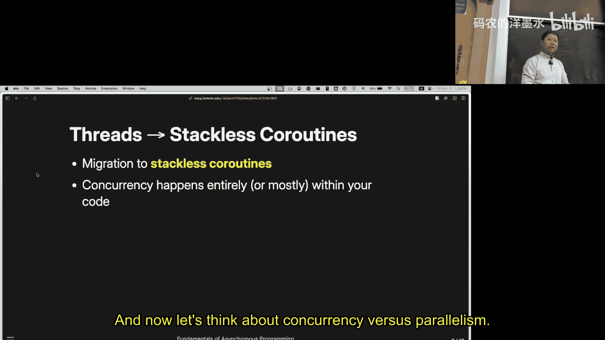
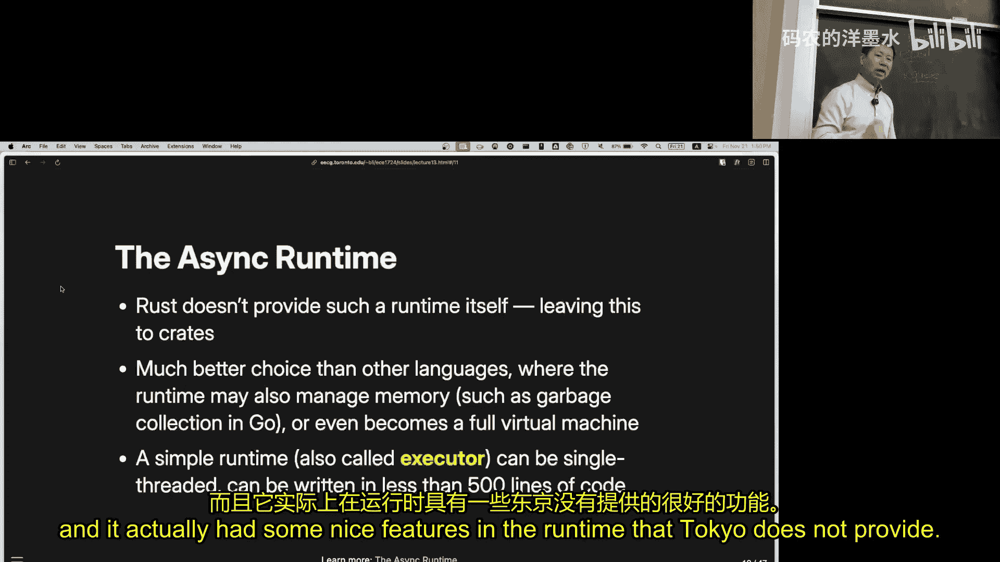
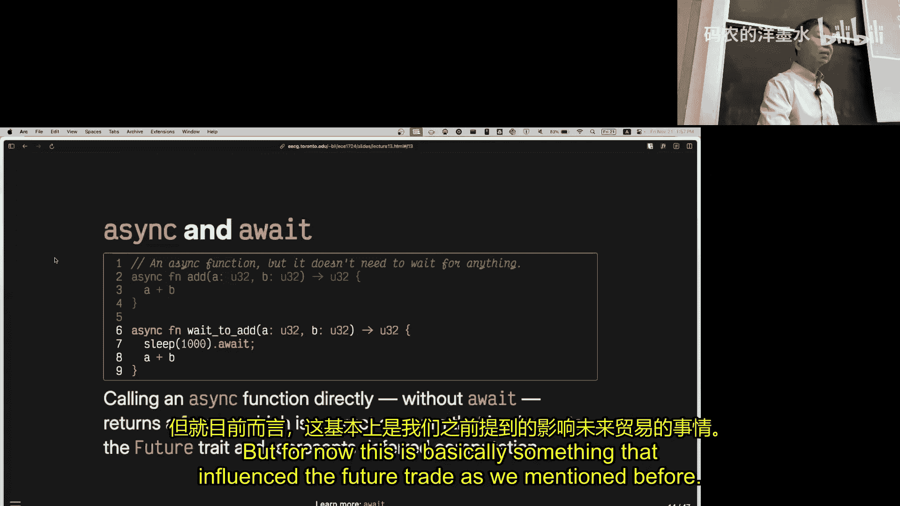
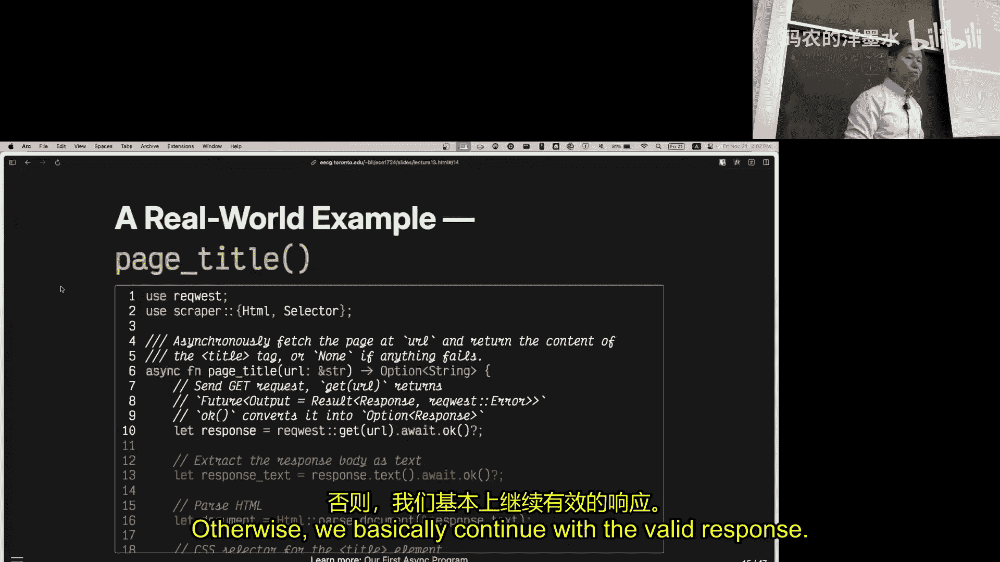
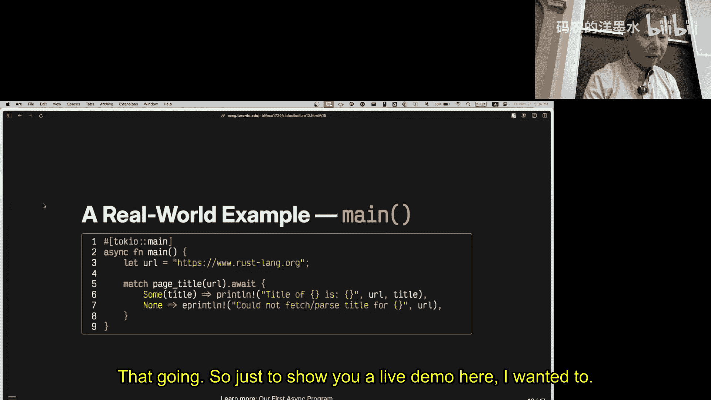
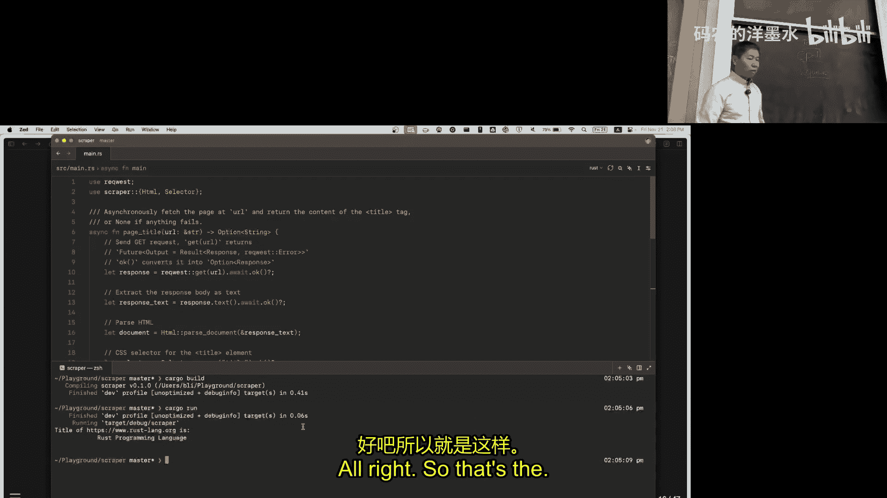
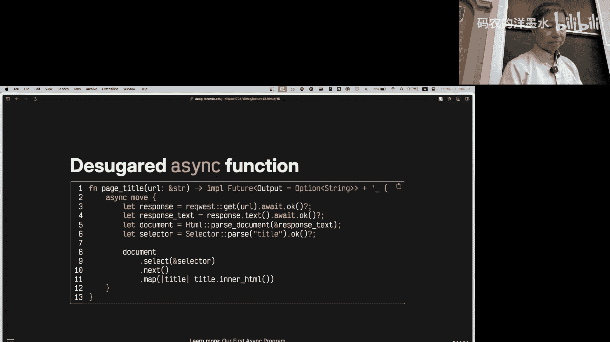

# 异步Rust入门：第19讲：异步Rust第一部分


在本节课中，我们将要学习Rust中异步编程的核心概念。这是Rust语言中最具挑战性的部分之一，也是现代高性能网络服务和基础设施的基石。我们将从基本概念开始，逐步深入到异步运行时和`Future`的实现原理。

## 概述：从多线程到异步

上一讲我们介绍了多线程编程。本节中我们来看看Rust如何从多线程编程演进到异步编程。

在异步编程中，操作的完成顺序可能与它们的启动顺序不一致。这些操作可以相互交错执行，这与多线程编程在概念上非常相似。

我们上次还提到了CPU密集型（CPU-bound）和I/O密集型（IO-bound）操作的区别。像视频导出这样占用100% CPU的操作是CPU密集型的。而像使用网络浏览器或从互联网下载文件这类需要等待I/O的操作，则是I/O密集型的。I/O密集型操作是异步编程的理想场景。

## 系统调用与效率问题

许多操作系统内核提供的系统调用本质上是**阻塞式**的。因为它们会阻塞，我们不得不使用多线程编程。每个Rust线程都与一个内核线程有一对一的映射关系，这样它们可以在不阻塞其他线程的情况下使用阻塞式系统调用。

然而，对于I/O密集型工作负载，使用多线程编程效率并不高。这涉及到**上下文切换开销**。虽然这种开销比在不同操作系统进程间切换要小，但它仍然存在。随着线程数量的增加，这种开销也会累积，在极端情况下甚至可能超过实际工作的时间。

## 非阻塞系统调用与回调

一个更好的思路是将许多系统调用从阻塞式转换为**非阻塞式**。我们可以告诉操作系统：“开始执行这个操作，完成后回调通知我。”这需要在操作系统内核层面进行重大改变。

现代操作系统内核已经实现了这种机制：
*   **Windows** 最早实现了称为 **I/O完成端口** 的回调机制。
*   **Linux** 提供了 **Epoll** 接口。
*   **macOS** 提供了 **Kqueue** 接口。

这些设施大约在25年前就已提供，但用户空间程序（如C++、Rust程序）在利用这些机制方面进展缓慢，因为这非常复杂。直到最近几年，Rust社区才设计出一套优雅的方式来使用这些非阻塞系统调用。

## 协程：异步的核心



Rust实现异步的方式基于**协程**。协程与线程的关键区别在于，**一个线程可以包含多个并发执行的协程**，它们不与内核线程一一映射。

Rust实现的是**无栈协程**。这是协程的两种变体之一（另一种是**有栈协程**，Go语言采用此方式）。无栈协程在进行协程间的小型上下文切换时，不将状态存储在用户栈上，因此速度更快。目前，只有Rust和C++支持无栈协程。

## 并发与并行


理解并发与并行的区别对掌握异步编程至关重要。

以下是两者的类比：
*   **并发** 类似于给团队的每个成员分配多个任务。该成员（对应一个CPU核心或内核线程）无法同时处理所有任务，他必须在不同任务间切换，交替推进。这是**在单核上模拟的多任务**。
*   **并行** 类似于给团队的每个成员分配一个独立的任务。如果有多个成员（对应多个CPU核心），他们就可以**真正同时**推进各自的任务。

使用协程，我们可以同时支持**并发**和**并行**。我们既可以在单个核心上通过协程切换实现高并发，也可以利用多个核心实现真正的并行计算，从而充分发挥现代多核CPU的性能。

## Future：代表未来的值

`Future` 是Rust异步编程的基石。一个 `Future` 代表一个**可能现在尚未就绪，但将在未来某个时刻就绪的值**。例如，从一个URL下载数据，这个数据现在没有，但几毫秒或几秒后就会有。

在Rust中，`Future` 是一个定义在标准库中的**特质**。任何实现了 `Future` 特质的类型都是一个Future。每个Future都持有记录其进度和“就绪”含义的信息。不同的任务（协程）对应不同的Future类型。

`Future` 特质有一个关联类型 `Output`，它指定了当Future完成时所产生的值的类型。

## Async/Await 语法

Rust编译器通过 `async` 和 `await` 关键字提供语法支持。

`async` 关键字可以应用于两种场景：
1.  函数或方法。
2.  代码块（例如匿名闭包）。

将一个代码块或函数标记为 `async`，意味着这段代码**可以被中断，并在之后恢复执行**。在这段异步代码内部，你可以使用 `await` 关键字。

`await` 关键字用于**等待一个Future完成**。它以后缀形式使用（例如 `future.await`）。代码执行到 `await` 时，如果Future尚未就绪，当前的异步任务就可以在此处**暂停**，让出执行权。异步运行时会转而执行其他就绪的任务。当被等待的Future就绪后（例如，I/O操作完成），原来的任务会**恢复**执行。

因此，每一个 `await` 点都是一个潜在的**任务切换点**。

## 轮询：检查就绪状态

**轮询** 是Rust异步中的一个核心概念。它指的是**检查一个Future，看它的值是否已经可用（就绪）**。如果就绪，就可以获取该值并继续执行；否则，任务可能需要暂停。

轮询通常不是由用户代码直接进行的，而是由异步运行时来负责。这是一种**协作式调度**，与操作系统内核的**抢占式调度**不同。在协作式调度中，任务主动在 `await` 点让出控制权，而不是被强制中断。

## Hello, Async World!

现在让我们看一些代码。这是一个最简单的异步函数：

```rust
async fn say_hello() {
    println!("Hello, async world!");
}
```

如何调用这个异步函数呢？常规的 `main` 函数是同步的，而 `await` 只能在异步上下文中使用。一种常见的方法是使用 `tokio` 运行时提供的宏来将 `main` 函数转换为异步函数：



```rust
use tokio; // 需要引入tokio库

#[tokio::main]
async fn main() {
    say_hello().await;
}
```

`#[tokio::main]` 宏在底层重写了代码，使得同步的 `main` 函数能够调用异步代码并等待其完成。

## 异步运行时（Executor）

Rust语言本身**不提供**内置的异步运行时。这是一个明智的设计决策，它将实现运行时的灵活性交给了第三方库。

异步运行时（也称为**执行器**）负责**调度和执行协程（任务）**。它的核心工作是：当一个任务因 `await` 或等待通道消息而**暂停**时，运行时选择另一个就绪的任务来执行；当被暂停的任务就绪时（例如I/O完成），运行时再安排它**恢复**执行。

运行时可以是**单线程**的，也可以是**多线程**的。一个功能完备的多线程运行时（如Tokio）非常复杂，但一个简单的单线程运行时可能只需要几百行代码。



以下是几个流行的Rust异步运行时：
*   **Tokio**: 目前最流行、功能最全面的运行时，由Amazon资助开发，默认是多线程的。
*   **async-std**: 另一个运行时，旨在提供与标准库类似的API。
*   **smol**: 一个更小、更简单的运行时。
*   **monoio**: 字节跳动开源的运行时，采用 **“单线程每核心”** 模型，专为网络服务器等I/O密集型场景设计，性能极高，并能避免一些数据同步开销。

选择Tokio通常是稳妥的选择，因为它功能强大、生态完善且性能优异。

## 真实示例：获取网页标题

让我们看一个更实际的例子：异步获取一个网页并提取其标题。

```rust
use reqwest; // HTTP客户端库
use scraper; // HTML解析库

async fn page_title(url: &str) -> Option<String> {
    // 发送HTTP GET请求，这是一个I/O操作，需要.await
    let response = reqwest::get(url).await.ok()?;

    // 获取响应体文本，这同样是一个I/O操作，需要.await
    let text = response.text().await.ok()?;

    // 使用scraper解析HTML并提取<title>标签内容
    let document = scraper::Html::parse_document(&text);
    let selector = scraper::Selector::parse("title").ok()?;
    let title_element = document.select(&selector).next()?;
    Some(title_element.inner_html())
}



#[tokio::main]
async fn main() {
    let url = "https://www.rust-lang.org";
    if let Some(title) = page_title(url).await {
        println!("The title is: {}", title);
    } else {
        println!("Failed to get the title");
    }
}
```

在这个例子中：
1.  `reqwest::get(url)` 返回一个 `Future`，我们使用 `.await` 等待HTTP响应。
2.  `response.text()` 也返回一个 `Future`，我们再次使用 `.await` 等待响应体下载完成。
3.  剩下的HTML解析工作是CPU密集型的，在同一个任务中同步完成即可。

虽然这个简单例子看起来和同步阻塞调用效果一样，但在像Web服务器这样的场景中，会有成千上万个类似的并发任务。异步运行时可以在一个任务等待I/O时，立刻切换到其他就绪的任务去执行，从而极大地提高系统的并发吞吐能力。



## 总结





本节课中我们一起学习了Rust异步编程的第一部分。我们了解了从阻塞式多线程到非阻塞式异步的演进动机，认识了**协程**作为并发单元的概念。我们深入探讨了 `Future` 作为“未来值”的核心抽象，以及 `async`/`await` 关键字如何提供清晰易懂的语法。我们还介绍了**异步运行时**的角色，以及它如何通过协作式调度来高效管理大量并发任务。最后，我们通过一个获取网页标题的实例，看到了异步Rust在实际中是如何工作的。在接下来的课程中，我们将进一步探索 `Future` 的实现原理和更高级的异步模式。