# 【全集 附课件】多伦多大学 使用Rust构建高性能软件系统 中英字幕 1080P p20 Lecture 20 - 异步Rust part2 -BV16V62BhEuf_p20-

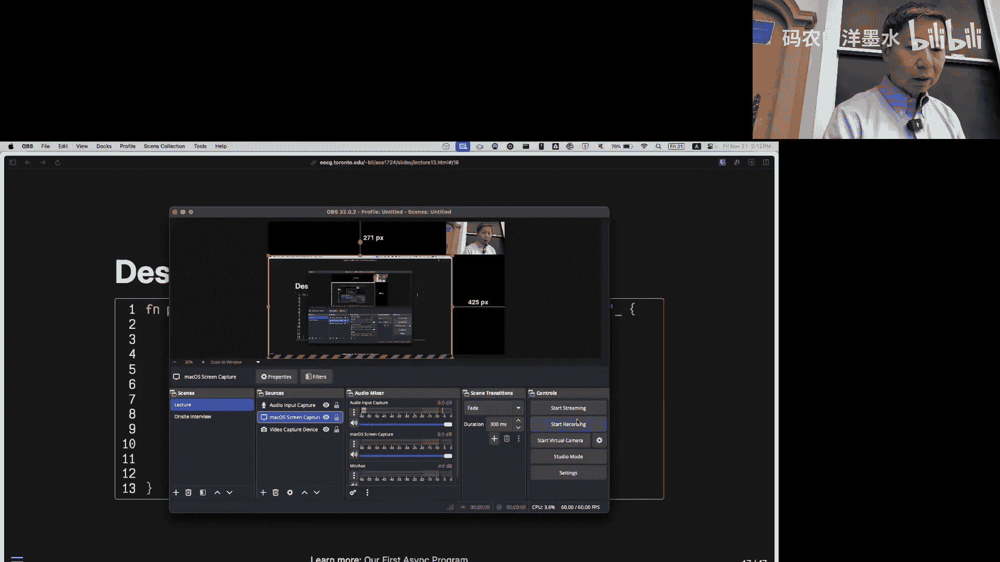

All right， so now the fun stuff。Alright， get ready for the fun stuff。

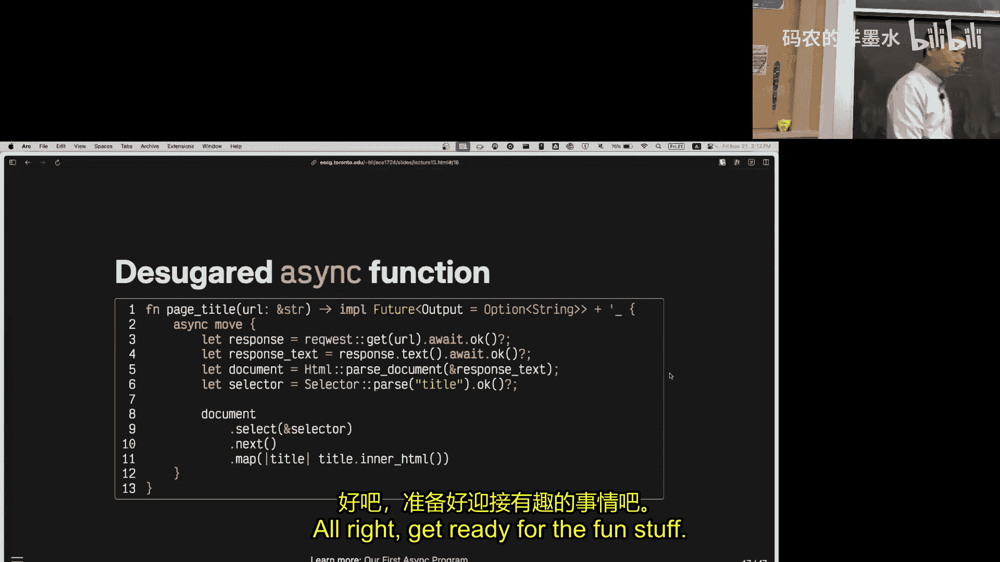

This part of the lecture will be the most challenging of today， and it's the most challenging。

 in my personal opinion of the， of the entire course。

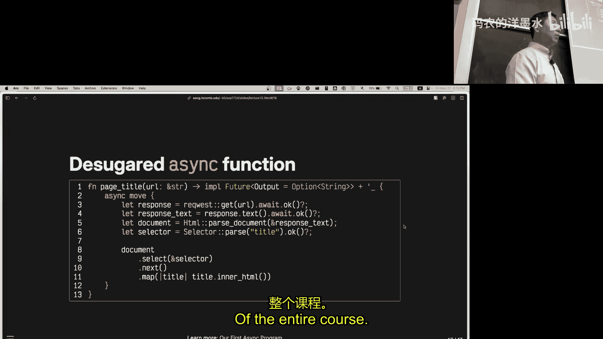

So we're gonna get into the fun stuff， which is to de sugarug the async function。Alright。

 the async function is a challenge to understand。Because it gave you a lot of sugar。

 Every time you have an asy keyword， that is sugar。Her right， aync FN， that is sugar。

 So we want to de sugarug that。And to do that。We wanted to get into the details。 And in the process。

 we hope that we can understand。The asynch crust a lot better。 That's what we hope for。Alright。And。

Let's try to get into this。Here's the code。That we have after we de sugarug the ACnc function。

The ASync function rather than having an ASync keyword before the FN keyword。

We have something that is exactly the same。 that is equivalent， Basically。

 to the previous sugary version。Here we are basically saying， we are returning。A future。

And that is made explicit by doing this returning a future kind of thing。Previous。

 it was not explicit because we have the sugar。 We have the acing keyword before the FN。

 but they're the same。So this is kind of the black coffee。

 The previous one is the sugary coffee with double sugar and double green， for example。Now， here。

How do we return the future。What we're doing is that we're returning a future something that implements the future trade。

But that future trade， we're gonna have to basically make sure that the output associated type is going to be the option string。

 And you mean， remember， the sugar version simply returns the option string。

 And now with the D sugared version， we have。The future with the output associated type equals to the option straight。

And that means that after this asnc function gets ready。

 the result of evaluating this future will be the option stream。

And that is something that we will be returning in this function。

So rather than directly putting everything in the async move into the function。

 we have the black coffee version， the T sugar version， where we put everything in the Async move。

 As you can see this， we're still using the async keyword。

 except now we're putting aync keyword on a block of code rather than the function。

 And this keyword is basically saying this block。😊。

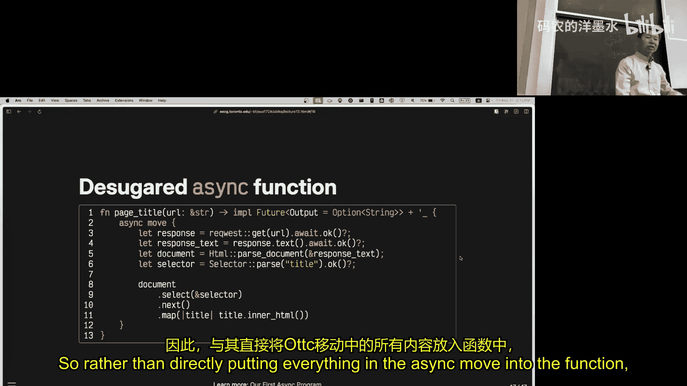

Of cold。Is going to evaluate to something of a future type。And that type。

 because it returns a option string inside the block of code。

The associated type of that future is going to be option straight。

So async move made disclosure closure， this basically block of code， anonymous closure。

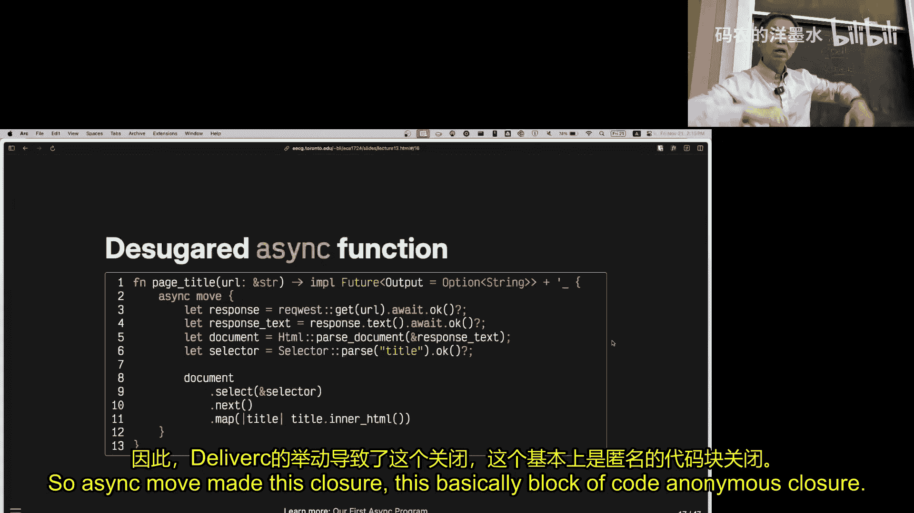

To be a future， that's how we actually try to have a syncnc keyword right there。

And what do we mean by move。 Well， move means that we're capturing the environment， right， you know。

 the ownership is gonna to be transferred into the actual closure。 That's what we mean by move。

 So let's summarize what we mentioned just now， one point at the time。 So first。

 we're using the import trade syntax。 Remember the import trade syntax。

 that would be when we discuss traits as parameters a few lectures ago。

 This is something that we use to say these are the things that we return。 This is the type。

 This type。 The return implements that particular trait。

 So we implements the future trait with the associate type belonging to the output。

 which is the option straight。And then it returns the future with the social type of output。

And the type of that output。Is option strict？And that is the type that we get after the future is completed。

And。It is the same as the original return type from the Async version， the actual sugary version。

 because the original type is the return type is output string。 It is option string。

 And now we're basically saying future option output equals to option string。

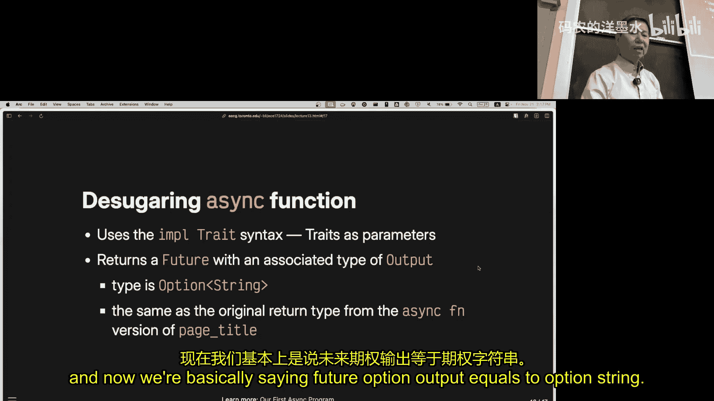

So， that's not。Everything that I have to say about this tea sugared version。

 you can see that everything is wrapped in this async move block。

 That would be a block of code that was previously in the original version。 And remember。

 the blocks are just eventually expressions。 So this async block will actually give you。

Which is the result of evaluating that expression。An anonymous compiler generated type。

 because this async is a keyword that the compiler understands。

 So it's a compiler generated anonymous type。

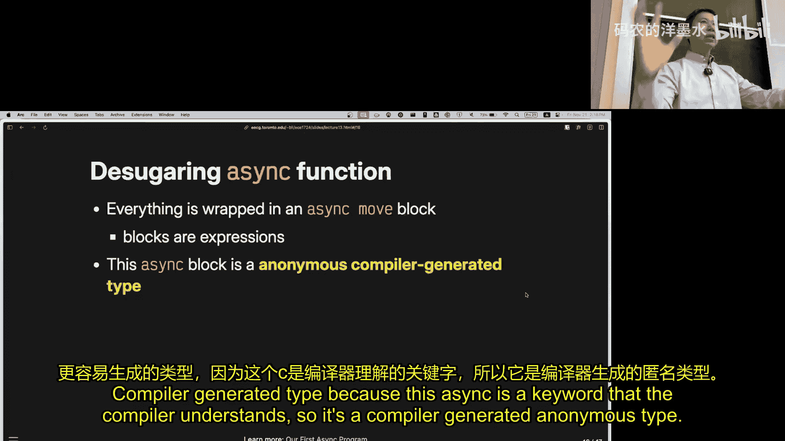

Except that this anonymous type implements， which is also guaranteed by the compiler。

 the future trait and the output type would be the option straight。Alright。

 that's what we have guaranteed by the compiler。And when you do the dot weight on this particular future。

 whatever it returns， that is a future， if we do a dot weight。

 which is when we call page title dot weight that we dot weight on this particular return future。

It will produce a value because eventually this future will become ready。 And when it's ready。

 it will produce a value with the type of option stream。 And that is the idea。😊。

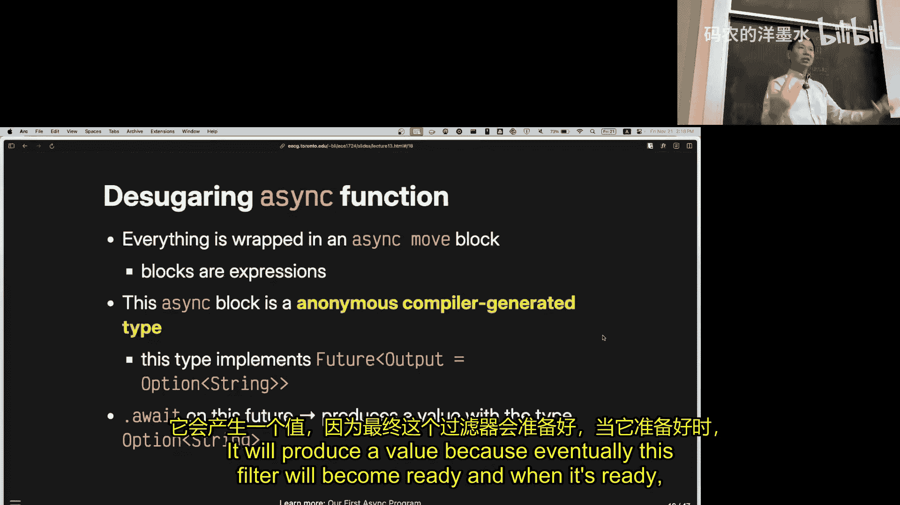

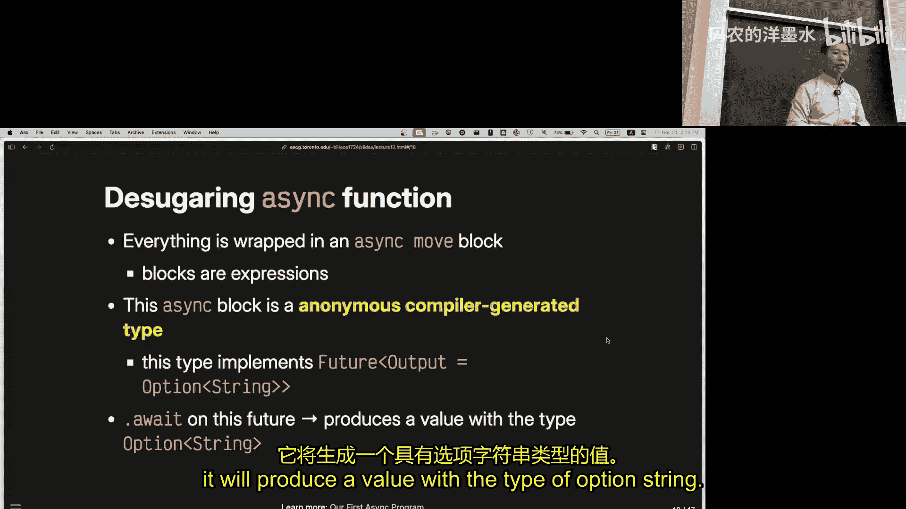

And that value is going to match the output type in the return type。All。

 so that's something that we have after we eat sugar this。

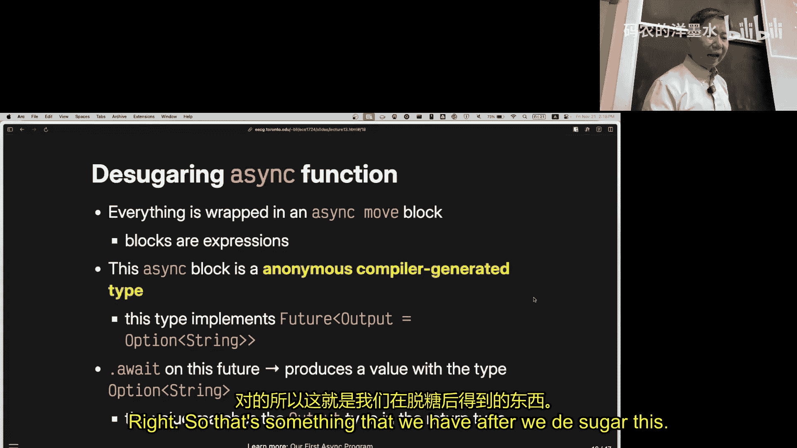

But keep in mind that we do have one more thing。

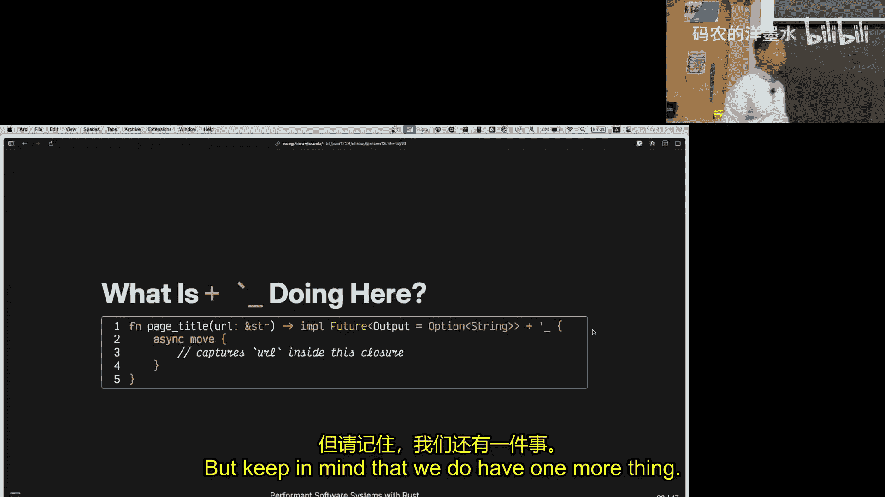

Going back to the original code， you can see that we have this plus。Ha。😊，Tick underscore。

 What does that really mean， Well， tick underscores lifetime Eliison， as we mentioned before。

 or the anonymous lifetime。 And we basically try to say， okay。

 here we have some kind of a lifetime issue。So we ought to put in something that basically says。

We wanted to have a bound and a lifetime of this particular future。

And keep in mind that inside the async move， that closure， because of the move。

 it captures the URL inside the closure。And keep in mind that the URL itself is a reference。

 It's a reference to a string。And that basically says that we basically have a reference inside。

The future。

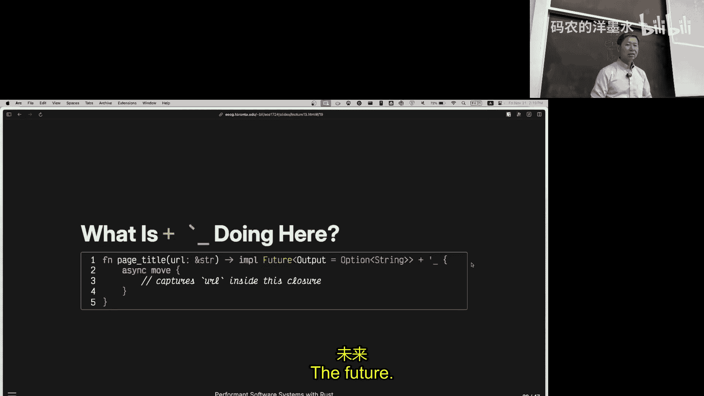

Whatever that async move gets is a compiler generated asynchronous。 sorry， anonymous type。

 and that is a future。 So we're basically capturing that URL inside that future。

 And what is this plus。Tick underscore doing here。 Well the return future is going to capture this URL。

And which is basically a reference。 So here the future is going to borrow this URL。

The future is going to borrow this URL and。The future cannot outlive the reference it holds。

 It cannot outli that。 That's number one rule that we always mentioned in rust。

Whatever that we are doing， we cannot outlive the reference that we hold。

So to actually give the compiler hints。We're going to have to have the lifetime specifiers。

 So its's lifetime should be tied to the lifetime of the URL。 In other words。

 we want to say to the compiler using this bound of the plus。

Tick underscore to imply in English language， this imp future may contain the borrows and its lifetime is somehow。

 some kind of anonymous lifetime， because the tick underscore is an anonymous lifetime。

 His lifetime is at most as long as the reference it captures， for example， the URL。

So the reason why you have this。Kind of a tick underscore。

 iss because the rust compiler does not take this without something like this for an answer。

 So if you don't have this， it's going to complain that the import future。

Something that we don't quite understand in terms of the lifetime。

 So it's gonna give you an error message at the compile time。

 because you will have to explicitly tell me that this is something that is guaranteed to be at most as long as the reference that it captures inside that future。

Except that this is too confusing。 So good news。

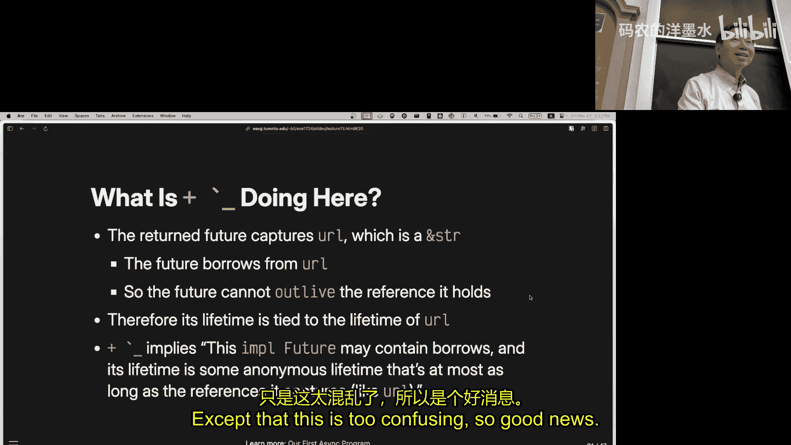

That the compiler will only give you this error message before version 1。7。

 like an older version about 2022。 So for the past three years。

 we got the modernin rest compilers right now， is 1。91。We no longer need this。

 So the compiler will say， okay， I asked you to write this too many times。

 Now I know that you wanted this。 So I'm gonna derive this for you。

 So the compiler will understand getting a little bit smarter。

 We understand that this is what you wanted。 So even if you don't have the plus tick underscore。

 It will still compile because it。Assumes that is plus underscore。

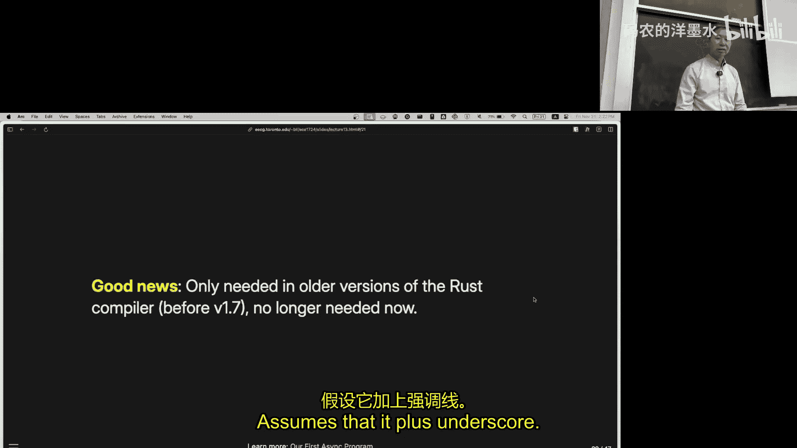

All right， so that's what we have。That's good news。 So that's one more thing。

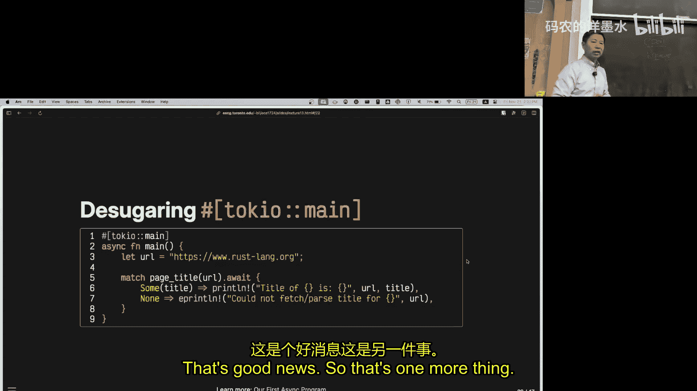

And then let's try to de sugarguur the Tokyo Ma。 This is a macro。 We want to de sugarug this。

 as well。So here we have this Tokyo main function。And we said that we can use that macro to put an ay on main。

 But this is， again， you know， more like a macro to give us kind of like a synthetict of sugar。

 except we use macros for thirdpart crates to give us the sugar。

 right rather than the compiler to directly giving us the sugar。 So with the macro。

 third party crates can easily expand the existing code and try to give you the sugar that way。

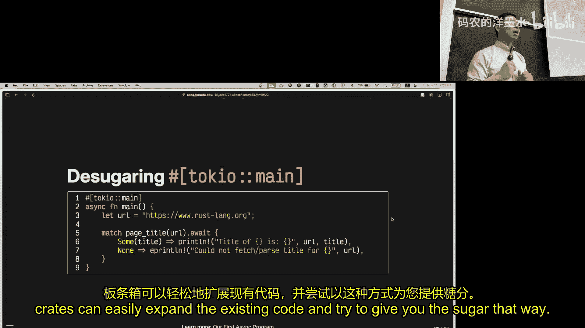

So this sugar is the aync F N。 That would be the sugar。 So how do we de sugarug this， Well。

 this is exactly the same as something like this。

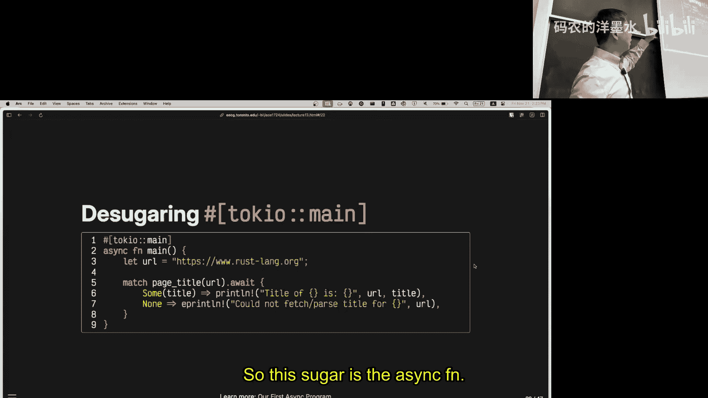

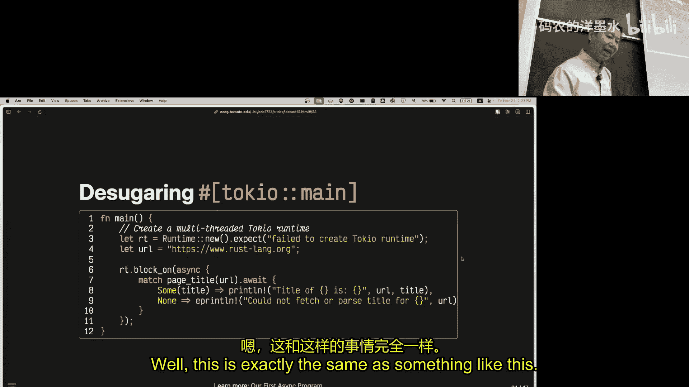

So we still have the non sugary version， we have the synchronous main。But inside that main。

We used the Tokyo's runtime structure， and we kind of call new on that runtime structure to create a new。

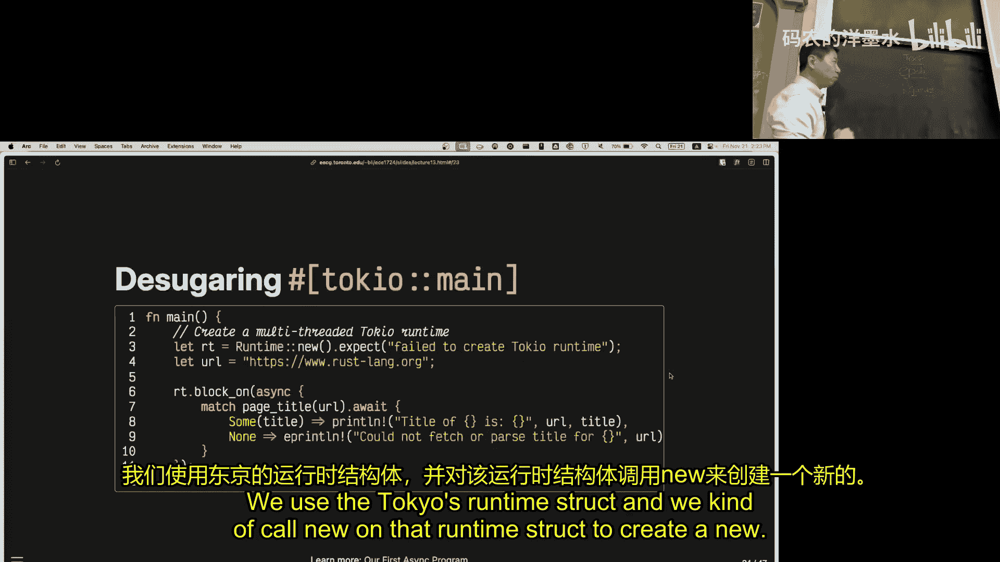

As the name suggests， asynchronous runtime。And once we have this new as synchronous run time。

 what do we do， Well call something called block on。 So the runtime dot block on。

 which is a method on that runtime， is basically saying， I'm gonna start my scheduler。

To run your asynchronous function or asynchronous block of code。 in this case。

 it's the asynchronous block of code。

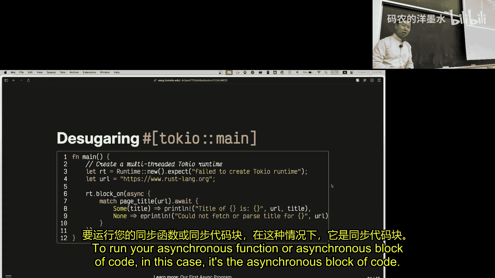

And that would be something that we actually have， because we have to have a weight inside a synchronous block of code。

 And this is what we will do be doing。 We have a anonymous closure。 We market as a sync， which。

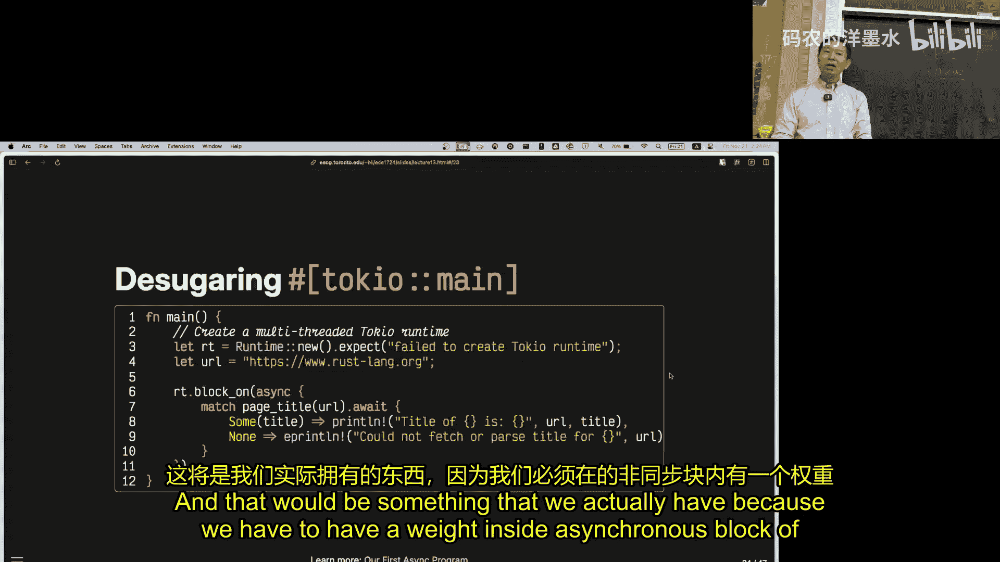

Basically yields a future because all async blocks will yield a future。

 It evaluates to a future as an expression。 It's an anonymous compiler generated type。

 which is a future。 And that inside that block of code we can call a wait。

 So this block underscore on is just the black copy version of saying。

 now I create a brand new line time。 And then I'm gonna try to run your async function or async block of code using my block on。

😊。

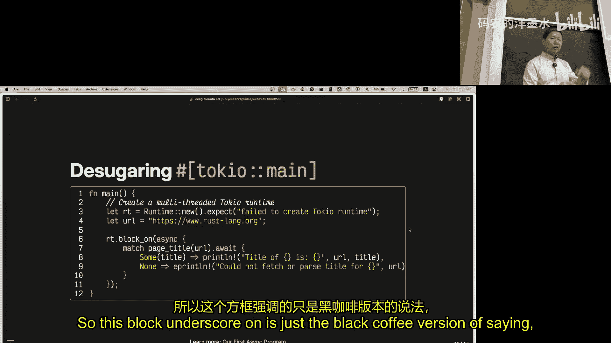

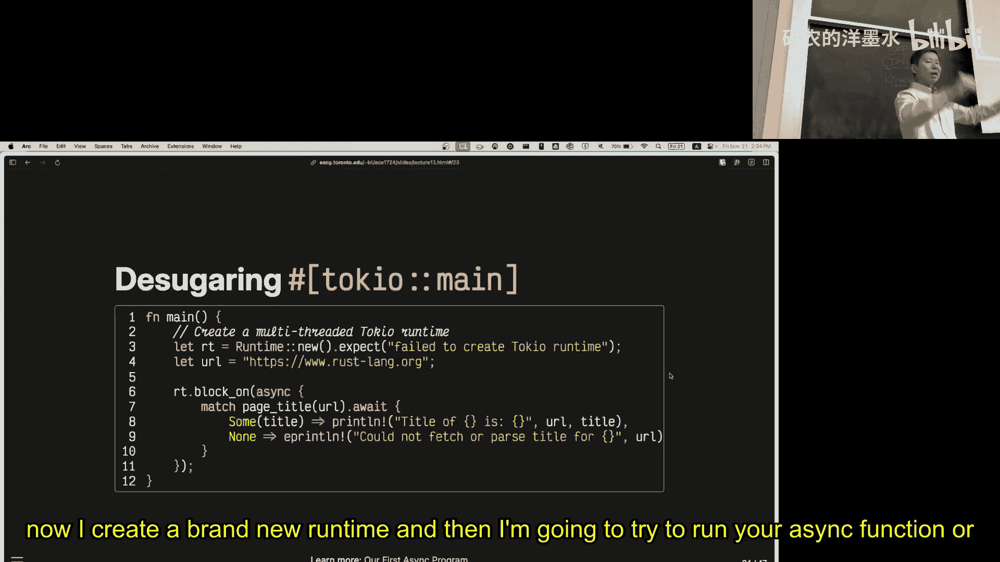

Now， because of the block on from the name， you can。

 you can see that this is something that basically say， okay。

 you have all of these things that are asynchronous。

 I'm gonna block until all of these things are done。

 So that's what we're doing with the Tokyo runtime。 And that's exactly the same as using the macro。😊。

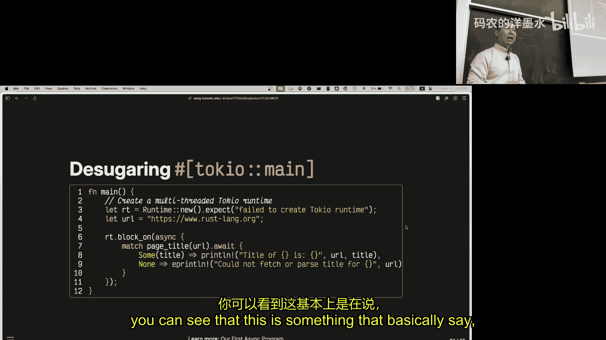

This way of doing this is actually a lot more flexible。 For example。

 you can configure the runtime to be single threaded and so on so forth。 You can。

 you have lots of configuration options。 You don't have to just create a default runtime using new。

 You could put in configuration functions， options in when you're creating the runtime。

 So you can make it multi- threaded， single threaded， whatever。😊。

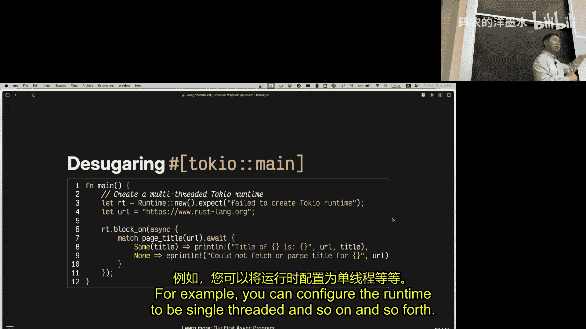

So that's the non sugary version of the main function that we have。

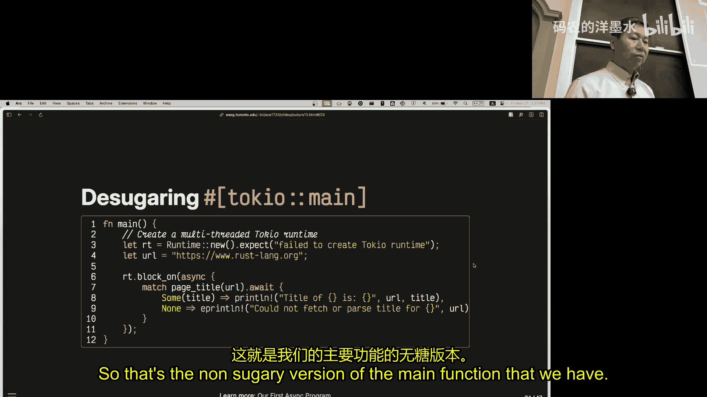

But， that's not the end。We still want to have a deeper dive。Into the future。

 let's get back to the original question。 What is a future anyway， in rust， What is a future。

So how do we actually try to， Well， we mention this。

 And what we say is that value that represents something that may not be finished yet。

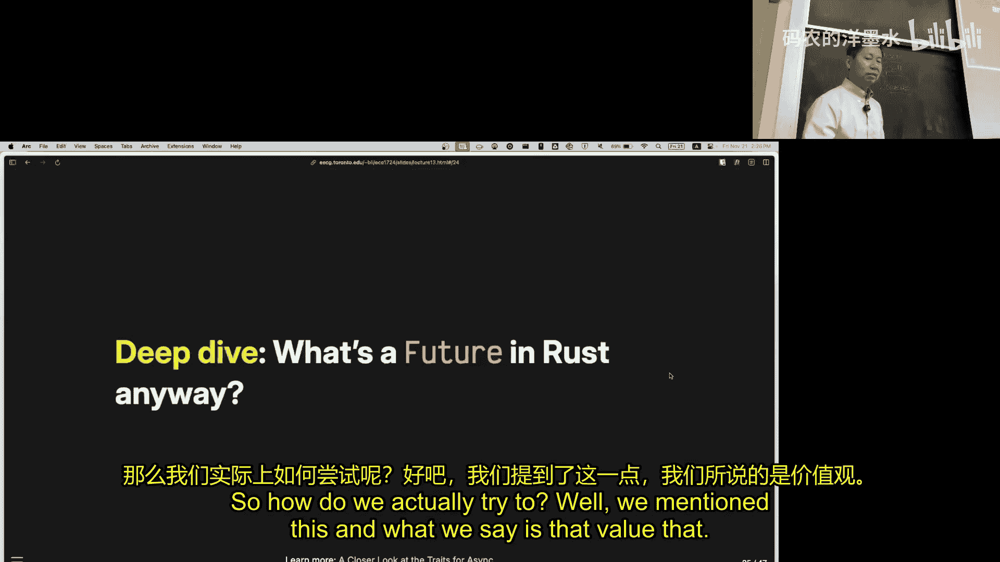

So this future would be some kind of like computation， except that this computation is。

Can be suspended because it may not always be ready。 You know， downloading from a website。

 take some time。 I obbound。 It can be suspended， receiving something， you know， from a channel。

 you know， bound by waiting for that particular message in that channel to arrive。

 So that would be something that may not be finished yet。 That is a value of the future。

 So that's what we mean by a future。Now， let's go to the formal definition。

So this is the formal definition inside。The rust standard library。We have this public trade。

 which is called future。 And， of course， we said that we have an associated type。

 This is how we do it， associate type output。

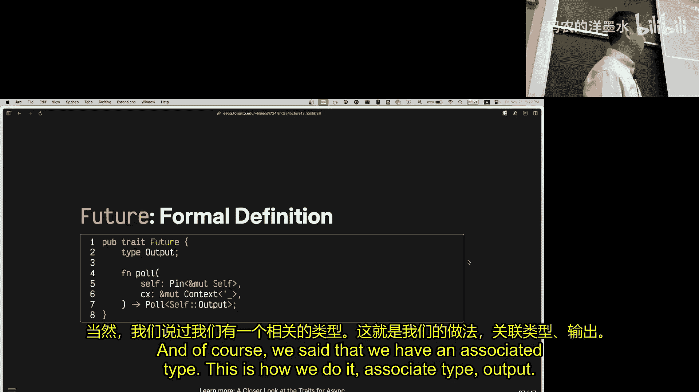

Same as the iterator。And now we have a poll。And this poll is a method。

And that pole method takes self。 Obviously， it's a method。 Se is a mutable reference to self。

 which basically means that you can change yourself。And also another parameter， which is the context。

And this context is a mutable reference to a value of the context type。

 And that context type is something we're gonna talk to a little bit later。

 But that's something that really tries to give us the。你好。Something that we can use later on。

To resume this particular computation。And now， what does it return Well it returns a enum。

 and that enum is called pole。And that you谂。Has a generic type。 When we're defining that enum。

 it has a generic type T。 And over here， we're basically saying that generic type is the same as the type output。

 which is self output。 This is why we we use associated types。

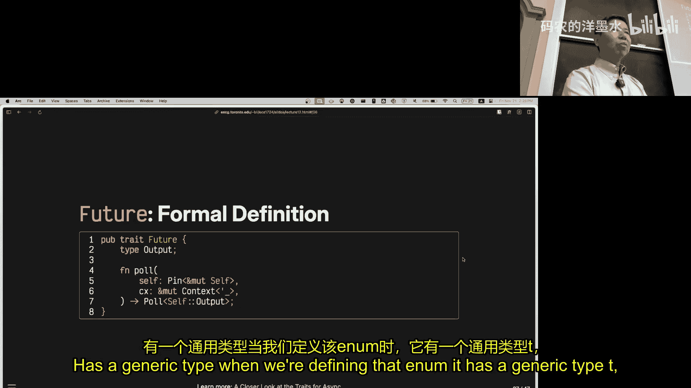

Alright， so basically， that means that we're going return an enum and that enum could be ready。

Or it doesn't have to be ready。 If it's not ready， it's actually pending。

 which basically means that we're pulling it。 It could be ready。 It could be pending。

And when it's ready， it means that this future is done。 Allright。

 And when it's the computation is done。 when it's pending， it means that it's not done yet。So that's。

The actual contract that we have for the poll method on that future trait。

 Any type that implements the future trade， thestruct or E number or whatever implements the future trade。

 You're gonna have to have the poll。All right。So here are some of the key points that want want to summarize。

Number one， we have the type output。And this is the type that the future will eventually produce。

 For example， it could be the result that we mentioned in our request。

 get a function that returns the future。 It takes a result as the type of the output could be just simple as a U 32 integer。

 Anything is the possibility of the output。 It depends on the task。We have a poll， which is a method。

It basically says。We are polling the future。 and that means that we're asking the future。

 are you ready yet。Give me the result。 Are you ready。If you're not ready， it's pending。

 So that's why Paul is gonna return an Nina ready or pending。

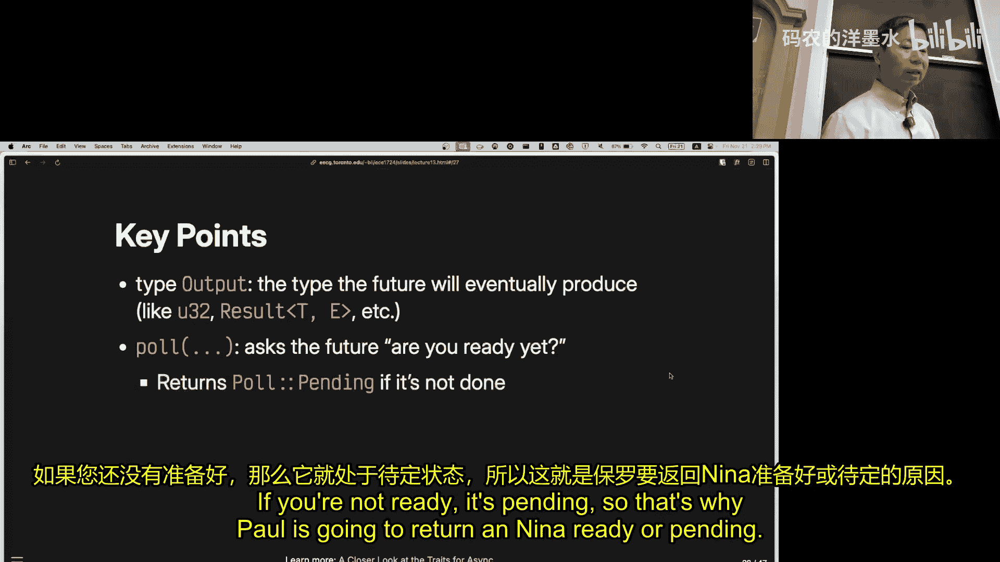

So if we're not done， it returns a pending in that enum。 If we are indeed done。

 it will give us a ready， but only give us ready， but also putting in the value of that genomeum variant。

 So a lot of these things in rust， They start to click into place here。 we're basically using our。

 you know， fundamental benefit in rust programming language that we can put values into any enum here。

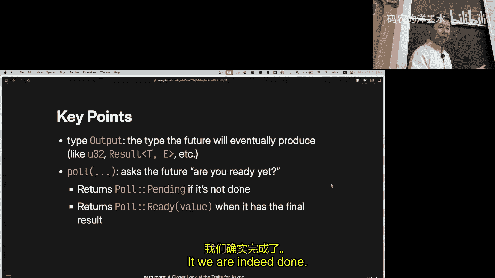

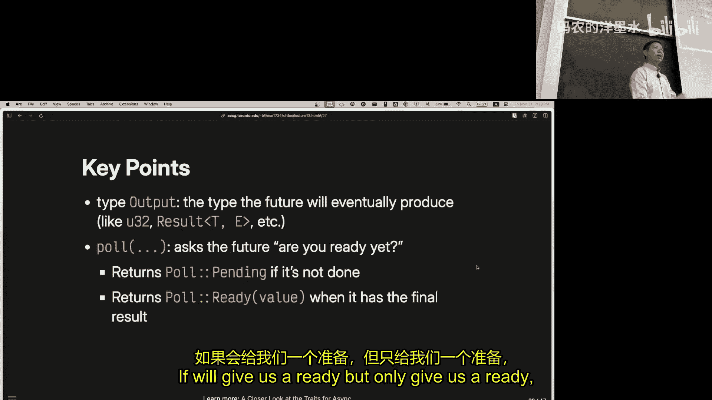

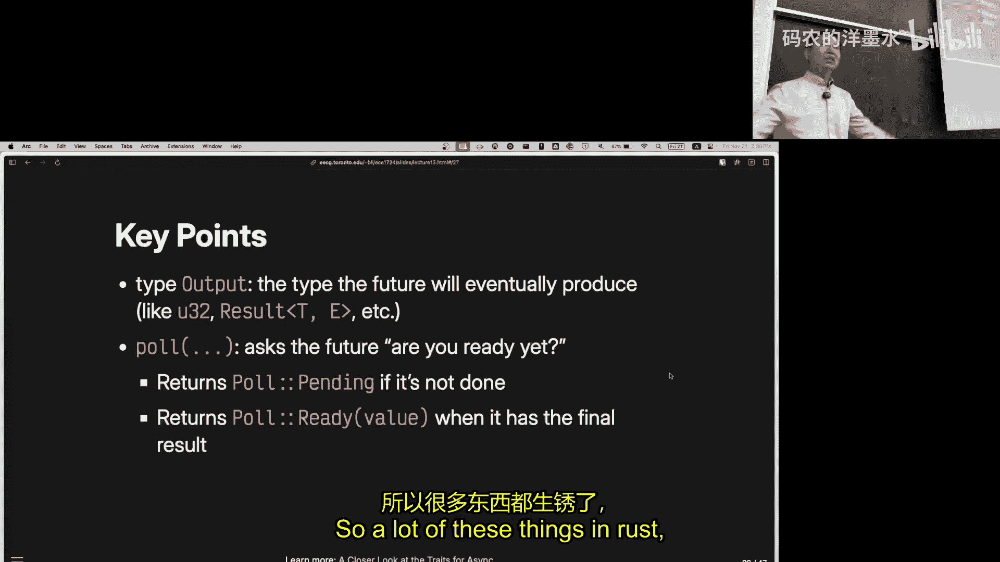

That would be the value。That we extract from the future， when it's ready。and。Good news。

 you don't have to write Paul。You don't have to write the implementation of poll method of the future by hand in normal code。

 That's good news。 But even though that is good news， I would still urge you to understand poll。

 It'll be great to understand it， because if you don't understand that。 you will never。

 ever understand asynchronous rust。 This is something that is a key to asynchronous rust。😊。

You don't want the sugar version。 In other words， you wanted the black coffee version。

 You really wanted to understand exactly what do you mean by sugar and by sugar， by。By future。

 and the as await in syntax is gonna do everything for you。

 combined with the powers of your runtime of the asynncch runtime， which is the executor。

 The third party cr。 Tokyo。 All of that is gonna collaborate to do it for you。

 Paul obviously is gonna be implemented by the Tokyo runtime or any other executor that we have。😊。

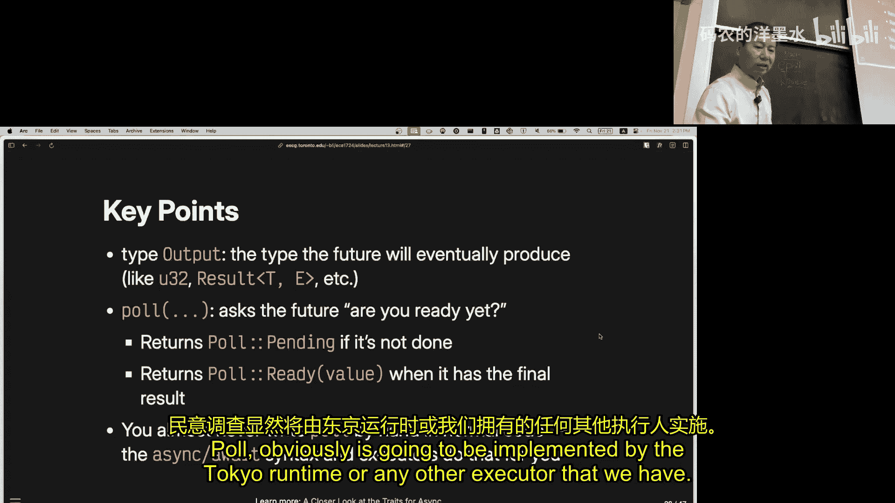

Now， one thing we're gonna have to understand that futures， just like iters。

 they are designed to be lazy。 And this is a very important point that we want to emphasize。

 This is a design principle。 These things should be designed to be lazy rather than eager。

 The other opposite of lazy will be eager。 So when you actually have a future。

 you don't try to run it。 Why do you try to run it when you have a future。 No， you don't run it。

 You just have a future， You don't run it。 The computation still there。 It's there， you don't run it。

 So， for example， here， we have a future。 Asy print line high， that's a future， right。

 Async block that gives us a future。 So we're gonna assign that future to F U T。

 But if you actually have this line of code， nothing will be printed。 A will not be executed。

When do you execute it。 Well， just like iters， they're lazy。

 They're executed when you put in the weight。 If you put in the weight， then it will be executed。

 So F U T dot a weight， then it be executed。 And， of course。

 a weight is just the collaboration between the compiler and the third time thirdparty library。

 which is the the Tokyo runtime， they collaborate to give you that poll。

 So a weight basically means I'm gonna call Po。 And when I start to call poll。

 I kick off the computation。 The computation is kick alive。 And that's something that we're doing。

 And if you don't call dot weight， which is a suffix form to kick it alive。 it will be lazy。

 it will not be running。 And this is exactly like iterators。

 If you don't have next iters will be lazy。

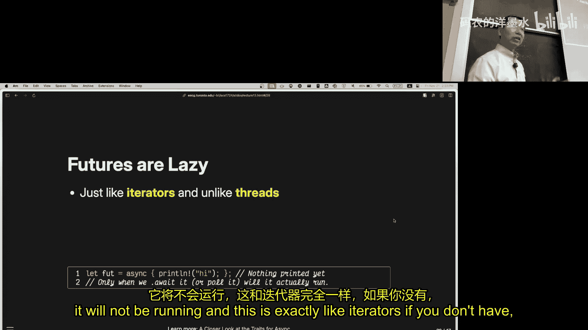

And this is very different from threats。 So thread will be a different case in threads。

 if you start to say， I'm gonna to spawn a new thread， it will start running immediately。

 So it will not be lazy。 We willll be eager。 And that's the design of threads。

 A future is going do nothing。 It is going to be lazy until an executor， which is Tokyo post it。

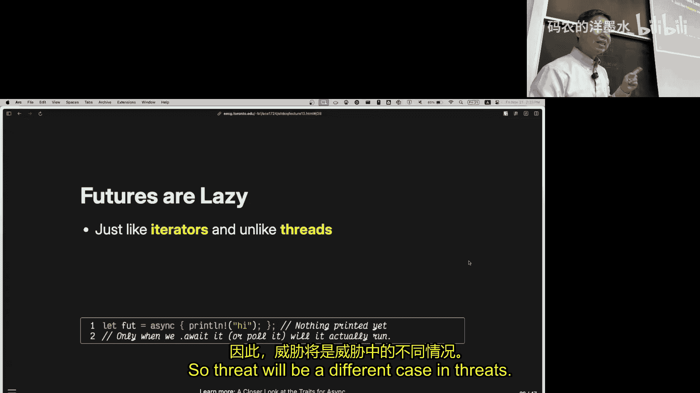

So that's what we understand， we must understand about futures。Al right。

 so now let's get into a little bit more detail about the executors， the actual Tokyo runtime。

And the tasks。So an executor， a runtime like Tokyo， Asynnc SDD and mono I O and so on。

It will provide an executor。 What does the executor do。Well， it's going to keep a queue of futures。

Obviously， because we do have multiple core routines that some of them might need to be run。

So in these exeors， especially in Tokyo， we typically give it a name called a task。

 So that's why we typically say co routineine and task。

 there are kind of terminologies used interchangeably。

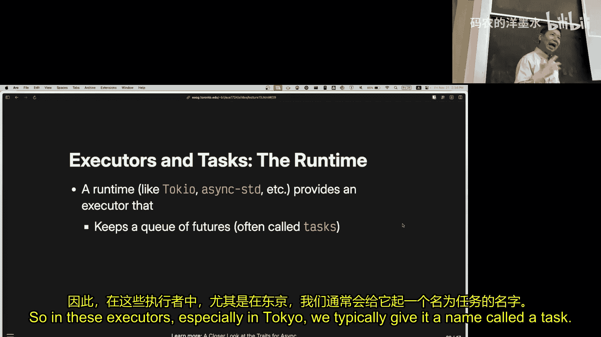

And then we're going to repeatedly call poll。On these futures。Alright。

 we're gonna call Paul on these futures。 This is the job of the runtime of the executor。

 We're gonna call Paul on these futures。But on top of that， we have one more thing。Which is the Wker。

Okay， the weakerker。Is something that is to be notified。By calling the W method on the Wker。

 we're notifying that waker。So why do we need to notify， Well。

 an I O can take hundreds of milliseconds or even seconds to complete。

 I don't want to poll every 20 milliseconds。 That's a little bit too much。

 I want that I O to call me back。Because of the wake。On that vr struck。

And this took advantage of the operating system kernel。

Facility that the O S kernel is able to call back the actual user space and in the user space。

 who is gonna take that callback。Is going to be。啲压蹉。Waks wake。Okay。

 so the weight is gonna wake up that particular future。

And that's something that gives the runtime a reason to start to pull it again。

If you don't wake it up， the future will not be pulled by the runtime。

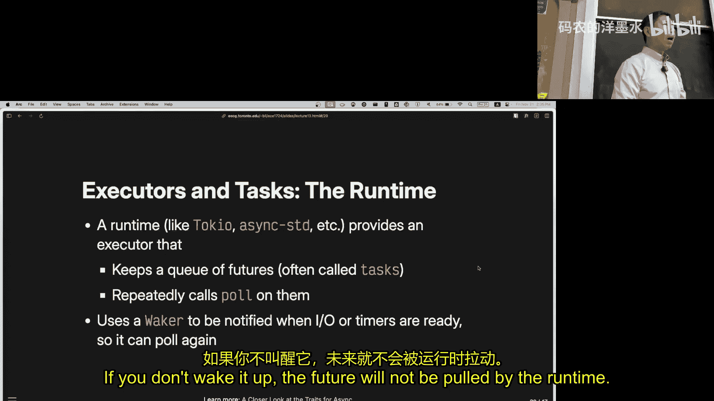

So that would be a weakerr。However， if you go back to the future。

 you can see that we do have one more thing。 So this is the original formal definition of future in the Ru standard library。

 We do have one more thing， which is the pin and percent mute self。And percent mute self。

 we understood。 This is basically a mutable reference to myself， right？ So that would be typical。

 typicallyypically we have self mutable self， right here， were kind of explicit。

 self is actually not just typical mutable self， mutable and mutable reference to self。

 but a pinned version of the mutable reference to myself。And what does that mean， What is pin。1%。

 mute self。So let's take a look at this。This is something that the runtime is gonna do。

 It's gonna pull that future。With a context。All right， with the contact passing。

 because that's the parameter that we must pass in， that's part of the trait。So Paul takes the self。

And the definition of the trade basically says this future， when you call Po on， must be pinned。

It can be mutable， but it must be pinned rather than the standard mutable reference。

And what does that really mean by pinning it， Well， pin is just a wrapper。That says。

Through this particular pointer。You are not allowed to move the value itself。

 The value itself sits in the same place of the memory until it goes out of scope。

 So you cannot move the actual memory to anywhere else。Typically， we're able to do it。

 So if we put something into a iterator into a vector and things like that。

 we're basically moving it。

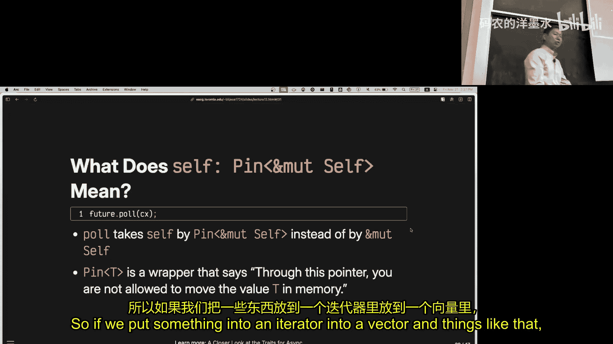

And it's， it's not a problem of moving it。 not a problem at all。 You can move it any time you wish。

 But in this special case， we're basically saying this pin。Is requiring。

Enforced by the compiler that this cannot be moved。So basically， with pen。

 you have some kind of a pointer。That this pointer， it's a pin pointer， and this is the model。

 this is the actual part of the memory that is not to be moved。So this is not to be moved。

 This would be the actual pit。So this is something that adds a level of interaction， this。

Part can be moved anywhere， but this cannot。 So if you really want to put it into a vector。

 you want to put the pin version of it because the pointer can be moved anywhere。

 but not the memory itself。Alright， so that's the starting point of that pen。

 So let's go into a little bit more details about this pen。It is still a mutable reference。

 In other words， you can still change anything inside this particular memory region。

 this particular block of memory， but you just want to have a extra guarantee that you can change the values inside that T。

 but you cannot move T to a different memory location。

And that's something that is a guarantee by the pin。

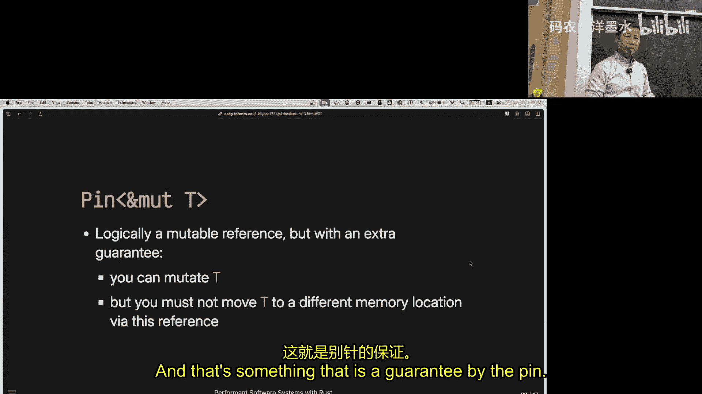

Allright。So when we're actually using pain in our future trade， definition of future trade。

We care about moving。 Why do we care about moving。Well， because these futures。Asnc Away futures。

 they have a certain property called self referential。In a lot of the cases。

 they're not always self referential， but in a lot of cases， they' are self referential。

And what do you mean by self referential。 Well， first of all， you know， this memory。

 this future right here， this is the future right here。

This is a type that implements the future trade。 The future right here is basically whatever that the compiler generates a。

 you know， anonymous compiler generated type using the acing keyword。 This is。A state machine。

 It contains the states。So the compiler will turn it into a state machine。

 That's the compiler's job to do it。 It will turn it into a state machine。

 It contains all of the states that you need to store when you're suspending this particular task and resume a different task。

 you wanted to store those states and those states are stored in this future。

And this particular state would might actually contain references。 Basically。

 it means that you have a field and this field refers to another field inside the same memory。

 And if you end up moving this， then this pointer will become a dangling pointer。

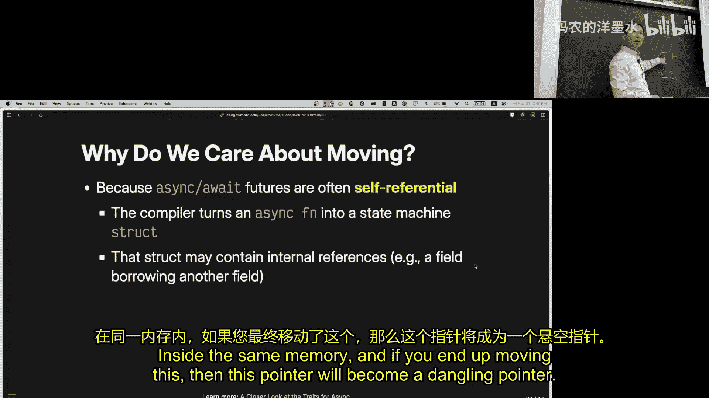

Because when you move this， you're not simultaneously updating this value。

 So it becomes a dangling pointer。

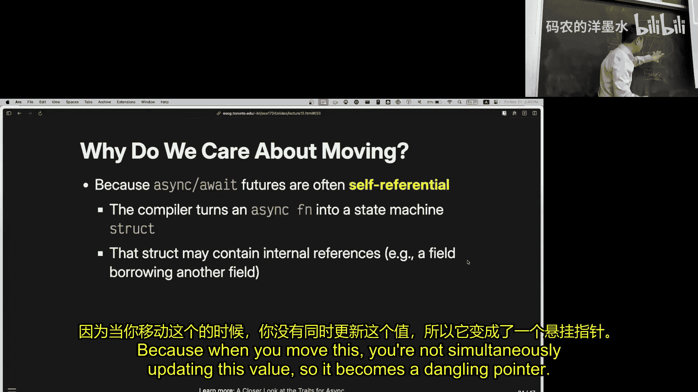

And， of course， I could change this value， but it would be way better to say。As part of the contract。

 this memory location cannot be moved。

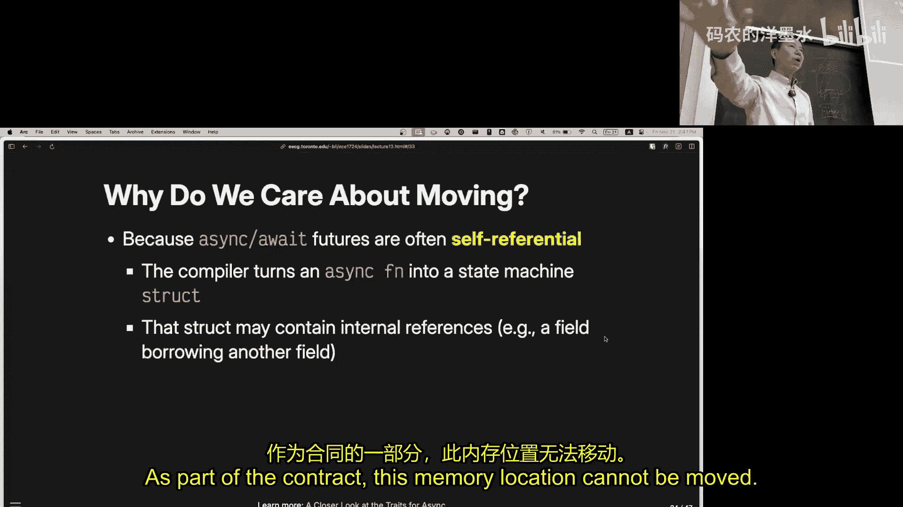

Remove thestruct after these references are created。

 those internal references would actually dangle and that。why Ru， basically saying。

That once we started polling a future， we must guarantee that whatever state that we use to that to represent the computation。

 everything， the intermediate states of that computation will have to be pinned on a particular piece of memory。

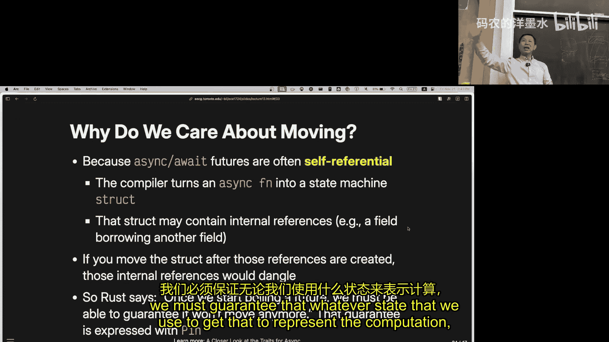

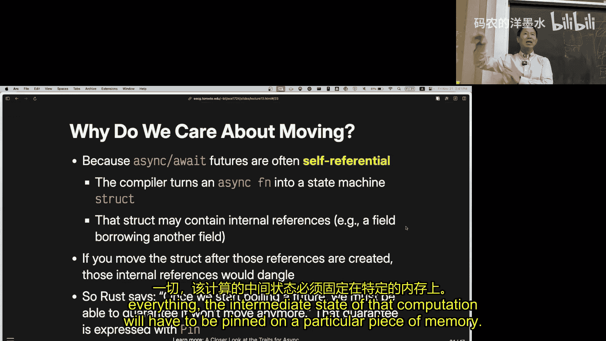

So that's why in the future trade， we must put the pin right there。

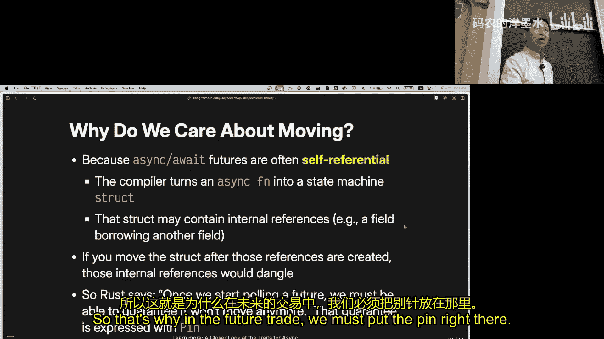

So again， what does the self pin mute self in force？ Well， first of all， before calling Paul。

 the executor must have pinned the future。 And secondly， inside the pole， the future is treated。

As immovable。So you cannot move the memory right here。Alright。

 so that's what we mean by pinning the future。 The executor is in charge of pinning the future。

 Otherwise it's a compile time error。

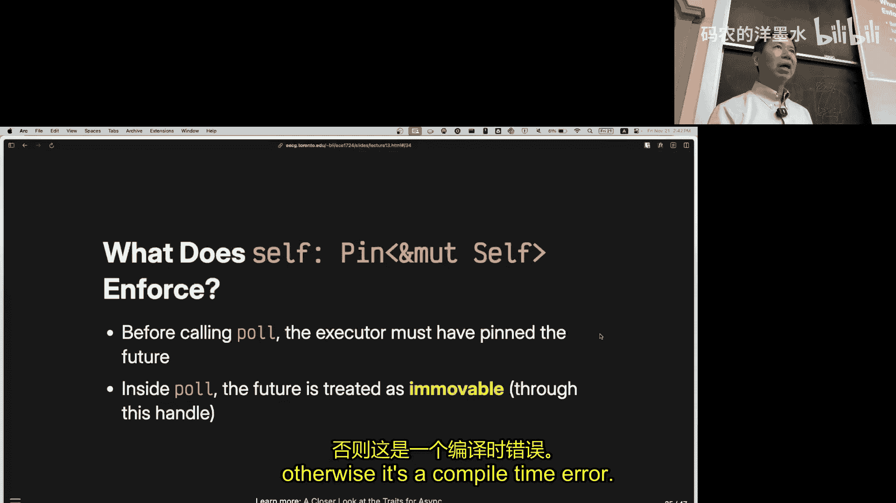

So what does the exeor do typicallyyp， Well， this is not part of any exeor。 just like， you know。

 typical code that what we typically do。 What we do is that before we poll that future， in this case。

 we have a future right here， before we pull that particular future， we actually。

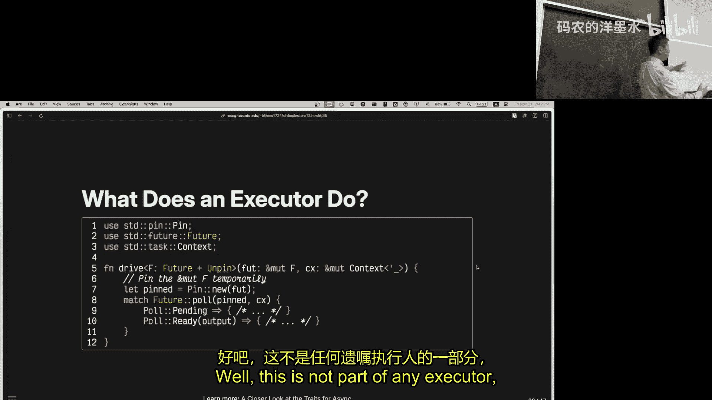

Pin the future first， we call a pin column column new to pin that future。

 That pin is part of the standard rust library for us to use。 So we're basically saying， no， no， no。

 you cannot move this。 We're gonna add this one additional level of indirect by pinning it。

 I could move this， but I cannot move this。And now， after we pin it。

 I can call poll and it now enforces the contract。 The compiler will see it and willll like it。

 will have no problems with it。 And， of course， the return value of the poll is going be a Num variant and either ready or pending。

 if it's ready， we will get the output out of it。

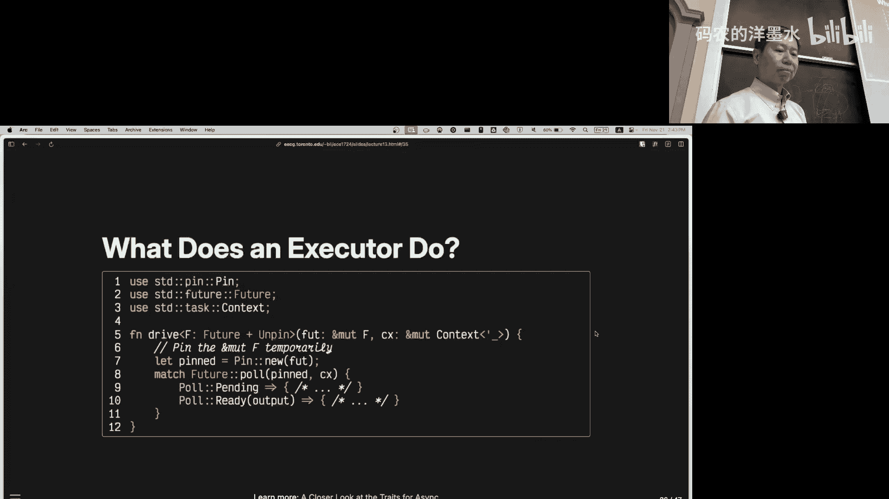

All right， so now what if we have pin， we will have unpin。What is the unpit。

The unpin is actually a marker trade。 What is a marker trade。

 And marker trade is a trade that does have nothing in it。 No data， no methods。

 no associated functions， nothing。 And basically， it's just a marker。 It's just to mark something。

 some property。So the unpin market trade basically says if a future is。Not unpin。

 if it's really pinned， Then the executor must pin it in a stable place。 For example， in this case。

 a future is actually not unpin。 Most asnc compiler generated futures would be like that。

 It would be unpin， not unpin。 Then we will have to pin it。But what is typically unpinned。

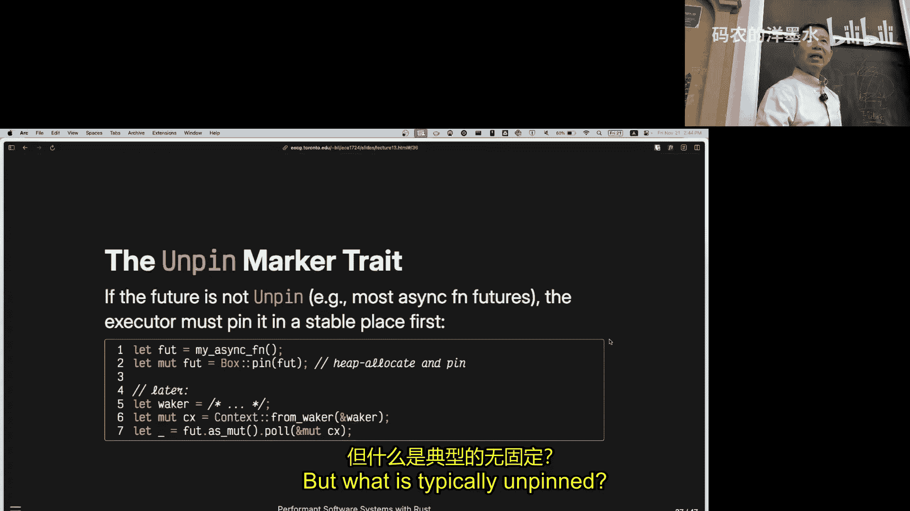

Well， unpinned basically says as a marker trait， it basically says that。To answer the question。

 is it still safe to move this thing around in memory， even it has been pinned。So if it's still safe。

 then the type。Is unpint。If it is not safe， then the type is not unpin。

 which is our anonymous future。Alright， so if it's not unpinned， we're going to have to pin it。

 If it is unpinned， we don't really have to pin it。

So what is unpin， What are the types that are unpin。 Well， first of all。

 if self is actually marked as unpin， then the pin is the same as the mutable reference to self。

If the type itself is onp。And then most normal types， they are unpin， you know， string of vector。

 your， your primitive types integers， Theyre unpin。 However， special case here。

 the compiler generated type， which is the ascingnc future。

 That would be not unpin or the exclamation mark unpin that we the not unpin。

 That means they require pinning。 And that's how the actual executor is gonna pin this before pulling this particular future。

So the self column pin M percent mute self， a mutable reference itself is basically just a general signature inside a future trade saying that we have the self。

 it works for both the unpinned and not unpinned futures。

We enforce that it must be on must be pinned before polling if it is not unpinned。Okay。

 so that's what we have。So if it's unpinned， then we don't have to pin it。 If it is not unpinned。

 we're gonna have to pin it before we call the pole。

And that is the actual contract inside the future trade enforced by the compiler and everything starts to click into place。

 you have pin as the standard library， you know， yet you can use pin column column new。

 you have the unpin， which is the marker trade that gives us the knowledge。

 give the compiler the knowledge， which one is pin， which one is sorry。

 which one is unpin and which one is not unpin。And then you have this trait to enforce that and enforce by the compiler。

Alright， so that is the unpin and the pin business that we have。Finally， last but not the least。

 in the steep dive， I'm going to talk about the waker。So what is a waker。

 A waker is basically a doorbell for a future。 So the future is a piece of computation。 It runs。

 you know， it's not ready yet。 but eventually it will be ready。 When it's ready， the doorbell rings。

 That's the waker。 The wakeker is a handle that is created by the executor。That a future can store。

And later， can call weight。Wake on that weaker handle。And when we call weight， what are we saying。

 We're basically saying， hey， run time， I might be ready right now， pull me again。Please。Soon。

 later on。And that's what the runtime is going to do。

All， so that is a weakerr。So where does the wakeker live， Well the wakeker。Lives in the context。

 Remember that you have to put in the context when you actually try to call poll in the future。

 That is where the waker lives。 In the context， you have a waker。

AndThat returns a reference to the waker。 and that's where the wakeker is。 And of course。

 the actual waker could be different from different tasks and so on so forth。

 you could actually try to pull that particular future when the wakeker。

 the doorbell rings when the wakeker dot weight is actually called。

So in poll， what you typically do is that you kind of get that waker from the context。

 and then you maybe store it somewhere。You know， the reason why I say maybe store it somewhere is typically it's actually a good idea to store it somewhere。

 Of course， this is not typically your business。 Sometimes you can just let the Tokyo executor do it。

 but it' it's helpful to understand this。 This is something that you will actually represent。

 and IO is ready。 know downloading is ready and all of that。

 So you might want to store that Wker somewhere， maybe if it's a multithreaded runtime。

 even protect that truck with a arc and mut text just to make it multithreading safe。

 And that's something that we will eventually call wakeake on and that would be our doorbell。

 and that's when we're gonna pull it again。 we don't want to pull it before it is ready。😊。

So why do we need a Wr just a quick summary without a waker if a future isn't ready yet。

The executor is going to be。Keep holding it by having a busy loop or it's gonna pull every future at all the time。

 just in case。And that is not ideal because a lot of the cases， these asynchronous tasks。

 they are IO operations or something that really can be having a waker。

 And that's something that we will use and saying operating system kernel call me back when this task is ready。

 And that's what the O S kernel using the Epo KQ and I OCP interface is going do。

 And that's what the runtime is going try to do after the wakeer cause wait。

 it will wake up that future。 it will start poll it again。 Otherwise， is not going poll。

So if you actually keep pulling， that's very bad for the CPU。

嗯。So the contract is in asynchronous rust is when Po returns pole pending。

 the future is not ready yet。And if it ever becomes ready to make progress。

 it must ensure that someone can call Wker。 wait。 and that's obviously the case if its ready。

 you just someone will have to call it。And。Eventually， when wakeake is caught。

 the executor will schedule that future to be pulled again。 That's what we just mentioned。

 Just just summary what we mentioned。

好啱。So now we we have 10 minutes left。 So we're going talk about some of the easy stuff。

So the first， we're going to talk about spaing tasks here， we're not spaing threats anymore。

 We're spaing tasks， yes。So the， the， the computation is like， you know。

 basically having a non blocking system call。 most likely it's O I O， right。

 So the operating system kernel is going to use the epo K Q interface to actually call the actual the kind of call back the the runtime。

 And then the waker dot weight is going to be called。 And then we start to pull again。

So that's the basic idea。Allright。so嗯。Okay， so we wanted to spawn a task rather than the thread。

 However， why do I say it's easy stuff。 It's easy stuff because this is exactly the same idea as spawning a thread。

 except now we're no longer having this multi-threaded library。

 We basically have this nice co routine library that we just mentioned with the run time with the asyn weight syntax and everything all of this synthetic sugar that we have enjoyed。

 And that's something that we can directly use。

So in this example， we just directly use Tokyo。 So Tokyo had spawn。

 which is very similar to the threat Though spa in the standard rust library。 It also had the sleep。

 It has the duration。 All of that would be， you know， available from Tokyo， just like in thread。

And we can just use the same thing so we can actually sleep。 We can then call a weight on that sleep。

 And that's exactly what we wanted。 So we wanted to wait for 100 milliseconds。 And then， of course。

 when we call a weight on that future。 We're gonna switch away from that particular task into something else。

 For example， here's something else that we have。 And then we can spawn both of them。

 one after another。 and they will start to run basically， And， of course。

 both of them is gonna to be suspended on that sleep。 And then eventually， they will wake up。

 And we will actually print the hello world。 So that will be something that we can certainly do。 And。

 of course， the main is also async because we have a weight right there。 And that means that we。😊。

Can actually have a third protein right here for the main function。 And that sleeps for 1000。

Miseconds。 So that's a simple way of spawning a task。

 just like the multi threadreading library that we have in terms of joining task。 Again。

 it's exactly the same。 we just need to spawn two different proteins or called two different tasks in Tokyo terminology rather than two different threads。

 And then we can use their handles。 And we can actually try to join。

 one way of doing this is just to call a weight because a weight is gonna just get weight for the entire task to finish。

 We can also try to。😊，啱。Basically use other ways of joining。 We can actually have a select。

 for example， we don't have too much time talking about that， but we could actually do those as well。

 but keep in mind that the joint handle in the previous case。

 we have a joint handle when we have a multithreading library that is return value of spawning。

 And here the spawn it returns a joint handle。 but joint handle just is a future。

 It implements a future， which means that we can call a weight on it and that's pretty handy for us to do。

Alright。So that is everything I would like to talk about today。

And keep in mind that this particular lecture。Is some。

Challenging to understand and how challenging it is。

You can imagine how challenging it it is when you start to read the actual references。

 So we have a lot of different references in this particular。In this particular。Block of knowledge。

 and none of them。Would be good。So my lecture is actually not based on any of these things。

 Some of them， they're not going too deep。For example， the Ru programming language。

 a brand new chapter 17 that does not even exist last year。

 It starts to talk about self referential in terms of pinning。

 and so on it goes deeper in some aspects， but it doesn't talk about the you know， the waker。

 It doesn't talk about the context and so on。 So it doesn't go deep in the other side。

 And so the it's not that good， but it's helpful to understand these things。

 The resttian resttomiccon。 That one is a little bit too deep。

 It's actually harder to understand what's going on。

The asynchronous programming in rust。 that one is actually not even complete。 It's not even done yet。

And the rust Async runtime the Tokyo runtime， the combination is actually available since version 1。

62， which is 2021。4 years later， this particular。Book asyn with this programming in rust is not done yet。

 And only chapter 1 to 4 is roughly speaking complete。 So these are the chapters。

 but these are the chapters that actually gives you a high level idea。

 but doesn't give you the detail。 For example， the future detail， the trait detail。 sorry， sorry。

 the the polling， the actual pin， the unpin and the wakeker。

 All of that is not part of this particular chapter 1 to 4。

And then you have miscellaneous blog entries。 For example， here。

 we have an example of a blog entry called the state of asynchronous rust runtime。 Again。

 it is a little bit too much into the details without introducing the highle ideas。

 So it is kind of hard to understand at the very beginning if you don't have the basic ideas。

 And then finally， you have documentation。 For example， Tokyo itself at documentation。

 But the documentation is so much into how do we configure Tokyo with multithreading and single threaded and so on so forth。

 and it does not really go into you know， the highlevel ideas， What do you mean by pin。

 What do you mean by unpin， What do you mean by futures by polling and so on so forth。

 And it also does it go into how does it work with the operating system kernel when we are using non-blocking system calls and operating system calling have have this facility to call back the user space。

 How do we how does that happen。And all of that would be something。That is a mystery。

So after reading all of these， it still could be more of a， more or less of a mystery。

 So I spent a lot of time developing this particular lecture。 As you can see。

 one slide was not even correct。 And I wanted to just convey the， the idea to you。

Using this particular lecture， hopefully you will be able to understand these things a lot better than not having this particular lecture。

And， and in the future， I would love that you will use the asynch rust a lot more because this is actually one of the best features in rust。

And as you can see， if you use the mono I O runtime， for example。

 you don't even need to implement the arc mu text or sync and send， you know， traits。

 And all of that would be more of a hassle。 And that's something that is really nice to have now。😊。

I do have one more thing to say today， which is the course evaluation。

 So the course evaluation is open。 I， I send an email to announcement to everyone evaluating the course online。

Make sure that you do it before the next lecture and I'm hoping that you can do it because it's not gonna give you any additional credits or points。

 but it's gonna give you some brownie points or you know you can think of it as hidden treasures。

 think of it as karma you know points where it will help future generations of this particular course。

 future students of this particular course， So basically it is a computation that implements the future trade。

Alright， so that's what you will be doing。 You can suspend your computation from time to time。

 You can resume it， but make sure it is ready。 Output is produced by the next lecture。 Thank you。

 And I look forward to seeing you in the next lecture， which is the last lecture。

 We're gonna talk about a lot of things next and definitely come to the next lecture。😊。

