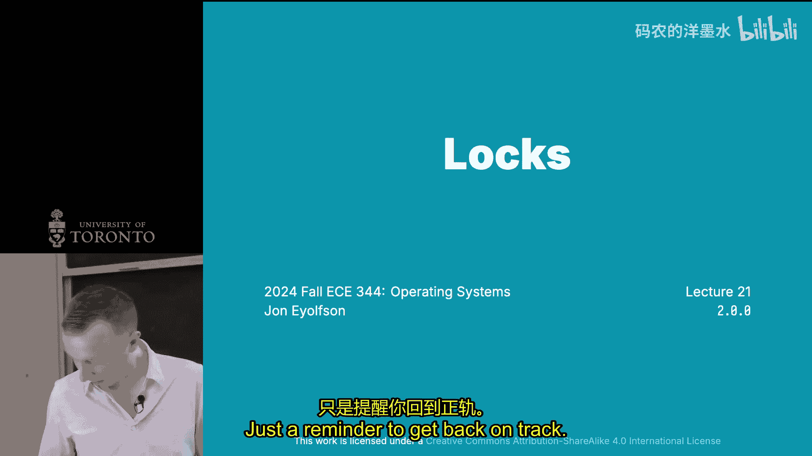
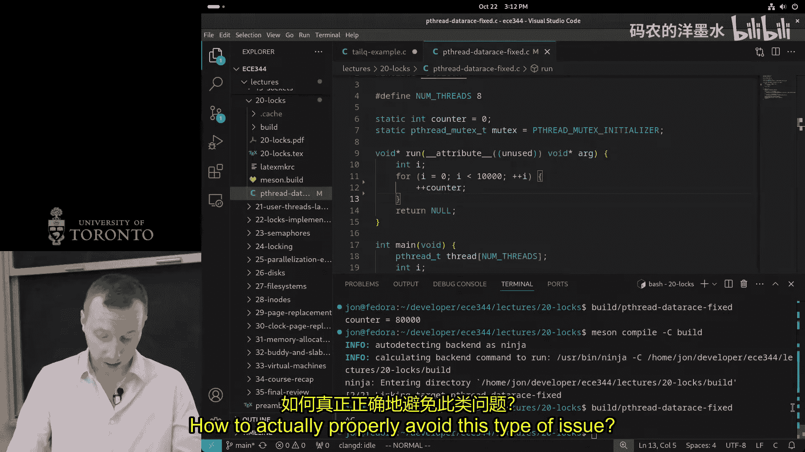
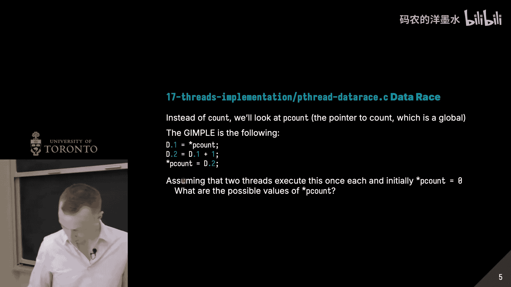
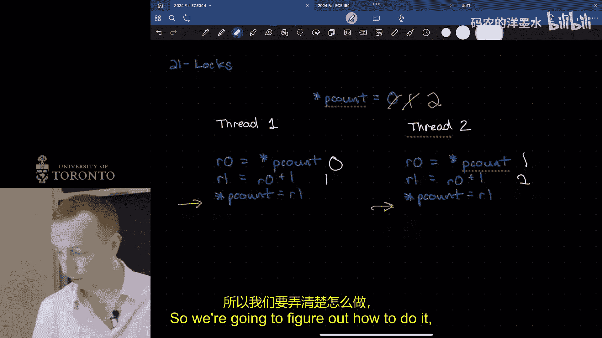
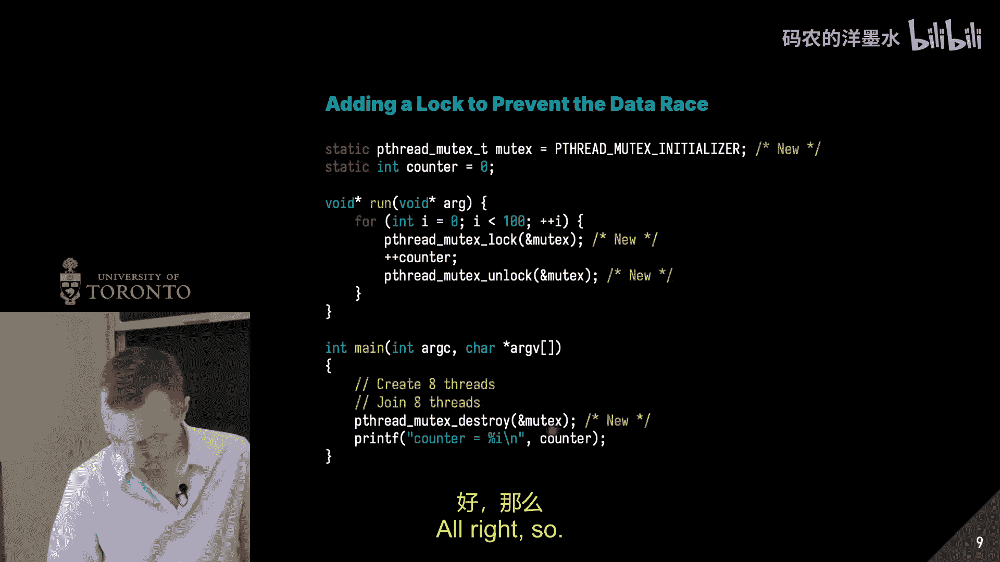
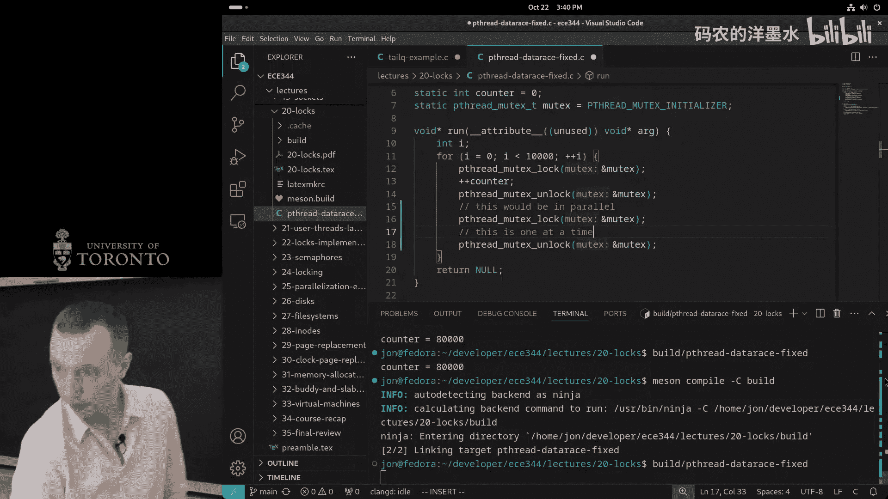
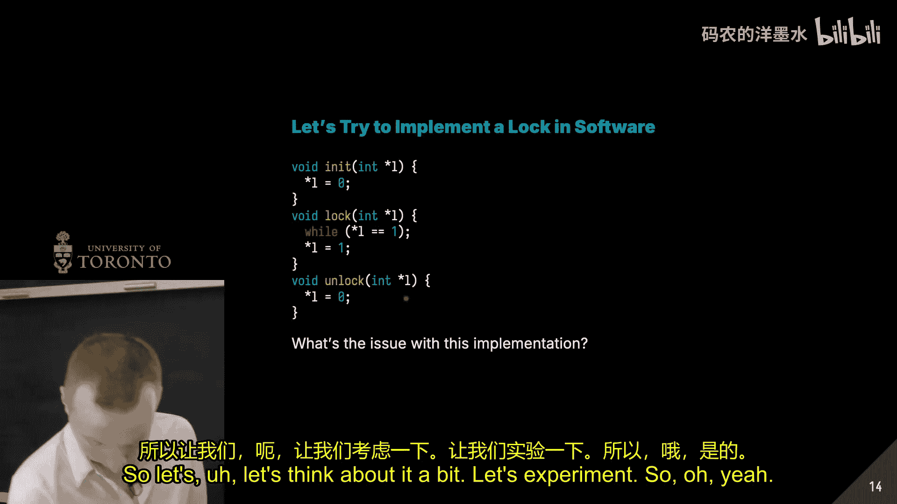
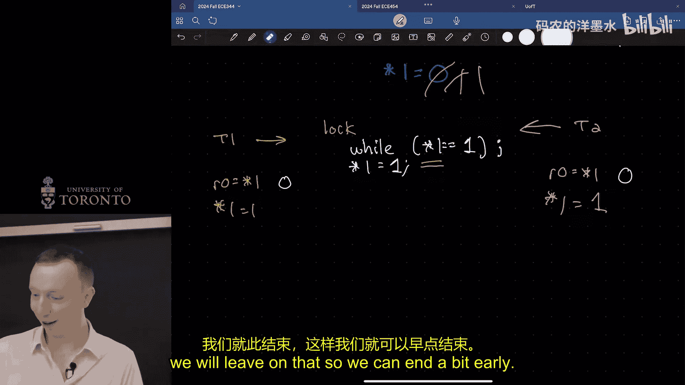

# 【全集】多伦多大学 操作系统 中英字幕 1080P p20 Lecture 20 - 锁 -BV1Rbk7ByERc_p20-

🎼。Alrighty， welcome back to offering systems we survived the midterm。Slightly。

 so Ts are grading it as we speak， I' have told them to be nice so。Depending， I guess。

 hopefully they finish it before reading week。 But， you know， if the average is bad。

 he'll let you have a good reading week and only release the grades after reading week so you can enjoy it。

 if the grades are good， I'll release it before。 How about that。😊，We'll see。

 hopefully they finish by Friday。 We'll see one question's graded。 looks all right so far。

Hopefully the rest of it is okay。 everyone survived， though， no。You survived。 we'll see。 but yeah。

 screwed up the threads question。 we have to accept a whole multitude of answers for that because it could have bred garbage so you could have justified any number of processes。

 one， two or three， all valid， all got a correct answer。 Yay， you just have to justify it。So。Well。

 even if you don't justify it， we have to assume that you knew what you were doing based off your other output。

 so as long as you were consistent， Hooray。So， yeah， that's fun。 Scewed up one line。

 and things all went to hell。 That is the story of this course， I it not。😊，So。

Just a reminder to get back on track So where we left off but for we were so rudely interrupted by the midterm and in lab4。

 we had this code so we created eight threads we told all eight threads to go ahead and increment the same global variable 10。

000 times we ran this code， we got very inconsistent answers right so we came up with some ways to fix it。

Some ways that fixed it， but not permanently， we still had a potential issue。

 but we got lucky most of the time。 So we didn't see any errors。

 And then we may have came up with a solution that was much better。

 That looked kind of like the mapre thing。 So today， we get to fix this issue more generally。

So this is something they should have taught you if you've ever used threads before。

 but we'll go over what they。How to actually properly avoid this type of issue。

 So this type of issue has a name and you should be able to identify that。

 This is going to come up a lot。 You should commit this definition to memory because this is the cause of incorrect behavior。

 if we have a multi threaded application， even on a single core。

So what we saw before， the reason we had incorrect results was something called a data race。

 and a data race can occur whenever you have two concurrent accesses to the same memory location。

 and at least one is a right。 That is the only condition you need to have a data race and bad things may happen。

 and the intuition behind it is like what we saw before。

 One thread may essentially read a old stale value that should no longer be valid， right。

 Something should happen to it in the future， but it reads an old value。

 So that is a data race that is the cause， the number one。Concurrency bug that you will see。

 These are the types of bugs that we will take seven years to solve。

 And this is where real programming starts。 So welcome to software。So。

In order to argue about data races and safety and all of that we need to have some more definitions。

 so there are instructions that are atomic and atomic operations， you assume are indivisible。

 So an atomic instruction。 if I say that to you。 it either happens or it doesn't。

 there's no it partially happens。 it either happens or it doesn't there's no in between。

 you can't preempt it。 I can't switch to something else in the middle of it。

 it's like at a hardware level， it either happens or it doesn't again， no in between。

 So I can get preempted between two atomic instruction。

 So instruction finishes then I get preempted and I run another thread or a whole different thread and another process。

Or， you know， another thing。Something， whatever I come back， run another atomic construction。

Atomic construction either happens or it doesn't。 And I get preempted between atomic instructions。So。

How I told you how I broke down that plus plus count and figured it out while。

This is a preview of your compiler course to figure out that that plus plus count was actually three operations。

 What I did or what you can do is kind of look into compilers so you could look at the assembly if you want。

 but compilers will not just take your C code and then spit out machine code that is not how compilers work that is not how they optimize or anything like that So compilers take your C code convert it to some intermediate language which kind of looks like assembly but has a few less restrictions like it assumes an infinite amount of registers。

 and it makes all the operation very， very simple and that is what's actually used by compilers to analyzer code and apply any optimizations and then it applies it generates assembly from this intermediate language。

 usually it's of the form of something called three address code。

And three address code just means every statement you assume is one fundamental operation。

 assumesum it's just atomic。 And that operation is very， very simple。

 So the statements have the form。At most， so all these things are optional。

 but it produces a result of applying some operation to two opera brands。 So maybe。

Assigns a register to the result of one plus2 or something like that that's as complicated as they get if you want to add three numbers well you need to do two stages of that right you need to add them to temporary and then add the third number to that temporary to get the final result so your compiler just generates things like this one line at a time and each only do one thing at once for the purposes of this course we can assume each of those statements are atomic。

So。GCC， most compilers have their own intermediate language。 GCC has something called Jple。

 This is more for previewing a compiler course or something that don't have to know that for this course just might help when you argue about some code but in GCC their three address code is called Jple。

 don't ask me why they named it that sounds kind of silly but if you want to see the dimmple of your code whenever you run your compiler。

 you can do F dump treee Jumple if you want to see all of it。

 you can do F dump treee all and the main reason to use this is well if your compiler is using it to reason about your code then you can use it to reason about your code too it's probably a bit easier to read than assembly and it will probably come up in compiler courses。

Playang， another compiler has their own different language。 They call it LVM bit code。

 but it's the same idea here。 statementsments will be like one fundamental operation。

So how I knew plus plus count was three atomic operations is because if you looked at the gmple for it。

 the gple of it looks like this， which is what I argued about before。

 So it assumes an infinite amount of registers， So any D dot something you assume is a register and has an infinite amount them and the other rule for three address code。

Is it will only assign to a register once， so it won't reuse it so it's easy to analyze it。

 It's only assigned once it's easy to follow it。 So what that looks like is well plus plus count。

 The count will be somewhere in memory。 the compiler will only use the memory address so it will do the memory read So it will read that int into a register。

 something like D1， then itll do that increment， So in Jple's case it creates a new temporary register called D2 and it's equal to D1 So that's the value at red plus one and then finally the memory right。

 So that is one way to figure out that plus plus count actually is3 atomic instructions so。

Just to revisit it again。Oops， not that。 So just to revisit it again。

Even if we have two threads and initially， the value is0。

There is a way that both threads execute such that。That value。

 the final result of that value is one instead of the expected two， right， So how that may happen is。

 let's say thread one executes first。It would do this read。

 so it would read from memory the current value of P count， put it in some register。

 all is called R0 instead of D dot1。So it would read the value。0。Oh， it's this room again。

 this is a cursed room。So it would read that value0。

 and then we could context switch back over to say thread2。Thread2 could start executing。

 it could do the memory read， and it would also read that value 0 because the other thread hasn't written to it yet right。

 so it would update， it would read the value 0 into its register and now at this point we are now screwed right so it doesn't matter which one executes next。

Say thread1 executes next。 Well， our 0 is equal to 0。 So 0 plus 1 is equal to one。

 And then we would update the。We would do a memory right to P count's location， update that int。2 B。

 A1 from a 0， right。 And now if thread 2 executes， well， it will increment。It's 0。 It red to a1。

 And then do the memory right。 So we would update  one to one。And now we are screwed， right？

So what is the only way that。Well， one of the two ways。

 the only way that if thread 0 or thread 1 executes first， that I will get my expected result too。So。

So Tread1 executes first， what is the only way I will get my expected result？2。第二。こ中に。Yeah。

 thread 1 complete in its entirety before thread2 even starts。

 So the only way to get the correct answer is thread1 starts。 It reads the value of P count。 Oh。

 it read a 0。 Okay， it executes its next line and acrements it from a 0 to a1。

 and then it updates that location。 So it updates。The 0 to a1。 And now thread 2 executes。

 So now when thread 2 executes and it reads， it's going to read。That new value。

 So it's going to read a one。And then， it's going to。Do the increment。

 So one is going to turn into a two。And then。We're going to update that value。 So we're going to。

Right， instead of。One， we're going to replace it with two。That looks an awful lot。

 like one thread can only run at a time， right， So that's the only way to prevent a data race is only one thread can execute that code at a time。

 So we're going to figure out how to do it。 But in order to argue about a data race， lucky for you。

 you have to argue about any possible interleaving between two threads。

 So typically when a data race happens to prove the existence of a data race。

 You just need to come up with an example that produces a wrong value。 So。

In this case。We'll assume the compiler doesn't reorder instructions or anything simple like that。

 So within a thread。It has to read and then write。 It can't write first before it reads or anything like that。

 So if we have to argue about any possible interleaving between two threads。

We don't have four factorial options。 We have a bit less because the read has to come before the right so but even in this case。

 we have to argue about a whole bunch of different area leaving so the only thing we care about is concurrent accesses to that same location so we only care about the reads and the rights to that global counter。

 we don't care about any of the register things because it'll all be independent。

 every thread has its own independent copy of registers so there's no concurrent accesses to the register won't have any data race yeah。

And's know we order。パだだ。With the order of。Lets as like。So yeah， the question is。

 can't we just always assume that the instructions do not get reordered and the generic answer to that is no。

 the compiler will freely and your CPU will freely reorder instructions？

Which makes your life even more complicated， right。

 but we'll just assume that nothing gets reordered， things could get reordered， which really， really。

 really， really， really makes this hard， but we'll do the simplified version of it。

 usually your compilers not supposed to reorder in any way that will cause anything to go wrong。

But you can， of course， screw that up from time to time。 So in this case， we only care about。

 So assume two threads just accessing that one counter。If we assume no reordering of instructions。

 so don't worry for this， the compiler wouldn't reorder the instructions because it's just accessing one variable but。

If we're accessing two variables， maybe instead of doing read， write， read， write。

 maybe it does read， read， write， write， Who knows it could reorder things。 But with this。

 don't worry about so。In total， just for that plus plus count between two threads。

 there are six possible innerleavings of instructions。

 So the first one we consider thread 1 goes first。 So it has to do its read first。

 So after it performs its read， we could either context switch to thread2 or continue thread 1。

 So if we continue thread1， then it would write。Update that value to from1 or0 to1。

 and then the only other choice is to have threadread2 execute。

 it would read one and then write out two， so our file count would be two。

If instead we context switch back over to thread2 after thread1 red， then。

Either we could context switch back over to thread1 or stay on thread2。 In either case。

 it will just change the order of the rights， but we'll still get the wrong answer。

 And then similarly， if thread2 goes first， we have the same three different options。

 So even for plus plus count。There are six possible preemption orders that we have to argue about for showing a data race。

 you can show any one that produces a incorrect value。 So of the six possible interleavings。

 only two give us the correct answer。 So it's a small miracle that we ever saw 80000， right。

So small miracles do exist， and computers are strange。So。In order to prevent data races， right？

The only real way to do it is to ensure mutual exclusion or to ensure only one thread is executing that block of code at a time。

 So we do that with something called a mutex short for mutual exclusion one at a time。

 So in order to create them， you can create them statically as like a global variable or dynamically。

 so just essentially on the heap。 So they're in the P thread library。

 So they're called P thread mutex underscore T。 That's the type of it。

 So if we create a global variable for one。 it's just equal P thread muttex initializer that will set you up with a default one。

 And then other than that。Like Maloc and free， there's Mutex and knit and destroy。

 You can give it this other optional attributes so you can include some attributes that change how the Mutex work。

So if you want Mutexes to work a little different， you have to use this dynamic value to give you some attributes。

 otherwise you'll get the default one for this course we'll just use the default Mutex without any crazy options or anything like that。

 we're just going to concentrate on using the default Mutex。So。

How you use it is you can think of a mutex as protecting a room。 I don't know。

 Think of it as like a closet。 So it represents the lock on the closet and the mutex itself represents the key。

 So if I have some code。 and I want to make sure only one thread is executing some code at a time。

 I can lock the mutex。 So that's like you grab the key that's hangs on some hanger or something， you。

you open the door， you lock it behind yourself， and then you are the only one with the key in that room。

 so there's only you allowed it at a time。 no one else can follow you in because you lock the door behind yourself。

 So this protected code only one thread would be able to execute it at a time。

 therefore we would not have a data race because you are essentially disabling concurrency here。

 only one thread can execute at a time。 you might call that protected code。

 you might call that the critical section， you might call it。

t know just the code under mutual exclusion whole bunch of different names you can call it but the crux is only one thread can be executing this code at a time and then whenever you're done executing that code that could lead to a data race you unlock it so you unlock the room you lock yourself in and you just hang the key back up on whatever on the hanger and then someone else can come get it if there's。

A whole bunch of threads waiting for it。Only one of them can get it， get in the room。

 They're the only one that can execute this protected code at a time，Then we're good。

 So there is a situation where if you have multiple mu textexes at the same time。

 you can do something called a deadlock that will come up later。

 but that's basically like you have locked yourself in a room and there are now two rooms and you say I'm not going to give up my key until I can get the key for that room and then the person in the other room says the same thing。

 says I'm not coming out of my room till I get your key and then you're at a standstill。

 you can't make any progress anymore。 that's a deadlock， basically they get blocked forever。

 you can't make any progress。Don't worry， we will revisit this。

There's also a version of Mutex lock that is nonblocking， so by default。

 this lock function will block until you have essentially got the lock。

 you have got the key and you have locked yourself in that room。

 so it will block until you have acquired the key if you want the nonblocking version of it。

 there is a muttex try lock， so that will tell you yes。

 no immediately whether you acquired the lock or not， we won't use it just yet。

 but it will come up later， but same concept it's like the nonblocking version。Of a lock function。

 Yeah， I just wondering typically in the projective code， we typically like do like write， right。

 And we don't need to read there。 Like people would not like the key can also can still read。No。

 so the question is in that protected code， we only have to protect the rights and that no。

 you would have to protect any reads and write。 So a data race is any concurrent accesses where at least one operation is a read。

We were sorry， one operation is a right。 So as long as there is one right， then you're done。

 even if another operation is a read， so you'd have to also protect the reads。

 otherwise you could imagine without protecting the reads， if you did something really complicated。

 you might read a partial result or something like that when it was trying to update that value。

 so you'd have to protect both the reads and the writes。We'll see some optimization we can do。

 assuming that all the threads are only reading， then it should be fine to share it。

 We'll get into more optimizations and things we can do for that。 But for now。

 you'd have to lock both the reads and the writes。All right， so。

If we take our code we had before， the generic fix to it。

 the easy fix using a Muex is all I do is I create a mutex now and here I just create it as a global variable。

 so I' have static P thread Mutex， I'm creative so I just called the Mutex Mutex。And then now。

 if I want to prevent the data race， my data race was only with plus plus counter。

 So I can essentially just make sure only one thread executes it at a time。 So I can do a lock。

 That means only one thread will be executing this plus plus counter at a time。 Therefore。

 I will not have a data race anymore。 So now if I compile it and run it。

 I will get 80000 every single time。Yay， right？So。This is also where people fall into traps where。

 hey， if I just。Make it a。If I just add thread， my program just gets faster， right？

Is this faster than just doing it on a single core， Yeah。Yeah， basically。

 my operation is I made this essentially serial， right， Only one thread can do this at a time。

 if this is all my work。I didn't make this any better than a single core， right。

 All I did was I actually made it worse。 So this can only run on a single core at a time， and then。

In this case， I have 8 threads。 So all 7 threads are all just fighting for it over and over and over again。

 So I made it slower， actually， than just not even bothering with threads。 So yeah。

 that's your one pitfall， there's a performance course that you'll get into later where you'll analyze these things more。

 But just because you add threads doesn't magically make your thing go faster。

As long as you want the right answer， right， So if I didn't want the right answer and I had a data race。

 it did go eight times faster than a single core， but it also produced the wrong answer， so。

You can go faster if you don't care about the wrong answer。

 but probably shouldn't be writing software at that point it。ありますか。Yeah。

 so the problem comes up even on a single ch just with concurrency。

 So parallelism just makes a problem worse。 So parallelism kind of looks like concurrency at the hardware level。

 but in order to argue about things for your own sandy， just assume concurrency。All right。

 so now fun thing that we can explore and see how easy it is to brick our program。

What do you guess happens if I just do this。Oops。一一。Yeah。

 I essentially locked out all the other threads， right？So。If I execute this。

 I'm actually not sure exactly。 Well， I am。 But if you run this。

 you're not exactly sure what happens because it just sits here。And blocks forever， right because。

Whatever the first thread is， I gets this lock， it never unlocks it。

 So let's say the counter is initially 0。 So it would grab the lock。

 update that counter from a 0 to01。 And then maybe we switch over to another thread。 Well。

 it will just block forever at the lock。 So threads 2，3，4。

 do da dot da da all the way up to 8 will get blocked here。

 they will never be able to progress because I never unlocked it。 And also funly enough。

 the thread that acquired the lock。😊，That updated the counter from0 to1。

 Well it would come back up here and then try to lock again， but it would be waiting on itself。

 So even if it has re if it has a lock， if it encounters another lock call。

 it will block there waiting for it to get unlocked， even if it has a lock。

 so there is an option to have something called a recursive lock that will detect that hey。

 you already have it， so if you lock again， you already have it， but by default。

 Mutes will just block forever， even if you lock a lock that you have。So even if you have the key。

 if you lock again， you're blocked forever。 So in fact， when I execute this。

Count just gets updated to one。 And then all my threads get blocked forever。

 So easy way to break your thread。 But luckily for us。Usually， they always look like this， yeah。

Save that that。Yeah， for deadlocking， essentially that thread's deadlocking itself。

 So deadlocking is just， you get stuck， you get blocked forever， you can't make any progress。

 So yeah， if you really badly mess up， you can deadlock yourself。With the default mutex，But， usually。

You're only protecting a small region of code。 So typically you'll see lock and unlock。

 So it's generally pretty hard to screw up。 If you see lock and you don't see an unlock。

 alarm bells should be going off because if someone。Right， if it's something like， if something。

Like if your code looks like that， then。When it's false and you forget to unlock it now。

 you are now screwed forever right， and you might deadlock yourself， so on and so on。

 which makes programming fun。All right， questions about that， we're good。Can。Yeah， like。

Like here I'd be using the same muttex over and over again， right， all my threads are sharing it。

 It's a global variable。Moel times are the same。Right。If you were to have that。Work again。

So here would be doing like lock unlock and it's in a loop。

 right so it's going to lock and unlock again。Like call it a second。ISo you can。

Neneath the unlock you right again。T lot。So。你前。Like this。yeah， you can。

 but you'd also want to do like an unlock before， right。So you could do this。

This would be in parallel。And then you could， yeah， make this。 This is one at a time。

 So I could do that。 I can reuse it， can share it across threads。 It's thread safe， all that stuff。

Because yeah， technically here all。8 threads have access to it， right。

 They're all using the same muttex。Yep。Alright， everyone， good with fun Me Texas。

 because we'll be using them for a while。So that's a code。So， oops。

Come on switch。 So that critical section protected code， mutual exclusion code。

 whatever you want to call it。It just simply means that only one thread can execute those instructions at a time。

 So you eliminate the deadlock condition right or sorry， the data race condition。

 two concurrent accesses with at least one being a right。 Any code between the lock and unlock。

 Only one thread can run it at a time。 you have no concurrent accesses。

 Therefore you do not have a data race。 So your mutual exclusion section。

 it should have a bunch of different properties， One should be safety。

 it should actually have mutual exclusion。 If I have a critical section or code between the lock and an unlock。

I also should have a property of liveness， AKA progress。

 so if multiple threads reach that critical section， AK multiple threads reach that lock call。

 one must proceed， they can't all just sit there forever。That would prevent the data race。

 but it would also cause your program to block forever and not make any progress。

 And that critical session can't depend on any outside threads。 What that basically means is。

If you depend on something else， you can mess it up and deadlock where you're waiting on another condition to happen and you won't make any progress。

I to write this like a head right to it and。はい。So。Kind of related to pipes a little bit。 Not really。

 though， kind of looks， gives us the same thing， but slightly different mechanism。Yeah。

 and then the last thing you want， if you encounter a。

If a whole bunch of threads arrive at a lock call， there should also be bounded waiting。

 kind of like scheduling。 there shouldn't be any starvation。 So that means a waiting thread。

 So if a whole bunch of threads arrive at the lock call。

 it shouldn't be possible that a thread never， ever， ever makes it through。

 So it essentially shouldn't be the case where other threads can but ahead of it in line and it just sits there forever。

 So it must eventually proceed。 So you might imagine there should be some type of queue for the lock。

 So if you， you arrive in order and they're served in order。 Yeah。

For the point that the critical section。Outside。What does that mean。大丈。

So if the critical section depends on outside threads， that means。

I might not able to make progress because I can't。Control any of the outside threads， right。

 And if I can't make any progress in the critical section。 That means I won't hit the unlock。

 And that means no other thread could pass a lock。So no other thread could make progress。

So I basically don't want a deadlock， I don't want to be in the situation where I block forever。

 I cause all the other threads to block forever at a lock call。Alright， so spoiler alert。

 we get to implement a mutex。 So if we get to implement a mutex。

 we should make it so that our critical sections have minimal overhead。

 So our lock call should be efficient。 We don't want to consume resources while waiting if another thread has the lock。

 we shouldn't just waste CPU cycles trying to acquire。 if we know we can't get it anymore。

 So you don't want to consume resources while you're waiting。 You want to make progress。

 run your code。 You don't want to just burn CPU cycles， trying to do some useless thing。

 Yeah overhead。So overhead is just basically any CPU resources that are wasting not running your program and not running what you want it to。

 So overhead， it's not making any progress for your your actual application you care about。

So the other thing we want our locks to be is fair。

 we want each thread to wait approximately the same amount of time。

 we also want our locks to be simple， they should be easy to use， hard to misuse。

 of course that is always our guiding principle when we're writing library stuff。

So similar to libraries we want layers of synchronization。

 so we're going to need some hardware provided low levelvel atomic operations that at a CPU instruction level。

 they are atomic， those will be provided for us and then on top of those operations we can implement some high levell synchronization primitives like Mutexes and then using Mutexes。

 you can write your properly synchronized application that has no data races and hopefully uses threads correctly to go fast and produce the correct result。

 both at the same time which is fantastic。So。Back in the day， this was a lot easier。

 So back in the day， we had a single core， we had a single processor。

 So the only way to have a data race， we didn't have parallelism。 Wow， I talking like an old man。

 So we didn't have parallelism。Yeah， I guess I did technically did。 I guess I am an old man。

 So didn't have any parallelism。 So your only source of data races came from concurrency。

 So if your only source of data races come from concurrency in order to implement a mutex。

All you have to do is your lock just disables concurrency。So if you disable concurrency。

Then there's no chance of you getting interrupted by something you can keep on executing。

 and this is how a mut text could be implemented back in the day。

 So just disables interrupts and then an unlock just re enableables them again so。Again。

 if that's your only source of concurrency。For your user processes。

 that would be ignoring signals which you can do for the kernel which has to deal with hardware。

 that would be actual legitimate hardware interrupts。But unfortunately for you。

 this is not a valid way to implement Muex anymore because if you have multiple processors。

 just because you disable interrupt Europes on one doesn't mean the other can't run in parallel。

 so on and so forth， so sorry。30 years ago， we would be done talking about how to implement a mutex。

 but。Tough for us， so。We get to implement our own mutex。

 So I will propose this as an implementation for a mutex。

 So I'm just going to use a simple integer to represent the state of the mutex。

I'm going to assume0 represents unlocked。 One represents locked， so。

For my initialization to initialize it， its initial state is going to be unlocked。

 so I'm going to set its value to 0。Then， in my lock function。This will be my implementation。

 I will just have while the current value of the lock is one。

 which should mean some other thread has locked it。 There's a semicolon here。

 so that will just loop forever。 So we'll keep on reading over and over and over again until it eventually reads a zero in which case it would break out of this while loop。

 and then。Change that 0 to a1。 So this thread is the one that has acquired the lock。

 It would change it from a1 a 0 to a1。And then my unlock code。

 my unlock while the thread that set it to one just has to set it from one to a0 to indicate it's unlocked again。

Is this how I could implement a mutex。Or is there any condition we can think of where possibly a data race could happen where something bad and unexpected happens yeah。

あ华。So they could both acquire the lock at the same time。 That's okay。

 But as long as only one makes it by， that's fine。Yeah。

Is it possible that multiple threads are built that long。Yeah， multiple threads could。Call locke。

 if we implement this correctly， only one should be able to make it buy at a time， right。So let's。

 let's think about it a bit。 Let's experiment。 So， oh， yeah。

I'm just like， let's say one the interesting stuff at the wild Lagota。Yeah。

 I'd be doing a comparison。 Well， let's see what happened， so。

Let's say we have two threads calling this lock function。So we have thread1 and thread2。

 So if we implement this correctly， only one should make it buy at a time， right。

 So let's assume thread 1 executes。So it essentially it would execute this first， right。

 It would do the memory read and then the comparison。

So it would essentially read the current value of。It's this cursed room。

It would read the value of L into some its register。So it would do like r0 equals。

Current value of L is 0 right so it would read L。 current value is 0 So what should happen is okay。

 it read0，0 does not equal 1， so the next thing it would do is just go ahead and update the state of the lock to1 right so it would do the memory right so it would write。

That value。Well， not that value， but it would just write the value1 to the lock， right。

 so it should update it from a0 to a1。Now， if threadread2 executes。Actually。

 I'll use a different color。So。Thread 2 executes， right， It's going to do the same thing。

So it's going to。Do the memory read， so it's going to read the value of L。Which is currently one。

And one is equal to one。 So it'll be stuck in this loop forever， right， so。Appears correct。

 So two threads called it。 Only one made progress。 The other got stuck。

 That's what I wanted out of this。Is there any interleaving of the threads that would cause both of them to pass。

Yeah， if they， if they both read before they write， right。

 So there is a situation in which something bad happens。 So if I rewind again。

Let's assume that threadread1 executes first。It does the read here。 So it would read。

Whatever the value is at L into its register， it would be zero at this point if we assume the initial state again。

Now， we could contact switch back over to thread 2， right？ Now， thread2， what's it going to do。

 It's going to do the same thing， So it's going to read into one of its registers。

 the current value of L。 What is the current value of L。Zero。Now we are right screwed， right？

No matter what we resume， let's say we resume thread 1。 Well。

 it's just going to write the value of one to the lock。 So it's going to update it from a 0 to a1。

 If thread 2， if we switch back to thread 2， it's going to do the same thing。

 So it's going to write the value 1。W。It's going to write the value1 to the lock。

 and they're both going to make it past lock。 So that is an absolute abysmal implementation。

 It is possible that two threads call lock and two threads make it by。The rule should be。

 if two threads， Well， if two or more threads call lock， only one should make it through at a time。

 right， Otherwise， we don't have mutual exclusion。So。Please fix it for me。 How would I fix this。Yeah。

So if I throw in an atomic。So if I throw an atomic on that integer。

 that's not going to help me at all because。Yeah， it makes the atomic load。

 I just did a load in a store。 they are atomic anyway。 so throwing on an atomic int is not there。

 that is a way to make plus plus atomic。 So if I incremented it， it would do that atomically。

 but nope in this case， you've heard atomic， it is not your savior yet。

So how can I change this code so that it works？H。So looking at it， my issue was， I really don't want。

 like， I want a thread just to change。Like atomically， that 0201。

 I don't want it to change a 1201 yeah。The read and the writer。So the read in the right atomic。

How would I do that？Maybe some instruction， yeah， well I can't do a lock and an unlock because I'm trying to implement lock and unlock。

 right？Check the value of it before I perform the right。Yeah， I make it a bit more complicated。

 So turns out the answer to this is we can't solve it yet because we need some help。

 We need some atomic instruction that will essentially make sure that we can atomically switch D 0 to a1 and that will prevent us from essentially doing switching the one to a1。

 which we don't want to do。 We want to make sure we can。😊，Only one thread switches to 0 to a1。

 So that is an atomic construction。That exists on your hardware。

And I will tell you about it in the next lecture。And we will leave on that so we can end a bit early。

 So just remember。

