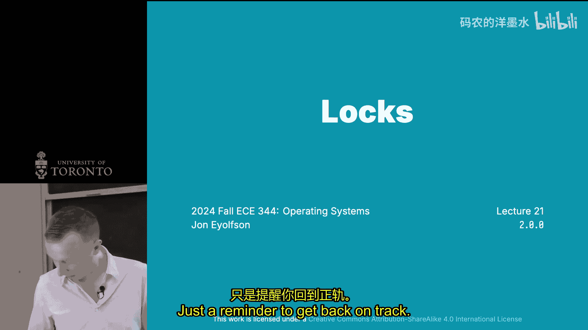
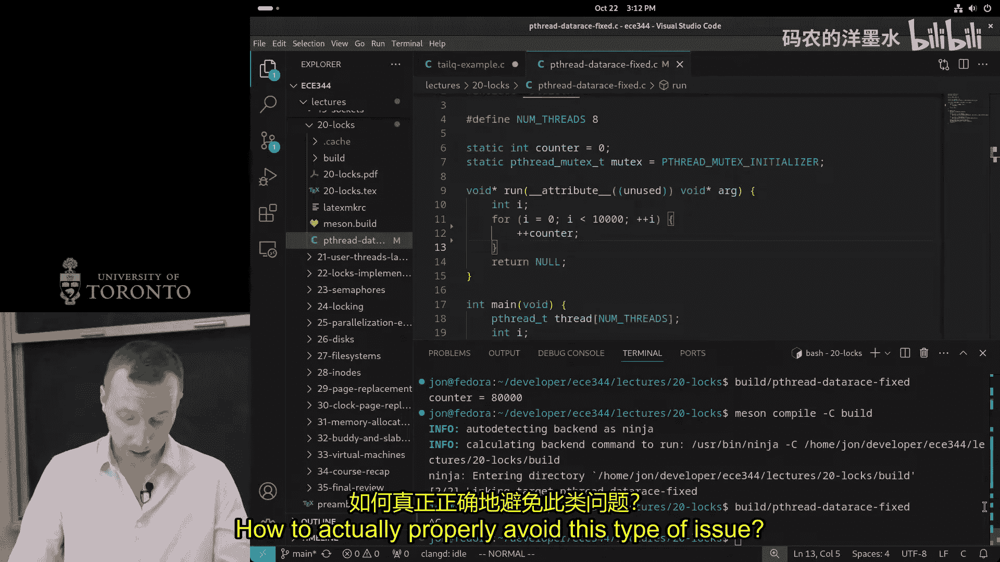
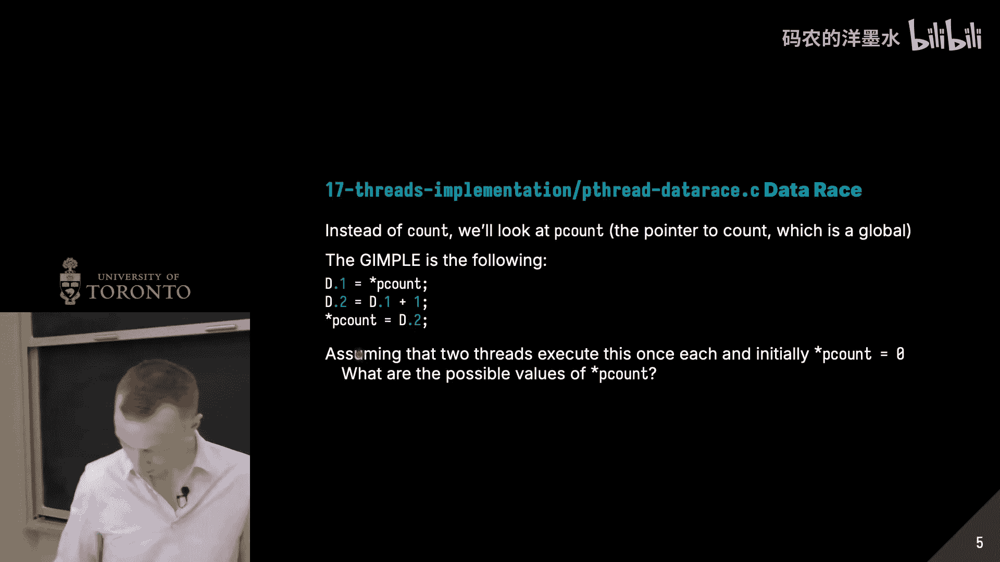
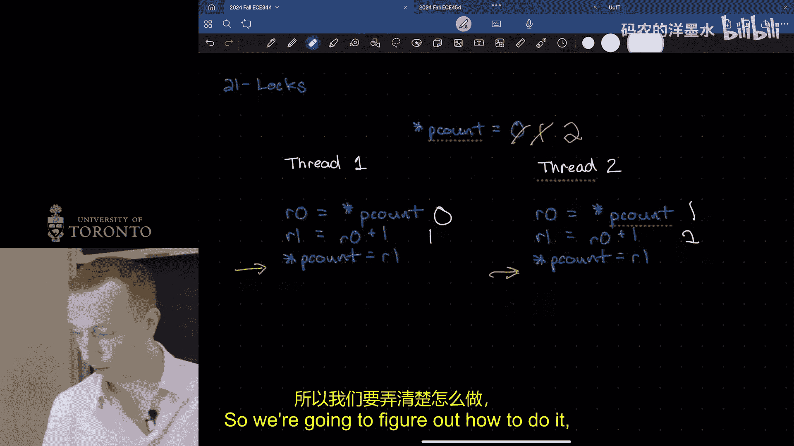
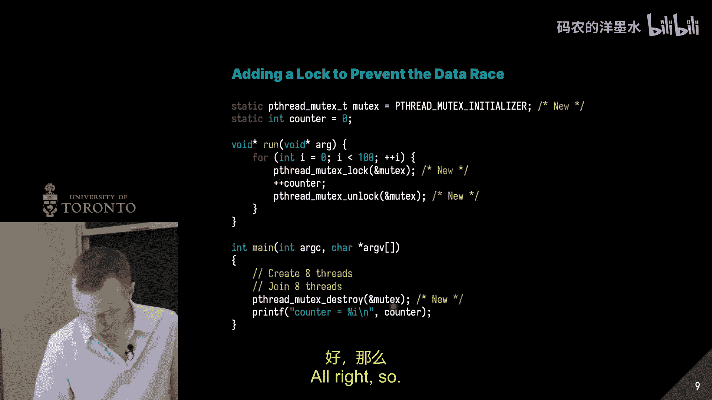
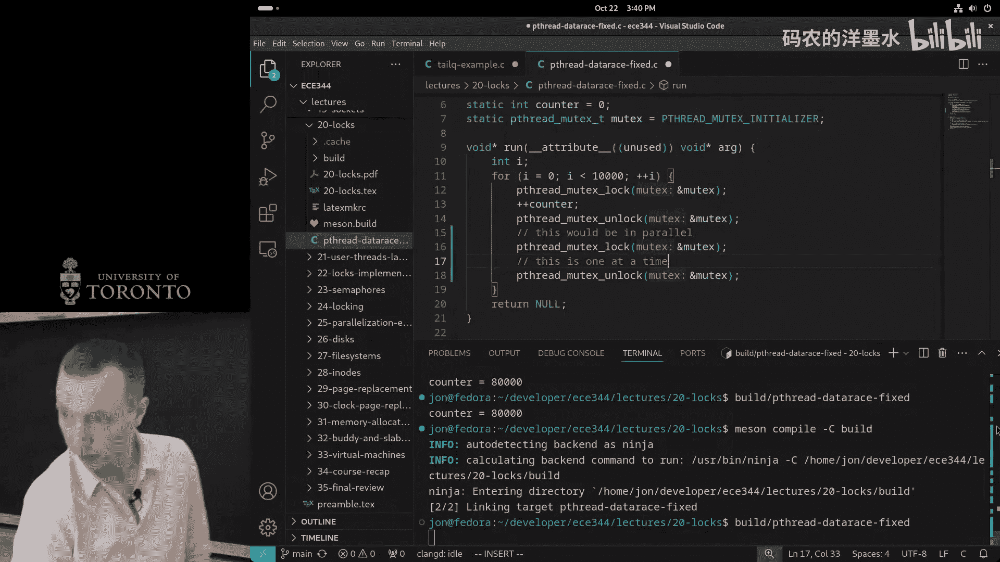
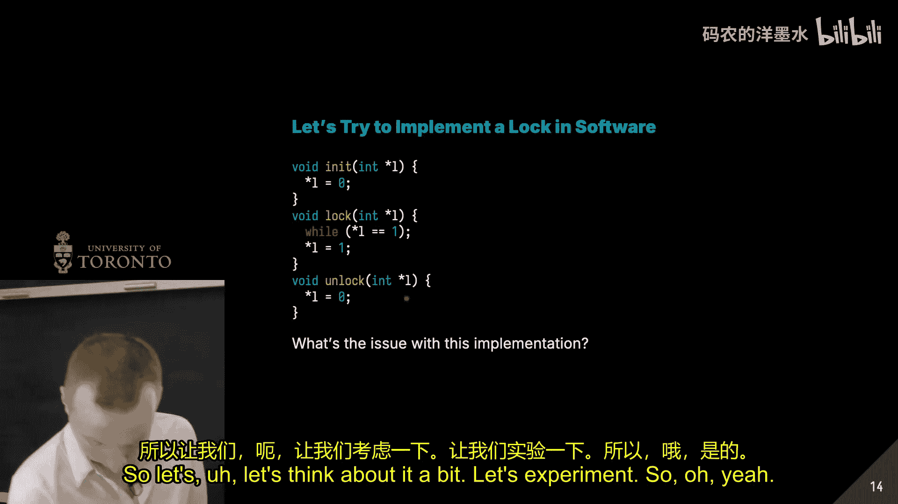
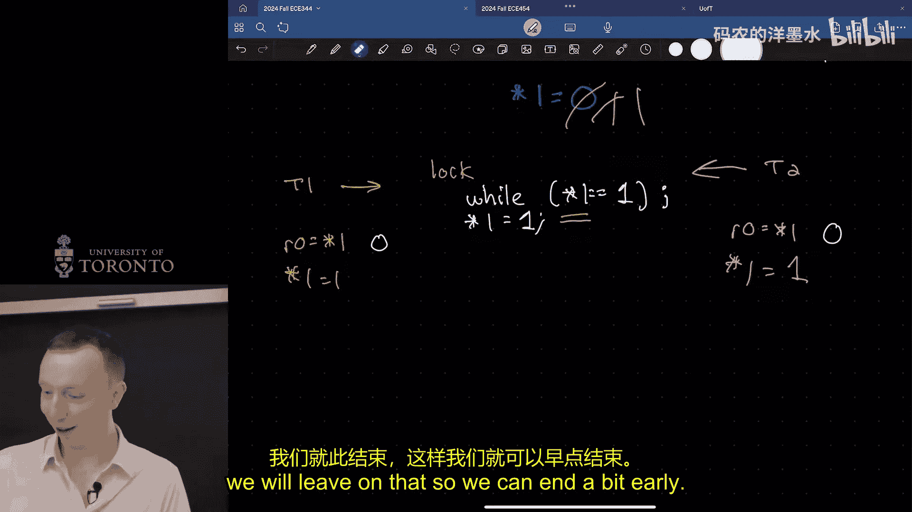

# 操作系统：第20讲：锁 🔒



在本节课中，我们将学习如何解决多线程编程中一个常见且棘手的问题——数据竞争。我们将了解数据竞争的定义、成因，并学习如何使用**锁**（Mutex）来确保代码的**互斥访问**，从而保证程序结果的正确性。



## 数据竞争与原子操作

上一节我们通过一个多线程累加计数的例子，看到了结果不一致的问题。本节中，我们来看看导致这个问题的根本原因：**数据竞争**。

数据竞争发生在以下条件同时满足时：
1.  两个或更多线程**并发**访问同一内存位置。
2.  其中至少有一个访问是**写入**操作。

其直观后果是，一个线程可能读取到一个已经过时、本应被其他线程更新的“陈旧”值，从而导致程序行为错误。这是并发编程中最常见的错误类型之一。



为了分析数据竞争，我们需要理解**原子操作**的概念。一个原子操作是**不可分割**的——它要么完全发生，要么完全不发生，不存在中间状态。线程可以在两个原子操作之间被抢占，但不能在一个原子操作的执行过程中被中断。

例如，在C语言中看似简单的 `count++` 操作，实际上会被编译器分解为多个原子步骤。我们可以通过查看编译器的中间代码（如GCC的GIMPLE）来验证这一点。对于 `count++`，其等效的原子操作序列通常是：
1.  从内存读取 `count` 的值到一个寄存器。
2.  将该寄存器中的值加1。
3.  将新值写回 `count` 所在的内存地址。

因此，`count++` 本身并不是原子的。



## 互斥锁（Mutex）的基本使用

既然数据竞争的根源在于对共享资源的并发访问，那么最直接的解决方案就是确保同一时间只有一个线程能执行特定的代码段。这就是**互斥**，而实现它的工具就是**互斥锁**（Mutex）。

你可以将Mutex想象成一个房间的钥匙。线程调用 `pthread_mutex_lock` 就像是获取钥匙并进入房间，然后从内部锁上门。此时，其他线程无法进入。当该线程执行完受保护的代码后，调用 `pthread_mutex_unlock` 解锁，相当于走出房间并归还钥匙，允许其他线程获取钥匙进入。

以下是使用Mutex修复我们之前计数问题的代码示例：

```c
#include <pthread.h>

static int counter = 0;
static pthread_mutex_t mutex = PTHREAD_MUTEX_INITIALIZER;

void *increment(void *arg) {
    for (int i = 0; i < 10000; ++i) {
        pthread_mutex_lock(&mutex); // 获取锁
        counter++;                   // 受保护的临界区
        pthread_mutex_unlock(&mutex); // 释放锁
    }
    return NULL;
}
```



通过用 `lock` 和 `unlock` 包围 `counter++`，我们确保了任意时刻只有一个线程能执行增加操作，从而彻底消除了数据竞争，每次运行都能得到正确结果（80000）。

**重要提示**：锁的使用必须配对。忘记解锁会导致持有锁的线程永远阻塞，其他等待锁的线程也会被永久阻塞，这种情况称为**死锁**。同样，一个线程试图对已由自己持有的锁再次加锁（非递归锁），也会导致死锁。

## 临界区的属性与锁的设计目标

被锁保护的那段代码称为**临界区**。一个设计良好的、基于锁的临界区应具备以下属性：
*   **安全性（互斥）**：确保最多只有一个线程在临界区内执行。
*   **活性（进展）**：如果有多个线程试图进入临界区，至少有一个能成功进入，不会全部永久阻塞。
*   **有限等待**：任何等待进入临界区的线程，其等待时间应该是有限的，不会发生“饥饿”现象。



基于这些属性，我们在设计或选择锁的实现时，有以下目标：
*   **高效**：加锁和解锁操作本身开销要小。
*   **公平**：线程等待锁的时间应大致相同。
*   **低消耗**：当线程无法立即获得锁时，不应忙等待（持续消耗CPU循环检查），而应让出CPU。
*   **简单易用**：接口清晰，不易误用。

## 实现锁的挑战与硬件支持

我们能否自己实现一个锁呢？一个天真的想法是使用一个整型变量 `lock_state`（0表示未锁，1表示已锁），并尝试如下实现：

```c
// 初始化
lock_state = 0;

void naive_lock() {
    while (lock_state == 1) { /* 忙等待 */ }
    lock_state = 1; // 获取锁
}

void naive_unlock() {
    lock_state = 0; // 释放锁
}
```

然而，这个实现存在致命缺陷。考虑两个线程几乎同时调用 `naive_lock()`：
1.  线程A读取 `lock_state`，看到其为0。
2.  在线程A将 `lock_state` 设置为1之前，系统切换到线程B。
3.  线程B也读取 `lock_state`，看到的仍然是0。
4.  现在，无论两个线程如何调度，它们都会将 `lock_state` 设置为1，并都认为自己获得了锁，从而破坏了互斥性。



问题的关键在于，我们的 `naive_lock` 函数中的“检查值是否为0”和“将其设置为1”是**两个独立的操作**，不是原子的。我们需要一个硬件提供的、能原子性地完成“读-改-写”序列的指令。这正是我们下一讲要探讨的核心内容。

## 总结

本节课中我们一起学习了：
1.  **数据竞争**的定义：并发访问共享内存且至少包含一次写入。
2.  使用**互斥锁（Mutex）** 是防止数据竞争的标准方法，它通过确保**临界区**代码的互斥访问来保证正确性。
3.  锁的使用模式是 `lock()` -> 访问共享数据 -> `unlock()`，必须谨慎配对以避免死锁。
4.  一个正确的锁实现需要满足安全性、活性和公平性等属性。
5.  单纯使用软件逻辑无法安全地实现一个可用的锁，我们需要底层硬件的**原子操作指令**的支持。



在下一讲中，我们将深入探讨这些硬件原子指令，并学习如何利用它们来构建我们自己的、真正可用的锁。