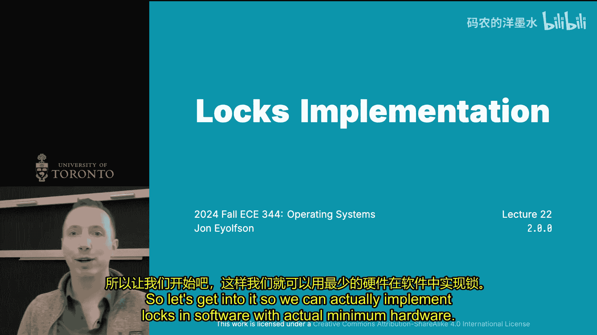
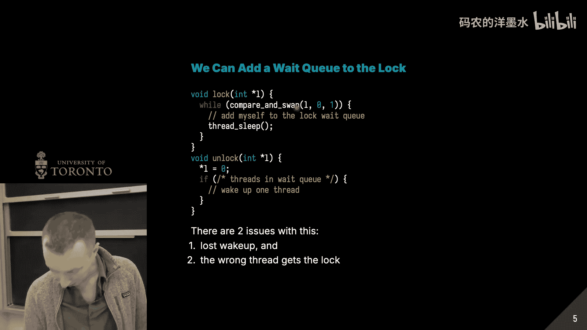
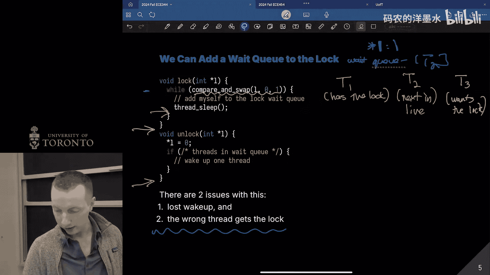
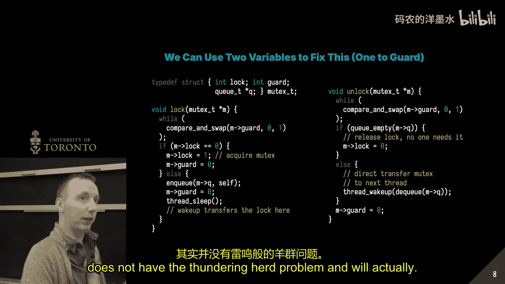
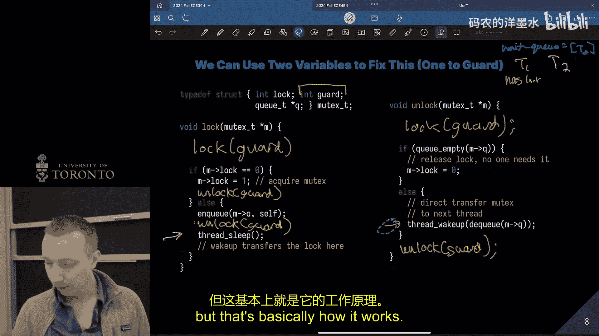
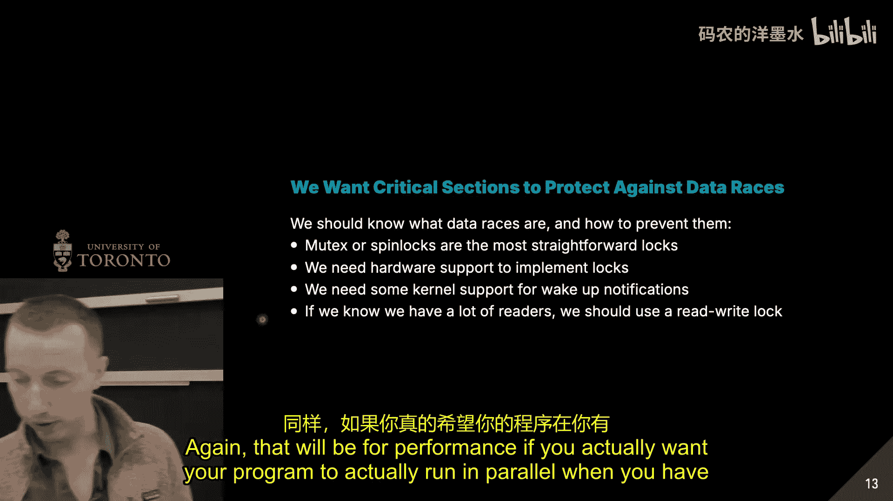

# 【全集】多伦多大学 操作系统 中英字幕 1080P p21 Lecture 21 - 锁的实现 -BV1Rbk7ByERc_p21-

Alrighty， welcome back to operating systems。 So left off Lesla sure we implemented a very crappy lock that didn't really work。

 we'll do better so let's get into it so we can actually implement locks in software with actual minimum hardware so the minimum hardware requirements are just and I can't do anything about the volume sorry just loads in stores have to be atomic and instructions execute in order and those are the only requirements you need So there's two main algorithms you can use there's Peterson's algorithm and Lamppartt's bakery algorithm which is basically trying to simulate that like I don't even know if anyone does that anymore go to a bakery。

 grab a number and then you get served in order。

So。Those are things you can do， but they are very， very slow。 So they don't scale that well。

 and processors execute out of order， so。Might not actually be able to implement them。

There is this one magical atomic function we can assume that's actually done in hardware。😊。

Most of the time it's called compare and swap and what it does is it takes an integer well it takes a pointer to some integer and then takes a old value and then a new value so the way this works is it will atomically compare the current what's pointed to by that pointer look at the value and it will always return the original value pointed to and it will only swap in the case that the old value is equal to old and it swaps it to the new value given by new here so。

It will only swap once， so it will essentially not make it possible for。U to change one to one。

 So this will only change a 0 to a1， and it will return 0。 So if we rewrite our lock implementation。

 such that lock is just now compare wall compare and swap。 So L is just a pointer to an int。

 So point to that int and we'll just do wall0。One and what this will do is it will only return zero if it has successfully changed a0 to a1。

 so if it has successfully changed a0 to a1， it returned0 and that means we can break out the while loop。

 we knew we changed it from a0 to a1 and it will do this atomically in hardware it is an atomic instruction。

Otherwise， if the current value is one， then it would just return one and we'd be in this infinite loop forever and then unlock。

We're the thread that changed it from zero to1， so there's no one else。Fighting with us。

 we can change it back from 81 to a0。 So this。Is a valid lock implementation。

 It's not a very good one， but it does work。Kind of it's missing a few properties。

 it's not fair at all。 It's not terribly efficient because even on a single core。

Even if it you should know that it can't actually acquire it。

 it will go through that wall loop over and over and over again while nothing else is going to change that value。

 but it does work。So what that is， it does have a name。

 It's called a spin lock because of that while loop。 So if it。Doesn't acquire the lock。

 It will keep on trying again and again and again。 That's where it gets the name spinlock from。

 So that compare and exchange or compare and swap is a very common atomic hardware instruction on X86。

 It's called compge short for Comp and exchange。 Again， they have to make things very short。

For some reason， I don't know why， So this implementation still has a busy weight problem。

 That means that while a thread is trying to acquire the lock。

 it's just constantly wasting our CPU trying over and over and over again。 so again。

 on a unit processor system so system with a single core if you can't get a lock a better solution would just be to yield so I yield basically I give up my share of the CPU let another thread run that hopefully has the lock so it can actually do the work unlock free the lock and then I can go ahead and use it。

On a multiprocessor system， like if I have multiple machines。

 maybe I don't want to waste the time doing a system called a yield myself。

 maybe the critical section is so small it doesn't matter in which case a spin lock might actually be a good thing to use and hopefully it doesn't waste too much time spinning。

So it has some use。 and we'll see it has some use to actually help us implement something better。So。

Our first thing that if we want to make a more generic lock that doesn't have this busy weight problem。

 what we can do is in the while loop， if we do not acquire the lock。

 then we can just do yield thread yield， but now we have another problem where there is something called a thundering herd problem and what that means is multiple threads might be waiting on the same block right so if I have eight threads waiting on it。

Then all of the eight threads are going to attempt to get it。

 even though I know only one of those eight are going to actually be successful。

 So I want something a bit smarter than this。 And I also have no control over what thread gets the lock first。

 right， There's no actual line。 It's not fair。 So I need to be able to reason about the order。

 threadreads actually acquire the lock and， having something like first come first serve。

For FiIO is actually an okay thing to do。 I just have to make sure there's some type of order。

 I cannot accidentally starve out a thread。So here is my proposed solution。So。

I am going to essentially come up with a weight queue。 So assume I just have a cu。 just be a list。

 I'll spare you the details。 But now I'll change my lock implementation so that whenever I don't acquire the lock so I go into the body of the loop。

 I would add myself to the weight queue。 So say I'm going to wait for something。

 And then I'm going to， instead of yielding。 I'm going to go to sleep。

 And what sleep will do is it will just block you until someone else wakes you up and then you're unblocked again。

 So this was also a thing you had to implement in the thread lab before。

 you had to implement a sleep and wake up。But I cut that for you， so you're welcome。

But real threads will actually have something like this。So。Now。

 in my unlock to get rid of that thundering herd problem。

 I first changed the value from a0 or a1 to a0 to indicate that Ive now unlocked the mutt。

 and now I could just simply check if there is a thread in the wake queue。

 then I just wake up one thread。 so I wake up one thread。 and then when it wakes up。

 it would return from the sleep。 and then only one thread would then again。

At least that's the idea do this compare and swap again and try and acquire the lock instead of having eight threads do it all at once。

 I just have one thread。But there is two issues that we should get used to reasoning about due to。

Essentially， data races。 So there are two issues。 One is a lost wake up， which means。

Is it possible for a thread to get put to sleep and then never wake up？

And then the other issue is the wrong thread gets the lock because I should actually give the threads the lock in the order。

 They tried to acquire it。 So the first one is asking， is it possible。

 a thread never wakes up And the second ones asking。

 is it possible that threads get the lock out of order， So for the first one， two reason about it。

Well， first。

You can't see what I'm doing。So to reason about it， we can assume we have thread1 and thread 2。

So I'll give you some hints。 You pretty much have to come up with the situation such that。

Whatever these two threads execute， that one will never be woken up again。

 So let's assume that the lock。Is locked。So the current value of the lock is 0 or sorry。

 is one and thread。One has the lock。And then thread 2， here， I'll put thread 2 in。Green。So。

Thread 2 is going to try to acquire the lock。 So it's going to call lock。And then thread one。

 which has the lock， is going to call unlock。So is there any possible innerleavings of these threads which cause thread2 to go to sleep and then never wake up again？

Yeah。感觉什么。哦，我听。We unlock it before。The， the process ended， and we tried to。

Track if a threat is limited。なだせ円で。Whenで。So yeah， what we're looking for is missing。

 waking up a thread so we can draw a weight queue here too。But。What order causes that to happen？

So one of these has to execute first， Let's just。Broup force it。

 Which one do we want to execute first， thread 1 or thread 2。Thread two。All right。

 Tread2 executes first。So if thread 2 executes first， it changes the value of the lock from a 0 to a。

Or a 12 a0。And then what checks？We didn。So， and then thread2 thread 1 executes again。

 So check the queue。 There's nothing in the queue。 That's fine。 That's expected。

nothing's in the queue， the other one hasn't started calling lock yet， so that's okay。

Nothing in the Q skips over。 It's done unlock。 Now， threadread 2 executes thread 2。

 it would do this compare and swap。 Hey， luckily， the value is 0， so it would change the 0 to a1。

Whoops。Why is this room so cursed？So it changed that 02a1。Return zero。

 so it would actually indicate that it has locked it， and then it proceeds。

So that's how it's supposed to work， right？ So threadread 1 unlocked it。

 threadread 2 acquired the lock。 That seems good。So that seemed to work as expected。

And think of a bad order， things could happen in。O。Yeah。Is it possible to？

But we try to wake up a threat when we should we didn't get a chance to。So this means it would。Yeah。

 so you're getting on the right track。 You're trying to wake up a thread that hasn't added itself to the queue yet。

 right。Yeah。G to。Mmm。かは。Yep， runs all。Yes， so the first thing that has to happen is T2 has to execute。

 right， So if T2 executes first， that means it's going to do this compare and swap first。

So the current value of the lock is one because thread1 has the lock。

 So that means compare and swap is going to return one。

 So thread2 is going to start executing the next line。

 So the next line it's going to go into the while loop。

 The next line's going to execute is add itself to the Q。But now is when we context switch。

 So if we context switch right now right before it adds itself to the Q。

 we context switch to thread1。 Well， what will happen is it will change the value of the lock now from one。

To zero。And then if it still continues execution right now， it would check。

If there's any threads in the weight queue， is there any threads in the weight queue right now， No。

 so skip， it's done， it's unlock call。 Now， if we switch back to thread2， well。

 now it would add itself to the weight queue because that's the next instruction it is going to execute。

So it adds itself to the weight queue。And then it goes to sleep。 It has a little nap。

 Is anyone ever going to wake it up。No， it is now blocked forever。

 So that is an example of a lost wake up。 So that is one bad thing that can happen。

 So that makes sense to everyone。Weve came come up with a bad situation that may happen。

 That causes some unintended behavior。 That is not great。So everyone agree with that。Yeah。

If another friend tries to come in and get the log， they would get a log。Yeah。

 and then they go to online when' they wake up eventually eventually wake up this。Yeah。

 so it could be possible。 So if that was the last thread that uses a lock。 now， it's blocked forever。

 But if another thread comes in， right， it would unlock and then maybe。Maybe wake it up。

 But if another thread came in and put itself on the Q2， then there'd be two threads on the Q。

 and it will only wake up one of those。 So it depends。 It's something that we may or may not see。

 depending on how lucky we get。But there is a situation that bad things happen。

 which makes your life a lot more fun。😊，All right。So everyone's okay with that till we get our next situation。

 So let's come up with a new situation where the wrong thread gets a lock。So， let's assume。

I'll help you out a bit here， we'll assume more or less the same scenario。

So let's assume a scenario where we have。In this case， we're going to need three threads。

So we have read one。Thread 2。 and let's assume thread 2 is properly asleep。

 So it put itself asleep because it couldn't acquire the lock。

 So thread 2 is currently in this weight queue。So if thread2 is currently in the weight queue。

 that means it should be next in line， right。Okay， let's assume we have thread 3 that wants to get the lock。

 So it is about to call。Well， it's starting to call this lock function。So。Is there a situation？

And it just has to be one interleaving of threads such that T 3 steals the lock from T 2。

Can't even see the time。Yeah。We wrote that on log。We accept。Yeah， so basically， what will happen。

 there could be a situation where。T3 steals it if thread1 executes first。

Then it would change the value of the integer from a1 to a 0。shouldn't be that。

 And now we can immediately contact switch。 if we immediately contact switch to which one thread 3。

 right， if we immediately contact switch to thread3。

 then thread3 before it checks anything is going to come here Do the atomic or do the compare swap。

 Hey， great， the value of the lock is 0。 So I just change it from a 0。😊，2， a1。

And now thread 3 has yoked the lock。 So now3 thread 3 has acquired the lock。

Now what's going to happen， nothing bad is going to happen past this other than thread3 yainking the lock because if thread1 continues。

 what it's going to do is check if theres threads in the weight queue。

 so it would wake up one thread so it would remove thread2 from the weight queue oops。

So remove thread2 from the weight queue， and then it would finish。

Then thread2 would return from the sleep。Come back up here。

 do the compare and swap again and then see that， oh， no， the current value of the lock is one。

 so it will just add itself to the weight queue again。And then take a nap again。

 So nothing that bad will happen in this case。 Just the wrong thread got the lock。

 So everyone understand that。Because you will have to tell me these things and come up with these situations。

 So I will probably ask you， hey， is there a situation where this may occur。

 You'd either have to argue it's all good or come up with an example like that。

All right， so just so you have it， there is the lost wake up example。At the bottom there。

 just so you can go through it and then the wrong thread getting the lock example。

 there is a situation there for you as well。So。This is how we can fix the lock。

 So this is closer to the actual implementation of a mutex。 So this。

I submit to you is the fixed version that does not have the lost wake up problem and does not have the thundering herd problem。

 and willll actually。

Will not allow another thread to maintain the lock。 So everyone like the look of that。

Looks fantastic right so let's break it down real quick and let me know if there's any problems using this。

 So the whole trick of this is it uses that same idea so we're going to have a queuee of waitinging threads that we're going to have in line。

But we had some problem where we had essentially a data race problem before in our muttex function。

 So what we are going to do is we are going to use a spin lock。

To help us implement our lock functions。 So this guard right here， this guard integer。

 we are going to use that integer essentially as a spin lock for the lock and unlock functions。

 So in order to make it a bit more readable， what you can do is this while compare swap of the guard。

Well， you could get rid of that whole thing if you wanted。

Because that's essentially the same as just。That is way too big。

So that's the same as just locking the guard。This room is cursed。

So that's the same as locking the guard right， And then at the end。

 whenever we just set whenever we set the guard to zero and we do it in both sides of the branch。

 so we make sure we unlock it。So setting it to zero， boom， boom to make this a bit more readable。

That's the same as the unlock。Of the guard。So now in our lock function。

 we lock the guard so that only one thread can actually execute the code after it。

 so we don't actually need a compare and swap anymore for implementing the muttex since we have acquired the spin lock which we argue does work。

 it's just slightly inefficient sometimes but this is really small。

 we don't need compare and swap anymore so we can just go ahead and check if the value of the lock is0。

 we change it to a1， otherwise if the current value of the lock is1。

 we would add our to the Q and then we can unlock yeah。Sure that only。that time log or。結だけ。なで？Yeah。

 so this is like that protected section we had before， so any code between lock and unlock。

 only one thread can be running at a time， so we won't have the situation like we had before。

So we can go over both situations as well。 So here in the unlock。Again。

 this comparing swap of the guard。Well。That's essentially a lock of that spin lock。

 so to make it a bit more readable， I could just， that's the same as lock of the guard。And then。

At the end， this unlock。This is an unlock of the guard。 So now in the unlock， well。

 I acquire the spin lock and I would first check if the queue is not empty or if the queue is empty。

 then I just。Change that value from a1 to a0。 If there is something in the Q。 Well， essentially。

 I just， the way this works is I just keep the value at one， and I just wake up the other thread。

 which is here。I transfer the lock to that and that will only wake up a single thread that is waiting and the value of the lock is still one。

 but one thread wakes up and then finishes that function and now essentially I has transferred the lock to that thread so now it can continue on its merry way。

So any arguments with this implementation？So we can check。To see if we can。

Have that lost wake up issue again。 So remember in the lost wake up issue。

 we had threadread1 has the lock。And then thread two was trying to acquire the lock， right？

So in our lost wake up issue。What happened first is。That thread one executed first， right。

 thread1 executed first and actually went ahead and changed the value of the lock。

 So let's see what happens if we do it now。 Well， now， oops， now the first thing we do。

Is execute thread1。 If we execute thread1 first。Then。It would lock the guard。

 so it's the only one that has the guard。And it would check the Q， OK， it's empty。

 it changes the value of the lock from a1 to a0， so 1 to 0。And then now。

 if we context switch over to thread2 that had an issue before， Now what happens。

 What can thread 2 do。Yeah， it can't do anything right。

 because thread1 still has that guard spin lock。 So it has that guard spin lock。

 So now if thread 2 tries to run， it can't make any progress， right。

 It's stuck there until thread1 is done what it's going to do。 So it's not done yet。

 it will get stuck there and the only choice to make progress is to execute thread1。

 So we've essentially prevented that lost wakeup example， right。So now it would just go through。

 okay， change the value of the lock from 1 to0 and then unlock。After it's unlocked the guard。

 then thread2 can progress， and then it would just change that value from a1 or a0 to a 1 to indicate that it has that lock。

All right。So。Any issues with this or does it look like a very was the word crmulent implementation？

Is this a perfect implementation work 100% of time， yeah。Get my contact with before this week。Yeah。

 yeah。 So there is one very， very subtle issue。 but luckily， it is detectable and fixable。

 If you didn't hear that what that one very subtle issue is is let's assume thread1 has the lock again。

 right。So if we assume thread1 has the lock and then thread 2 is trying to acquire the lock。

 what may happen is that， okay， if thread2 executes。Then it acquires the lock。The guard lock。

 it would come in here， check if the lock is zero currently it is not because thread one has the lock。

 so it would go in here， add itself to that weight queue， so we would have a weight queue up here。

So it added itself to the weight queue。And then it unlocks the guard。

Now we can freely swap to thread1， right， So now we can freely swap to threadread 1。

 Thread1 can acquire that guard。Oops。It can now acquire that guard。Check if the queue is empty。 Oh。

 currently， it is not empty， so it should come here。

 and then it will try and wake up a thread that is no that is not asleep yet。So very， very。

 very subtle issue， the nice thing about this is since there's no data race with the queue itself。

It knows that thread is definitely about to go to sleep。 So since it's about to go to sleep。

 we can just retry it a few times until it successfully wakes it up。 So I spared you those details。

 but essentially， a real implement， this is a real implementation。

 The only other thing is that wake up would have to retry itself。 If that thread isn't asleep yet。

Everyone good with that。try to。させなまが。So， so if you try and wake up something that's not asleep。

 you just get an error saying that thread's not asleep yet， so。In the real implementation。

 if you saw that error， you would just retry it because you know it's about to go to sleep。

So subtle issue。 But that's basically how it works。 So have the slide that says， yet。

 there's still a data race to explain that one situation。

Okay， so。We had the comment， I think last lecture， too。

 So remember what causes a data race And again， I'm saying data race again。

 So you should know what this is。 So a data race， two concurrent accesses to the same variable with at least one of them being a right。

So that means that even if there is a single right and it is uncommon。

 you have to protect the reads as well。 if at least one of them is a right。

 but if you know you have only reads， you can do as many reads as you want in parallel right so you ideally want to if reading is really common writing is uncommon。

 you'd like to have as many readers all reading at once as you can and if a write happens。

 then you need mutual exclusion so you don't have a data race So basically for that you kind of want different behavior depending on whether you are reading or writing So they came up with this other lock that has a very。

 very very creative name， it's called a read write lock。Wow， so a read write lock。All it does is。

Allows you to use the lock for two purposes so you can either use the lock for reading。

 which will ensure that all the other threads are only reading。

 or you can lock it for writing which will make sure that you are the only thread that has access to that lock now so this is mostly for performance because reads can happen in parallel again as long as there is more rights。

 so multiple threads can hold the read lock all at the same time。

 only one thread may hold the right lock， therefore we still don't have any data races so。

An implementation of a read write lock could look like this so same idea as before we have this internal guard just to make sure we don't have any data races in this case we don't want any data races。

 we're going to keep track of a field called number of readers so other than that we're just going to have this lock here we're going to assume it's just a mutex so if it's just a mutex the implementation of the right lock and the right unlock can just be well。

 just lock that muttex and unlock that muttex。Well the read lock implementation is to simply。

Lock the guard so that guard is protecting accesses to this end readers。

 keeping track of how many readers we have， because we now know that plus plus end reader。

 that's a memory load and then a memory right。So it will increment the number of readers。

 then check if I have increased it from 0 to 1。 This means it's the first reader。

 then I acquire that muttex。 And then other than that， if I have multiple other readers come along。

 So if I increment it from a。1，282。 then I don't do anything right。

 because I already have some the first thread already acquired that mutex and I'm just sharing it because all we're doing is reading。

 and then at the end， I unlocked the guard because that was just protecting the number of readers。

And then in the unlock， all I do is lock that guard， decrement the number of readers。

 and if I'm the last reader， then I unlock that mutex。

 and then after that I can unlock that guard because I was just using it to protect any。

Writes or reads to this N reader variable。 So does that look like a good implementation or is there some type of issue。

And I will give you a hint， it works properly。But is it fair。m。Yeah。で気た。Yeah。

 you can starve the right。 So no matter if one reader comes in and then a writer。

Tries to acquire the lock。 I can have a constant stream of readers come in such that the writer will never actually acquire it。

 even though it was technically second in line。 So this would。Suffer from starvation。

 so I could starve a writer fairly easily。 So this is the right idea。 This is kind of how it works。

 except the real one would have to be fair， but that's boring to fit on a slide。

 but that's kind of the right idea。 So they'd have to have a real implementation probably want some type of cue to see when a reader when a writer actually request a lock in which case it would probably block any more readers from happening。

 let the current readers finish and then let the writer do it。 but gets the same idea。

 we want parallelism for all the reads， we can have multiple reads happen at once as long as no write happens at the same time。

So。And questions about that。 Fun locks。 that are， That's basically how you implement a mutex and a read write lock。

Joy， everyone looks like they're about ready to have fun with another midterm。Yeah。

 that sounds a about right All right， then we will wrap it up quickly then so we need critical sections。

Two actually protect against data races， critical section again。

 only one thread can execute at a time it's always between the lock and the unlock。

 so you should know what data races are and how to prevent them。

 new Texas or spin locks are the most straightforward locks to actually implement locks。

 you need hardware support like that compare and exchange instruction or compare and swap。

You would need some kernel support for thread， sleep and thread wake up and then。You know。

 if we have a lot of readers， you should use a read write lock again。

 that will be for performance if you actually your program do actually run in parallel when you have multiple threads。

 so just remember boom for you。

