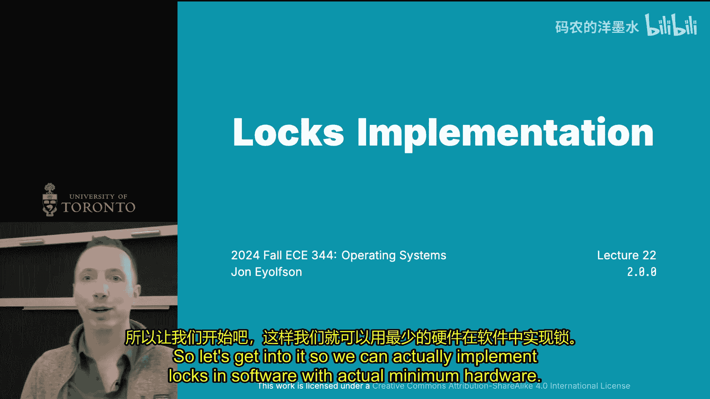
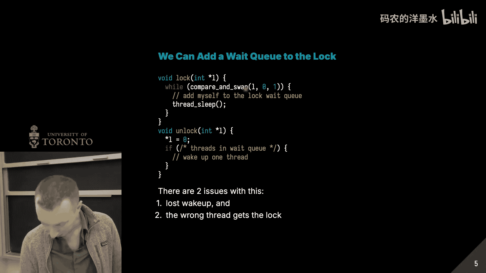
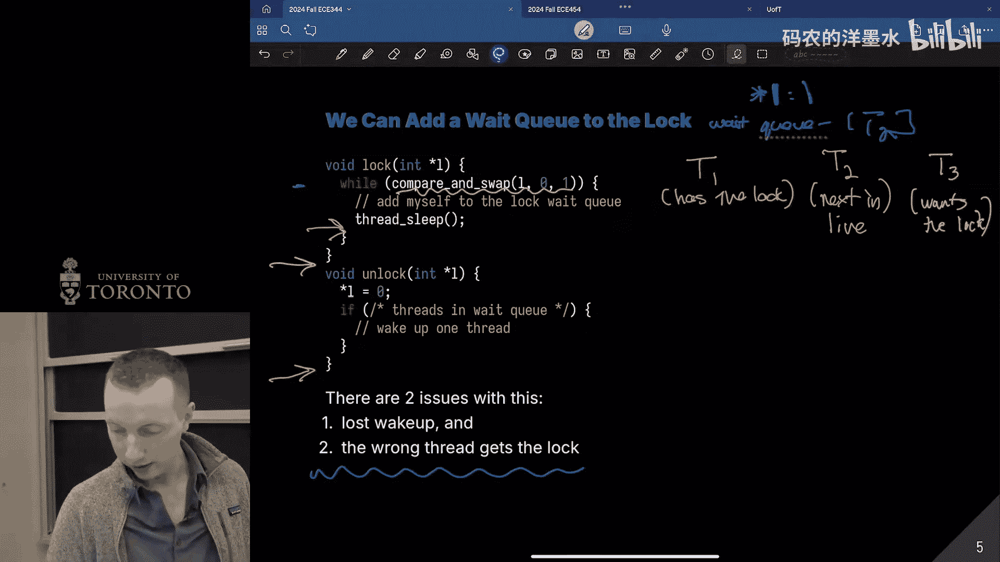
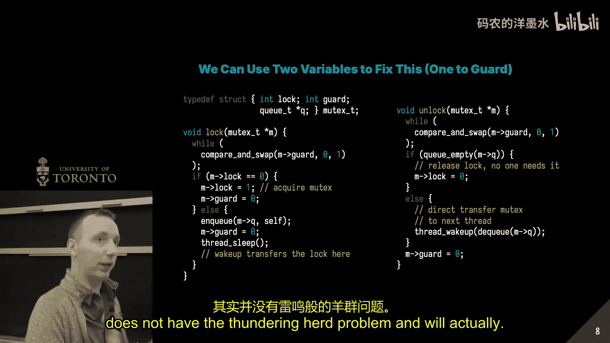
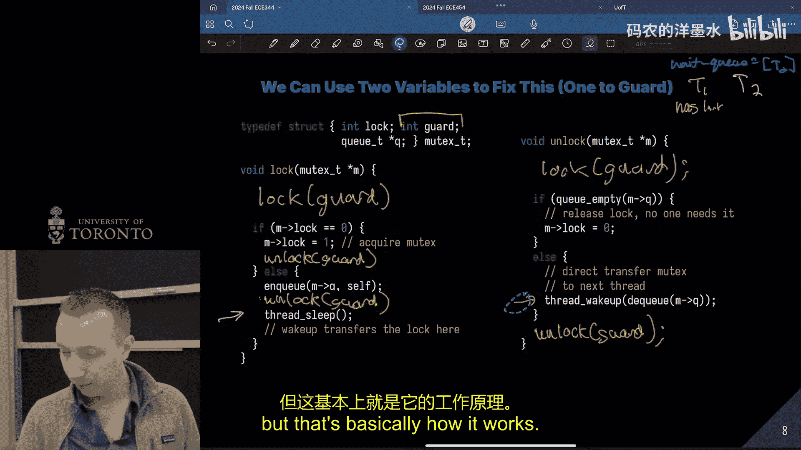
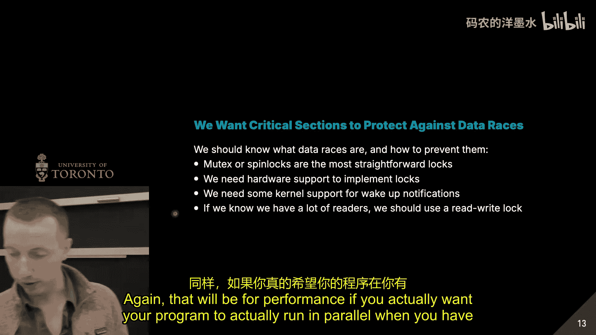

# 操作系统：第21讲：锁的实现 🔒



在本节课中，我们将学习如何实现一个真正有效的锁。我们将从硬件支持的最小原子操作开始，逐步构建一个公平、高效且能避免常见问题的锁机制。

---

## 概述

上一节我们实现了一个非常简陋且无效的锁。本节中，我们将做得更好。我们将探讨实现锁所需的最小硬件支持，介绍几种软件算法，并最终构建一个功能完整的互斥锁（mutex）和读写锁（read-write lock）。

---

## 硬件支持：原子操作

要实现锁，我们需要硬件提供一些基本的原子操作。最基本的要求是：
*   **加载（Load）**和**存储（Store）**指令必须是原子的。
*   指令按顺序执行。

有了这些基础，我们可以实现一些软件算法，例如**Peterson算法**和**Lamport的面包店算法**。这些算法试图模拟“取号排队”的行为，但它们通常非常慢，扩展性不好，并且现代处理器的乱序执行特性可能使其难以实现。

幸运的是，现代处理器通常提供一个关键的原子硬件指令，我们称之为**比较并交换（Compare and Swap）**。

### 比较并交换（Compare and Swap）

这个函数通常接受一个指向整数的指针、一个旧值和一个新值。其工作原理如下：
*   它**原子性地**比较指针当前指向的值与给定的旧值。
*   它总是返回指针**原本指向的值**。
*   只有在当前值**等于**旧值时，它才会将指针处的值**交换**为新值。

用伪代码表示其行为如下：
```c
int compare_and_swap(int *ptr, int old, int new) {
    int original = *ptr;
    if (original == old) {
        *ptr = new;
    }
    return original;
}
```
这意味着，例如，它只会成功地将一个 `0` 改为 `1`，并返回 `0`。如果当前值已经是 `1`，则不会发生交换，并返回 `1`。

---

## 实现一个简单的自旋锁

利用 `compare_and_swap`，我们可以实现一个最简单的锁——**自旋锁（Spinlock）**。

以下是其实现思路：
```c
void lock(int *lock) {
    while (compare_and_swap(lock, 0, 1) == 1) {
        // 忙等待，不断尝试获取锁
    }
}



void unlock(int *lock) {
    *lock = 0;
}
```
**工作原理：**
*   `lock` 函数在一个循环中不断尝试使用 `compare_and_swap` 将锁变量从 `0` 改为 `1`。
*   如果成功（返回 `0`），则跳出循环，表示获取了锁。
*   如果失败（返回 `1`），则继续循环，不断“旋转”尝试。
*   `unlock` 函数简单地将锁变量设回 `0`。

**这个实现存在的问题：**
1.  **不公平**：无法保证等待最久的线程能先获得锁。
2.  **效率低下（忙等待）**：即使在没有机会获得锁的情况下（例如单核系统上锁已被占用），线程也会持续消耗CPU周期进行无意义的尝试。

自旋锁在**临界区非常小**且运行在**多处理器系统**上时可能有用，因为它避免了线程切换的开销。但在单核系统或临界区较长时，忙等待会浪费大量CPU资源。

---

## 改进：让出CPU与睡眠

为了解决忙等待问题，一个直观的想法是：如果获取锁失败，线程不应该空转，而应该主动**让出（Yield）** CPU。

### 让出CPU（Yield）

改进后的 `lock` 函数如下：
```c
void lock(int *lock) {
    while (compare_and_swap(lock, 0, 1) == 1) {
        thread_yield(); // 让出CPU，调度其他线程运行
    }
}
```
这解决了单核系统上的CPU浪费问题。获取锁失败的线程会主动放弃CPU，让持有锁的线程有机会运行并释放锁。

然而，这引入了新的问题：
1.  **惊群效应（Thundering Herd）**：当锁被释放时，所有等待的线程都会被唤醒并同时竞争锁，但最终只有一个能成功，造成了不必要的上下文切换和竞争开销。
2.  **缺乏公平性**：仍然无法控制线程获取锁的顺序，可能导致某些线程“饥饿”（Starvation）。

---

## 目标：一个更完善的锁

我们需要一个更智能的锁，它应该具备：
*   **避免惊群效应**：一次只唤醒一个等待线程。
*   **保证公平性**：按照线程请求锁的顺序来授予锁（例如，先来先服务）。
*   **避免“丢失唤醒”**：确保每个进入睡眠的线程最终都能被唤醒。

我们的解决方案是引入一个**等待队列**。

### 使用等待队列的锁（初步尝试）

以下是初步的实现思路：
```c
void lock(int *lock, Queue *q) {
    while (compare_and_swap(lock, 0, 1) == 1) {
        // 获取锁失败
        queue_add(q, self); // 将自己加入等待队列
        thread_sleep();     // 进入睡眠，等待被唤醒
    }
}

void unlock(int *lock, Queue *q) {
    *lock = 0; // 释放锁
    if (!queue_empty(q)) {
        thread_wakeup(queue_remove(q)); // 唤醒队列中的一个线程
    }
}
```
**思路：**
*   在 `lock` 中，如果获取失败，线程将自己加入等待队列并睡眠。
*   在 `unlock` 中，锁持有者释放锁后，检查等待队列。如果不为空，则唤醒队首的一个线程。



但这个初步实现存在严重的**竞态条件（Race Condition）**问题。



---

## 分析竞态条件问题

我们需要分析两种可能的错误场景。

### 1. 丢失唤醒（Lost Wakeup）

**场景：** 线程T1持有锁，线程T2尝试获取锁。
**错误执行顺序：**
1.  T2 执行 `compare_and_swap` 失败（因为锁为1）。
2.  T2 **即将**执行 `queue_add` 将自己加入队列，但此时发生上下文切换。
3.  T1 执行 `unlock`：将锁设为0，检查队列（此时T2还未入队，队列为空），因此**没有唤醒任何线程**，然后结束。
4.  切换回 T2：T2 执行 `queue_add` 将自己加入队列，然后执行 `thread_sleep()`。
5.  **结果**：T2 永远睡眠，无人唤醒。

### 2. 错误线程获得锁（Wrong Thread Gets Lock）

**场景：** 线程T1持有锁，线程T2已在等待队列中睡眠，线程T3也尝试获取锁。
**错误执行顺序：**
1.  T1 执行 `unlock`：将锁设为0，然后唤醒等待队列中的T2。
2.  在T2被唤醒并重新执行 `compare_and_swap` **之前**，发生上下文切换到T3。
3.  T3 执行 `lock`：发现锁为0，成功通过 `compare_and_swap` 将锁设为1，**抢先获得了锁**。
4.  切换回被唤醒的T2：T2 执行 `compare_and_swap`，发现锁已被T3设为1，获取失败，只好再次将自己加入队列并睡眠。
5.  **结果**：本应获得锁的T2被T3“插队”，锁的授予顺序不公平。

---

## 最终方案：使用守护自旋锁

问题的根源在于，`lock` 和 `unlock` 函数内部的多个步骤（检查锁状态、操作队列）本身不是原子的，导致了竞态条件。

解决方案是：**用一个锁来保护另一个锁的实现**。我们使用一个简单的**自旋锁**作为“守护锁”（guard lock），来确保 `lock` 和 `unlock` 函数体内部的代码是原子执行的。

以下是修复后的实现：
```c
// 假设 guard 是一个用于实现互斥的自旋锁
// lock 是我们要实现的互斥锁的状态（0=空闲，1=占用）
// q 是等待队列

void lock(int *lock, int *guard, Queue *q) {
    // 首先获取守护锁，确保下面代码块互斥执行
    while (compare_and_swap(guard, 0, 1) == 1) {} // 自旋等待获取guard

    if (*lock == 0) {
        // 锁空闲，直接获取
        *lock = 1;
    } else {
        // 锁被占用，加入等待队列并睡眠
        queue_add(q, self);
        thread_sleep(); // 睡眠时会自动释放guard？需要实现支持
    }
    // 释放守护锁
    *guard = 0;
}

void unlock(int *lock, int *guard, Queue *q) {
    // 获取守护锁
    while (compare_and_swap(guard, 0, 1) == 1) {}

    if (queue_empty(q)) {
        // 没有等待者，直接释放锁
        *lock = 0;
    } else {
        // 有等待者，不修改lock状态，直接唤醒队首线程
        // 被唤醒的线程将在lock函数中继续执行，并设置*lock=1
        thread_wakeup(queue_remove(q));
    }
    // 释放守护锁
    *guard = 0;
}
```
**关键改进：**
*   **守护锁（`guard`）**：这是一个自旋锁，用于保护对 `lock` 状态和等待队列 `q` 的所有操作。在 `lock` 和 `unlock` 函数的开头和结尾分别获取和释放它。
*   **消除竞态**：由于守护锁的存在，`lock` 函数中“检查锁状态”和“加入队列”成为原子操作，解决了“丢失唤醒”问题。`unlock` 函数中“检查队列”和“唤醒线程”也成为原子操作。
*   **锁的传递**：在 `unlock` 时，如果有等待线程，持有者并不将 `*lock` 设为0，而是直接唤醒一个等待线程。被唤醒的线程（在 `lock` 函数中从 `thread_sleep()` 后继续执行）会发现自己已被授予锁，并完成后续操作。这保证了锁在所有情况下都能正确传递。

**一个非常细微的竞态：**
在 `lock` 函数中，线程将自己加入队列后、调用 `thread_sleep()` 之前，如果 `unlock` 函数恰好执行并尝试唤醒它，可能会发现该线程还未完全进入睡眠状态。一个健壮的实现需要处理这种情况，例如让 `wakeup` 操作重试或使用更底层的同步原语（如 futex）来避免此窗口期。

---



## 读写锁（Read-Write Lock）

之前讨论的锁都是**互斥锁**，任何时候只允许一个线程进入临界区。但在某些场景下，如果只是读操作，多个线程同时读取共享数据是不会引发数据竞争的。为了提高并发性能，我们引入了**读写锁**。

读写锁允许：
*   **多个线程同时持有“读锁”**，用于只读操作。
*   **只有一个线程能持有“写锁”**，用于写入操作，且此时不能有任何读锁或其他写锁。

一个简化的读写锁实现如下：
```c
typedef struct {
    mutex_t lock;       // 保护数据的基础互斥锁
    int reader_count;   // 当前读者数量
    mutex_t guard;      // 保护 reader_count 的互斥锁
} rwlock_t;

void read_lock(rwlock_t *rw) {
    lock(&rw->guard);             // 保护 reader_count
    rw->reader_count++;
    if (rw->reader_count == 1) {  // 第一个读者
        lock(&rw->lock);          // 获取基础锁，阻止写者
    }
    unlock(&rw->guard);
}

void read_unlock(rwlock_t *rw) {
    lock(&rw->guard);
    rw->reader_count--;
    if (rw->reader_count == 0) {  // 最后一个读者
        unlock(&rw->lock);        // 释放基础锁，允许写者
    }
    unlock(&rw->guard);
}

void write_lock(rwlock_t *rw) {
    lock(&rw->lock); // 直接获取基础锁，阻止所有其他读者和写者
}

void write_unlock(rwlock_t *rw) {
    unlock(&rw->lock);
}
```
**工作原理：**
*   `read_lock`/`read_unlock`：使用一个计数器 `reader_count` 跟踪读者数量。第一个读者需要获取基础 `lock`，最后一个读者释放它。中间的读者只需增减计数器。
*   `write_lock`/`write_unlock`：直接获取和释放基础 `lock`。

**注意：** 这个简单实现可能导致**写者饥饿**。如果一直有新的读者到来，写者可能永远无法获得锁。一个公平的读写锁实现需要额外的机制（例如，当有写者等待时，阻止后续的读者）来保证写者有机会执行。

---

## 总结

本节课中我们一起学习了锁的实现原理：
1.  **硬件基础**：实现锁需要硬件提供原子操作，如**比较并交换（Compare and Swap）**。
2.  **自旋锁**：基于忙等待的最简单锁实现，适用于短临界区和多核场景。
3.  **问题与改进**：简单的锁存在忙等待、不公平、惊群效应等问题。通过**让出CPU**和引入**等待队列**，我们可以改善这些问题。
4.  **竞态条件**：在实现更复杂的锁时，必须仔细处理**丢失唤醒**和**错误授予**等竞态条件。使用一个**守护自旋锁**来保护锁本身的实现是常见的解决方案。
5.  **读写锁**：为了提升读多写少场景下的并发性能，可以使用读写锁，它允许多个读者并行，但写者独占。



锁是构建并发程序的基础，理解其实现原理对于编写正确、高效的多线程代码至关重要。