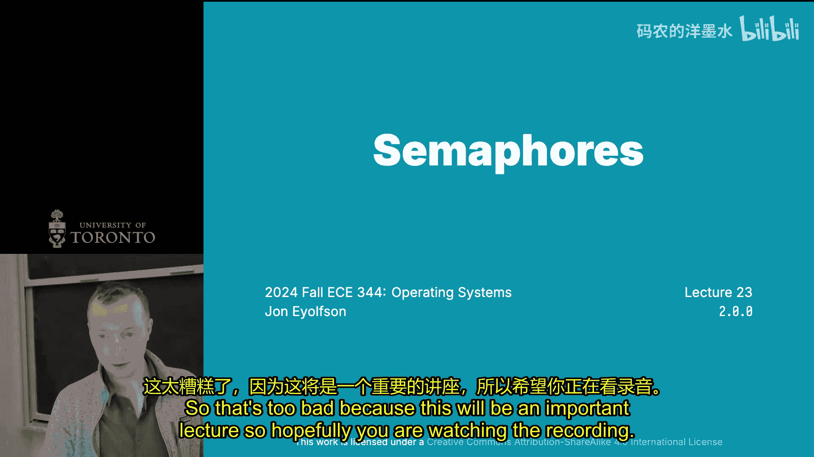
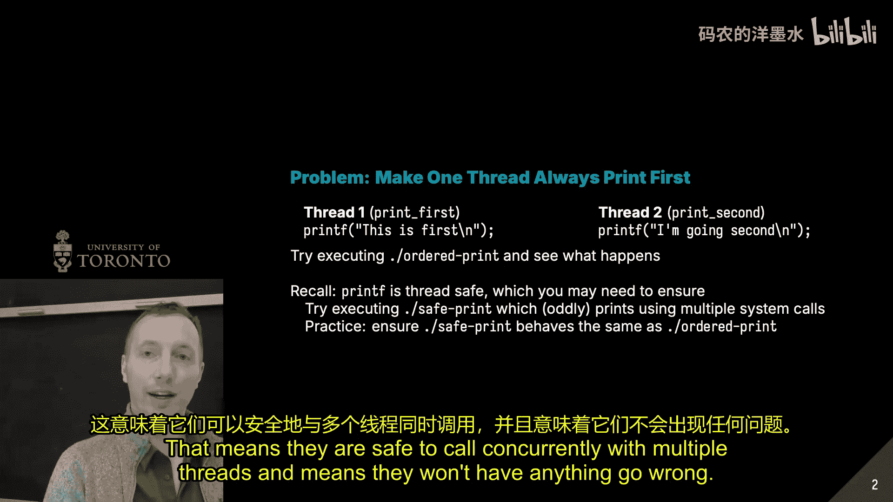
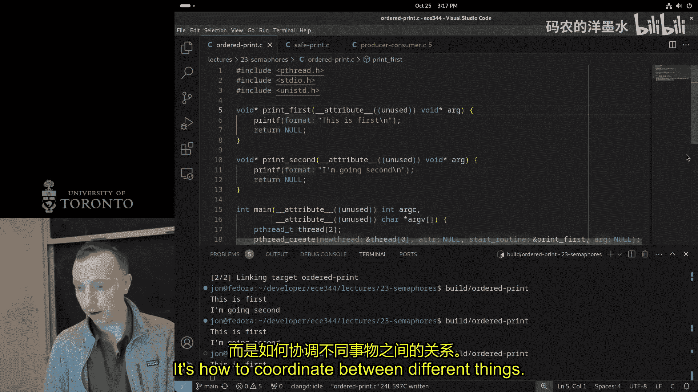
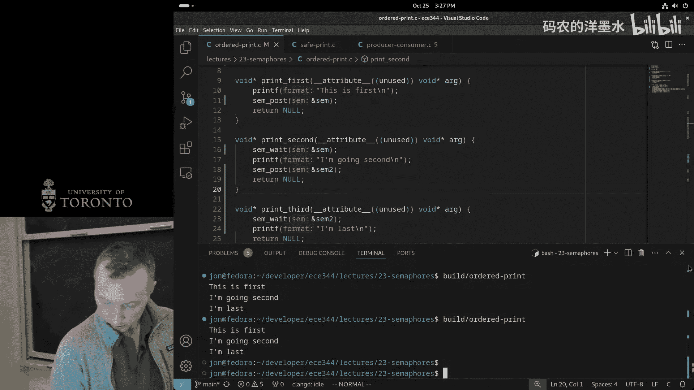
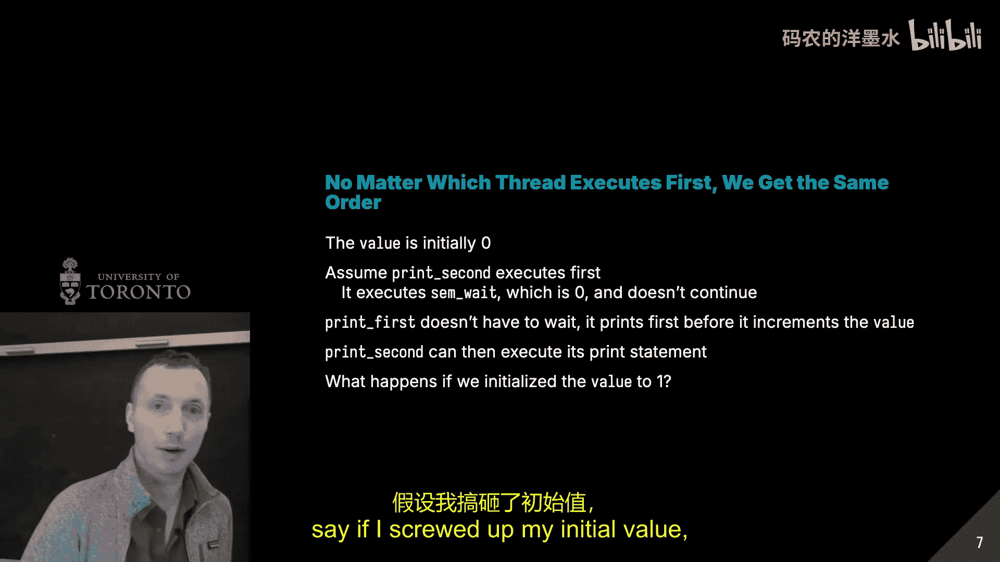
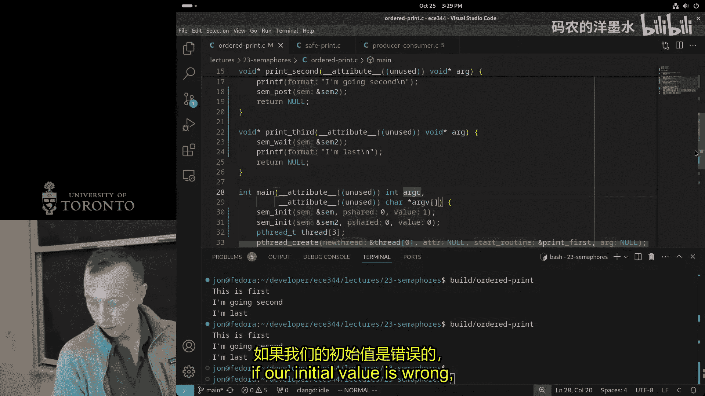
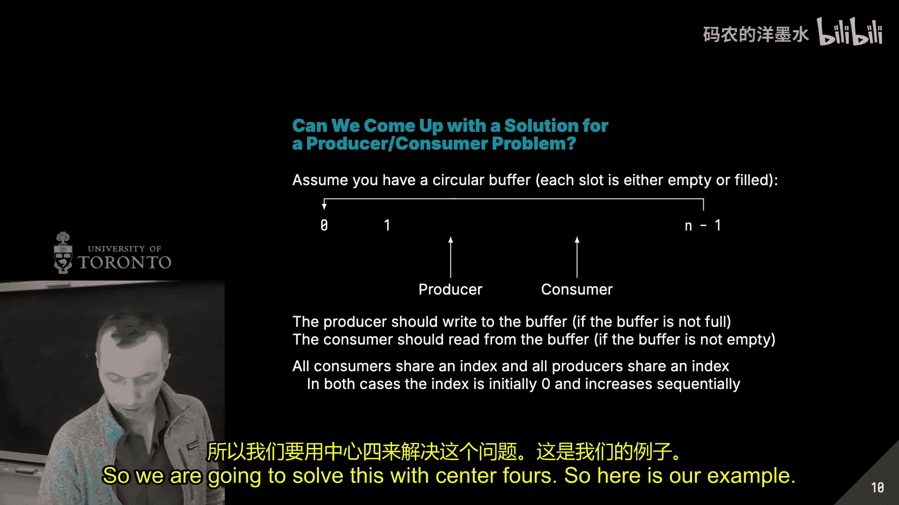
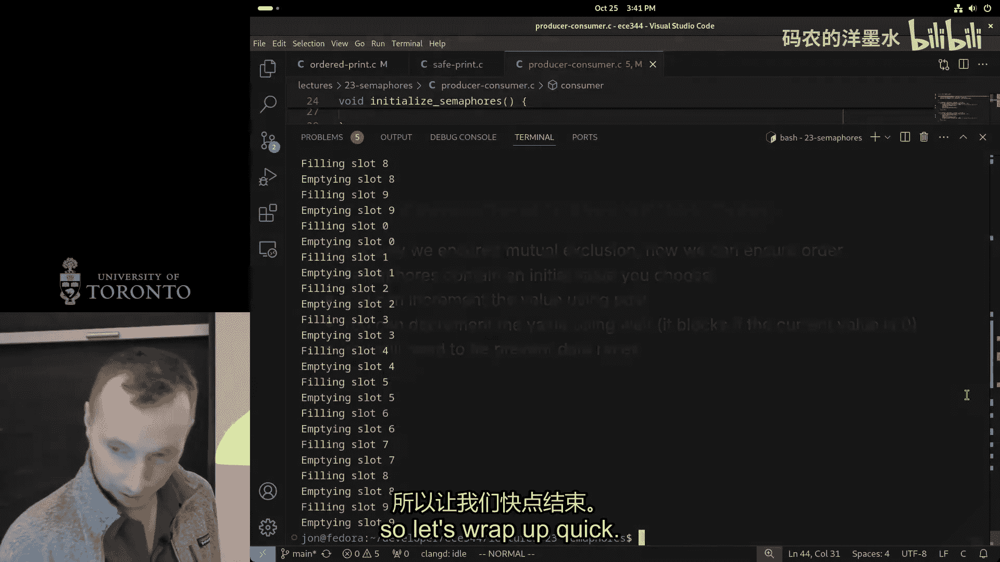
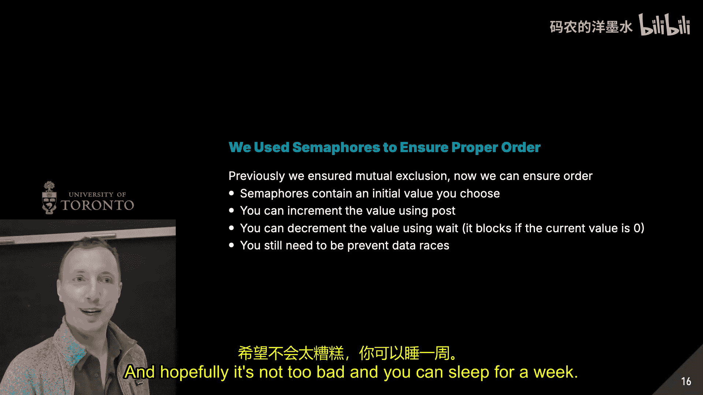

# 【全集】多伦多大学 操作系统 中英字幕 1080P p22 Lecture 22 - 信号量 -BV1Rbk7ByERc_p22-

🎼Okay。🎼Okay。All right， welcomecom back to operating systems。 We got solid four people here today。

 So that's good。 So that's too bad because this will be an important lecture。

 So hopefully you are watching the recording。 So center4 Oh5 perfect。 So we had locks before。

 So locks ensuresured mutual exclusion， only one thread could run that protected section。

 which is between the lock and the unlock call at any given time。

 but it does not help us if we want ordering between threads。

 So how do we ensure some ordering between threads。 So the first example the day。😊。

Well， the thing we're going to solve today is we're going to make sure that if we have two threads set up one thread that's about to print。

 this is first and another thread that says I'm going second。We want that order to happen。

 We want threadread one to always print this is first， first， and then have the other one print。

 I'm going second， second so。First thing to note is now since we are dealing with data races and that you now have to make sure the functions you call are something called threada。

 That means they are safe to call concurrently with multiple threads and means they won't have anything go wrong。

 So turns out now you're going to have to search any function that actually is used by multiple threads。

 So it's possible that I call print F from two different threads at the same time， concurrently。

 So now I need to look up the documentation for print F。 if I look at attributes。

It says the interface to all them， and then it has this attribute where it says thread safety。

 So it will tell us whether or not it is safe to use with multiple threads at the same time。

 if it says empty thread or empty safe， that means it's safe to use with multiple threads。

 and you don't have to worry about it。 If a function does not say this。

 that means you do absolutely not want to call it with multiple threads concurrently because something can go badly wrong。

 It may have a data race in it and even worse someone might not know that wrote that function might not even know what a data race is。

 So it definitely probably has one。So。Here is our example， So we' are going to create two threads。

 We have two run functions， one called print first。The other called print second。

 And they say data is print one line。 This is first。 This is second。

Then we create them and we join them。 So if I run this right now。

 is there any guaranteed ordering between the two threads。No， right。 So even if I run it。

It's called ordered print， so even if I run it， hey， it did the right order that I wanted it before。

 but if I run it multiple times， oh no， the second time it did not run correctly。

So is there anything we can do to make sure that。The first thread prints。

 this is first before the other one print， this is or I'm going second。Join so one way I could do is。

 yeah， join them。 But then I essentially make it serial。 If I create a thread， join it。

 create a thread， join it。So without。Changing， like creating two threads and having them maybe run in parallel。

 I there any way that I can make sure that there's an order between them。 Any ideas。

So I'll propose a clever one for you。So let's create a mutex。I'll call ity， let's just call it M。

 P thread。Mutex initializer， so I'm going to do something。Very fun。

 So I want this thread to go second。 So what I'm going to do is let's see if I can do P thread。😊。

Vi textex lock。So let's look at。And then I will lock it again， and then I'll have this thread。

 actually the first thread unlock it。So what might happen then if if the second thread runs first。

It would acquire the Mutex。 So it's the only one allowed to do that。 And then。Now。

 if it hits lock again， it can't pass lock until it's been unlocked， right。

 Well the only point it's going to be unlocked is if the first thread executes。

 prints this is first and unlocks it。 So if it unlocks it。

 well then it should be able to pass this lock and then finally print I'm going second。

Everyone agree with that？Second unlock after the print。Yeah， if I want to balance it。

 I could do that shirt like that。All right， well， let's just。Yeah。

I was going to say that this act are different。Yeah， it's a global variable so M's the same。

 same mutex。So let's try and run this。This is first， second。First。Hmm， help， explain。So。

You being the first thread ran first。Yeah， so initially the mutex is unlocked。

 so the first thread ran first and then unlocked and already unlocked Muex。And that does nothing。

 Actually， that does undefined behavior technically。 So that's our first wrong thing。 And then yeah。

 lock， lock also。Technically， when we had when it did work， technically。

 we were using undefined behavior too， because this thread locked it， when it did work。

 and then this thread unlocked it， that was also technically undefined behavior so。

Unlocking and already unlock lock is undefined behavior。

 An unlocking a lock that was locked by something else is also undefined behavior。

 So we want something that kind of has this idea， but actually works。

But this is absolutely not the right thing to do。Absolutely not the right thing to do。

 There are like several things wrong with this， so。What we actually want， let's delete everything。

So what we actually want is something called a Center4。

 Has anyone ever heard the term Center4 before， Do we have any votersers in chat。So center4s。

 they are for originally for ship signaling。 It's like a series of different flags to communicate between ships。

 So you wave flags in a certain way to communicate what you're doing to another cargo ship or something like that。

 So we stole that idea because it's in some type of ordering between things。

 It's how to coordinate between different things。 So we just kind of stole that name。

So Senate fours are what we use for signaling。 I've used the word signaling here。

 This is nothing to do with interrupts or anything like that， nothing to do with signals。

 just the generic English term signaling。 So how Senate4s work。Is essentially。

 they have a value that's shared between all the threads optionally。

 you can share it between processes if you want to have some ordering between processes and think of a center 4 as simply just a integer value that is always greater than or equal to0。

 So technically it's an unsign int。 if you want to think of as just an int that is0 or greater。

 go ahead and center4s， you have two fundamental operations you can do with them。

 and they happen atomically。 so they will not have any data races。

 So the first function that you can use with the center 4 is called weight that will atomically decrement the value and then post will atomically increment the value。

 So it will increase it by one。The only catch here is that weight behaves differently so that integer value cannot go below 0。

 So if。You call weight， and the current value is 0， Well it can't go negative。 It can't subtract。

One from0， otherwise it would go negative and break the fact that the value is always 0 or greater。

 so weight will block until another thread posts and increment it so it will wait。

 block until another thread increments it from0 to1 and then a thread can get unblocked and then decrement it and finish the weight so。

Initially， you can set that value to whatever you want， that initial value， you can set it to 0，1。

 whatever value makes sense。 Basically what that means is the initial value you set it to is how many threads can make it past a weight call without any post calls so。

How you use a center4 API， it's similar to locks， so I have to initialize it and destroy it。

 so it takes the type is just S underscore T， so it takes it by pointer to initialize it。

The second argument is P shared。 So it's just a bully and yes or no。

 whether you want it to be shared between processes， so。If this is0。

 it's not shared between processes。 So if you fork， they're still independent。

 if you set it to one and you fork that center4 shared between processes， it's the same value。

 so you can coordinate between processes for the purposes of this course will just worry about a center4 within a process between thread。

 So we'll always set to0。 and then you have the initial value， then destroying it。

 and then you have weight， which again， will atomically decrement it and make sure that the value is above0。

 So it can actually decrement it。 And then there's a non- blocklocking version of try weight。

 which will tell you yes or no whether it was able to decrement it。

 And then there's post which atomically increments it， it will never block。

 So they'll all return 0 on success and you probably will never check the return value of them except for maybe a net so。

Now， with center 4s in our back pocket， let's see if we can go ahead and make them print in order so you can't see what I'm doing。

 There we go。 So to use a center4， just like a P thread Mutex。 we will have to create one。

 I will I will name it S because I am creative， So to use it， we need to include the Se4 library。

So I create one as a global variable。 Let's call it static and then。

First thing I like doing what' the center for is placing the weight。

 So it's easiest to argue about what I do not want to happen first。

 So what which print line do I not want to happen first。The second， right？

If I want it to not happen first， I should place my weight right here。

So I want to wait for something to happen before I can actually continue and hopefully do the print F。

So the next thing I need to， I like to do after placing the weight is set the initial value。

 So I'm going to have to call Sam and knitt。Give it the address of Sam， and then P shared can be 0。

 I'm not going to share it。 So I have to think about the initial value。 So let me move it here。

So I have to think about the initial value。 So that is basically how many threads should be able to pass the weight without a single one。

Incrementing the value。 So how many threads do I want to pass by this weight initially and print this a second。

0， right？ So if I set it to 0。That means that how it's set up right now is if thread2 runs first。

 it hits some weight。 the current value is 0， so it can't decrement it。

 It has to block until some other thread increments it。 So that is the last thing to do。

 I should increment it。 So where should I place a post to increment it。Yeah， after the first print。

 right， So if I place the post here。What this should do is enforce that order。

The second thread goes first， while it will hit some weight， the current value of the sum4 is 0。

 so it will block until something else increments it so it can't continue anymore。

 then thread1 could run print this is first so now it's definitely printed that and then post would increment the value from0 to one and then it's done and now since the current value is one。

 then this weight can wake up and decrement it from1 to0 then it would print I'm going second。

If the first thread executed first， then it would just print this as first immediately。

Increment the value of the center  for from 0 to 1。 And then if thread 2 executes now。

 it just immediately decrements it from 1 to 0。 and then prints。 this is second。 So now。

 if I run this。It will give me the correct order every single time。So everyone good with that。

What about if I added a third thread。So let's， let's rack our brains for a bit。 Let's do exam mode。

 So let's say I created a third thread。And I'll just do this。 I'll say I'm last， I guess。

So we'll create a third thread。So now how it's written。What will happen when I execute this？Yeah。

 the third one。The third one and the first one will sort of be like sort of a title。So。

I'm not sure who will print first either the first one or the last one， right？So for the first one。

Oops， did I not compile oops？Or did I join on the wrong thing， I think I joined on the wrong thing。

Oh， whoops， I print it。Woop， okay。Executing the correct function now。

So if I compile and run this now， I get， this is first。 Oh， well。

 I know from my ordering before that second。Can has to go after first， But the last one， right。

 It has no ordering whatsoever。 It could actually go before first。 It could go right after first。

 or it could actually go last if I get really lucky。 probably won't get really lucky。 Oh， wait。

 I did get really lucky。 There we go。 So it can appear in any order because there's no ordering between the last one and all the others。

 So how would I fix this so that I always get them in the order 1，2，3。 Yeah， second I a second cent4。

 right， everyone agree with that。 Second sign4 that does the same thing。 So let's creatively name it。

Sim 2， alright， easiest thing to do is place the weight first。 So where do I place the weight。There。

Yeah， the third thread where before， before the print， right， So place the weight here。

What they call it Sim2。And then I have to initialize it to some value。

 What should my initial value be。Probably zero again， right？

And then if I want to make sure that the last one happens after the second。

 I should only post after I print the second， right so something like that。

So this is what our final code looks like。 So everyone agree with that。Looks good。

 So let's run it a few times just to make sure。 So first， second， last， first， second last。

 error every single time。So。Everyone good until we make it more complicated。Oh。

 it's pretty much always just that complicated。The program you try and order might be a bit more difficult。

So。

Now， that's just explaining what happens if。Either thread runs first。

 So if I go back and change the initial value to one， say if I screwed up my initial value。

 what happens？ So if I go back to here。

Keep all my weights， and posts all the same。 If I change this value from a 0。201。What happens now？

Yeah， now the second one might print first now because now essentially the seven4 is not doing anything。

 there's no order。 if I set the initial value to one。

 if second happens to execute first this weight would decrement from0 to one。

 it would pass print this is second first didn't really save anything， if it happened to go second。

 well the first thread would just post it from one to two。

 whatever big deal and then the second when it runs goes from two to one so if we set the initial value to one doesn't really do anything anymore so the initial value is one of the key things we need to consider so even if our weights and our posts are in the right place if our initial value is wrong。

 then bad things might happen。

So。Looks very familiar so。Are we able to use a center4 of a mutex or as a muttex？

Because they kind of look similar， yeah。What。Oh， wait。The threads call。We first get the。Yeah。Yeah。

 yeah， so the center4 is equivalent。2 a or sorry， a mu text is equivalent to a semaphore where the sephore's initial value is one。

 and instead of lock， I call weight， and instead of unlock， I call post。

So that will do the same thing。 It will only allow one thread in that。Block of code at a given time。

 So you can actually use a sepho as a muttex if you really want。 But again。

Typically Mutexes are just for mutual exclusion to prevent a data race that's their one and only usage。

 so it's generally a lot clear if you use a mut text to prevent a data race and then you use seaphos to just ensure ordering。

 so Mutexes cannot be used to ensure ordering， but senophos could be used to implement a mutt if you want。

So。That's basically how it would work。 If we went back to our old example where we used Muex before。

 we could do it using a center4， set the initial value to one。 instead of lock。

 we do weight instead of unlock， we do post， it'll do the exact same thing。

So the classic problem is a consumer producer problem。 So， oh， some things are grayed out。 whoops。

 So assume you have a circular buffer。 So this is just an array of slots。 So it's of size n。

 So there's slot0 all the way to n-1 And then you have a whole bunch of producers that write to one of the array slots and then consumers that read the value and do some computation on it。

 So it should have a few rules where the producer should write to the buffer if the buffer is not full。

 and the consumer can read from the buffer。 if the buffer is not empty。

 and how this buffer works is as soon as you fill it up and reach the end。

 It should just start back off at the beginning。 So it should just keep on replenishing its data over and over and over again。

 So all of the consumers， if we have。Multiple of those， they will all share an index。

 All the producers will share an index。 And I already wrote code for that。

 So I make sure no data races can happen。 So I already protected it with a mu text。

 We're going to show ensure the ordering。 So we want to make sure that。

It doesn't already fill a filled slot， or it doesn't empty an already empty slot and get potentially invalid data。

So we are going to solve this with center4s。 So here is our example。

So。The main things we want。 So don't worry about the wall loop。

 So I'm actually using a center for to keep track of how many things I want to produce and consume。

 That's just to make this example work and actually go ahead and finish executing。In a real program。

 this would just be like an infant loop for both of them trying to produce and consume data。

 So don't worry about that。 only worry about the body of the loop。 So in the producer。

 what it's going to do is sleep for a little bit of time to simulate doing some work。

 going to produce a value。 and then whatever value it produces， it will write it into the buffer。

 So it calls this fill slot function and this producer function。

This could be many threads could be running this。 So many threads could be filling slots in parallel。

 And then my consumer threads， what they're going to do again。

 Concentrating the body of the loop is they don't have to do some work。

 They are the ones consuming the value。 So they need to empty a slot。

 They need to read a slot out and then simulate doing some work with that value。 so。

My program right here， I have a bunch of different values we can play with。

 so the nu producers is how many producer threads to create。

 the numb consumers is how many consumer threads to create。

 and then that is the number of elements to produce then the buffer size that's the size of that circular buffer and then I could also adjust how long a producer takes to produce a value and how long consumer takes to produce a value if you really want to play with this。

 but initially let's say we have I don't know，10 producer threads and。5 consumer threads。

 If I execute this。I also printed a red line whenever anything bad happens。

 So the first thing that happens is， well， if I have a bunch of producers and a bunch of consumers。

 initially， all the producers are trying to create some value， right。

 So if I don't have any ordering， they'll likely the consumers will immediately run and the buffers initially empty。

 and they'll try and read an uninitialized slot。 So here it is。

 it would read slots since there's five of them，5 all go out and then read the slot。

 but that slot's already empty。 So I have an error there。 So that is the first thing。

 I probably want to fix。 And then if I go on since I have 10 producer threads。

 I can see that they fill。The 10 slots。And then my consumer threads work。 Oh。

 they're reading valid data this time， but they missed the first five。 So they read slots 5。6，7，8，9。

 And then my consumer thread or my producer threads run。

 And there's only five more things to produce。 So it will overwrite slot 0 that the consumers have not read yet。

 which is already filled and then do that for the other five and then eventually the。

Consumer is going to come and read the last five values。 So how would we solve this with semaphos。Oh。

Any ideas？Yeah。Thanks。when it's been。This thought is it。The empty。Yeah。

 so we'll probably need one cent4 to keep track of only emptying a slot that's already filled。So。

easiest thing to do with that is to place， I like placing the weight first。 So if I'm doing that。

 my weight should come before this empty slot， right， So I should probably have a weight here。 right。

 This helps me get also might help you with naming。 So I need to wait for something here。

So what I'm actually waiting for there is essentially I'm waiting for a filled slot， right， so。

That' may a good name for my center for。 So I'll call it， let's call it filled slots。

So I want to wait on filled slots here。So my next step to do is after I've placed the weight to set the initial value。

 so I just moved up the initialized centerhors here so it's a bit easier to read so I can initialize filled slots。

Not shared。 What should the initial value be， How many threads should be able to empty slots initially zero。

 right， So initial value is 0。Now， where should I place the post？Yeah， after fill slots。

 I want to place the post， right？So everyone agree with that。All right，If I run it now。Wow。

 we got no red， right？😮，Everything looked to happen as it should。Am I done yeah？Yeah。

 the producers could still overwrite data that has not been read。 So if I have something like。

10 producers in one consumer。 Then I see bad things happening， right。

 because I don't have any protection of， well， in this case， if I let it run completely。

 I'll see that my last error is I emptying a slot that's already empty。

 but typically for ordering problems， your issue typically stems from the first thing that went wrong。

 So the first thing that went wrong。 If I scroll up is that I filled a slot that was already filled。

 So I need to prevent that from happening now， too。So。I need another sun before。

Where should I place the weight？Before I fill， right， so I want to place it here。

So now I can kind of think of a name， so if I'm waiting to fill a slot。

 I only want to fill an empty slot right， so I should probably name it empty slots。

 so that's probably a good name so let's call it empty slots。So let's wait on empty slots。All right。

 now my next job is going to pick an initial value。So what should my initial value be here？Sorry。

Yeah， the number of slots in the buffer， the size of the buffer， right。

 So that's how many at most without a single consumer thread running。

 that's how many producer threads I want to run。 So luckily， I defined it as just buffer size。

 So that is the size of the buffer。 In this case， it would be tan or whatever I call it。

So our last thing to place is a post。 and that should probably go after empty slot， right。

 So after I empty a slot， well， then I have created a new empty slot。 so I should post it here。

 empty。All right， that look good。All right， well let's。Compile it。And。Test it。So now。

 if I run it now， boom， I can see it doesn't overrun。 even if I only have one consumer。 Yeah。

 see it run， it emptied a slot， but my other ones even refillled that slot。

 And then it was just constantly， there is enough producers that it was just constantly waiting for that consumer to run whenever it empty slot to immediately filled it in。

Empty fill in， empty fill in didn't have any issues。 doesn't matter how many threads of each I have。

 It always works。 So 5，10。 That's fine。2，3 doesn't matter。

 Everything hopefully runs at most in parallel。 It keeps up all the ordering is okay。

 even if I do it for you know，100 elements， just keeps on going。And joy to the world， huh？All right。

 that's producer consumer。 Que about that。Neat， we can have our reading week。 so let's wrap up quick。

 So we use centeno4s today， ensure some proper order。 Se4 is contain a initial value you choose。

 They're basically just an integer， two operations， increment it using post。

 decrement it using weight。 The only trick is that it blocks up the current value is0。

 waits for something else to post it so it can decrement it。

And this is to say that Center4s should be only for ordering。

 you still need to identify and prevent data races。

 so have a good restful reading week and good luck on your exam tonight and hopefully it's not too bad and you can sleep for a week。

