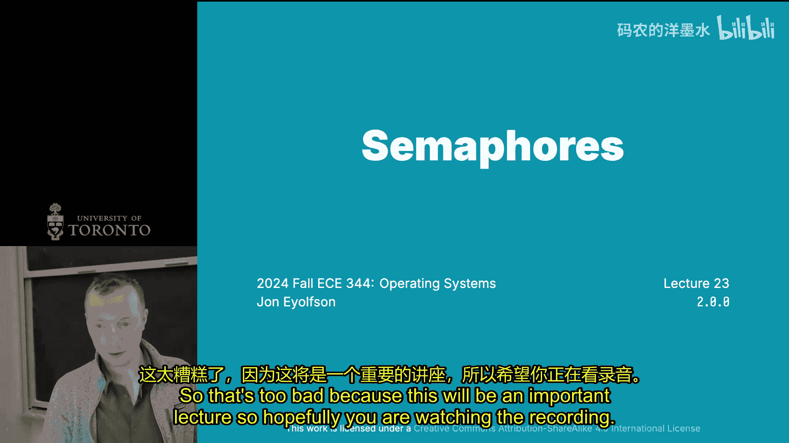
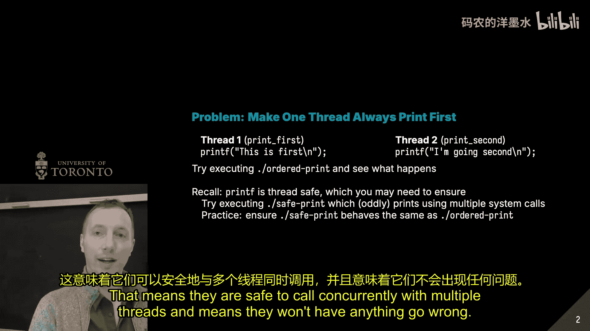
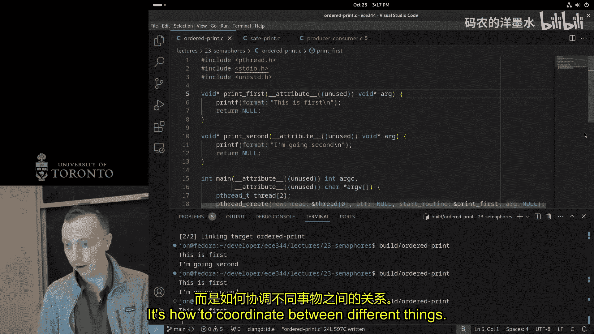
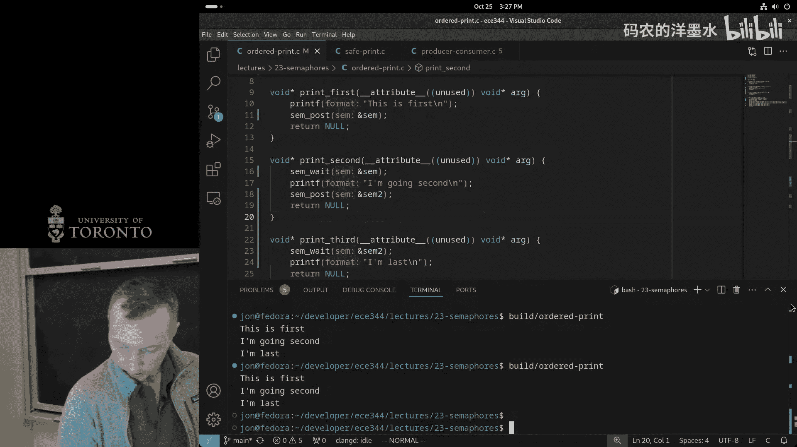
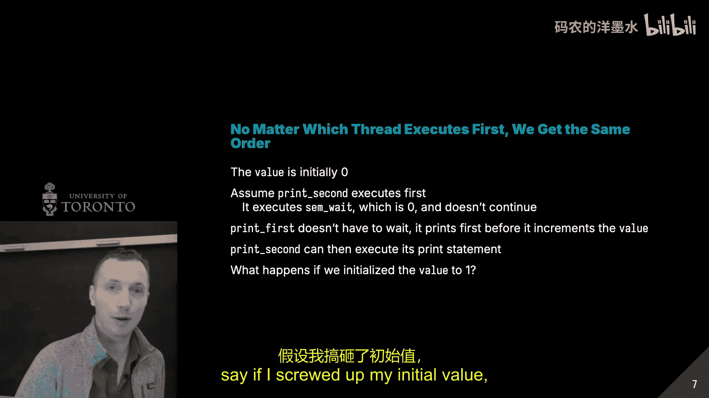
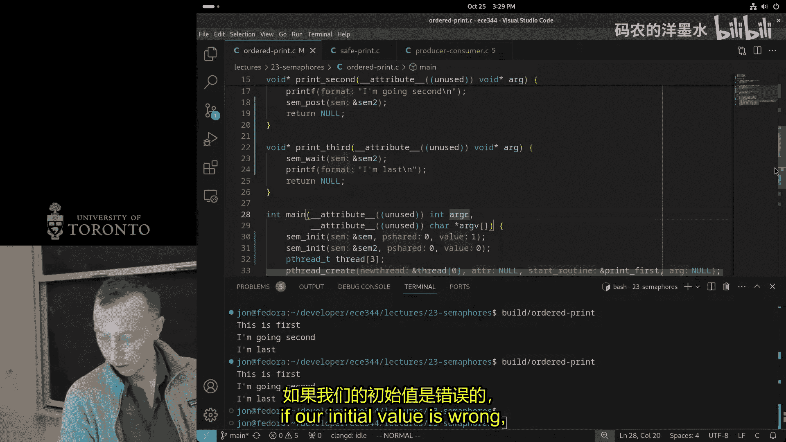
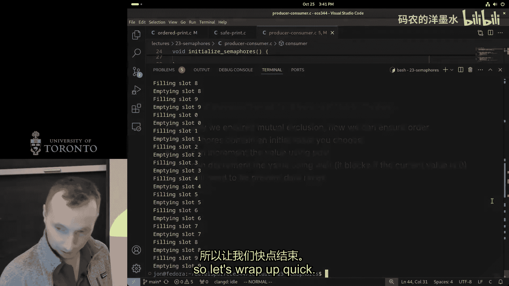

# 操作系统：22：信号量



在本节课中，我们将学习如何使用信号量来协调多个线程之间的执行顺序，确保它们按照我们期望的特定顺序运行。



上一节我们介绍了锁，它确保了互斥访问，但无法解决线程间的执行顺序问题。本节中我们来看看如何使用信号量来实现线程间的协调。

## 信号量的基本概念

信号量是一个共享的整数值，其值始终大于或等于0。它提供两个原子操作：
*   **`wait`**：原子地将信号量值减1。如果当前值为0，则调用线程会阻塞，直到值变为正数。
*   **`post`**：原子地将信号量值加1。此操作不会阻塞。

信号量的核心操作可以用以下伪代码描述：
```
// 初始化信号量 sem 的值为 initial_value
sem_init(&sem, 0, initial_value);

// wait 操作
while (sem <= 0) {
    // 等待
}
sem = sem - 1;

// post 操作
sem = sem + 1;
```



## 使用信号量实现顺序打印

假设我们有两个线程，一个打印“This is first”，另一个打印“I‘m going second”。我们希望确保第一个线程的打印总是先于第二个线程。

以下是实现此顺序的步骤：

1.  **创建并初始化信号量**：我们创建一个全局信号量，并将其初始值设为0。这意味着，在没有`post`操作的情况下，任何试图执行`wait`的线程都会阻塞。
    ```c
    #include <semaphore.h>
    static sem_t s;
    sem_init(&s, 0, 0);
    ```


2.  **在需要等待的线程中放置`wait`**：我们不希望第二个线程先执行，因此在第二个线程的打印语句前放置`wait`。
    ```c
    void* print_second(void* arg) {
        sem_wait(&s); // 等待信号量
        printf("I'm going second\n");
        return NULL;
    }
    ```

3.  **在触发条件满足后放置`post`**：在第一个线程完成打印后，我们调用`post`来增加信号量的值，从而唤醒可能正在等待的第二个线程。
    ```c
    void* print_first(void* arg) {
        printf("This is first\n");
        sem_post(&s); // 增加信号量值，通知第二个线程
        return NULL;
    }
    ```

通过这种方式，无论操作系统如何调度这两个线程，打印顺序都能得到保证。

## 扩展：三个线程的顺序控制

如果我们有三个线程，希望它们按顺序1、2、3执行，则需要使用两个信号量。

以下是实现三个线程顺序执行的逻辑：



1.  **创建两个信号量**：`s1`用于控制线程2在线程1之后执行，`s2`用于控制线程3在线程2之后执行。
    ```c
    sem_t s1, s2;
    sem_init(&s1, 0, 0);
    sem_init(&s2, 0, 0);
    ```



2.  **安排`wait`和`post`操作**：
    *   线程1：打印后，`post(&s1)`。
    *   线程2：在打印前`wait(&s1)`，打印后`post(&s2)`。
    *   线程3：在打印前`wait(&s2)`。



## 信号量与互斥锁的关系

互斥锁可以看作是一种特殊的信号量，其初始值为1。`lock`操作相当于`wait`，`unlock`操作相当于`post`。然而，两者的用途有明确的区分：
*   **互斥锁**：主要用于保护共享数据，防止数据竞争，确保互斥访问。
*   **信号量**：主要用于协调线程间的执行顺序。

虽然可以用信号量实现互斥锁的功能，但为了代码清晰，建议根据目的选择合适的工具。


## 经典问题：生产者-消费者

生产者-消费者问题是一个经典的同步问题。我们有一个固定大小的缓冲区。生产者向缓冲区写入数据，消费者从缓冲区读取数据。需要满足：
1.  生产者不能在缓冲区已满时写入。
2.  消费者不能在缓冲区为空时读取。

我们可以使用两个信号量来解决这个问题：

1.  **`empty_slots`信号量**：表示缓冲区中空槽位的数量。初始值为缓冲区大小`N`。生产者在写入前需要`wait(&empty_slots)`，消费者在读取后会`post(&empty_slots)`（因为读取后产生了一个新的空槽位）。
2.  **`filled_slots`信号量**：表示缓冲区中已填充槽位的数量。初始值为0。消费者在读取前需要`wait(&filled_slots)`，生产者在写入后会`post(&filled_slots)`。

以下是核心逻辑的伪代码表示：

```c
// 初始化
sem_t empty_slots, filled_slots;
sem_init(&empty_slots, 0, BUFFER_SIZE); // 初始空槽数等于缓冲区大小
sem_init(&filled_slots, 0, 0);          // 初始已填充槽数为0

// 生产者线程
void producer() {
    while (1) {
        item = produce_item();
        sem_wait(&empty_slots); // 等待有空槽
        // （此处通常还需互斥锁保护实际的缓冲区写入操作，防止数据竞争）
        insert_item(item);
        sem_post(&filled_slots); // 通知消费者有新数据
    }
}

// 消费者线程
void consumer() {
    while (1) {
        sem_wait(&filled_slots); // 等待有数据
        // （此处通常还需互斥锁保护实际的缓冲区读取操作，防止数据竞争）
        item = remove_item();
        sem_post(&empty_slots); // 通知生产者有新空槽
        consume_item(item);
    }
}
```

**关键点**：信号量解决了访问缓冲区的顺序问题（空/满），但缓冲区本身的插入和删除操作通常仍需要互斥锁保护，以防止多个生产者或消费者同时修改缓冲区索引时发生数据竞争。

## 总结




本节课中我们一起学习了信号量。信号量是一个用于线程间协调同步的强大工具，其核心是一个非负整数值和`wait`、`post`两个原子操作。我们学习了如何用它来强制执行线程间的执行顺序，并探讨了其在解决经典生产者-消费者问题中的应用。记住，信号量主要用于**排序和协调**，而数据竞争的预防仍需借助互斥锁。正确设置信号量的**初始值**以及合理安排`wait`和`post`的调用位置是实现正确同步的关键。