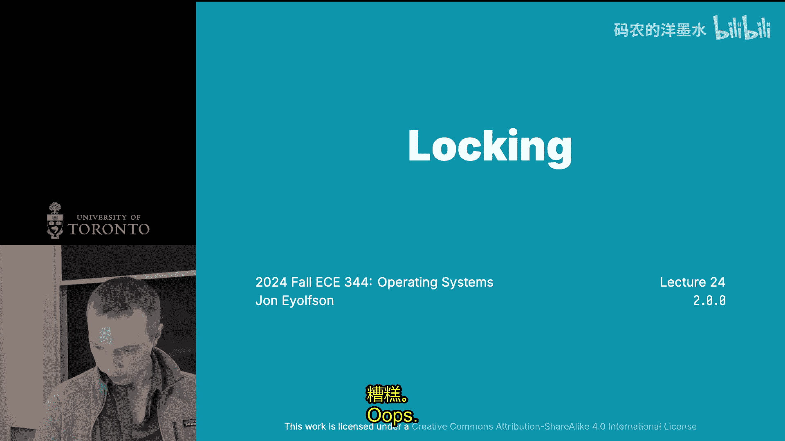
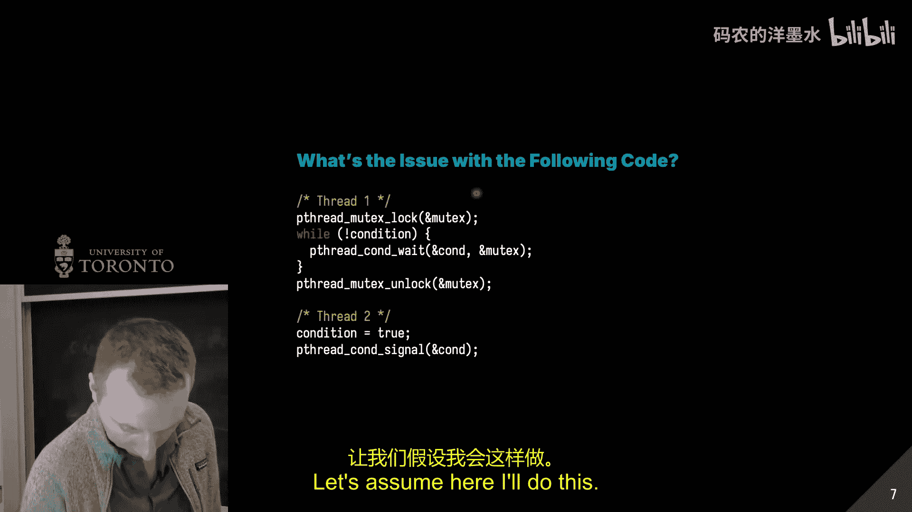
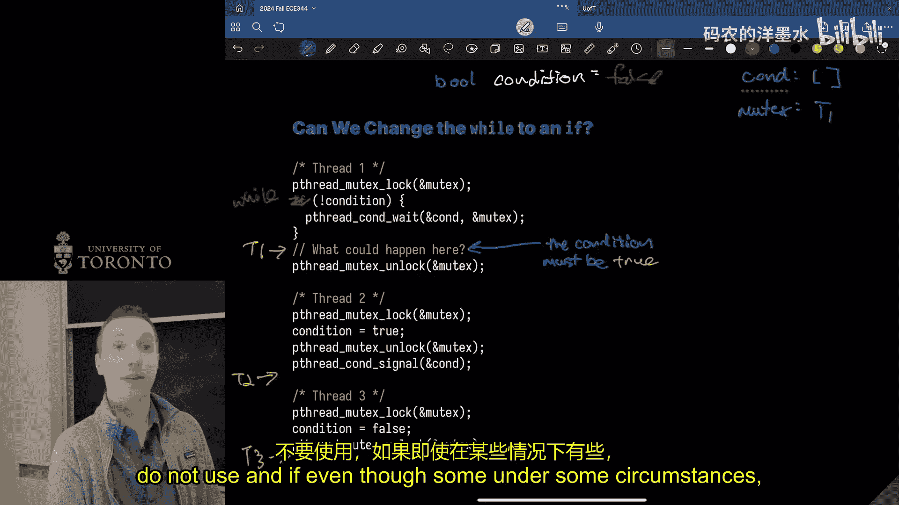
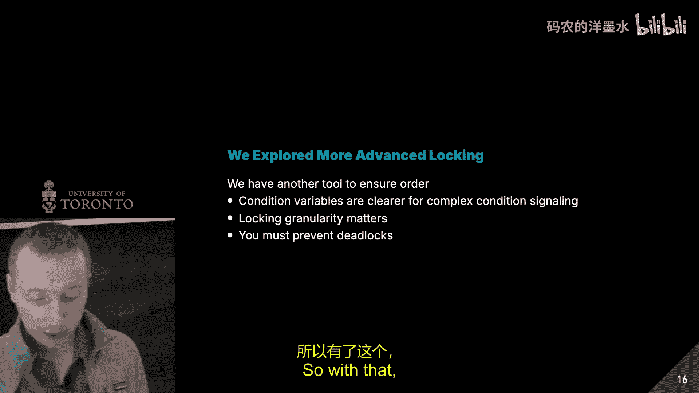

# 【全集】多伦多大学 操作系统 中英字幕 1080P p23 Lecture 23 - 加锁 -BV1Rbk7ByERc_p23-

🎼。Allrighty， welcome back to operating systemss， Wow， it feels like it's been month。So。Final。

 well last hard topic， so locking， this will be relevant for La 5。

 which you now have officially made shorter and pushed back due to democratic process so you get another week for lab 4 and La 5 is short so only have a week and this lecture will be relevant for it so。

We get to finish talking about locking。Oops。

So。Before we talk about locking， we can talk about and relate it to other languages。

 So there is this concept called monitors built into some languages。

 So with some object oriented languages， some developers will like wow Mutex is are really hard to use。

 So I want something a lot easier。 So what they proposed is you can mark a method as monitored。

 and then let the compiler handle the locking for you。

 So the rule of that is if you have an instance of an object。

 only one thread can be active across all of its monitored method。

 So that basically means that if you have a monitored method that will create one mutex per instance。

 So each object will have a mutex and the compiler inserts the lock and unlock calls for you。

 So in Java， there's if you have the unfortunate。呃。Task of writing Java。

that's what the Java synchronized keyword does。 So if you have。

 let's say we have something called we're running a bank。

 We create a class for a bank account that keeps track of our balance。 Well。

 if we have multiple threads， all possibly you know， decrementing and incrementing this balance。

 Well， I don't want any data race on it。 So what I would do is I could just mark the methods as synchronized。

 And then that's it。 And I won't have any data races and under the hood。

 What will happen is basically the compiler will create a mutex as a field。In this account。

 and then for every synchronized method， it will have a lock call at the beginning and an unlock call at the end。

 So across all the synchronized methods， only one thing can be running at a time。

So that is an easier way to do it。 This is something you would do if you were running a bank。

 doesn't quite get into database races between accounts and things like that。

 So in the next lecture to set us up for lab5， we will be running a bank。

 So we'll be running a multithreaded bank and seeing how we can do that and making it run fast。

 So this is just a preview for that So get ready for that because that will be a fun one。

 that's the next lecture。So。Before we get into that， we can。

Go after another synchronization primitive there is another one that is called condition variables that behave more or less like centenophorees。

 theyre more or less for ordering， they're meant to be even more general than centnophores and allow you to more easily express very very complicated conditions because centenophores basically it's just an inte are right。

 and it waits has simple rules that the increments or decrements， if it's zero， it waits for it。

 it'll block until something else increments it so it can actually decrement it so。

Condition variables are another way。 There's actually an equivalentence between condition variables and center4s。

 If you want to you know go all May about it。 But the way to think about condition variables。

 I like to think about， it's just a Q。 and you get to manage the Q for it。

 And the Q should be waiting for some certain condition to be true。

 So they are creatively called con。 Theyre just P thread con short for condition variable。

 I don't know why it's not C。 but whatever。 So that's the type。 So mu textex its con。

 So it has an initializer like before。 it has a destroy method。 And then instead of you know。

 waiting or posting。 instead it has a signal， a broadcast。 and basically it's a Q。

 So it will have a weight。 So the weight。😊，Again， think of this as a Q。

 It will put the current thread onto the Q， and then it also requires a mu tech so we don't have any data races actually adding it to the queue。

 and it will autoically unlock it。And then when it wakes back up， it will try and reacquire it。

 So we'll look at that。 There's also time wait if you want a thread to wake back up after a certain time period。

 so you don't have any lost wake up issues or anything like that。

 And the other way it works is that signal that will wake up the first thread on the queue and broadcast will wake up every single thread in the queue。

 So the weight function basically thinks of it as adding this thread to the queue signal from a different thread will wake up one thread in the queue。

 broadcast will wake up all threads in the queue for this will pretty much just ignore broadcast and worry about just signal。

So they must be paired with a mutex， so any time you call weight， you must have the muttex held。

 which means it must be locked， so you must have actually pass by a lock call。

 So signal and broadcast you don't have to have the lock required to call them for the weight call you do and why while I like to think about it as weight needs to atomically add itself to the queue safely without any data races。

 So it actually needs to use that muttex。 also the condition。 it's probably protecting。

 we don't want having data races changing that condition or checking that condition So we need a mutex anyway so we can just piggy back on it。

 So what why it also needs it is it also needs to unlock that muttex before putting this thread to sleep so that another thread can acquire it and hopefully change the condition so that it's true and also wake it back up again and also。

It will try and reacquire that Muex whenever it wakes back up again so that we also do not have any data races or any other problem。

 So one mutex can protect multiple condition variables if I want。 And again。

 we'll just consider calls to weight and signal。So。

Here is how the weight coal works that doesn't have any data races。

 So they'll be a little hand waving a bit through this。 But you should understand what weight does。

 So weight for condition variables。For the thread that calls weight。

 it will add itself to a Q for that condition variable again。

 just think of cond as a Q easiest way to do it。 then it will unlock that mutex。

 and then it will get blocked。 So it will no longer be scheduled to run， it will go to sleep。

 And then whenever the thread calling weight is woken back up by some other thread calling signal or broadcast it will then get unblocked。

 So it is now could be scheduled to run， it doesn't mean it will immediately run。

 And the other step before it returns from weight is it will try to lock that muttex again。

 So when weight returns， it has the mutt。 And when you call weight。

 it also has the muttex when you call weight。 So it stays in the same state。

So if I wanted to change my producer consumer example to use condition variables instead of centenophorees。

 while it might read a bit easier。 And I only have one condition。

 So basically I'm just keeping track of the number of filled slots。

 That's my condition for the producers the condition I want to wait on is that essentially every slot is filled。

 So when the number of filled slots is equal to the buffer size or equal to capital N here。

 then I need I can't progress anymore， everything is full。

 So I would wait and I have two condition variables， one for the queue of threads。

 producer threads waiting for an empty slot。 And then a queue of threads waiting for filled slots。

 So if everything is filled， I put myself on the queue waiting for an empty slot。

 because I am a producer。 And while。😊，You know， I don't want any data races with this。

 And filled things。 So I would have to lock the muttex before that and also go ahead and。

Pass the mutex into this weight call thats will put me to sleep and wait for another thread to actually wake me up。

 So just like placing the mut or the center floors placing the weight and the post。 Well。

 if we change the conditions such that， it might no longer hold。 So if we empty a slot。

 we decrement the number of filled slots again， we do this after acquiring the mutex。

 So if we decrement and empty a slot， then we can signal and。One of the producer threads that， hey。

 there's now an empty slot， Wake up so that it would reacquire this lock here。 Come back here。

 recheck the condition， Make sure that everything is still not full。 If it is not full。

 then it will go out here， fill a slot。Keep track of the number of filled slots again， increment it。

 And then similarly， with the consumer threads， our condition is， if the number of filled slots of 0。

 we need to wait for a filled slot。 So if there are no filled slots。

 then we'll just wait for a filled slot and similarly。

 the producer thread we'll go ahead and signal that， hey， there's now a filled slot。

 So instead of having two cent of fours。With two different initial values。 Now。

 I just have a single variable with keeping track of the number of filled slots。

 and I have two cues that I'm managing by itself。 So is this easier to read or worse to read than the center。

 for example。Up to you， it doesn't really matter in this case， their equivalent。

 it's just something that comes with experience there more or less you can write one in terms of the other。

 it might just get really really ugly for this， maybe this is a much clearer way to write it basically。

The way the rule of thumb is that。If you're just depending on a simple integer。

 just use a center for if you have a more complicated thing than just a single integer。

 use a condition variable and manage that cu yourself。Some got yous with the cu though。

We might have some issues， so。Let's assume here I'll do this。

So let's assume we have the following code。So the idea of a condition variable is your condition might be way more complicated than this。

 but let's say my condition is just a simple boolean and I want to make sure in thread1 here that this special line of code right here。

This should only。Run if。Condition。Is true。So this should only run if the condition is true。So。

If this is my code， I have two threads。Executing thread one is just reading the condition。

 making sure that， hey， it's actually true by the time I run this code。

 and thread2 is just setting it to true。Then initially， let's say I have my two threads。

 I have thread one。I have thread two oops。And initially， the condition is equal to false。

 So we have a。Condition variable。It's basically a queue， so initially that queue is empty。

 there's no threads waiting， okay， it's this room。So initially that thread empty or that Q is empty。

 so there's nothing in the queue waiting， and then initially that mutex is held by nothing。

 so I'll just put a null sign here。So。With the code， two threads running。

 is there any interleaving of threads that cause something bad to happen。

 So bad things that could happen in this code is， well。

 if thread1 can execute that line of code while the condition is false， that's really bad。

Other bad thing that could happen is， is it possible that thread1 gets blocked forever。

 it goes to sleep and it gets comatose and it never comes back。So。I will give you a minute。

 Think about any interleaving between thread 1 and thread 2 that could happen such that something bad happens。

So I will give you a minute and then we can discuss and see what bad things will happen。Give it。

30 more seconds。っでま。H。Want the answer， okay， well we had the first call up there， what runs first？

So let's say good warm whatever。Okay。Okay， so let's go quick。

 so right now you have thread1 running first right so it would acquire the Muex so let's do that so the Muex is currently held by thread1 here。

No， I can't now thread1 runss again。So then we check the condition。

 so the condition is currently false yep， so we and then we wait， which will switch the thread too。

So if we hit weight， yeah， so part of the weight， if we run this。

Then what weight will do is essentially it will atomically put thread1 into the Q。

 So thread1 is now in the Q， and it will also unlock the muttex。

So it will autoically unlock the mutex。So now we have no other choice but to run Tread2。

Thread 2 is going to set the condition from false to true oops。Some false to true。

And then it's going to signal。 so signal is going to remove it from the Q。

 and it's going to be runnable again。So after it wakes up， well threadread2 is already done。

 so it's going to wake back up again。So as part of waking back up， before it returns from weight。

 it's going to reacquire that muex again。 So it would get。The mutex， the thread one has it， whoops。

 wrong pencil。Thread one has it。So it would go back up， check the condition。

 The condition is currently true。 So it'll break out， run this。

 So that condition's true and then unlock it。 So that's fine。 Nothing bad happened。So。

Let's rewind everything。So that was an instance of nothing bad happened。

But we got to see how things work。 So who。Who's got something bad happening？

So I will give you a hint there something bad happening is thread one going into the queue and never waking up again。

Yeah。it create two runs first。So threadread2 runs first。So thread2 runs first。

Here let's just do this one quick if thread2 runs first， the condition gets set to true。It would。

Does it run the signal？It could， doesn't matter， signaled。

 there's nothing in the queue doesn't matter， then if threadread1 runs， it would acquire the mutex。

 check the condition it's true， doesn't put itself to sleep， runs this code， that's fine。Yeah。

So right。Reaches the wild condition。Okay。Butれ， did you said it。No， if I set the condition to true。

 then it breaks out of the loop。Double negative。 So here let's。

So you said threadread one executes firstry。Okay， so thread one executes first。

It would acquire the mutex。So it acquires that mutex， so thread1 has it， oops。

And then it executes again， so it checks the condition， right？えと。SoWell， the conditions false。

 so now it's about to call weight。Then we switch to thread2 right now， right？

So we switched to thread2 right now。So thread two， can it run this line？Yes。

 so thread2 runs this line。Seets the condition equal to true。

And let's say threadread2 executes the next line。 so it signals。

 is there anything in the queue to wake up？No， we'll wake up anything， No just carries on。

 no problem。 then well， thread2 is now done now thread1 runs。Well， still has the muex。

 so it would atomically add itself to the Q。So now it is in the queue and then it would also unlock the muex。

Now who's going to wake up poor thread one？Nobody， it is now comatott， it is now gone。

So how do I fix this， What was my issue here？Did I have a data race？Yeah。Ohoops。Yeah。

 I have a data race changing my condition， right， So in order to fix that。Here。

 let's rewind everything again。Condition。So in order to fix this。My data race is on the condition。

 so I need to have a lock here。Where does my unlock go？Before signal or after signal。

Or it doesn't matter。I mean， the four signal。Before signal。So like this。Turns out。It doesn't matter。

So we can demonstrate why it doesn't matter by。I think it's good if we just leave it as is。

 So let's demonstrate that doesn't matter。 So now with the lock and the unlock。

 what bad thing happened before is that thread to executed first， right？ So now if thread2 executeds。

 The first thing it's going to do is acquire that mutex。 So now it has the muttex。So。

It would change that condition from。Or no， threadread1 ran first， right？ Yeah。

 that's what bad happened。So when bad things happen， threadread1 ran first， right。

 So threadread1 runs first， it acquires that Mutex。Then it checks that condition。

 It is currently false， so it is about to run this。Weight line here。

So now if I happen to context switch to T2， can thread2 make any progress？No， right。

 because it has lock of the muex， which thread has the muex thread1。

 so it can't actually change the condition from true to false because while it can't acquire that mutex。

 it's protected。 So the only choice I have is to run thread1。 If I run thread1。

 it will immediately add atomically add itself to that Q。And then also unlock that mut text。

So now thread 1 is blocked。 It can't do anything。 So now the only choice is that thread 2 runs。

 So can thread 2 lock the mutex now。Yep， so now thread2 can acquire that mutex。

Then change that condition from false to true。And then。Actually， the worst case is。

We'll place an unlocked call。After it's actually better to call the signal before slightly。

 so let's see why this might be slightly inefficient。So if we have unlock after the signal。

 what will happen is thread2 we' go ahead and unblock thread1。So。Thread1 is now unblocked。

But if we were to immediately context switch to threadread1。Would it return from weight？No。

 because weight has to reacquire that mutex in order to return from it。

 Mutex is currently held by thread2， so it would just get blocked trying to reacquire that mutex。

 So we just woke it up It's not going to be able to get the mutex as we currently hold it。

 So might you might argue it's slightly inefficient。 It doesn't really matter。

 It's not going to affect our correctness at all。 just will block for a bit until thread2 finally executes。

 It would unlock that muttex。 So now that mutex is unlocked。Now。

 thread1 can acquire that mu text because it's unblocked and then finally return from weight。

It would acquire the Mutex。Check the condition again。 It's currently true。 So break out。

 run this code only if the condition is true。 Yy， everything works as expected。

 So now we've fixed everything， right。So。Some inquiring minds might be like， hey。Well， this is。

Also stupid。 Why did you recheck that condition， So is anything bad going to happen if I take this while。

So will everything still work as expected？Yes， yes， yes。 Yeah， I got yeses。 So in this scenario。

 yeah， it will work as expected because I'm only changing it from false to true yeah。cannot。So。

In that specific scenario。I can actually get away with changing it to an if。The general scenario。

 that's not going to be true。 So likely with the condition variable， you'll have something that。

 you know， modifies it。 It will get changed from false to true， false to true， so。

More realistic code would look like this， so let's say we have thread1 as before are fixed up thread2 that now protects changing the false to a true。

 and then we have thread3 which sets the condition equal to false so it doesn't have to signal anything because it's not setting it to true so if it woke up something。

 it's just going to wake up， check that it's still false we don't need a signal there。

 we really need to signal when we actually set it to be equal to true。So。In this case。

 if we set change that while to an if。Is there a scenario of all these threads that might happen where something bad happens here。

 And again， remember at this line， the condition。Must。Oops must。好。Must be。True。So if I have。

 let's say， I have。Boool。Condition。Of course。So if I initially have my condition equal to false。

 I have my condition variable， which is basically a Q that has nothing in it。

 My mutex is currently unheld by thread。Is there a possible interleaving of thread1， thread2。

 and thread3 such that thread1 executes with the condition being false there？So。Thread1。

So I'll give you a minute to think about that。Any innerleavings of thread1，2， and3。

 such that thread1 could execute that line with the condition being equal to false instead of true。

So again， give you a minute for that。All right。Allright， so we've got one there。 Anyone new。

 want to try this one， something bad that can happen。Yeah。すね。That。Okay， so let's go down quick。

 So first， thread1 runs。 So thread1。That acquires that mutex， so thread1 now has the mutex。

Nothing else can run right now because they all try and acquire the mutex， they can't get it。

 The condition is currently false， so I would put myself to sleep so I would put myself on the queuee。

So thread1 is now on the Q and it gives up the muex。Then。Yeah， then thread 2 starts executing。

So it acquires that mutex。So thread2 now has the muex， sets the condition equal to true。

And then it unlocks the muttex。そし？Yeah， and then now we execute thread three， so right before。

In this case， it doesn't really matter。But let's say for argument sake， thread3 executes next。

 so it would acquire that mut text。So thread three executes。Changes that condition equal to false。

So now the variable is equal to false。The thing that can run is thread 3。

 So it would unlock the mutex。 Or I guess thread 2 could run。

 You you want thread 2 to run or thread 3。Thread3， All right， let's finish thread3。

 So thread3 unlock that muttex。It's done。Now threadread2 has to go， no other choice。

So signal would unblock thread1。And they can try and return from weight， so in this case。

 thread2 is done。Nothing is going to the only choice to execute next is thread1。

 threadread1 will reacquire that mutex before it returns from weight。

 so it will reacquire that mutex。And then well， because we didn't put a while there。

 it just falls out of the if and then executes this line。 conditionition is false。

 We have broken everything， right， So we need to recheck the condition because even if something sets it to true。

 doesn't mean by the time you wake up again， it is still going to be true， so。

My advice to you is with a condition variable， never， ever， ever， ever。

 ever tried to be clever and change that while to an if。Just keep it as a while， worst case。

 it's another check。And， you know， if it's truly， you could put as an if。

 it doesn't mean that is true forever。 So if you modify your code later on where that is no longer true。

That is probably something that you will take eight years to fix because it might only happen very rarely。

 So with condition variables， always check the conditions in a while。

 Do not be clever and change it to an if otherwise， bad things could happen。 So everyone。

 okay with that。Use a while to recheck the condition， do not use， and if。

 even though under some circumstances， you could get away with it。

Soops， so condition variables， similar purpose to center4s。

 center4s are basically like a special case of condition variables。

 they could just go to sleep when the value is0 and your condition could be if it's greater than zero or you increment it。

 wake up， you can implement one using the other， they're equivalent if you go into the math thing。

 but it can get messy。For for complicated condition， use condition variables。For much better clarity。

 otherwise， if it's simple enough to use a center for， use a center for。

So next thing is to talk about how to use a muex。So there's a thing called locking granularity that's the extent of your lock or how much code is between a lock and unlock call because that code is essentially running in serial。

 so you need to use locks to prevent data races， but the simplest way you could prevent a data race is to just lock the whole thing and then turn the whole thing serial and then while suddenly it's slow so there's a whole bunch of different ways you could do it if I lock large sections of the program。

Probably going to be slow if I divide the locks and use smaller sections well then maybe I have some other issues to contend with。

 So like let's think about if I want to paralyze a hash table， which spoiler alert。

 you get to do for lab 5。So luckily， I wrote a hash table for you。

 So you are essentially doing five lines of code。So the lab  five。It's like five lines of code。

 you get to play with Mu Texas。So that's all you do。 I wrote it for you， and we can go over it a bit。

 But if you want to paralyze a hash table， simplest thing to do， one lock around the whole thing。

Probably going to be really bad。 So you can probably come up with a better scheme。

 Your hash table is basically like an array， and。For some of them。

 collisions are just like a link list so you could protect each way。

 I guess that gives away too much， but you could protect you know a link list with a lock instead and have multiple locks instead So things to consider about locks is overhead So creating a lock takes some memory some space doing a lock call is not free。

 it will also take some time。 So if I had a billion locks each protecting you know an increment or something like that。

 probably going slow my program down a lot。 if I have a bunch of you know if I have a whole bunch of locks but all the threads are fighting over the same lock again。

 I'm going to slow it down。 So that's called contention or basically how likely it is that two threads will fight over the same lock So the more contention。

 the more it's going to run in serial and then the last thing I have to consider which is especially important for this course and the coughf cough final is dead。

So being in a condition that we've kind of seen already where no threads can make progress is basically what a deadlock is。

So。For locking overheads， like I said， it has to allocate some memory for each mutex。

Initialization destruction， they'll take some time again calling lock and unlock， do take some time。

 so the more locks you have， the greater the cost is going to be。

Like if you have a billion locks while you're probably just going to slow down your program a lot。

 so there's always some trade offs with this that you unfortunately just have to experiment with and that will be a whole another course like 454。

So。The main thing we care about is and you do not want are deadlocks， so the more locks you have。

 the more you have to worry about deadlocks and the conditions for deadlocking are for of them and they all have to hold in order for a deadlock to happen The first one is mutual exclusion which of course we have for simple new Texas the next is hold in wait so you have to have a lock while something else is waiting for a lock。

The third is no preemption。 so I can't just take a lock away from a thread without it actually acknowledging it。

 And then the fourth is circular waiting。 So I can't be waiting for a lock held by another thread or another process。

 So for this course， in order to break a deadlock， we are either going to either break condition 2 or break condition 4。

 And I will show you how to do both。So。First， let's consider a simple deadlock。

 so consider two processors or two threads。One thread tries to get lock1。

 then lock2 and then thread2 tries to get lock2 and then lock1。 Well。

 a dead lock could happen if thread one executes first gets muex 1 then thread2 executes and gets lock 2。

 Now no wonder what thread executes next I am now screwed。 So thread2 with try and get lock1。 Oh no。

 that's held by thread1 I can't make any progress。 thread2 tries to get thread1 or sorry thread1 tries to get lock2 which is held by thread2。

 Oh no， it can't make any progress so they're both waiting on each other So they both have this hold and weight condition where they're holding one muex and trying to acquire another another one has。

 So we want to avoid this at all cost and yeah this will just cause your program to just block forever。

So。One thing we could do is ensure some ordering to prevent deadlock。

 So if I had those two mutexes before， if I always acquired lock1 first and then lock 2。

 this will never deadlock no matter how many threads I have because I can only acquire lock2。

 if I have lock one So no hold and weight condition or no circular weight。

 it's not possible for me to hold a lock that is already held by another thread because I always acquire them in order。

So。You could do this in order or if you have some way to order locks。

 then you know you could use the memory address of a lock。

 you could use some ID if you have a definite order and you always acquire them in the same order and you're consistent。

 you will never have a deadlock because that will break that circular weight condition。

The other one is to break that hold and weight condition。

 and that's where you'll finally see this trilock come into effect。

The more generic solution would be like， hey， if I'm trying to acquire two mutexes。

 what I could do is I could just lock Muex 1 and then do the non blocklocking。

 try to acquire Mutex 2。And this will tell you whether or not you have acquired it or not。

 So if I did so zero means I acquired it， if I get a value that is not0。

 it means I did not acquire it。 So if I did not acquire it， I can give up that hold and weight。

 so if I don't get it， so I have lock 1， I try and get lock2， I don't get it。

I can break the hold in weight， I can just unlock， give up thet1 wait。Yield， do something。

 hopefully that you know give up the other mutex。 So hopefully the other thread can make progress。

 And then I would just lock Muex 1 again and then try to acquire Mutex 2 again。

 So this will run over and over again while I can't get both Mutexes and then。

If I actually get lock 2， that means this protected code only executes if I have lock 1 and lock 2。

 So I have no issues。 So this will also not deadlock because it breaks that hold and weight。

 So everyone good with that one。Are you're actually waiting for like？It it。Yeah， so this weight。

 it could be a yield， it could be， I weight for set duration， it could be whatever。East thing。

 Just do a yield or something like that。All right， questions， comments。

 concerns other than otherwise we can wrap it up and enjoy。

We've now done the hard content of the course， spoooge sailing from here until the final on the weekend。

 which sounds awful。But at least it's early， I' guess。Which is good， maybe。Maybe you'll make the。

That's a little bit shorter because they have less time to study。Oh。Yeah。

 we'll also have extra lectures， so we'll probably have review right before then。

 so everything should be nice and fresh。So。Let's wrap up today then so we advance some more advanced locking today。

 another tool to ensure order condition variables which are basically just cues might be more easier to read for more complex condition signaling other than that your locking granularity is going to matter for performance you want to have multiple locks again you'll practice that a bit on lab 5 and then if you have multiple locks you have deadlocks so you must prevent them。

 So with that just remember。

