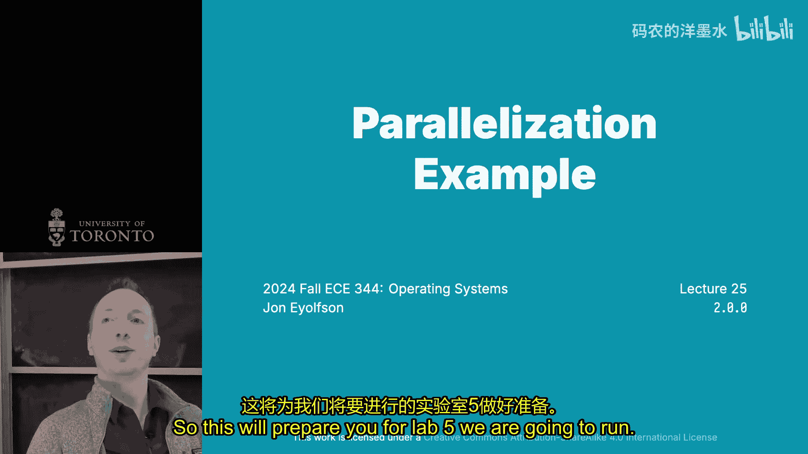
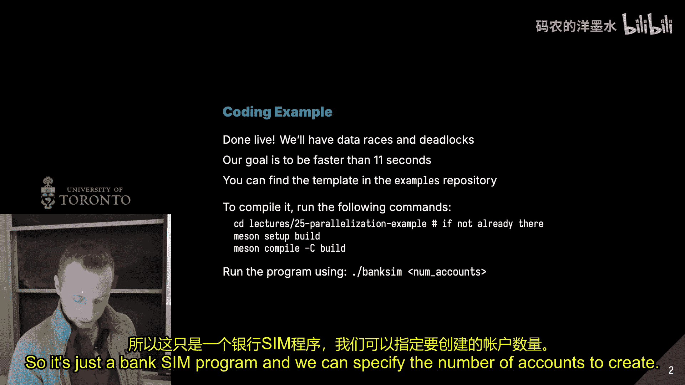
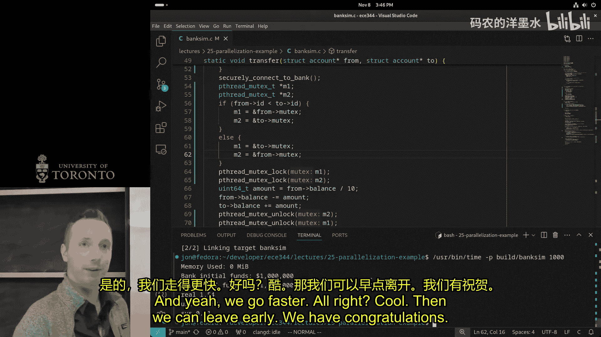

# 【全集】多伦多大学 操作系统 中英字幕 1080P p24 Lecture 24 - 并行化示例 -BV1Rbk7ByERc_p24-

🎼Yeah。Alrighty， welcome back to operating Systems today。Fun， fun lecture。

So this will prepare you for La 5， and we are going to run the world's greatest bank ever created。😊。

So this whole example， I will be relying on you。 We will try and make the best bank。

 we will make issues and the more mistakes we make， the more we shall learn。

 So how this is going to be set up is we are a bank a successful bank。

 We are going to simulate doing 10 million transfers between our happy， happy customers。

 So I have a simulation that can vary the number of customers we have and we' simulate doing 10 million transfers。

So how this is going to work is each account has a unique identifier associated with it。

 and then a balance。 Let's just assume for argument's sake， that they each start with 8000。

 So we are just going to simulate transferring between all of these different customers。

 So we just generate transfers between random accounts and how this is going to work is they're going to just transfer 10% of their current balance to the other account。

 So if we are successful bank we should have the same amount of money。

 our customers are just moving money around。 we should always have the same amount of money， so。😊。

The only other part of this is they must call this securely connect to bank before starting a transfer。

 So other than that。It's done live。 We'll have data races。 We'll have deadlocks。 Hopefully。

 we will have a whole bunch of fun。 Our goal is mostly performance。

 We want this thing to run a whole hell a lot faster than initially without using threads or anything like that。

😊，And initially it will take about 11，10 seconds， so it's just a Bank Sim program and we can specify the number of accounts to create。

So。Let's look at that for a second。 So up here， I have a few defines。

 So I have my starting balance is $1000。 number of transfers is $10000。

 And then while we're going to hopefully speed it up using threads eventually will'll use eight threads。

 and then I have a strict account that represents an account。

 So each account has a identifier and then a balance。

 So we don't let them go negative or anything like that。

 So it's just an unsigned in to keep track of their money。 then I just have know。

 static number of accounts that we specify on the command line。

 And then a big array of all these accounts。 And then I have this securely connect a bank。

 which is simulates you know， securely connecting to a bank， hopefully we can parallel that。

 the main thing we want to make sure we run in parallel is this transfer。

 So transfer securely connects to the bank。And then transfers 10% of the balance。

From the from account。 So transferring between two accounts。

 So from someone we're taking money out of。 So we're taking 10% of its balance out。

Subtracting that amount from that account and then transferring it to the other account。

 So we subtract from one， add to the other。We should have the same amount of money at the end of the day。

 Then I have this placeholder for a。Function to run for my threads that we will add to。

 Then check error。 And then other than that， we can ignore。 It just initializes things。And then here。

 this is what we want to paralyze。 So this is。Simulating doing the transfers。

 So this will do one for every account， So one or sorry one for every transfer。

 So this runs 10 million times， picks a random account to get a from index to。 So it uses RA。

 then to index picks a random account and then the account it uses well。

 just indexes into that big accounts array and then takes the address of it。

 So we have a pointer to obstruct。So。Everyone okay with that？So。If。We calculate our initial funds。

 So every account starts with， you know，$1000。If I have 10 accounts。

 how much money is this bank managing？$10，000， right。

 So if I do a whole bunch of transfers between different accounts。At the end of the day。

 how much money should be in the bank？10000 right so that will be our sanity check。

 So let's run this program。 So here I'm going to just use user bin time to keep track of how long this program runs for dash P will just present like lines in a different order to make it a bit more readable and then I'll run my banks in with 10 accounts。

 So initially I have 10000。 I also keep track of the memory used。 So in this case。

 we don't use that much。 It's just just 0 megabytes。 And then after we do all the transfers。

 we have $10000。 the real time that's wall clock time。 So it took like 10 seconds。User time。

 how much time spent in user mode， and then cis is how much time spent during system calls， so。Now。

 if we want to make this faster， what shall I do。Paralyze it， right， I have threads， so。

I wrote a whole bunch of starter code here， so here this will'll create， in this case， eight threads。

Creates a thread I D malocs it so that there's no databases or anything like that。

 I'm not giving an address to a stack or anything like that。 And then will P thread create it。

 So I also need to uncom。The the。Thread。They miss the line。嗯。Okay，I need to initialize my P threads。

 so。Pe thread。P thread T， and then I call it threads and it is numb threads。

So I'm creating a big array of eight threads， create all them， tell them to run this run routine。

 give it the thread I D， and then hopefully it frees it。 So I set all my eight threads off。

 then join them all so they should all complete。 And then after that。

 I will go ahead and check the final balance。 So this is what I' am trying to paralyze。 So。😊。

If I just put this here。Is that good， I made my program eight times faster。No。What should I do here？

So， well， let's run it and let's see if we sped it up。So， we run this。Oh， no。1，2。3。For。5，6。7even。诶。9。

10。Shoot， shoot， shoot。 Okay， we made it slower。 What am I， What's my problem， What am I doing here。

Yeah， are we just doing。A time。Yeah， so now I'm doing like eight times more work， right。

 So each thread is doing。10 million transfers。 If I have 8 threads， they can all do an8 of the work。

 right？ So I still want to do my 10 million transfers。 So first thing。

 I should just take this and divide it by the number of threads。

 And I just assume that this divides nice and equally。 So now each thread does an8 of the work。

 right。😊，So。Ideally， this makes it go eight times faster， right。是。

So everyone agree with that eight times faster。So let's run it。1。2。Three。4。5。6，7。

 so it didn't quite go eight times faster。Went 7 and our final balance， hey， we made $33 million。

Sweet。What are my issues here？Yeah， I have data races。 I it We gonna see up there。 Okay。

 so first issue is I have a lot of data races， but you would think。Just looking at this。

 it should go eight times faster， even if it's wrong， right， I'm not waiting on any other thread。

 They're all going。They're all just going。So it turns out this is where we have to look up things。

If we are observant， this thread run function calls RAand。Well， is RAand threadread safe well？So。

You might think， hey， maybe it is or isn't thread safe so we can just look at the man pages for Rand。

Look at the attributes and it says， oh， it is threads safefe。So if it's threads safe。

 that means there's no data races from using Rand as opposed to， you know。

 just using them in every thread。 But if there's no data races using Rand。

 that means it probably uses a muex。 And that means it's probably slow。

 So that's why we didn't quite get eight times speed up because while there's some shared state in there。

 if it's safe， doesn't have data races， it has a muex。

 So turns out this is there's an R R function And what Rand R function is it doesn't rely on any external state。

 we have to give it some state， but then it will be you know。

 really fast because it doesn't depend on anything else。

 it doesn't need any locks or anything like that。 So。I'll save you some time if we look at R R。

 Rand R needs you to give it a state， which basically you need to give it a starting seed so we can go ahead and make it faster by I will just declare a variable called unsigned int seed。

 make it equal to the thread ID initially。And then here I will change Rand to instead use RAand R。

Rand R， and then you give it this seed。So in this case， it's also thread safe。

 but now there's no shared state between threads。 So if I do this， it will likely be faster and。

Aside from performance reasons， you and actually doing this in practice。

 you wouldn't be expected to do this， this is to just show you。 so now if I do it。

My bank hell fast now， right， So now I'm about eight times as fast。Holy crap。I'm rich。So yeah。

 data races happened。Just looking at the output every time we run it， it's insanely。

It's really obvious in this case， if we have our sanity check， right， but what if I was。

 I don't know， some unnamed bank。And I had， you， 10000 accounts。

 so I was managing lots and lots of money。So if I'm managing $10 million。哎。That's not too bad。 right。

 What if I was an even more successful bank and I was managing， I don't know， a billion dollars so。M。

 Im out I made 100 bucks。 or I a bit less what if I was managing $10 billion。

I lost a little bit of money。 Okay， what about if。I managed $100 billion。 Hey， no data races。

Why is this happening？Yeah。それ三し。Yeah， so number of transactions the same。

 But if I have more accounts， it's less likely I have a data race， right。

 I'm just picking two random accounts transferring。 If I have a lot。

 I'm less likely to see the issue。 So this is。Kind of。I don't know。

 counterintuitive to other programs you've written， where the more data you have the。

More looks like it looks correct。 So smaller programs will show the issue a lot faster than larger programs because you're more likely to actually see the data race。

 So this is the case where like you can be essentially too big to fail。

 right So you write this crappy code。 It goes eight times faster if you're managing， I don't know。

 some huge bank。 you have a lot of customers。 You never see the data race。

 you might blissfully think that you just。Bade things eight times faster。

 You can collect your big paycheck and go home。 everything works。Issue is data races。

 So let's go back to just 10 accounts where， yeah， bad things happen。So how do I fix this。Yeah。

Have a lock for each account。 Okay， so that's a good idea。 So， yeah， our first thing might be。Here。

 here is where we have our data races right between the two accounts here。

 So naive solution that will get rid of the data races just to put a lock around you know。

 this whole thing， both transfers。That's going to be slow because essentially， I'm serializing it。

It won't be too bad because I assume this securely connected bank can run in parallel。

 So we might get a little bit of a speed up， but probably not much。 So we might figure， hey。

 maybe I need a Mutex for each account。So let's create a mu text for each account， P thread， Mutex T。

 I'm going to be creative and just call it Mutex。So good， every thread now has a muex。

 or every account now has a muex。So。What would you like me to do with said Muex？

You've got to acquire it。So I have to lock it P thread Muex lock。 So in the thread I'm going from。

 That is from Muex and then address of because I need its address。

So you want me to lock the from and then what？诶 law。Lock  two。And then unlock both where。

After line 55， so let's make it nice looking。Everyone agree？A argument。Should work？Oh。

 we have one argument， one dissenter。Will it not cause a deadlock？Oh。Yeah。1。Yeah。

 so we could easily get into a deadlock situation here。 Let's just， you know， we can run it again。

 make sure here，1，2，3。😊，4，5，6，7，8，9， crap。Probably deadlocked。 I can double check if I'm deadlock。

 I can go to H top C。 all my CPU cores are doing nothing。 So probably indicates a deadlock there。

 So nothing's going on。Oh， that's fine， okay， so we deadlocked。And why， well。

We could have thread1 that transferred where from is like account A and2 is account B。

 and then thread2， where from is account B and2 is account A。

 and in that case we might have a deadlock where thread1 would acquire lock A first。

Right acquire lock A first， and then thread2 could acquire lock B。

 And now each thread is waiting on each other's lock and they deadlock。

 right So everyone get that deadlock。Fix it。What what do I do if I want to avoid this deadlock。Yeah。

未必来。反回？わ。あ。So unlock it before we lock the two。So you want。Something like。This。那完了。After the。你唔见。

unlock。Unlocked before line 58。 Yeah and then have the。啊。今は？This。还能告诉。Maybe need those two。大致。啊QB。

This。So。I mean， we can try this。 So this。Works。It has a subtle issue， though。So， the subtle issue is。

If we compare it to running sequentially， where we have， essentially we have transactions。

The balance in any one account might be off。So。I won't get into the details why， exactly， just。

It's very subtle。 Its because we're doing it as like a big transaction。

 So any individual account might have the wrong balance。 But in this case， if you're the bank。

 who cares about the customer。 So the customer can have the wrong balance。

 I'm not losing money anymore。 So you might get your raise here。 but， you know。

 they might have increased customer complaints to the call center。 So can't do that。So let's rewind。

 So， yeah。这是公安的。A quiet like。So。I should do a trilock， trilock。

So yeah we can do the trilock solution first so remember in order to break a deadlock for necessary conditions。

 only two we can really do anything about break circular weight by always acquiring the locks in the same order or the second one is we can break hold and wait so you want break hold and wait。

So to break cold and weight， that's where we need our trilock。 So we could do while。 So P thread。

 trilock whoops。So we could try and get the two lock。Ohoops。So。We'll try and in this case again。

Trylock will return 0。 if it's successfully locked it and return not 0 otherwise。 So if it's not 0。

 then what do we want to do in the wall loop， We probably want to。Unlock the from， right。

So what else do we want to do， So we unlocked the from then what。That's it， we're good， yeah。

Lock it again。Ohoops。So we'll just lock it after again。That's it。Yeah。Wait a bit。

 yeah maybe I should wait a bit here。So we could wait， we could yield， we could do whatever。嗯。

The Linux way to yield。 There is a system call for that。 It has a very generic name。

 It's called Ske yield。 So that will yield。 If you're a thread or a process。

 It's just a very generic name。 That's basically what yield is。 So yeah， we could。 So in this case。

 we try to get the from Mut， Try to get the two。 if we did not get the two。

 then we will unlock the from yield。 So we don't have any locks when we yield。

 then we lock the from again and then try and get the two again。 So if。Trylock is successful。

 That means I've acquired the U text， and that means I don't need this line。 So， so this looks good。

Someone's peeping。So perfectly， perfectly good， perfectly good thing to do。😊，H， okay。So。

Anyone want to stake their rays on this working？So do we want to be a big bank or a small bank？

So if we are a big bank。Too big。呃这。Okay， if we're a slightly smaller bank。1。2。3。4。5。6，7。8， oh， no。Oh。

 no， oh， no， we're going to get fired。Let's see。So。Yikes， it looks like it appears to be deadlocked。

But。My computers heating up right now， So all of those eight cores， so there's like 10 on my machine。

 but we just used 8 and they're all really unhappy right now。

 So that might give us some evidence as to what is going on。

 So let's close this before VS code crashes again。 What's going on here。

 Anyone see the subtle mistake we have。As I will tell you， we have the right idea。But there's。

One strange issue that is causing it to constantly， no matter what， even on a single thread。

 constantly go through this loop over and over and over and over and over and over again。

Will you want me a try？Isn't programming fun yet？回定宣。I shouldn't yield。All right。

Let's one try screw yielding。 I don't。Like other threads。1，2，3。4，5，6，7，8。9 nope。

So yield didn't really matter。Yeah。Yeah， trilock will actually lock it。So。

EWe probably always get stuck at least once。 Let's see。One， two， three， and it's probably stuck。

How far can I push it before I run out of memory。One more0。He耶。😊，H， does that give us some evidence？

So I guess you get your raises back if you're a large enough company that doesn't cause VS Studio to run out of memory。

What else should I try or any ideas of where we went wrong？Yeah。是。So。要说啊。So here。

 it's not being caused。Byuy a real bedlock。 So whenever I yield。

 it doesn't matter if I acquire to first or from first。

 because if I get one and I don't get the other， I give up the first one。So in this case。

 whenever I yield， I don't have any locks， so I don't have any dead locks， no problem yeah。啊。Yeah。

ooh， what if from and two are the same account？So if from and two are the same account， well。

 then that's the same mutex。 So it would be the same mutex。

 So I would lock it and then try and get my own mutex， which will fail every single time。

So subtle thing。 So this， you might think。In my application。

Transferring to and from the same account。 Does that make any sense。No， not really。

If I wanted to be clever， right？They're given by pointer。

 so if the pointer to front is the same as the pointer to2， that means it's the same account。

 so that means， well， I can be fast， I won't have to do anything， right？So。Now。

 I shouldn't have a deadlock because that time I was like deadlocking with myself， right。

 Who wants to stake their rays on this one。So。We're not deadlocking ourselves。

 And if we eliminate hold and weight， we won't have any deadlocks， right。So if I wasn't lying to you。

 this should work。So let's make sure。 so if we're at the big bank。Runs real fast。

 gets the right answer。So that's good， no deadlocks， no data races。

What if we're the small bank where bad things may happen。 So if we are the small bank。

 let's see if this works。Yes， it does。So it will be a bit slower because well。

 it's more likely that two accounts interfere with each other。

 So there's more contention for the locks because there's less accounts， only 10 accounts。

 So it'll go a little bit slower， but we don't have any data races and we don't have any deadlocks。

 So well always complete。 We will always have the same amount。 So it'll probably speed up a bunch。

 even if we have 100 accounts。 We get like almost  eight times speed up。 We have。

 we don't have any data races。 We don't have any issues or anything like that。Coolhu。

Anyone disagree with their cool bank。Readay to go get paid。So what about if I was like， hey。

I don't want you to break hold and wait， I want you to not have a deadlock。Some other way。

How would what's another way to prevent a deadlock here， So let's go back。So， yeah。こ没有要。要会さ。Yeah。

 so another way to avoid a bedlock is， well， if I always acquire the locks in the same order。

I won't have a deadlock， I could look at the account like use their memory addresses to compare it turns out each account has a unique ID。

 I could use that too， maybe it might be a bit clear so in order to do that what I might do is well I'll pick which lock to or lock first based off whatever has the lowest ID so maybe I here create a temporary mutex or just create a pointer to a mutex called M1 that will be the first one I lock and then M2 which will be the second one I lock let's move this after this。

So in that case， I have to pick which I'm going to lock first and which I'm going to lock second。

 so I could check like， hey is the from accounts。Id， lesson。The two accounts， Id。In that case。

 then M1 should be the from account。Mutex， and then M2 should be the two accounts Muex。Otherwise。

 if it's the other way around， then I just reverse them right。 So I do this。M1 is the two。

 M2 is from。 and then I always acquire them in that order。 So here I would lock M。哦。One， then M2。

 and then here doesn't really matter。 just for pretty sake， I'll unlock M2 and then M1。So。

Should this prevent a deadlock？Hopefully， right， I always acquired the locks in the same order。

 My problem before where I deadlocked if I was transferring A to B and B to A。Well。

 now if it happens， if let's assume a has a lower ID than B， then in that case， M1 would be A's lock。

 M2 would be B's lock， and in the other thread that's transferring B to A。

 well the from account which would be B is greater than2's account which。Is a。

 So M1 in both cases would be A and M2 would be B。 So I would always acquire A then B。

 no matter what from and to is， right。So turns out this is another way to prevent a deadlock that works perfectly well。

 So if I run this， boom， no problem。You can pick whatever you want。So everyone okay with that？

All right， any other questions or any other things we want to do improperly。

It was kind of sweet when we made like $17 trillion， wasn't it？

Although you would probably be responsible for that and then you'd probably go bankrupt。

 but that's when you hope for a government bailout。Alright， anything else， Otherwise。

 we can wrap it up。 It was just doing this example today， we have made。

The world's most successful bank。So， yeah。I just wondering。

 what is the connection between this to the。不不慢。やせて。So like La 5。

 I'm basically giving you a hash table and then telling you， and then。

Paralyzing it and then telling you to make it safe。So basically。

 you'd be given this code and have to create your own Mu Texasex and do your locks and unlock so you don't have any data races and you don't have any dead locks。

And have we go faster。 All right， cool， then we can leave early congratulations。

