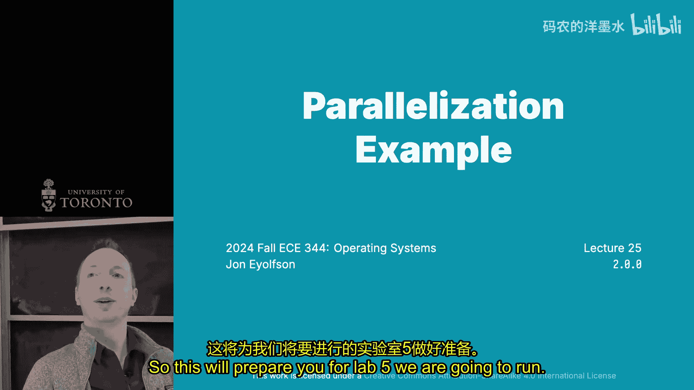
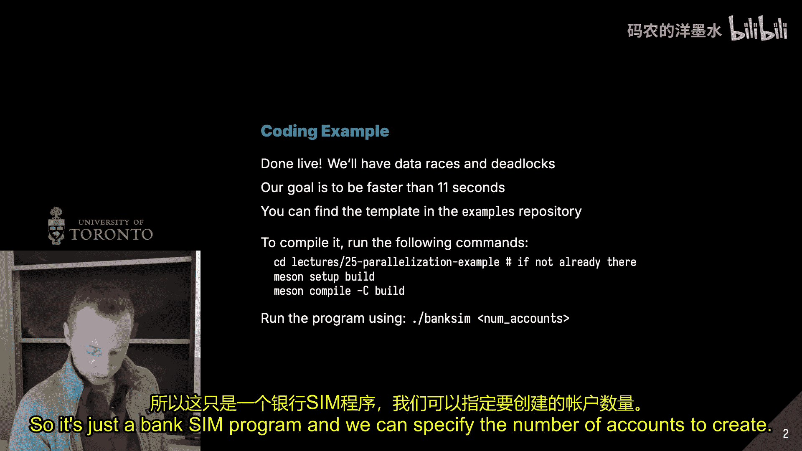
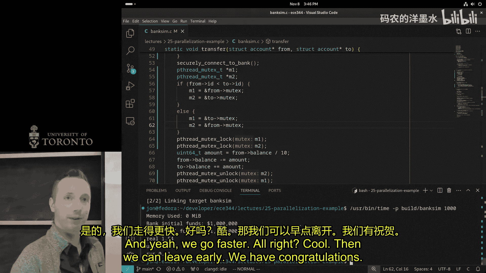

操作系统：24：并行化示例 - 银行转账模拟教程



在本节课中，我们将通过一个模拟银行转账的示例，学习如何将程序并行化。我们将从一个简单的串行程序开始，逐步引入线程，并解决并行化过程中遇到的数据竞争和死锁问题，最终实现一个既正确又高效的并行程序。



---

### 概述与初始设计

我们首先设计一个银行模拟程序。该程序将模拟在多个客户账户之间进行大量转账操作。每个账户有一个唯一的标识符和一个余额。初始时，每个账户的余额为1000美元。程序将执行1000万次随机转账，每次转账将从一个账户转移其当前余额的10%到另一个随机账户。理想情况下，银行的总金额在转账前后应保持不变。

以下是核心的数据结构和串行转账逻辑：

```c
typedef struct {
    unsigned int id;
    unsigned int balance;
} account_t;

static account_t *accounts; // 账户数组
static unsigned int num_accounts;

void transfer(account_t *from, account_t *to) {
    // 模拟安全连接到银行（此处为串行瓶颈）
    securely_connect_to_bank();
    unsigned int amount = from->balance / 10;
    from->balance -= amount;
    to->balance += amount;
}
```

主程序循环执行转账：
```c
for (int i = 0; i < NUM_TRANSFERS; i++) {
    int from_idx = rand() % num_accounts;
    int to_idx = rand() % num_accounts;
    transfer(&accounts[from_idx], &accounts[to_idx]);
}
```

初始的串行版本运行时间约为10秒。我们的目标是利用多线程技术来加速这个程序。

---

### 第一次尝试：简单的线程划分

上一节我们介绍了串行版本的程序。本节中，我们来看看如何简单地将其并行化。最直接的想法是创建多个线程，让每个线程独立完成一部分转账工作。

以下是创建线程并分配工作的基本框架：
```c
void *thread_run(void *arg) {
    int thread_id = *(int *)arg;
    unsigned int seed = thread_id; // 为每个线程使用独立的随机数种子
    int transfers_per_thread = NUM_TRANSFERS / NUM_THREADS;
    for (int i = 0; i < transfers_per_thread; i++) {
        int from_idx = rand_r(&seed) % num_accounts;
        int to_idx = rand_r(&seed) % num_accounts;
        transfer(&accounts[from_idx], &accounts[to_idx]);
    }
    return NULL;
}
```
**注意**：我们使用了 `rand_r` 替代 `rand`。因为 `rand` 使用共享的全局状态，虽然是线程安全的，但内部可能使用互斥锁，会成为性能瓶颈。`rand_r` 使用线程局部的状态，避免了锁竞争。

我们创建了8个线程，期望获得接近8倍的加速。然而，运行程序后发现总金额不再正确，出现了数据竞争。这是因为多个线程可能同时读写同一个账户的余额，导致更新丢失。

---

### 解决数据竞争：为账户加锁

我们发现了数据竞争问题。要解决这个问题，需要确保对每个账户的访问是互斥的。一个自然的想法是为每个账户配备一个互斥锁。

首先，我们在账户结构中添加互斥锁：
```c
typedef struct {
    unsigned int id;
    unsigned int balance;
    pthread_mutex_t lock;
} account_t;
```

在转账函数中，我们需要锁定涉及的两个账户：
```c
void transfer(account_t *from, account_t *to) {
    securely_connect_to_bank();
    pthread_mutex_lock(&from->lock);
    pthread_mutex_lock(&to->lock);
    unsigned int amount = from->balance / 10;
    from->balance -= amount;
    to->balance += amount;
    pthread_mutex_unlock(&to->lock);
    pthread_mutex_unlock(&from->lock);
}
```

然而，这种简单的锁定顺序（先锁`from`，再锁`to`）会引入新的问题——死锁。

---

### 避免死锁：打破循环等待

上一节我们为账户加锁，但引入了死锁风险。本节我们来看看如何避免死锁。死锁发生的典型场景是：线程1锁定账户A并试图锁定账户B，同时线程2锁定账户B并试图锁定账户A。双方互相等待，形成死锁。

要避免这种死锁，我们必须保证所有线程以**全局一致的顺序**获取锁。这里有两种主要策略。

**策略一：总是先锁ID小的账户**
我们可以比较两个账户的ID，总是先锁定ID较小的那个账户，再锁定ID较大的那个账户。
```c
void transfer(account_t *from, account_t *to) {
    securely_connect_to_bank();
    pthread_mutex_t *first_lock = &from->lock;
    pthread_mutex_t *second_lock = &to->lock;
    if (from->id > to->id) {
        first_lock = &to->lock;
        second_lock = &from->lock;
    }
    pthread_mutex_lock(first_lock);
    pthread_mutex_lock(second_lock);
    unsigned int amount = from->balance / 10;
    from->balance -= amount;
    to->balance += amount;
    pthread_mutex_unlock(second_lock);
    pthread_mutex_unlock(first_lock);
}
```
这种方法通过强制一个固定的锁获取顺序，彻底消除了循环等待的可能性。

**策略二：使用trylock打破“持有并等待”**
另一种思路是打破死锁的“持有并等待”条件。我们尝试获取第一把锁，然后使用 `pthread_mutex_trylock` 尝试获取第二把锁。如果失败，则释放第一把锁，让出CPU，然后重试。
```c
void transfer(account_t *from, account_t *to) {
    securely_connect_to_bank();
    while (1) {
        pthread_mutex_lock(&from->lock);
        if (pthread_mutex_trylock(&to->lock) == 0) {
            // 成功获取两把锁
            break;
        }
        // 获取第二把锁失败，释放第一把并重试
        pthread_mutex_unlock(&from->lock);
        sched_yield(); // 让出CPU，避免忙等待
    }
    unsigned int amount = from->balance / 10;
    from->balance -= amount;
    to->balance += amount;
    pthread_mutex_unlock(&to->lock);
    pthread_mutex_unlock(&from->lock);
}
```
**注意**：此方法需要处理一个边界情况：如果 `from` 和 `to` 指向同一个账户，那么尝试获取同一把锁两次会导致失败。因此，在尝试获取第二把锁之前，需要检查两个账户是否相同，如果相同则无需再次加锁。

---

### 性能分析与总结

在本节课中，我们一起学习了如何将一个串行的银行转账模拟程序并行化。我们经历了以下关键步骤：

1.  **初始并行化**：简单地划分工作给多个线程，但遇到了由 `rand()` 函数和账户余额访问引发的数据竞争问题。
2.  **解决数据竞争**：为每个账户引入互斥锁，保护共享的余额数据。
3.  **避免死锁**：发现了简单的加锁顺序会导致死锁，并学习了两种避免死锁的策略：
    *   **固定锁顺序**：通过比较账户ID，总是以相同的全局顺序获取锁。
    *   **使用trylock**：通过尝试获取锁并在失败时释放已持有锁的方式，打破“持有并等待”条件。



最终，我们得到了一个既正确（没有数据竞争和死锁）又高效（接近线性加速比）的并行程序。这个示例生动地展示了并行编程中的核心挑战和解决方案，为处理更复杂的并发数据结构（如实验5中的哈希表）打下了坚实基础。