# 【全集】多伦多大学 操作系统 中英字幕 1080P p25 Lecture 25 - 磁盘 -BV1Rbk7ByERc_p25-

🎼Yeah。Alrighty， welcome back to operating System So。We get to finally approach our last topic。

 which is persistent。and we get to do that through this。Quick survey by show of hands。

 How many of you have actually used a hard disk drive。

 like the big spinning metal things that are loud and click。 And oh， we got a few like four。

 That's pretty good。 usually people haven't seen that so。

If you don't know what the hell I'm talking about， those are the。Larger capacity or older drives。

 I didn't have a choice back in my day that all the data is stored on a metal platter magnetically。

 and it spins around。 it looks like you know a disk spins around。

 there's a magnetic head that reads the data and that's how your data is stored across power outs。

 it's done through magnets and actually put on metal and something has to read it。

 So that is mostly for high capacity stuff nowadays and people do not use it。

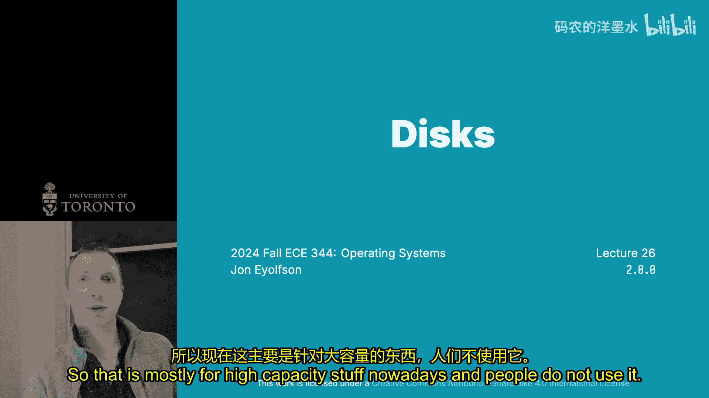

If you had to use it， while there's some physical limitations， you have to schedule that。

 I won't go into any of that because the likelihood that it will be concerning for you is pretty much zero。

 so。All the storage we use today is solid state drives。 They're more modern。

 they use transistors like RA to store data rather than magnets and magnetic disk。

The only difference is that unlike RA， so if you power off your machine， RA gets cleared。

 nothing persists， if you reboot your computer， Ram starts again from scratch。

 the only difference is unlike RAM wherever you lose power or something like that。

 the data actually stays on the device and that's how you can boot windows and save your files and power down your machine and power back on again and not lose anything so some pros to using SSDs as opposed to hard disk drives is there's no moving parts or physical limitations。

 as you might imagine if there is a spinning hunk of metal。

 that is constrained by the laws of physics it can only move so fast， take some energy to move it。

 the magnetic head stays in place and moves up and down so if your data is on the other side of the disk it might have to spin halfway around in order to read it and there are some physical limitations with that。

SSDs， they have better throughput， they have good random access because well it's just circuitry。

 they're more energy efficient mostly because it doesn't have to spin a hunk of metal and better space density。

 so hard disk drives they're all like this thick by like this big and the smallest the biggest SSDs are like this by like that So it's like four times as big spacewise。

 even the worst case。 most solid state disk are actually like a little chip like this which is really really small cons is SSDs are more expensive depending on what kind you get they have lower endurance so you can only write to an SSD a certain number of times before it wears out and you can't write anymore for most of you your laptops don't last that long it's probably like 10 years or something like that So it lasts longer than your laptop so it doesn't really matter but if you're using if Google is using these they might actually hit the right capacity。

And then you can't use them anymore。And they're also more complicated to write drivers for。

 which we will kind of touch on today just based off how they are constructed。

 and we'll explore more as we get into file systems and how to actually store data on the disk。So。

From a high levell view， this is how an SSD is organized it's organized in a hierarchy。

 so your chip is called a die that stores all of the data on it that die is further divided into planes so a die contains multiple planes we don't really have to care about that what we care about is on a plane there are multiple blocks and on a block there are multiple pages so this is where we get involved in where we actually have to organize something as an operating system and these pages while they're just called pages they can be  four kilobys and match up with the size of a page in virtual memory but they don't have to in hardware they can either be 4 kilobyte or 8 kiloby most of the time for the purpose of this course will just assume there  four kilobyte and they line up with our virtual memory page just for argument's sake and to make everything a bit simpler。

So。How they work is well they're a lot faster than hard disk drives and the pages， like I said。

 typically four kilobytes， just like our size of pages and virtual memory。

And the rough speeds of reading data is really， really quick。

 So it's like 10 microseconds in order to read a page。

 you can only read pages at a time to write a page it's like 10 times slower。

 it's 100 microseconds and then erasing a block note this is where things get weird because you might see that there is no such thing as erasing a page。

 you can only erase a block at a time and a block contains multiple pages。

 and it is also a very slow operation。 It is one millisecond， not a microsecond。

 So it is about100 times slower than even writing or 10 times slower than writing a page or 100 times slower than reading a page。

 So it is the slowest operation we have。Oh， yeah。打爆。Yeah， erasing all the pages on that block。

 so we can only do it at a time， yeah。Nope， you're not allowed to overwrite data。

I don't know why they're like this， some physical limitations you'd have to talk to an SSD architect。

 not me， I'm just telling you what we have to do in software。Hard disk drive， like the。Magnetic one。

 the sole one。 So yeah。This is kind of weird。 And they also have other rules。

 So you can only read complete pages。And write to freshly eraed pages。

 So you can't overwrite things like you just said。 You can only write to it once after it's been erased。

 You can't overwrite it， which is a bit strange， But it's just how these work again。

I am not an expert in hardware I'm just telling you how we have to use them in software so erasing is done only at a block level and a block typically has like 128 or 256 pages so we have some constraints here and you might imagine writing drivers and organizing this is a bit of a pain in the neck because it's up to the kernel to decide that but the rules are that entire block needs to be erased and it needs to be erase before I write anything and I can only write to each individual page once before I have to erase that whole block again so writing also is slow especially if well maybe I don't have a freshly erased block or page available so I'd have to find some block to a racese a racese at all which is really slow and then finally write to that page so based off bad luck。

 things could degrade。Really quickly in terms of performance。So the O S can help a bit。

 So SSDs will need to garbage， collect blocks so。What it might do is， hey。If a block。

 if you're only using like I don't know， let's say a block has 128 pages。

 say you've already written to 126 of them and are no longer using those anymore。

 you're only have two active pages well what your SSD might do is be like okay well I'll just freshly erase a new block in this move those two pages there so the other 126 ones can be written to again so your SSD that would be some type of garbage collection may have overhead because you have to move pages to a different block so you can actually erase it。

And also， when you delete a file， the operating system just marks things as unused。

 The SSD hardware itself might not know that they're not used anymore。

 so it actually might not be able to erase the block if it thinks it's still active and in use。

 so that hardware might think the disc is full， but a block could be erased。

 a file could be deleted and not erased。 So in order to help with this。

The OS has something called like a trim command and that basically informs the SSD that hey me。

 the colonel are no longer using this block， I don't want you to erase it quite yet。

 I don't want to wait for you to erase that whole block but I'm just going to tell you it's unused so that you can erase it whenever you have idle time hopefully you know I don't have to pay that penalty I just let it erase in the background so that by the time I need to use it hopefully it's already been erased and the hardware itself can deal with that so I don't have to wait for freshly erase pages all the time so that's basically what the trim command is Yeah alive。

So the page is still alive means like a file is actually using that block to store or page to store data。

 and we'll get into it in the next lecture， how to actually。Store files and stuff across pages。

 So we define the light。There are pages inside of lock。Yeah。

 pages in the block that are still used for files or something like that。

 So each of these will have like a little bit of your file。All right， good about SSDs。

 That's the weird rules of that other than that。 So so far we've been talking about single devices。

And how many of you have more than one hard drive in your laptop？Probably zero of you。

 So what happens if your're。Blaoptop hard drive dies。What happens to all your work？It's dead， right。

 and you probably cry。So what should you have done。Well。

So if you have like just a single drive in your desktop， sometimes jokingly。

 that's called a single large expensive disk。 So just one large disk for data， if I lose the disk。

 I lose the data unless I back it up somewhere else。Back it up to the cloud。

 which is just another word for someone else's computer and they store it on their hard drives。

 So if you care about your data and you don't want to use the cloud or anything like that。

 there's also another scheme you could do if you have more than one disk。

 So there's something called a redundant array of independent disk typically we just say raid and the idea behind this is you distribute your data across multiple physical disk。

 and you have redundancy， which is just multiple copies of the data。

 and you can use this redundancy in two ways。 So you can either use the redundancy to prevent data loss。

 So I have multiple copies of my data。 So if I lose a drive。

 I don't lose any data or you could use a redundancy to increase throughput or increase performance。

 and there's a tradeoff between the two and we'll go into a whole bunch of different configurations。

 we can have for rate that trades off between these two。 So first。

One is if you only care about performance。

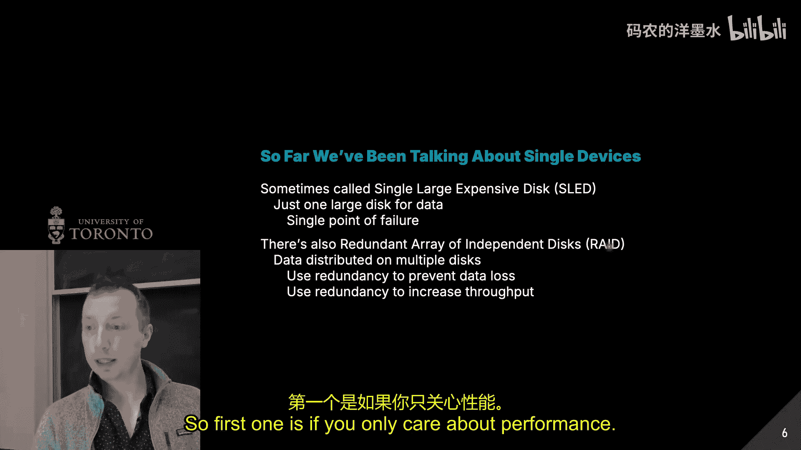

So if you only care about performance， they're just given by a number， so raid zero。

 it's also called a stripe volume， and the idea behind that is well I have multiple disks。

So instead of just having one copy of the data on one disk。

This one is going to take that data and split it up across all of the disk。 So in this case。

 let's assume that we have a file called a that's in eight pieces。 well。

 what it will do is store like the odd pieces of that file on disk 0 and the even pieces on disk1。

 So half is on One driverive， half is on another drive。 So right now， if disk 0 dies。

 did I lose data。Yes， right， which seems really bad and kind of counter to what I want to do now。

If I lose disc 0， while I lost half of file A， that means file A is now useless。

 If you only have half of windows， it's not going to boot。

 So I have now introduced more points of failure here， right。

So if I have three disk and I divide all my files across three of them。 now。

 if any of the three disk drive dies， I'm out of luck， I have lost data。

 So the only reason I would do this is for performance。

 So people do this on like high end gaming systems and things like that， where you really。

 really need really fast access。 So in here， compared to a single drive。

 my performance is twice as good。 So instead of assuming I can do this in parallel。

 instead of reading eight chunks of this file all from a single disk。

I could instead read four from one disk and four from another in parallel。

 so it would be twice as fast， similarly to write to the data。

 instead of writing all that data to a single disk， I write half of it to one disk。

 half of it to the other， so it would be twice as fast and while if I' had three of them。

 you reading would be three times as fast， writing would be or three times as fast as well。And if。

Both of these discs are 10 terabytes。 I can actually use 10 terabytes for storage。

And in like Windows or something， this whole array would just appear to you as just a single drive。

 but under the hood， it would actually have half of the data on one drive。

 half of the data on another drive So questions about this， this one is room room， go fast。

And have more points of failure， but that's your trade off。Okay。These can be hard disk or SSDs。

 doesn't matter。They can be anything as laws are all the same， pretty much。die。电源。Yeah。中ど。我他。

Like two different physical SDs。 So like the， the whole idea behind this is I can just take one out of the system and replace it。

So they're actual physical， different drives。 So this one isn't going to help replacing if one dies。

 replacing isn't going to help because I lost data already。Yeah，我。

Point of failure means like just how many disks I can survive losing before I lose data。So here。

 point of failure is just like which disk like the point of failure is a disk dying here。

 So how many can I tolerate dying and here zero， as soon as I lose a single disc， I have lost data。

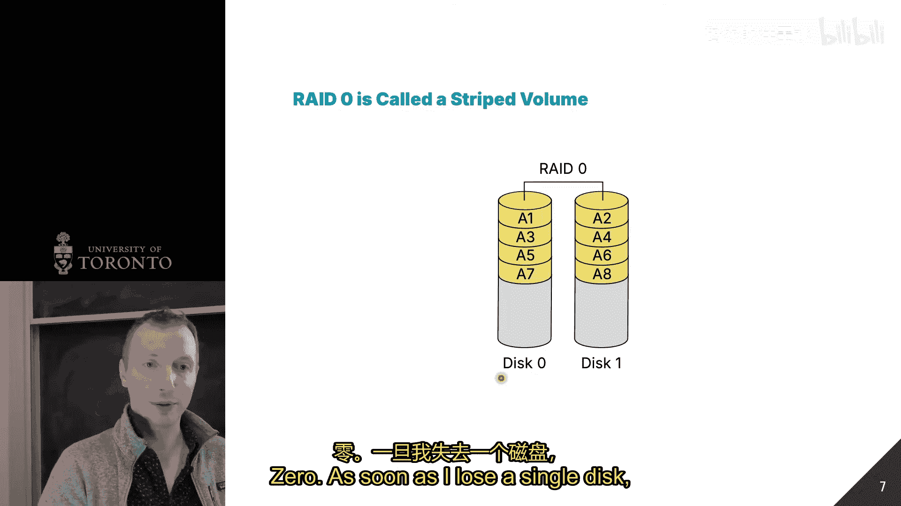

So。The other so rate 0， pretty much for performance only， stripes the data across all the array。

 You can have more than two pro faster， roughly end time speed for reading and writing。

 The big con is， if any dis fails， you have lost data。 So there's more point of failure。

 So any one of the drives can fail instead of just a single drive。

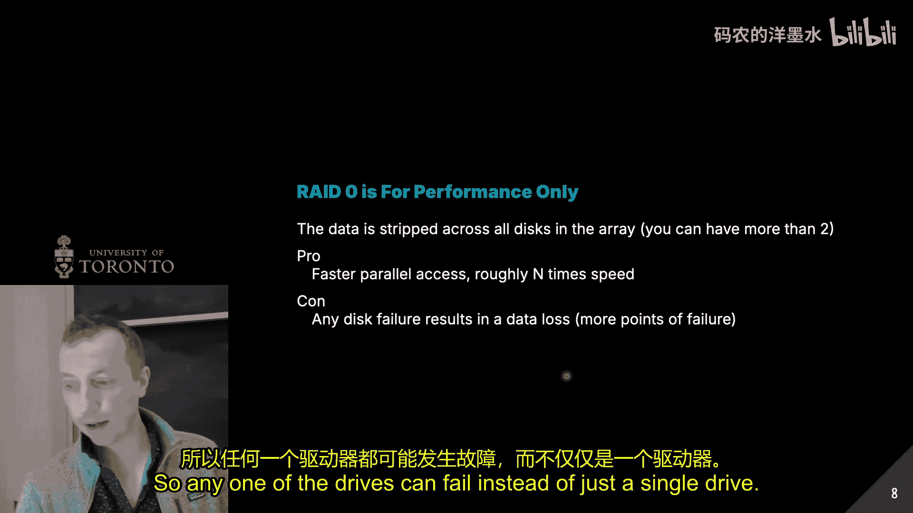

The complete opposite of that that goes completely in the other direction is called raid1 and that is otherwise called a mirror。

 so it makes all the discs an exact copy of each other so if I have two disks。

This time file A is smaller。 Let's say it only takes up four little chunks。 Well， on both this。

 they are exact clones of each other。 So it's the exact same thing on both this。So。For this。

 if one of the drives dies， do I lose data。No， if I have four drives that are all exact copies of each other。

 how many could fail without me losing data。3， right， As long as I have one left， I'm all good。

 What about read performance。So， yeah。Yeah， it can still be fast。 So in this case。

 if I have two drives， my read performance can be twice as fast because even though I have the full copy on all the drives to speed it up。

 I could just read like the odd parts from this disk and the even parts from this disk all in parallel。

 So my read performance can be you know， n times faster or ends the number of drives。😊。

Well about my right performance？going to be the same as a single drive， right。

 because I have to write it to all of them。 If I assume I can write it in parallel。

 then it's the same as using a single disk， yeah。A disc would like like。Never access。ブラも。D。

 you never asked。Yeah， yeah。 So， so I might not use it， but in not using it。

 it's making it go faster， right， So， but yeah， could be considered a con。

 I'm kind of wasting space of it。 So this is。The more disc I add to this， the more space I waste。

 right， like if both of these are 10 terabytes。I can only use 10 terabytes if I have four of them。

 so 40 terabytes total， I can still only use 10 terabytes right， because there's only one actual。

 like they're all exact copies of each other， right。So yeah。

 typically you only use this if you have two drives。

 it just makes some exact copies of each other so that if one drive dies。You don't cry。

And it's a very cheap way so that you can tolerate at least one drive failure。

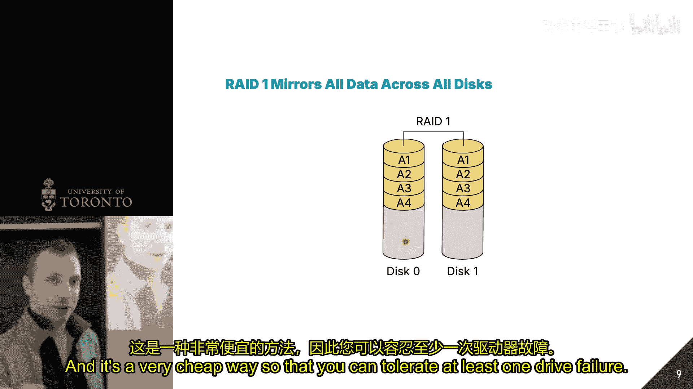

So it's simple， but it's wasteful， so every disc is an exact copy of each other。

 has good reliability as long as one disk is alive， you didn't lose any data。

 you still have that good reperformance。😊，But that con is。 yeah， there's a high cost for redundancy。

 We can do a lot better。 And the right performance is the same as a single disk。

 So it's not that great， y。Out the right performance。

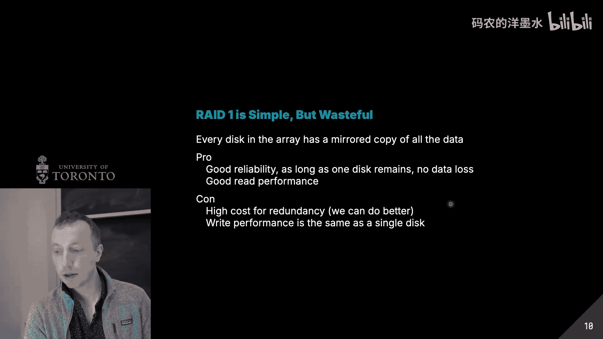

The right performance is the same because， well， let's say we need to update this file right， Well。

 if I have to update file A， I have to write four blocks to every single disk。

If I assuming I can do it in parallel， that takes the same amount of time as's writing four blocks to a single disk。

I still have to write it all。 So doesn't help。 I have to write everything to every single disc。

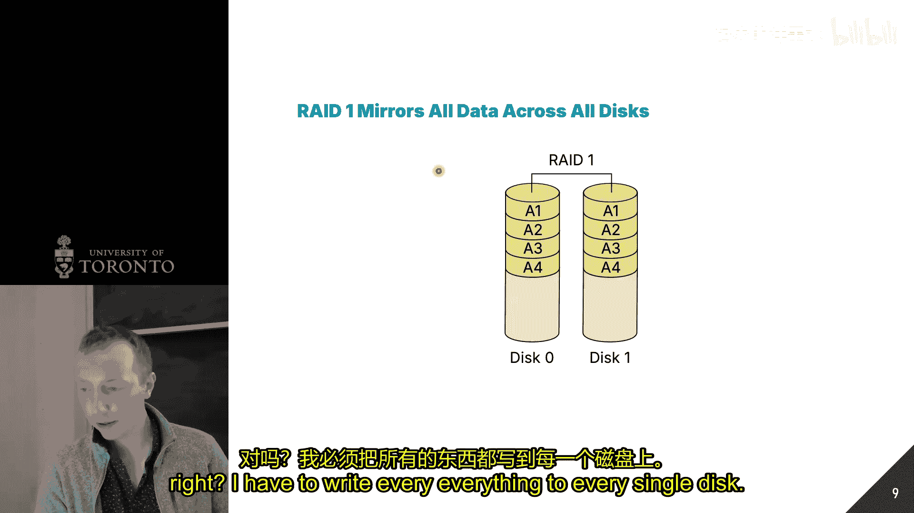

All right， so the other one that kind of。

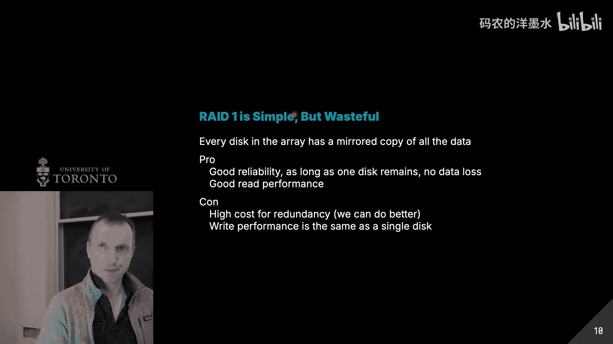

Goes in the middle of them is called Ra 4。 You might think what the hell happened， Ra 2 and Ra 3。

They were bad ideas。They're not useful anymore。 So Ra 4 also isn't really used。

 but it helps introduce us to this concept。 So， the idea in Ra 4 is。

 let's say we have four disk in this time。 it can have as many discs as you want。

 The idea is it will stripe the data across all of the disk like in raid 0。 So across these three。

 it's raid 0。 So it's a third of the data on each disk。But in Ra 4。

 it uses one disk for parodity and the parody information is， well， in this case。

 some bit of information such that if I lose one of the diss。

 I can actually recalculate whatever that bit of information I lost is and reconstruct it。

 so I won't actually lose data if one of the disk drive dies and the way to calculate this parody bit is it just uses an X or。

So XO， can anyone explain to me if I like X or three things together in plain English。

 what does the output of XO tell me about the three things I am Xoring？Or the three bits I'm xoring。

Yeah。Its the number of there。Okay。Anyone else plain English， What's the up。

 What's the result of exoring like  three bits together。Yeah。oneで。ご安でござ。Yeah。

 basically the result of xoring everything together is， well， if you added them together。

Xoring everything is a0， if they're even， and it's a one。

 If adding all them together is odd for any number of inputs。

 So that's the easy way to think about Xor。So that's what it does。 So how that would work is。

 let's say we have。

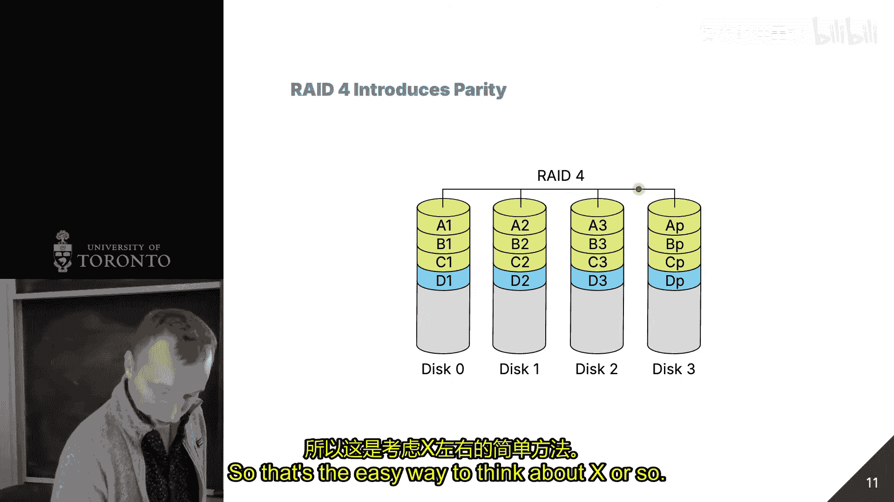

Those four disk again， so let's say we have some data， A1， A2， A3， canyon ci room。

 I don't know why this room is cursed。So A3。And then we have some parity information。

 So I'll just argue about a bit。 But， you know， if you want， to recover a bite。

 you do the same thing。 So。So。Let's say。On disk1， we have a1， on disk2， we have a0。

 and on disk3 we have a0。So my parody， which is just exoring everything together。In this case。

 the result of my Xor is going to be a0 right， so adding all those three together 1 plus1 plus0。

 that's 2， so that is an even number so the result of my Xor is a 1。So。

The reason we do this is if this。Disc dies， so let's say A2 dies， so this is now dead。Well。

 what we can do is we can run to the store。We can go ahead and buy a new drive。Let's call it A2。

Let's call it a2 prime。 And then using that parity information。

 we can actually determine whether or not we lost a one or a 0。 So we know that， hey。

 the data we have。Still surviving is in A1， well， that's a1。Plus， a zero。That's  one。

 So 1 plus 0 is1。 Then we have a mystery number here。 that's either a 1 or a 0。

 And we know that adding them together will result in a even value。

 So I couldn't have lost a 0 because one plus 0 plus 0 is odd。

 and that disagrees with that parity information。 So I must have lost a 1， right。

So I must have lost a one。I could actually reconstruct the data I lost。

 and this is called this is just called rebuilding the array。 I buy a new drive， put it in there。

 rebuild it。 So it recalculates all the data that's lost。 And I'm healthy again。

 So questions about that。Yeah。So we're doing that because we want to tolerate a single drive failure here。

 So we don't want to lose any data if a single drive fails unlike in rate 0， right。

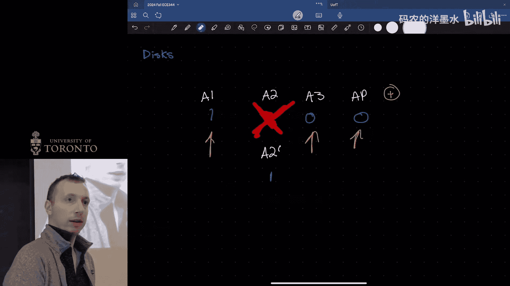

And the nice thing about this is if we go back real quick is。Our right performance。

Is actually three times faster than normal， right， because well。

 we can ignore this disk and this is basically rate 0。

 So our read and write performance is in this case， three times faster。 I'm losing one disk。

 but because I'm losing one disk， I can actually tolerate a disk failing and not lose any data as opposed to rate 0。

 right， So I'm trading it off a little bit。 yeah。When thinking about writing。

OkayCan we think of the kernel actually put the data。And that。は。Yeah。

 the kernel will figure out what it needs to write from memory to disk and have it in buffer and stuff like that。

 Yeah， but， we don't need to worry about that for now。 This is like。

How we distribute data across this。They'll say there two different spots break before the first ones there。

Nope。No。Yeah， so。

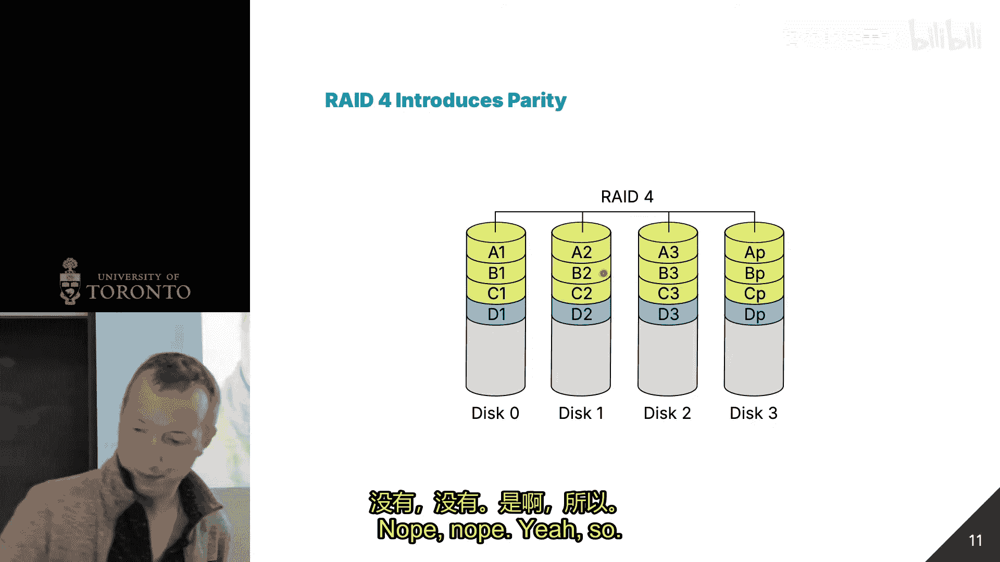

In this scenario， also， what happens if。This disc also dropped。

If we didn't go to the store and this disc also died。So if this disc also died。

How do I know what I lost。So， we know from。Just what we did before from actually looking at the result before we lost two ones。

 right。That fulfills that equation， fulfills that parity。 But because of this。

 there's a second solution。 So we this would also agree， right， if they were both zeros。

 So 0 plus 0 plus 0 is even。 So that also agrees with this。 So if I lose two drives。

 I have no idea which  one I lost。 So I actually lost data， yeah。A one。One bit of data。こでポいてるんである。

So in this， I'm just showing a bit， but a1 and A2 from the diagram would whole a whole bunch of data。

 I'm just showing how we recover a single bit。For a bitete， you just do this for every bit。

Why are we adding these are existing separate hard？完。The work that。The data。

So we're not really adding it。 We're just storing an exor。 So that's just that bit of information。

 And we're doing it because we want to actually reconstruct the data if we lose one of the drives and we want to be able to lose any of the drives and still reconstruct it。

So， why is。Like one。理方。Oh， so， so in this， I just picked a drive to kill。So I just said， assume that。

This is the data we had， right？So I just said， assume this is the data we had。

 It didn't need to be this。 I just said， assume this is our data。

 And then I just randomly picked a drive to fail。But if any one of these drives died。

 we could reconstruct whatever we lost， right？So。You would use it， oh， yeah。すくってです。

So this would be like your actual data that's stored， right， This is like actually part of your file。

 And this is only the result of Xoring all those things together。

So we only use this if we need to reconstruct things。 otherwise， we wouldn't really have to use it。

So funny story time。 This is essentially what I stored like my PhD thesis on。😊。

So we argued that one drive dies。 I'm good。 Two drive dies were。Not good， right？So。

One of my drive died。 when I was finishing， when I was near finishing， did I lose any data。No。

So I carried on， it went a bit slower because well， every time I accessed that data。

 it has to figure out what I was trying to access， but your data doesn't get lost or anything like that just gets a bit slower。

I should have gone to the store and bought another drive and reconstructed it。

 But I was a poor grad student that was busy。 So I didn't do that。

 Turn out if you buy all the drives at the same time， they'll probably die all at the same time。

 So before I went to the store， another drive died。Did I lose data？Yeah。

So more of the story is go to the store and reconstruct it if you're using grade 5。 Otherwise， yeah。

 you lose data。So it is possible to get that data back。 So like we said before。

 if we lost both of them。So if we lost both of these， right。Well， there's two solutions。

I could have lost a 00 or a 11。If you pay a data recovery specialist a lot of money。

 they can figure out which one of these two it was by basically brute forcing it or using like how like how files are formatted to reconstruct which one of these two they are。

 It will take a long time and cost you thousands and thousands of dollars。 I did not do that。

 but that is an option you have if you get into like data recovery specialists。

 It's basically what they do。 yeah。Yeah， physical dis。No， it wouldn't make a new disk。

 you have to physically go out and buy a new one。Yeah。

 so this would be like that physical disk drive die that drive dies。

 I physically remove it from my system。 I buy a new one， and I put a new one in。

And then it reconstructs it。

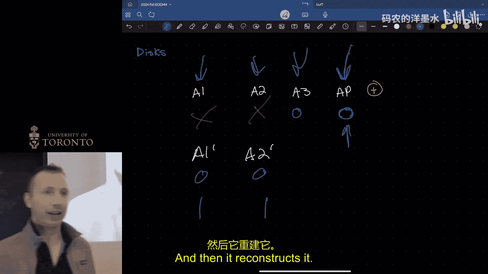

So。That's my moral story。Also in here， if each of these drives were like 10 terabytes。

 then the amount of space I can actually use for storing files would be like 30 terabytes。

 so I could use these disk to actually store the data for the files。

 and then this disc is just used for the result of xoring everything across the other disk so 10 terabytes would be used just for that。

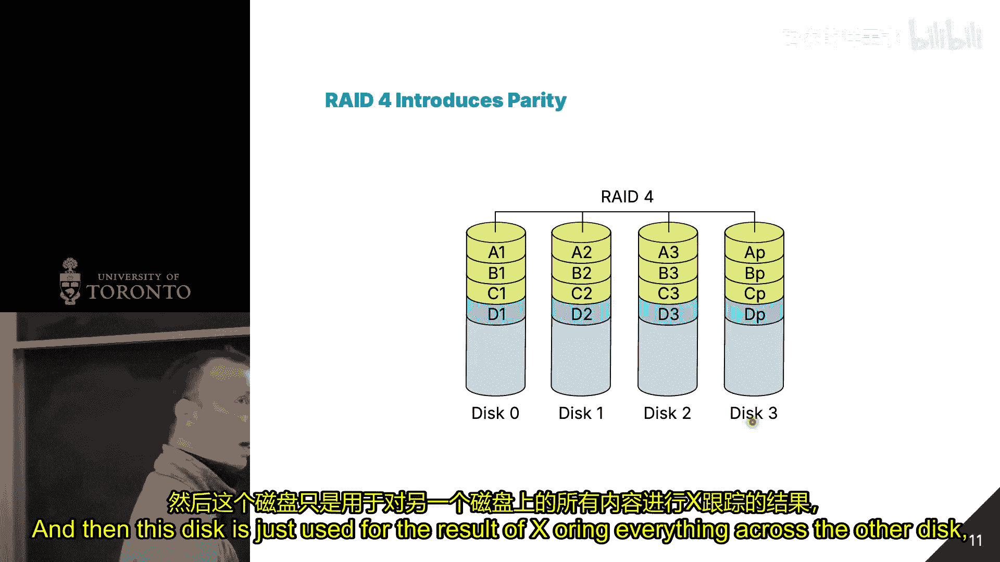

So。That's basically saying with parity， I can use all the available space minus a single disk drive。

 I need at least three drives in order to do this。 So if you only have two and you care about your data。

 you're stuck with Ra 1。The pro is， well， we'll get n-1 times performance。 Basically。

 you remove the parody disk and it's raid 0。 and the benefit， the main benefit over Ra 0 is I can。

If a single disk drive dies， I can replace it and rebuild it without losing data。

The con is right performance can suffer because every right must write to the parody disk。

 So let's say I was only updating like a1 on disk 0， then B2 on disk 1， then C 3 on disk 2 Well。

 all of those modifications would require me to recalculate the parody disk。

 So that would actually cause three rights to disk 3， which would stress it out a bit。

 So all of the rights get concentrated onto disk3， and it might wear out faster than the other ones。

 which is something we don't want to do yeah。

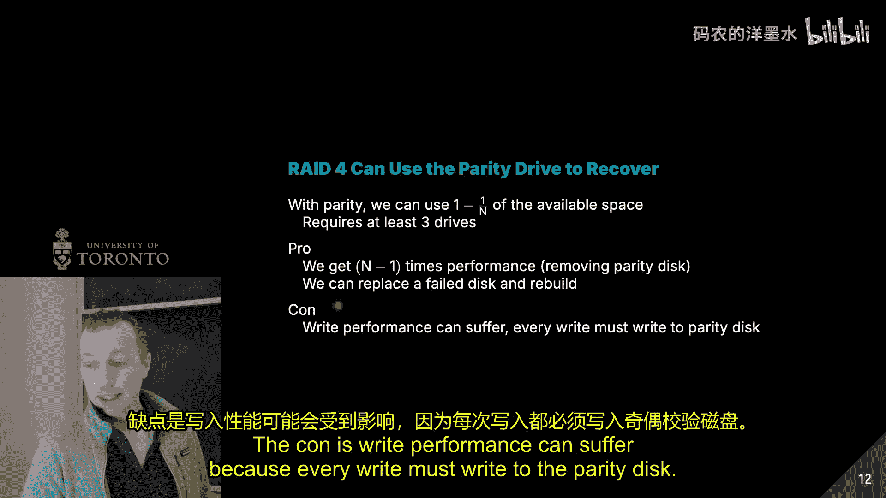

Is there some signal that drive kids when it die？Yeah， there is some signals。

 So spinning magnetic drives。 when they're about to drive。

 they usually have something called the click of death。 So they start sounding really bad。

Sometimes like drives will report their status if they start writing bad data or something like that。

 they'll tell you， I ignored all of those warnings and then waited for it to actually die die。

 probably shouldn't have done that yeah。Yeahep。大です。In grade one yeah。But grade4， randomized。Replace。

可。In Ra 4， I can still use my system。 It would just be slower。We a one。

And one of those distance dies， you don't replace it。Yeah， so like if a3 is gone， you're saying， oh。

 well， how do I access that part of the file， So you can actually， instead of replacing the disk。

 that one can be dead， you just have to like recalculate it every time you try and use it。

So it's going to be a lot slower， but it's going to still work。So when I was working on my thesis。

 right， I didn't。 It didn't need to go fast。 I didn't care。 So I just ignored it， went slower。

 whatever I don't care。 I'll fix it。 I'll finish this， and then I'll replace it。Oops， so。

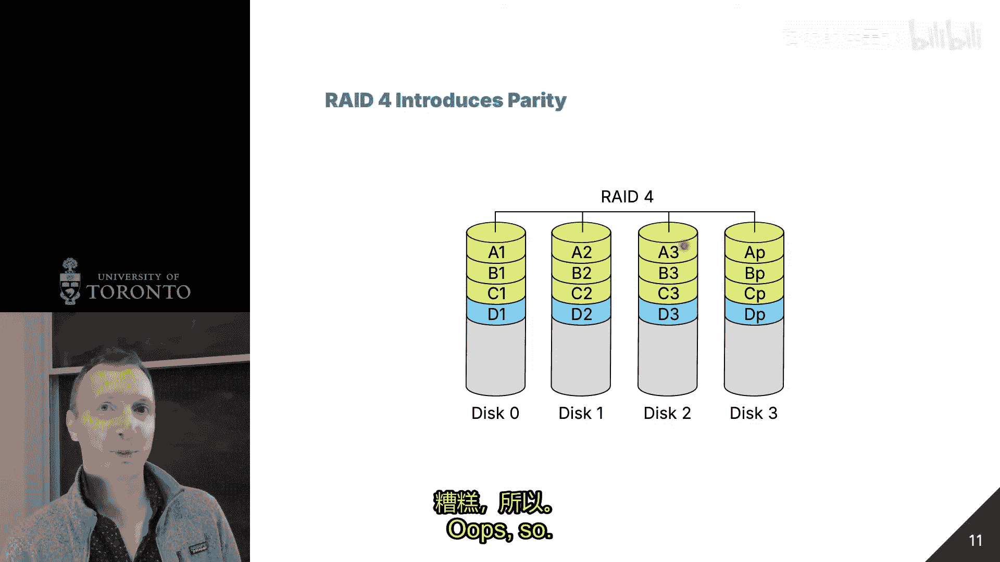

This is Ra 4。 It's not used， but it has the same idea。 So this is the first one that's actually used。

 This is what I was using to store my thesis and everything。 It's the same idea as Ra 4。

 The only difference is instead of having all the parodity information on a single disk。

 it distributes it across all of the disk， so。

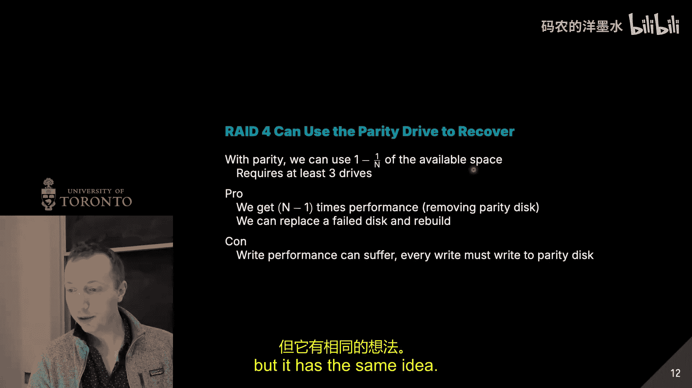

Each disk essentially gets a fourth of the parodity information。 So in this case。

 disk3 has the parodity for a。 disk2 has the parodity for B。 disk 1 has a parodity for C。

 and disc0 has the parodity for D。 So the idea is， on average。

 all of those rights from changing data gets distributed evenly across all the other disks and they wear down at event at reasonably the same time。

 So the where is a bit more concentrated， it's a bit more distributed。 But other than that。

 it maintains pretty much all of the same properties as raid 4。

 except just splitting the rights across all the other disks。 So all the same pros as raid 5。

 the only difference is。

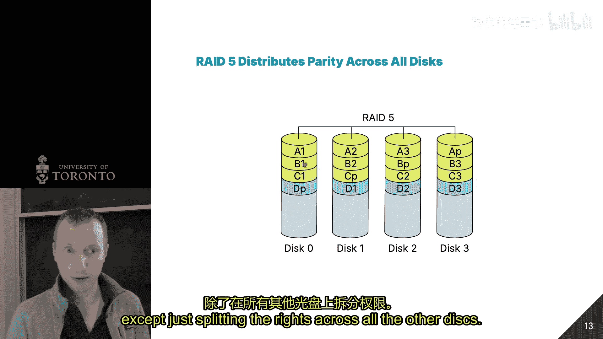

The right improvements is improved a little bit in practice because I no longer have that bottleneck of a single parodity drive。

 but functionally pretty much the same idea。

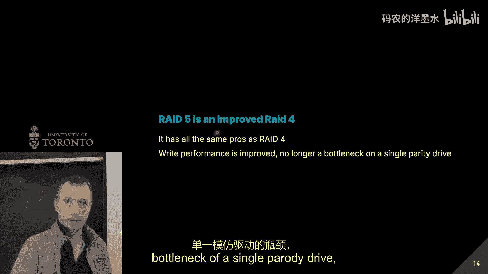

The next one is called Ra 6 and Ra 6 adds another disk full of parodity information。

 So instead of having just an Xor across all the three disks。

 I now have this other bit of parodity information called Q such that I can actually lose two disk now and reconstruct that data。

 you might be asking me how the hell do I recompute another like compute another thing that will make it so I can actually you know recover the disk or recover the information。

And in order to explain it， I need to explain Galo's fields and like a whole bunch of very complicated math things。

That I don't quite understand。 So I will just ignore it。 Someone else has figured it out for us。

 Just know it is possible。 It's basically like a linear combination of Xors， and then。Math。

 and you can reconstruct it， I don't know。But if you're interested， take a math course。

 Don't look at me。 All we need to know is that we essentially can have another piece of parity information such that if any two disk drives die。

 we do not lose any information。The only big drawback is。

 while now we essentially have another disk full of parity。 And like in Ra 5。

 it would distribute that across all the disk。 But at a high level， now。

 instead of using one disk for parity， I use 2 disk for parity。

 Trade off is now I can tolerate 2 drive failures。 And if all these were 10 TB drives。

 I could actually use3 TB or 30 TB for data， yep。So if the parodity just drive。

If the parody disk dies， that's fine， you just go buy another one， it can just recalculate it again。

And it's。It's the same idea， like it just has to exor all them again or do the other weird one。

 but you just recalculate some no problem。And if we got lucky and the parody disk drive died if it was like Ra 4。

 then our performance would be the same， right， We just wouldn't have any protection anymore。Yeah二。

How white。So this helps write faster because essentially the other three disks are all in raid0。

So essentially we have two drives for parity。But our right can be distributed well across all the drives。

 hopefully。Realistically， it's like three drives in parallel。

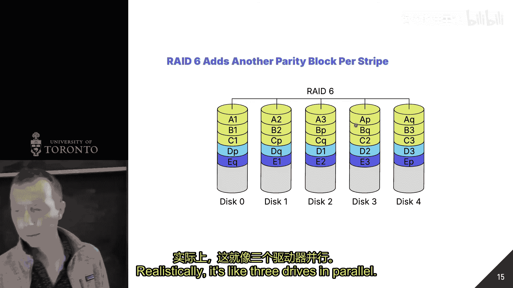

All right。So do the extra parity。 I have less available space。 I need at least four drives for this。

 Perhaps I should have used this to store my thesis on it， and it would have survived that。

 but I didn't actually lose data。 So don't worry about it。

 The right performance is slightly less than rate 5 because there's another parodity calculation and another right。

So it's a little less performant and a little less space efficient。

 But the trade off is now I can tolerate two disk drives dying at once。

So there are some other things to do。 We can mix and match different rate levels。

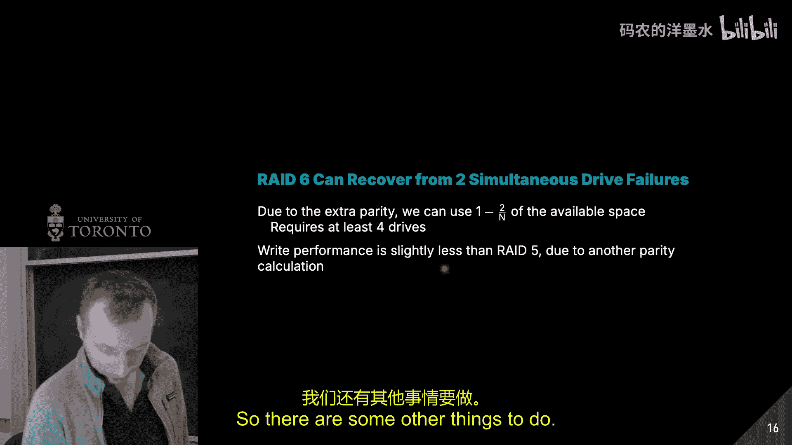

So， if we go back。Let's say we have six disk drives。

 We can actually combine raid 1 and zero if we really wanted to。

So one thing we could do is at the top of the hierarchy， we could have a raid1。

 which is just a mirror。And then we could have a mirror of raid oops。Of raid zero arrays。

And in this scenario， I， I don't know why this room is cursed。So in this scenario。

Let's say we have six hard drives like this。And in this scenario。

This drive is an exact copy of this drive because well， at the top level。

 both of the rate zero arrays are exact mirrors of each other。 So they have the exact same data。

 So that would also mean that this drive has the same data as this one。

This drive has the same data as this one。So under this scheme。

 if they were all six of them were 10  TB drives， I could only use 30  TB of storage。

 But how many disk drives can I tolerate dying before I lose data。3。Is it three？That。Maximum three。

Mimum， two or minimum one。到我仰话。So。Let's， if I pick any drive， I shouldn't lose data， right。

So let's pick。This one。Alright， so I lost S drive。 I've not lost data。Okay。If I lose another drive。

 is it possible for me to lose data？Yeah， which one？The other green one， if the other green one dies。

 I lose data， right， yeah。rate 0。The data copy。い。So in here。

 I've read one at the top and then two exact copies of the raid 0 array。And the raisezor split。Yeah。

 yeah， rate zero is just striped like a third on each disk。Yeah。So in this case， well。

 if I lose the other green one， I'm screwed because I have no more copies of that green data。

 but if I get lucky。Let's say this one dies。 Did I lose data？Nope。

If I get super lucky and this one dies， did I lose data， Nope。

 so I can tolerate 1 to 3 drive failures if I get really lucky。

 not guaranteed because I could get lucky to the pairs could die。 And then I no。

No shot I'm not going to recover。This is actually called- they usually name it from the inner level first。

 so this is something called raid1 plus0。So you can organize it the other way。 Typically。

 it's actually organized like this。 read 0 at the top and then。

It's a raid zero of a bunch of pairs of raid one。So， how why。

So this is typically how it's actually organized。So drive， drive。Drive。So。Dry， so this is called red。

1 plus 0， or simply raid。10 and same idea。 But now all of our pairs are right next to each other。

 So this one is the same as this one。This one is the same as this one， but。Has the same effect。

 I can lose one to three drives， depending on my luck without losing data。

 and I can combine a whole bunch of different rate levels。If I really want。 But typically， this is。

Usually done because I've been using this for my stuff， because if this。Drive bs。

Let's say this one's dead Well， in order to reconstruct the array instead of having to read all of the information from all the other disks and recalculate everything。

 which spoiler alert， another reason why I didn't do that is because it takes days to reconstruct a drive is in this one。

 if I just go out and buy a new one so I go out， I buy a new drive。

Then in order to reconstruct this raid， all I have to do is copy data from this drive to this one。

 and that's it。 I don't have to do any fun calculations or anything like that。 as go by another one。

 let it copy， which is a lot faster and it can just copy sequentially。

 no calculations know nothing like that， just reconstructs it。So any questions or anything like that。

 That's fun， right？ So if you're using like， you know， Google， Cloud providers or anything like that。

 they're using one of those configurations based off whatever architecture they liked。😊，And。

What you're paying Google for， essentially， one of you is paying Google for a guy that has a tray of hard drives。

That just goes throughout their data center and replaces all of the dead ones and reconstructs all the data so that nothing is lost。

So， especially if you're operating a data center like Google， drives， die all of the time。 So yes。

 there is literally someone's job to run around on a scooter replacing hard drives。

 So that is a nice career path that you might have。So。Any other questions or anything？

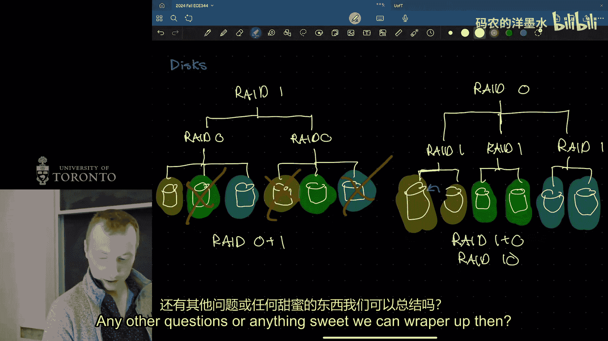

Sweet， we can wrapper up then。 So this are the thing that enabled persistence。

 We explore two topics today at a high level SSDs and raids SDs more like RAM except their access in pages and blocks has that weird thing where we can only write to a freshly erased page and we can only erase pages in blocks So because of this SSDs need to work with the OS in order for best performance like trim in order to inform the SSD when it can clean up things and we can use raid or a redundant array of independent disk to tolerate failures and improve performance using multiple disks in a variety of configuration。

😊。

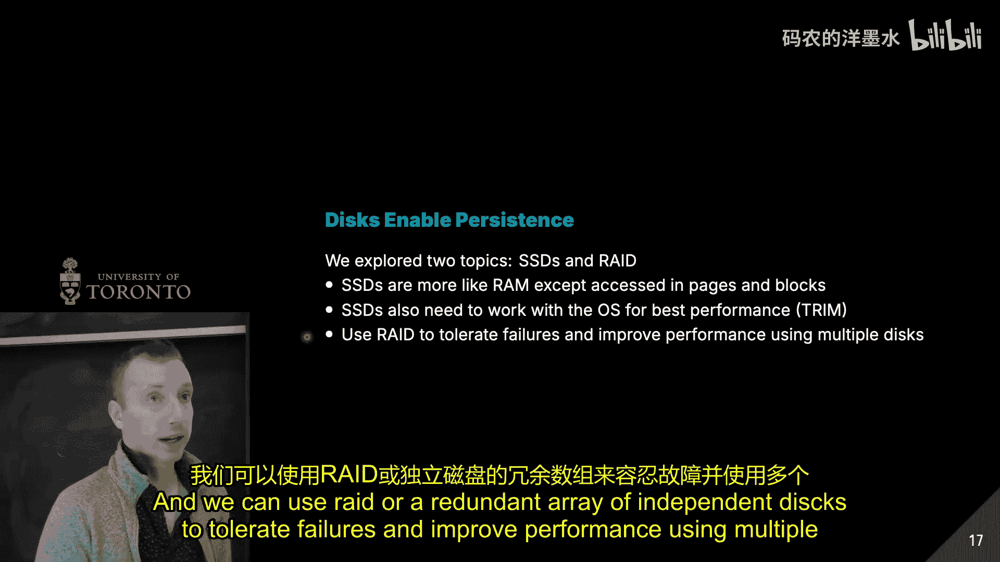