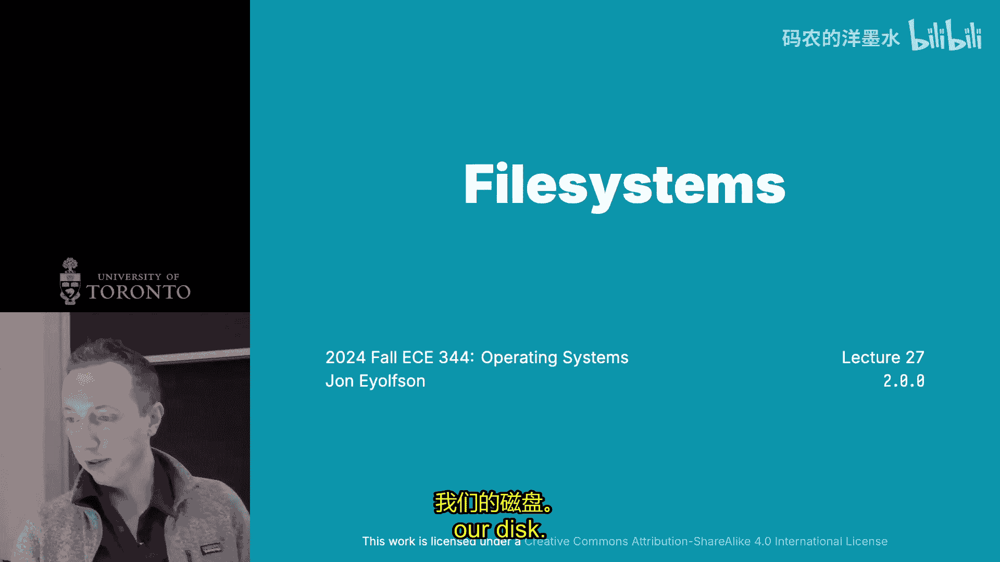
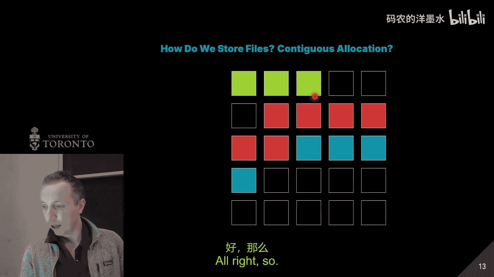
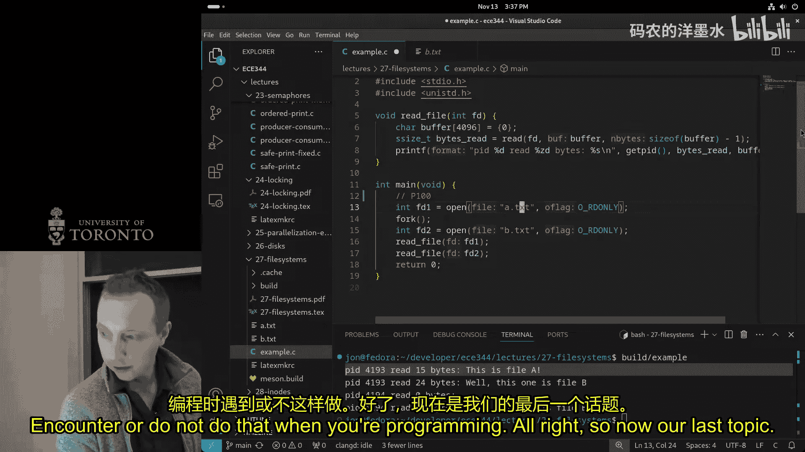
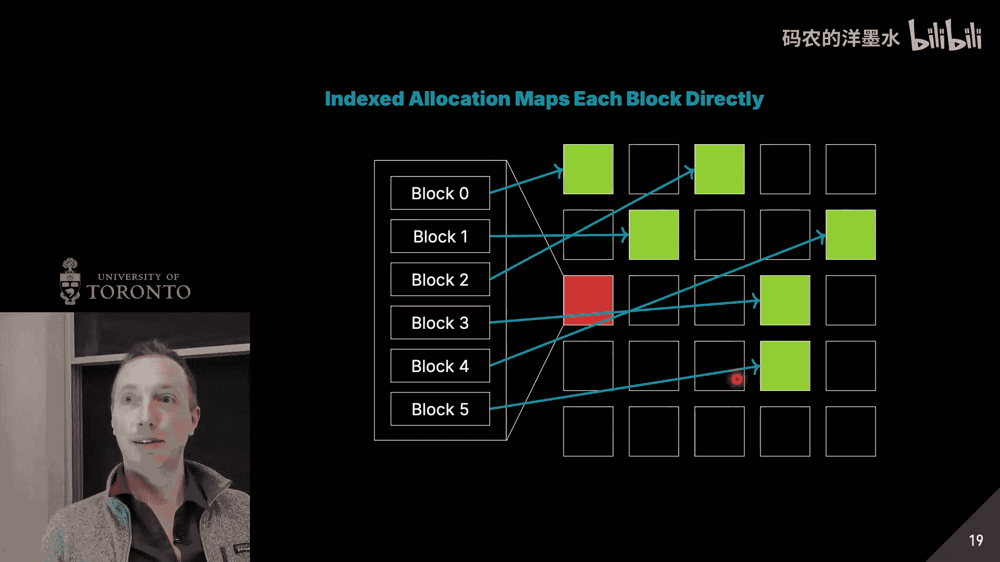
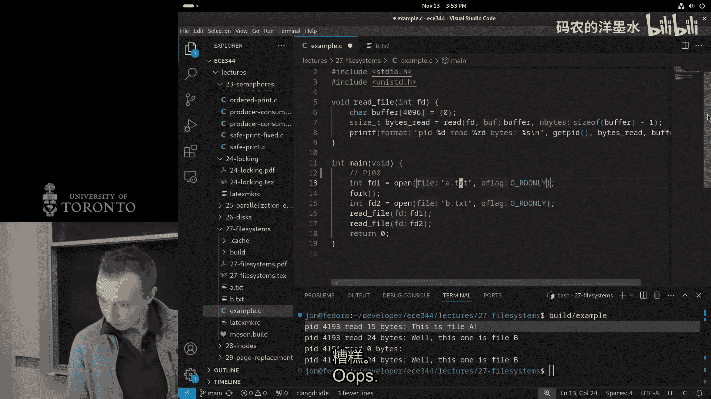
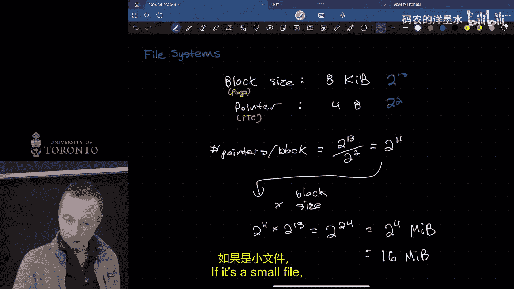
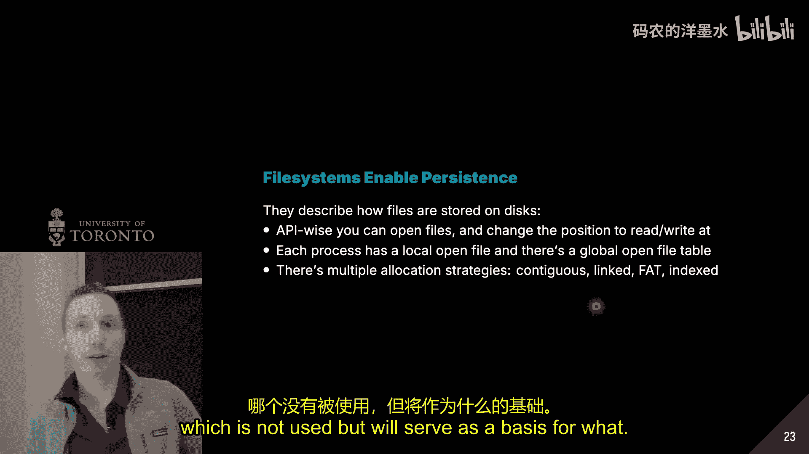

# 【全集】多伦多大学 操作系统 中英字幕 1080P p26 Lecture 26 - 文件系统 -BV1Rbk7ByERc_p26-

🎼Yeah。Alrighty， welcome back to operating System， so today we get to talk about file systems and how to actually store files on our storage devices or our disk oops。

So。4 file systems。 I mean， we've been using that。 We should define how files are organized a little bit。

 So the usual layout of a Poss file system， Aka， Linux， B SDs， Mac。Although Mac deviates a bit。

 here are some directories that should be present as part of this standard， which is。

Very creatively named H。FHS， which is file system hierarchy standard。

 very creative name and defines what directories should exist there so it says。

 well there's a root directory at the top， so all your directories are laid out in a Dg or directed acyclic graph so at the top there there's the root directory and in it this standard defines some other directories that need to be there。

 so there's a bin directory that contains all of your executables for running your system。

 there's this dev directory that represents all of the devices。

 they're not actually real files in there but the kernel presents all your devices through this directory there's ETC which should be all your configuration files and then there's this home directory on MacOS it's called users。

And then every user on that machine should have their own private directory in there。

 so like on my machine， my username is John， so I have a directory also called John there and I may store my files there like a to do file。

There's also this。And and T directory， short for mount。

 that's where if you plug in a USB drive or something like that。

 there's usually where they will show up as a directory。 So if I plug in a USB drive。

 it might show up as under this mount directory and be called USB or something like that or the name of the flash drive。

So all of our processes， they have something called a working directory so that's where we currently are what directory we're currently in。

 so maybe I'm running some executable， I'm in my home directory and then while there are two ways to get to other files。

 either an absolute or relative path the only difference is that absolute path start with the root directory and then relative paths are relative to this working directory so if I want the relative path to do dot txt there's these special symbols that we'll get into in a second there's dot which means this current directory and then dot dot which means go up one level so to do dot txt it's in the current directory I'm in so the relative path would just be like dot slash to do dot txt or just to do dot txt but my relative path is USB directory would be like dot dot that would bring me to home then dot dot to bring me to root then slash mount to bring me here and then。

/lash USB to bring me here while the absolute path to this file would be just shojotodo。

txt and to USB it would just be slash mount USB， all stuff we probably have encountered now we're just going to get into details on how to actually store this as we go on。

So。Those are the answers just in case you didn't have them。 And the special symbols， again。

Dot is the current directory， and then dot dot is the parent directory。

 So those are entries within a directory， so。Fun story time now。 So， you know， when you type L S。

 it doesn't show you dot and dot dot unless you do dash A or something like that。Well。

 someone had to program L S to do that， so they didn't want to show dot and dot dot because it's always present there。

 They just didn't want to show that。 So that would require like an if statement with two expressions。

 right， if the directory name is dot or dot dot， then don't show it。

 But if you are a creative programmer。And you want efficiency。 Well， how could you change that？

 So you only check one by of data。Or how do I make that even shorter？

So what's common between those two dot and dot dot yeah？Yeah， the first character。

 the first character is a dot， if I want to program more efficiently。

 if the first character is a dot， I just don't show it and that covers both cases。Well。

That is what someone programmed。 and that's why all hidden files on Linux begin with a dot because someone programmed that in and that bug became a feature。

So that's why hidden files on Linux。 All they have to do is begin with a dot。

 because that's the way someone programmed to handle hiding dot and dot dot。 They just said， hey。

 if the first character is a dot， don't show it。 And then they didn't check anything else。

 So that is why hidden files on Linux is just anything that starts with a dot isn't shown by default。

Bug becomes a feature， and we all use it now。Cool story，hu sweet。

 and the other special character is the Tilda character。 that's the user's home directory。

 whoever is currently logged in， and then the relative paths are calculated from the current working directory。

 which is given by this environment variable， or you can type like CWD and see what the current working directory is。

😊，So。To access files so you can either access like the contents of a file sequentially or randomly。

 So for sequential access， this is what we've probably been doing once we open a file and do read system calls to it。

 So each read system call would like advance a position in the file。

 So if we call read multiple times， we would eventually read the contents of the file。

 And then rights， they're just appended to the position set to the end of the file。

 or it could start at the beginning of the file。 But all rights would be sequential to。

 So if I write。Hello， and then I write world。 Well。

 then the contents of the file is going to be hello world。

 They're not going to overrite each other or anything like that。

So there is a way to do random access to a file， which I will show you so you can just read and write at any location in the file if you really want。

 and to do that while you actually have to change this position so you are actually indicating which byte you would like to read or write from。

 so that is another system called that we haven't got into quite yet。

So the system calls we have is a good buddy open， So open takes a path name to a file。

 and then some flags and flags can be like what operations I want to do through this file descriptor to this file so it could be。

Read， write means I could read it or write it or do both or do neither。呃。

WR only means I can only write to it， I can't read to it。

And I duplicated it for some reason that should just be read only so I could read only and not be able to write to it。

 There's also this OAend flag and that will move the position to the end of the file initially。

 so if I want to just add content to the end of the file when I write to it and don't want to destroy anything that's existing there。

 I can do OAend and that will move that position for me。

If I want more control over the like that position， I use this LC system call。

 so LC takes a file descriptor and then offset， which is just a number of bytes。

 and then this once parameter which tells you what this offset is relative to。

So this whens can be one of a few options， it can be See set。

 which means the Bte I tell you is absolute， so if I do when at seek set and say the offsets4。

 that will change the position to start at Bte4， so if I read or write to it I would start reading or writing from Bte4。

Then if I use this wince of current， that's relative to what the current position is。

 so if I wanted to skip forward eight bytes， I could set onces to current and then offset to8 and that would jump it forward eight bytes。

If I want to do relative to the end of the file， while I sent when to seek end。

 and if I want to go to the last bitete of the file， I could just say the offset 0。

 that will go to the end of the file， I can have a negative offset。 So if I。

Did negative4 from the back， that means I would get the last four files of the file。So。

We also did this。 We did the open directory thing。 You know。

 where we had to do this redirecty system call and then this closed directory。

 We'll get into how to actually。Sore things in a directory and you'll be doing that as part of the lab six as well。

 so that will be fun， but this is just， you know you've done this before。

 this is just some more example code of how to get an access entries in a directory。So。

How this works as well， each file descriptor。I said before it kind of points to a file I lied a little bit。

 it has a little bit more information it has that position。

 so you can have different file descriptors to the same file with different positions。

 so what's actually stored in the process control block are yes， there's the file table。

 So like a file descriptor is an index to this table and this table exists in each process， but。

I said before it points to a file again I lied a little bit。

 it points to one of these entries here and these entries tell you some things about the file descriptor so these entries will have a position so that's where I currently am trying to access in that file flags。

 what access do I have through this file descriptor can I read， can I write to it。

 what am I allowed to do and then there is this pointer to a V node。

A V node short for virtual node just represents anything that I can read or write bytes to。

 So this could be a real file。 It could be a socket。 It could be a pipe。 It could be。

What something else？Could be a directory， it could be whatever。So this V node will point。

 if it's pointing to a real file， it will point to a file itself。

 So the contents of a file descriptor is actually。Position flags and then a pointer to the file itself。

 And then like each process。Could have a whole bunch of different ones。

 so this could have file descriptor  one that points to file B。

 and it has its own position flags and Vn， which points to file B and maybe another process also is using file B。

 but their file descriptor points to a different entry with its own position flags。

 but its Vnode is actually pointing to that same file so they can actually access it。

 but they have their own independent position。So。Each process contains a file table as part of its process control block。

 a file descriptor is basically an index into that， and each item points to the system wide。

 so this thing in the middle here， that whole table that is managed by the kernel and that is a global table that the kernel is just managing。

So it's called a， well， it's a system wide global open file table， short they shorten it to Go。

 don't ask me why it sounds pretty terrible， but that Go table holds information about the position and the flags and also points to Vn will be anything that supports reads and writing for bytes。

So that Vn holds some information， but the files again， can represent regular files， pipes。

 network sockets， a terminal， whatever。So。Remember what happens during a fork。

 So a process control block is graded like is just copied during the fork， specifically for us。

That local open file table gets inherited。 So both process control blocks point to the same global open file table entry。

 So if one process changes a position， it will change it for the other one。

 So it gets a little weird with that。 And you have to and that's also why。

We saw before if we like print out information through multiple processes。Or read information。

 only one process will be able to read it because they're sharing that one position。

 whoever reads it first is the one that reads it。So。In the case of forking， that would mean， again。

 both processes point to the same global open file table。 So this would be process1 and process 2。

 And if they fork their PCBs are exactly the same and the their local open file table。

 all it does is point to a global entry。 So in the case of fork。

 they would both point to the same entry。 That means if one changes the position。

 it changes the position of the other one。 So you could really screw with another process。

 if you just started doing that Lse system call and moving that position all around。

 and that would very much confuse the other process。 Yep。Be still seek。

the child process of PCD were also change。So their PCB won't change。

 but the position will update in that global open file table， which is shared by them。Y。

Which makes us even more fun。So yeah， there are some gotchas with this again that current position is shared between both processes if you fork。

 so file descriptor points， essentially you can think of it as pointing to a global entry。

 so if they both point to the same global entry，They share that entry， so if you seek in one process。

 it would seek in every other process that shares it， if you fork it like 50 times。

 then all 50 processes are pointing to that same entry one would affect the other ones and the only thing here is if you want。

To access a file independently， well， you have to open the file in both process after forking because if you do an open。

 each open system call， no matter what will create a new entry in the global open file table。

 So if you want them to be independent， you would have to be very careful and only open the file after you fork so that you each have your own entry。

It's your own entry to that same file， but you can both read the entire file。

So if we have some code like this，Let's assume we have a single process running。

 it doesn't open to to do。Txt， and then we fork， so now we have two processes。

Then we do an open to file B。Openening it as read only how many local open file table entries are there and how many global open file table entries are there。

 So each process would have its own local file or local open files。 and then its。

One set of global open file tables for the kernel and for。Argument's sake。

 we will assume that there's no previously opened files。

 Even the standard file descripts didn't get opened or anything like that。So。

Let's say process 100 runs。 So process 100 runs。It does open that will create an entry in the global open file table。

 right， and also an entry in its local open file table， right。

 So it would have file descriptor0 that points to some global entry， yeah。

The local open file table is just all of your pointers to the global entries。 Yeah。

 the file descriptors through the process， yeah。So。After we fork， we would create a new process。

 Probably 101。 It would have that same file descriptor。

 so it would have its own file descriptor pointing to that same global entry。 So at this point。

Two processes， each with one local open file table entry。

 And then they both point to the same global one， right， And then if both of them open B dot T X T。

 that would be each of them would open a new global entry。

 And then they would have their own local entries for this file。

 So it would look something like this。 There would be two local open file tables for each process。

 So the parent one。File descriptor 0 would point to this global entry。

 which would have its own position flags and V node that points it to do do T XT。

 and then due to the fork， the child would also have its own file descriptor0。

 which would be its local entry pointing to that same global one and then after the fork they both open B do TX T so that would create two new entries in the global table and they would both point to file B。

 but process the parent process would be looking at this one。Pointing to file B。

 the child would be looking at different entry， also point to file B。Yeah。

 so like what how would it look like how would changing a position look so it be like。

Whereas pointing at。Cha？Yeah， so just this value would change when you did the L See exists somewhere else in the table。

No， it just exists like right here。 So the， the entry in the global table would have position flags and then a pointer to V node。

 So if any process doesn't L seek， it would change the value here。Yeah。Do you open？Yep， yeah。

 every single time you call open on a file， the kernel will create a position flags and V node in its global open file table。

べた。Thanks。Yep， there is everything in computing have limits。

 so I might run a memory typically on systems。They try not to limit the number of global entries。

 but they will limit the number of entries a single process can have。So I think the limits are。

I think the default limit is like 32000 power of twoish per process open file descriptors open。

 but you can configure that system admins bring on a machine USS agent to probably have less。

Smaller limit so you don't break the computer。But something you can configure。All right， so。

Let's see a little example and make sure we understand this。 So let's say I have two files here。

 I have a file called A that just says this is file A， a file called B that says， well。

 this one is file B。Now I have this program where in Maine， I open A dot T X T。Then I fork。

 then I open B dot T X T， and then I read file through file descriptor 1 and file descriptor 2。

 And what this read file function does just declares a buffer。

Then does a read system call that tries to fill up that buffer and then says， well。

 the P ID of the current process I called this function， the number of bytes read。

 and then the actual message。As well。So if I run this program， what will I see。

 And I don't care about the number of bytes red。Yeah。そ呃。Only one of the。嗯。

processors are going to read。All right。From which file。Yeah think。

like you open up filescriptor pointing to file A and then you for。

 so the second one also points to file A。 when you call read on filescriptor one。

 only one of those processors is going to read。What's in file A so we don't really actually know the PI we don't know if it's 100 or 101 for example。

 that is reading at that moment right？So for the first file， let's say here for argument's sake。

 I start off with process 100 then。It opens this file descriptor， let's say it's file descriptor3。

So that points to some global entry for A dot TxT， where the position essentially is starting at the very beginning of the file。

 right？Then。I fork。So now I have process 100 and process 10，1。 So let's say process 100 and 101。Now。

 if I ignore file B for a second， they'll both call read fileile with FD1， which is three。

So they'll both do read I don't know which one is going to succeed first， say for argument's sake。

 it is 100， so if 100 runs first it reads， let's assume that it just reads the entire file and one read system call so it would fill up the buffer with the contents of the file。

 print PID is 100， the number of bytes it read， and then that should print like this is file A or whatever the contents of file A was right？

And then。If。Process 101 executes next， comes in here， and then。After it reads。

 the position will be equal to the end of the file。So。

Because it's sharing the global entry after 100 does that read system call。

 this one is also pointing to the end of the file because it's the same global entry right。

 so I shouldn't have actually changed them， but they're pointing to the same thing。

So 101 would come in do read， read would return0 because I'm at the end of the file。

 I can't read anything else， So I would get P I D 101，0 byte thread， nothing。

 And then what about for file B。Yeah。を建议。I be because I mean like because you open。

Seate global open file。Yeah。And so like even if you read。

 like if one processor reads and it reaches the end of file， the other entry。

the position as the beginning yeah， so because I opened after the fork。

 each process would have its own global entry。The position would initially be zero and then if I read from one。

 it'll read it， go the end of the file， but because they're now independent。

 I don't affect the position， the other one， they point to different global entries So don't know the order of things but if I run this all I know is that well I have two processes。

 I will only see one print the contents of file A， while both would print the entire contents of file B because they're not sharing that position or anything like that。

 So everyone get that。So it's also why if I fork over and over and over and over again。

And I type on standard in。 Only one process is going to be able to read that information。

 so it won't get copied to all of them because， well， I forked it over and over and over again and。

If I have， if I'm sharing file descriptors， let's assume file of a was gigantic。

 If file a was gigantic， well， maybe I get。Across both of these processes。

 I would read that whole file， but I wouldn't know which process reads what part of the file and what。

The other part or what the other process reads from。

 So I would get the entire file across both processes。

 but I don't know what any individual process will actually read。

 So that would be fun to debug if you expected to see the entire file and you have screwed up。

 So everyone understand that， gotcha。😊，Do not。Encounter or do not do that when you're programming。

All right， so now our last topic。

So how do we store files？How we will simplify this is for now we'll ignore the metadata about a file。

 We'll just try to think about how we actually store the contents of a file and how we would describe where to find the contents of a file So if we just take our disk and for now we'll just divide it into blocks think of them as pages although they might not be the same size。

 they might be about the same size。 So we have to think about in this case。

 let's say we have a green file， a red file and a blue file if we were to describe where the contents of this files was well。

 if we use like contiguous allocation like an array and I need to describe it to you。

 how would you describe an array to me like how do you。Tell me。

Where an array exists in memory and what addresses are valid for it？Yeah。Size of each other。Yeah。

 so basically， you just tell me where the array begins and then how big it is。

 right So if I want to describe the contents of a file， the first idea we might have is like， hey。

 well， this green file starts on block 0， and it's three blocks big。 This red file starts on block 0。

1，2，3，4，5，6， starts on 6 and it's 6 blocks big。Blue starts on this and it's four blocks big。

Is this a good way to store files？Probably not， right。

 What both if I want to make the red file bigger。Yeah， I would have to move it， right。

 I would have to， while I can't make it bigger because then it would destroy。

 it would overwrite parts of the blue file。 I don't want to do that。

 So I'd have to pick it up and move it and copy it there。 And you might imagine that might be really。

 really bad if this red file was actually， you know。What's the size of big file now。

 if it was like 150 GB and， oh， no， I want to add a single byte to the end of it。 Oh， no。

 I'm gonna have to move 150 GB， so。Probably not the best way to store a file。

 We can probably steal some ideas from virtual memory a little bit and come up with a better way to describe the contents of a file。

So， some of you。Well， the nice thing about this is contiguous allocation is fast。

 as long as you don't modify the file or anything like that， it's really space efficient。

 So to describe where the contents of a file is， I only say what block does it start off and the number of blocks it actually takes to store and random access is fast。

 So to go to any individual by， I can immediately calculate which block I need to go to。

 So if my blocks are 4 kiloB and I want to go to byte。6，000。It's an easy calculation。

 I can figure it out。 it's on block 1。 I can access it， look it up。 I don't have to do anything。

 I don't have to do anything fancy。Big drawback of this is files can't grow。Easily。

 and we get to talk about fragmentation now， which is basically wasted space。

 So there's two types of fragmentation。 There's internal fragmentation。 That means， you know。

 you may not actually fill a whole block， we're going to ignore that for now。

 we can't do anything with it in file system。 So if our blocks are 4 kB and we're only storing。

12 Btes of data， while essentially almost all of those4 kilobytes are wasted space。

 but because we only deal with blocks at a time， we can't do anything about it。

 internal fragmentation is wasted space within a block。

 so it is all 4 kilobytes minus the 12 we're actually using to store things so。

The main problem we have is something called external fragmentation and that's basically wasted blocks or blocks that can't actually be used to store the content of a file because while maybe we shrink it。

Maybe we trunccate it。 And like there's just not enough space to store a file if I only had like。

For instance， if my storage only went up to here。And I had these three blocks bit or three blocks to store or sorry。

Let's assume this is all the space we have。 And in all the space we have。

 we have 12 free blocks in total， right？ But if I have a file of size 12。

I can't store it here because I don't have 12 contiguous blocks in a row。 In fact。

 I can only if I tried to store something of 10 blocks big， I still couldn't store it。

 even though I have 12 blocks free， because I only have 9 free in a row here。

 So that would be considered external fragmentation。

 All these blocks are useless for an allocation of size 10。

 They're all essentially just wasted space。So。We might think of well， we love linked lists。

 everyone love Li list， don't they？We could describe the contents of a file using a linked list。

 so to describe the contents of a file using a linked list。How would we describe it， Well。

 we would say what block the file starts at。 And then let's just assume the pointer to the next block is stored on the block itself for argument's sake。

 So to describe a file。That would be fairly space efficient。 I would just say it starts on block 0。

 and it's a link list。 So have fun accessing the rest of it， so。😊。

Now I can store my blocks anywhere I want， right， so block 0 of this file could be here。

 blocklock one of this file which I'd have to follow the next block  two of the file。

 follow the next， block 3， the file file the next， block 4， follow the next， block 5， file the next。

 I could do that。Reasonable， right？Although some of you don't like Lake Ly， but。

Something I could feasibly do。So this fixes that external fragmentation problem， right。

 One block as now as goes any other block。 I don't need to store file contiguously as long as there's a block free。

 I can use it and just point to it。So。The nice thing about this is its space efficient to describe the content of a file。

 I only need to save what the starting block is。Here。

 the blocks would be slightly smaller because I would need to store a pointer to the next block。

 so maybe I'm wasting some space on the block itself， but we can ignore that for now。

 The big thing we solved here is files can grow and shrink in space。

 We have no external fragmentation。 We still have internal fragmentation。

 but we're not going to do anything about that。Now we have a slight problem。This is really slow。

 right， So to access block。Three of a file。 What do I have to do？Yeah。

 I have to go to the first block， read it's next， go to another block， go to another block。

 read it's next， go to another block， read it's next， if this was virtual memory。

 that would be a different page every time so I'd have to do like the page translation every time。

So it would never have like a T L B entry or anything。 Sam idea for file systems。

 This would be really bad because each block。Would be a new block。

 I would have to read that if it was an SSD， I read， you know， blocks at a time。

 So this would be really， really slow。 Is there anything I could do that could speed this up。Yeah。

A hash table will not quite help us。What if we just want this？To go faster and still use a link list。

下回。Doubly link list， that won't help us if we're accessing like a block in the middle。

So mostly this caching thing， so。If it's slow because each next pointer is on a different block。

 what would be faster？Yeah。Andors in the single。Yeah。

 if all the V pointers were just on the same block， they were all beside each other。

That would be a lot faster。 So that is the first allocation strategy that is actually used， so。

In this case， it's called file allocation table or fat。 If you have used Windows。

 this is or like formatted a USB drive and it's small。

 That's what fat stands for file allocation table and is basically this。

 it uses link list to describe files。 but instead of storing the next pointer on the block。

 it reserves some blocks and all it does of store pointers。

 So it would set aside a pointer for each block， basically just make an array of pointers。

 And here I would say， okay， start at the pointer for block 0。

 And then what would be stored is the next pointer for block 0， it would point。Its value would be 6。

 that would mean the next block is6。At entry 6， that would have the next entry for that block 6。

 which would be two same idea。 So now。It would look like this。 still uses a link list。

 but it just moves all of the next pointers， two separate blocks。 So they're all beside each other。

 So it's a bit faster。 But if you've used Windows， I'm sure all of you have。

 This is how your boot drive is formatted。 They're all， they're all fat。 in this case。

 it's called fat 32，32 is the size of the pointer。So neat， So that is file allocation tables。

 That's the idea behind it。So。Similar to link allocation， same benefits， files can grow and shrink。

 We have faster memory access because that fat could even be stored。

 That block could be stored in memory or cache the whole time。

 It just has to read it once when your computer boots up。

 But the major drawback here is the size of that table is linear to the disk size。

 So the more blocks I have。 I have to have a pointer for each individual block。

 whether or not I use it or not， it can become very， very large。

 which is why it's only really used for your boot drive and not Windows itself。

 Windows definitely does not use something like this。 but your boot drive uses it。

 because it's nice and simple。 and。If it's， if you're not storing that much data， it's good enough。

 so。How can we further increase random speed？ You had an idea of hash tables。

Hash tables are basically just as。So could I use an array to make this much faster。Yeah。个短修で。あく願します。

What would Clyde， though， if I'm so each file would have a hash table to describe its contents？

So what would the key be， what would the value be？Because what I really need to know here， right？

If I want to get。I don't know。For this green file， it starts at block 0。How。Looking at this table。

 if I wanted to ask you， I don't know。What block on the hard drive is block2 of this file？What， well。

 what is it in this case。Yeah。Block six。Close。So the green file starts at block 0。

 So block 0s next pointer is to block 6。That would be block one of the file is block 6 of the hard drive right and the next pointer for block 6 points to block2。

 so block  two of the file points to block two of the disk so it looks like that right。

Why wouldn't we just use an array？So block X of the file corresponds to block whatever on the drive。

 So if it was just a big array for if each file was represented as an array。

 I could just say immediately store what block on the disk is I dont know block 3。

 which one's block 4， which one's block 5 of this file， that should be a lot faster， right？

Everyone should love as at this point。 So that would be a lot faster if I just had an array that told me what each block of that file corresponds to on that disk。

So。That idea is called index to allocation。 And the idea behind this is， well。

That array has to be a size。 I might just do something like this。

 and I will use a block to store an array。 And in that block， that would to describe that file。

 I just say which array represents this file。Tell it which block that array is stored on in this case。

 I'll illustrate it as a red block and then it would have for this green file。

 where is block 0 and that would just be a pointer to block 0 on the device。

 Where is block1 for this file points to block 6， Where is block2 for this file points to block 2 on the device and then so on and so forth right。

Yep。Isn't this kind of like a single level page table， exactly。

So it all comes back to virtual memory。 Yeah， it looks exactly like a single level page table。

 In fact， that is exactly what it is。😊，So。Since we know how a single level page table works。

What is some， what are some drawbacks of this or like。Looking at this。

 could I determine what the maximum size of the file would be if I use something like this？

If I told you that blocks were like 8 kilobytes and pointers were four bytes。

Could you tell me the maximum size of a file using。Your ideas from a single level page table？

Oops。

So。If my block size is 8 kilobytes。And my pointer。Is four baits？

If I wanted to translate this to a single level page table。

 I don't need to keep track of permissions or anything。 The pointer is basically a PTE。

 but a lot simpler， doesn't have to store any permissions or anything like that and then block， well。

 that's the same as like a page size。So if I want to figure out how much memory or how big of a file I could actually represent。

 what are the steps that I should do here？Yeah。Yeah， so first。

 I have to figure out how many pointers。 so the number of pointers in this case。

 if I want to use the。File system terminology， how many pointers per block？And in this case。

 if I wrote this out in powers of two，8 kilobytes is2 to the 13。Four bytes is2 to the two。

 so the number of pointers per block， well that is simply equal to 2 to the 13 divided by 2 to the two。

 so it's how many pointers can I fit on a block which is2 to the 11， right？And then， well。

 if I want to figure out the maximum size of that file。

That's how many individual blocks I can point to， so it would just be that number。Times， the size。

Or times of block size， right， and that's how big my file could be at maximum。

So that would be2 to the 11 times 2 to the 13。Which is equal to 2 to the 2 more。

If I wrote that out in。Powers of two are megabytes， like a megabyte is just2 to the 20。

 so that would be the same as two to the four meg。I bitetes。

 I write MB because that means powers of two。Just MB by itself is slightly ambiguous。

And that means2 the4 is 16， so that means the maximum size of the file would be 16 megabytes using this。

Would you be happy with that？No， right。 So we have to do something a bit different， yeah。

We're gonna have on。Well， how how would you do this so。This is kind of like one level of page table。

 right？Yeah。Yeah， I have three levels of page tables or two levels of page tables or however many I want。

But。We will put a cap in that idea for now， and。Go ahead and don't need that。 Go ahead。

 put a cap in that idea because we will use that for the next lecture， but。As you might emitit。

 so we're going to do something similar to that to actually store files。

But unlike having three levels of page tables all the time。

 we are going to vary it because we want it to be as fast as possible。 So for small files。

 we don't want to go through three levels of page tables。 Ily， we want to do nothing or。

If it's a small file， maybe only have a single level of page table so with that we've started talking about file systems。

 how they would enable persistence， they describe how files are actually stored on the disk API wise right you can open files change the position to read and write at each process has a local open file table and then the kernel has a global open file table。

There's multiple ways to store files on a disk。 we saw contiguous linked fat。

 fats the only one of these that's actually used， that's file allocation table。

 It's basically a linked list， but they're all stored on a separate block and then indexed which is not used but will serve as a basis for what。

