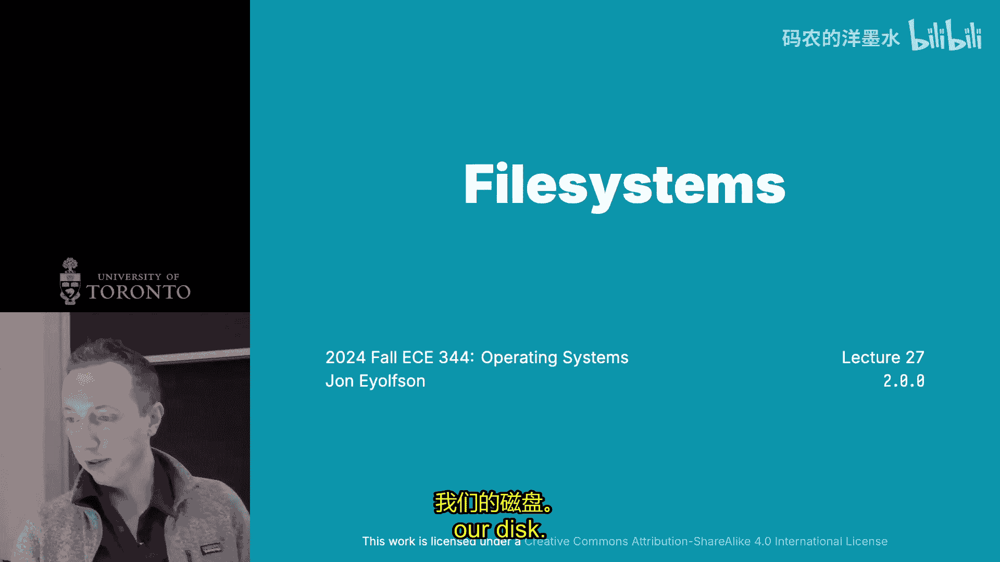
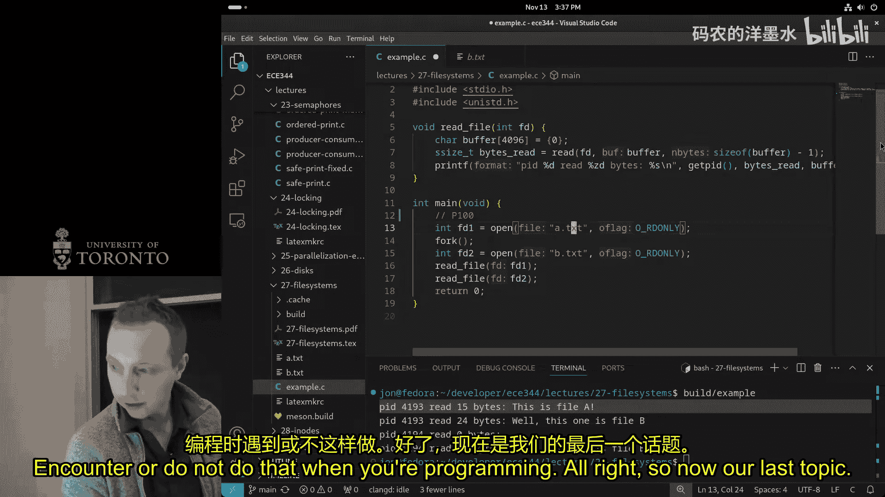
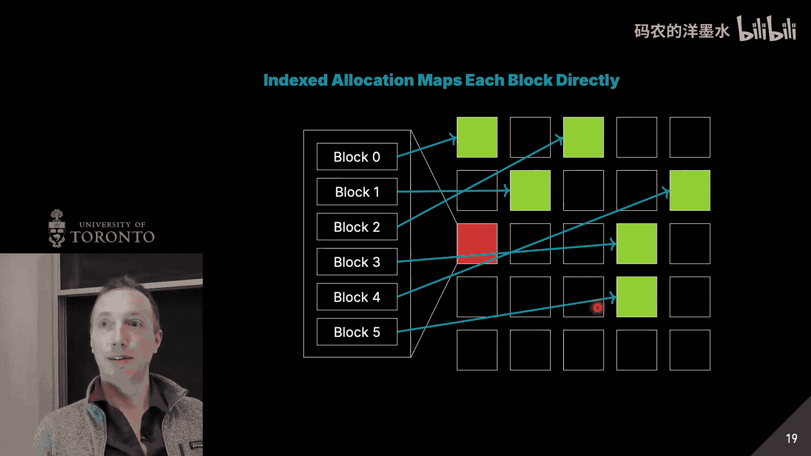
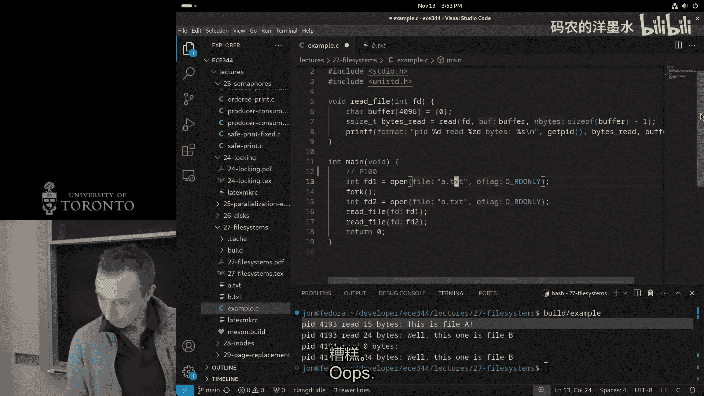
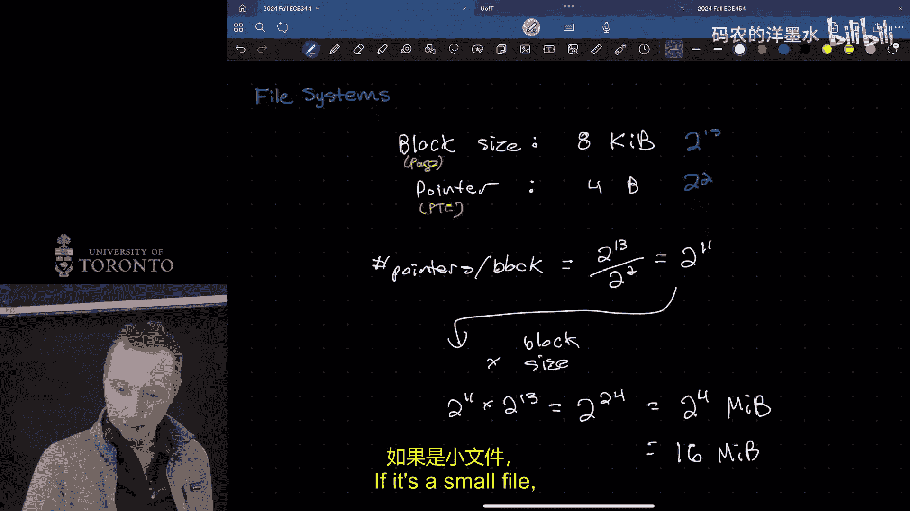
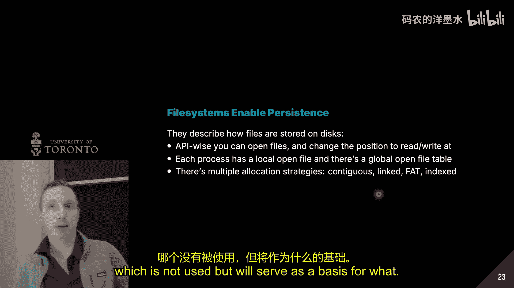

# 操作系统：26：文件系统

在本节课中，我们将要学习文件系统。我们将了解文件在存储设备（如磁盘）上是如何组织和存储的，以及操作系统如何通过系统调用让我们访问和管理这些文件。

## 文件系统布局

上一节我们介绍了文件系统的概念，本节中我们来看看一个典型的类Unix系统（如Linux、BSD、MacOS）是如何组织文件和目录的。

文件系统遵循一个名为“文件系统层次结构标准”（FHS）的规范。所有目录都以一个有向无环图的形式布局，其顶部是根目录 `/`。以下是该标准定义的一些关键目录：

*   `/bin`：包含系统运行所需的所有可执行文件。
*   `/dev`：内核通过此目录呈现所有设备（如磁盘、终端），它们并非真正的文件。
*   `/etc`：存放所有配置文件。
*   `/home`（在MacOS上为`/Users`）：每个用户在此拥有自己的私有目录。
*   `/mnt`：用于临时挂载外部存储设备（如USB驱动器）的目录。

## 路径与工作目录

每个进程都有一个“当前工作目录”，这是进程当前所处的目录位置。访问文件有两种路径方式：

*   **绝对路径**：从根目录 `/` 开始，例如 `/home/john/todo.txt`。
*   **相对路径**：相对于当前工作目录，例如 `./todo.txt` 或 `../mnt/usb`。

以下是路径中使用的特殊符号：

*   `.`：代表当前目录。
*   `..`：代表父目录（上一级目录）。
*   `~`：代表当前登录用户的主目录。

**有趣的事实**：在Linux中，隐藏文件以 `.` 开头，这源于一个历史“特性”。早期程序员为了在列出目录内容（`ls`命令）时过滤掉 `.` 和 `..` 条目，简单地编写了“如果文件名以 `.` 开头则不显示”的代码。这个做法后来被沿用，成为了隐藏文件的约定。

## 文件访问方式

了解了目录结构后，我们来看看如何访问文件内容。文件访问主要分为两种模式：

*   **顺序访问**：这是最常见的方式。打开文件后，每次 `read` 系统调用都会从文件内部的一个“位置”开始读取，并自动推进该位置。`write` 系统调用默认将数据追加到文件末尾（或从开头写入），也是顺序的。
*   **随机访问**：允许在文件的任意字节位置进行读写。这需要通过 `lseek` 系统调用来手动改变文件内部的位置指针。

## 文件系统调用

为了实现上述访问，操作系统提供了一系列系统调用。以下是核心的文件操作调用：

*   `open`：打开一个文件，返回一个文件描述符。
    *   参数包括文件路径和标志（如 `O_RDONLY`、`O_WRONLY`、`O_RDWR`、`O_APPEND`）。
    *   `O_APPEND` 标志确保每次写入都自动定位到文件末尾。
*   `lseek`：改变文件描述符对应的读写位置。
    *   函数原型：`off_t lseek(int fd, off_t offset, int whence);`
    *   `whence` 参数决定 `offset` 的基准：
        *   `SEEK_SET`：偏移量相对于文件开头。
        *   `SEEK_CUR`：偏移量相对于当前位置。
        *   `SEEK_END`：偏移量相对于文件末尾。
*   `read` / `write`：从文件描述符读取或写入数据。
*   `opendir` / `readdir` / `closedir`：用于读取目录内容。

## 文件描述符的内核结构

文件描述符并非直接指向文件。实际上，它的背后有一个多层结构：

1.  **进程本地文件表**：每个进程的进程控制块（PCB）中都有一张表。文件描述符是一个索引，指向该表中的一项。
2.  **全局打开文件表**：由内核维护的系统级表格。进程本地文件表的表项指向此全局表中的一项。
3.  **vnode**：虚拟节点，代表任何可以读写字节的对象（如普通文件、目录、管道、套接字）。全局打开文件表的表项指向一个vnode。

**全局文件表表项** 包含：
*   当前文件偏移量（位置）。
*   访问标志（读/写/追加等）。
*   指向 vnode 的指针。

这种设计允许多个进程（或同一进程的多个文件描述符）独立地打开同一个文件，并拥有各自独立的读写位置。

## Fork 与文件描述符

`fork` 系统调用会复制父进程的PCB，包括其文件描述符表。这意味着子进程继承的文件描述符指向与父进程**相同的**全局打开文件表项。

**重要影响**：由于它们共享同一个全局表项（包括其中的文件偏移量），因此如果父进程或子进程通过 `lseek` 或 `read`/`write` 改变了文件位置，另一个进程看到的文件位置也会随之改变。这可能导致意想不到的行为，例如多个进程尝试读取同一个文件描述符时，只有一个能读到数据。

**如何实现独立访问**：如果希望父子进程完全独立地访问同一个文件，应该在 `fork` **之后**，在各自进程中分别调用 `open` 打开文件。这样每个进程都会获得一个属于自己的全局打开文件表项，从而拥有独立的文件偏移量。

让我们通过一个例子来巩固理解。假设有以下程序流程：
1.  进程打开文件 `A.txt`（获得文件描述符 `fd_A`）。
2.  进程调用 `fork()`，创建子进程。
3.  父子进程都打开文件 `B.txt`（各自获得独立的文件描述符 `fd_B`）。
4.  父子进程都尝试从 `fd_A` 和 `fd_B` 读取数据。

**结果分析**：
*   对于 `fd_A`（在fork前打开）：父子进程共享同一个全局表项。只有一个进程能成功读取 `A.txt` 的内容，另一个进程将读到文件末尾（EOF）。
*   对于 `fd_B`（在fork后打开）：父子进程拥有各自的全局表项。两个进程都能独立地读取 `B.txt` 的全部内容。

## 文件存储策略

现在，我们深入到磁盘层面，看看文件内容是如何在物理块上存储的。我们暂时忽略文件的元数据（如权限、时间戳），只关注数据块的分配。

### 1. 连续分配
文件数据存放在磁盘上一系列连续的块中。
*   **描述方式**：`(起始块号， 长度)`
*   **优点**：描述简单，随机访问速度快（可直接计算块位置）。
*   **缺点**：
    *   文件难以增长（需要移动后面所有文件）。
    *   会导致**外部碎片**：磁盘上有足够的总空闲空间，但没有足够大的连续空间来存放新文件。

### 2. 链接分配
文件数据块像链表一样散布在磁盘上，每个块包含一个指向下一个块的指针。
*   **描述方式**：`起始块号`
*   **优点**：无外部碎片，文件可轻松增长/缩小。
*   **缺点**：随机访问速度极慢（必须从链表头部开始遍历）。

### 3. 文件分配表（FAT）
这是链接分配的一种优化，被早期的Windows（FAT32）等系统使用。它将所有块的“下一个指针”集中存储在一个单独的、称为“文件分配表”的连续区域（或内存中）。
*   **工作原理**：FAT是一个大数组，数组索引对应磁盘块号，数组元素的值指向文件的下一个块号。文件起始块号作为链表的头。
*   **优点**：继承了链接分配的优点，且因为FAT常驻内存，访问速度比分散的链表快。
*   **缺点**：FAT表的大小与磁盘总容量成正比，对于大磁盘会占用大量内存/空间。

### 4. 索引分配
这是现代文件系统（如ext系列、NTFS）的基础思想。它为每个文件创建一个**索引块**，该块是一个数组，直接存储文件第0块、第1块、第2块...对应的物理磁盘块号。
*   **描述方式**：`索引块号`
*   **优点**：支持快速随机访问（只需在索引块中查找一次）。
*   **缺点**：单个索引块能存储的指针数量有限，限制了单个文件的最大大小。

**最大文件大小计算**：
如果磁盘块大小为 `B` 字节，每个指针（索引项）占 `P` 字节，那么一个索引块可以存储 `B / P` 个指针。因此，单个文件的最大大小为 `(B / P) * B`。
例如，块大小 `B = 8KB = 2^13 B`，指针 `P = 4B = 2^2 B`，则最大文件大小为 `(2^13 / 2^2) * 2^13 = 2^24 B = 16 MB`。这对于现代系统显然太小了。

**解决方案**：采用类似多级页表的思想，使用**多级索引**。对于小文件，使用直接索引（索引块本身存储数据块指针）；对于大文件，引入间接索引（索引块指向的块本身又是一个索引块）。我们将在下一讲详细探讨这个精妙的设计。

## 总结

本节课中我们一起学习了文件系统的核心概念。我们首先了解了类Unix系统的标准目录布局和路径访问方式。然后，我们深入探讨了操作系统提供的文件访问API，包括顺序访问、随机访问以及相关的系统调用（`open`, `lseek`, `read`, `write`）。

我们揭示了文件描述符背后的内核数据结构，包括进程本地文件表、全局打开文件表和vnode，并重点分析了`fork`操作对文件描述符共享行为的影响及其注意事项。

最后，我们从磁盘存储的角度，分析了连续分配、链接分配、FAT和索引分配等文件数据存储策略的优缺点。索引分配因其高效的随机访问能力成为现代文件系统的基础，而其单级形式的文件大小限制则引出了对多级索引解决方案的需求，这将是下一讲的重点。