# 【全集】多伦多大学 操作系统 中英字幕 1080P p27 Lecture 27 - 索引节点 -BV1Rbk7ByERc_p27-

All right， yeahep， you too。🎼。Alrighty， welcome back to operating System， So today。I nodes。

 short four index nodes we left off last time。Trying to describe how we would store the content of or describe the contents of a file。

 we ended up on an array， but they were too small where we。

 if we were to store the array on a single block。

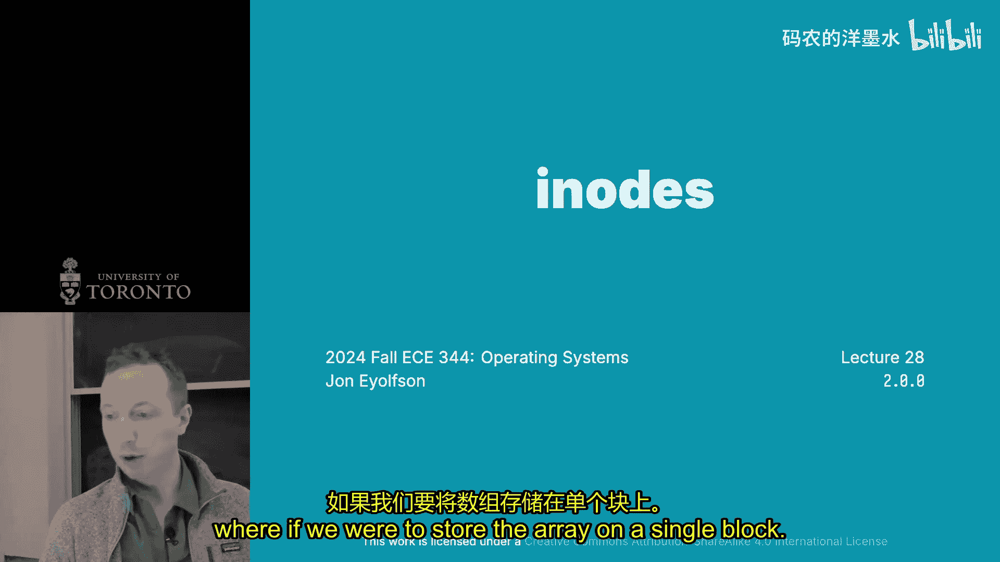

So。An iodeode it technically describes everything about a file， including its content。

 so this is what your files are actually made up of they are called an iodeode and they are a set size so they are a 28 bits or sorry bytes and you get to change these in lab 6 so lab6 you will be populating these fields so some things in an iodeode are well one it describes where the contents of a file are and then all the metadata associated with that file so it has a mode。

Has an owner。 So like the user and the group that owns that file。

 some time stamps like when it was created， when it was last modified， when it was last accessed。

 things like that。The block size count。 So how many blocks does this file consume。

 and then the actual blocks are organized like this because well。Theyre pointers to the blocks。 Yes。

 but I don't want to waste space for a small file。 So before we stored all the pointers on a block。

 well， if my file is really， really small， if I only need like 10 blocks or 12 blocks or one。

 I don't want to use a whole block that's mostly empty。

 So what it does is there are a whole bunch of pointers here。In the structure。

 some are called direct block， so they point directly to a block and there are typically in the case of iNots there are 12 of these。

 so the first 12 indexes here will point to the first 12 blocks of the file。

If this file is 12 blocks or smaller， it won't use any blocks to store the pointers。

If it is a bit bigger， then we get into what we have before and it's called a single indirect block。

 So it points to a block。 This block is full of pointers。

 so it is only populated with next pointers and then those point to other blocks。

 So that would with a single indirect block now in total， if there's 12 direct。

Through single indirect blocks， last time we argued we could point to what like 2048 of them。

 so now we can point to 2060 in total if you add those two numbers together。Now。

 if we want to use a file that's even bigger， well。

 we take a page out of the virtual memory playbook and we use essentially two levels of page tables。

 so there's one pointer here reserved for double indirect that will point to a block full of pointers。

And all those pointers point to other blocks that are full of pointers。

 So it's like two levels of page tables。 And then finally。

 there is one pointer reserve for a triple indirect block。

 So that points to a block full of pointers， which points to a block full of pointers。

 which points to a block full of pointers exactly like three levels of page tables now。😊。

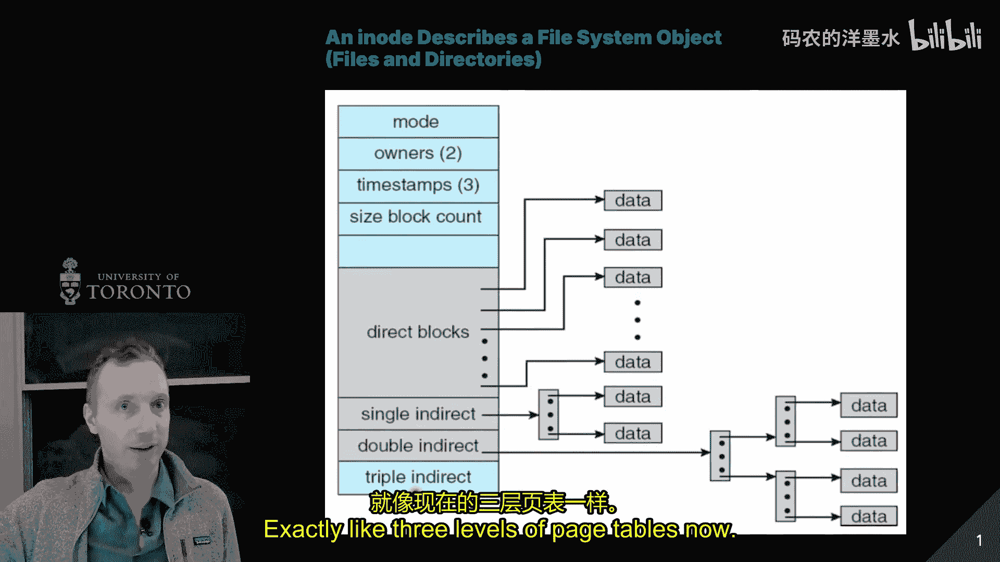

The reason we do that instead of just having a straight triple block or something like that is because we want iNots to be efficient for small files and also have flexibility to support large ones so the iNots they hold all of the metadata and pointers to blocks all the iNots for all of the contents of your files are all stored right next to each other on inode blocks and the idea here is if the files small enough。

 we just want to only use direct pointers， we don't want to have to access pointers stored on a block。

But if we have a really large file， that's what we have to do。

If it's not that large and we only need a single indirect block。

 we will use that and we will use them in order if it's too big if。

Through the combination of the single indirect and the direct block， we need more。

 Then we use the double indirect block。 And then if we need to， we use the triple indirect block。

And there's also an optimization here。In total across here， there are 15 pointers。

 if they are 4 bys each， that's 60 bys worth of information。

 If the content of your file or in some cases doesn't really， it's not really used for files。

 but if the contents of your file will see what I'm air quoting。

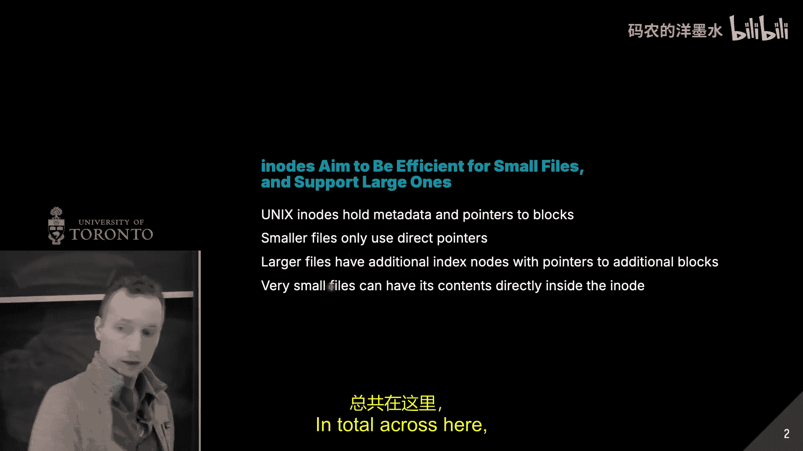

In a little bit， if the contents are 60 B or less。 then I can just not point to anything and store the content directly in the space。

 use it for something else。 So that's some optimization we could do。

 And that's also if you've ever heard of a small string optimization， it's basically what it does。

 if a string small enough， just uses the pointers to store the string itself。

 instead of actually pointing to data elsewhere。

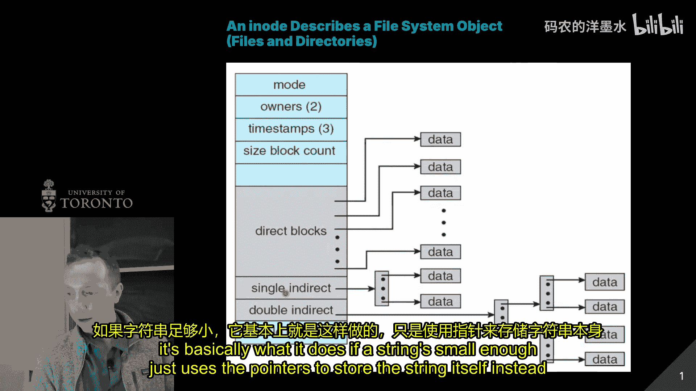

So。Now， if we go back to our i node problem， so here I would tell you in the i node。

In that index block， how many direct pointers there are。

 so typically this is how an iNotode is organized there's 12 direct pointers， one single direct one。

 one double indirect and one triple indirect and here like before if our block size is 8 kilobytes and our pointer to a block is4 bytes and we assume the indirect blocks consist of pointers only then we should be able to argue but the maximum size supported by this yeah。

Let's say the power large。Go by direct one， single or double corner。To use a triple。Y。

 would it still store some of the stuff in like direct？Yeah yeah。

 if the file' is big enough we have to use triple， it will only use that if it absolutely has to。

 so it will fill up the direct ones first， then the single indirect ones first and the double indirect ones first and then the triple last because you might imagine that's the slowest right I'd have to go ahead。

 read a pointer on a page and read a pointer on a page and read a pointer on a page so yeah we would use them in order of speed。

Yeah， why is a block a？So a block is 8 kB。 It just depends on the hardware。

 It's either's typically either 4 or 8。So it just depends on the hardware。Is it a page？No。

 so sometimes it's the same size of a page it but it doesn't have to be。

So it just has to deal with the hard work because the block is the disk block。

But it's still the same concept that we do。Yes， it's still the same concept。

 it's just a big hunk of bites。So just the size might be different。But for argument's sake。

 for like if we have to deal with it， interacting with virtual memory。

 we'll just assume it's the same size， but it doesn't have to be。

 but that's just implementation stuff that you'd have to worry about。Allright， well， in this case。

 if you wanted to figure out the maximum size of a file， you could like we did before。

 figure out the number of pointers I could fit on a block again。

 I won't redo that So it's just the size of a block divided by the size of a pointer so it's to the 11 So the total number of addressable block that we can use for this file or well 12 of them are direct so they point to a block then through the single indirect block well that's one block full of pointer so that's to the 11 through the double indirect Well that's the same as before that's to the 11 all to the power of two because well they could each point to a separate table and then through triple that is to the 11 all to the power of three if you want to just approximate stuff。

 this term dominates all the other one。 So you can just approximate it as being two to the 11 all to the power of three which is two to the 30。

So if we want to figure out the maximum size of a file now。

 it's two to the 33 blocks we could point at times the size of a block。

 so that is2 to the 47 which is 64 terabytes so a single file can hold up to 64 terabytes so everyone probably good enough for your system。

Probably good enough and if you need to support a file larger than that。

 then well you could just add a quadruple indirect block right。

 and then it's2 the 11 times bigger than that。So this is what's actually used。

 and that's why we can support really， really large files and really small ones efficiently。

So now to talk， you might notice that in an iode， there's no such thing as a name。

 Nas are purely in directories， and they are purely for your convenience。 So in a directory。

There are links to i nodes， that's。Where all of the names are。

 So a hard link is just a name directly to an iode。 So if in my directory。

 I have something like to do dot T X T， it points directly to an iode。 So a directory with。An entry。

 A K A file name is called a hard link and a hard link will point to one in。

 So this will be fun where we get to actually look at L S and explain a whole bunch of stuff。

 And this lecture should be fun because you can tell me to do whatever you want me to do so。😊。

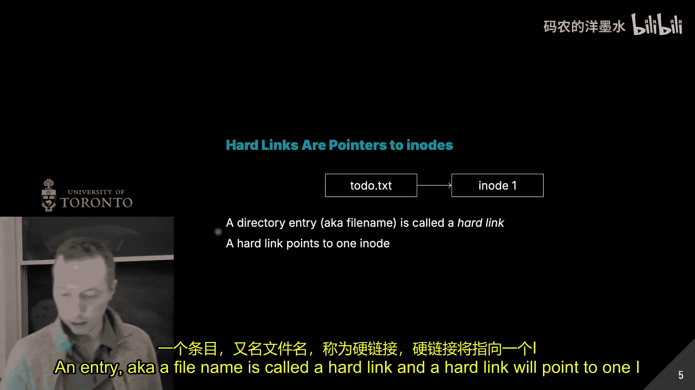

If I go here and oops。Let's say I make a file called a dottxt and I say。A。

 let's say I'm really happy， so the contents file is just a with three explanation marks。

 and if I go here and I do LS。There's some information about this file。

 So everyone probably knows what this means， right。So permissions for the file。

 so it's like what can the owner of the file do to it so it's execute。

 read and write sorry the other way around it， read write， execute。

 so here the owner of the file which is me， I can read and write it and then this is the permissions for the group。

 there's also a group called John it can only read it， it can't write it。

 and then any other user can read it。Anyone know what this number means？Yeah， a。The first dash4。

 it's for special permission bits。 so here we can find a file that actually uses it。

 so if you use pseudo。Oh so。They use other weird permission bits。

 so there's like other things like S and special ones that's a set user bit so it'll make sure it always runs it as root and that's kind of how it works but that first one there is just for other things。

That we won't go into。 but yeah， anyone know what this number means。Just some boring up， yeah。合わせ。では。

What could they a guess。It doesn't make sense。That's okay。 What， what。Any other guesses。

 number of bytes like the size of the file？So I wrote what I write in the file。

 I wrote a exclamation mark， exclamation mark exclamation mark， and then it's a new line。

 So that's five。 So that's probably this number， right。So that's probably the size of the file。

 everyone's seeing this every time， what the hell is that？Still no't brave guess。Number of changes。

 good guess， no yetep。Does it have to do with iOs， absolutely？Yeah。

 it's basically the number of references to that iode。So that's what that means。 Typically。

 it will always be one。 Also this。 What's this mean。That's like when I last changed that file， right？

Trust me， this is the last time I changed the file。 It was before the due date and everything。 Yeah。

 we'll see why I don't trust that as part of this。 So yeah。

 so this number is the number of well we can call it a whole bunch of stuff the number of hard link to that iode or the number of references to that iode whatever you want to call it So in order to create a hard link。

 so a hard link is a name to an iode this means this name is pointing to an in that's only reference by one name which is a do Txt。

 So if I type LN， the LN command will create a hard link by default。

 So the first argument is a hard link to what iode So it's the iode that you don't give it an iode number。

 you tell it a file name and it will figure out the in number so this will say。

Point a new name pointing that points to the iode given by a dot TX T， and we can call it B dot TX T。

 So if I do this and type LS， there is now a file called B dot TX T and that number has gone up that one has now become a2 because both of these names reference the same iode。

And the iode has all the data about the file who owns it。

 when was last modified and where the contents of it are。 So now if I go and I edit。File B now。

 while I open it， it's the content of file A that's。All stored on the in。 then if I modify and I say。

This is my change。And I save it。Now， if I actually look at the contents of file A。

 what am I going to see？'m going see A。 and then this is my change。Yeah。

So I'm going to see that because well if I edit the file。

 I'm editing the contents of the file and I edit it through the inode if both names point to the same inode。

 it's the exact same thing， so if I access doesn't matter if I access A dot TXT or B dot TXT。

It's the same underlying in， so it's the same content。And I can see here that size updated now。

 it's 15 for both of them。If you want， you can do LS dash L I and what L I will do is in the first column here。

 it will put the iode number， so each iode has an iode number。

 So if you want to figure out what it is， you do dash I and then you can see that okay。

 these are both pointing to the exact same iode。Yeah， why， I mean。

 I'm assuming that that total lady is talking。I agree number。Why you。Sorry what I mean， I don't know。

 but I'm looking at it and what it says totally。It lookss like that it's counting the total number。

Would you actually。Oh， total 8 and total four。it isIt's not the number of permissions， it is。

So this is a slightly different file system， it usually makes sense where it's the number of entries here if we do。

Yeah， there's only four entries in this directory。So if I do dash a。

 that will also show me dot and dot dot。 so I can see the i nodes for the directories。

 directories are represented by i nodes 2。 Let's just ignore that total 4 for now。 Yeah， or totally。

Dirrection。所以呢这道的在。Yeah， so dot dot is the current directory， right？

So the current directory is iode 6565577， and then dot dot is the iode number of my parent directory right。

 so if I go up to my parent directory。They all should kind of jive with each other。

 So if I do it here， I'll see that while there's a test directory in this directory and its high note is that。

So that tells me what that directory is。 And if I do a dot in this directory。

 since it's the parent of the other one， this number matches this number。Yeah二。Y。

 can you access files directly by？tell there。系 can you see。最初はね。

Does doesn't make sense it's not in the file。So the iodes， what's in the file system。

 The file system stores i nodes。 And then the directory just stores name iode pairs， essentially。So。

 you can。Yeah， without having a name， Pete， I don't think they allow you to just say I want to access iodeode blank。

They might it would be。Feaible， but it would be weird because。

Typically we're humans and we use names。Okay， so everyone， okay with that。 actually。

 other weird stuff， so。You've been tied up to this point if I do like RM。

To something that deletes something， right。Does that delete the contents。

 like if I look at file A now since say we're both hard links。

 does that delete the contents of file A， Is that just gone now。The answer is no。Because all RM does。

All our M do is remove the name。 It doesn't delete a damn thing。It never has。

 it only deletes something。If， if I R M now a dot T X T。

 and this is essentially the number of references to that iode， then it would go from one to 0。

 then it could delete it because it's not used anymore。 But by default。

 all R R M does is remove the name。 only deletes it if it goes from 1 to 0， yeah。

Why does it like by doing giving mean like overwrite the memory。

 like why does it just leave the remember you just don't have a reference？Yeah， so this is。

 those blocks are on the hard drive， right， but it probably wouldn't delete them。

 It probably just mark as unused and it can use it for something else， which is a lot faster。

 And that's also why。If you accidentally delete a file。Even if it says it's removed and it's deleted。

If you act quick enough， you can typically recover it。

Because while most of the time your computer is lazy unless you use secure delete。

 it'll just say that's not used anymore and it'll reinitialize it whenever it's reused for something else。

And。Also。This is kind of how your everyone's had like a recycling bin or their trash bin or something like that。

Well， how that works is if you delete a file， what it'll do is still in that trash bin。

 create a hard link to that iode that you just deleted and hold on to it until 30 days happens。

 And then it deletes that。 That's the last reference。 and then it would remove。

 but it's a lot easier to recover because， well， it doesn't actually get deleted。

 It still points to that iode。 So that's basically how your recycling bin works。Not that complicated。

 huh， operating systems is neat。And， yeah， we can just play with the file system all day， so。

There's also another thing we can create。 if there's something called a hard link。

 there is something called a soft link。 So a soft link。

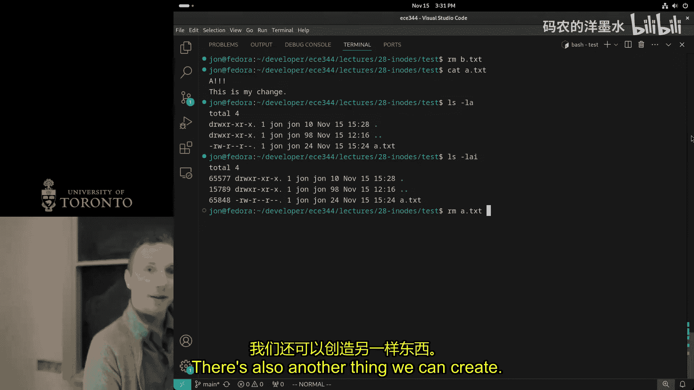

The way to think about it is not how it actually works。

 But you can think of a soft link as just a name to a name。

 So I can create a soft link called B dot T X T that points to a name to do dot T， X， T。

It's a little bit of a lie because B dot T XT would be its own iode and the contents of that would be to do dot TXT。

 So there's actually an iodeode between these two things。

 but how it works is you think of it as name to a name， yeah。The name you。

The number you're printing with。You said the number of card length， so for example， in this case。

 if you printed right now。で報びせ。If I create a soft link？

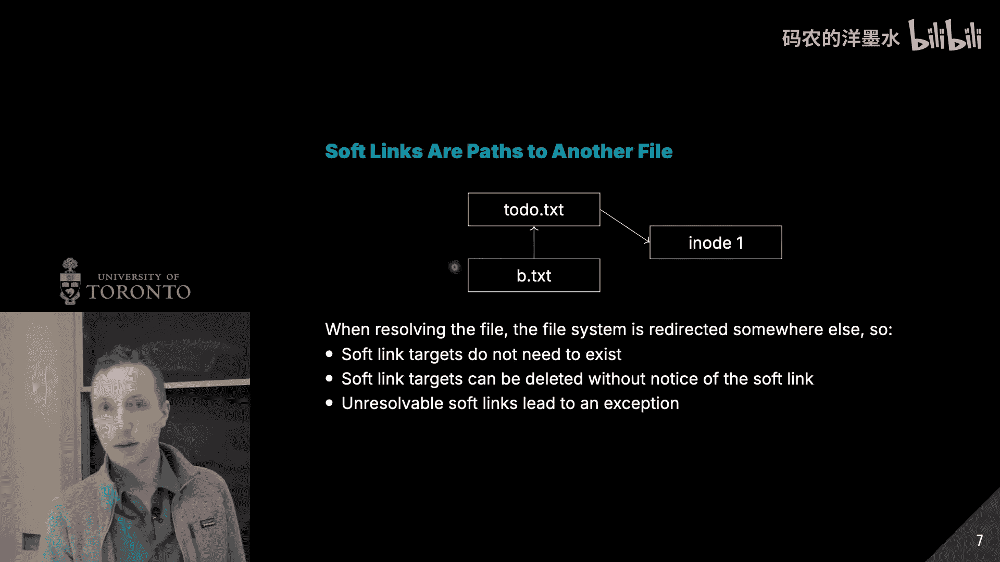

Yeah， so let's go ahead and do that and see what happens。So。If I look at my directory again。

I just have A do TXT to create a softlink， I use at LN again， but I use dash S。

standss for soft or symbolic link， you might hear both of them， they both mean the same thing。

 or in Windows La， this is the same as a shortcut。So shortcuts are named a name。

 symbolic links named a name， so I will point to the name， in this case it will be a name A do TXT。

 and I'll call my new file B do TXT。So if I look at it now， this is what it looks like。

 so it would be its own iode。The number here is number of hard links to that iode。

 so this is only name to name。 so in this case it is B dot TXT， is it new iode。

 but the contents of this iode are just A dot TXT it's telling you what it's pointing to yeah。そとすがあド。

じはリた。No， so so like in A dot T X T， right， it's iodeode holds all the information about when it was created and then the contents of that file。

For B dot T X T， same idea， its iodeode holds all of the metadata about that iode。

 including the name it points to。 That's like the contents of it。So in this case。

 the contents of it are a dot T X T。 And that's also why here in the size， the size is 5。

 A dot T X T。So it's the same idea， but it's treated a bit especially because now if I do cat B dot T X T。

 my operating system is going to be like， well， I'm not going to show you the contents of the Slink I'm going to follow them。

 So if I do cat B dot T X T， what that will do is okay instead of aing B dot T X T will know that oh。

 no， I should find the iode that A dot T X T points to and then it will find this iode and then print that。

 So it's a bit of an indirect way to do that。Yeah terms。We're saying I。

Iinos hold the contents of files， like the pointing is pointing to the contents of that file。Yeah。

So now， well， if I have a Simlink， right， if I removed a dot TXT before， I would still have that in。

 but now if I remove A dot TXT and look now， things look unhappy。Because now。

 while A dot T X T does not exist， right， now I'm going to get a weird error message because if I cat B dot T X T。

 does B dot T X T exist。Absolutely， just。The name it refers to 8 dot T X T doesn't exist。

 So you will get a confusing error message if you try and cut that that says。B dot T X T。

 no such file or directory because it followed the Sim link， but still used the name B dot T X T。

 I guess they thought it was。Clearer than just saying A dot T XD not found when you tried to do B dot T XD。

 I don't know， but。A1 C， any other weird things we could do with that if it's name to a name。

We like infinite loops， could we make an infinite loop out of this？Yeah， can make a cycle。 Yeah。

 can we make a cycle？ So can we make ase called a dot T X T that points to B dot T X T。Oh。

 let's see how smart our operating system is。 Hey， let's see if anyone ever thought of that。

 So we will create a file called A dot T X T that points to B dot T X T。So if we do that。

 looks slightly unhappy。 But now we have A dot T X T points to B dot T X T。 B dot T X。

 T points to A dot T X T。So if I cat B dot TXT again， what's going to happen？

Is this going to be another fun thing to do to first years again？So let's see what happens。

Too many levels of symbolic links， Da， they outsmarted us。So question might be， who outsmarted us。

 did the colonel outsmarred us or did whoever wrote Cat outsmarred us？How would we figure that out。

Yeah。No。Yeah。So we're going to try tomar it。You want to point A。 So let's remove a oops。

So we want a2。2 a C。And then C to point to B。Like see we like。Oh， you want it to be a real file？Oh。

If it's a real file， then it should be fine， right。If we have。C。txt。So now it should resolve。

 right if we cat， what's the most indirect one B？Then it will follow。 Give us see， because。B， well。

 that's in symbol link to A。 Then it finds a。 That's a symbol link to C。

 And then C is an actual one that points to I node。 We'll use that one。 So that's。That's fine。

Let's remove this。All right， so how do we figure out who's the smart one， Ka or the kernel？Yeah。

 psychological make sense to me。Because otherwise， every single。Yeah yeah， logically。

 it makes sense that it's the kernel。 Otherwise， every single other command would have to recognize this and program against it to not infinite loop。

 How would I check if the kernel did it or not。Stra， right， I can just Stra the thing。

 so if I S trace that will give me evidence as to who did what so cat B do TxT。

Two main levels of symbolic links， so we e trace them。So we asked trace it。

 so this is printing to standard error two main levels of indirection。

 Let's see where that came from So here。So all that stuff。

 the locale stuff is just to print it off in whatever language you want。

 seem to fail a whole bunch of times。 So it's just going to use default reads。

 So that's all printing stuff。This is also the error message in the， oh， there's that error message。

 That's just one open B dot T X T。 I got an E looplet error。 So that was from the kernel。

 So the kernel protected us。 We don't have to write that or handle this case in all our programs。

Our good old buddy。 The colonel does it for us。 So that's good for us。

 We don't have to argue about stupid symbolic links and symbolic links are really fun。

 So anything else we want to do with this。😊，Anything else we want to break should be more or less okay。

 I think we broke。Oh， let me show you something that you shouldn't do and why I don't trust you guys with timests。

Yeah， so。Like I said， on the in， so here let's say C。txT is my assignment。

So has anyone ever used this touch command？WhatWhat's touch do？Makes a file。

 so it does make a file if it doesn't exist， but what it'll actually do its actual intended purpose is if I touch C。

 TxT，So this is the last time I modified it， 38 or 37。

What that will do is update that time Last time I modify it。

 So it touches the file and says I just modify it， even if I don't make any changes。

 it updates that timestamp。And that timestamp， well， I mean。It's just my most recent update to it。

 right？So I can tell you， if I give you this file， it has this timetamp on it。

 and I can tell you that I definitely submitted it before the due date tomorrow。 It's today's date。

 right。So， touch。It will also let you do more fun things。

 so it will also let you change that date to whatever you want。

 so if I just do slash D and change it to 1980， which is provably not today and say I did it on Christmas Day at 6 a as was definitely alive and awake at that time。

And I can touch it and then look at it again。And boom。Or I so I definitely did before I was alive。

 Trust me， bro， I definitely。Did that。So that is what why。

I may or may not know someone that handed in their assignment this way and got away with it。But。

This is why I do not trust timestamps on files， because you can modify them all you want。

There's nothing to verify it。 You just change it。So say it with me。

 I promise not to do that in other courses。All right， so I did not show you that。

 I don't know why I do these things， but。Yeah， I I teach you all sorts of terrible things here。 Yeah。

 how can it change for a year， but not in time。 that just not。Yeah。

 so the time's just not showing so。If it's too long in the past， it just doesn't show the time。

 it shows the year， if I wanted to， I mean， if I change it to something more recent。

Let's say Christmas Day this year。Well。I think it doesn't show the time unless it's the same day。

Because even if I put it for tomorrow。Yeah， it still doesn't say it only says the time if it's the same day as today。

So if I did it the same date， that's just how L S is。 So if I did this， it should say 6 AM。

Which clearly well I was actually awake at 6 AM。You guys definitely work。

And I definitely didn't make this at 6 AM。 All right， Any other fun things we want to do with this。

 I taught you bad things。So。And yeah， this applies to Windows2。

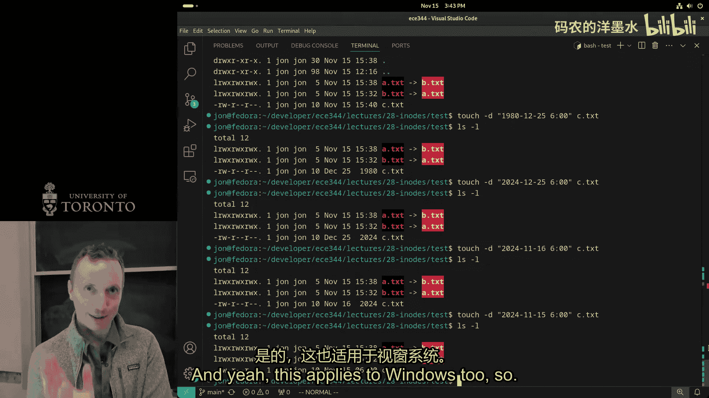

So。so if we did something like this， so by default， if you touch a name that doesn't exist。

 it will create an empty file with that name and update the timetamp up to that。

 So if I touch to do dot T X T create a hard link to that same in for that empty file called B dot T X T。

 and then I create a Sim link to to do dot T X T called C dot T X T。

 well then I can access that empty file through C B or to do dot T X T。If I do this。Move command。

 so move。You might think it's called move because it moves a file。 Well， it doesn't do that。

 Mo the move command。What it really does is just rename the name。

 It doesn't do anything with the iode， doesn't move the contents or anything like that。

 So if I do move do move to do dot T X t B dot T or D dot T X T， it just changes the name。

 So that name still points to that original iode and then if I remove B dot T X T。

 well then I should break that link for or after I move that name。

 then I can't access that file through C dot T X T because it's just a Sim link。But。

I could probably I could access it through B dot T X T if I remove B dot T X T。

 well then there's only one thing pointing to that original iode and that is D dot T X T。

 so we should be able to answer how the file system looks like before and after the move and RM commands here so。

If I look before the move。Again， Sim Li's easiest way to think of them is named a name。 Really。

 there's an iode in the middle here because it needs to store the name somewhere。

 but right before this move。I have one iode， let's call it in  one that gets created from the touch。

B dot T X T and to do dot T X T are hard links to that same in。

 And then C dot T X T is a sim link to to do dot T X T。

The difference between is soft length and heart。Justた。

The symbol that is a soft link to something else， is I points to that symbol。Yeah， so symbollink。

 just think of it as name to name。It's Iode points file So hardlink is named to iode。

And whenever you try to access a name， it will always。Follow whatever to get to an iode。

 if it's a hard link， it'll get to the iode directly。 if you try and cat the Sim link。

 then the kernel is going to follow all the Sim links until it eventually gets to an iode。

So everyone okay with this。 This is a state of things， yeah。

So then what's the advantage you would like to stock？So soft links。

 the reason why we would use them is because， well。Maybe this to do dot Txt， if it points to an iNot。

Then。If C dotTXT was also a hard link to that inode and say I actually removed to do dot TXT。

And then recreated it later。 So now it's pointing to a different iode。

 I have now broken that C dot T X T， right， It points to the old one， not the new one。

 And I want to point to the new one。So generally， webs。If I know that the iode might change。

And I don't really care。 I would use a symbolic link。

 Most web servers and things are set up to be symbolic links so that it's just a name and it resolves it。

 So sometimes to your Python executable， that Python you're running is actually a symbolic link and there might be multiple Python executables on your computer。

 but Python will be a symbolic link to one of those and then if they want to change the default version of Python。

 they just change that symbolic link to point to the newer version so that's typically what they're used。

 they're a bit more indirect so they'll survive updates better。Allright。

 so everyone okay with this before the move command。So if we do move。

 what that will really do is just actually get rid of this link from to do dot T X T to that in。

 so C dot T X T will still point to that name， but now in this directory to do dot T XT does not no longer exist。

 we rename it， move should actually be called rename， but if there is an R。Our N and our M command。

 would in one。Rename something and one remove something。 Probably not a good idea。

 So that's why they call it move。 just so you don't accidentally delete things。

 So it just renames that hard link before to do talk T X T that point to node1 to D dot T X T that still points to node1。

 Now， if we remove B dot T X T， that means we only have one thing pointing to that in anymore。

 And now if we try to access C dot T X T， that will not resolve to an in eventually。

 and it will say file not found。 So everyone， okay with that。Yeah。Does move just make it new。No，No。

 move just renames the name。So it doesn't do anything to that iode。

 So if as soon as I do move to do dot T X T， D dot T X T， it just renames。

To do dot T X T to D dot T X T in that directory doesn't do anything with the in at all。So yeah。

 should more accurately be called rename。Yeah。I software。Yeah， you can use move on So Lake Excel。

 just rename this。The C dot TXT to whatever you want。 So yeah， you can use move on soft length。Yeah。

 so' still point to do dotTXT， yeah。All right， so。On Mux。Maac O S， Linux， everything is a file。

 directories are files of type directory instead of regular files。

 So additional file types are a regular file， a block device that's how it represents a hard drive。

 a block device so I can only access it blocks at a time。

 you can have name pipe so you can have a file that is a type pipe sockets。Look like files。

 they have an i note， it doesn't have any content， but it has the type socket。And directory inots。

 they do not store pointers to data blocks or anything like that。 The content of a directory。

 it's like a file。 It's just formatted in a special way。 So directories。Especially。

 you'll create a directory from scratch and Lab 6， but directories。

 they are just essentially storing a whole bunch of topples。 They just store name to Iode tearss。

 and that's all a directory stores。

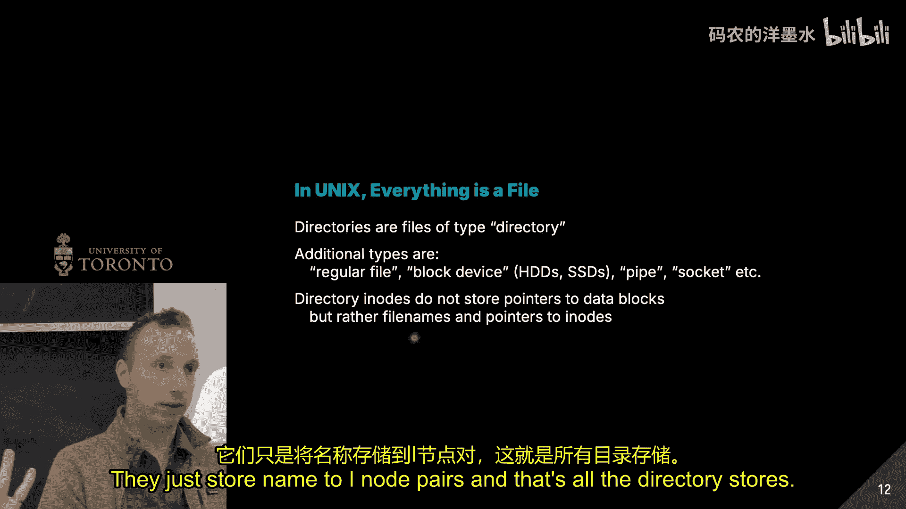

So。If I go back to here， if I look at this directory and I look at it。All。Ohoops。

So the contents of the directory， like if it was an actual file， well， if I accessed it as a file。

 it would have all of the name in pairs， so there would be an entry。Called dot with this iode。

 dot dot paired with this in， A dot T X T paired with this in。

 B dot T X T paired with this in and C dot T X T paired with this iode。

 So that is all a directory is， it's not that special aside from just giving an in and name。

So now we should be able to answer all sorts of things now， so。

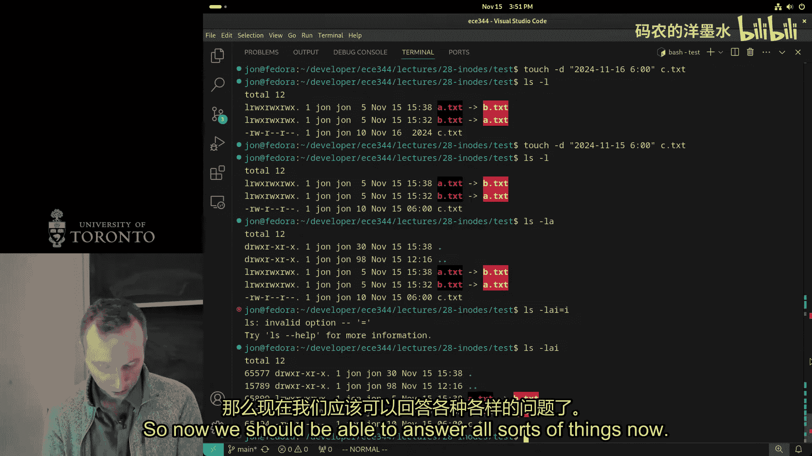

What data is stored in an iode， So let's go through it fairly quick。

 So is the file name stored in an iodeode。No， file names are only stored in a directory， right。

 The in itself just has metadata and points to the contents of the file。

Doesn't I know which directory it's in？No， it's just， it's only in that directory。

 if you need to look up where an IO is， you'd have to go throughout your entire file system。

Does an iode know the size of the file？ Yes， that is stored on the iode itself。

 Does it know the type of the file？ Yes， that is stored on the iode itself。

Doesn't I know know the number of soft links to a file。 No， just name to name。

 Doesn't know the location of the soft links。 Absolutely not。

Does it know the number of hard links to that file。Turns out it does。

 that information needs to be somewhere。 So it actually stores the number of links to that iode on the in itself。

 so。

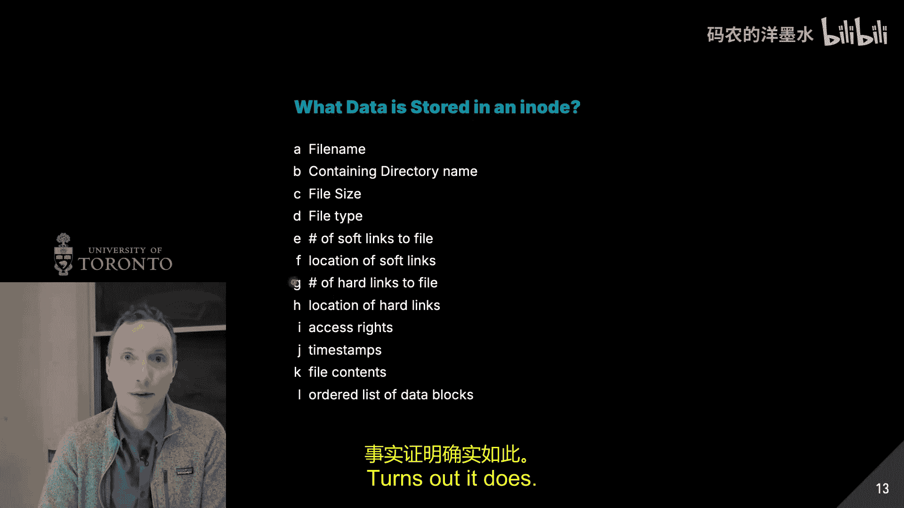

If you use the stack command， there's also a stackt system call that will show you a whole bunch of information about the iode。

Including the file name， which is not on the iode， but the rest of the stuff is on the iode。

 so it tells you the size of the file。 So in this case， it's 10 bytes。How many blocks？Annoyingly。

 when you get into lab six。This number of blocks is really， really， really stupid。

 So the number of blocks is the number of fixed size blocks of size。 Let's recalculate it of size。

512。 so the number of blocks there are the number of size512 blocks there are。

 it's just hard coded at 512。 Don't ask me why， so this file will take up an IO block。

 so this is in this case it's the same as the virtual memory page size。

 so the contents of the file takes up exactly one block。One IO block， which is eight。

Fix size blocks of 512， but it's one I O block。 And that's as small as a regular file can be。

 So it'll tell me what device it's on。 It's iode number。

 Then the number of links there are to this iode。 So that would change there。

 And then it also has a metadata who owns it， What was less accessed。

Some other file systems will have more content， but there's like access， modify and change。

 You might be like， what the hell is the difference between modify and change。One of them is。

The last time the contents of that file was changed and the other one is the last time that iNot was changed。

So two different things。 I forget which ones which I think modify as the contents and changes the iode itself。

 But don't quote me on that one。 And birth is supposed to be whenever this iode was created。

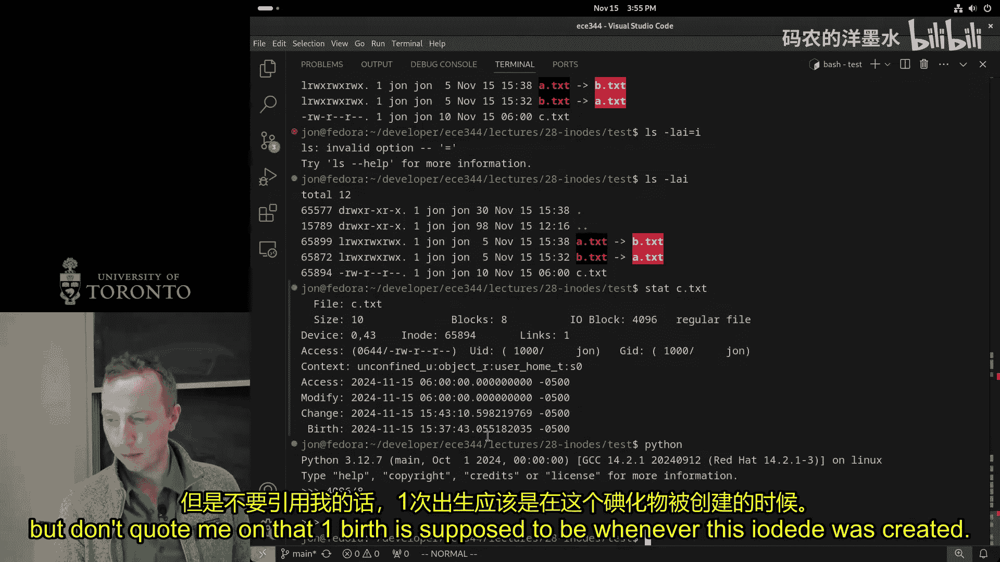

So。Number of links to that file that is stored on the in itself。

 not the location of the hard links only in the directories。 Access rights are stored on the iode。

 Timetamps are stored on the iodeode。 F contents are not stored on the iode。

 It's pointers to the contents on the disk and then an ordered list of data blocks。 Yes。

 that is those are the pointers to the data blocks。 So that is what is stored on the iode。

So going through all that， these are all the answers。There's sometimes here for the file content。

 as you will see。For Simlink， if we go back。

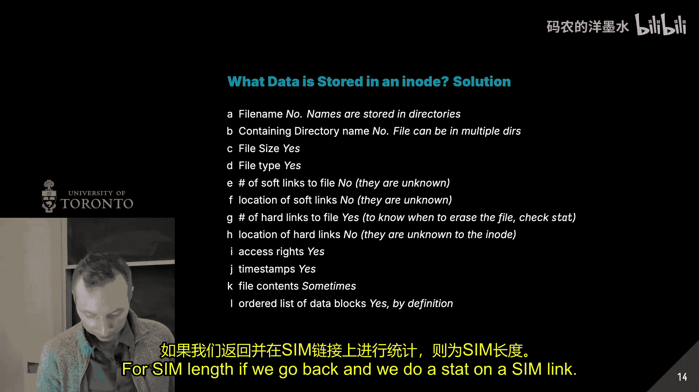

And we do a stat on a Sim link。We'll see that。Oh， this one does take an I O block。 Okay。

 weird weird non default file system。 But for you for your file system。

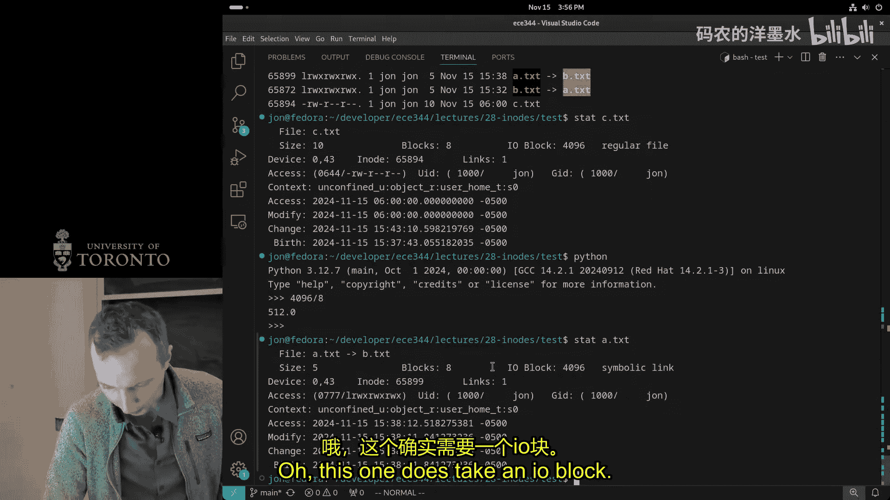

Here if。Like the contents of the file of a Simlink is like the name。 So it would be like B dot T X T。

There is an optimization for Simlink on the file system you're going to use is if they are smaller than 60 B。

 they're stored wherever the pointers are stored and the strings just stored right there。

 So it uses that ordered list of data blocks to store the actual string itself as that optimization。

 but that is only an optimization for Simlink。 So that's why it says sometimes。

So other things we can do。 We can have a file system cache to speed up writing to disk。

 writing data to a disk is slow。 So what you can do is just instead of writing it back out to disk。

 you can actually。Cash a file block in main memory。

 There's something called a file system cache because well likely if you are modifying that block。

 you might be likely to modify it again。 That's called temporal locality。

 or I might actually just like preload the next sequential blocks and that means spatial locality。

 So if I'm access an array。 It's likely I'm going to access the next element。

 So I should probably just load it in and cache it。

So there is going to be a kernel thread or demon that writes data changes periodically to disk whenever you know。

 it's。Otherwise， idle， otherwise。Otherwise it won't do it。

 this might be sometimes if you plug in a USB drive that you know is really slow and copy a Linux ISO to it。

 that's gigabytes， it might finish really really quick。

 but that's because it all got cache and it didn't actually write to the device so if I want to force writing to a device I can use a system call or command that does a system call called flush or sync and that will trigger all of the rights to happen same for。

I mean， this idea of buffering and stuff， same with print F。

 That's why you use F flush sometimes to flush out print F。

 So it actually does the right system call。Other little things we can do in the file system。

 something called a journaling file system。 So if I delete a file on UniX， it involves three steps。

 removing its entry from the directory that name iodeode pair releasing that iodeode from the pool of free iNots says inode is no longer used and then all of the dis blocks that file used I get to free them all you could crash or pull the power between any one of these steps which is leading to a storage leak if it crashes here。

 then I release that iode I can reuse that iode but now all of those disk blocks are marked as used and I can't reuse them anymore so basically what a journaling file system does is before it does all these it writes an entry that says what it's about to do and and only deletes it after it's done all three steps so that way we can recover if we crash between any one of those we read the journal see everything we are in the middle of doing and then go back replay the steps。

 make sure everything is consistent。So that is a journaling file system。

 That's the default thing Apple does now to make sure that， hey。

 your file system is actually consistent。So we can wrap it up。 iOs are a hybrid allocation strategy。

 much better flexibility over contiguous length file allocation table or index， and on Linux。

 everything's a file， names and directory can be hard or soft。

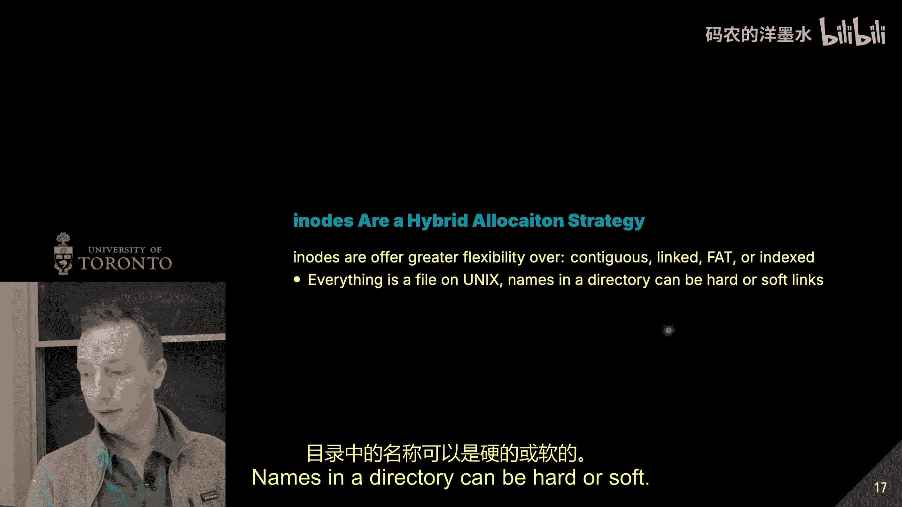