操作系统课程：第27讲：索引节点 (i-node) 🗂️

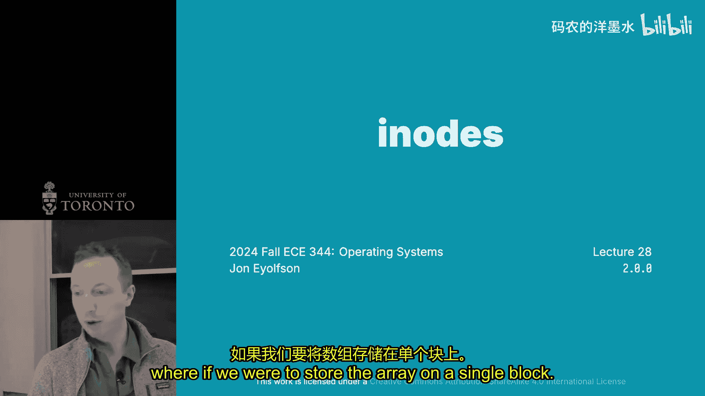

在本节课中，我们将学习文件系统的核心数据结构——索引节点（i-node）。我们将了解i-node如何高效地存储文件的所有元数据和内容指针，以及它如何支持从极小的文件到巨大的文件。

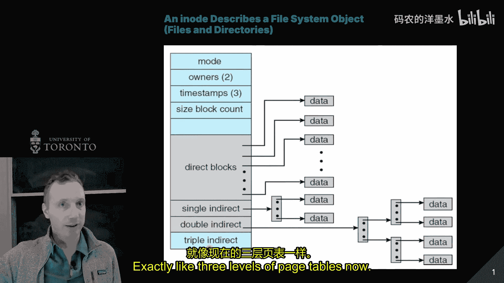

---

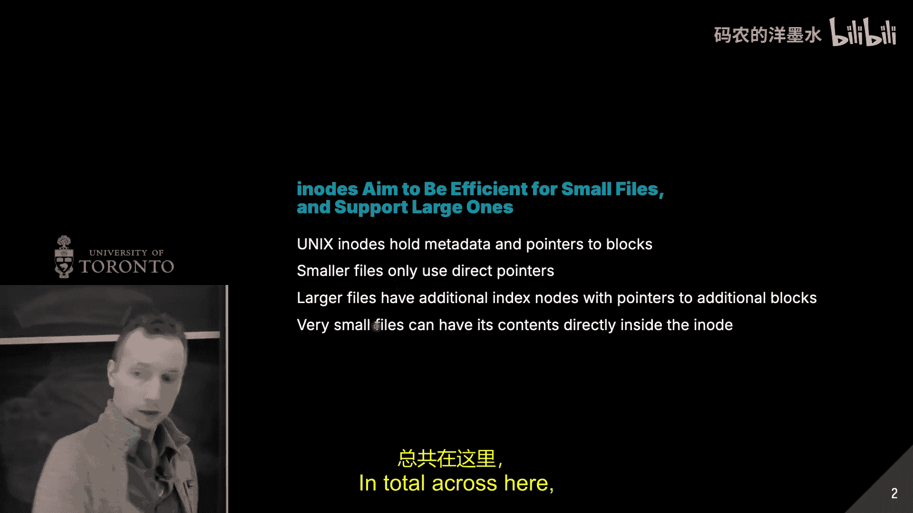

### i-node 的结构与设计

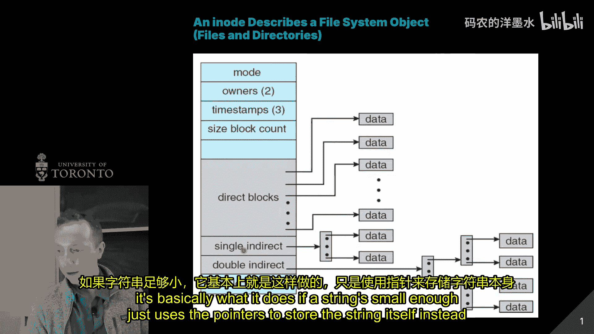

上一节我们讨论了如何存储文件内容，最终落脚在索引块数组上。但这种方法对于小文件来说效率低下。本节中，我们来看看i-node如何解决这个问题。

一个i-node在技术上描述了关于一个文件的一切，包括其内容。文件实际上就是由一个i-node构成的。i-node有固定的大小（例如128字节），在Lab 6中你将有机会填充这些字段。

i-node包含以下信息：
*   文件内容的存储位置（指针）。
*   所有与该文件关联的元数据。

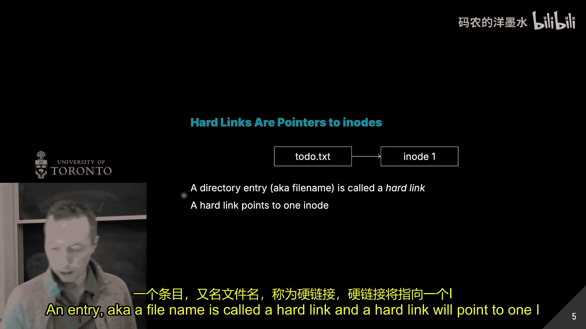

以下是i-node中通常包含的字段：
*   **模式 (mode)**：文件类型和权限。
*   **所有者 (owner)**：拥有该文件的用户和组。
*   **时间戳 (timestamps)**：创建时间、最后修改时间、最后访问时间。
*   **块数量 (block count)**：该文件占用了多少个磁盘块。
*   **数据块指针 (data block pointers)**：指向文件实际内容所在磁盘块的指针。

数据块指针的组织方式是i-node设计的精妙之处。我们不希望为一个小文件浪费整个块来存储指针。因此，i-node中的指针被组织成多级结构。

### 多级指针结构

i-node中的指针分为几种类型，用于高效支持不同大小的文件。

以下是i-node中指针的组织方式：
1.  **直接指针 (Direct Pointers)**：通常有12个。它们直接指向文件的前12个数据块。如果文件小于等于12块，则只使用这些指针，无需额外空间存储指针块。
2.  **一级间接指针 (Single Indirect Pointer)**：这是一个指向一个“指针块”的指针。该指针块里充满了指向数据块的指针。通过它，可以寻址更多数据块。
3.  **二级间接指针 (Double Indirect Pointer)**：这是一个指向“指针块”的指针，该指针块中的每个指针又指向另一个“指针块”，第二个指针块中的指针才指向最终的数据块。这类似于虚拟内存中的两级页表。
4.  **三级间接指针 (Triple Indirect Pointer)**：这又增加了一层间接性，类似于三级页表。

我们采用这种混合结构，而不是单一的巨型指针数组，是为了同时保证小文件的效率和大文件的灵活性。所有文件的i-node都集中存储在磁盘的i-node块区域。

### 文件大小计算与优化

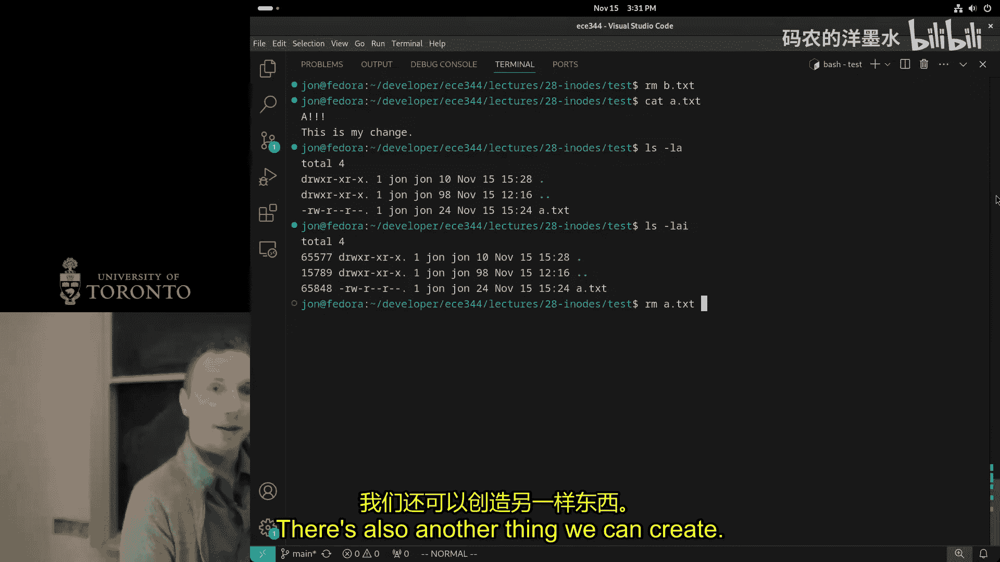

现在，让我们回到i-node能支持的最大文件大小问题。这里，我们假设块大小为8KB，指针大小为4字节。

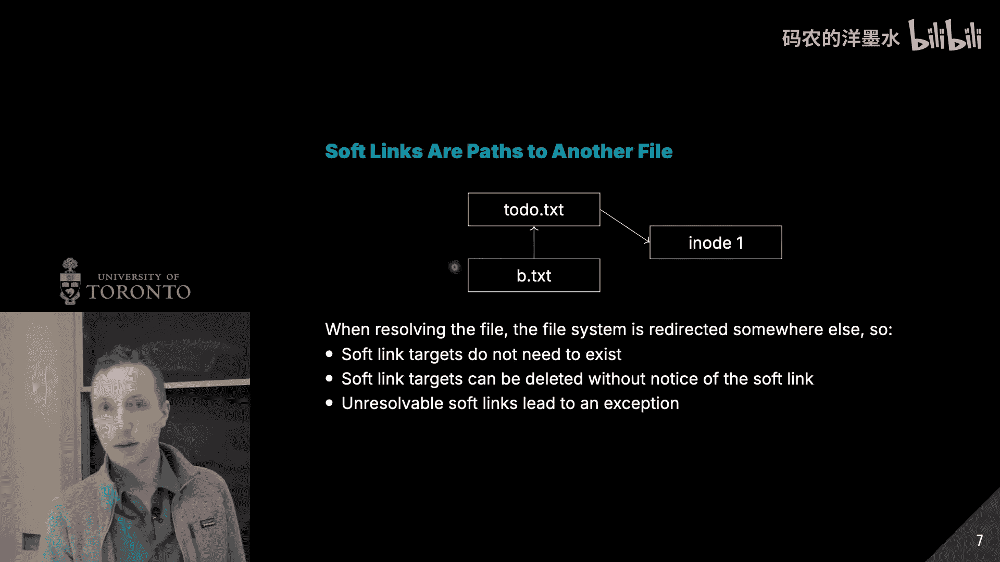

一个指针块能容纳的指针数量为：
`块大小 / 指针大小 = 8KB / 4B = 2048`

那么，通过各级指针可寻址的总块数为：
*   直接块：**12** 块
*   通过一级间接块：**2048** 块
*   通过二级间接块：**2048²** 块
*   通过三级间接块：**2048³** 块

三级间接项远大于其他项，因此可近似为 **2¹¹³ = 2³³** 块。
最大文件大小约为 **2³³ * 8KB = 2⁴⁷ 字节 = 128TB**。这对于大多数系统已经足够。如果需要支持更大的文件，可以增加四级间接指针。

此外，还有一个优化：如果文件内容非常小（例如小于60字节），i-node可以不使用任何指针，而是直接将内容存储在原本用于存放指针的空间里。这被称为“小文件优化”。

### 文件名、硬链接与软链接

你可能注意到，i-node中并不存储文件名。文件名纯粹是为了用户方便而存在于目录中。

在目录中，存储的是 **文件名到i-node编号** 的映射。这种映射关系称为一个 **硬链接 (hard link)**。因此，一个文件可以有多个名字（多个硬链接），它们都指向同一个i-node。

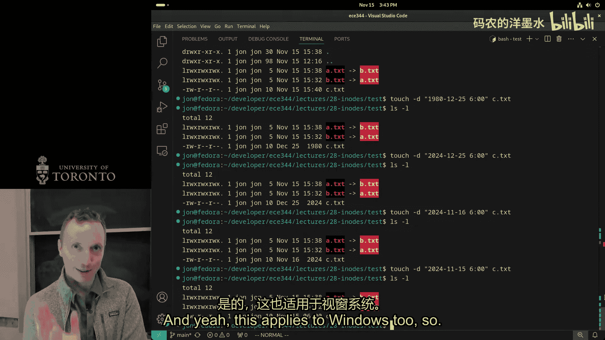

`ls -l` 命令输出中，权限后的那个数字表示指向该i-node的硬链接数量。使用 `ln` 命令可以创建硬链接。
```bash
ln source_file new_hardlink
```
删除文件（`rm`）实际上只是删除了一个指向该i-node的硬链接名。只有当硬链接数降为0时，系统才会真正释放该i-node及其数据块。

除了硬链接，还有 **软链接** 或 **符号链接 (soft/symbolic link)**。你可以将其理解为“指向另一个文件名的文件名”。

使用 `ln -s` 命令创建软链接：
```bash
ln -s target_file symbolic_link
```
软链接本身是一个独立的文件（拥有自己的i-node），其内容是其指向的目标文件的路径字符串。当访问软链接时，内核会自动跟随（解析）这个路径找到最终的目标文件。如果目标文件被删除，软链接就会“断裂”（成为悬空链接）。

软链接的优点是，即使目标i-node改变（例如文件被删除后重新创建），只要路径不变或更新软链接指向新路径，链接仍然有效。因此，它常用于指向可能更新的资源，如默认程序版本。

### 目录与文件操作的本质

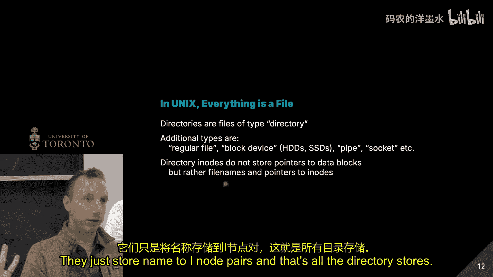

在Unix/Linux系统中，**一切皆文件**。目录也是一种特殊类型的文件。

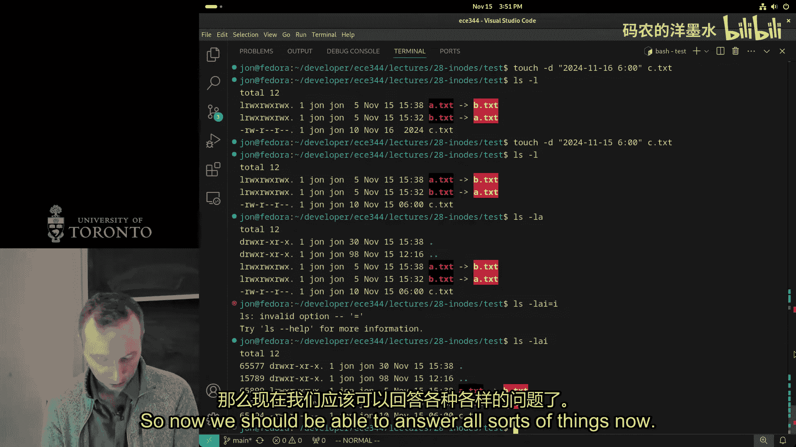

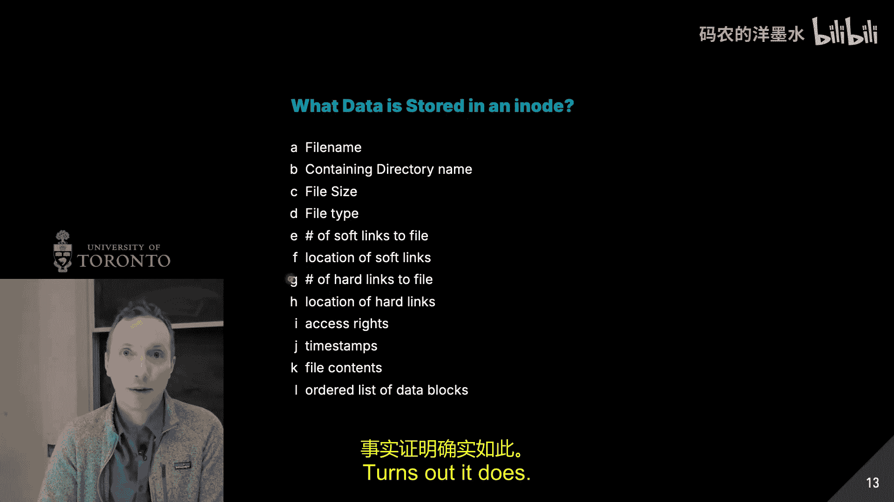

目录文件的内容不是普通数据，而是一个 **（文件名， i-node编号）** 对的列表。还包括特殊的条目 `.`（当前目录）和 `..`（父目录）。

因此，`mv`（移动/重命名）命令的本质只是在目录文件中修改了一个文件名条目，并不移动任何数据块。`rm` 命令的本质是删除目录文件中的一个条目。

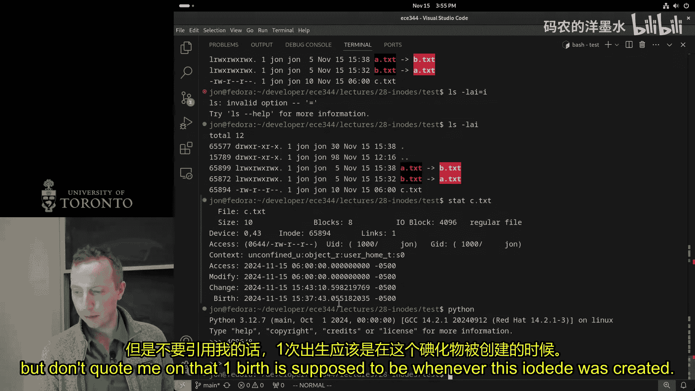

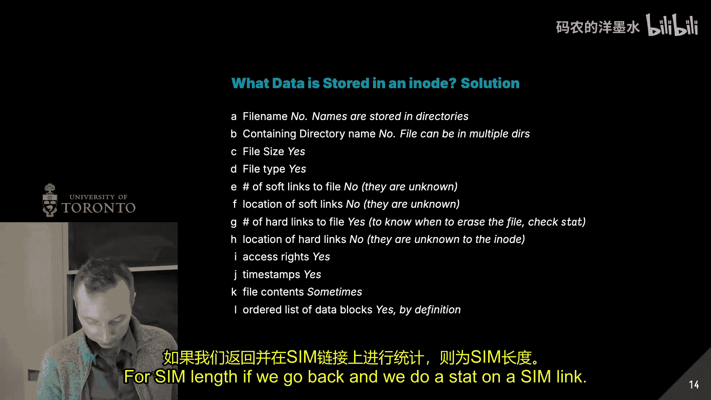

### i-node 信息查询与总结

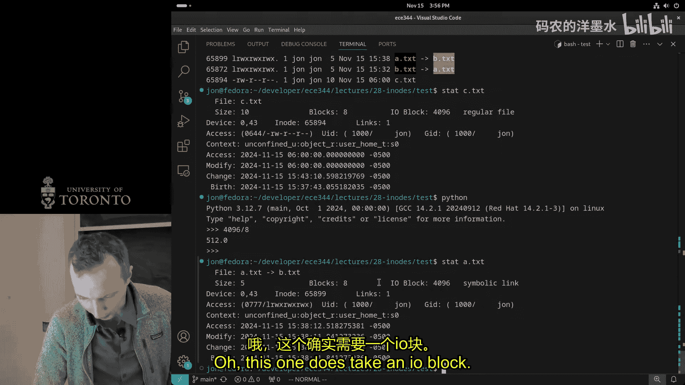

我们可以使用 `stat` 命令查看一个文件的i-node详细信息，包括其大小、链接数、时间戳等。

本节课中我们一起学习了：
1.  **i-node的结构**：它是文件所有元数据和数据块指针的集合。
2.  **多级指针设计**：通过直接、间接指针高效支持各种大小的文件。
3.  **链接的概念**：硬链接是文件名到i-node的直接映射；软链接是文件名到文件名的间接映射，有自己的i-node。
4.  **目录的本质**：是存储（文件名，i-node编号）映射的特殊文件。
5.  **文件操作的本质**：`mv` 和 `rm` 等命令操作的是目录中的映射关系，而非直接操作数据块。

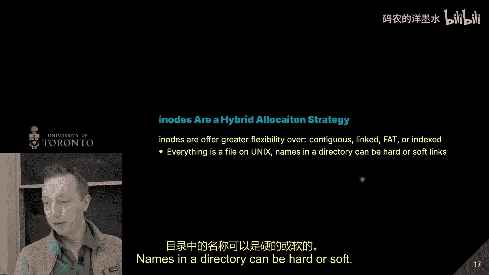

i-node是一种混合分配策略，比连续分配或简单的文件分配表（FAT）提供了更好的灵活性。在Linux的“一切皆文件”哲学下，名称和目录通过硬链接和软链接的概念被巧妙地组织起来。