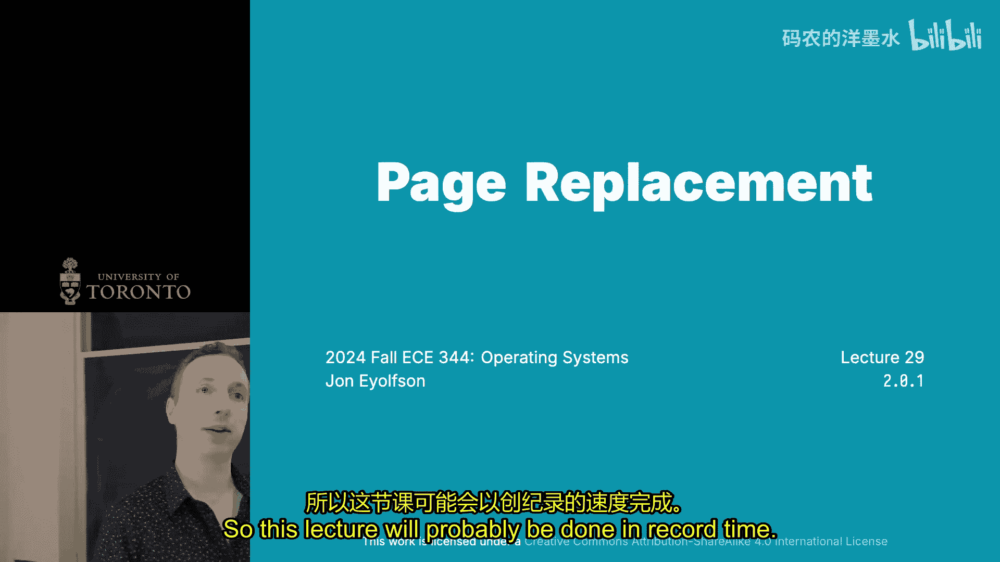
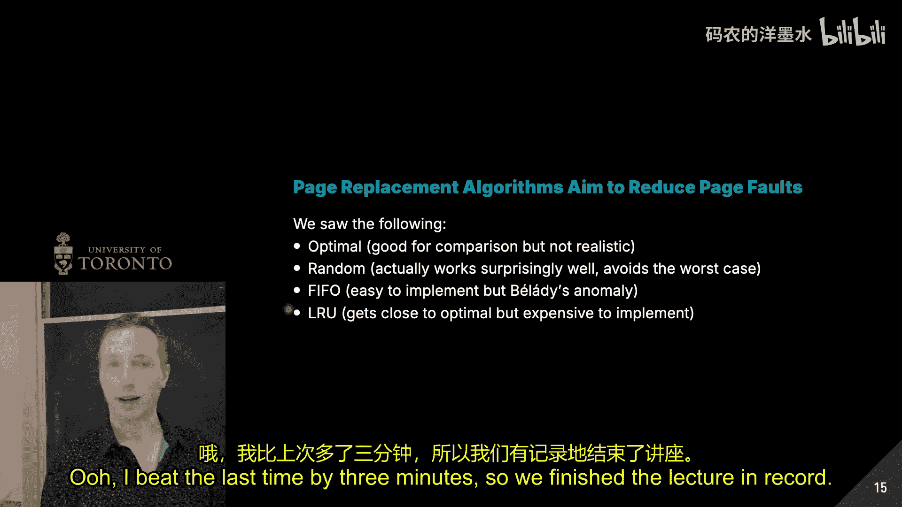

# 【全集】多伦多大学 操作系统 中英字幕 1080P p28 Lecture 28 - 页面置换 -BV1Rbk7ByERc_p28-

Alrighty， welcome back to operating systemss。One of our final topics。

 this one will definitely be on the exam， but like scheduling。

 it will be a fairly simple question to go through。

 So what next thing we're talking about is page replacement， but luckily for us。

 all the hard stuff is done。 So this lecture will probably be done in record time， so。

First off to go back at a high level picture， your memory and everything on your computer。

 there is a hierarchy where there's always a tradeoff of speed and capacity and price。

 So at the top of the pyramid here are the fastest things。

 So the registers on your CPU Those are the fastest， but there are not very many of them。

 Then also on your CPU to speed things up。 we have a cache that you won't really get into programming against until like 4。

5，4。😊，But the cash does exist here。 It's larger than the number of registers。 and well。

 it is a bit slower。But it's still faster than Ram。 So it's basically a cache for Ram。

Then below that， you have your volatile memory， your RA， your random access memory。

That probably is in the field of gigabytes， like 16，32， 64， fairly normal numbers these days。

 and well it's。Quite affordable but not as cheap as disks。

 And then there are four or three types of disk here。

 There's non volatileat memory and VME drives that plug pretty much directly into your motherboard。

 normalmal Sata SDs and then hard disk drives。 So what we're talking about now is actually performing some caching of the hard drive to memory。

 So we are going to。😊，Try to use memory and try to have the capacity of the level below it while trying to have the speed of the level above it。

 So we're going to get over today how to actually swap pages between memory and a disk。

 And then that way， we can actually fake out our computer and we can actually use more memory than we have have physically on that machine。

And then you might notice。At the bottom here， there are tape drives。

 Those actually exist in data centers。 They are very， very cheap。 You can get terabytes for very。

 very cheap， but they are very， very slow。 So Google data centers will use it to archive data and things like that。

No one's probably seen a VHS tape before， I assume。Oh， people have seen them。 So yeah。

 there is a machine at Google that will literally go pluck out a tape， put it in the drive。

 read it or write it if it needs to， and then put it back。

 but that's for like really deep archival storage because it's really， really， really， really。

 really， really cheap。So， oops。So this whole hierarchy， we want to hide it from the user。

 Each level wants to be the speed of the layer above it and the capacity of the layer below it。So。

On real operating system， the memory used by all your processes might exceed the amount of physical memory。

 So we're going to go into that today how to maintain that illusion。 So this is okay。

 It's going to be fast。 if not all of them are in use at the same time。 if they are seldom used。

 So the idea here is I'll keep only reference pages in memory。

 And I'll put the others on disk and to make it a bit simpler。

 We'll assume that the size of a page is the same as the size of a block on disk to make it easier。

 So the way this works is it can swap pages back to memory when they're needed。

 and page replacement is just talking about which page do I select to boot back to disk whenever it is otherwise full。

 So this is also why。On Windows， if you've noticed a big file in your C drive called the swap file or something like that。

 that's what that is。 It's basically using that big file to store blocks from memory if memory gets full and put them there。

 which is going to be a lot slower， but you can actually use a lot of memory across all your processes more than what's physically on the machine。

So the first thing strategy we could use is called the band paging。

 this is the whole idea of using memory as a cache for the file system so we can map memory pages to file system blocks like when we did an endMap for that file。

 we only load them into memory when they're used through the page fault handler so it initializes the content of the page with whatever that content of the file is。

If the page doesn't represent a file， then we can just map it to swapspace。

 a big fake file on the disk and we can move that page over to that swap space so we move it to disk if we need to use more physical memory。

 temporarily store it on the disk。Free up that page of memory for something else。

 Use it for something else。 And then if we need to get the value of that memory back。

 we can load it back from disk。So。For performance reasons。

 a process working set should fit in physical memory。 Its working set is in a given amount of time。

 The number of pages your process uses is called your working set。

 So if your working set does not fit into memory， you're going to have performance issues because you're going to have to transfer some pages of memory to disk。

 So if you can't fit it all of your working set into physical memory。

 your process does something called thrashing， which means it will constantly move entries to the disk and load them from the disk back and forth and your performance will suffer。

 So。This is also why some people have disabled swap files nowadays。 if they want things to go fast。

 So if you're running a data center， maybe you don't want to just have performance issues randomly。

 if you run out of physical memory， maybe you want to be told you're out of physical memory and then you'll just go to the store buy more。

 So if you just disable the swapping， you'll get out of memory and then your performance won't suffer。

 but your program will crash until you go out and buy more memory。

 but today well assume we want to do page replacement。So。What we're talking about today。

 page replacement algorithms that is selecting what page in memory to boot out to disk if it is otherwise full。

 and we have four main algorithms we'll get into today one's kind of a joke one。

 so the optimal one is like for scheduling when we did shortest job first， we looked into the future。

 we kind of figured out what the most optimal thing to do was。F page replacement。

Our only goal here is to reduce the number of page faults。

 So what the optimal algorithm will do is replace that page that won't be used for the longest of try and maximize the amount of page hits I get。

 so I actually reuse that memory in the longest amount of time。

 So I can't implement this because it needs to look into the future。

 but we can use it to actually evaluate our page replacement algorithms。Next one， kind of a joke。

Just randomly replace a page， no rhyme or reason， just do it randomly。

 Then the next one is first in first out or fiIO， so I replace the oldest page first。

 so there's formal line。 I kick out the oldest one first。

The next one is going to be least recently used。 It's going to look back into the past to predict the future so we could actually implement this one。

 And the whole idea here is to replace a page that hasn't been used in the longest time。

 So maybe they're done with it。So。To evaluate all of our page replacement algorithms。

To actually evaluate them， we're going to assume our physical memory can only fit a laughably small number of pages just so we don't。

Waste our time so we'll assume that physical memory can only hold four pages and then I tell you an sequence of accesses to different pages。

 so here I have accesses to five pages and I access them12，3，4，1，2。

 so if it's not in memory I have to bring it into memory and select something to go back out to disk So for all of them。

 they're all initially on disk we'll use this example this sequence for all of our examples this lecture so we can compare them because at the end of the day。

 we just want the fewest number of paid faults unlike scheduling this one has a straightforward goal。

Scheduling， right， I'm kind of at odds with response time， average weight time， fairness。

 number of context switches here。's just number of page faults， nice and simple。

So we're just going to count the number of page faults。So how I like to write them out。

I write for every access， I write a box， and this box represents C pages in memory。

 so I can write four pages in memory， so if I access page one and I assume all of them are initially on disk。

 so nothing is actually in memory。系。Access one。 So one needs to be in memory。 And here。

 any page fault。 I write the number in red， indicating I had to read it from disk and put it into memory。

 So since initially， memory is empty， I have to load it from disk into memory and I can load up to four pages at a given time。

 So everyone， okay with that。Alright， so if I access page two should be the same story， right。

 I have to load it in from disk， so I wouldn't kick out page one because I already loaded it in so why would I get rid of it So now after I access two it's also in memory and it is also a page fault so I write it in red。

Everyone on the same page。Haha， that's a good one。 All right， God， use that joke。

 I'm not super creative。 All right， so。😊，accessccs page 3， this is going to be boring， right。

 So access page 3， same thing。Access page 4， same thing。 Now， memory is full。

 So now I might have to replace something。 So if I access page 1， do I have to replace any of these。

 or is it already in memory。Yeah， it's already in memory。 So I won't do anything with it。

 So I just write the access， nothing's in red。 It's there。 So everyone good with that。 All right。

 page 2， if I access page 2 next， it should be the same idea， right。All right。

So now we're going to access page 5。 So5 is not in memory。 Memory only holds four pages。

 so we need to kick something out。 If we are doing the optimal thing。

 we are looking into the future and we are replacing the page that is not used in the longest period of time。

 So between pages 1，2，3， and 4， what am I kicking out。F right so if I at 5。

 if I look into the future， the next thing I'm kicking out is one Im not going kick that out。

 next thing I'm accessing is two， so I can't kick that out。 Next thing I'm accessing is3。

 so I can't kick that out。 so I'm only left with one victim and it is four。

 So how I would write that is I would just replace this four with a5 and write it in red。 so。

Replace the four， so I kick out four， it goes back to disk， and now I have page five in memory。

 so everyone okay with that。All right。 now， since I did the optimal thing， if I access page1。

 it's already in memory， right， great。😊，Access page two， already in memory， great， access page3。

 already in memory， great。Now I access page four， I need to kick out one，2，3， or five。

 What do I kick out？Yeah。At this point。If I look in the future， the next thing I use is five。

 so I can't kick out 5。 But other than that， I'm free to kick out whatever the hell I want。

What we kick out， most people hate one for some reason。 So we just kick out one。

 So we replace one with page 4。 And then when we access page 5， that is also a hit。 Now。

 at the end of this， we are just going to count the number of page faults we have。

It's really easy if you put it in bold or circle it or something like that。

 So how many red numbers are there。6， so we would say six page faults and we're done。

 So everyone okay with that。Alright， so let's do some different algorithms。 So this is optimal。

 so we should。Not get to6。 We can't do better than6 for this sequence。So let's do the same with FiIO。

So again， memory holds only four pages。Same sequence。

 The only thing I'm changing is my page replacement algorithm。

 So can I skip the four first four accesses because they are boring。 Yes， okay。

 so everything needs to get loaded into memory。 memory needs to get full first。

So now we access page one， that should be still good right， in memory， so we're good。

 access page two， that's in memory， we're still good。Alright， now we have to make our first decision。

 So we are accessing page 5， and we have to figure out which one to kick out if we are doing first in。

 first out， who do we kick out1， right？ So one was the first one we put in。 So we kick out one。

So we replace one with five。Ooh， was that a good idea？So now we access page one。

 we have to bring it back into memory， crap。 What do I replace4，1，2？Oh， now I access page two。

 what do I replace for two？3， crap。 This sucks。 All right。 now I access page 3。

 where I have to replace for three。4， well， geez， this is not going well。 Allright， X page 4。

Or to kick out。5， so easy way to do FIO 2。 All the page faults will form a diagonal line if you want to do it quicker。

 So to check yourself， page faults follow a diagonal line if you don't want to think too hard， so。

We replaced page5 with page four， then we access page5， what do we replace？We replaced one， right。

 so it's a page fault。 How many page faults do we got here？10， right。Pretty bad。So。

Let's think for a second。 Let's have a little thought experiment。 So if main memory held five pages。

How many page faults would I have？Y five， right？So I have more physics because I could fit everything into memory the first time I have to load it in。

 but after that everything fits， so I'm all good。 So as you would expect， the more RA you have。

 the less page faults you have， correct？So the opposite should be true， right， the less RA I have。

 the more page faults I have。Everyone agree with that， that makes sense。Yeah， that makes sense。

So let's try try it。So。Same thing。 Everythings exactly the same。

 But now memory can only hold three pages。 So I have less memory。

 I should have more than 10 page faults。 So let's see what will happen。 I can skip the first three。

 right， It would be boring。 same thing again。 So one， have to load it in。2， have to load it in。

3 have to load it in。😊，All right， this is already looking bad， it looks like we are right。

 we access page four。Allright， Well， doesn't fit。 We have to kick something out。

 Why am I kicking out。One， crap。 that was a bad decision， right。So did I access page1。

 what do I kick out？2， right， oh， that was a bad decision。 Yeah， this is looking bad。

 then access page two， What do I kick out？Three right should be a diagonal line。So now access page5。

 what do I kick out？F， right by law of diagonal lines。Okay， well we got to hit here。

 so page one's already in memory， that's good。Page2 is already in memory that's good。Page 3。

 that's not in memory。 What do I kick out for page 3。One， right， so I kick up page one。

Now I access page four， what do I kick out？2。Now I access page 5， and it's already in memory。

 So it looks like this。 How many page faults is that。Why you lie to me？好。So I have less memory。

But less page faults。So if your computer gets slower。

 just take how to stick a memory and it will run faster。See。

 Apple is trying to save you by overcharging for RAM。Every。This sound right to everyone。

What the hell is going on here？Turns out。That this is a mathy thing。 It's called it even has a name。

 It's called Beldy's anomaly。 And that says that more page frames， Ak。

 more memory can cause more page faults。 So this is a unique problem with FF algorithms。

 which is why they are terrible four page replacement algorithms and why you should avoid them。

 So this issue does not exist with LR or any quote unquote， stackbased algorithms。s。

 if you like Greek symbols and math， which I don't。

 there is a paper that you can read that proves that this anomaly is unbounded。

 which in layman's terms basically means you construct。

Any sequence you want to get any arbitrary page fault ratio。

 So you can come up with any sequence to get whatever ratio you want。Luckily， for us， aside from PIO。

 for other algorithms， it makes sense， increasing the number of pages A K。

 adding more memory results in less page faults。 It's only for PIO。 You don't have to prove this。

 Just know that this anomaly exists。 And that's probably why you shouldn't use PIO for page replacement。

All right。Last example， let's do the same thing。 rewind back， go to four pages。

 This time we'll use least recently used。Can I skip the first six。Alright。

 we are speed running this lecture， so first six have to load into memory， then I access page1。

 then page 2。 they're already in memory。 So the first decision I have to make is paid with when I access page 5。

 I have to figure out who do I kick out1，2，3 or4。 and in this scenario。

 if we lose least recently used。We're going to go backwards in time and kick out whatever is used least recently。

 So whatever is used in the longest time period。 So which one we kicking out， I hear threes。

So between 1，2，3，4， if I look back， can't kick out 2。 I used it just before。 can't kick out 1。

 I used it just before that。 can't kick out 4。 I used it just before that。

 So my only victim is  three。Everyone good。Allright， so I kick out three and replace it with five。

 So this is what it looks like。Now， I access page 1。What do I kick out？Nothing。

 It's already in memory， right， So I'm good this time。 same thing for two， already in memory。

 All good。 Now， I access page 3， I need to kick something out。 Why am I kicking out。😊，4， right。

 not kicking out 2， not kicking out one， not kicking out 5。 So4 is my last victim。

So it turns out that was a bad decision， so I just kicked out four， and then I used four。

Sos a little bit unlucky， but overall， I seem to be doing better。 So now what do I kick out。5， right。

 I can't kick out 3， can't kick out 2， can't kick out 1。 So I kick out 5。

 which also seems like a bad decision in this scenario。 So now I access 5。

 I have to kick out something。 Well I can't kick out 4， can't kick out 3， can't kick out 2。

 So I have to kick out 1。 So it would look like this。 How many page faults we got。8， right。

So 8 page faults。 So better than FiIFO， not quite optimal。

 but this is something we could actually implement。 We're not fortune tellers。

 So everyone okay with that。All right，If I was to implement this， let's think for a second。

 So if I actually have to implement least recently used in hardware。Well。

 how I could implement it is every page could have like a timestamp or a counter on it。

 And then whenever I reference a page， well， I just saved the system clock the current time into that counter for that page。

 and then for replacement。 When I have to do a replacement。

 I scan through every single page and find the one with the lowest timet。

 which means I haven't used it in the most amount of time。 So that is O N， that is slow。

 You do not want to do something that's O N for every single replacement you want to do ideally you want to do it in constant time。

 so。Can anyone think of a different way to。Implement L R U in constant time。Yeah。Yeah。

 we'll get into that。 We can approximate it。 But if we wanted to implement least recently used。Yeah。

A link list， right， like a doubly linked list。 So that's one thing I could do。

I could create a doubly linked list of pages。Then every time I reference a page。

 I can move it to the front of the list because it is now the most recently used page。

 And then for replacement， I just removed the page at the back of the list。

So computer science people would tell you that that is fine。 that's constant。

 but if you were to implement this， this is atrocious because each reference。

 so each time you reference a page that means you are reading information from the page so that happens even if you read a byte from it。

 you want that operation be as quick as possible。 but for this one。

 if I reference a page since it's a doubly link list。

 I would need up to six pointer updates for each page reference。

 So that doesn't sound fast every time I want to access a byte I have to do six pointer updates。

So that will make your computer probably。Byte six times 8。Oh no。 I can't do math on the fly。

 Some big， decently big number 32。32 times slower if you use this。Yeah。

 WubE link listed has a previous and a next。So it's constant to access the head of the list and the tail of the list。

Yeah， so this。We cannot implement because it would be too slow。 we want this reference。

Whenever we reference a page， we want that operation to be as quick as possible， One suggestion。

 just approximate it。That's what we're going to do。

 So implementing this in practice is not going to work。

 We will settle for an approximation of lease recently used。

 And while this seems to work because least recently used is an approximation of the optimal case。

 So the approximation of an approximation is good enough for me。 We're engineers。 so。

There's lots of different tweaks you could do to implement this more efficiently。

 So specifically in the next lecture， which is why this lecture is short。

 because I can't fit it in this one。 And your exam question will probably be the next lecture， too。

 So we'll make sure we understand it。But we'll be looking specifically at something called the clock algorithm。

 that will be an approximation of least recently used and something we can actually implement。

There's also other things that relax the least recently used property a little bit。

 There's lease frequently used， which just checks if it was used somewhat frequently。

 just like a bit。 there's a two Q。 So implementing that in hardware and then adaptive replacement cache again won't go into it will choose the clock algorithm as something to look into。

So page replacement algorithms， The whole aim of them is to reduce the number of page faults because we're using the disk as。

More space for main memory。 So we saw the following。 we saw the optimal algorithm。

 It's good for comparison， can implement it because it looks into the future。

Random actually worked surprisingly well， we didn't have an example because it's random how would we do that that would be fun to grade2 but it's actually a bit better than PIFO because it avoids the worst case and random was fun to implement and there's FIFO easy to implement but it's a bad idea because of Belldes's anomaly and then we got into least recently used so it got close to optimal。

We could theoretically implement it， but it's too expensive。

 We're going to have some approximation we'll discuss in the next lecture。Oh。

 I beat the last time by three minutes。 So we finished the lecture in。

