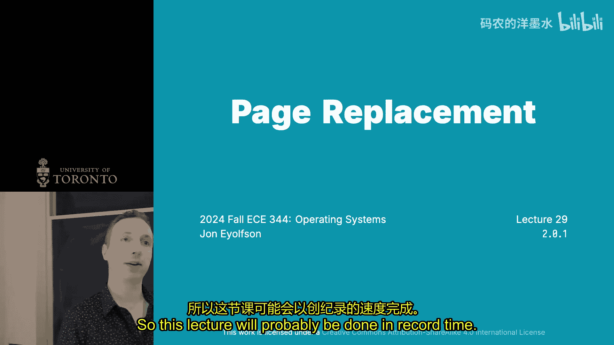
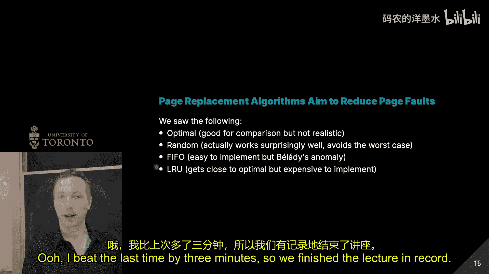

# 操作系统：28：页面置换算法 🧠



在本节课中，我们将学习操作系统中的一个核心概念：页面置换。当物理内存不足以容纳所有进程所需的页面时，操作系统需要决定将哪些页面移出内存，以便为新的页面腾出空间。我们将探讨几种不同的页面置换算法，并理解它们如何工作以及各自的优缺点。

## 内存层次结构概览

计算机系统中的内存存在一个层次结构，其核心是速度、容量和成本之间的权衡。理解这个结构有助于我们明白为何需要页面置换。

*   **寄存器**：位于CPU内部，速度最快，但数量极少。
*   **高速缓存**：同样位于CPU上，速度比RAM快，用于缓存RAM中的数据。
*   **随机存取存储器**：即我们常说的内存，容量较大（如16GB、32GB），速度适中。
*   **磁盘存储**：包括非易失性内存、固态硬盘和机械硬盘，容量巨大，成本低廉，但速度远慢于内存。
*   **磁带驱动器**：用于数据中心进行深度归档存储，成本极低，但速度非常慢。

整个层次结构的目标是对用户透明：每一层都试图拥有上一层的速度和下一层的容量。页面置换正是实现这一目标的关键技术之一。

## 页面置换的基本原理

上一节我们介绍了内存层次结构，本节中我们来看看页面置换是如何工作的。当所有进程使用的内存总量超过物理内存容量时，操作系统会利用磁盘空间来模拟更大的内存。

其核心思想是：**只将当前正在使用的页面保留在物理内存中，而将不常用的页面暂时存储到磁盘上**。我们假设内存页的大小与磁盘块的大小相同，以简化管理。

当进程访问一个不在物理内存中的页面时，会触发一个“缺页异常”。此时，操作系统需要执行以下操作：
1.  选择一个当前在内存中的页面作为“牺牲品”，将其内容写回磁盘。
2.  将所需页面从磁盘读入内存，替换掉那个牺牲品。
3.  更新页表，反映新的映射关系。

这个过程就是**页面置换**。在Windows系统中，用于存储这些被换出页面的磁盘文件通常被称为“交换文件”或“页面文件”。

## 工作集与颠簸

为了获得良好性能，一个进程在特定时间段内频繁访问的页面集合（称为**工作集**）应该能够完全放入物理内存。

如果工作集的大小超过了可用的物理内存，进程就会陷入**颠簸**状态。这意味着操作系统将花费大量时间不停地将页面换入换出磁盘，导致系统性能急剧下降。因此，有些人为了追求极致性能，会选择禁用交换功能，这样当物理内存耗尽时，程序会直接崩溃，而不是忍受缓慢的颠簸。

## 页面置换算法评估

接下来，我们将重点讨论页面置换算法，即如何选择被换出的页面。我们的**核心目标非常明确：尽量减少缺页异常的次数**。

为了便于比较不同算法，我们将使用一个统一的例子：假设物理内存只能容纳**4个页面**，我们有一个页面访问序列：`1, 2, 3, 4, 1, 2, 5, 1, 2, 3, 4, 5`。我们将统计每种算法在处理这个序列时产生的缺页次数（用红色数字表示）。

## 主要页面置换算法

以下是几种主要的页面置换算法，我们将逐一分析。

### 1. 最优算法

最优算法是一种理论上的算法，它通过预知未来，总是替换掉**未来最长时间内不再被访问**的页面。这能保证产生最少的缺页次数。

**公式表示**： 替换满足 `max(未来再次访问的时间距离)` 的页面。

由于我们无法预知未来，因此该算法无法实际实现。但它为评估其他算法提供了一个理想的下界（即最佳可能表现）。在我们的例子中，最优算法产生了 **6次** 缺页。

### 2. 随机算法

随机算法顾名思义，就是随机选择一个页面进行替换。它实现简单，并且由于避免了某些最坏情况，其平均表现有时会出乎意料地不错，但不可预测。

### 3. 先进先出算法

先进先出算法维护一个页面进入内存的队列，当需要置换时，总是选择**最早进入内存**的页面（即队首的页面）进行替换。

**代码描述**：
```python
# 使用队列实现
replacement_queue = Queue()
victim = replacement_queue.dequeue() # 移除最早进入的页面
```

然而，FIFO算法存在一个严重问题：**Belady异常**。即增加物理内存页框的数量，有时反而会导致更多的缺页。在我们的例子中，FIFO算法产生了 **10次** 缺页，表现不佳。

### 4. 最近最少使用算法

最近最少使用算法根据页面的历史访问情况来预测未来，它认为过去一段时间内没被使用的页面，在将来也可能不会被使用。因此，它选择替换**最久未被访问**的页面。

**公式表示**： 替换满足 `max(自上次访问到现在的时间)` 的页面。

LRU算法是对最优算法的一个很好近似。在我们的例子中，它产生了 **8次** 缺页，优于FIFO。

## LRU算法的实现挑战

虽然LRU算法效果很好，但精确实现它成本很高。一种直观的实现方式是为每个页表项维护一个时间戳或计数器，每次访问页面时更新。置换时，需要扫描所有页面找到时间戳最小的，时间复杂度为O(n)，对于频繁的内存访问来说太慢。

另一种思路是使用一个维护页面访问顺序的**双向链表**：每次访问页面时，将其移动到链表头部（标记为最近使用）；置换时，直接移除链表尾部的页面（即最久未使用）。这样插入、删除和移动操作都是O(1)。

**代码描述**：
```python
# 使用双向链表实现
class LRUCache:
    def __init__(self, capacity):
        self.capacity = capacity
        self.cache = {} # 存储键值对
        self.head = Node(0, 0) # 哑元头节点
        self.tail = Node(0, 0) # 哑元尾节点
        self.head.next = self.tail
        self.tail.prev = self.head

    def _remove(self, node):
        # 从链表中移除一个节点
        prev_node = node.prev
        next_node = node.next
        prev_node.next = next_node
        next_node.prev = prev_node

    def _add_to_head(self, node):
        # 将节点添加到链表头部（最近使用）
        node.next = self.head.next
        node.prev = self.head
        self.head.next.prev = node
        self.head.next = node

    def get(self, key):
        if key in self.cache:
            node = self.cache[key]
            self._remove(node)    # 从当前位置移除
            self._add_to_head(node) # 放到头部
            return node.value
        return -1

    def put(self, key, value):
        if key in self.cache:
            self._remove(self.cache[key])
        node = Node(key, value)
        self._add_to_head(node)
        self.cache[key] = node
        if len(self.cache) > self.capacity:
            # 移除尾部节点（最久未使用）
            lru_node = self.tail.prev
            self._remove(lru_node)
            del self.cache[lru_node.key]
```

然而，即使使用链表，每次内存访问（哪怕只是读一个字节）都需要更新链表指针（约6次指针操作），这会显著拖慢内存访问速度。因此，在实际系统中，我们通常采用LRU的**近似算法**，例如下一讲将要详细介绍的**时钟算法**，它在效果和开销之间取得了很好的平衡。

## 总结

本节课中我们一起学习了操作系统的页面置换技术。我们首先回顾了内存层次结构，理解了页面置换的必要性。然后，我们明确了页面置换算法的核心目标是**最小化缺页次数**。

我们详细分析了几种主要算法：
*   **最优算法**：理论最优，无法实现，用作评估基准。
*   **随机算法**：实现简单，表现尚可但不可预测。
*   **先进先出算法**：实现简单，但存在Belady异常，性能可能很差。
*   **最近最少使用算法**：效果接近最优，但精确实现开销过大。



最终，我们得出结论：在实际系统中，我们倾向于使用**LRU的近似算法**（如时钟算法）来高效地管理页面置换，在保证性能的同时控制开销。在下一讲中，我们将深入探讨这种可实现的近似算法。