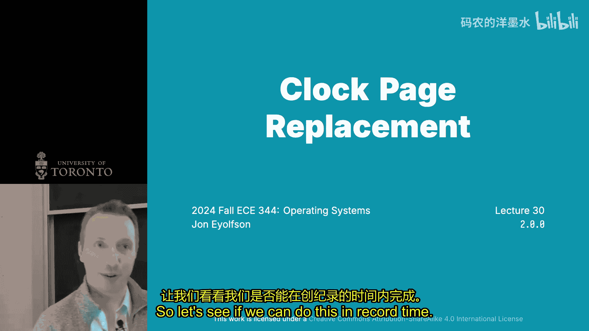
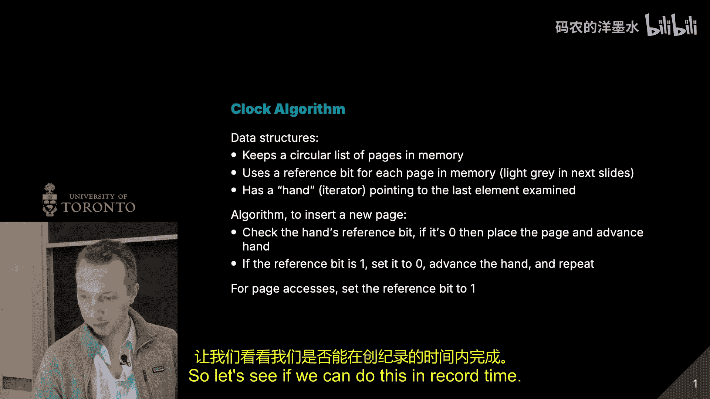
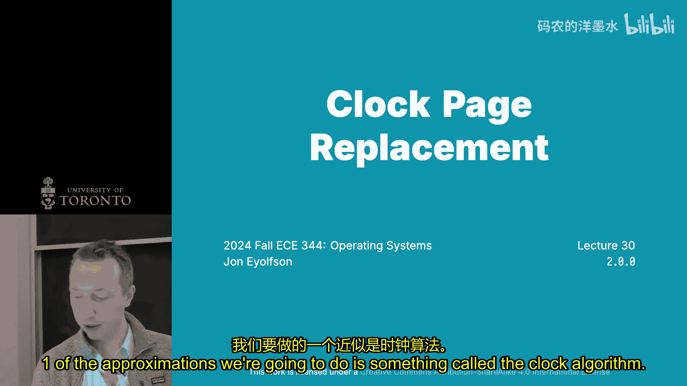
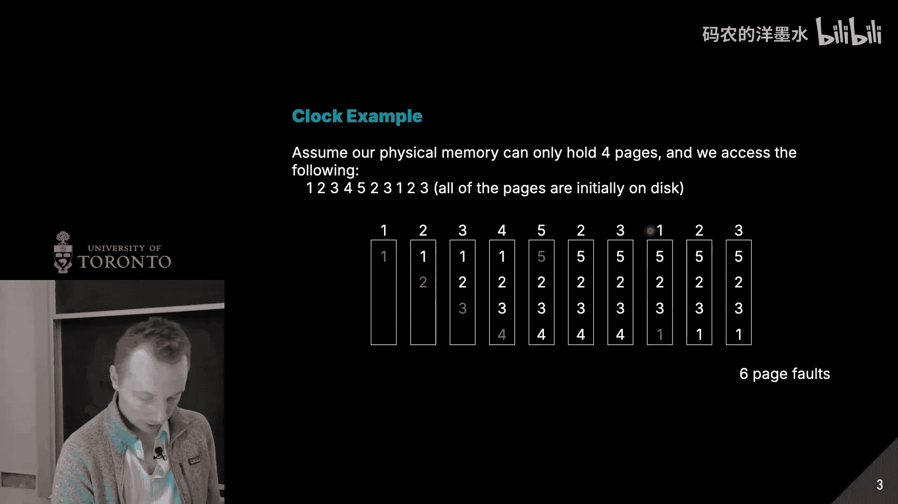
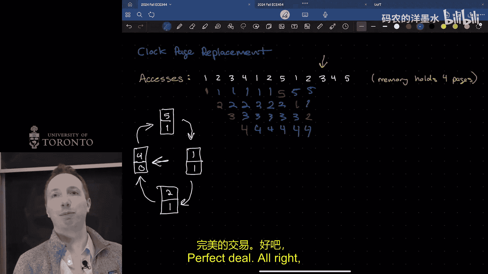
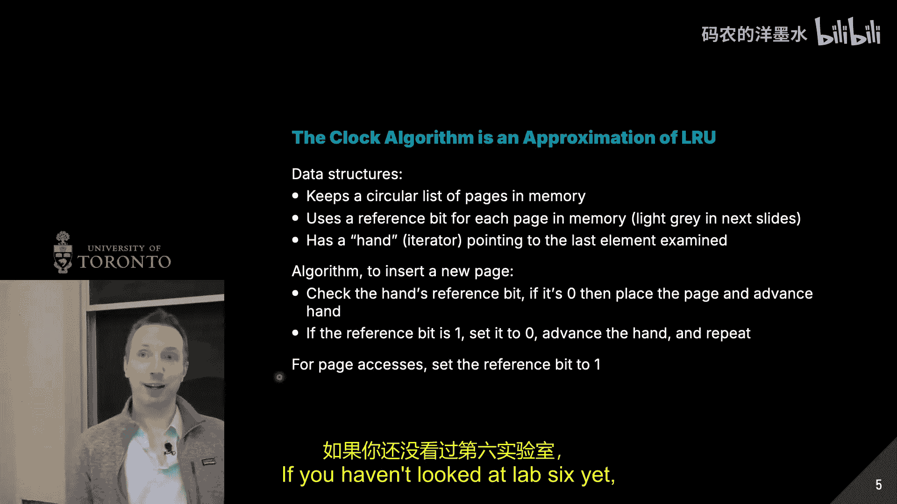

# 【全集】多伦多大学 操作系统 中英字幕 1080P p29 Lecture 29 - Clock页替换算法 -BV1Rbk7ByERc_p29-

Alrighty， welcome back to operatinging System So。This lecture should be quick。

 The long versions like 30 minutes because， well， unfortunately。

 your finals coming up sooner than you would like。 So you should probably finish lab 6 before that。

 So let's see if we can do this in record time。😊。

So where we left off before， we were doing least recently used， We said we couldn't implement it。

 So we're going to approximate it。 And one of the approximations we're going to do is something called the clock algorithm。

 So we are talking about clock page replacement today。

So the data structuresers involved here， we're keeping a circular list of pages in memory。

 this will allow us to figure out what page we need to evict， so circular， it will be a certain size。

 all the pages in memory and it will be circular， so it will loop back on itself。

So how this is going to work。 We're going to keep track for every page in memory。

 We're going to have a reference bit associated with it that will keep track whether or not it has been referenced。

 And in the slides， it will be in that light gray color。 And this bit。

We want our references to be as quick as possible。 The quickest thing we can do in our computer is update a single bit whenever we reference something。

 And in fact， this is what our MM MU does for us。 So we essentially get this for free。

 So we don't have to worry about performance。 This whole algorithm will take place whenever we do replacement and only replacement。

 So we don't care if that's a bit slow。We want our references to be as quick as possible。

So other than that， we have a hand。 You think of it as a clock。

 It's basically an iterator or pointer to the last element examined。

 And how the algorithm works is if we need to insert a new page。

 If we need to find something to kick out。 Then we check the hand reference bit。

 So whatever thing it page is pointing at。 check its reference bit。 if it's0， then it's out of here。

 So that means it hasn't been used in a while。 So we kick it out。

 And then we placed the new page there， said its reference bit to one since we just used it。

 and then advance the hand to the next one， we'll see why that's evident why we have to do that。

 because essentially this is like a two strike system， we don't want a strike to count against it。

 And again， we'll see that in a little bit。The other option here is if the current page we're pointing at has a reference bit of one。

Means we've used it somewhat recently， So we just set that bit from a1 to a0。

 and then we advance the hand and repeat this process until we actually find a place for this page to go。

 And then for page accesses， all we do is set the reference bit associated with that page to one。

 we want to be as quick as possible。So。Again， we'll assume that our memory can hold a certain number of pages in this case。

 four， and then we have the following accesses like before。

Only difference now is I'm drawing this little clock。 So initially， if we have four pages， well。

 we have a circular buffer of pages。 Initially， I'll just say they're all 0 to say they're invalid。

 so。The first reference points to the second points to the third points to the fourth。

 and then that points back to the first reference， so it is a circular list of pages with a reference bit。

 and then this little thing is the hand that is the current element we're pointing in and if you use your imagination。

 it looks like a clock。That's why it's called the clock algorithm。If we access page 1。

 we follow all the rules。 So the hand is currently pointing at something with the reference bit is 0。

 Well， it's not even valid anyways。 So we place our new page here， right。

 So we place our new page here， set its reference bit to one。

 So its reference is in the bottom cell here。 And then we advance the hand。 So everyone。

 okay with that。All right， two， what happens？Yeah， same thing。 So the hands currently pointing here。

 The reference bit is 0。 So I place it there。 So page 2， reference bit is one， advance the hand。

 and I'm done。 Allright， this is kind of boring like before， right， So first。4 accesses。

 I'm going have to populate it。 So I insert a3。 Reference bit is one。 Advance the hand。

 Inert a 4 reference bit is。One， advance a hand。All right， now the fun part。We referenced page 5。

What happens if we follow the algorithm to the letter。So we're currently pointing at page 1。

 Its reference bid is 1。 Do we toss it out。No， right。

 We just set its reference bit from 1 to 0 and then advance the hand， trying to find another victim。

Now in this case。You can kind of see where it's going。 We're going all around the world。

 We're going to check everything once。 So this reference bit is1。 I change it from a 1 to a 0。

 advanceance the hand。Same thing from page three，1 to a0， advance the hand。Same thing for this。

 It's one。 change it to 0。 advanceance the hand。 The shortcut for it。 the first time。

 I could have skipped all those steps if I just set all the ones to 0 because I know it's going to spin all the way around。

 So if you want to do it faster， that's your shortcut。Alright， so now I'm pointing at this page。

 Do I kick page1 out。Sure do。 So I replaced page1 with page 5。

Set the reference bit for page 5 as one， and then advance the hand。 So after page 5。

 my clock looks like this。Everyone's still with me。Perfect， so now we access page 2， what happens。

Yeah， so that's a hit。 It's in memory。 But I'm going to， since I just referenced it。

 I'm going to set it's reference bit from a 0 to a 1 now。

 So I actually do something when it's in memory now。

 So I said that two or the reference bit for page 2 to a1。 And now， well。

 this looks more kind of like least recently used。 I have now used it。 If it's reference bit is one。

 It means it gets a second shot at life。 It means I'm not going to immediately kick it out。😊。

All right， now I access page 3 what happens。Yeah， same thing。

 I set the reference bit for page 3 from a 0 to a 1。 And again。For references。

 things that are in memory， don't try and play with the hand or anything like that。

 Don't move the iterator。 Don't try and do page replacement。 If it's in memory。

 All we're doing is flipping a single bit at most。So now we access page 1。 What do we do。3 to 0。 No。

 we have to go with what we're currently pointing at。Yeah， so currently， we're pointing at page 2。

 its reference bit is one。 Yeah， Oh so like the hand does not change。The green is access already。

Yeah， if it's a page sheet， you're not advancing the hand that's slow。

We're just updating references if it's a hit。 That's it。 Flip1 bit。

So now we follow the algorithm for the replacement。 So we're accessing page 1。

 So do we kick out page 2。No， its reference bit is one。 So we just put a strike against it。

 So its reference bit goes from 1 to 0。 And we advance the hand looking for our victim。

 Do we kick out page 3。Nope， so we just said its reference bit from 1 to 0。 Advance the hand。 Now。

 we're pointing at our victim。Page 4， its reference bit is 0， so it gets evicted。

 so we kick it out for page1， set page1's reference bit to one， and then advance the hand。

 And you can see why we advance the hand otherwise on our next miss。

 We're going immediately set one's reference bit from a one to a0。

 which doesn't make sense since we just put it in。 So that's why we advance a hand after we put something in。

Alright， so now we access page 2， what we do。Yeah， all we do。 Don't touch the hand。

 Don't touch anything。 Just set to's reference bit from a 0 to a1。 If it's already a one， you can。

 if it makes you feel better， you can change it from a one to a1。Alright， now we access page 3， boom。

 its reference bit is one。So now we are done if we wrote this out。So typically。

 that little diagram you just have as you're going through it。

To actually say what pages you're replacing， it would look like exactly like the diagram we have yesterday。

 So the first four accesses were all misses， and then。Going back to our diagram before。

 we replace page 1 with page 5。Then on this diagram， it doesn't have to do with the hand。

 That's the actual algorithm。 So 2 and 3 were hit。 And then when we access page 1 again。

 we threw out page 4， right， So we threw up page 4。 And then the next two were hits。 So in this case。

 our number of page faults is 6。Fun，hu。All right。So。

Do we want to do it for this example， Do we want to have fun， Play with a clock。Sure， all right。

 let's do it， so this is the same sequence we had in the last lecture when we were going through it。

So four questions like this， you probably want。Do you use a corner of the paper or something like that？

Draw the little clock so here。I'll draw my clock。 Wow， it's this curse room。So I'll draw my clock。

Initially， it's all empty and my hand points here。So if I have four pages。Well。

 I have a circular list of four pages。As part of my clock algorithm。And then for all of the accesses。

Yeah I'll just write it in blue。So。First， access。If I access page one。What do I do？Just put one in。

 advance the hand， right。One， reference bid is1， Adv the hand。

If I wanted to do the first four very quickly， how could I just do the first four very， very quickly。

Don的。Keep the hand at at one and。Yes， everyone okay to do the fast version。So， fast version is just。

Keep the hand at the first element and just populate the first four。

 set all those reference bits to one and just populate them in order。 So next。

Thing we populated was two。 Refence bid is1， then3 reference bid is 1，4。 reference bid is  one。

 Now we are。At this reference， right？So if I was to draw all of our page faults， well。

 the first access， we brought one into memory。 Second one， we brought two into memory。Third one。

 we brought three into memory， fourth one， we brought four into memory。

 so it would look something like this。All right， we're okay with that。Allright。

 so now if we access element 1 or page1， what happens。Yeah， it's already one。 the bit。 Yeah。

 the bit's already won， So I don't have to do anything if it makes you feel good。😊。

Then you can erase this one here and then write down a one。So。Or you could just not do it。

 But if that makes you feel good。Who am I to stop you？Next one， we access nothing happens。

 page 1 and page 2 are in memory。 The reference bits are already one。

 So I'll just take the shortcut and say that nothing happens。All right， now we access page five。

Do we want to take the shortcut or do the slow version。So shortcut is this is something new。

 I'm going have to run the algorithm。 If all of the pages are currently have their reference bit as one。

I could go around the entire clock， or I could just do the fast version and set all the ones to zero。

Okay， setting all the one to0。Alright， so let's set all the ones to a 0。 Do the fast version。Zero。

 zero， zero。So。Now it looks like this。 We're accessing page 5。 So what were we kicking out。Page 1。

 right。 So we are kicking out page 1 with page 5。 So in our diagram， it will look like this。Now。

 we actually have to place it， so。I put in page 5。 Refer bit is one。 Am I done。Yeah。

 advance the hand when I'm after I put it in。 So now it looks like this。So everyone okay with that。

All right， now。Whoop， please， now I access element 1。 What happened。Yeah， so current hand is at 2。

 Reference bit is 0。 So that is donezo。 It is out of here。 So I'm replacing two with a one。

 which seems like a bad idea。 But we just follow the algorithm。So two gets replaced by one。

It's reference bit as one， and we advance the hand。Now， we still have five。 We replace。2 with one。

 And we look like that。 So everyone， good again。All right， so。Now we access page 2， what happened。

should be kind of boring at this point， right？So we're accessing page 2。

 hand it' is currently pointing at 3。 its reference bit is 0。 So it is donezo。 So see you later。

I'll replace it with two。Indvent the hand。So I would just place three with two。Well。

 turns out that was a fairly poor idea。 Now， I access page 3 again。

So I kick out page four for page three。Are we bored yet？All right， we're all bored。So。

 this is this guy And keep on page faulting till the end because， well， at this point。

 I'm just replacing things in essentially FiIFO order。It's not really helping me at this point。

If I put a clock algorithm on the final， you'll do well on it， right。Perfect deal。 Allright。

 so let's see if we can wrap up real quick。 So like I said before in the previous lecture。😊。

For performance， you might choose to disable swapping altogether。 Memory is cheap。

 has quite high capacity。 If you can throw money at a problem， like if you're Google。

 you would rather spend more money to increase your performance。 So you'd rather just。

Let programs using too much memory die。 What Linux will do is if your one process is using。

 or if you run out of memory on your system， it will run something called the O O M or out of memory killer or it essentially just picks a random process and kills it to free memory。

So。Basically， just pick something to kill， send zig kill to it。 kill D 9。 Bo， it's done。 boom。

 you have free memory。 We have fix the problem。There's also some different things we can do with virtual memory so we can have larger page sizes。

 so essentially we can skip out on the lowest level of page tables and use those bits all for a larger page so on some systems or on Linux。

You can use something called a huge page which makes the pages two mebytes。

 or if you go up to the next biggest size， so the next two to the nine bigger。

 you can have pages of size1 gigabyte and they are creatively called gigab pages。

So the whole trade off here is you trade off more fragmentation for more TLB coverage。

 So the TLB can only store a certain number of entries by default。

 Each entry covers 4 kiloB the size of a page。 So you can't really cover that much with the same number of entries。

 say。Your TLB holds 10 entries。Then it can essentially cover 40 kilobytes of memory translations。

If you use huge pages， then， well， now， if I have the same 10 entries， I can cover 20 MBby。

 which is a lot bigger。 So there's some trade off here， if your program uses only like4。

Kilbytes or 8 kilo or something like that。 that would be exactly two pages。 Well。

 if you're using a huge page， a lot of that space， a lot of that  two meby is wasted。

 So wasted memory we call fragmentation。 that's basically a trade off we have now。

 There's a move right now to have more support for huge pages。Alright。

 so that was the little we can wrap up now because we just went over the clock algorithm。

 So it's an approximation of L R U that we can actually implement。😊。

The key data structures are a circular list of pages in memory。Each page has a reference bit， yeah。

TLB。TLB translation look aside buffer from virtual memory。Basically。

 a cache for doing all the translations。So there's only a certain number of entries that can cache。

 like page table entries。Basically， cache for page table entries。No。

 not more TLB entry is a bigger reach。So if each entry covers， each entry covers a page， right。

 which is 4 kiloB。 but yeah， if we used a huge page， each entry covers way more space。Yeah。Yeah。

 that would just reduce the number。Switching。Like the bigger。Redduce the need to。い先す。No。

 the bigger page， just one entry， one page table entry covers way more memory。That'这。

Might be good for performance。 It's less translations you have to do， right， If I use two pages。

 it's the same translation。 I't have to retrans it or do anything， yeah。Alright， so yeah。

 with the clock algorithm， a circular list of pages in memory。

 Each page has a reference bit associated with it。 It was light gray in the slides。

 Then it has a hand， which is an iterator point to the last element examined。

The algorithm that only runs when you are doing page replacement。

 where this page you are trying to access is not in memory。 Check the hands reference bit。 if it's 0。

 place the page there， set its reference bit to one， advance the hand。

If what it's currently pointing at has a reference bit of one， we set it to 0。

 It just gets a strike against it。 And then we advance a hand and repeat until we actually find our victim。

 And then for accesses， we do the fastest thing we can， which is just set a bit if。

The bit of that page is a0。 We set it to a one。 If it's already a one， we leave it alone。

So with that， I will stick around if you haven't looked at labb 6 it， you should。

 I will stick around to help you if。

