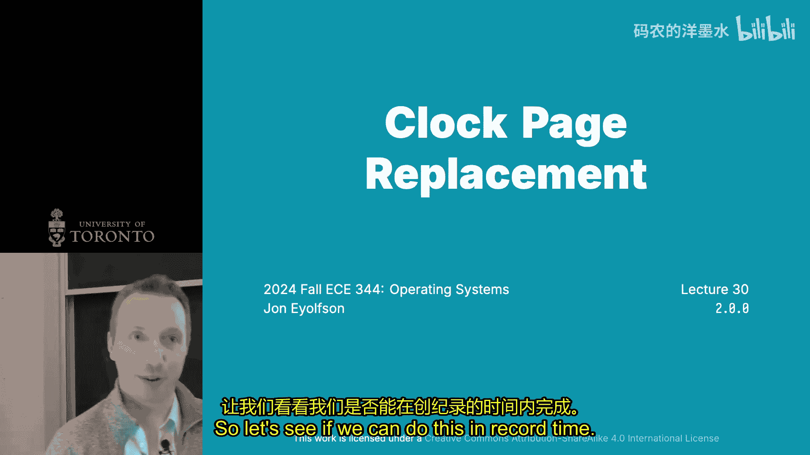
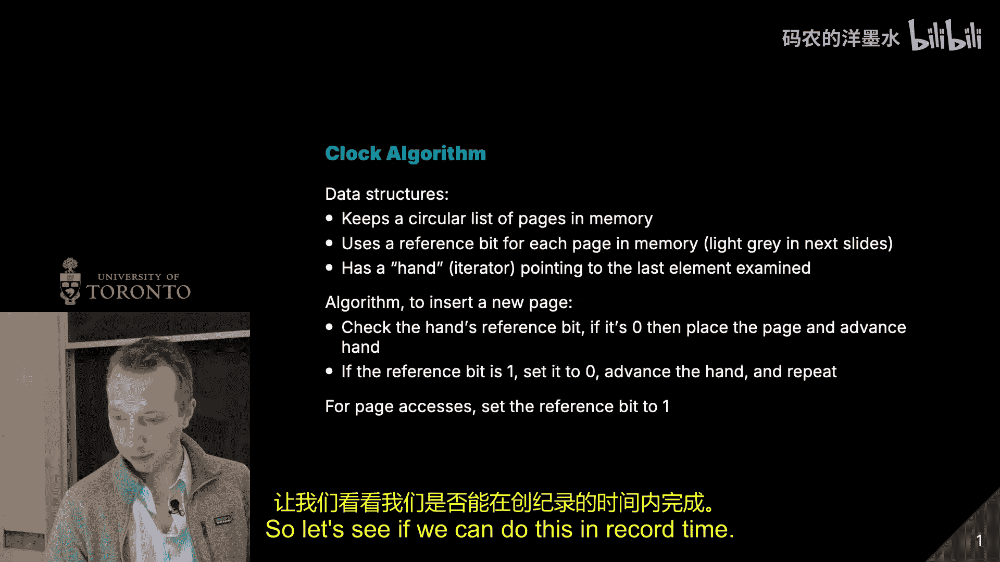
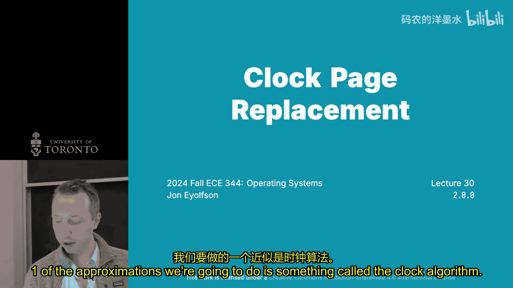
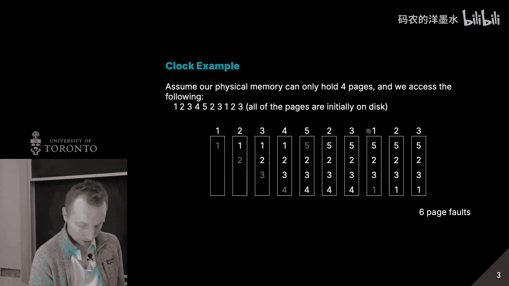
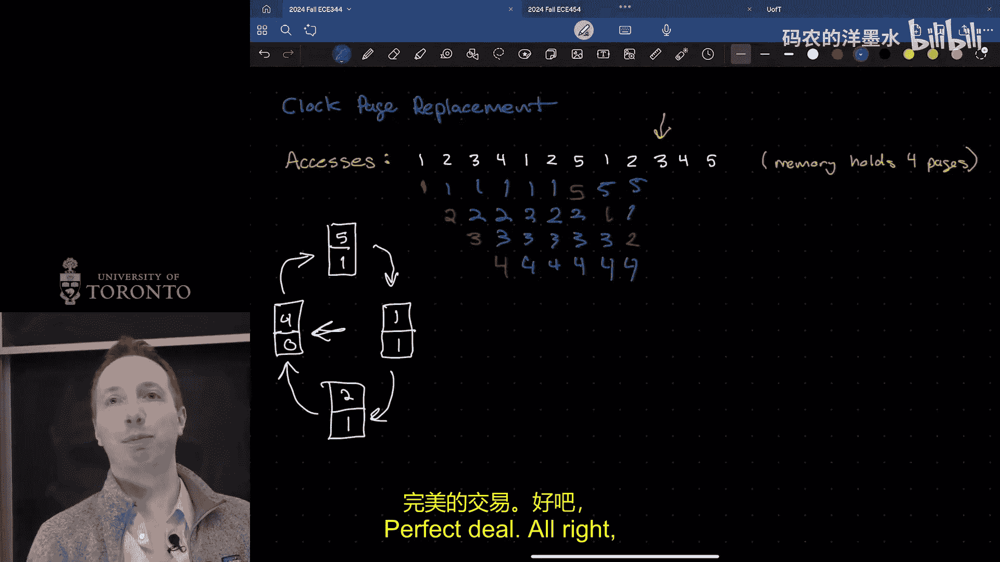

# 操作系统：29：Clock页面替换算法 🕐







在本节课中，我们将学习一种名为Clock算法的页面替换算法。它是上一节讨论的“最近最少使用”（LRU）算法的一种近似实现，因为LRU算法在实际硬件中难以高效实现。Clock算法通过一个简单的“引用位”机制，模拟了LRU的行为，同时保证了性能。

## 概述

上一节我们介绍了LRU算法的理想与实现困境。本节中，我们来看看如何通过Clock算法来近似实现LRU。该算法的核心思想是使用一个循环列表来管理内存中的页面，并为每个页面维护一个“引用位”，以记录其近期是否被访问过。

## 核心数据结构与概念

Clock算法依赖于几个关键的数据结构：

*   **循环页面列表**：这是一个环形的数据结构，包含了当前所有在内存中的页面。它允许算法按顺序检查每个页面。
*   **引用位**：与内存中的每个页面关联。当页面被访问（读或写）时，硬件（如内存管理单元MMU）会**自动**将该页面的引用位设置为1。这是为了确保访问操作本身尽可能快。
*   **指针（时钟指针）**：这是一个迭代器，指向循环列表中**上一次检查过的页面**的下一个位置。你可以把它想象成钟表上的指针。

算法的所有逻辑只在发生**页面错误**（即需要替换页面）时才执行。而页面访问（命中）时，只进行设置引用位这一快速操作。

## 算法运行规则

以下是Clock算法在两种主要情况下的操作步骤：

### 情况一：页面访问（命中）

如果访问的页面已经在内存中，我们只做一件事：将其**引用位设置为1**。不移动指针，也不进行任何替换操作。这是为了保证访问速度。

### 情况二：页面错误（需要替换）

当访问的页面不在内存中时，需要找到一个“牺牲”页面替换出去。算法流程如下：

1.  检查当前指针所指页面的**引用位**。
2.  **如果引用位为0**：这个页面近期未被使用，是合适的牺牲品。执行以下操作：
    *   用新页面替换该页面。
    *   将新页面的引用位设置为1（因为我们刚“使用”了它）。
    *   **将指针向前移动一位**（指向下一个页面）。
3.  **如果引用位为1**：这个页面近期被使用过，给它一次“免死”机会。执行以下操作：
    *   将该页面的引用位**从1清为0**（相当于记一次过）。
    *   **将指针向前移动一位**。
    *   重复步骤1，继续寻找引用位为0的页面。



**关键点**：指针总是在**放置新页面后**或**将引用位从1改为0后**才向前移动。这确保了刚被放入的页面不会立即被选为牺牲品。

## 算法示例演示

假设内存只能容纳4个页面，初始状态为空，指针指向第一个位置。我们跟踪以下页面访问序列：1, 2, 3, 4, 5, 2, 3, 1, 2, 3。

**初始状态**：指针指向P1（空），所有页面引用位为0。
```
[P1:0] <-- 指针
[P2:0]
[P3:0]
[P4:0]
```

**访问页面1**：缺页。P1位置为空，直接放入，设引用位为1，指针移向P2。
```
[P1:1]
[P2:0] <-- 指针
[P3:0]
[P4:0]
```
（类似地，依次放入页面2,3,4，指针循环移动）

**放入页面2,3,4后**：
```
[P1:1]
[P2:1]
[P3:1]
[P4:1] <-- 指针 (假设刚放完P4)
```

**访问页面5**：缺页。指针指向P1，引用位为1。
*   将P1引用位清0，指针移向P2。
*   P2引用位为1，清0，指针移向P3。
*   P3引用位为1，清0，指针移向P4。
*   P4引用位为1，清0，指针移回P1。
*   P1引用位现在为0，替换为P5，设引用位为1，指针移向P2。
```
[P5:1]
[P2:0] <-- 指针
[P3:0]
[P4:0]
```

**访问页面2**：命中。只需将P2的引用位从0设为1。指针不动。
```
[P5:1]
[P2:1] <-- 指针
[P3:0]
[P4:0]
```



**访问页面3**：命中。将P3的引用位从0设为1。
```
[P5:1]
[P2:1]
[P3:1] <-- 指针
[P4:0]
```

**访问页面1**：缺页。指针指向P4（引用位0），替换为P1，设引用位为1，指针移回P5。
```
[P5:1] <-- 指针
[P2:1]
[P3:1]
[P1:1]
```

后续访问页面2和3均为命中。在这个序列中，总共发生了6次页面错误。

## 性能优化与相关话题

### 快速扫描优化
在寻找牺牲页面时，如果发现所有页面的引用位都是1，可以一次性将所有引用位清0，然后指针绕一圈后就会替换第一个页面。这避免了逐位检查的开销。

### 现代系统的考量
*   **禁用交换**：对于像谷歌这样的大型服务，内存资源充足，有时会选择直接终止（`kill`）过度消耗内存的进程（Linux中的OOM Killer机制），而不是进行缓慢的页面交换，这被称为“抛钱解决问题”。
*   **大页支持**：标准页面大小通常为4KB。现代系统支持“大页”（如2MB的Huge Page或1GB的Gigantic Page）。使用大页的**权衡**是：
    *   **优点**：提高TLB（快表）的覆盖范围。TLB条目数有限，每个条目映射一个页面。大页使得单个TLB条目能覆盖更大的内存地址范围，减少TLB未命中，提升性能。
    *   **缺点**：可能导致内部碎片（Internal Fragmentation）增加，如果程序实际只用到大页中的一小部分，其余内存就被浪费了。

## 总结


本节课中我们一起学习了Clock页面替换算法。作为LRU算法的有效近似，它通过**循环列表**、**引用位**和**指针**这三个简单组件，实现了可接受的缓存性能。其核心优势在于：**页面访问时仅需快速设置一个位**，而复杂的替换逻辑只在发生缺页时执行。我们还了解了与之相关的性能优化技巧和现代系统中关于内存管理（如大页）的一些扩展思考。