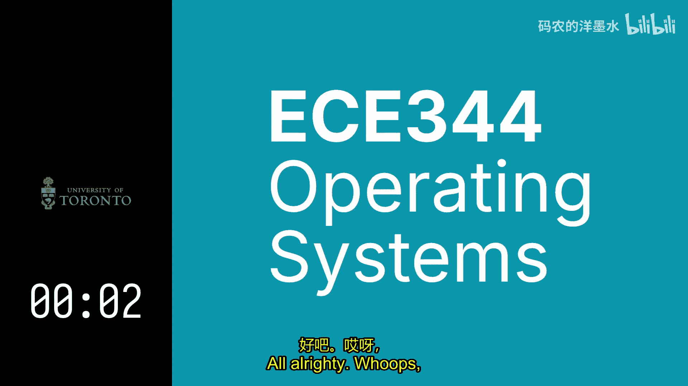
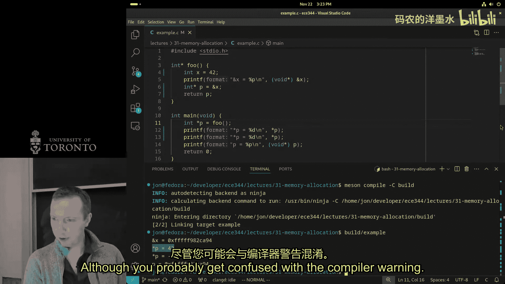
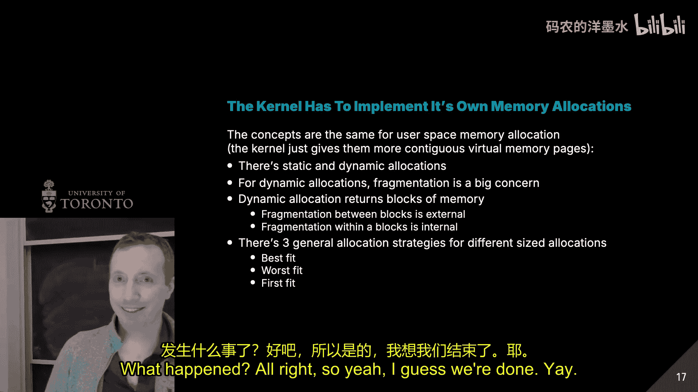

# 【全集】多伦多大学 操作系统 中英字幕 1080P p30 Lecture 30 - 内存分配 -BV1Rbk7ByERc_p30-

。

Alrighty whoops， welcome back to operating systemss， Wow， that's E we。

All right， so today we get to talk about memory allocation， fun。Should be。Kind of review ish。

From 105 and some slightly new things that hopefully are not surprising。So。

As I've learned from the labs from some of you， static allocation is the simplest strategy。

Everyone's done that， it's basically create a global variable。

 so if I create a global variable called buffer， say its size of a page。

 then I don't have to worry about using Maoc or anything like that and how this works。

Now we can demystify it a little bit whenever the program loads。

 the kernel sets aside that memory for you so your application get compiled to an L file part of that information that's in it is where the global variable is supposed to live in memory and then as part of launching your program through Ex VE or things of that nature then it would set aside memory there。

 copy that value to memory so it's available and these global variables are valid for the entire lifetime of your program or sorry the entire lifetime of your process so as long as your process exists this memory exists。

 there's no way to free it， the only way to free it is to exit and stop your process。

So often we need dynamic allocation， so you might only conditionally require memory。

 stack allocation would be sometimes wasteful because well it's alive for the entire duration of your program。

 so if you set aside a gigabyte and you only use a gigabyte for a second and don't for the rest of the time。

 well that space is basically wasted。You also might not be able to do it ahead of time。Anyways。

 so you might not know the size of an allocation you need at compile time so where do you allocate memory。

 you can either allocate it dynamically on the stack or the heap you don't really think about doing it on the stack because the compiler more or less does it for you that's where all the global variables go to and then the heap well that's the bane of everyone's existence right it's malloc and free and friends of malloc and free so we're going to talk briefly about how those are implemented。

But first we can talk about stack allocation， this is done for you in C but you can actually request it if you want。

 so if you have a normal variable in X， well there's actually a function called to ask for memory from the stack that you probably have never used。

 so there is a function called Alloc a， it works exactly like malloc you ask it how many bytes to set aside for you and it returns a pointer back to the beginning of those bytes。

 so。Whenever I write in X， well， that's going to live somewhere in memory and the compiler will insert a call for you to alloc a in this case x is an int。

 so it'll set aside four bytes and then it will have a pointer to that int and then you can access it that way。

The rule is with Alloc A， you can go ahead and use it。 There's no free associated with that。

 because whenever you return from a function。It just sets the stack pointer back to the original value。

 and then everything's delocated all at once。 It's super quick， yeah。

Also allocated memory from the be get the allocated ones the。When the program stops running。

 all its memory is gone。 Yeah， but just for function calls。Different。So this is so stack。

It only lasts as long as that function is alive。That's it。

So if I have foo and I have an int X in there， x is only alive as long as you're calling thatFo function。

Outside it doesn't exist。Yep， so。This won't work also if you try and use a memory after returning。

 So I might have a pointer。 We'll have a little example of that。Just in case。So。

Actually， let's do some review first， so here let's see our code so we can make sure we understand what a stack allocation is。

So here I have a function calledF。Inside of it， I have int x equals 1， right？X lives on the stack。

It only lives as long as this function lives， right。Then here I'll print the address of X。

 so it should be some address on my stack， right？Then what I'm going to do here is this P function is going to return the address of x。

 So it's the address of that stack variable。 And then in main， main just calls P。

 And then we get that address back， remember。C is。Copy by value。 So it should be the same value back。

 right？ So if I print the value of the pointer。And it's equal to the address of x。If I run this。

Both print statements should show me the same address， right？Any disagreements with that？Yeah。Sorry。

X is gone， but the address of x is the same， right？So it returns the address of x。

It goes into this variable P， and then we print P。 So address of x and P should be the same thing。

 so。Should print the same address， right， and it should be an address on the stack。Sure。Yesよ。Yeah。

 everyone agree with that， that's C basics， right， it's the stack variable address to it。Right。

 I run this。 I should get。Two pointers that are the same address。Some of you seem very unconvinced。

Yes， yes。 Okay， okay， So let's run this。 We'll see the same pointer liars。😊，Yeah。

And so does x get the out here？那て个あ。So its address still exists， it's a value， it copies back。

 but if I looked at this compiler warning。It says。Addres of stack memory associated with local variable X returned。

 and yeah it。Tecically undefined behavior。 if I use that value。

 So since it's technically undefined behavior， my compiler decided that undefined behavior means they can do whatever the hell it wants。

 and it just set it to 0， so。If I want this to work， how I convinced you all it should。

 I have experienced my backgrounds in compilers so I can fool the compiler in order to actually return that address for you。

 So I can fool the compiler by just creating a pointer。😊，To an int called P， save the address of X。

 and then I'll return P。So if I compile this now， I have now successfully fooled the compiler and I get the same address both times like what you said before。

 so it's truly undefined behavior。So that's okay， right？Can you just briefly explain why？

So why this works？So the compiler just said， hey， if I return the address of a local variable。

 then I can do whatever I want。 so I changed it so that I'm not directly returning the address of a local variable。

 So I'm assigning the address of a local variable to a local variable called P。 and then returning P。

 which is done by value。 So I fooled the compiler。 It's the exact same thing as before。

 but I did in a ran belt way and the compiler doesn't done do things。 yeah。で算。今なけやす。Yeah。

 so P gets deated when the function terminates， but it's returning the value of P here right。

 and it's copy by value， so you get a copy back in the collar yeah。おしない派で。Oh， okay。All right。So。

Let's see here。X is on fo stack， right， It's assigned to one。 We print the address of it。

 and then we return the address of it， right， So it's out of scope。

 X is gone whenever we return from fo。 So in Maine， when we return from fo， it's gone， right。Well。

What do I expect to happen if I actually try to read the value at that address？Garbage。あビに？

Unfined behavior。 So the a is outside of your。Would that be sexual。Saeg fault。All right。

 let's have some vote。Who's saful？Not even you。哪知到。One， okay， whose's team garbage？Whose team won。

Maybe。Oops。1。Yeah。Yeah， so in this case， it didn't get overwritten， right， So I called foo。

Then that's increasing my stack。 X existed on the stack。 F is done， So it returned back。

 but if I'm pointing， I'm pointing to the stack still。

 it's not going to change that value it could change that value to whatever it won。

 but fast thing to do is not change it back。So I'm pointing to it。 still exists， Still good。

I on most computers， I get one， even though this is technically undefined behavior。All right。

 what about if I print it again？Who's， alright？ So team 1。For the second print line， so one1。

All right， team garbage， garbage。Okay， team one garbage。哦哦。

We seem to have a bunch of bandwagon hopers。So let's see it。 We got more votes for， I mean。

 gradually。We got one garbage， right？Yeah， does it need a stack as well。Yeah。Yeah。

 so the first printf， I mean， printf uses the stack too， right， So the first time it preserves。

It read the value first before it started using a stack and overr anything。

 So if we change this to like just to make sure we're not crazy。

 if we change this to like 42 or something。Then we should see the first one's 42 and then it's so it reads it。

 prints the value， but of course， print F use dis stack as part of writing。 So when I call it again。

 while now it used the stack and overwro it with something happens to be today always negative one。

 but it's technically garbage。All right。Everyone okay with that？Ih， so lesson here。

 do not try to return a address to your stack yet。そして。Pri。So print F will use the stack， right？

So let's say main calls P， so like if this is my stack， it puts x like here right。

 then returns a pointer to it， returns from P， so this value still exists， right？

But print F gets called in Maine， and then it uses the stack。So it might overwrite that。

Because it would have its own local variables and things， so it would just overwrite it。

 So first time it didn't overwrite it before it read it。

 and then the next time we read the overwritten value because it's going to use this stack too。

All right， that was fun。Basic thing is， don't do that。

 If you use a good programming language language like rust， you can't do that。

So it will not let you do that。Although you probably get confused with the compiler warning。

 all right， so back on topic， so you've used dynamic memory before， right。

 malloc and free and all those fun things， that's the most flexible way to use memory。

 but the most difficult to get right mostly because you have to remember to free the damn thing。

 So you have to properly handle memory lifetime。 So you have to decide when to call free whenever you're done using memory。

If you don't call it when you should call free， you have a memory leak， if you call it too early。

 you might access information you can't or shouldn't be able to get garbage values or at best Seg fault because yeah。

 you have to also free exactly once， if you free twice， and that is also a Seg fault。

So if you are writing the allocator too， you also have a new concern， which is fragmentation。

 which is that wasted space because， well， this memory allocator has to decide what memory to actually use for your allocations。

So it's a unique issue only for writing a dynamic memory allocator because while you allocate memory in a different contiguous size blocks。

If you're writing malloc， you have no idea how much memory someone will ask you for。

In malloc right it returns you a pointer after it returns you a pointer。

 it's not allowed to change it or do anything with it。

 it has to leave it alone until you actually call free。

 so we can't do something like compaction where we move allocations around and try and get everything close together so we don't have a wasted space so a fragment in this case is a small contiguous block of memory that cannot handle an allocation。

 same concept as before with when we did contiguous file systems。

RightAny that can't be used for an allocation is external fragmentation。 So again。

 you can think of it as a whole in memory where we're just wasting some space。

So we have three different requirements for our memory allocator to have fragmentation as an issue。

 so we have to have different allocation lifetimes if all of our variables have the same lifetime。

 those are like stack variables， we don't have that issue。

 we can allocate them all contiguously in a row， then when the function ends， we just reset them all。

 they all have the same lifetime so it's easy to free them。

 we don't have to deal with fragmentation at all。Also if all of our allocations are the same size like if we're dealing with pages or any fixed size allocation。

 don't have to worry about this because they're all interchangeable and then three we have the inability to relocate previous allocations AKA our allocation decision is permanent so things like Java where everything is a reference what Java will do is Java can rearrange all your memory and change all the pointer values。

 it just has to make sure that if it changes a pointer it has to change all the references to that pointer and fix all them all up so that's part of what the magic of the JBM will do for you but in Sealand we don't have that luxury。

 everything is permanent if we are allocating malloc。

So there's internal and external fragmentation just like for file systems。

 external fragmentation again， when you allocate different size blocks and there's no room for that allocation between the blocks。

 and then internal fragmentation occurs when you allocate like a fixed size block and the allocation doesn't actually use all of the memory in that blocks so some of that memory is wasted so we're going to assume that we just give back blocks exactly the same size as the user wants。

 so we won't have any internal fragmentation we're just going to have to deal with external fragmentation。

So we want to minimize this which。Is basically wasted space。 We want to prevent that。

 So we want to reduce the number of holes between blocks of memory。 if we have holes。

One idea might be to keep them as large as possible， so it's not wasted。

 I can actually use it for an allocation because our goal is to keep allocating memory without wasting space。

So if you are implementing Maloc， which we do not do， but you might have to at some point。Usually。

 the basic implementation uses something like a free list that keeps track of all the free blocks of memory by chaining them together。

 That's what a linked list is and。It knows how big a block size。

Stored as part of the free list so since we are implementing malloc we need we need to handle a request of any size。

 So how this will work is for an allocation just choose a block large enough to fulfill the request move it from the free list if we split something off then a smaller chunk goes back onto the free list don't worry we'll have an example and then for deallocation you add the block back to the free list and if it's adjacent to another block well then we can merge them and create a bigger block of memory that we can hopefully use。

Yeah， just wondering like we choose like a block that's large enough， do we choose a block that？

Will result in like a smaller hole or a big bigger hole。 Yeah。

 so we'll get over strategies for picking the block next。 Yeah， so our main strategy here is， oh。

 well， what what hole do we pick to put the allocation is。So there's three general strategies。

 one is called best fit， so that says choose the smallest block that will satisfy that request。

 so it needs to search through the whole list unless theres an exact match。There's also a worst fit。

 which is choose the largest block， whatever has the most leftover space。

 also has to search through the list， or there's just the let's find something that's good enough。

 So the last strategy is first fit。 as soon as I find a free block big enough for this allocation。

 I'm going to use that one。 So hopefully I don't have to search through the entire list。So。

Here is our strategy with best fit。 So here I assume our memory allocator is managing this big block of memory。

😊，Any of the colored blocks means it memory we've given out before。

 so we can't use it to satisfy this request。 It is not free and anything that is free just has the black transparent background and the number of it is the size of that free block。

 So we have a red allocation at the beginning， then we have a free hundred0 Btes of memory。

 then we have a big blue allocation， and then we have a free 60 Bs of memory。

 So now if someone calls malloc 40 well we have to pick a spot to actually fulfill this block。

 So if we're doing best fit， will we put it will we split this block or split。The100 or the 60。

The 60， right？ So that's closest to the number without going over or。Clsest to that number， yeah， so。

I would put it there。 I split that 60。 There's 20 left over。 So you could put before or after。

 It doesn't matter。 So here I've split that off。 I now have 20 B free at the end。

 So now if I'm still using best fit， I have this purple allocation for 60 B。 Where do I put it。

Hundred， right， I can't put it in the 20。 It's not big enough。 So I put it。I would put it here。

 and then I would have 40 bytes left over， right， so there are 40 bytes left over。

Now if I have a pinky allocation for 60 bytes。Doesn't fit anymore， I say， out of memory， right。

 I have 60 B left over。Doesn't quite fit。 So maybe best isn't the best。

So what about if we did this using worst fit， W fit sounds worse， but let's see So same allocation。

 if we have 40， where do we put it now in the hundred block right。

 so we put it in the hundred0 block， it's got 60 left over。 Now we have an allocation for 60。

 doesn't matter they're both the same size， so let's stick it somewhere。Next one， hey。

 we have 60 B left over。 It fits exactly in the remaining space。 right， Wors fit is the best fit。

Because its fit， right？Okay， terrible joke， don't worry about it。

Turns out best fit and worth fit are both slow。 So if you simulate this without my silly example。

 best fit tends to leave like really large holes that are good for allocations and very small holes that are mostly external fragmentation that are useless。

Worst fit if you simulate that。The name is in fact correct。

 it's actually the worst in terms of storage utilization。

 if you simulate it across a whole bunch of different program traces， and if you just do fast fit。

Which is much quicker to implement because you don't have to search the entire list every time。

 it tends to leave average size holes， which tends to work good。

 so it's good that this one works because， well， first fit is generally the fastest one。So yeah。

 a new record again sweet so the kernel， we're definitely closing in on this course right。

 lectures are getting smaller or shorter and shorter and shorter。

 which is probably good because your final exam getting closer and closer and closer。😊，Sorry。😔，Yeah。

The worst。Yeah。But it was only be kind of like。While you are placing some memory。

They were specifically used。Yeah， yeah， yeah， the example I showed worst fit prefer best。

 but that's not always the case， yeah yeah。I think it's because worst case tend to be more big coat than in smalls。

No best of fit。M wife。Yeah， choose the bigger philosophy that implies living a bigger home。Yeah。

'll essentially every for worst fit， it'll essentially just break that larger hole into smaller pieces all the time then。

So small， that becomes useless and then， yeah， yeahep。All right， so yeah， we can wrap up。

 I'll stay around where yeah， we're getting done for the course， what？Yeah， we're pretty much done。

 I told you， the course gets a lot easier after we talk about threads， and I don't want like。

You have enough to worry about since your exam's on the seventh， so let me wrap up and then。

 oh right， quick question。So we have， I'll do two more lectures of content and then I'll start doing review just to give you guys a break。

Because yeah， we're Friday。What happened all right。Yeah。

I guess we're done， yay。