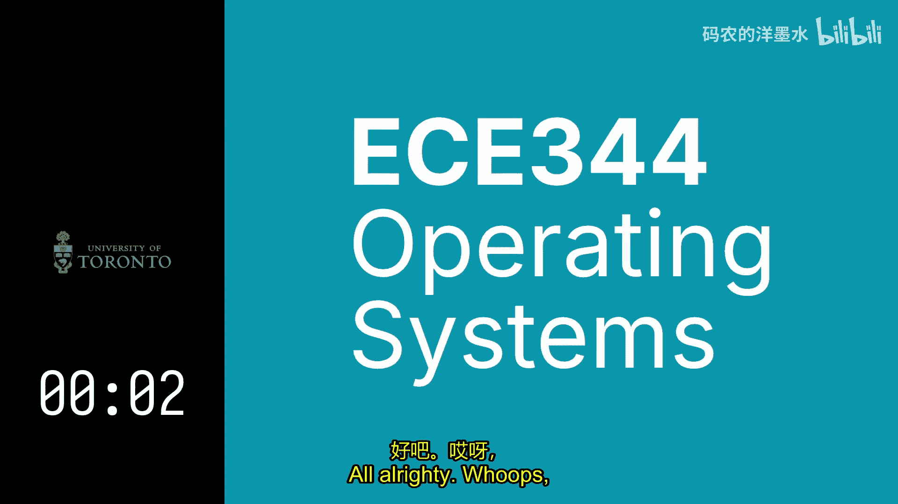
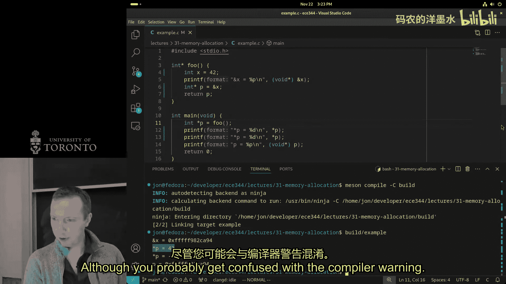

# 操作系统：第30讲：内存分配 📚




在本节课中，我们将学习操作系统中的内存分配策略。我们将回顾静态分配、栈分配和动态堆分配的基本概念，并深入探讨动态内存分配器（如 `malloc` 和 `free`）的实现原理及其面临的主要挑战——内存碎片化。

---

## 静态分配 🏛️

静态分配是最简单的内存分配策略。它通过在程序中声明全局变量来实现。例如，声明一个页面大小的全局缓冲区：

```c
char buffer[PAGE_SIZE];
```

当程序加载时，内核会为这些全局变量预留内存空间。编译器生成的二进制文件中包含了全局变量在内存中的位置信息。在通过 `execve` 等系统调用启动程序时，内核会分配相应内存并复制初始值。这些全局变量在进程的整个生命周期内都有效，无法手动释放，只有在进程退出时才会被回收。

---


## 动态分配：栈与堆 🔄

通常，我们需要动态分配内存，例如在条件性地需要内存，或者无法在编译时确定所需内存大小时。

### 栈分配 📥

栈分配通常由编译器自动处理。在C语言中，局部变量默认在栈上分配。此外，还有一个鲜为人知的函数 `alloca`，它可以显式地在栈上分配内存，其用法类似于 `malloc`：

```c
int *x = alloca(sizeof(int));
```

`alloca` 分配的内存会在函数返回时自动释放，这是通过移动栈指针来实现的，速度非常快。**关键点在于：栈上变量的生命周期仅限于其所在的函数。**

为了加深理解，我们来看一个关于栈变量生命周期的例子。

以下是关于栈变量地址返回的一个示例。我们有一个函数 `foo`，它返回一个局部变量的地址。

```c
#include <stdio.h>

int* foo() {
    int x = 42;
    printf("Address of x inside foo: %p\n", (void*)&x);
    // 返回局部变量 x 的地址（未定义行为）
    return &x;
}

int main() {
    int* p = foo();
    printf("Address returned to main: %p\n", (void*)p);
    // 尝试访问已释放的栈内存（未定义行为）
    printf("Value at that address: %d\n", *p);
    return 0;
}
```

运行此代码是**未定义行为**。虽然地址可能被成功返回，并且第一次访问可能得到预期值（`42`），但后续的栈操作（如调用 `printf`）可能会覆盖该内存区域，导致读取到垃圾值或程序崩溃。**核心教训是：永远不要返回指向栈上局部变量的指针。**

---

### 堆分配 🗑️



堆分配通过 `malloc` 和 `free` 等函数实现，这是最灵活但也最易出错的方式。主要难点在于必须手动管理内存的生命周期：
*   **内存泄漏**：忘记调用 `free`。
*   **悬垂指针/重复释放**：过早调用 `free` 或对同一块内存调用 `free` 两次，通常会导致段错误。

对于内存分配器的实现者，还有一个独特的挑战：**内存碎片化**。

---

## 内存碎片化 🧩

碎片化发生在动态分配不同大小、不同生命周期的内存块时。它分为两种：
*   **外部碎片**：空闲内存被分割成许多小块，分散在已分配内存之间，导致没有足够大的连续空闲块来满足新的分配请求。
*   **内部碎片**：分配的内存块大于实际请求的大小，块内未使用的空间被浪费。

在本节讨论中，我们假设分配器按需分配精确大小的内存块，因此主要关注**外部碎片**。

碎片化产生的三个条件是：
1.  **不同的分配生命周期**（如堆分配）。
2.  **不同的分配大小**。
3.  **已分配的内存块无法被移动（重定位）**（这与Java等语言不同，C/C++中 `malloc` 返回的指针是固定的）。

我们的目标是**最小化外部碎片**，即减少无法被利用的小块空闲内存（“空洞”）。

---

## 实现基础：空闲链表 📋

一个基础的 `malloc` 实现使用**空闲链表**来管理空闲内存块。每个空闲块本身包含其大小信息和指向下一个空闲块的指针。

其工作流程如下：
*   **分配 (`malloc`)**：遍历空闲链表，找到一个足够大的空闲块。将其从链表中移除。如果该块大于所需，则将其分割，将剩余部分作为一个新的、更小的空闲块插回链表。
*   **释放 (`free`)**：将被释放的内存块添加回空闲链表。如果它与链表中的相邻空闲块物理地址相邻，则将它们**合并**成一个更大的空闲块，以减少碎片。

接下来，我们看看在分配时如何从多个符合条件的空闲块中做出选择。

---

## 分配策略选择 🎯

当空闲链表中有多个块都能满足分配请求时，需要一种策略来决定使用哪一个。主要有三种策略：

以下是三种常见分配策略的对比：
1.  **首次适应**：从链表头部开始搜索，使用**第一个**足够大的空闲块。
    *   **优点**：搜索速度快。
    *   **缺点**：可能会在链表头部留下许多小碎片。
2.  **最佳适应**：搜索整个链表，使用**大小最接近**请求且不小于请求的空闲块。
    *   **优点**：理论上能减少大空闲块被割裂，保留大块内存。
    *   **缺点**：需要全局搜索，速度慢；可能产生大量极小的、无法利用的碎片。
3.  **最差适应**：搜索整个链表，使用**最大**的空闲块。
    *   **优点**：避免产生非常小的碎片。
    *   **缺点**：需要全局搜索，速度慢；可能过早耗尽大块内存，不利于后续的大容量分配。

模拟研究表明，**首次适应**策略在速度（无需遍历整个链表）和内存利用率（倾向于留下中等大小的空洞）之间取得了较好的平衡，因此通常是实践中较好的选择。

---

## 总结 📝

本节课我们一起学习了操作系统中内存分配的核心知识：
1.  回顾了**静态分配**和**栈分配**的原理与限制，特别是栈变量的生命周期。
2.  深入探讨了**堆分配**（`malloc`/`free`）的灵活性及其带来的手动内存管理挑战。
3.  重点分析了动态内存分配的核心问题——**内存碎片化**（尤其是外部碎片），并理解了其产生的条件。
4.  介绍了内存分配器实现的基石——**空闲链表**数据结构及其分配、释放、合并的基本操作。
5.  比较了**首次适应**、**最佳适应**和**最差适应**三种分配策略的优缺点，了解到首次适应通常在效率和效果上是一个不错的折中选择。


理解这些概念对于编写高效、健壮的C/C++程序至关重要，也是操作系统管理物理内存资源的基础。