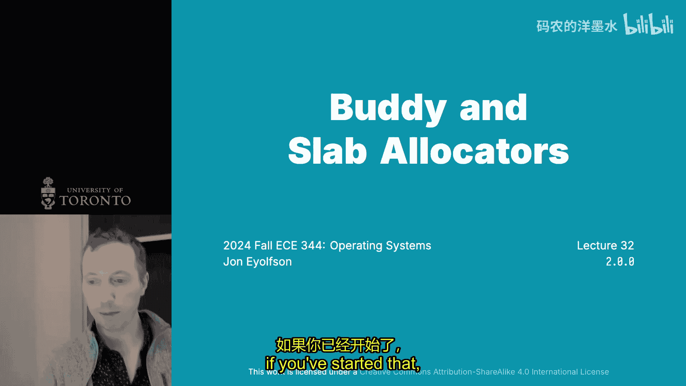
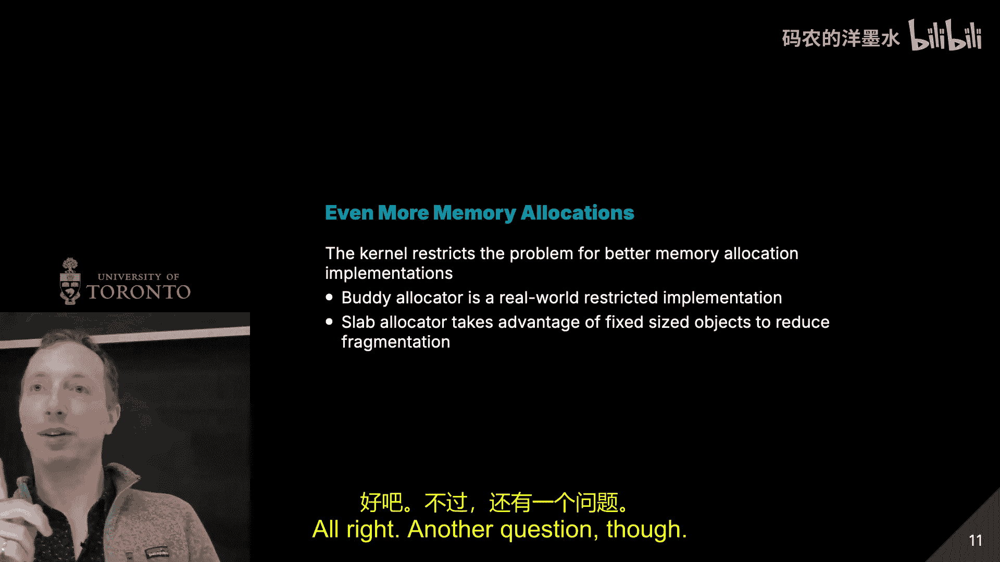

# 【全集】多伦多大学 操作系统 中英字幕 1080P p31 Lecture 31 - 伙伴分配器与Slab分配器 -BV1Rbk7ByERc_p31-

じない。Alrighty， welcome back to operating Systems。So today， second last content you need for the final。

 so this lecture will be short。So。Since this lecture will be short again。

 you can spend the rest of the time work on La 6 that you've all already definitely started， yes。Yes。

Or。And you can fill out the course evaluations。So that would be great because my salary is directly tied to the course evaluations。

 So I would appreciate you filling them out。😊，And。I would like to still be employed。

So fill them out if they're nice， so I'm still employed。If you want me to teach another course again。

 please fill them out because I am also up for review soonishh。 So they are important。

 So please fill them out。 Alright， so with that in mind。

 let's see what record we can do to do this lecture， so。😊。

The important thing for the exam will be the buddy allocator part。

 The slab part has to do with lab 6。 If you've started that， it should look somewhat familiar。

 So what's a buddy allocator。 So we left off。

Talking about dynamic memory allocation， If you were the one unfortunate enough to have to implement malloc or something like malloc。

 well。Just divide memory。 We could bring them into little。

 keep track of a whole bunch of free blocks。 have a link list of all the free blocks。

 Figure out which one we use for an allocation。 That works。 It's general。

 doesn't suffer from any internal fragmentation or anything like that。

 because you always give back memory， the exact size of the request。 So the buddy allocator。

 It restricts the problem a little bit。 Typically。Especially if you're the colon。

 mostly for programming。Allocation requests will be powers of 2 anyways， like 2，4 B，8 B，16 B，32 B。

 maybe the size of a page。 So what the buddy allocator does is restrict allocations to only be powers of two。

 at least internally for a more efficient implementation。

And how this will work is we start off managing a huge block of memory and we'll just split it into blocks of two until we can handle the request and looks a bit recursive。

 And we want to be able to do that because we want to have faster searching and merging。

 We don't want our worst case to be searching every single block in the free list。So。

How we implement this is we have multiple lists。 So if we restrict allocation requests to be。

2 to the K。 So some power of two for0 all the way up to n。

 we can round up the allocation request if needed。 So therefore， our allocation。

 we're going to use a separate free list for each power of two。 And that way。

 we only have to check whether or not there's an element in free list or not because everything will be the exact same size。

 So we need one for every power of two。 So we need n plus one free list， So that's one for each size。

 And then how this works， if you request some memory。 So if they do not request a power of two size。

 we have to round it up， we'll have some internal fragmentation。 But that's okay。In this case。

 we assume a power of two size request， so we'll search the free list for that exact size if there is a block free。

 perfect， it's exactly what they requested。 if it's not， well， we restrict our search a bit。

 We can just search the next power of two size up so we could search for something twice as big。

 see if there's a free thing there。So there's nothing free there， we go up。

 search the next power of two， so on and so forth until we finally find a free block of memory that can hold this request。

If it's way too big， we recursively divide it in half each time until it's the correct size， all the。

Other buddies would be inserted into the free list。 So we'll have an example to see what that means。

 And then for delocs where you give memory back， Well， we can coalesce。

 the whole idea here is we can coalesce two buddies together because they'll be contiguous based off how we split them off so we can coalesce them back together。

And we can recursively do this over and over again until we're finally done。

 And we have the biggest free block we can get。So how this would look like。

Anything with a white background that is not free or anything， so。just for illustrative purposes。

 So I'm assuming my buddy allocator in total is managing 256 B of memory。 So right now。

 I have a fulfilled allocation for red of size 32。 and then a blue of size 64。

 So in order to fulfill this request， what this algorithm had to do was， while， 2，56 is too big。

 So it split up into 228 B blocks and they are buddies of each other。

 But both of them had to get split off into 64 by ones。 Yeah，😊，To being like。So。

 the splits are equal size。 So it's just really easy to coalesce them together， so。Here。

 if you know your buddy is free， you can immediately merge them back together。 And that's why。

 So I can't immediately merge things that aren't buddies。 So like this， if I freed the blue 1。

 I couldn't merge it back together with this one because they're not buddies。

 So I make sure that it's all log n， right， because it's recursive。

 So it's just log n to coalesce things back together and also search。😊，Yeah， so in this case。

 those 228 by blocks they're broken off into 2，64。 Then this 641 is broken off into 2，32s。

 And then I use one of the 32s to fulfill that allocation。 So I have1，32 B block that is free。

 And then I have two，64 B blocks that are free。 and then one is used for the blue request。

 So everyone， okay with that。So this is just where we are。 So now。

 if we have someone request a malloc for 28 B。Well， is 28 a power of 2。No， so in order to do this。

 I'd have to round up， right， What's the next power of 2 from 28。32， right。

 So I'm gonna lose 4 B due to internal fragmentation。 That's fine。 So in this case。

 if I ran up to 32 and I look， do I have a 32 B block free。😊，I do。

 So I would immediately just put the allocation there and mark it as used。 So now。

If another request comes in for size 32， then， well， do I have any 32 B blocks free。No。

 so I have to look up the next level。 So do I have any 64 B blocks free。Yes， so in this case。

 you probably just pick the first one。 So I have to pick this first block， split it into two。

 Then I use one of them for the 32 by allocation。 And then the other one goes back onto the free list。

 yeah。Size may less than 30。室にせ。Yeah。W size memory。The next 28。's allocate 32。

 like we're allocateocating now， so we at first allocate 28， then we allocated 32， but as good as 60。

A block of 64 to 232， so why can't we use both of them？

So we're assuming the allocations come in in order。 So this one came in first， right， So 28 came in。

 I surrendered up to 32， and I just directly used this block。So， then。こさもさ。

So the red one is an allocation before。So I assume someone already used it。

So I can't move it or do anything。 So any of the colored blocks are allocation requests that I can't move。

So I reallocated it。 Yeah， so that's why I had to split this one。

 So I have no 32 by ones free right now。 So I have to pick one to split。

So let's say I split this one。 The allocation comes in here。

 and then I would add a new 32 back onto the free list。 So my free list now has currently 1。

32 by block free，1，64 by block free， so。If I free this blue allocation， what happens。Yeah。

 to emerge form  one big 128。Yeah， so this blue allocation， if it's freed as part of freeing。

 it'd be like， hey， buddy， are you free， And then its buddy is free， so they will。

Merge and become one。Sounds weird。So they become one No， got weirder。

 So theyd merged together and become one free hundred28 B block。

 So this is what it would look like after freeing it。

 And then now I can handle an allocation request of size  hundred and28。 So everyone， okay with that。

Fun。Some variant of asking what happens on an allocation request and。Stuff come on on the final。

 You can do it。 perfect， yeah。That very6 courtwalk。安企。Yeah。

 so if I went here and I split the other one。 So this one was free， and then this one was split。

 So we had a 32 and。Free 32 here， they just can't do it。If a bigger request comes in， not contiguous。

 can't do it。So， that's。I like the way you're thinking。

 It's almost like that's something that's on the exam。See you， you could have written the exam。

 Allright， so everyone okay with the buddy allocator。Sometimes when I make an exam， I talk too much。

 so I should probably just shut up， yeah。三す。とあ。Like130 bys， it wouldn't work。

 even though the 32 is like right next。Yep。Yeah， so in this case， if I ask for know a weird amount。

 like 1，30， you might be like， hey， it's actually contiguous。 I could do it， but the algorithm。

 it would add way too many complications。 It's trying to be as simple。

 If you do that and cross boundaries， you。You've broken all the kind of rules so that can like immediately coalesce it。

 And then it's on a different buddy。 And it gets kind of weird。 So they。

Wouldn't do that to make the algorithm a lot simpler。All right。So buddy allocators。

 they are actually used in the length kernel quite a bit because they have several advantages over the default。

Free list implementation。 So it's fast and pretty simple compared to like the general dynamic memory allocation doesn't have to search the list。

Has multiple lists， but it only has to search is an element there or not。

 Never has to search the entire list。 Wororsse cases， I have to check the list at each level。

 but logarithmic， not that bad。 also avoids external fragmentation。More or less， not completely。

 but mostly by keeping things contiguous as much as it can。

 But the disadvantages is there's going to be some internal fragmentation if the user does not request a power of two。

Because we have to round it up。 if you're the Linux kernel and you're the only one using it while you're probably using powers of two anyway。

 So that's not much of a disadvantage。 So that's why they would use something like that。

The other option is our slab allocators that take advantage of fixed sized allocation。

 So you're allocating things that are all of the same size。What you can do in this case。

 either manually or it might be an optimization in the memory allocator itself is。

 well you can just use a big region of memory for all objects of the same size。

 basically all you need is an array or a bitmap。 if you're doing lab 6 to keep track of whether or not something is allocated。

 since they're all the same size， you treat memory as just a big array and just keep track of whether that array slot is used or not。

 and it's a lot easier。 So this prevents internal fragmentation if everything is the exact same size。

 we don't have to worry about it。So how it works， basically a cache of slots or you can think of it as elements of an array。

 So each allocation has like a slab of slots， that array。 And then instead of a link list。

 we have a bitmap to keep track of whether or not each index is free or allocated。

 So there is a mapping bit0 would correspond to index 0， bit1 would correspond to index 1。

 so on and so forth。 So for allocations。It's really easy。

 You just search the bitm for a single zero bit and then figure out what index that corresponds to。

 set that bit to one to indicate you've used that and return basically a pointer to that element in the array and you're done for de allocationlocs。

 if you want to be quick。 You just clear the bit。 you set the bit from one to 0 and you're done。

And you can implement some the idea of a slab on top of a buddy allocator if you want。

 So how that might work is consider you have two size objects and A and a B。

 where they're always the same size。 Well， if you wanted to in your program。 you might be like， well。

 it's not a power of2。 So maybe I ask the general malloc。

 maybe malloc implemented with a buddy allocator。 I ask it for a big block of memory。

 And I use that big block of memory as a slab。 So I essentially use it as an array to hold the object。

 So each of these little slabs would be from the buddy allocator。 So they would be a power of two。

 And then on top of them， I would have my array of objects that are all the same size。

 So say this is 20。 So maybe I can hold four in here and then have some space for a bitm。

 And maybe I ran out of a space。 I asked for some more memory from a buddy allocator。 so I can。

Another four here。 And then similarly， maybe for B， they fit exactly two on a slab。R box。Oh。

 the red boxes just indicate like an actual allocation。 So that's allocated。Used by the program， and。

Blank ones are free。Yeah。n。Yep。Yeah， yeah， so Slab A2 can store four of a。

 Slab A1 can store four as well， but two are being used by the program right now， so two or free。

 two are allocated。Yeah。Yeah， this little tight portion would be， if it's a really odd shape。

 that would just be unused。 so that would be internal fragmentation， yeah。The add of for So you said。

In this example， a has。I that because no。Object are Alex。こざ。it's because of the bit of space。

 So like， assume。Object A is like a weird size， like 20。So if it was 20。

 every time I asked for memory from the buddy allocator。

 I'd be wasting what 12 bytes every single time， right， because it' would have to round up to 32。

But instead， I could be like， okay， buddy alare， just give me 100 or like 1024 bys。

 and I'll just stick a whole bunch of A's right beside each other。

 And then I can fit way more in is basically the idea behind it。So you can mix and match。

 You can do whatever you want。 So everyone， all right with that。

So there's no coalescing here because you just， it's just a bitmap of things， right。

 So you just flip it。 They're all the same size。 you don't have to coalesce anything。

 So this is also the bitmas。 You'll have them in lab 6 because you have a bitmap for blocks。

 and also a bitmap for i node。 So that iode table is basically like a slab。

 You have a bitmap for the iodes。 in table， which is basically a big array， yeah。もう一人？Yeah。like。前。

For example， another 32 split it and take a part of that。Use like a combination of those splits。le a。

 I give a is like。非常不脱尼。example。 Yeah， no， that would make thing。 I know where you're getting at。

 Like， yeah， I could split it and like have half， but that would make the algorithm way too much。

 way too complicated。So that would break coalescing would get a lot harder then。

 because then you'd have to detect， oh， it was this part of a smaller part of a different block。

 and then you might have to merge two things from two different branches。

 So you could technically do that， but that would make it way more complicated。All right。

 everyone okay with this。Alright， sweet record， so。Even more memory allocation。

 So the kernel restricts the problem for better memory allocation。Implementations。

 you can restrict it by doing powers of two。That would lead to something like the buddy allocator。

 or you could restrict it that you only deal with allocations of the exact same size。

 That means you can use something like a slab allocator， which guess what you're using for lab 6， so。

Continue working on La 6， and I will be around for any questions。

 but we are almost done one more lecture of content and then review， then exam。

 and hopefully we will all do fantastically， yeah。😊，他说没事。To say。Your body other。Yeah。

 so like you could just， even in your own programs。

 you could just mall a whole bunch of memory and then use that memory as a slab if you wanted to。😊。

It's just different ways to combine these techniques。Or you could just have a slab set aside。

The whole idea is you can mix and match if you really wanted to。All right， another question no。

All right。