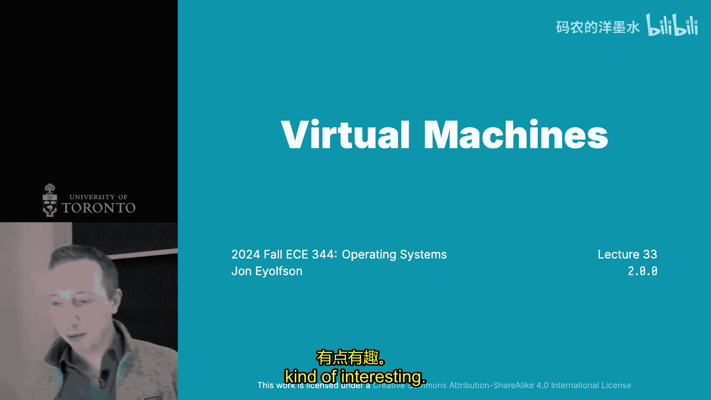
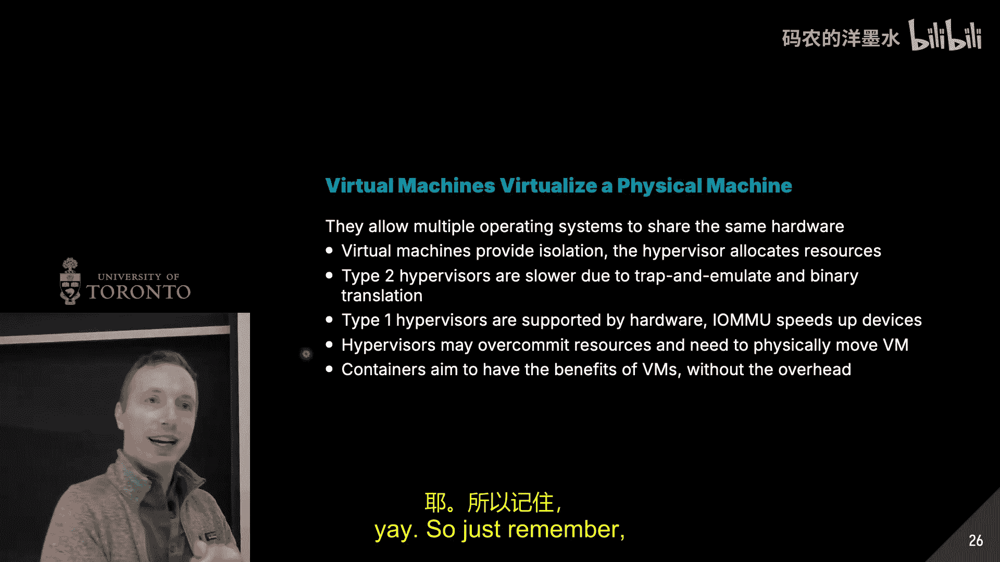

# 【全集】多伦多大学 操作系统 中英字幕 1080P p32 Lecture 32 - 虚拟机 -BV1Rbk7ByERc_p32-

🎼Yeah。All right， welcome back to operating systemss。We have made it to pretty much the end。

 This is the last lecture of content， which you have to know for the exam。 I know you have to。

No content from this lecture from the exam， because， yeah， it's already done。

 I can't change anything about it。 So we get to learn a little bit。

 I'll point out what is super relevant。 This should be kind of review， kind of interesting。

 So we'll try and demystify some virtual machines today。

So they abstract a entire machine， much like a process abstracts a CPU。

 A virtual machine abstracts the entire machine。 So the goal is we run multiple operating systems on a single machine。

 Each operating system believes it is the only thing， actually running。

It's the only thing running on the hardware， it thinks it has control over the entire machine。

 even though there might be multiple operating systems all sharing that machine。

So some terminology we have to go over is there is the idea of the host and that is the software that has direct control over the software so there is a hypervisor or virtual machine manager that controls virtual machine so it controls creating them managing them isolating them what hardware they're able to access and they are two kinds of hypervisors depending on your hardware support there is type1 type1 is also called a bare metal hypervisor that means it runs directly on the host hardware requires some special hardware support so all of the virtual machines you are running are actually running in real kernel mode as opposed to some made up kernel mode so if we want to kind of emulate kernel mode that is a type2 hypervisor or host。

hypervisIt means your virtual machine is actually running in user mode and we are just playing some tricks in order to fool it into thinking that the kernel that's running is actually running in kernel mode。

 so this will be a lot slower but doesn't require any specialized hardware but any hardware that has been made in the last time like 10 years supports virtualization natively and。

Spoiler alert， you've all been running a virtual machine this entire time。 if you knew it or not。

 and if you're using Windows， Windows kind of acts as a hypervisor and MacOS also acts as a hypervisor。

 So a guest guest is that virtual machine that's running a guest sees its own virtual copy of the host。

It can access less。Of the actual hardware than what's present。

 depending on whatever the hypervisor says， or you could just make up and emulate new hardware and just fool it into thinking it has access to hardware that doesn't exist and then you do something with it so typically you can just make up network controllers and give it to them and then figure it something to do with the host network yeah。

I guess that's the virtual machine actually running。

So host is the hypervisor that's what's actually managing the virtual machines。

 Vir machine would be running as a guest。 So it's running in a hypervisor。Alright， so what we know。

 which is， I guess kind of review is the picture on the left here。 So we have hardware。

 all of the software that controls the hardware is in the kernel。It runs in a different CPU mode。

Runs in kernel mode。 There's this programming interface between the kernel and then user processes。

 Quick， What's the name of that interface。System calls yeah。

 the system call interface so we have to make system calls to go from user mode to kernel mode and this is the world we currently all know and love right so if we have virtual machines。

 how it actually looks is well there's your hardware running here and then your hypervisor or virtual machine manager is actually what's controlling the hardware。

😊，Then it creates a whole bunch of virtual machines on top of it to see what hardware each virtual machine can access。

And then each virtual machine has its own kernel， which may or may not run actually in kernel mode。

 depending on if we have a type 1 or type 2 hypervisor and each virtual machine still uses system calls and it runs a whole bunch of processes。

 but here we might be running three different operating systems instead of just one。

 and we can isolate things， we can not give them network access if we don't want。For instance， A1O。

 the official operating system of North Korea。They have their own offering system， correct。

So they have their own operating system。 It's called Redstar O S。

 It does a lot of very interesting things。 So it will like tag files with identifier so they can figure out what came from what。

 So if you want to play around with North Korea's operating system。

 you probably shouldn't install it on your actual computer。

 But if you wanted to play around with it and have fun。

 you could install it on a virtual machine and probably not give that virtual machine Internet access。

 And then you can see what's going on with them。 and no harm， No foul。

 if anything bad happens since it doesn't have access to the Internet。 So fun things you can do。

 or you can create a virtual machine， put on as many viruses you want and see which virus you know。

 comes out supreme at the end。😊，Can do whatever you want。 It's isolated。

 Some other benefits will go over。So another note here， they are not emulation。

 So emulation is usually typically to translate one instruction set architecture or ISA to another。

 So X 86 to arm or risk5 or something like that。Typically， in order for speed。

 that guest operating system executes the instructions directly on the CPU using the same instruction set architecture。

 Otherwise， your virtual machines would be running really slow。 So if any of you have a Mac。

And you're running Docker。 It's actually using a virtual machine。

 That virtual machine will be a arm virtual machine， otherwise， well。

Max can translate x86 to arm and actually do it pretty fast。

 but a little bit inefficient better if it all stays in arm。So emulation， okay， for some use cases。

 like if you're bored during your thesis， you could write an emulator for an Nintendo entertainment system。

 that old 8 bit CPU， not that hard。 I definitely didn't do that as a means of procrastinating or anything like that。

 but emulation not required a virtual machine could use emulation if you want。

 you could on your Mac or an X86 virtual machine if you want your performance will be a little bit worse。

Max because they are magical。 But in general， if you have to emulate something。

 your performance is going to go down quite a bit。So。Cool things that virtual machines enable that。

 Oh， yeah， question previous。 So for the ISA translation， is it the same。我要怕。退丈。

For type 1 and type 2， no， this is different。 So the type 1 and type 2 virtual machine is just how we're running。

 like what mode we are running the virtual machine in。And assuming it's the same instruction set。

This is， if we have to translate in the instruction set， then it's just going to be slow。

 We can do it， but it's a different problem。So could do it So cool things virtual machines enable us to do is well pause and play so。

😊，If we took the analogy of our kernel before， our kernel does process management， right。

 we pick what process to run when we can stop running it， context switch to something else。

Same things apply for the hypervisor and virtual machines。

 the hypervisor picks which virtual machine to run and it can context which virtual machine in or out。

Interestingly， enough， it can actually context the virtual machine across different physical machines if you really wanted to。

 So if you're running a process right， it might be running on one CPU core。

 context switch it when it comes back， it's running a whole different core， you don't really care。

 right。Same thing can happen for virtual machine so you can contact switch out a virtual machine and switch which machine it's running on。

 which makes server management a hell of a lot easier because I can actually reboot a physical system。

That's running a whole bunch of virtual machines without the virtual machines going down by just first move them off that physical machine。

Move them to another computer， update。The actual hypervisor or whatever I need to do， reboot it。

 And then we can context switch the virtual machines back to it after it's all updated。

 So that's why Amazon uses virtual machines。 if you search， if you try and get AWS or whatever。

 It's all virtual machines。 It looks like it stays on forever。

 but it might not actually stay on forever。So。It could move around exactly like a kernel can move around a process。

The also nice thing， especially if you're running Redstar O is they have security and we can provide protection through isolation。

 So like processes are isolated from each other， guests are are isolated from each other。

 So the hypervisor is what's actually controlling the physical hardware the device。

 we could set limits on CPU time， memory for the virtual machines， network bandwidth。

 So if your guest has virus or it's misbehaving or someone compromiser or something。

 it only has access to its own set of virtualized hardware。😊，No harm， no foul。

 you can easily roll it back， detect it， remove it。

 whatever you want to do as the administrator that is running oops。

So they might also help with consolidation too so in data centers。

 you have lots and lots and lots and lots of servers running often they don't make use of all the resources and the workloads might be a bit spiky too some might be busy some might be idle for a lot of time and also servers with different like serving different purposes could be sharing the same hardware So instead of having you a lightly used physical system。

 I can make my database on virtual machine my web server on virtual machine and then initially I can run them all on the same physical machine and then if I need to scale up if I need to buy more machines well I just buy another machine and move one of the virtual machines to run on that physical machine instead。

 I don't really have to change my infrastructure or anything like that or reinstall an operating system。

 I can just throw the virtual machine on different physical machine and。Can scale out a bit better。

So the key abstraction for virtual machines is a virtual CPU。 So for processes。

 part of that process control block acted as like a virtual CPU。

 but didn't virtualize the entire CPU just enough for user mode So just the user mode accessible registers didn't save anything that was only accessible to kernel mode。

 so if I am trying to actually implement a virtual machine。

 I have to in the while I have to simulate the entire CPU。

 including whether or not it's in kernel mode and all of the special registers that only kernel mode can access so they call that a virtual CPU or VC and that stores the entire state of the CPU again including all of the kernel mode information So the hypervisor would save this when the guest isn't running so just like contexting switching a process that saves all。

userr mode registers， this would save literally everything。

 so when the virtual machine resumes like the process control block loads all the data and then resumes。

 it's just more registers， more information。So the guest still uses user and kernel mode。

 so there's no changes to the guest operating system。

 Linux kernel still uses kernel mode instructions that can access the hardware。On X 86。

 way back at the beginning， we talked about。Privilege modes and， you know some of the names。

 So user mode was ring 3 in X 86。 kernelonnal mode is ring 0。

 and X 86 was invented in like 1978 or something like that。

 So virtual machines did not exist as a concept。 So when we need a new privilege mode。

 if we are actually managing kernel mode。 we need something more privileged。 So back in the day，0。

0 is the most privileged。 But， you know， they can't break backwards compatibility。

 They can't change the name once it's there。 So hypervisor mode on X 86 is called ring in negative one。

😊，More privilege than ring 0。 And that is what lets you control the guest。

So if we have a type 2 hypervisor， then it has to create a virtual kernel mode because it doesn't actually exist the host operating systems running in kernel mode and we don't actually have a hypervisor mode。

 so we have to do some tricks to enable typepe 2 hypervisors which will show us why they are much。

 much slower。So one strategy， if you are a type 2 hypervisor。

 is to use something called trap and emulate so。Like if your user process tried to use。

An instruction that's only allowed in kernel mode。 you would get an legal instruction。

 You would probably get a signal and then crash。 Well， instead of that。

 the hypervisor can actually handle that illegal instruction and try to simulate it all in user mode。

 So any privileged instruction， they would generate a trap or an illegal instruction。

Then the hypervisor， which is running in user mode， should handle this error。

 it would emulate or in other words simulate the operation for the guest。

 it would have to create its own copy of all of the registers that should exist in kernel mode。

Update them and then resume it。 This is going to really slow down otherwise native execution because I have to try an instruction。

 let it fail， send a signal to my process， emulate what is supposed to happen in software instead of hardware。

 So this is one reason why typeype 2 hypervisors are slow。Another thing。

 So this is how it would look like visually。So this is your guest operating system。

So it would be have what it thinks is kernel mode and user mode up here。

If the guest thinks it's in kernel mode when it's actually in user mode and tries to use a privilege instruction。

 then it would generate a trap or a signal or an interrupt， whatever you want to call it。

 It would go to the virtual machine manager or the hypervisor in the case of a typeype 2 hypervisor。

 This is running in kernel mode。 This is actually just the kernel。 So you would have to go ahead。

 emulate the action， update that virtual CPU and return back to user mode。

 So that would be quite slow。It also doesn't always work because X 86 was designed before。

Before virtual machines even existed， so for some CPUs。

 there's not clear instructions that just work in kernel mode and work in user mode。On X 86。

 some instructions will just behave differently depending on what CPU mode the CPU is currently in。

 so for existence or for example， on X 86， there is this instruction called pop F which pops a flags register the flags register actually used it depends on whether or not you are in user mode or kernel mode。

 if you're in user mode， it pops the user flags register， if you're in kernel mode。

 it pops the kernel flags register。 So you can't use trap and emulate for this。

 if you ran it in user mode， it would just affect the user mode flags。

If your typepe 2 virtual machine thought it was actually in kernel mode and executed this instruction and assumed it would modify the kernel flags。

 then they wouldn't get modified。 the user ones would get modified instead。

 and it will probably crash because that won't happen。 So what you can do instead of this。

 You could call these special instructions。 They behave differently depending on what mode they're in。

 and we can handle them using a different approach。

So our different approach will be something called binary translation。

 So if the guest virtual CPU is in user mode， just run instructions natively because they both agree if the guest thinks it's in kernel mode。

 then your hypervisor would need to inspect every single instruction before it's executed which is going to be very。

 very slow the special instructions need to be translated to instructions with the same effect so I can have to emulate or simulate what they're actually supposed to do if they're just regular instructions。

 they can run natively but I do have to inspect them and the kernel would use any CPU instructions Well how the kernel actually knows whether or not it is in user mode or kernel mode is well there's an instructions to switch from user mode to kernel mode as long as the hypervisor can handle that using trap and emulate。

 it can actually know what CPU mode we。Supposed to be in。

 So this will cause performance to suffer greatly。 But for some things， they are adequate。

 And this binary translation， everyone's used Valel grandand， right。This is how Valgrind works。

 That's why you don't have to recompile anything。 It will essentially inspect all your instructions。

 Look to see if you're calling malloc。 If you do， it will add some bookkeeping information to make sure you free it and stuff after。

 That's also why Valgrind is like 30 times slower than actually running it without it， yeah。

So it would essentially inspect every single instruction。

 that load or store memory and see what address they go to and see if it's valid。

 if it's one of the things you allocated。And there's tricks it can do to make that faster。

 but it's going be even。All the optimizations they do。 It's still like 30 times slower， but。

It's okay because you get to debug your program， right？Yeah。So why is it。Inspect。

So if the guest is in user mode， so this means the virtual machine， if we're type 2。

 the virtual machine is running purely in user mode， right？

So if it's running purely in user mode and the guest thinks it's in user mode， then they both agree。

 right， it can just run any instructions。It's fine。 If the guest thinks it's in kernel mode。

 then I have to start inspecting every instruction that might behave differently。Y， okay， so。

Here's what it looks like visually again。This time。

 we're just looking at special instructions that behave differently if。We have。

 if the virtual machine is actually in thinks it's in kernel mode。

 then we have to translate everything。Update that virtual CPU。

 which holds all of the kernel mode registers and everything like that。

 simulateulate what it's supposed to do and then return to running the guest operating system。

So how this is done faster is more hardware。 So it was like 2005。 So is that newer than you guys。No。

 okay。 So slightly older than you。 Er sorry， slightly younger than you， but not by much。

 So we had virtualization hardware in 2005 and 2006 for AM M D。

If you go into your motherboard settings。It has a whole bunch of different names。

 but it's basically hypervisor support， so it might be code name Banderpool。

 that was their code name when they developed it， they published it as virtual machine instructions。

 you might see it short into VMX。AMD， they called it Pacificica while they were developing it。

 they published a secure virtual machine， or you might see it called SM&V。

 These all mean the same thing。 It's basically that hypervisor mode。Existing。

 so they just add the concept of negative ring， negative one or hyper mode。So any system nowadays。

 if you are booting Windows or Mac O S， it kind of。Mostly acts in kernel mode， but when it boots up。

 it will actually be in hypervisor mode and claim the hypervisor。

 so it's the only one able to access it and then that's why you can run virtual machines quickly on Windows or Mac。

Yeah。Just the last item confused， what's the difference between that and。把这个。In the whats。

 like being the previous side the demonstration graph I'm just bit confused。

 what's the difference between what we do right now with the？

So this is if we don't have hypervisor mode。So if we don't have hypervisor mode。

 then we have to start inspecting instructions and it's just going to be really slow。

So it up like I guess when we have hypervisor， we just know something that is running in mode。

 Yeah if we have hypervisor mode， our hypervisor controls everything in hypervisor mode and the guest kernels actually execute in kernel mode。

Right now， who is checking if there is like a special operation。That would be the。

Kind of hypervisor that's running in user mode。Yeah。

So the first one is for the one that doesn't have。Take time to。

 so doesn't mean it's usually slow when you。Yeah， type 2 is going to be much slower in kernel mode。

would beあ。Like the。The Windows exam。Yeah， it basically making a Linux？they a hyper politics？Yes。

 yeah， yeah， so everyone's been using Docker， right？Docker is only supported in Linux。

 so it provides isolation， we'll get into that in a little bit but basically it needs Linux。

If you're using Docker desktop， it installed a virtual machine for you。You might have not known it。

 but you are all running， I've tricked you all， you're all running a virtual machine。

So you're running， no matter if you're on Windows or Mac， if you're using Docker。

 you're using a Lax virtual machine。Docker desktop just hides it from you。

But you are using a lengthx virtual machine。 So we'll talk about that more in a second。So。

Some other complications we have， we have virtualized scheduling now if there's only one CPU on a physical machine。

Well， the guest doesn't know it， right， the host could still present multiple virtual machines to the guest if we really wanted it to。

Now we need to map like some virtual machines to physical CPUs or schedule them like processes。

 this is exactly like a normal kernel。The hypervisor will have its own hypervisor threads to maintain control so it can take the CPU away from all of the guests and everything like that。

 Basically， everything translates， We just have to go up a level higher。

So one approach you might want to do that's easy is just CPU assignment。

 So if there's more physical cores on your machine。

 then all of the virtual CPUs across all of the virtual machines。

One easy thing to do might just be to map them one to one。

 The host can continue using the spare cores。 And then if we have to share。

 things get more complicated， that's called overcommiing。 You have more。Virtual resources。

 then physical resources at equal numbers， you could still map one to one。

 the hypervisor threads don't run that often but。If you have more than that。

 then we have to schedule them。 We can use the same scheduling algorithm like we did for processes。

So if we have over commitmentmitment， we can have additional problems。

 so we can actually cause the guests to behave slightly differently。

 So let's assume we had a realtime task Well， even if on actual hardware， it always met the deadline。

 So say it needed to complete a task and like 10 microseconds or something like that。

 if in practice it could always reach that time。 Well， if we put this on a virtual machine。

 it might not take that time because it doesn't actually have control over the hardware。

 So it could start a task， then that virtual machine could get context switched out and then well。

 it can't do anything about that。 and then maybe you know a full second passes before it gets context switch back and it's gonna to miss the deadline。

 So even though and there was nothing it could do from its point of view。

 So it might make processes missed deadlines， they wouldn't have。

If they were running on actual bear metal like the host。So in this case。

 for really high performance applications， maybe you don't want virtualization or you would just assign a core to them。

 so you don't have them get context switch， but you might have some subtle behaviors。

And virtualized memory would get a whole lot more complex。 This is where it gets really fun， right。

 So remember， virtual memory allows each process to think it has the entire address space。 Well。

 now the guest kernel thinks it's managing physical memory。

 but it doesn't see it's not actually managing physical memory， that is also virtual memory。😊。

So only the hypervisor manages physical memory， it would virtualize it for each guest。

 and then each guest thinks that virtual memory is physical memory and virtualizes it for each process。

So we have virtual， virtual memory。Which is even more fun， right。So。In this case。

 this is also why hardware support is necessary because essentially we would have nested page tables。

 right？So the hypervisor would have its own set of page tables。

 and then the guest would have its own set of page tables。 So a guest to translate a。

Virtual address in user mode to a physical address would have to first go through three levels of page tables and then go through three levels of page tables again if once was fun。

 So that would be what like six memory accesses。 So what hypervisor mode will also let you do is it essentially will know that there are nested page tables and essentially。

The TLB will learn to cache the entire translation of going through those nested page tables so that。

 okay， it is a bit slower， but things will be cached and hopefully it will not perform that badly。

of as well for the hack。So hypervisor would do the exact same thing， right？How many virtual machines？

だぶ。So we need three levels of page tables just to do like a 39 bit virtual address， right？

So if we want our virtual machine to have a 39 bit virtual address， we have to do the translations。

Like idea why。なんてあ。Like， why they。Do you seeing that hypervisor is dividing up physical memory？

Two partitions for the。Yeah， because the hypervisor is the only thing that can actually touch physical memory。

Right。So why， why would that happen。So for Colel， right？

We're essentially making sure that a virtual address translates to a physical address， right。

 for our normal thing before this。 Well， now， if we have a virtual machine。

It's translating that virtual address to what it thinks is a physical address， right。

 But the hypervisor has to translate that physical address to an actual physical address。

 So we have two steps there。 Yeah that's the case。 So hypervis always over。Because every computer。

Yeah， so it's been a common thing since like 2005 to have this。

 So one of the reasons why performance isn't that bad is because， well。

 that core actually knows that there's nested page tables and the T LB will cache。

Both of those translations together。 And there's some other things you can do to make it faster。

 But that's the gist of it without going into too much detail。 That's a whole another course。

 That's like the cloud computing course or something like that。That's just the idea of it。Allright。

 so yeah， that would be nested page tables again， like I said。

 the guest thinks it controls physical memory， does page table management。

 but the hypervisor actually controls physical memory。 So like I said， we'd have nested page tables。

If memory is over committedmitted， that's where we get more fun， right。

 because then we'd have page replacement。So then the question is like， okay， well。

 who should do the page replacement， the hypervisor or the guest operating system。Typically。

 the guest might know its memory accesses patterns better。

 so you could just not have paging with the hypervisor and delegate it all to the guest。

 that's probably the most performant one way to go about it。 But again。

 that gets into more complicated stuff。 Let's just not worry about it for now。So。Also， we could。

 essentially， we could do copy on right before， right。

 we could share pages when we had processes that was really easy with fork because as soon as you fork them。

 they're copies of each other。 they're sharing pages that was easy to do。 So guest。

 we could also share pages if they are duplicates， but it is a little bit harder to figure out if pages are duplicates。

 So what the hypervisor can do is it can actually do some duplicate page detection across virtual machines。

 So what it would do is essentially have a hash for every single page。

If two pages have the same hash， that means they could be the same or they could not be the same。

 but it's possible for them to be the same so then they can go ahead， check byte for byte。

 make sure both pages are the same。 if they're the same。

 then they could do that same copy on right thing where they both two version machines can share the exact same page。

 and then it would behave exactly the same as copy on right before。

 can share them until a guest tries to write to it。 then we do copy on right like before。

Other fun things it can do is provide virtualized IO devices so it can multiplex like one device to multiple virtual machines。

 like you can only have one physical network card， but each virtual machine might think it has its own network card and they all physically share that one。

 You could also map one physical device to a virtual device in one VM so that it has exclusive access to the device。

 but the hypervisor is still in the middle translating between them， so that is bad for performance。

 especially if you are trying to give a virtual machine a GPU。Slows things down quite a bit。

 So there's a hardware solution to remove the hypervisor during runtime。

 And that is something called IOMM U。 If you have heard of that before。

 that will basically just make the hypervisor map that device。

Devicice is virtual memory exclusively to the guest。

 and the guest is the only thing that can can physically control that hardware。

 and it has direct access to the hardware。 So now that virtual machine has exclusive access over to the device。

 This allows complex things like GPUs to work at native speeds and VM。

 So even on your Linux box if you want to game on Windows or whatever。 you could create a Windows VM。

 give it a GPU and it runs pretty much at native speed or machine learning or what have you。

So that is one of the newer developments。 So here the device is a special type of virtual。No。

 so the device is like just some hardware that the hypervisor can choose to share with it or not。

 but it still is in the middle of it managing it， right。Yeah。

 so it could just make up a network card right and simulate a network card or do whatever。

So I could say， hey， virtual machine， you have 10 network cards。Have fun。Yeah， so virtual machines。

 a boot from a virtualized disc， so you can think of a disk image as just like the content of a physical disk contains partitions。

 Each partition would have a file system like you're working on in lab6。

Usually it's just one big file， some formats allow you to split it up。

 but the guest kernel sees it as a normal disk， it has four control over and that disk image is basically all you need for a virtual machine。

 makes it easy to move so if you want to move your virtual machine to a different computer。

 just move that disk image and then you boot it up。

And suddenly you kind of like manually context switched it to a different machine。

 So if you use virtual box， there's like O VA files that you download that represents your virtual machine。

 Basically， it's a disk image and then a bunch of guest settings like default settings。

 how much CPU and memory it should have。 but really for virtual machines。

 all you need is a disk image and then you're good to go。

 That's why it's nice to distribute software like that。So speaking of distributing software。

 virtual machines could isolate be used to isolate an application。

 So assume your application uses a dynamic memory or dynamic library back all the way in lecture 3 right and an API change would cause your application to no longer work even more subtle。

 It could change the library's behavior。 and then your program just crashes an unexpected way。

 So maybe a good idea is in practice。 I don't just link to any old dynamic library。

 maybe I freeze my dependency。 I say I'm using this exact version of the library。

 I don't care what you have on your machine。 I want my application to use this。 Well。

 what you could do is you could create a virtual machine for your application with all the libraries it needs and just distribute that。

 tell them to run it and it will be consistent in the same every single time。

 You won't have to worry about what system you're actually running on。

 So that sounds like a good idea right Nothing will be。B。So。This is where containers come in。

 So if I did something like that， well， then let's say my application is really small。

 The kernel is like。I mean， let's say for argument's sake。

 the kernels like a gigabyte and your applications like a few hundred kilobytes。

 well that seems a bit silly to distribute an entire kernel with my application PS this is the important part for the exam Kaf cough。

W you're using containers， I should probably just shut up。Anyways， where was I So yeah。

 so instead of distributing the kernel along with your application。It's like 1 GB kernel。

 few kiloby application。 That seems a bit silly。 Why don't I just reuse that same kernel over and over again。

 Why't I just， Yeah， why don't I just reuse a kernel。

 So that's basically what a container like Docker。Is it aims to have all those benefits of using virtual machines without having to distribute a kernel every single time。

 So the nice things， why it's nice to have a virtual machine is the hypervisor can isolate it。

 set limits on like CPU time， memory， network bandwidth， things like that。 So the idea。😊。

For containers was what about if the kernel supported this directly without virtualization。

 so what if the kernel could isolate a process from the rest of the system， set limits on CPU time。

 memory， all of that stuff， and in the Linux kernel， this actually exists。

 they are called Linux control groups or C groups。So they aim to support hypervisorlike limit for processes。

 they will isolate a process to something called a namespace that can only see a certain part of the file system。

 only have access to so much CPUU， so much memory， you can limit its network accesses and things like that and that is Linux specific system calls。

 so you can set all sorts of other resources like mountpoints like IPC sockets， whatever you want。

 so containers are basically just lighter weight virtual machines。

The only difference is they use a normal kernel， but you would distribute all the files you need to run your application。

 The only difference between a container a virtual machine is you don't distribute a kernel。

 you just use the host Linux kernel and it can get some isolation So like I said。

 if you're using Docker Docker needs the Linux kernel if you're using Mac OS or Windows。

 you are using a Linux virtual machine and you have one Linux virtual machine that's shared between all your containers。

 all your containers use that specific kernel。 Yeah much overhead。I know it's like right。

So if your system is Linux， your overhead is basically zero。If your system is back with windows。

You're running it through a virtual machine， so the virtual machine penalty。Also。

 doctor basically have zero。Yeah， Docker has pretty much zero overhead。 The only overhead is。

 I think Docker desktop by default， the virtual machine doesn't get that main resources。

 I think by default it only gets like two CPUs or something you can set it if you want。

 but that's basically the limit。 but it's on Mac OS or Windows， it is all virtualized。Cool， huh。

 we finally， it took us 12 weeks， but we figured out why are the hell we use Docker， yay。So。

Virtual machines， they virtualize an entire physical machine。

 they allow multiple operating systems to share the same hardware。

 nice things about them provide isolation。 The hypervisor allocates resources and controls the actual physical hardware。

 typeype 2 hypervisors are running in purely in user mode。

 they're going to be a lot slower due to trap and emulate and binary translation needing to take place。

If you have a type1 hypervisor， they're supported by the hardware， there's a actual hypervisor mode。

 and if you want to give a device directly to a virtual machine。

 you can use something like IOMMU to give it a GPU or something like that。

Hypervisors might overcommit on resources。Like CPU or memory。

 we might need to physically move a virtual machine again that gets into more complicated things。

 we won't get into the details and the more important part is why we use containers。

They aim to have all the benefits of a virtual machine without the overhead and having to supply the kernel for each and every application。

Overheads just wasted space right， I anything wasted as we call overhead。

 so I don't want if I have 10 applications， I don't want 10 slightly different versions of the Linuxnx kernel as want to use the same one。

All right。Yep。It the container for you。Yep， yeah， your container。 So if you。Look at the details。

 Docker desktop is running one virtual machine and all your containers are using that virtual machine。

So fun。 Yeah， we just figured out what our computers are doing now。 So with that， we're done content。

 Yay， so just remember， I'm pulling for you。😊。

