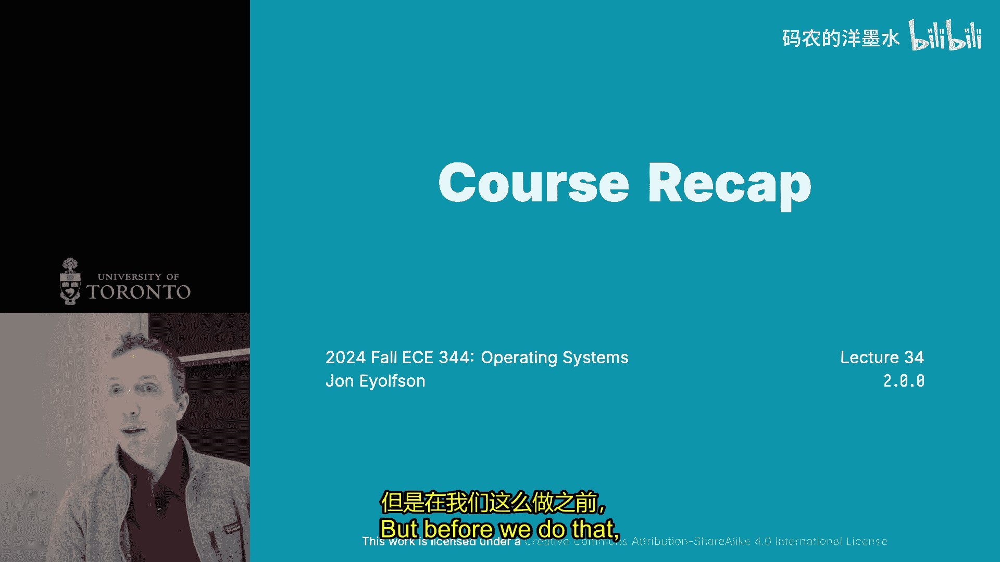
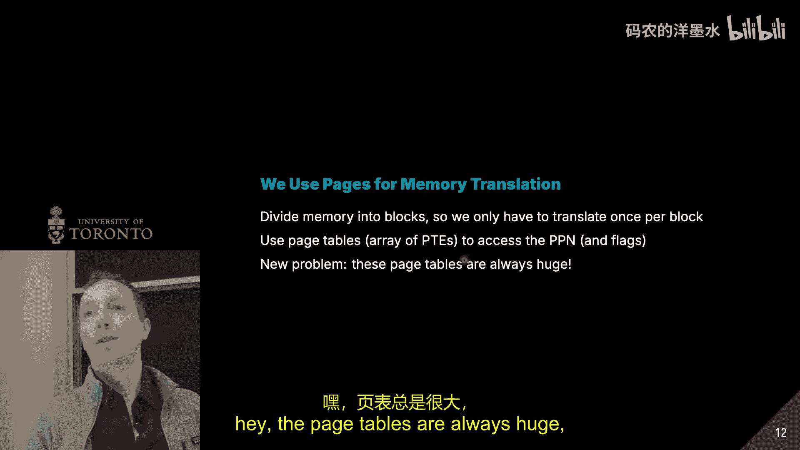
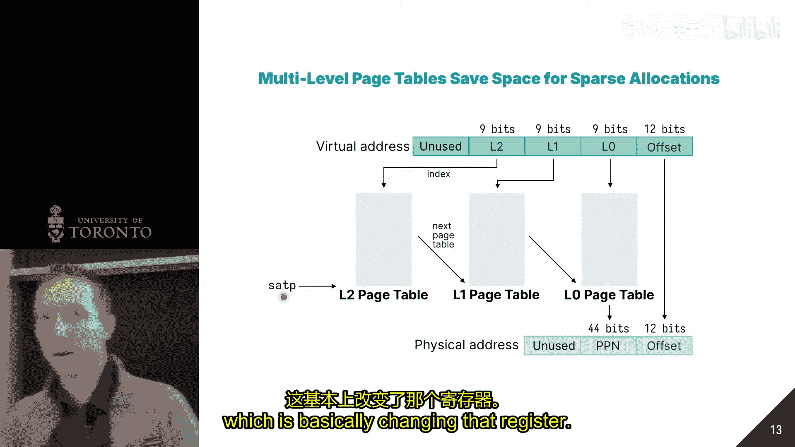

# 【全集】多伦多大学 操作系统 中英字幕 1080P p33 Lecture 33 - 课程回顾 -BV1Rbk7ByERc_p33-

🎼Okay。Alrighty， welcome back to operating System。We're done pretty much。

 So do a quick course recap unless anyone has any questions they want me to solve initially other than that。

 we can start by doing a quick course recap to。Get our review。 juices flowing， I guess。

There's also tons and tons of past exams on my website with solutions on Discord I posted the latest to with that are blank so we can have those they're all loaded up ready to go。

But before we do that， let us do the whirlwind review session。 So started off talking about， hey。

 what's the role of an operating system， It's got to manage resources。

 So the operating system lives somewhere between the hardware， it interacts directly with hardware。

 and it enables applications。 So， the programs you wrote in 105。 they're all running a user mode。

 their applications。

In 243， you did more hardware stuff。 and then in this course。

 you figured out how to tie them together through the use of an operating system。

 So we sit in the middle。 So there's three core offerings concepts we visited during all of our adventure together。

 First one was virtualization。 Share one resource by mimicking it Aka。

 it has multiple independent copies we did that with virtual registers for process or for threads that would virtual memory for processes。

 that with virtual machines for virtual machines。 So we virtualized everything。

 Then we talked about concurrency。 That's where things got real fun for us right？

 So we have to be able to handle multiple things happening at the same time。

We have to make sure things are ordered correctly using center4s or conditioned variables。

 we also want to make sure there's no data races， so two concurrent accesses to the same location with at least one being right is grounds for a data race。

 So we also need to prevent those through things like mutes。 then finally we touched on persistence。

 how to retain data consistency even without power and figured out how our file system was laid out。

 how it maps to iodes， hopefully you're done with labb6 So how directories are represent how we actually store files on disk。

So。Started off talking about CPU modes。 They are actual physical limitations on your CPU that。

Tells you what instructions you can access。I guess all the categories are blanked out here， oops。

 but this is machine mode， so machine mode that is where your bootloader firmware live。

 we didn't really touch on that we just assume we can get booted then there is hypervisor mode living at this level that controls all of the virtual machines then there's supervisoror mode or kernel mode that's where the kernel lives that actually lets us talk to hardware and then there is user mode so that's where applications and libraries live like the standard C library or whatever library you use all running at user mode。

So went over some different architectures for the kernel。

 a monolithic kernel runs all the operating system services in kernel mode。

 So it's called monolithic because anything that even remotely touches the hardware。

 All lives in kernel space。 So the kernel has to do virtual memory management。

 Otherwise we'd have no isolation， No security， bad things would happen。

 have to do some process scheduling to figure out which process gets to run needs to maintain control over the CPU。

 so that has to be in kernel space。 but IPcs in kernel space。

 a little bit of it needs to be there to communicate between process make sure we can't snoop on one each other。

 but file system and device drivers could be in user space， depending on our architecture in Linux。

 which is a monolithic kernel。 they all exist in kernel mode。 So might be bad because more code。

Might lead to more bugs。 And if there's a bug in kernel space and someone takes it over while they're operating kernel space。

 they can do whatever they want， they have your whole computer。 So some kernels。

 the complete opposite architecture of that is a micro kernel that tries to run the minimum amount of services in kernel mode。

 So only virtual memory process scheduling basic IPC running kernel mode and then user space would have more advanced forms of IPC device drivers and file systems。

But generally， things don't do this。One reason is that it is slower because， well。

 in order to even manage doing file system operations。

 you have to cross this user space kernel space boundary， which means a system call。

 which means slow。 So that's one reason to avoid it for performance。

 but you might argue this one has better security， but most things for performance reasons fall more in the monolithic。

Camp。Depending， then we talked about libraries briefly。

 applications could pass through multiple layers of libraries。

We couldn't really define what an operating system is because the operating system is libraries plus kernel needed to run your application。

 different applications have different requirements。

 so what you might define as an operating system depends on what libraries you use。

These three different applications use all different types of libraries。

 they all exist in kernel or user space。Whether or not these libraries are considered part of the operating system depends on your application。

 Firefox would probably use all of them。For example。So then we got on to processes。

 so the operating system creates processes。Has to maintain process control blocks， including state。

 we now know a whole bunch of stuff that lives on the process control block has like a copy of that U context for each thread in it。

 has a root page table for virtual memory， has a local open file table for all of its file descriptors so we learn a whole lot about processes and then also how to create a new process through fork。

 and it was forking fun right probably not， but。And then we argued about， well。

 what would we have to do to create a new process？Well， if we want to run a different program。

 we would have to load that program into memory， reinitialize the process with that context and start running a different application。

 that is when that was that Exec VE system called that's how to run another program。

So then we started our awful terminology。 So we're responsible for managing processes。

 operating system。 There is a strict parent childil relationship between processes for the exam And。

 of course， for life， you should know and identify and how to prevent zombie processes。

 orphan processes and things of that nature Quick。 popop quiz， what is the zombie process。Chd died。

 but。Yeah， it means a process has been terminated but it has not been acknowledged and the knowledge or the acknowledgement is a weight system call。

 so it's terminated but the operating system can't clean up its resources。

 that's why we call it a zombie and then an orphan it is as literal as it sounds， it means。

Some processes parent process has now terminated， it now no longer exists。

 you do not have a parent anymore more so you need a new one， you get reparented， likely to in。

Then we explored basic IPC。Some basic IPC is read and write through file descriptors。

 They could represent regular file， your terminal， a pipe， a socket。Doesn't really matter。

 we just need to know it's something we can read and write bytes from。Then we figured out， hey。

 they're pretty powerful， the standard file descriptors， we can redirect them。

 we can change them to different things。 we can change together programs。 It was kind of neat。

 and then we discussed signals， basically interrupts for user processes。

 That's where we added kill to our vocabulary kill is the system call for basically sending a signal。

 So Colonel has to handle three types of interrupts。

 That's more hardware details you don't really have to know about that。

So then we got into scheduling because we needed a break from all of the weird children running and being able to run in any order。

 so we talked about CPU scheduling， looked at a few different algorithms。First come， first serve。

 the shortest job ones， round Robin， whatever you had you had a question about this on the midterm likelihood of me asking you again is pretty much zero。

 so don't worry about it。Then we got to scheduling， it got even more complex。

 we introduced some priority， introduced priority inversion， talked about things more generally。

 some processes need good interactivity， others maybe you don't care。

 maybe you only care about throughput， then we got into complications about multiprocessors may require per CPU cues。

What real time is， we need to have some type of deadline we meet either in practice or we guarantee it through caning cycles。

 and then we got into the scheduling algorithm the kernel actually uses called the completely fair scheduler that tries some model that ideal fairness of giving each process。

 its equal share of the CPU。Might be a short answer in this， I don't remember。

But we didn't do any long questions about it。Then we got into virtual memory and that was fun。

So we use pages for virtual memory translation because we didn't want to translate every single address at once。

 that would be really really inefficient。 So we divided memory into blocks。

 we called them pages they were likely4 kilobytes that's generally what they are in systems。

 but for questions I can ask you they any size and since we divide them into these pages。

 we only have to translate once per page So we used page tables。

 which was an array of page table entries， Each page table entry stored a PPPN。

 So what VPN the PPPN actually points to and the page table entry also had flags at minimum it would have to have at least a valid flag。

So we had this new problem where we argued about hey， the page tables are always huge。

 just one big table for every process not going to work。

 and then we got to everyone's favorite topic which was multilevel page tables。

So。The entire idea for multilevel page tables is we're going to split them up into different levels。

 make sure that each smaller page table fits exactly on the page。

 simplifies a lot of things for us because our kernel can just operate on pages。

 some pages might be used for data some pages might be used for page tables and in order for。

U to translate it an address on a 32 bit virtual address system。

 we would need three levels of page tables。 we figured out we had the fund calculation to figure out how many page table entries we can store on each page table that told us how many number of index bos we needed for each level and then we just divided the address we'd never have to translate the offset and then we figured out how many levels we need in this case we have three。

In order to use it for our process， we need to be told where the route page table is。

 so what page it's on that would be in like an SATP register if we're actually doing the translations。

And then to do the translations， right， we'd have to follow the levels based off the virtual address that would tell us what entry in the L2 page table to pick。

That entry would tell us what L1 page table to use， then we find the entry from the L1 index。

 figure out the entry， point us to this， then finally， whenever we hit L0。

 that gives us our final mapping， figures out where this VPN actually maps to。Yeah。

SATP was basically the root page table register， so that's what the MMU is going to use to actually start the translation off。

Yeah。Yeah， yeah， so it holds the physical page table or physical page number of the route page table。

 the highest level one， which would be L2 yeah。Yeah， so each。

Each process would have its own route page table and then as part of context switching right it would have to change that register to point to it so that's like exactly what you did for lab3。

 you return me a new route page table and then to simulate context switching I just changed the route page table to that which is basically changing that register。

All right。So wrapped up page tables， translate a virtual page to a physical page or addresses if you use the offsets。

 so the MMU is the hardware that uses those page tables。

 which could be a single large page table but that's really really really wasteful。

 if you only have a 16 bit address then probably it's fine。The kernel simplifies the kernel。

 kernel just cares about allocating pages。 It could just do it from a free list of pages。

 Doest have to worry about any fragmentation or anything like that。 All pages are equally。

A the same size we don't really care what they're used for and then we' talked about multilevel page tables to save space for sparse allocations because most programs do not use 512 gigs of memory and need that many translations Then we were like hey。

 that's slow to translate every address like that so we talked about the TLB or translation lookaide buffer which is basically just cache for caching all of those lookups so I don't have to do those lookups over and over and over again。

So then we had a brief detour， we explored a question using priority scheduling。

 we also looked like MMAP， not covered on the exam don't worry about that was just for fun。

 my sick idea of fun， so then we talked about threads and then life got complicated again so threads enabled concurrency。

We related them initially to processes， they are just lighter weight， they share memory by default。

 the only thing that's independent for a thread are its registers and it stack it stack lives in virtual memory so you can give pointers to other thread stack that is generally a very。

 very poor idea and you will have probably very， very undefined behavior。

 so you shouldn't do that so we should treat our stacks as being independent。

Then while threads do not have a parent child relationship with each other。

 threads just live within a process， so a process can have multiple threads。 Initially。

 it just has one at the start。 but you can create others after that。

 if you fork that new fork process will be。A new process。

 only running one thread that's a copy of whoever called fork。 So that's basically how they work。

 If a process dies， all the other threads die because they live within a process they don't execute anymore。

There's no such thing as orphan threads because they live within a process。

There's no parent child relationship between threads。One thread， you can join on any other thread。

 as you have probably noted in La 4， You could create a thread。

 threadread 1 joints on the main thread。 That's fine。By default threads are joinable， so there is。

The concept of a zombie thread， so if a thread terminates and you don't join on it。

 it's technically a zombie thread because you haven't joined on it。

 you haven't cleaned up its resources， so they need to be acknowledged unless they are detachable threads in which case。

 as soon as they terminate， they release all their resources。So。

Both processes and kernel threads enable parallelization， we have multiple cores on our machine。

 we want them to run in parallel not just concurrently。

 so each process can have multiple kernel threads， P threads by default are kernel threads so each P thread maps to one kernel thread。

There's a whole bunch of different ways to map them， most implementations are either one to one。

 so one user thread to one kernel thread that's Pth or many to one， which was your lab4。

 which is pure user thread so that means all of your user threads mapped to a single kernel thread the kernel only knows about that one thread you are just concurrently switching what code that thread executes。

For real programs， the operating system has has to manage what happens during a fork or signals。

 And that was， again， if you fork new process gets created with only one thread。

 that's a copy of whoever called fork for signals， we didn't argue about because the rule。 I mean。

 it's not complicated rule， but it's complicated to handle。

 If you have8 threads running in your process。 and your process gets set in a signal。

 A random thread handles that signal。 You don't get to pick which one。 It's random。Then we argued。

 hey， now we have synchronization issues， even with concurrency， especially with perism。

 we can have data races where we started off showing that count where it was inconsistent with what we have with a single threaded application。

So we took a deep detour also on sockets and U context， you don't have to know sockets for the exam。

 we give you all the functions you need to know， don't give you that they're just IPC U contextex。

 however， is fair game since you used it on La4， so it's basically threads。

It's the state of the user registers。 You should have had some experience doing that。

 The question would not be terribly long for that， if it does exist。So。Next one。

 we got into how to prevent a data race。 We argued， hey。

 we need to have critical sections in our program to prevent a data race。Data race， again。

 two concurrent accesses to the same memory location with at least one being a right means I'm ripe for a data race。

 which means I might get an old stale value that is no longer valid。

 So we first talked about mut textes or spin locks or the most straightforward lock。

 they ensure that only one thread can be executing code between a lock and unlock call at once。

 that's called a critical section Sincely one thread can be doing that at a time。

 we don't have any data races because only one thing can access that concurrently。

If we have to implement it ourselvesself because we have a little embedded system or we're writing an operating system or something。

 we need some hardware support to implement locks， so we need to do that compare and fetch or exchange。

 whatever that was called the compare and exchange。

 so we need to do things like that to implement locks。Those are atomic operations。

 So hardware level data that all happen， or they don't。They're used for using locks。

 but in future courses， you might use those atomic operations to help your programs run faster。

 spoililer alert for，4，54。 if you do end up taking that。 so they will come up later as well。So。

We also need some kernel support if we want to implement locks that are fair and don't waste resources and don't spin。

 so we need kernel support for putting threads to sleep。

 making sure they block and then waking them back up so we have a mechanism to unblock them Also we argued that hey for performance reasons。

 maybe we have a lot of readers。And writes only happen sometimes。

 so we ideally want to have lots of readers all go in parallel and only one writer to happen at once。

 then you should use something like a read writeite lock which will allow things like that。

 It's just Pth RW lock。So then we argued about order that was only to prevent data races。

Having only one thread executing at a time。 And we were like， hey， what about if we want to order。

 have some type of order between threads because initially they're running concurrently or in parallel。

 We don't know which one's going to run next。 It's a wild West。Can't make any guarantees。

 So in order to make sure things happen in order that is way too many orders。

 we have to use center4s to do that。 So center4s are basically just a number。

 an unsigned int or just a whole number。So they contain an initial value。

 you choose when you initialize them， they have two atomic operations。

 you can increment it using an operation called post。

 or you can decrement it using an operation called weight and the only hitch here is that if the current value of the center for is0。

It will the thread will block until that value becomes greater than 0， so it can decrement it。

 So that number will never go negative。 So that is the only。Extra thing。

They do not prevent data races， you need to also prevent data races， so typically for ordering。

 you use center4s for preventing data races， use Mu Texas。Then we got to more， oh， yeah。

So there's different implementations for a center4， so if you do post it。

 you kind of know that only one that's currently asleep will wake up。

 so like Mutex is a good fair one， they'd be in line and just wake up one。

But it depends on the implementation， but for us， we can assume it's fair and we just wake up one。

But of course， there's different implementations with different trade offs。

 which makes our life fun as engineers。All right。Then we got into more advanced locking。

 so we have another tool to ensure order they were conditioned variables。

Much clearer for more complex conditions。 So if your condition depends on just an int。

Or just a certain number of things， centphos are good， if it's more complicated。

 then condition variables are good。Condition variables are basically just a cu that you can manage so you can wait if。

They have to be tied with a mutex， so if you check a condition and it's false。

 you can wait that will put yourself in a queue and block you and then well if another thread like does something so that condition is now true。

 it can now signal you， which will wake up exactly one thread on that cu， wake it up。

 it can reacquire that muex and try again。This is where it had that wall loop。

 so it has to keep checking that condition because we don't know whether or not that condition got changed out from under us before we acquired that lock。

Then we also talked about locking granularity。While we're essentially making our code serial。

 so that's really slow in order to get good performance。

Maybe we have parts that don't data with each other， so we have multiple mu texts。

 and if we have multiple mu texts。Well， if we try to acquire two at the same time。

 we might deadlock ourselves， which means one is waiting for a lock held by another thread。

 and that thread is waiting for a lock held by that original thread。 So do we have a thing here。

 So there were four conditions for deadlocking Two of them。

 we can't do anything about mutual exclusion， which means only one thread can be running at the time for Mu Texasex。

 That's the whole point can't do anything about that。Other one was preemptions。

 so I can't just take a locked lock away from you that doesn't happen with default Mu Texasex。

If you have it， you have it until you unlock it。 so I can't do anything about that。

 the only two I can do anything about is the first one being hold and weight。

So I have to have a muex while trying to acquire another one if I break that then I won't have a deadlock that's where we used our if we lock the mutex we try and lock another one that's where we tried it if we tried it we didn't get it we gave up the original logt a Muex so we didn't have hold and wait so we always just yielded when we held nothing and then the other way to break it is a circular dependency so if we always acquire locks in the exact same order in some specified order we'll never have a circular dependency so we won't have a deadlock so that's generally the easiest way to do them always acquire them in the same order。

All right， then we went to disk， we explored two topics， SSDs and RA， SSDs are more like RAM。

 except access through pages and blocks， had that weird thing where you could only write to a freshly erased page and you could only erase blocks in。

You could only erase pages in blocks at a time so those were weird rules。

 all you have to really know is those weird rules probably won't probably at best would be a short answer。

 might have to work with the OS for best performance like trim to tell the SSD hey what pages am I currently not using anymore so it can go ahead and erase stuff while it's otherwise idle？

Then we talked about raid。How to combine multiple hard disk our machine in different configurations with a tradeoff of tolerating failures and improving performance using multiple disks。

 So there's raid 0， which was I don't care striping go fast。 So more points of failure。

 but my performance。Is very， very good。 If I have five disk， I get five times of performance。

 but I have five points of failure。Opposite that was raid1。 So raid 1。

 everything is exact copy of each other。 So as long as one disk survives， I have an exact。

 I don't lose any data， then the next ones that are used were raid 5， so Ra 5 had a disk。

Devoted for parity calculations， so if one disc died I could always recover。

 then Ra6 essentially has two disk for parity， so if two disc dies I can always recover。

Might take a while， but I can always recover， and the parity will always be distributed for performance reasons。

 Then we talked about， hey， we could also combine things like raid。Rade 10。

 which is raid 1 plus zero。Not that big of a topic， so don't worry too much about it。

 but good things to know， especially if you care about your files and you actually want to do that。

So。Then we talked about file systems， how they enable persistent。

 describe how files are stored on disk。EpiI wise， we can open files。

 change the position to read and write at， talked about the global open file table。

 what file descriptors actually point to， so each process has a local open file table。

 those are basically just。The file descriptors are an index into this table。

 all the entries point to a global entry， so that's why if you fork， the position would be shared。

 so weird things might happen。Then for file systems and storing files。

 we argued to store which blocks they on， we could do it contiguously， which is bad。

 not going to be used linked so just make it a linked list of blocks。 you're like， hey yeah。

 sure that would work， but we'd have some performance issues with that。 then fat same idea。

 it's just a linked list but all of the pointers are in a giant array so they're all right beside each other instead of on separate blocks。

 So we'd get better performance in the last one was like an array。Yeah。

 so when we learning about these allegations。We're the same guy here at all。まあ一際。哦。

Well what's the difference between block？是。我さ。So here。You talk about technically。

 I should be saying IO block， what IO blocks it's on。

 typicallyy IO blocks are the same size as a page， So you might just say page just because it's all the same size and same idea anyways。

But yeah， so you might slip up， usually they're called blocks。

 but most of the time the blocks are the same size of the page。We don't have that many terms。

 Lots of things are called blocks。 Lots of things are called pages。

 So kind of depends on the context。All right， then we talked about iodes。

 some of you are still having fun with iOs in lab6， that's a hybrid allocation strategy。

They have greater flexibility over contiguous link fat or indexed。 It's basically indexed。

 but multiple levels， depending on how big that file is。 so some。Entries point directly to blocks。

 Then we'd stole an idea essentially from multilevel page tables for bigger files we can have it point to a single indirect block for bigger ones。

 we can point to a double indirect for huge ones， we can point to triple indirect block。

 and that supports a gigantic file on UniX， everything is a file。

 Na in directory can either be hard or soft link so。The file names， all they are directory entries。

 name to iode for hard links， and then。Essentially。Name to name for soft length。

 but that name is going to be stored on in。 So there's a little bit of。

Details there that you're going in with labb 6。Oh right， then we got into page placement。

 wasn't that fun？So page replacement。I think that was our first half hour lecture， right？

So first half hour lecture， we did optimal as good for comparison but not realistic。

 that was assuming all pages are on disk and we're trying to figure out which ones should go into memory and then if memorys full。

 which ones to kick out back to disc。To make the illusion that we can use more memory than we physically have。

 the optimal algorithm looked ahead， predicted the future and replaced the page that isn't used in the longest whole page。

Replacement algorithm aims to reduce the number of page faults。It's good optimal。

 it's good for comparison， but we can't always go into the future。

did random actually worked surprisingly well in practice because it's not as bad as FIO。

 FIO first in first out， it's easy to implement but had that weird anomaly where we had less pages or less memory and we had fewer page faults which doesn't make any sense。

 so that anomaly only exist for FIO， other algorithms don't have that。We also said， hey。

 LRU would be a good thing to implement that is looking at the past。

Not using or replacing the block that hasn't been used in the longest time， it gets close to optimal。

 but it's expensive to implement because well it has to scan every single block or do a whole bunch of operations during accesses which is what we want to avoid so we did the clock algorithm which was basically an approximation of LRU。

You should practice this。 This is definitely going to be on the exam。

 I think I've told you about it like 1 thousand times。 So this should be of no surprise。

 So do these steps。 I won't even talk about them。 You， You know what to do， Allright。

Then we talked about kernel allocations， so some memory allocation algorithms。

 so concept are the same for user space memory allocation if you have to implement malloc or free。

Colonel just。Essentially just gives the standard C library a whole bunch of memory called the Heap and Maloc and Free manage that heap for you。

In your C program， there's static and dynamic allocation， static ones。

 they're all done when your program loads， don't have to worry about it， four dynamic allocations。

 fragmentation is a big concern。If you don't know the lifetimes， you don't know the size and。

Things of that nature。 So dynamic allocation returned flocks of memory。

Fragmentation is basically wasted space。Any wasted space between blocks is external fragmentation。

 any wasted space within a block that the memory manager is dealing with is called internal fragmentation。

 And first， we had a general allocation strategy which just gave users the exact size block that they requested。

 So there was no internal fragmentation。 There was only external。

 And we saw three general allocation strategies， worst fit。Best fit。And first fit。

 but we probably wouldn't implement any of those。 so we saw some more allocation in the next lecture。

 we saw the buddy allocator that restricted it to powers of two。

 So there's a linked list for each individual level。Every time we。Do an allocation。 If it's too big。

 we split into powers of two， one and it's bodydy in order to reason why we do that。

 so it's easy to merge them back together。 It's basically log n， which is nice and fast。

And then if we have all same size allocations， we have the slab allocator。

 which is basically just an array and a bitmap to keep track of what is allocated and what is not。

 and again， you're doing that in lab 6。Then we wrapped up with virtual machines。

 so virtual machines again， I did that last lecture， but quick recap。

 virtualize the entire physical machine， multiple operating systems all share the same hardware。

Provide isolation， hypervisor is a thing that controls everything。 Type 2 hypervisors are slow。

 They run in user mode， type1 or fast hardware support， hypervisor mode， which we all have。

Could overcommit on resources， might need to physically move the VM more complicated things。

 but things you know they should be able to do What you should really know is why we use containers because they have all the benefits of virtual machines without the overhead we're all sharing the same kernel good way to distribute applications that are always run consistently and you've been using containers for the entire semester so should know what they are all right。

W， that's the entire course， so let me know and Discord what you want to review in our next last and final lecture which will just be review so again。

You can on my website， there are exams with solutions， CS S111 from UCLA， valid， same course。

 essentially EC 350。Three same course should be valid in Discord announcements I posted two blank ones。

 I will have them on my iPad for the next lecture， please use Discord tell me which ones you want me to go over or just the next lecture。

 just shout at me to go over them， we'll review it， we'll have fun， we'll laugh， we'll cry whatever。

