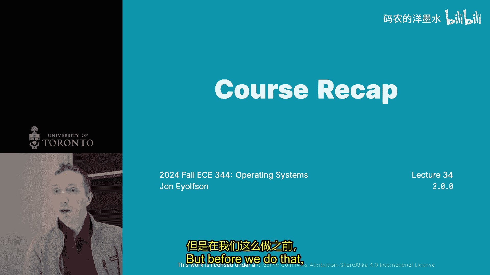
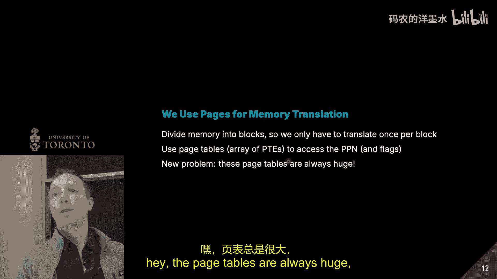
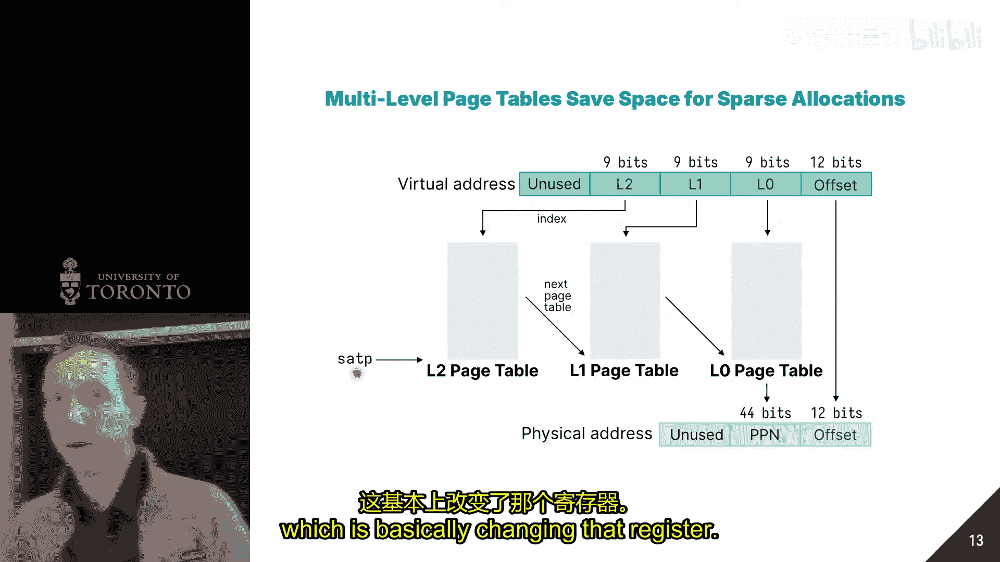

# 操作系统课程回顾：33：课程总览

在本节课中，我们将对整个操作系统课程的核心概念进行一次全面的回顾。我们将梳理从操作系统基础角色到高级主题如虚拟化、并发、持久性等所有关键知识点。

## 概述

操作系统位于硬件与应用程序之间，负责管理资源。它直接与硬件交互，并为用户程序（如CSC105中编写的程序）提供运行环境。本课程的核心围绕三个概念展开：**虚拟化**、**并发**和**持久性**。

## 操作系统角色与架构

上一节我们概述了操作系统的定位，本节中我们来看看其具体的架构模式。

操作系统需要管理资源。它运行在硬件之上，并为应用程序提供服务。应用程序运行在**用户模式**下。

CPU具有不同的运行模式，这些模式是CPU的物理限制，决定了可以执行哪些指令。主要模式包括：
*   **机器模式**：引导加载程序和固件所在之处。
*   **管理程序模式**：控制所有虚拟机。
*   **监管者模式/内核模式**：操作系统内核运行之处，可直接与硬件对话。
*   **用户模式**：应用程序和库（如标准C库）运行之处。

关于内核架构，主要有两种设计：
*   **单体内核**：所有操作系统服务都在内核模式下运行。Linux即采用此架构。优点是性能高，缺点是内核代码庞大，可能包含更多漏洞。
*   **微内核**：仅将最少的服务（如虚拟内存、进程调度、基本IPC）运行在内核模式，其他服务（如设备驱动、文件系统）运行在用户空间。优点是安全性可能更好，缺点是因频繁跨越用户/内核边界而导致性能较低。

应用程序可能通过多层库与系统交互。操作系统的定义取决于应用程序使用了哪些库，因为“操作系统”是运行应用程序所需的内核与库的集合。

## 进程管理

在了解了操作系统的整体架构后，我们进入其核心管理对象之一：进程。

操作系统创建并管理进程。每个进程都有一个**进程控制块**，其中保存其状态信息。PCB包含每个线程的`ucontext`副本、用于虚拟内存的根页表、以及记录其所有文件描述符的本地打开文件表。

创建新进程通过`fork()`系统调用实现。若要运行一个不同的程序，则需要使用`execve()`系统调用，它将新程序加载到内存，并重新初始化进程上下文。

进程间存在严格的父子关系。需要了解并防止以下情况：
*   **僵尸进程**：进程已终止，但未被父进程通过`wait()`系统调用回收（确认），导致系统无法清理其资源。
*   **孤儿进程**：父进程已终止的子进程，它会被重新指定父进程（通常是`init`进程）。

进程间通信的基础方式是通过文件描述符进行读写，无论其代表的是普通文件、终端、管道还是套接字。标准文件描述符可以被重定向和连接。此外，**信号**是发送给用户进程的软件中断，`kill()`是发送信号的系统调用。

## CPU调度

操作系统需要决定哪个进程可以使用CPU，这就是调度。

我们探讨了几种CPU调度算法：
*   **先来先服务**
*   **最短作业优先**
*   **轮转调度**

随后讨论了更复杂的调度需求，如引入优先级、处理优先级反转、区分交互式进程和批处理进程的需求。在多处理器系统中，可能需要每个CPU都有自己的队列。**实时调度**需要满足截止时间。Linux内核实际使用的调度算法是**完全公平调度器**，它试图给每个进程公平的CPU时间份额。

## 虚拟内存

为了让每个进程都拥有独立的地址空间，我们引入了虚拟内存。

我们使用**页**来进行虚拟地址到物理地址的转换，以避免逐个地址翻译的低效。页的大小通常为4KB。翻译通过**页表**完成，页表是**页表项**的数组。每个PTE存储一个物理页号以及一些标志位（至少包含有效位）。

单一的页表非常庞大。为了解决这个问题，我们使用了**多级页表**。其核心思想是将页表分割成多个层级，确保每个较小的页表恰好能放入一个物理页中。

例如，对于一个32位虚拟地址系统，我们可能需要三级页表。通过计算每页能存放的PTE数量，可以确定每个层级需要的索引位数。地址被相应划分，偏移量部分不需要翻译。

`SATP`寄存器（或类似寄存器）存储**根页表**的物理页号。在上下文切换时，需要更新该寄存器以指向新进程的根页表。

**内存管理单元**是使用页表进行地址翻译的硬件。为了加速翻译过程，CPU使用**转译后备缓冲器**，它是页表项的缓存。

## 线程与并发

虚拟内存提供了空间隔离，而线程则引入了执行流的并发。

线程是轻量级的执行流，默认共享同一进程的内存空间。每个线程独立的部分主要是其寄存器和栈。线程间没有父子关系，它们都存在于一个进程内。进程终止，其所有线程也会终止。

默认情况下，线程是**可连接的**。如果一个线程终止而未被其他线程`join`，它就会成为**僵尸线程**，其资源未被清理。可以创建**可分离的线程**，这种线程终止时会自动释放资源。

线程可以在多个CPU核心上并行执行。用户线程（如Pthreads）到内核线程的映射主要有两种模型：
*   **一对一模型**：一个用户线程对应一个内核线程。
*   **多对一模型**：多个用户线程对应一个内核线程（纯用户级线程），由用户空间库在单个内核线程上切换执行。

`fork()`时，新进程只包含调用`fork()`的那个线程的副本。处理信号时，信号会被随机传递给进程中的某个线程。

## 同步

当多个线程并发执行时，我们需要同步机制来避免问题。

**数据竞争**是指：两个或更多线程并发访问同一内存位置，且至少有一个是写操作。这可能导致读取到过期、不一致的数据。

为了防止数据竞争，我们引入了**临界区**的概念。**互斥锁**能确保同一时间只有一个线程执行临界区内的代码。实现锁需要硬件支持**原子操作**，如**比较并交换**。为了实现公平且不浪费CPU资源的锁（即阻塞而非忙等待），还需要内核支持来将线程放入睡眠队列并唤醒它们。

对于读多写少的场景，可以使用**读写锁**，它允许多个读者同时进入，但只允许一个写者。

有时我们需要控制线程的执行顺序，而不仅仅是互斥。**信号量**是一个用于同步的整数值，支持两个原子操作：
*   `post()`：增加信号量的值。
*   `wait()`：减少信号量的值。如果值已为0，则调用线程会阻塞，直到值大于0。

信号量本身不防止数据竞争，它只用于控制顺序。防止数据竞争仍需互斥锁。

对于更复杂的条件同步，我们使用**条件变量**。条件变量总是与一个互斥锁结合使用。线程在检查条件不满足时调用`cond_wait()`，这会释放锁并将线程放入等待队列。当另一个线程改变了条件并调用`cond_signal()`时，会唤醒一个等待线程，该线程将重新获取锁并再次检查条件（通常使用`while`循环）。

使用多个锁时可能发生**死锁**。死锁的四个必要条件是：互斥、持有并等待、不可抢占、循环等待。我们可以通过破坏“持有并等待”（例如使用`trylock`）或“循环等待”（例如规定严格的锁获取顺序）来预防死锁。

## 持久性：磁盘与文件系统

接下来，我们探讨操作系统如何实现数据的持久化存储。

我们讨论了两种存储设备：
*   **固态硬盘**：像RAM一样按页访问，但写入前需擦除，且擦除以块为单位。`TRIM`命令可帮助SSD进行垃圾回收。
*   **硬盘与RAID**：RAID通过组合多个磁盘来提高性能或可靠性。
    *   **RAID 0**：条带化，速度快，无冗余。
    *   **RAID 1**：镜像，完全冗余，可靠性高。
    *   **RAID 5**：带分布式奇偶校验的条带化，允许一块磁盘故障。
    *   **RAID 6**：带双重分布式奇偶校验，允许两块磁盘故障。

**文件系统**在磁盘上组织文件。进程通过**文件描述符**操作文件。每个进程有**本地打开文件表**，文件描述符是其索引。表项指向**全局打开文件表**中的条目，这解释了为何`fork()`后父子进程可能共享文件偏移量。

文件在磁盘上的存储分配方式有：
*   **连续分配**：性能好，但容易产生外部碎片。
*   **链接分配**：每个数据块包含指向下一块的指针。
*   **FAT**：类似链接分配，但所有指针集中存放在文件分配表中。
*   **索引分配**：使用索引块来记录文件的所有数据块位置。

Unix文件系统（如EXT系列）使用**索引节点**来管理文件。inode是一种混合索引结构，包含：
*   直接指向数据块的指针。
*   指向一级间接索引块的指针。
*   指向二级间接索引块的指针。
*   指向三级间接索引块的指针。

这种设计支持存储大小差异极大的文件。目录是一种特殊文件，包含从文件名到inode号的映射。链接分为：
*   **硬链接**：多个目录条目指向同一个inode。
*   **软链接**：一个特殊文件，其内容是指向另一个文件路径的字符串。

## 页面置换与内存分配

当物理内存不足时，操作系统需要决定将哪些页面换出到磁盘。

**页面置换算法**的目标是减少页错误的发生。
*   **最优算法**：置换未来最长时间不被访问的页面。作为理论比较基准，无法实际实现。
*   **随机算法**：随机选择页面置换。实践中表现尚可。
*   **FIFO算法**：置换最先进入内存的页面。存在Belady异常（增加内存页框数可能导致更多页错误）。
*   **LRU算法**：置换最近最久未使用的页面。接近最优，但实现开销大。
*   **时钟算法**：LRU的近似实现，使用一个引用位，性能与开销折中。

内核也需要管理自身内存的分配。动态内存分配中的**碎片**是一个主要问题：
*   **外部碎片**：分配块之间的空闲空间碎片。
*   **内部碎片**：分配块内部未被利用的空间。

我们学习了几种分配策略：
*   **通用分配策略**：如首次适应、最佳适应、最差适应。
*   **伙伴系统**：只分配大小为2的幂次方的块，易于合并碎片。
*   **slab分配器**：用于分配大量相同大小的对象，使用位图管理空闲对象。

## 虚拟化

最后，我们探讨了如何虚拟化整个计算机系统。

**虚拟机**虚拟化了整个物理机器，允许多个操作系统共享硬件，并提供隔离。**管理程序**负责控制所有VM。
*   **类型2管理程序**：运行在宿主机操作系统之上，性能较低。
*   **类型1管理程序**：直接运行在硬件上，性能更高。

与虚拟机相比，**容器**提供了类似的隔离性和一致性，但开销更小，因为它们共享宿主机的操作系统内核。

## 总结

本节课中，我们一起回顾了操作系统课程的完整知识体系。我们从操作系统的核心角色与架构出发，深入探讨了**进程管理**、**CPU调度**、**虚拟内存**、**线程与并发控制**、**同步机制**、**持久化存储**以及**虚拟化**等关键主题。希望这次总览能帮助你串联起各个知识点，为理解和应用操作系统原理打下坚实的基础。