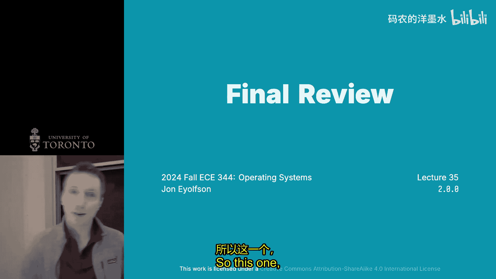
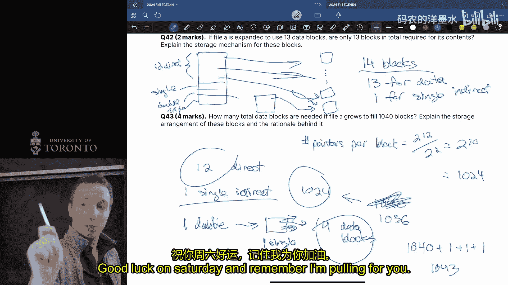

# 【全集】多伦多大学 操作系统 中英字幕 1080P p34 Lecture 34 - 期末复习 -BV1Rbk7ByERc_p34-

那我看。Allrighty， welcome back to offering systems for the last and final time。

This one， it's all just review。So。Before I start just so you know， your final。

Your functions you're given exactly the same as 2024， Winter， EC E 3，5，3。

 You will get all these functions， so you get。Listed your exams closed book， yada， yada， yada。

 Allright， what do we want to do。Any suggestions or？Ling problems， all right， good。

 which a locking problem in particular， one from this exam， the previous exam。All right， let's see。

I put a green check mark next to everything I did in section1 so you can look at that recording so you can see those questions if you want。

嗯。Locking。I'll just sue this question。Sure， yes， all right。Let's make this a bit bigger。Ohoops。

So locking， examine the provided code where two threads executing thread1 or T1 and T2。

 so we got two threads。We got a T1。 Oh， it's this room。あ。T， boy， I hate this room。All right。

 we got T1 running。We got T2 running， they would both start running the beginning of the function。

All right， says each acquire and release multiple mu tes。 We have three mu textes in total， M1。

 M2 and M3。First part says analyze lies if the two threads executing functions T1 and T2 in the provided code result in a deadlock。

 explaining the reasoning behind whether or not a deadlock is possible or not in this scenario。

T 1 will acquire M2 then M1， and then thread 2 will acquire M1， then M3。Do we have a deadlock？Yeah。

 no， we do not， that is correct。Why？Because M1 will eventually unlockaw。

At the end of T2 before I then T1P。So if thread 1， thread2 executes first gets M。1。

 I could still run well do the first column T1。 M2 is not shared between them。

 And then while if this one has M1， this one will try and get。Thread one will try and get M1。

 but it's fine thread2 can make progress， get M3， do whatever it needs to do， carry on。Basically。

 if I want to do it succinctly。If I look at the dependencies， there's no circular weight here， right。

 I always get M2 before M1， and I always get M1 before M3。 So there。Is。No circular。So basically。

 the only two things we need to be concerned about for deadlocking。

 two things we can do anything about is hold in weight。 There is hold in weight here。

 but we need all four conditions for a deadlock， one being circular weight。 in this。

 there is no circular weight because we have M2。We need to get M2 before we can get M1。

 and we need to get M1 before we can get M3。 So those are straight lines。 That is not a circular way。

Then we might deadlock。What's an example of circular weight， Well， luckily enough。

Says assuming in addition of a third thread， thread 3， executing function， thread 3。

Dvisise a sequence of law calls。Here。Involving only Mutexs M2 and M3 that could lead to a deadlock。

 So we probably want hole and weight to happen。 How would I lock M1。sorry， M2 and M3。

 that would result in a deadlock here。So， going here。These are the two functions I have。

 I'll just write it here just for sanity， I guess。 So say we have thread 3。

And I really dislike whatever weird。Electrical crap happens in this room。All right。

 so we want to use M2 and M3 in。Thread 3， such that it deadlocks。 So what sequence do we want。Yeah。

 probably M2 probably M3 M2。 Basically， we want to create this line， right。

 to make our circular dependency。 So that would mean I have to have M3 before I try to get M2。

 So if I add it here， I could just lock M3。Le。M2。And then it says。

 describe this sequence and explain how it results in a deadlock， combined with thread1 and thread 2。

How it could work now is since I have thread3。What could happen is thread1 acquires Muex 2。

 So this thread now has M whoops。Let's do it in orange。 So this one has M2。

 And then we contact switch to another thread。 Maybe we context switch to thread 2。 It acquires M1。

 So now it has the M1 muex。 And now we context switch over to thread 3。It gets the M3 mutex。

 and now none of them can make progress anymore， right。

1 thread1 can't make any progress because it's trying to get M1， which is held by thread 2。

 Tread2 can't make any progress because it's trying to get M3， which is held by thread 3。

 And thread 3 can't make any progress because it's trying to get M2， which is held by thread 1。

 So we deadlocked。So everyone okay with that。 So that was a very quick 18 marks。 Yeah。Do。

 we need to add one。对 don the。No。So we can't avoid a circular wave。With that one。thread3。

 So in thread 3， if I flipped those two lock calls around， would I deadlock。No， right。

 because now I don't have a circular weight anymore。So if I flip these two around， right， I do。

Of they took too much。If I flip these two around， there's no situation where I can deadlock because now I don't have this。

 right？I essentially created this line。Which is still ordered。

So I still always acquire things in the same order。 So I have no problems whatsoever。

 So there's only one sequence that will deadlock。 And I was nice saying。Well。

 I constrained the problem a lot。 All right， so everyone okay with the locking question。All right。

 what's next？So， we can。The heart threads question threat。 Let's look at the other exam for fun。Oh。

 yeah。Sentutter For question。So let's start it on the other exam。So something like this。Alright。

 Center4's question。 So this is from the 2024 winter winter。 Yeah， Allright。

 so it says you are given four threads that get properly created and run。

 You want to ensure ordering between them。 You decide to use center4 to accomplish this task recall that center4 after initialization use post to increment the value and wait to decrement the value waiting until that value is greater than 0。

 assume no errors occur。 So you never need to check return values。 Consider the following code。

 So I get three center4 is created for us that don't have any values which hinting that I probably need to set them at some point。

 And then I have thread 1 to thread 4， all calling some functions。 and then some comments that say。

Let's say。F2 should only run after F1 completes。 F3 should only run after F1 completes。

 then seems like F 4 can run whatever。 Well， I mean， we have this dependency。 So within a thread。

 it would call it F3 before F 4。 But that's why dependency within a thread。

 And then it says thread 4， F 5 should only run after F2 and F3 complete F 6 should only run after F 4 completes。

So first part which is most of the question， says fill in the initial values for each center for and insert a post and weight calls in a way that ensures ordering in the comments。

 you cannot change the ordering of the F calls and they always execute in the order written within a thread。

 write your answers on this page。Oops。All right， so。Basically， with this for every kind of。

Ordering you want to ensure， just use a different center for。

 So we will start off with the ordering that waits for F1 to complete。 So let's use center for 1。

That should。Only wait until after F1 completes。 So easiest thing to do with the center fors I find is to first place my weight call。

 so。What threads do I need to wait for F1 to complete。None， what。Well， yeah， some。

So thread 2 and thread 3 need to wait for F1 to complete。thought you咩问。At once no。

So I need to place a weight call。 Where do I need to place one weight。Yeah。Above F2。

 so I need a weight here。Oh， curse this room。So， we。With S1。Do I need another wait or am I done？Yeah。

 above F 3。 so wait on the same center for。Then next thing I like to do do I need any more weight calls。

 anything else need to wait for F1 to complete？Nope。

 so easiest thing to do now is to set the initial value。

 So the initial value you can think about is how many threads should be able to pass weight without any other thing calling post。

 So what should the initial value be in this case。0， right。

 We don't want either thread 1 or thread 3 to start executing。

Past their weight before threadread1 does something。 So we need to。Iitize it to 0。

 And then for posting， well we post after F1， right？ So we post after F1。That's our dependency。

 So we post some1 here。If I post some 1， that would increase it from like 0 to 1。

 that would only let one pass， right。So the initial value， if I said to 0， right？

That means that if threadread 2 happens to execute first。Since C initial value is 0。

 it's not going to make it pass this call。 It's going to get blocked， right。

 until someone increments it。 And similarly， for this， if the initial value was， say 2。

Then both the threads could just。Pass by weight， no problem。Sos why it's good to think about it。

 It's like， hey， without any post thatsmy， threads can pass by a weight because first one。

 go from two to one， next one would go one to zero， no problem。

So that's why we have our initial value at zero。We need to post after we call F1。Sat it。

 Just one post。I need another post， right each post just increments it。

I'll have two threads waiting for it。 So I need to post twice in order to resolve it。 So I need， wow。

 holy。I do not like this， whatever the hell happens in this room。All right， so I need to post。

S 1 here。 So that is that first condition， right， So now both thread 2 and thread 3 will run after and only after。

F1 is done。So that's my first condition， so that's check。

Don't try and reuse center4s or anything crazy like that。 So that means。

I could put a little check here， this is a check， this is a check。No。Next 1。

 I want to only run after F。2 and F3 completes。Yeah， we just do like have two weights。

After like to set2 in。嗯。2 by 5， and we add one。Yeah。

 so how I can do this one is it needs to run after F1 and F2 completes。

 so I'll need at least a weight here and let's say I use S2。So。That's probably good。

 I need at least a weight there。 An initial value should probably be0 again because I don't want this to run until someone else posts。

Then， well， now I have to insert my post calls。 So I want to make sure it runs only after F2 and F3 completes。

 So they're in different threads。So I would need to post here。After F2 and post after F3。

So how I have it written right now， since I only wait once。

 while either of those threads would be able to post， increment it。 and then I could call。

F 5 when either F2 or F3 complete because I don't know which one will go first。

 I want to wait for both of them。 Well I just need to insert another weight call here。So now。

I wait twice。 each of each other thread posts once。

 So they have to both post before I can get by two weights。 So is that okay。

 So that should check that one。And then with the last one， so I should only run after F4 completes。

 so again， I would just do a weight on S3 here。Initial value should be 0。

 and then I could just do a post of Se3。Right after doing F4。 so we okay with that？All right。

 then the last one says for each function state， what functions could run in parallel with it。

 not including itself。r one， if it can only run by itself。

 So should be able to look at this and see F1。In this case， F1。Needs to complete before F2 or F3。Wow。

Before F1 or。F3 complete and then。Well。F3 has to wait for F4 because it's in the same thread。Then。

For F5， it can only run after both of these complete， right？

So it only runs after both F3 and F2 complete。SoThis is F 5， and then F 5。

Where F6 can only run after F5 and also after F4。So that's all of our dependencies。

All at the same time。 So if I'm running F1， well， it can't run at the same time as F 2 or F 3。

So can't run anything else that's dependent on either of those。

 So F1 can only run by itself in parallel， right， yeah。So we me individualize if they not。

So like our producer consumer example， where we wanted like， we had a buffer size， right。

 and we wanted。At most。Buffffer size threads running at once。

 That's when we set like the initial value to the buffer size so that we can have 10 threads go all at once。

 but they're capped at that。 I can't have anymore。That's。Generally。

 you'll usually see it initialize at 0。 but sometimes you might notd。

 if there's some other weird limit or something like that。All right， so for this。

You can only have F1 running by itself。F 2 could actually run at the same time of F3， right。

 So F2 here， while this is running， we know F1 is complete。

 so we could run it at the same time in parallel with F3 from thread。3， also， there's no dependency。

 could also run at the same time as F 4。So。And that's it。 And then。I shouldn't really have to go on。

 you can double check the answers with the other one。 I'll try and move on to something else yet。Oh。

 if you have a question， that's fine， yeah。Oh， you want next one or this one。If we won't be， yeah。

 we can be done with this。Question 12。Get 100。We call it。呃。Okay， so。

 I'll just do this question from the start to make sure everyone's on the same page。 Alright。

 so we got processes。 It says， consider the following code would。

 assume all system calls are always successful， and we're running under process I D 100。😊。

So we have process idea 100 running whoops。So process Id 100。 So we have this loop that executes。

Two times。 So this will be fun。 So we go through the loop once we have。😊，O。

 this will be really fun in this room。So we go into the loop process 100。Creates a variable called I。

 It's equal to 0。Then it calls fork。So it creates a process。う。Process 101。ItIt's an exact clone。

 so it has an I with the value of1， and the only differentiation between them will be the return value of fork。

In the parent Rt will be equal to 101， in the child Rt will be equal to0。Then。Let's say。

For argument's sake， process 1000 executes next。So currently。I is equal to 0。

 and R is greater than 0。 So it's going to get stuck here in the weight。

 So it's going to wait for its child to perish。So only thing I can do is run this child。

 which is 101， doesn't look like 101， but it is。So no other choice。

 It has to call this print function。 It would print。呃。They print PID。Equal 101， RE0。

I is equal to zero，Then。It would go up here。4 loop increment its I， its I。 Well R went out of scope。

 So Re is dead。 I got incremented to one。Sorry， I deleted that process 101。Oh wait， no， I didn't。

So now it calls fork again， so。Process 100。We'll draw the family tree up here， process 100。

 created 101， 101 is about to create 102。So。No， we create process。1，02。From the fork。

'll try and put them on the same line。So。It's going to be exact copy of the parent。

 so it will have an I equal to 1， only difference is going to be the return value of fork。

 so in 102 RE is going to be equal to 0， process 101 RE is going to be equal to 102。Now。

I don't know which one will'll execute next。I is not equal to0。

 so that if statement will always fail。 Don't know which one will execute next。

 So for argument's sake， I't know。Oh， I really hate this room。

So don't know which one we'll execute next could be 101 again。That would print PID 101 RET。102。

And then I is one， or I could have PID 102， RET。Is zero， I equals。One。Either of them。We'll go ahead。

 come up here。Nothing is dead yet。 Let's say P101 happens first。Both of their rats go out of scope。

It would increase I。 Oh， well， thankfully， mercifully， it would increase I equal to 2。

 Then it would drop out of the for loop， and it can exit right。

 So these are now mercifully both able to exit。 I don't know which one's going to exit。😊。

102 could die first。1，01 could doesn't matter。 But as soon as 101 dies， then。

Process 100 will be able to return right， so then it will be able to pass by the weight because it would wait on only its direct child。

 which was 101。So。It will then， always print。P I D。呵呵呵呵呵。PID。Equals 100， R was 101。I is equal to0。

And now process of 101 or 10 will come up here。I will go。So red will go out of scope。

 I will increase to one， and then it'll fork again， create a new process， probably 1，03。Then， 103。

Mercifully。It'll have an eye。It'll equal1。And then the only difference would be the return value of fork。

 So in process 100， it would return 103 in this process， it would return。0。

 and this is the last time they're both going to run。 They'll both exit eventually。All right，Who。

Everybody keep on track with all that crap。So first question， then。

 how many new processes get created？3， right， We have that little tree at the top。

 So we assume process 100 always exists。 So we created 10，1，1，02， and 1，0，3。

So next was draw a tree of the parent child relationship showing the process I Ds they would likely get Yok。

 Thankly， we already did that。So next， using the P I Ds in your tree provide a possible sequence of outputs of the code。

 so。We're going to see what。 So these will eventually print too。 So this will print。PID 102。

 I equals1。Or sorry， whoops， these are already dead， sorry。Is these two that will print？

So we'll get PID equals 100， I equals1， RE is 103， and the other one we get PID 103。

I equals1 red equals zero， and then we'd get this line first always。Then this line， then this line。

 and this line， that's a possible sequence of orders。 You get 1，2，3。For。5，6。

 so we get six lines in total。 That's one possible sequence。All right。Oh， yeah。我同。包。

100 will wait for 103。 No equal。Yeah， I is not equal to 0。 So process 100。

 this will only happen once process 100 will only wait for process 101。Alright。

 so there's a possible sequence。 show an impossible set of outputs for the provided code。

 ensure that all the sequence prints within the same process remains consistent。

 But the overall sequence cannot be produced by that code。 So basically， just swap these two around。

So， so what that's saying is。Like， I'll always see process 10，1 R I equals 0， and then I equals 1。

 it won't somehow reverse within the same process。 It's just between processes。 So process 1，0，100。

 oops。Sorry， this。Process 100 willll never print first before 101 because it waits for it。

 so that can't happen。Alright， now we can finally go to the other one。 So for each direct。

Child process of 100， which in our case。The way we wrote it was 101 and 103 state whether it will always。

 maybe or never be a zombie or an orphan， one answer for each briefly describe your reasoning。

 So for process 101。Can it be a zombie？And this is always， maybe or ever。 Is there a chance。

 even for a brief second that it is a zombie。Yes。Right， so why？Well。

 what might happen is as soon as process 100 forks the first time。

We just immediately start executing that new process， 101， right？1，0，1 can execute tilts completed。

 It terminates。 It's technically a zombie。And then it will get cleaned up。

 So it will never be a zombie by the time process，100 exits。

 but it will be a zombie for a little bit until it gets cleaned up。I think I also。

 if you explained it well enough or if I thought what you meant。

 I also gave it fullmarks if you always said never， but you had to be clear that it never。

 if you assume process 100 exits。 Was that your question。The other one，That one's okay。

 so let's finish this one， maybe。Briefly。All right， orphan can't be an orphan。No。Or never。

 because it gets weighted on。Right， so the parent will never outlive it because it always gets weighted on and we don't assume anything weird with things dying。

 All right， for process 103。Can it be a zombie？And is it always。Always， maybe or never。So。

In this case。Process 103。No one waits on it。And it can terminate before anything else， right。

 So it could definitely maybe be a zombie。 I think that should be the answer。呃。Yeah， so。Maybe。May。

Terminate。Before。Any。And the only thing that's here。

 wait on it is a knit whenever it gets reparented because nothing that I wrote explicitly waits for it。

 All right， the next one is orphan。So it can't ever be an orphan。So an orphan。

 if we go back to our diagram。Was it 103？So， orphan means。

It's possible that process 100 exits before me。Right。So in this case。

 is it possible process 100 executes before me。 So the way I left this off is whatever process 103 was created。

 right？ So it could be the case where process 103 is created。All it's going to do is print and exit。

 but it doesn't have to execute next， right。Right。So like。Reation。

103 doesn't get weighted on by anyone。zombie。呃。Yeah， I think I also took。

 it gets a bit finicky with the zombie because technically， you know， it gets reprinted it。

 it's gonna get terminated some time it might be a zombie for a little bit， even if it's like。

4 loop waiting。 So I also accepted always for that one。

So always was fine for that one and then for orphan。Possible that it could be an orphan， right。

 might be an orphan because process  100 doesn't wait on 10，3 or anything。

 Pros 100 could just print its line， terminate。 And then as soon as it's terminate。

 it just orphaned 10，3， right， could be the other way around where process 1，0，3 executes first。

 it terminates， so。Doesn't have to be an orphan。Although shouldn't that be always。

Actually should be always an orphan， right， no？We can exit a afford。Oh， yeah。

 it could still be running， right， The opposite could be true。 So 100。Or we could exit before。Yeah。

 but if we exit before， we're done， but it doesn't wait on us， right？So eventually。

 it's going to exit and you're going to get orphaned and you're going to be a zombie orphan。

So I think technically， the answer， this answer， I think the answer given was maybe。

 but I think it should always be always。For orphan。これか？So 103。

Will always either be an orphan that's still running or a zombie orphan。

So I believe the solution's wrong。 It should always be an orphan because we never wait on it， right。

So should always be an orphan， I believe the solutions are wrong。All right， next one。Yeah。

 file systems。 which one。This file system one。啊。Alright， file systems。

 How much time we got 14 minutes。 So this file systems。Summ a file with a block size of this。

 So I'll just write powers of  two because I like to，4 by to the power of 2。 Da this room。

And 128 by i nodes， which is 2 to the 7。 Yeah，2 the 7。Yeah。Ins have 12 direct pointers。

 one indirect pointer， one double indirect and one triple indirect， analyze the output of LS。

All the stupid arguments。The output of the format includes i node numbers in the first column。

 So these are the i node。 So it's telling you， just in case you forgot the other one should be somewhat self explanatory。

 So this column。Is the number of hard links。Then。User that owns it， group that owns it。

 although doesn't really matter the size and then the modification date， we which we cannot forge。

 right。Didn't show you how to do that。 Do not write your whoever。And then finally， as the names。

So first question says when editing file C what iNots contents get modified。

 so the file C is a symbollink， so it's symbolic link。

 so it's basically named to a name so if we try and open it。

 it won't open inode 22 because that stores essentially B so we're treating iNots as just name to a name so to find the iodeode it will then refer to the name B and then look at that iodeode which is inode 20 so inode 20s contents get modified。

Every okay with that right。Next one， iss it possible to store all the iodes associated with this directory on a single block。

 provide an explanationlam supporting your conclusion。

So we can figure out how many i nodes we can fit on a block right？

 So the number of i nodes we could fit on a block is just the size of a block。

 So two to the 16 or two to the 12， sorry， divided by the number the size of the i node。

 that's the number of i nodes。Per。Block。Which， thankfully。

 IRA wrote everything out in powers of  two。 So that's just2 to the 5， which is equal to just 32。

 So that means I could fit i nodes。😊，1 to 32 on a single block， right。

 If I look at my IO numbers here， they all fall within that range，1 to 32。 So the answer is。Yes。It。

Fit。哦。I know。Wow， that's hopefully better writing than me。Fit。Between。1 to 32。

And my writing is usually better than this， but this room's cursed， I have to write like a goblin。

I don't know why I thought that。 Alright， next one。

 determine the number of data blocks that file E will occupy。 So file E。Its size is 5000。

So can I fit 5000 bys on a single block。No， how many blocks do I need？2， right。 I need at least two。

 So one doesn't fit， but two fits。 there're each。4096。 So if I have two blocks， that's like 8192。

 So the answer here is just2， and it says calculate the number of bytes lost due to internal fragmentation for block for file E。

 so two blocks is 800095 Bs， or you could just say 2 times。Two to the 12 again。

 I don't really care if you have a c as long as you have the right numbers， I don't care。

 so it's just that minus 5000， right。So could write either。 if you just stop there， that's fine。

 If you have your blanket calculated with you， that makes you feel safe。

 You can do the failure calculation if you want， which is what 3000。9192 easy calculation。

 if you don't have your calculator， but you could use if you want， doesn't matter。

 So that okay with everyone。All right。Next one， determine the number of directories contained within the parent directory represented by iodeode 19。

 De the name of all the directories linked to this iode so。That's。Iodeed 19 is a directory。

 and it's the parent of this directory， right。So。Well， I know that let's give it a name。

 So let's just say。Oh don't know， let's call it directory。Directory。D1， I don't know。

 some mystery directory， right？So。In some place。In directory D1's parent。

 it will have an entry that has like the name。Direectctory。D1。19， right。

 So it will have a name in some other directory， maybe the route directory， maybe It know。

 some other directories who knows。And then inside that directory， right， it will also have a name。

perioderiod that points to itself。Right。And then。In every other directory， it will have。

 It will be the parent of that。 So everything else， oops。Nope。

So in everything else in any other directory， like， I don't know， call it。C 1。

It'll have a dot dot to 19。 for example， that the one we're currently looking at。

 And then every other parent or every other directory inside of it will also increase the link by one because it will have a dot dot that will refer to it。

 So every directory by default is going to have a link of two because it will have a dot referring to itself also it will have a name somewhere else that refers to it So an empty directory will have two。

 and then every other directory in that directory will increase the account by one because it will have a dot dot that points to it。

 So another way you can think of it is just like that。 So if the total link is5。Well。

 it has the default too。 And then for every other directory inside of it， it will have a dot dot。Dot。

 dot， also referring to it。 So it would have。3 directories in total within it。

 So I don't know what their names are。 So C 1， C2，3 C3， whatever。 So that okay with everyone。Sweet。

 alright， next one。What occurs when you execute RM B， I it possible for the file to be deleted。

 So let's see。Let's get rid of some of this crap。So， if we remove。Remove file B。What happens？Yeah。

 it just removes the name from the directory。File B refers to I know 20。 Well。

 file A also refers to I know 20， right， So if I remove B。

 all it does is remove this entry in the directory。And now it's no longer pointing to IO 20。

But file A still is。 So it's just going to decrease the count here to one。

 So that file is not actually going to get deleted because there's still a name that refers to that iode。

 so。Is it possible this file to be so remove。Name。And then， not deleted。Alright。

 assuming B is removed was the impact on C and the associated I nodes。 So B is now gone。

 Does anything about C change。No， it just looks a bit red if you've had color in your terminal because。

C stored on I know 20。 its contents is pointing to B。

 doesn't matter if the name B doesn't exist anymore。 you won't affect anything about C。

 So the answer is nothing。If file A' is expanded to use 13 data blocks or only 13 data blocks required in total for its contents。

 explain the storage mechanism。ItSays we have an eyeode。And then we have in total 12 direct pointers。

One single indirect。One double。And one triple。If this file uses 13 data blocks。得得得得得。

All the way to 13。Can I point to them all using just the in。No， I could point to 12 of them right。

 so I could point to 12， da， say this is up to 12。Now， how do I point to that last pesky block 13。

Yeah， I need a single indirect block， right， so I need to create a block here。

That's an indirect block， so it's just a block full of pointers。In this case。

 I only need one pointer from it to point to block 13。 So in total， I would require 14 blocks， right？

So，13 for。Data。And then， one，4 single。Indirectect。Everyone okay with that？Allright， next one。

 How many total data blocks are needed。If the file grows to 140 blocks。

 explains the arrangements and the rationale behind it。 So weve got to do a bit of math。

 So we need to figure out here。The number of pointers。Per。Block。

So we have our block size from before， which is2 to the 12， and we have our pointer size。

 which is two to the two。So。To the 12， I hate this room。So2 to the 12 divided by2 the two。

 that's2 to the 10。So that is also equal to 1024， so that's how many pointers I can fit on a block if my file contains all of that。

 then I can refer to 12 direct。I have my one single indirect。And then that refers to 1024。So。

 in total。That is 1040， right。Data blocked。Or can do math。 Oh， no， I cannot do math。

So that's why maybe you want a calculator。 Alright， so that's 1036， right。

 So I still have four more blocks I need to store。 So my single indirect one is full。

 So I need to do a double indirect one。 So for a double indirect， I need。1， double。In this case。

 it would need to point to one。Single， so a new single one single。Which would just have。

 in this case， was that four entries that point to other blocks。 So four data blocks。So in total。

 my data blocks here are。1040 plus I needed one block for the single indirect。

 one block for the double and one block for a single referred to by the double。 So in total。

 I needed 1043。 right， hopefully that's right。 Allright， So now we are out of time。

 So thank you for taking this class。 Hopefully you enjoyed it。 Good luck on Saturday。 And remember。

 I'm pulling for you。 We're all in this together。

