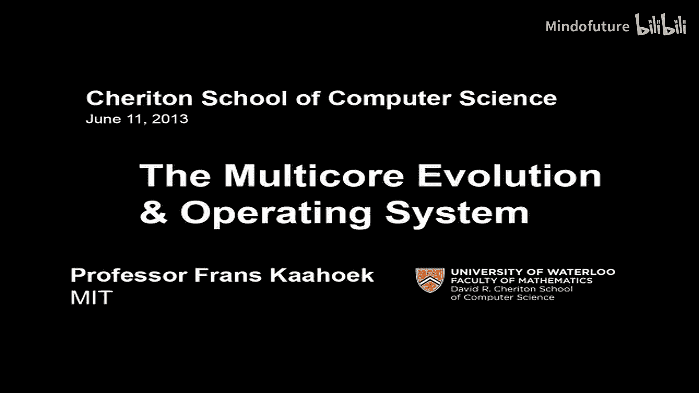
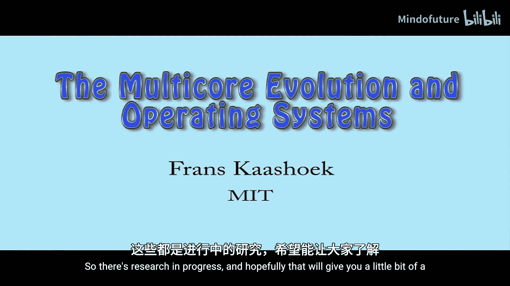

# 多核演化与操作系统-｜-MIT-｜-Frans-Kaashoek--BV1dXGHzzEfM-

So I want to not talk about old stuff， but talk about new stuff that we're currently working on。

 so there research in progress and you know hopefully that will give you a little bit of a way or an insight about it like how I think about know systems problems and how I approach them but before diving into the details I want to say a little bit about。

You know how I pick or how we think about the research， picking research problems。

 and so I'm going to put a little bit in a larger context before diving in the first I want to talk a little bit about why computer systems just keeps them being an extremely exciting field to be in。

And one of the reasons iss basically no limits to what you can do。

 you basically be limited by your imagination and unfortunately that also has some downsides and one of the downsides is actually using a reasonable heart to pick research problems and so I want to talk a little bit about what are sort of rules or forms of rules that have used to sort of pick research problems and then we dive into one of them and we see one class of problems that seems to be promising system research to work on and what I call incrementalcrement and scaling problems where one dimension technology scales well and other dimension of technology doesn't scale and that sort of creates a friction there's a problem to work on and you can few multicore processors as one of an example of one of these increments and scaling issues。

So。So why do I think computer systems are so exciting and why I mean this area， as I said。

 I think you're you can almost build anything and sort broadly speaking and simplifying a little bit。

 if you think about computer systems build hardware and software hardware actually compose it extremely well particularly if you compare it to to analog systems because you take a transistor and restore signal to 01。

 you can hook them up and sort build them large and large designs out of them and if you look at today's processor building of transistor more trans than more components than em Boeing 747 has and so it's amazing that what people build and that partly comes from this sort of digital abstraction that we have where basically every signal is either restored or zero1 hardware might get it wrong once in a while but we have all kinds of error correction ways of doing it and if you compare it to analog systems's very different in analog system to circuit bigger and bigger you collect noise and at some point it just limits the size of the circuit you can build。

Now this is only not true on the transistor level even on you've recursionively applied is you can see that we can build huge computer systems out of many。

 many components all because of this digital abstract。

 you can think about the internet as one big in system composed out of many components and workable because of this digital abstract。

So hardware composes well that was a good story clearly software can compose really well too it can badly compose。

 but if you design you software well， pick your abstractions well and avoid leaky abstractions and you can think about leaky abstractions as the equivalent of noise in analog circuits if you pick your abstractions well。

 you can actually build a large software pieces with very few people and it's remarkable if you think about what you build today by picking a web server or database。

 an operating system and before you know you have created the next Facebook there's a small number of people So story is just very exciting I mean if there's no sort of really natural forceful natural loss that's going to stopped you you can build almost anything in some sense the story is even better in the this like not only get good composibility the technology。

 the underlying technology that we've built these components from it's actually improving itself and in fact I think computer science is probably the only discipline point where I think。

rate of technology improvement is proportioned to the technology itself and just give you an example but I mean with that So basically for say yeah。

 you build a better processor， if you build a better processor。

 you can actually run more complicated layout tools。

 which allows you to build better processors think so you have there's recursive cycle going on where the improvement in technology feeds the technology itself that we're using。

And being at MIT， you have to formulate this as a mathematical equation correct and you as a joke。

 you know sort of did this， and so the de technologyology over de time correct is proportions to technology and if you solve this equation you get an exponential function。

I always think like when the popular press talks about exponential improvement in computer science。

 it actually might be right for the months。So， you know of course。

 anything that proves that an exponential entry rate must run into limits very quickly too。

 and this clearly in computer science or computer systems in general we run into limits all the time。

 but none of them have to be proven to be sort of fundamental in the sense that theyre really really a roadblock and in fact in many cases it seems to be the case that we' going be good for a couple years to come in terms of the technology improvement so and that makes basically for a wonderful environment correct and just to illustrate make that point a little bit more clear this is the computer that I did my intro I guess programming class on and the manufacturer doesn't exist anymore and as's in one example of the technology improvement rate going in action2 megabyte of memory3 megahertz 301。

000 guilders which is about whatever 35 even more in dollars then we' more interesting but interesting point is like 20 student shared。

They do their programming labse and it is less powerful than your smartphone and maybe 1983 for you some of you is very far in the past for me it' not that far and this is amazing that know that was actually a high end computer and so what does that mean for systems research so in one hand you have this wonderful environment like inter technology improves at exponential rate in many dimensions software at hardware propose its rate so you could build almost anything you want and really what it's true is you R limited by imagination。

And I think there's one reason why you see a lot of good inventions or instant cool new applications in computer systems coming out of young people because they're not limited by their views of like。

 oh， the technology can't do that， they don't know about this and so some of this crazy new stuff and it can be done because the England Island technology has changed enough that it actually is feasible to build these new types of applications。

So you get these new students here what I think are the dangers and these are dangers that or traps that I fell in myself multiple times。

 so I think it's very easy to do research it completely irrelevant。You know。

 you go work on some problem， you work on it for four years， you know you find a solution， example。

 you have a better algorithm， and that speeds up things by 10%。

And you you could have done nothing correct and sit on the beach for four years and have technology solve that problem for you if you were lucky and know you might think oh you know maybe the 10% the top of like the factor of 16 that you have got from sitting on the beach it maybe still worth it in some cases it is but often it isn't and it's easy to get sucked into this not realizing that technology can solve a problem for you and that you're not solving an intrinsic problem so it's very important to sort of separate intrinsic problem from technology in problems。

The other one in which I think is another one that iss very tricky to handle which is very easy to invent unnecessary complex solutions。

 there are no physical laws that force you to make something simple and so it's easy to come up with oh。

 it can make it a little bit more complex so I can also tackle this problem too and so before it know you invent a solution that is more complex and really what's necessary。

You might say， well， that's not really。But the problem of that and the problem of that is actually people don't adopt complex solutions。

 people like， you know， simple， solutions， and they are much easier to adopt by other people。

 And so if you want to have research get adopted。 you got to figure out ways that force yourself to make the solution simple。

 since the technology， like the physical laws are not going to do it for you。

 it's all mental exercise。 you just have to think harder to come up with actually simpler solutions。

Now。That's the downside。Luckiily it's way outed by opportunities right and as I already mentioned。

 because the technology keeps improving because we can compose these bigger systems。

 computer systems entering new application areas are rich for new research problems whether it's mobile computing。

 sensor computing you can just list them off and these are fields that they didn't exist 10 years ago makes the field an extremely exciting era to be in another one which is one of my favorites too like resolve all problems using improvements in technology the classic example for these is the IO bottleneck IO bottleactctors exist in the 1960s what sort computers really sort of started off and it still exist and the problem here is the IO systems so much slower and your processor and relative to your process actually get slower over time is so you have to rethink about how you design systems that actually get good short systems and you can see this all over and currently actually we sort of an interesting point with the new technology for。

That replacingple magnetic disc allow you to build solid state disk and allow you to think about storage systems in a very。

 very different way than we did before。啊。Another area I think that's always ripe for sort of good research is controlling and complexity。

 and since one of the key challenges is complex solutions how do you build systems that are actually how you can you come up with extractions that just make it simpler to build systems。

And then we have seen examples， huge examples of successes in that area， like frommeo。

 transactions stand out as like one of the sort of major computer science or computer systems for database abstracts that really has simplified how people can then build on top of that。

And I think you see that in many our areas too， and so these abstractions think about map producedduce as a recent example that really has sort changed how people build large scale distributed applications so the final category which is the one I want to talk a little bit more about in this talk are in some in and scaling problems and in commence scaling problems that mean problems where one dimension technology changes quicker or better than other dimensions and this graph is to illustrate that in the context of multicore on the green line is the number core per processor or nutransistors per procedure and you can see that that's an increasing that an exponential rate the plot there's a lock plot and gear on the excesses。

So you see the transistors， you， no transistor are increasing increasing here in this line is the interesting line where you see that the clock cycles was also an exponential increasing rate until sort of early 2000s where it actually flattened out and the reason that it flattened out is because the power consumption basically you could seede in the watts actually produced by chip or was also actually on an exponential rate until the around 00ts where things are just getting too hot and so the things just have to slow down the clock we have to maintain the clock speed to stay under that 00 wt and as a result you can see that process are actually stop getting faster。

And so before 2000， know you can sort of rely on technology to make your program run faster after 200。

 I think you know if you want to run your program faster。

 you cannot rely on single process performance get better。

And so the solution to a you of an instant case， correct where the transistor actually is still keeping an increasing at an exponential rate。

 but a clock speed isn't， and so what do you do with the transistors well。

 the simple solution is to stick more of them build more processor in a single processor or in a more course on a single processor and ask software designers to run software parallel because that's the only way you're going to get more performance。

And so and if you believe that Moore's law continues。

 which assess that the number resistors should be doubling every 18 months。

 that means that the principle of the number course should be able to double every 18 months too。

 whether that will happen in practice this course and portion of demand and applied but technically to be possible to do so and so then the fundamental goal for software designers is going to be how to take these multiple course and organize your software in some way that you can actually execute in parallel in these multiple course。

And so this is what the goal is sort of way I will call informally scalability。

 I'll talk a lot about scalability for the rest of the talk。

 but informly what we're looking for is to have an application to n times as much work on end course as you could do in one core and typically that won't materialize because you have serial sections where it's either in the hardware have one network interface card and so there's no 100 core and want to send over the network interface in one network interface cards it has to be serialized or you might have locks on your shared data structures or you might have other shared hardware resources like a DM interface and so in principle。

 actually obtaining sort of this perfect scalability typically pretty hard because you of the serial sections。

The other hand， though， it's important to actually minimize the serial sections because from end those law。

 the runtime of app parallelel application is equal to the parallel the time you spend in the parallel application divided by the number of course plus the serial time。

 so if n goes through a large number then you're going to be dominated by a serial time。

And so the key challenge is going to be to figure out like waves after reducing net time。

 we actually avoiding it completely。So now you might think。See， this is an old story。

 we have seen this particularly for the older people in the audience。

 this sounds like the stain parallel computing story where a lot of research was done in the late 80s or early '80s and the early 90s and in fact this is a picture of a machine that I did my master fus on and it's a shared memory multiprocessor had 16 depth on Motorola 6830s running in 600 megahertz at chip memory。

 all the good stuff that actually you can find in today's X86 processors is actually building into a single chip。

To what has changed？And I think what has changed from a sort of computer systems point of view is that in 1987 and this comes back to this technology improvement and in 1987。

 parallelcomputing didn't address any burning problem only for a very small subset of people that actually were doing scientific computing needed all the cycles that they could get it actually solved the problem for most other people you just waited the year and you bought a machine that was twice as fast in my masterphy took a couple years three years so I got two and 56 mehertz at 16 of these processes correct and at the beginning of my masterphys that was a lot faster than 16 times faster than the process was using in the end of my masters was only fact of two。

And so in some sense， I've wasted my time working on this problem。

 but I think that cannot be set anymore today because processors are not getting single core performance issues not getting faster。

 it just like it stays at the same rate， will stay at the same rate for at least the in the term。

 and so basically that has left to a rebi of apparel computing。And really。

 you go through an Intel website or an AM&D website， you will not find single clock。

 speed performance anymore， which would used to be the dominant metric， right？So。

Then you might wonder like okay why look at an operating system since this is a generic computer science problem and the reason you want to look at an operating system is partly because a lot more time because more applications need to be parallel。

 more and more most application actually rely on the operating system and so if the operating system doesn't scale。

 the application won't scale the operating system will be do serial section and so and if you look for example at an application like a mail server about 70% of the time actually spend into kernel or in the operating system and reading writing files opening in a closing network connections and things like that。

 so that part of the operating system just doesn't scale then your mail server won't scale。

AndClearly you would imagine that you want to run scalnable mail server in your data center。

 mean you have a server box in your data center with a lot of cores on it would be great if it could scale up。

 correct， particularly because mail is such a parallel application is embarrasly parallel every user you should be able mail messages from every user you be in parallel。

So it seems like an interesting problem to start off also my background these and operating systems that it seemed like a great place to start and finally the OS the current is a very paralyzed program because a lot of people spend a lot of energy actually making it parallel and so it's interesting ways to explore like what are the new。

 how can you push spread it？And so we'll say a little bit of that。

So what happened in operating system scalability basically if you look back to the 20 years ago like in the early 80s。

 most of the processors or most operating systems not all。

 the many operating systems were union processor designed。

 so basically it was a big lock around the kernel， you entered executive system call。

 the first thing the kernel did to grab a log and then everything was serialized。

Until you release the kernel and then you release a lot in the last 20 years that that picture has completely changed because like all the research that was done in the early 80s or late 80s and early 90s parallel computing data that has been ined。

 today's operating systems where it is Linux layers。

 you open them up and you'll see that all the techniques that will developed they're actually in these systems。

 for example all the people that worked at SDGI actually contributed all their code to Linux and so a lot of the fine green locking。

 you see petitions and rep she had data structure the schemes are pretty complex。

 you petition the data structure across course， so you could do per core locking。

 in fact you look at Linux today， there's a lot of code paths that actually don't use any locks at all。

's all lockfr code， very carefully designed and still be correct， but to get better scalability。

So and we sort of the so summary of this is like a lot of these ideas I' like to re copypy updated are sort of invented in the early 90s and late 80s that all have been adopted and basically you run on your Android phones。

 phones and any server in the cloud。So in the iOS community。

 this has sort of a lot of discussion about what's the future for scalability for operating systems。

 is it possible to take these designs that we have now extend the sort of multiprocessor。

 shed memory kernels and scale them up to a large number of core？

And there's a number of reason why you might think this is not true。

 and so example one reason is because of all these shared data structures。

 like there's a shared process table， there's a buffer cache， there's a shared file system。

 all these shared data structures that are sitting there in shared memory are going to be serial sections。

 and so the whole idea of having shared data structures is sort of contradictory with scalability。啊。

You also see that another argument that the juice and it won't scale a recruit is the kernels are so big and so complex and millions of lines of code。

 there's just no way possible to sort of modify it and to really be this super fine grained code that scales well and one of my colleagues at MIT and on Argerwald put the very fine point of it and said like okay。

 if Numer Corps doubles every year， then we have to have the critical section or the serial sections every year too。

 which means that we have to rewrite the operating system kernel every。Every year， you know。

 I'm imagining rewriting six million life of code，' a little bit of work， right？

And so a number of people in the operating system because you including myself said like yeah。

 we completely I of believe these one of these free regions and like wow that's probably not going to happen。

 we've got to come up with a new design for operating system they radically different from the ones before and so you see a whole bunch of proposals in the OS community for new operating system like Corrry barrelfish Fo at the cellularium Corrry is the operating system I worked in myself and actually there' the way we sort of got started back in this area。

But after a while working on Corrry， I started to wonder where it really was true。

 whether the memory traditional scrap memory multiro the kernels will run out of gas。啊。

AndBecause the techniques that we were coming up with in the core seemed equally applicable to any sort of Linux type operating system。

 and so know this led to the question said like it's going to be evolution there's going to be a revolution and this is a hard question to answer。

 but you consider try to shed some light on it。 So the first thing I want to do is shed a little bit of light in this question and the way I'm going to do that is I'm going to talk a little bit about a picture of work where we basically analyze the scalability of Linux so we took an off-s shelf a core a machine that has 48 core the way to think about it to have eight times six basically8 soets each with six course we ran some at that point the most recent version of Linux so this is a couple of years ago we took a bunch of applications that scale in principle perfectly like an email server has is embarrassly parallel So if something doesn't scale to the OS's fault。

 not the application's fault。And then we just measured it and sort of said like okay well how well do we do and then I should know there's a couple of caveats we didn't really use a real file system because if we'd be bottleneck by the disk system so we use an inmemory file system and of course a 484 multiscket machines not exactly as a 484 chip but hopefully we' give you some some some sense。

So the machine we're running on schematic this is a schematic of it and the main point of it is actually that it has a cast here and chat memory machine what that means is that if one core writes a memory address and then another core reads it it will observe the right of the last that will observe the value that was written last and sort of an informal definition of cast here that's what you should think about。

So now here's the plot， so we took this version of Linux from then and run these applications。

 so there's a couple of applications， there's a mail server， there's Men CaashD。

 a popular Caching server， Apache Postgress， El， GMake， the Apparel Make and PS searchching。

 which is a reverse indexing system and Mens， which is a Ma De library written for multipleportre processors。

Maybe you look at this graph， you know the things are sort of disappointing right。

 Apache gets a speed up of one on a 48 core machine， this 8。

 you know8 you know actually GMake us pretty good， D actually 20 should be much better and that is actually the other one that that's good。

Now， Mans and GMake actually to spend a lot of time doing computing。

 so I actually to spent not most of their time in the operating system。

 because GMake spends most of the time actually running GCC。

But the other ones in spend actually quite a bit of time in the operating system a new terrible。

 So the first time you know I generate a graph like this， it was like， yeah。

 we got to think about new operating systems， right mean we were far away from this perfect scalability of 48。

But now coming back after I working in Cor for a while like we you go back and actually and understand exactly what actually went wrong so let me tell you a little bit what happened and sort of understand the goal here is to understand is this fundamental that these things don't scale or is it just happens to be like they didn't get around to fixing couple scalability problems right？

And so。So here I'm going to pick one application to tell you what the scoop is。

 so I'm taking the mail server and you actually see that if you look at it in the following way where this is the normal course。

 there's the fruitput in terms of normal messages per second process。

 you see actually that the mail service person scales incredibly well until around whatever 30，32。

36 course and then flattens out and then collapses。

And so the first question to ask whose fault is this， well。

 if if you look at the time spent in the operating system and this plotted on the red line。

 you see actually that the operating system seems to be doing fine until exactly the point of things collapse。

 right then the kernel just falls over and all the time is' actually spending in the kernel as opposed to actually running processing of mail messages。

So now you want to know like， why？And so what we did。

 you know you take a system profile or where you can complete system profile and you look at the two different profiles we look at the profile for 40 course where it's actually scale not so good anyone one a 48 course which scales word and the bottom that should pop up right because that's where all the time is spent and so if you look at them a little bit carefully。

You know here's the time spent each of these functions in the kernel and you see that actually in the bottom case。

 the 48th case that certainly this lookup mount function has taken 34% of the time you know this male batch of valve doesn't even show up in the other function so here' you said of goodmush look up lookup mounts or see what's going on there so here's lookup mount。

It's a total of five lines of code， where apparently 50% of 40% 30% of the time spent， right？

And this is the first time it was a little bit of a surprise to me it all make sense。

 but I'm thought hard enough about it。 And if you look at this first of all。

 it takes a spin lock out and it takes a spin lock around a hash table。

 the hash table is a hash table of mo points and the hash function is like。You know。

 tens of lines of infrastructure like assembling structure Gs basically doing a modular operation。

 looking at the table and basically returning a value。

And so the first thing you might wonder is how is it possible that10 lines of instructions correcting can actually be the cost of this 30% slowdown and clearly the reason is that actually it's not these 10 lines instructions that' the problem it actually turns out of course it the lock is the problem and so let's look at how lock are implement in the Linux and this is pretty standard implementation of Linux to called spin locks and there's ticket locks you go code to counter you grab it ticket and then you wait for your turn and once you turn is up and then you're in regularly you go do the bake your post office or and basically the ticket locks implement the quizz of that inside of the operating system and so you can see here this is a spin lock operation it not a lot of code the only thing really looks's interesting it takes an atomic increment on ticket counter and so it gives you the next ticket number and that's all of and then it spins until the current ticket number is equal to the ticket number that you got and so there's two there's one。

the spin lock that contains the current ticket number and the next ticket number， correct。

 and so the guy that grabs the next ticket number waits until the current ticket number is equal to his ticket number。

And so then the unlock doesn'll do much easier it just implements the current ticket number so there's a completely logical and fine implementation so let's see what actually happens you run this on the machine so let's say at some point in time somebody actually has to lock and a lot of the other course are basically spinning in this loop waiting until their turn is up and so the caching。

 the hardware caching system will cache this data structure in the local caches or each of these individual processor of course。

So they a hell Heley spinning， which is great， right because there's actually no communication on on the network。

 and so there's nothing really wrong here then at some point。This guy。

 one core is going to do an unlockb and is going to write this current picket number now that's going to cost the hardware will send because it's a cache hearing machine it will send out invalid messages to all the different core saying like hey。

 you' got to invalid your copy of your line and that's in principle。

 not a problem you can sort of send them all in parallel and the hardware does that and then basically then the owner that one core becomes the owner for the right operation the course。

 all the other guys that are still they are going to read immediately again this cash line because they're spinning and' like an affection。

And so they're going to all send a message to you at one core you know saying please you know send me the cashline in here we can certainly have a serial section because all these messages will be sitting there in the queue and then prox one by one by the hardware to send them out and in fact。

 there's vacuum bundle of contention at this point also because we're going to take've got hundreds of cycles and out actually send a response back。

But a little bit worse because how long on average。

 how many messages do you have to wait until the lock the new lock owner is going to get the right message。

 Well， the hardware doesn't really know who's the next guy in line and so it's going to be on average to take half end messages before the next holder actually gets the lock so it's half n times through the five minute0 cycles but the real issue is to half n because at more and more locks more and more force are contend you may have to wait long or longer to get the lock。

Which means that more and more cores actually start to content on this section and so more and more cores are starting to wait which means they have to wait even longer。

 in fact this is you get the snowball effect where as soon as a couple courses are actually contending on this short spherical section。

 then quickly all of them actually starting to contend for this critical section and waiting spending all the time waiting to get this lock。

So。So this is basically the fundamental problem and this is a well-known problem。

 contentant spin locks it's long well knownn in the literature that they can collapse and here you just see the collapse in thatpt and the thing of a little bit surprising to me is like how fast the collapses and how dramatic and the second is that even if you have this big operating system learning this mail server and it's this single cache line that actually is causinging the all complete performance form slow down。

So。Now how do you fix this well there are many ways of fixing this and one thing you could replace them is something that's called scalable locks。

 which actually is a misnumber because it's not a scalable lock。

 I just flattens out at a particular level but never gets actually it doesn't scale up with the number of course so actually not a great solution and the better solution is like what a lot of Linux data structures do is to actually copy the data structure and have every core have its own individual version of the data structure and so that means that a read operation can just take a local lock that is contentent because nobody else is contending for read the hash table and release the contentent lock。

Now only of rights， you have to do something complicated when actually you unmountute the file system。

 you have to take lock out and all the replicas and then change the hash table。

 but how often do you unmountund the file system？Have we met her second， no， all right。

 you know so this is a completely， you there's a typical systems approach there's solution to this problem。

 Greg doesnt like the right way to go。And next under thelinus kernel does is in lots and lots of places using Perco locks and it's not anything new here So in fact。

 we went through all these applications and basically there's a story for each of the scalability bottlenecks that we found and sort of try to come up with standard per programming techniques to fix them and in fact we're able to basically go through all of them and fix bottlenecks。

 in fact we only have to change about 3000 lines of code which out a couple million it's a pretty good deal and the other thing is that we didn't optimize for a single application。

 you see that a lot of applications have the same problem showing up and so it's not the case like when we took any one applications to fix all eight scalability bottlenecks and took the next application fix a whole bunch of different set of scalability of bottlenecks。

We also had to change the applications a bit， which I'll talk a little bit about。

 which is a little bit unfortunate， but of course's not many lines of code。

 like 60 lines have changed。So this is good and the fact that you can now remesure the scalability for each of these applications you know it's not perfect but actually it is pretty good certainly if you look at this graph。

 your first conclusion is not， okay， we got to build a new operating system architecture to very actually scale because this looks actually completely decent。

Now， I should point out， of course。I should point out that this is not our contribution really。

 most of word work was actually done by the Linux in kernel community and there were a bunch of places where not everybody runs 48 core machines with these kinds of applications on there were a bunch of plays where had them fix things that they're completely capable of fixing so most of the credit you really through the Linux community。

 but basically these sort of chefs that shift memory multiprocesedor operating systems。Might be okay。

So talk a little bit more about this。 So if you look at this set of slides at least these graphs know my conclusion was going looks promising。

 no problems through 48 kernels， 48 course， but of course this is nettgging down we've seen this collapse happening at 36。

 maybe the that collapse is at 49 correct and then there's some fundamental thing that you cannot fix。

 So it's not too much we can conclude from this particular experiment。We have to work as I said。

 we have to make some changes through the applications because in a particular system calls we're not in particularly scalable and of course in our studies only few number of applications but nevertheless。

 you might be sort of compelled by at least thinking well。

 we should not give up immediately on chip memory multicro recurs。

So spend more time thinking about it because it's hard to give the real answer to this question and really one problem is that the whole approach is sort of broken like this working driven approach that the way you think about scalability is broken point the way you think about scalability in systems or xing applications too is by plotting graphs at the form like numbermer core and the Xx is approved both than the Y axis and that's a very unatisfactory way of thinking about scalability because's dependent on the benchmark that you pick you profile one particular workload maybe in another workload something different happens and you keep sort of fixing things and you never know really when you're done and so it' would be nice if we had a more effective approach。

Now， I should say。I should say actually that although they're sort of from a sort of recent point of view and a scientific point of view。

 there's sort of undesirable correct words of different approach。

 but in practices of work it has worked fantastic， mean like limits comm almost any OS vendor or any OS builder or any application designer uses this approach。

And the reason that's actually pretty good， correct， and just to contradict myself。

 and the reason that's actually pretty good is because you pick an application and you fix the problem for that application and presumably you pick the application that actually was' important。

And so you've fixed real problems。And but yet nevertheless。

 you sort of a sort of scientist who feels like nagging， you know， could you do better？嗯，就。

And the reason I want to do better is。For four reasons， one is， how do you know when to stop？

when is a bottleneck， scaling bottleneck sort of fundamental， like you know。

 there's no solution really to it or is it the case that you just didn't think hard enough？

And for some reasons youre things' tricky to fix， and so maybe you're not creative enough and so you have no answering sort of way of engineing that question。

And one example， again just help you， so think about this like one that always fascinated us where and when we started working on this area。

 like if you create two files in the same directory，And you do that in parallel。

 to that scale or not。And then keep that in mind and'll come back to that and or initially I oh of course not。

 why should that now scale you have a shared data structure like there's no reason to think that then it should be scalable The other problem。

 of course that this whole sort of workload different approaches is it heights on a bottleneck when you fixed one bottleneck but maybe there's another bottleneck of like lurking right behind it correct and you just haven't found it yet because your machine didn't scale up through 92 quas where I go under the qua of it actually was necessary exposed to the bottleneck。

Pretty more workloads have different bottlenecks so you might miss them。ett cetera， et cetera。

 So the thing you know we sort of we're fascinated about it or like we've been thinking about for the last couple of years is。

Is it possible to have sort of an interface what I'll call an interface driven approach where you know intuitively。

 certain interfaces seem like impossibly implement scalability while others clearly seem very should be able to implement the scalable？

😡，And。It would be nice if we could think about it in terms of the interfaces if we could look at an interface and say like that interface。

 that should be perfectly scalable， that interface should not be now you cannot hope that they have a perfect scalability。

And the reason that that' would be cool， correct， is you can actually start thinking about designing interface so that the implementation is possibly to be scalable。

It also provides a clear implementation goal， like if you knew that the interface inable is scalable。

 implementable， you can do it， you have to go and like think maybe hak。

 at least you know it's possible that you can do it。😡，Pretty more， it also enable systematic testing。

 you can sort of independent of the workload， you can sort of start thinking about testing interfacephas。

Now the only account for that is of course you have to have a rule。

 know that's just like whatin interface faces kind of ball in in which you rock。

And so we've been puzztling about this for a while。

 and so I'll tell you a little bit about what we're currently standing with this thinking。So。

So first of all， we need a different definition of scalability。

 like this whole definition I was using so far， where basically throughput versus the number of course is not a useful definition because you might not even have a machine to measure it on。

 right， So we have to be able to talk about the scalability of an interface independent of having a machine。

So that means independent after action making a measurement。

 so way one way to approach this problem is is fall， and this is a little bit of a strong definition。

 but' give us a starting point。No， you can observe a correct the course and read and write disho cash lines very fast。

😡，If there's no interference between two cores， they don't share a cash line。

 they can do it extremely fast because of the cash rence system。

The only thing that's extremely bad is when one core writes you know a cashlan and another core reads it。

 and particularly if multiple fours read it and then it's really a disaster。

And so a simple definition of scalable is to say an implementation of scalable if operations have disjoed access parallelism。

 basically meaning they don't rerite share a cache line。

So this is a little bit of a strict definition。 but a starting point。 And in fact。

 this definition was proposed earlier， actually in by number fewians， Israeli and Rockport。

 And we're going to use that definition。 So my new definition of scalability is if two operations to a piece of code。

 readw writes share cache line， that's not scalable。

And if it doesn't then scalable so now we can ask there's this new definition of scalability or this borrow definition of scalability。

 we can ask ourselves the question which interfaces permit scalable implementationation So let's say two system calls I mean just always should talk about pairs of system calls because it's easier to talk about it of so you take two pair of system calls like get it getting the process idea for the current process ID number and can they be implementing these scalable。

Well， you would say yes， correct， because there's no shared state at all。

 they should be able but independently read their process ID numbers。

 there's no cache line being shared at all， sort of as dising excess parallelism， so boom。

 it should be sustainablealable。😡，Now how about two creating two files in the same directory？Well。

 there is definitely shared state De， you know， there's the director reading you have to look when you create the file。

 you have to sort of look at the file already exists。And so you might think， well， probably not。

But in a thing a little bit longer about it， you know what if you represent the directory as a concurrent hash table where names of the directory entries。

 names hash to different buckets， know to different buckets。

 and either bucket that is stored at one core buckets are never shared， Well。

 let's say A and B hash to different buckets， then each of these two could actually update the current directory perfectly flat。

 right。You may have to have read sharing， but that's okay， there's no read right sharing。

So that seems actually， so if you think about that way。

 that actually should may be possible right And so we need sort of still a better way of deciding which interfaces can actually implement it in the scalable manner or not。

 because clearly we're sort of back here and sort of thinking hard， we're just not， you know。

 we wanted to get out of that business。So here's one proposal。

 which is we're going to say the following rule whenever two operations commute and I'll say in second what that is。

 then there exists a scalable implementation， so that's a rule that we're going to propose as a way of designing scalable interfaces。

And so comm is a little bit of a complex thing in an operating system。

 course because there's arguments， there's state， internally in the operating system。

 and so we're going to say the two operations commute if there are order doesn't matter and later operations cannot distinguish which order the two operations executed。

And that basically means like you could do them in either order， later opportunities。

 you can distinguish the final outcome， and we' were going to say that you commute。Now。

 I'm going to not prove any of these rules through you。

 but you can actually formulate that using you know the sort of an action calculus and actually。

Not improve a a little more precise statement of this particular rule。 but for this talk。

 know this is sort of the basic intuition。 So we're going to use this intuition。

 it sort of makes sense， correct， if you think about it。

 because if two operations two operations to commute。

 And so the order doesn't matter in which they execute。

 it means it shouldn't really be any communication necessary between the two operations to execute them And so if there's no communication necessary。

 that means that there should be should be possible to implement them in a disjo access paralleling way because no cash line should have to be read by core that actually wrote another cache line but otherwise if the order is independent doesn't matter。

 should either way。 So that sort of the base intuition， you can formalize that if you want to。

So going back， and we're going to use this rule， so which interface of its scal implementation， well。

 get bit and get bit。Clearly do， correct， because you execute the two operations in any order。

 they commute， the two operations you commute and therefore there should be scalable implantation possible。

Creating of two files in the same directory by two processes also commute because if you or3 two you could do first create A and then create B or first B and then A。

 it doesn't matter。 the outcome will be the same， you will have a directory with two files A and B in them。

 and the processes actually cannot tell the other processes can fail the order in which the two operations matter。

 And so it commutes with our definition of commivity。Now。

 I noticed that I put the arguments in there or it is crucial that the argument is actually a part of the comm part。

Now， if the two frets create two files in the same directory。

 that actually does not commute and that's for basically a stupid Uniix rule。

 which says that if you create a file， you have to return to the created the lowest file descriptor number and so if two frets create at the same time。

 two files both code create one is going to get the lowest file descriptor number and the other is going to get the next highest file descriptor number so you can totally tell in which order the two operations is actually executed and so by our definition these two two calls and do not commute furthermore by our rule it's probably unlikely that there is a scalable implementationation possible and that sort of make sense because they have to synchronize on this lowest file descriptor number。

So that's sort of the intuition。So。You know what do we like about this rule。

 Well comm is a property of the interface， not of the implementation anymore。

 so now we can just talk about interfaces as I did on the last slide and sort of talk about like the oil。

 this should be completely scalable， this should be not， we may have to think very。

 very hard to come up with a scalable implementation for two calls to commute。

 but principle should be possible and might not commute in all cases for certain arguments it might not commute for other arguments and a will commute。

 but at least if we arguments were a commute， you could optimize for those cases。

Also it's the case that operations that network comm may not scale。

 and we don't actually have the reverse claim， but likely and so maybe for a programmer。

 it's probably better to avoid system calls that actually don't commute because's unlikely that maybe it's unlikely to get a scalable implementation。

😡，Another of course thing is that you can do a cool thing now you can start thinking about how to change the Uni interface or the positive interface to get more commut so for example you could decide let's change create to actually return any file descriptive number instead of the lowest file descriptor number and for most UniX applications that will perfectly work fine like the very few applications and that will rely and that particular semantics the one who important application that relies on it is the UniX shell but and then the others don't。

So these are sort of dangerous things you can start playing now。Now as I said。

 these calls are sort of depending on the arguments in the state of the operating system。

 so there's a little bit of a little bit of annoyance because if you have a very complex interface。

 it's hard to start thinking about all the possible ways in which things can compute and so we want to make it easy for programmers the reason about this So the design put a little bit of a tool chain that allows you to help you to reason about the comm of an interface and basically the way it works is we have a python model that describes the system call in a very sort of abstract manner to create there's sort a shared data structure you called the directory and modifies the directory。

And then we basically。Run that through symbolic execution engine and generate all possible pairs。

 all the commivity conditions。 So we'll say like where two create calls， you know。

 theyre the same file they won commute if they are different files and same directory。

 they will commute， et cetera et cetera。And then so we generate all the test cases。

 and then we actually run an operating system on modified QMU， which we call Mx。

 and we run these comm calls in the operating system and if we see any cash line share moving。

 we know that the operating system at fault， correct mean it's not scalable even though it could have been scalable and so we don't really need a big machine at all。

 we need only like four core and we can basically we are totally in business。

So once you have that infrastructure。啊。You can now ask in a once more principled way how well is Sectionly Linux doing in terms of scalability and on the system call level and so we took a small part of the as interface Ft that we name all the calls that are listed here and for each of these pairs like open open so open open is creating two open open is opening two files and you can see that and the generation a whole bunch for the two open cases。

 you're going have a whole bunch of comm cases like in many cases we're commutute and in many cases we're doesn commute。

And the greenness of the block tells you in how many cases actually did commute So maybe there are 16 cases in which it commutes and if it'll commute in all 16 cases。

 it will be green the block and the commute in none of the cases it will be red then you see that open and Ft commute well and in fact they're also completely scalable in Linux implemented and you can see that open and open So for example。

 doesn't scale at all there's no case in which two open calls。

 including creating 2000 same directories actually scales currently on Linux。And in fact。

 if you look at this picture， then you can see that there's quite a bit of room for improvement。Now。

 I should say that many of these cases are probably corner cases you know where you don't really care about like rename with。

 for example， if you create。Two files and the files already exist。

That in principle coulds because both get an error code back how many applications are going to run into this so it's not clear that you should really be worried about that particular case but there are cases where are important。

 so for example two opens to creating two different files in the same directory that actually as an operation that are very common in applications and you would have hoped that that would scale。

So now you might want to work great， you generate all this comm case。

 maybe it's just impossible anyway to implement any operating system that actually scales for this interface。

 and maybe plastic should be redesigned and should be just moved on the side and basically the guys that we're talking about revolution。

 that are absolutely right， we just need a completely different interface。So you we went。

 we spent a little bit of time and actually build a new operating system that build implements exactly。

 it's a shared memory multiproitor operating system that implements that core of the plastics interface and of course we knew what had to be scalable because we knew which calls were communutative and we were like。

Okay， for each call we're going to assure we're going to try to make that a scalable implementation。

And it turns out we basically used mostly standard parallel techniques。

 I'm not going to talk about it， there's a couple new ideas and we have a different way of implementing the VM system that's quite different。

 but in general it's all sort of standard parallel programming and nothing really shocking also for the fun of it we also changed the cases where doesnt scale where it doesn't commute we also sort of implement community versions of the plastic system calls just to see how that work out and so you're can redraw the same diagram for this operating system called SV6 just to reflect the fact it's like version six units in terms of its functionality so it's not much and it scalable so' why called SV6。

And you can see actually now that in this heat diagram like most pair for calls do scale are most of the green。

 the fact 1，562 cases out of the 1，600 or something scale and there are couple of cases where it doesn't so there' are like weird interactions between P you read and P you're right that we didn't really bother or actually making scale but we think it's possible but it's not clear that's really worthwhile doing but the interesting cases like open open for example scales perfectly and again this' is not particularly sophisticated once you know that something should be able to scale。

 you go or look for the right solution it's very nice to know that it should be an answer。Now。

 one of the things I wanted to point out to you before started wrapping up is that。

This is a new way of sort of thinking about scalnerability， right。

 because I don't show you a graph at all about like number cores in the x axis and ppo and the y x。

 which is a typical way of thinking about scalnerability， I just plot e diagram， that's it。😡。

So you might think well。You know that was all this rule。

 bogus you know maybe you can prove it but you it doesn't really work out and real hardware and just to make you feel comfortable here's and there's a workout know this is a slightly different mail server and here's the version that actually uses some noncommunative calls and here's the version that use a commative calls and you see things work out perfectly the community one scales perfectly so you know the heat diagram is telling the truth in some sense。

 at least for this machine and for this application。ok。So you're stepping back a little bit。啊。

You's all kinds ofds are starting point sort and we don't really know where it is going。

 this is sort of line of research， but there's a couple of instant questions you can ask yourself。

 right？One question you can ask are there non communitiesative interfaces that can be implemented scalable because the reverse of this claim that I have this rule is certainly not true and for example。

 we have examples of implementing operations they're not perfectly scalable。

 but they's of asymptootic scalable and like at a core， you will get more fruitput。

 but maybe not like perfectly linear。And so， in principle。

 what to think about this application and how often does that happen。

 and we don't have a good handle on that at all。嗯。The definition of use for sc doesn't really match the real hardware I showed you in the previous class。

 it did work for that application， but there are cases where the hardware actually is scnable where I set the rule or the rule will tell you it's not。

😡，so for example， our rules definition of Scability correct like any readr sharing for cache lines is bad。

 basically is nonsalable， but that's not really true because if two cores are next to each other and two other cores are sitting on somewhere else on the network and there's no interferes between on the interconnect and in principle。

 nearby communication can happen completely scalable and so there's cases where you should be able to do good。

Similarly， current chips have synchronized clocks and so all you can use that to actually implement scalable operations。

 and so there's any questions about like what is the right definition of sort of scalability that maybe even capture better what actually the real hardware properties are。

Another interesting interesting question is like how important are the co cases？

You know we have many cases where we think that are corner cases。

 but we don't really know actually whether they're important or not。

 and it's not that easy to establish whether it are corner cases or not。

 so there's a little bit of a step back saying like there's a you know I think just going to build the rule is a nice step forward。

 but there's a lot of instant questions that we don't really know the answers to。So just to wrap up。

 as any piece of research， we build on the shoulders of joints that went before us and particularly we're certainly not the person that did any lunar sc studies a lot of people have done it。

 this idea of combining parallelism and comm， there's a lot of work in different areas of thinking about connectivity and parallelism and so none we're not aware of anybody who formulated a rule like this。

 but there's definitely shared thinking in the community。

Now I focused mostly on operating systems mostly because I'd like to go in depthite least in one area so I can tell you something that is interesting。

 but clearly if you're doing parallelel programming or multicore research there's lots and lots of interesting areas correct and I think one of the most interesting ones is like how do you build parallel applications and easily and the type of programming we're doing inside of the kernel is certainly not the standard type of programming that you want any programmer to do and so I think the heart probably really is like how to actually build parallelroll software and maybe this predictive rule might be helpful but we don't really have an answer to this and so in many other areas where they're basically interesting research opportunities。

So do wrap up。I sort of try to give you perspective of why I think computer systems is exciting as ever。

 why I't have to think about research problems in computer systems。

 why parallel computingut or multicore processing is a real problem now and why is' therefore very important to work on because there's no other way of getting performance correct and so you got to figure out how to get software more parallel and then specifically talk to a little bit of a new way of thinking about scalability using this comm rule so hopefully and I think that applies beyond operating system correct there's nothing in the comm rule that says the specific to operating systems and just that the statistical interface is an interesting interface to study but you should be able to apply to any other interface。

 and so this' maybe an interesting sort of tidbit of information that you could use if you start thinking about writing parallel software maybe make your calls commutative。

I， that' is all I wanted to say， so any questions。This parallel。抓子。AWhile now。

 and lots of people have done who。Prdible amount of research into all kinds of aspects。

for a very long time。And yet people keep saying we don't have any really satisfying solution。啊。

Can you comment on why you think that might be。I know， because I think it's hard。

The short answer to that also there are many aspects to effect is the Harford sites。

 the programming site， there's the the language site。

 so it's not like there's a one silver bullet like there's like one problem you have to kill when people talk about the parallelil program problem it's a big problem like many sub problemsms embedded in it so it's not like we have to take one problem and we have to solve one problem we're done。

And also you can see that we you know it's not like you know the you look at the Linux and tremendouss progress has been made and the fact that Linux scales so well to so many cores currently is a testimony to all the research that has been done before and that has I mean all adopted it and embeddedbed it。

 I think we're now at the point where we're going to scale to many more。

A course of a single processor。 and we're running different types of applications than we did before。

 and that's going to force us to think even harder。

I mean there were SDI machines that had0 processors， correct。

 but the type of application that people were running on is we're actually not stressing these shared data structures inside the kernel that much now we're because there's no other storied than parallelel computing。

 every application has to if want to get better performance application have to make it parallel which means all kinds of application that really people didn't think much about in terms of parallel computing now need to be thought about and so the application domain also has gotten a lot and lot bigger than before。

So that's a short。Hopefully satisfysifying answer。販か。

There's likely to be a lot of research necessary in lot。Yeah， yeah。

 and we got to push it forward to a much broader application domain than we have done so far。

Like I don't think transaction hardware transactionion memory is a silver bullet。

 I do think it has interesting opportunities， one of the things that personally of by I think has been interesting examples of transaction memory like and all that currently when you're writing concurrent block free data structures。

 you can update one cache line atomically and that's it and so if you want to implement a doubleded list。

And walk tree， you can't。You know with hardware transaction memory you can actually update multiple cache lines atomically and so it's like the DS。

 the double swap， data Charritons， know they seem appropriate to mention that here。

 they I wrote an old operating system using the double swap operator。

 and so basically you can think about hardware transactional memory I guess eight cache line atomic operations which is aimed limited eight cache lines。

So I think it's actually great for implementing maybe these lock free data structures I'm not sure it actually solves any of the higher level perel programming problems going to be I'm much more rapid solve。

Sure。Yeah， yeah， although you luxury free data structures， you know。

 like empirical rocks isn't as easy solution to that problem as injectional memory。

 I'm not sure why you would。Use that。How long you need。

So I think it has a use and it will be interesting to see actually。

 you might also be all the cool things you could do with hardware transaction memory that people haven't thought about because days of the hardware transaction memory get you hoops into the cash coherence system and so maybe there are cool ways of using that right that。

So I have7。Soft advisor嗯。Whether we can use those。在车道。啊。Not very optimistic。

 know I think it's cool and interesting work， but I think at the colon level。

 he cares so much of the performance and the colon writers。

 such an expert tend to be very expert at this lockfty very fine grainarel programming。

 they will do that， to get the best scanability they can get。

And I think we'll use the hardware transaction memory maybe to simplify some code pass。

 but it's just amazingly about the simplification。And having harsh often transactions memory has too much overhead for。

These kinds of operations。这就加一块。是。so there's an interesting point like so you know I spend a lot of time using lock free data structures and some lock free maybe walk free data structures is actually not particularly good。

 I think this's another sort of misnomer lock free sounds fantastic right not must scale because there's no locks scale but does not the same thing of scalability like Lock free basically means completely something different。

And so for example， if you look at our VM system used to use a concurrent skip list first。

 but that doesn't scale at all， because as lu as you a couple rid and doesn't scale because the skip list has an index and the index is shared between all cores and so when you insert a new node in the skip list and once in a while you have to update the index。

 then any you read that unrelated through that right dig does that has to cross through that index too and basically gets hit because you got to fetch that cache line which is going to be hundreds of thousands of cycles。

And if you couple force hit the index at the same time， you have contention。

And so basically that shared index becomes a bottleneck。

 so even though the operating like insert and lookup can be commutative correct。

 when there are different keys， the concurrent skip list actually is the wrong way of implementing that because it doesn't give you scalability and so you should do some other data structure to it。

So I think there's a whole area just still needs a lot of sorting out。

 right when about like how to think about all this stuff。Yeah。

Com required。For example， the elite operation has to be changed so that always succeeds so that yeah you probably in a good rule for designing interfaces is you should not return too much argument results and if you do an incr or dec。

 you should probably do de you and't return any value。

So that you can separate out like the read operation from the modification operation。

 and so for example， remove probably should also not return any value so that you cannot。

I think it's more commutative。This is like one of those rules you may want to I think there's a couple interesting rules that you can sort of design rules that you could come up with making sure that certain interfaces are more communutative in more cases and I think。

As like for example， all the things that we did in terms of modification and deposits interface。

