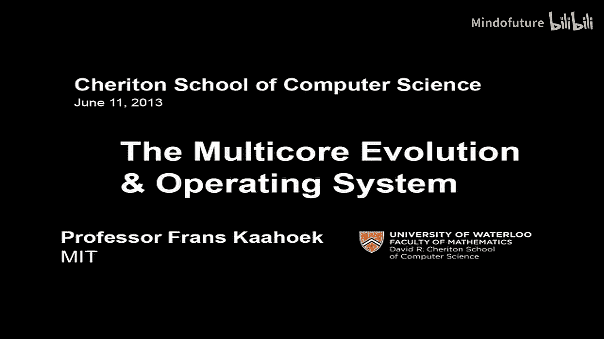
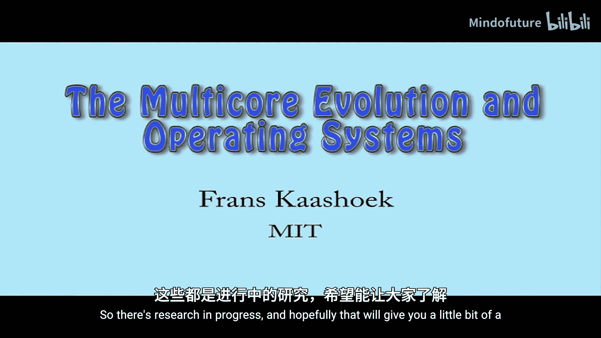
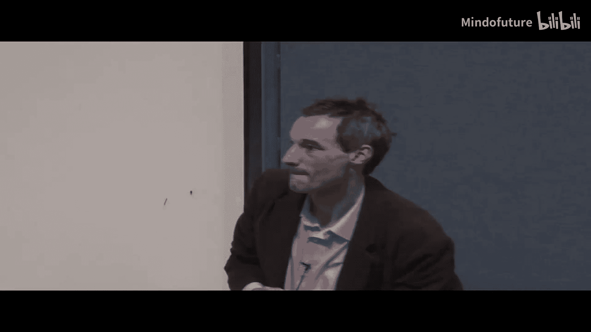

# 多核演化与操作系统：1：研究动机与背景

在本节课中，我们将探讨计算机系统研究的前沿领域，特别是多核处理器带来的挑战与机遇。我们将从为何计算机系统研究持续令人兴奋开始，逐步深入到如何选择研究问题，并聚焦于“增量与扩展”问题，其中多核处理器是一个典型例子。

## 为何计算机系统研究令人兴奋

计算机系统领域之所以持续令人兴奋，主要原因在于其几乎无限的可能性。我们构建系统的能力主要受限于想象力，而非物理定律。这得益于数字抽象的强大力量。

在硬件层面，数字抽象允许我们将晶体管组合成庞大而复杂的设计。今天的处理器包含的组件数量甚至超过了波音747飞机。这种可组合性在软件层面同样成立。如果设计得当，选择恰当的抽象并避免“泄漏的抽象”，少数人就能构建出像操作系统或数据库这样的大型软件系统，并在此基础上创建出像Facebook这样的应用。

更令人振奋的是，支撑这些组件的底层技术本身也在以指数级速度改进。计算机科学可能是唯一一个技术进步速率与技术本身成正比的学科。例如，更好的处理器可以运行更复杂的布局工具，从而设计出更好的处理器，形成一个递归的改进循环。

我们可以用一个简单的公式来描述这种指数增长：`d(技术)/d(时间) ∝ 技术`。解这个方程，我们得到的就是指数函数。虽然任何指数增长最终都会遇到极限，但在计算机系统领域，我们遇到的限制似乎都不是根本性的障碍，至少在可预见的未来，技术进步的空间依然巨大。

## 研究中的陷阱与机遇

然而，这种快速变化的环境也带来了研究上的陷阱。第一个陷阱是容易研究**无关紧要的问题**。研究者可能花费数年时间优化某个算法，使其性能提升10%，但与此同时，技术进步可能已经带来了16倍的性能提升。因此，区分**本质性问题**和**技术性问题**至关重要。

第二个陷阱是容易发明**不必要的复杂解决方案**。由于没有物理定律强制要求简洁，研究者很容易不断添加功能，导致方案过于复杂。然而，复杂的解决方案往往难以被广泛采纳。人们偏爱简单、优雅的方案。因此，要想让自己的研究成果被采纳，必须有意识地追求简洁的设计。

幸运的是，机遇远大于挑战。技术的持续进步和系统可组合性的增强，使得计算机系统不断进入新的应用领域，如移动计算、传感器网络等，这为研究创造了丰富的土壤。

另一个经典的研究方向是利用技术进步来解决长期存在的问题。例如，I/O瓶颈自计算机诞生之初就存在，至今仍是挑战。但随着固态硬盘等新技术的出现，我们得以重新思考存储系统的设计。

此外，**控制复杂性**始终是系统研究的核心。如何设计抽象来简化系统构建是一个永恒的课题。事务处理和MapReduce就是两个成功的例子，它们极大地简化了数据库和分布式应用的开发。

## 增量与扩展问题

上一节我们讨论了研究的一般机遇，本节中我们来看看一类特别有前景的问题：“增量与扩展”问题。这类问题指的是技术的一个维度（如晶体管数量）扩展得很好，而另一个维度（如时钟频率）却停滞不前，由此产生的摩擦创造了研究机会。多核处理器就是这类问题的一个典型例子。

下图展示了多核处理器的发展趋势。绿线代表每个处理器的晶体管数量（或核心数），它仍在以指数速率增长。然而，代表时钟频率的蓝线在21世纪初就趋于平坦，原因是功耗限制。芯片的功耗（黄线）也在指数增长，直到变得过热而无法继续提升时钟频率。

因此，大约在2000年之后，单核处理器的性能停止了增长。如果我们希望程序运行得更快，不能再依赖处理器变得更快，而必须利用仍在增长的晶体管资源。最简单的解决方案就是在单个芯片上集成更多处理器核心，并要求软件设计并行执行，因为这是获得更高性能的唯一途径。

如果摩尔定律继续成立（晶体管数量每18个月翻一番），那么核心数量理论上也能以相同速率增长。因此，软件设计的根本目标就变成了：如何利用这些多核心，以某种方式组织软件以实现并行执行。

这个目标通常被称为**可扩展性**。非正式地说，我们希望一个应用程序在N个核心上完成的工作量，是在单个核心上的N倍。然而，由于存在**串行部分**，完美的线性扩展通常难以实现。串行部分可能来自硬件（如单一网络接口卡）、软件（如共享数据结构的锁）或其他共享资源。

根据Amdahl定律，并行应用程序的运行时间等于并行部分的时间除以核心数，再加上串行部分的时间。当核心数N变得很大时，运行时间将完全由串行时间主导。因此，关键挑战在于找出减少甚至完全避免串行时间的方法。

你可能会觉得这是个老生常谈的故事，类似于上世纪80年代末90年代初的并行计算研究。当时的共享内存多处理器已经具备了今天多核处理器的许多特性。那么，有什么变化呢？

变化在于，在1987年，并行计算只对一小部分从事科学计算的人才是“燃眉之急”。对于大多数人来说，只需等待一年，就能买到速度翻倍的新机器。但今天，单核性能已经停止增长，并行计算成为了获得更高性能的唯一途径。这导致了并行计算的复兴。如今，你去英特尔或AMD的网站，已经找不到以前作为主导指标的“单核主频”了。

## 为何关注操作系统

既然这是一个通用的计算机科学问题，为什么要特别关注操作系统呢？原因在于，随着越来越多的应用程序需要并行化，而大多数应用程序都依赖于操作系统，如果操作系统本身不能扩展，那么应用程序也无法扩展。操作系统将成为串行瓶颈。

例如，在一个邮件服务器应用中，大约70%的时间花在内核中，用于读写文件、打开/关闭网络连接等操作。如果操作系统的这部分不能扩展，邮件服务器就无法扩展。显然，在数据中心里，我们希望运行可扩展的邮件服务器，特别是邮件处理本身是“易并行”的应用。

此外，当前的操作系统本身已经是一个高度并行化的程序，社区投入了大量精力使其并行。因此，以操作系统为起点，探索如何进一步推动可扩展性，是一个有趣且实用的方向。

---

本节课中我们一起学习了计算机系统研究充满活力的原因、研究中需要避免的陷阱、以及“增量与扩展”这类问题的特征。我们特别聚焦于多核处理器带来的挑战，并解释了为何操作系统是解决多核可扩展性问题的关键切入点。在接下来的课程中，我们将深入探讨操作系统在多核时代的具体可扩展性现状与解决方案。