# 003：库 📚

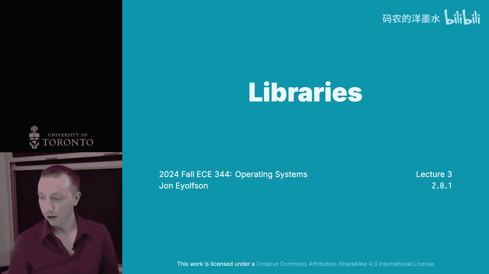

在本节课中，我们将要学习操作系统中的“库”这一核心概念。我们将探讨什么是库，它们如何工作，以及静态库和动态库之间的关键区别。通过理解库，我们可以更好地认识操作系统如何为应用程序提供支持。

---

## 什么是操作系统？ 🤔

上一节我们介绍了内核，它是直接与硬件交互、运行在内核模式的软件。那么，除了内核，操作系统还包含什么呢？

实际上，操作系统的定义有些模糊。它通常被认为是**内核**加上应用程序所需的一系列**库**。例如，网络管理器、办公软件或浏览器等应用程序，它们可能使用不同的库（如C标准库、GUI工具包等）来与内核进行交互。

因此，一个操作系统可以看作是：
**操作系统 = 内核 + 应用程序所需的库**

你所认为的“同一个操作系统”，可能取决于你的应用程序使用了哪些库。例如，Android和桌面版Linux都使用Linux内核，但它们的应用程序库集不同，因此通常被视为不同的操作系统。

---

## 代码编译与链接回顾 🔄

在深入讨论库之前，我们先快速回顾一下C代码是如何编译和链接成可执行文件的。

假设我们有四个C文件：`main.c`, `util.c`, `foo.c`, `bar.c`。编译过程如下：
1.  每个`.c`文件被**编译**成一个目标文件（`.o`文件），其中包含该文件的机器代码。
2.  所有`.o`文件通过**链接器**“粘合”在一起，形成一个最终的可执行文件。

用伪代码表示这个过程：
```bash
gcc -c main.c -o main.o
gcc -c util.c -o util.o
gcc -c foo.c -o foo.o
gcc -c bar.c -o bar.o
gcc main.o util.o foo.o bar.o -o my_program
```

---

## 静态库 📦

如果我们想在多个应用程序中重用 `util.c`, `foo.c`, `bar.c` 中的函数，每次都重新编译它们会很麻烦。这时，**静态库**就派上用场了。

静态库（在Linux上通常是 `.a` 文件）本质上是一组预先编译好的目标文件（`.o`文件）的归档集合。你可以把它看作一个代码包。

创建和使用静态库的步骤：
1.  将源代码编译成目标文件。
2.  使用 `ar` 命令将这些目标文件打包成一个静态库（例如 `libmylib.a`）。
3.  编译你的主程序时，链接这个静态库。

以下是创建和使用静态库的命令示例：
```bash
# 1. 编译源文件为目标文件
gcc -c util.c foo.c bar.c
# 2. 创建静态库
ar rcs libmylib.a util.o foo.o bar.o
# 3. 编译主程序并链接静态库
gcc main.c -L. -lmylib -o my_program
```

**关键点**：在链接时，静态库中的代码会被**直接复制**到最终的可执行文件中。这意味着可执行文件会变得更大，但运行时不需要再寻找库文件。

---

## 动态库 🔄

与静态库相对的是**动态库**（在Linux上通常是 `.so` 文件，即共享对象）。C标准库就是一个典型的动态库。

动态库也是可重用代码的集合，但它的工作方式不同：
*   代码**不会**被复制到每个可执行文件中。
*   多个程序可以**共享**内存中同一份动态库代码。
*   库是在程序**运行时**才被加载到内存中的。

使用动态库的好处是节省内存和磁盘空间。例如，`printf` 函数的代码只在系统中保存一份，所有程序都使用它。

---

## 静态库 vs 动态库 ⚖️

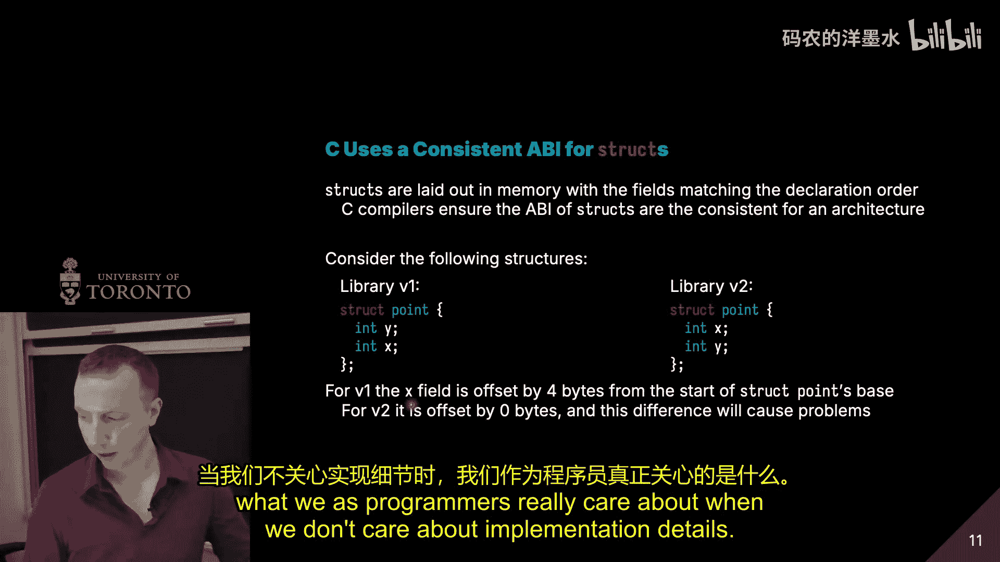

以下是静态链接和动态链接的核心区别：


**静态链接：**
*   **优点**：可执行文件自包含，不依赖外部库文件。更新库不会影响已编译的程序。
*   **缺点**：可执行文件体积大。如果库有更新（如修复bug），需要重新编译所有使用它的程序才能受益。

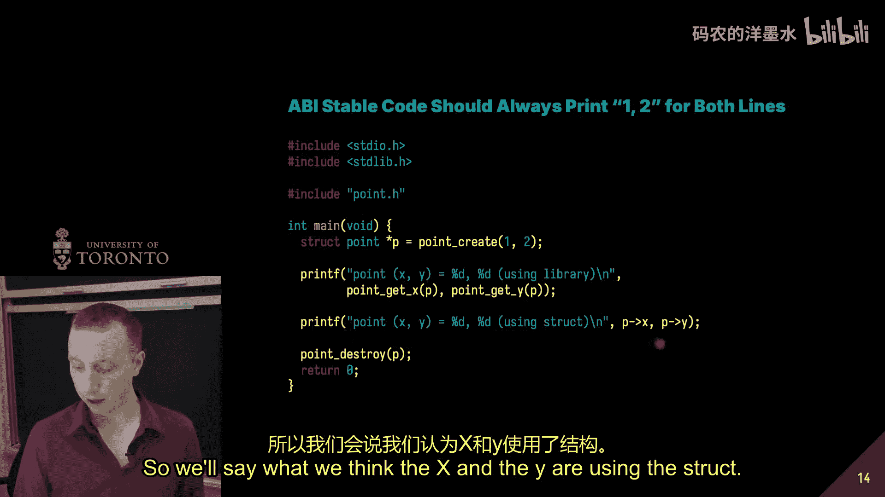

**动态链接：**
*   **优点**：节省空间，便于库的更新（只需替换一个 `.so` 文件）。多个程序共享内存中的同一份代码。
*   **缺点**：可执行文件依赖外部库。如果库的更新引入了不兼容的更改，**可能会意外地破坏所有依赖它的程序**，而它们自己并未重新编译。

一个有用的命令是 `ldd`，它可以查看一个可执行文件依赖哪些动态库：
```bash
ldd /bin/ls
```

---

## 动态库的陷阱：ABI破坏 💥

动态库的一个巨大风险是**应用程序二进制接口（ABI）** 的意外破坏。ABI是比API（应用程序编程接口）更底层的约定，它定义了数据结构在内存中的布局等细节。

让我们通过一个例子来理解。假设你有一个库，定义了这样一个结构体：
```c
// 版本1: point.h
struct Point {
    int y;
    int x;
};
```
在内存中，`y` 在低地址（偏移0），`x` 在高地址（偏移4）。

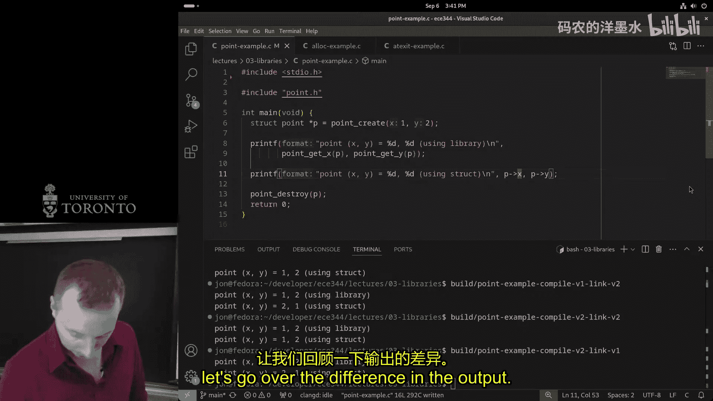

库还提供了创建和访问函数：
```c
struct Point* point_create(int x, int y);
int point_get_x(struct Point* p);
int point_get_y(struct Point* p);
```

现在，你在程序中这样使用：
```c
#include "point.h"
int main() {
    struct Point* p = point_create(1, 2);
    printf("Library: %d, %d\n", point_get_x(p), point_get_y(p)); // 使用库函数
    printf("Direct: %d, %d\n", p->x, p->y); // 直接访问结构体成员
    return 0;
}
```
使用版本1的库编译和运行，一切正常，两行输出都是 `1, 2`。

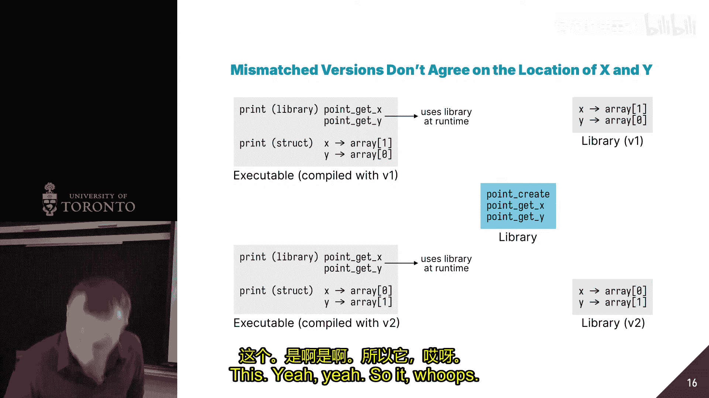

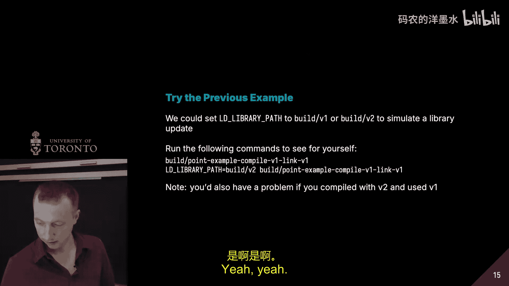

**问题来了**：库开发者觉得 `x` 应该放在 `y` 前面，于是在**版本2**中修改了结构体定义：
```c
// 版本2: point.h
struct Point {
    int x; // 顺序变了！
    int y;
};
```
**API没有变**（函数名和参数都没变），但**ABI变了**（内存布局变了）。

如果你**不重新编译**你的程序，只是将系统上的库文件更新为版本2，再次运行原来的程序，会发生什么？
*   `point_create(1, 2)` 现在会在内存位置0写入1（作为`x`），在位置4写入2（作为`y`）。
*   `point_get_x(p)` 会读取内存位置0，返回 **1**。
*   `point_get_y(p)` 会读取内存位置4，返回 **2**。
*   但是，你的程序是**用版本1的头文件编译的**，它认为 `p->x` 对应内存位置4，所以会打印出 **2**。`p->y` 对应内存位置0，打印出 **1**。

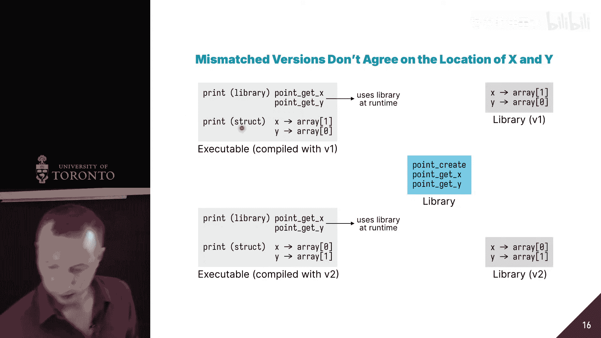

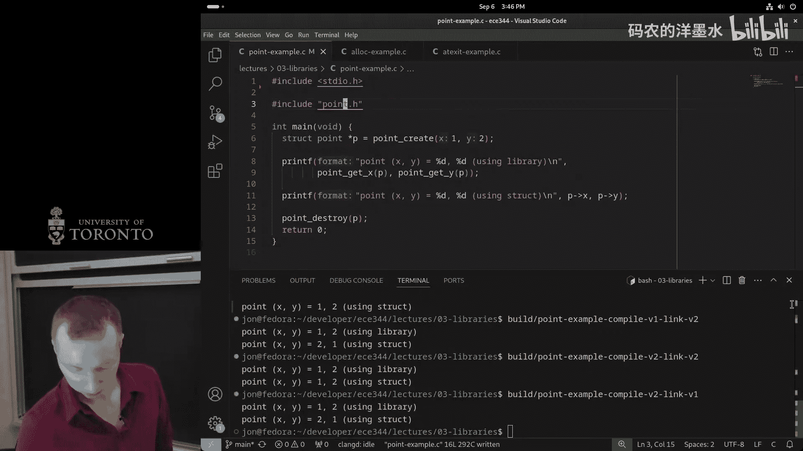

输出将变为：
```
Library: 1, 2
Direct: 2, 1
```
你的程序行为出错了！这就是ABI破坏的典型案例，在现实中确实发生过，导致大量软件崩溃。

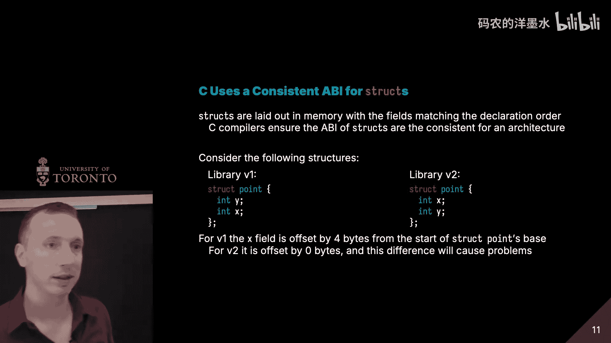

**教训**：对于动态库，如果你公开了结构体定义，就极难在不破坏现有程序的情况下修改它。一种好的做法是**隐藏结构体实现细节**（使用不透明指针），只通过函数接口来操作。

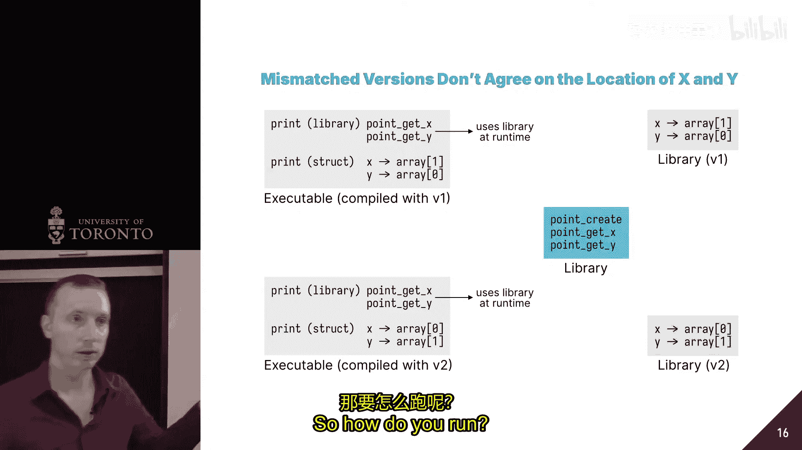

---

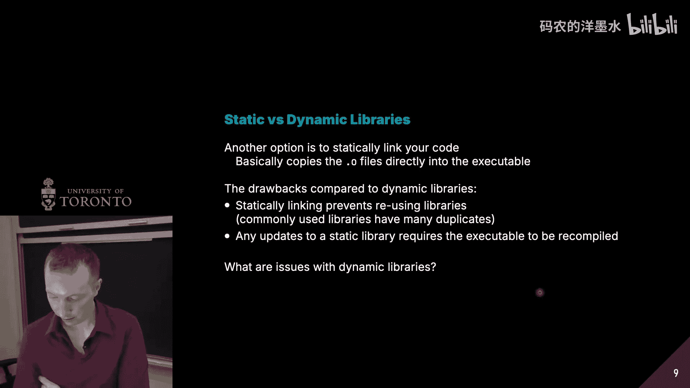

## 动态库的实用技巧：调试与拦截 🛠️

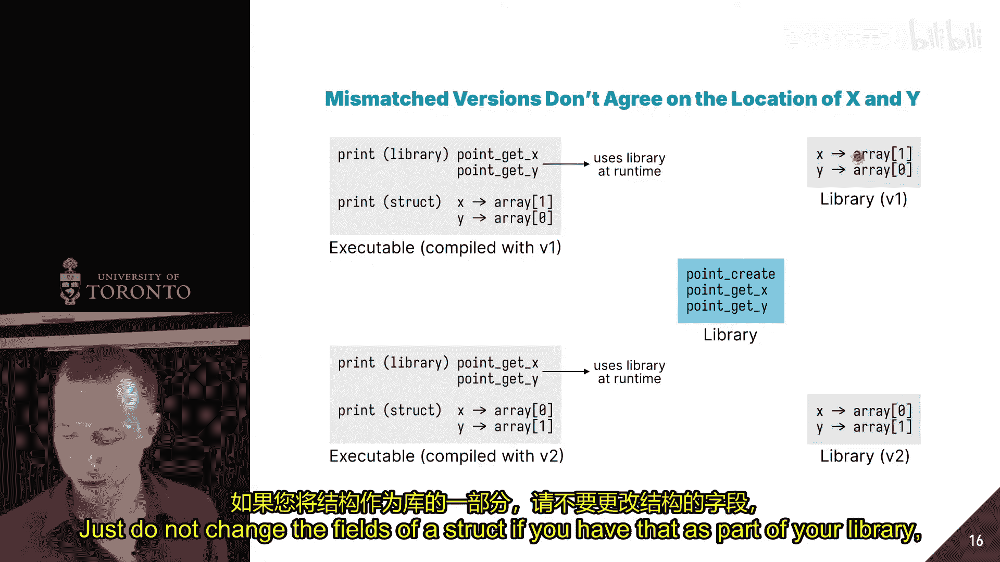

动态库在运行时加载的特性，也带来了一些强大的功能，例如拦截函数调用以进行调试。

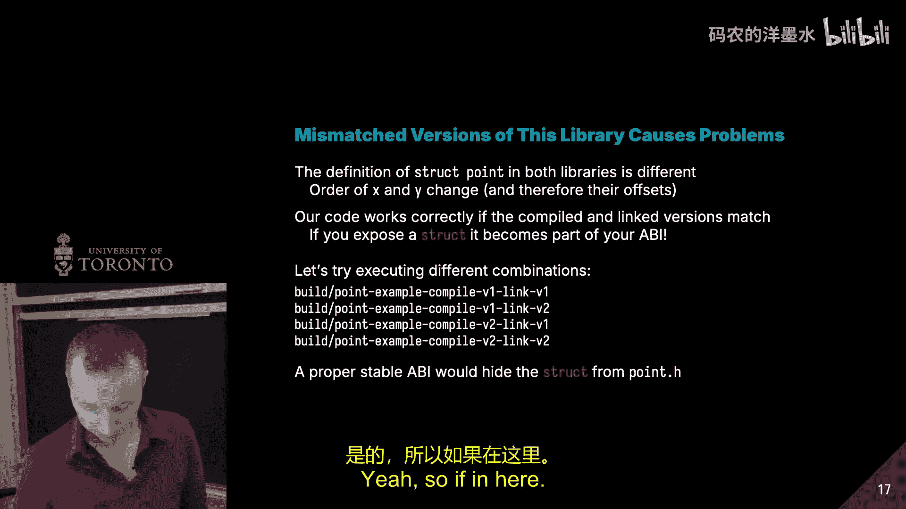

你可以使用 `LD_PRELOAD` 环境变量，让系统在运行程序时优先加载你指定的库。这可以用来“劫持”标准库函数，比如 `malloc` 和 `free`，以跟踪内存分配情况。

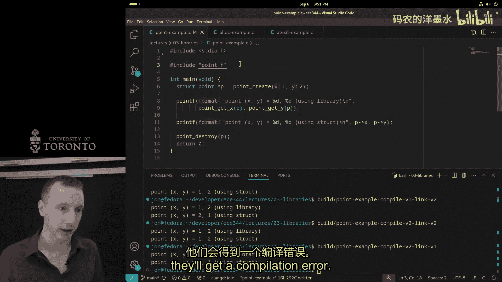

下面是一个简单的示例，创建一个自定义的 `malloc` 包装器：
```c
// my_debug.c
#define _GNU_SOURCE
#include <dlfcn.h>
#include <stdio.h>
#include <stdlib.h>

void* malloc(size_t size) {
    static void* (*real_malloc)(size_t) = NULL;
    if (!real_malloc) {
        real_malloc = dlsym(RTLD_NEXT, "malloc"); // 获取真正的malloc地址
    }
    void* p = real_malloc(size);
    fprintf(stderr, "malloc(%zu) = %p\n", size, p);
    return p;
}
```
编译成动态库并运行程序：
```bash
gcc -shared -fPIC my_debug.c -o libmydebug.so -ldl
LD_PRELOAD=./libmydebug.so ./my_program
```
这样，程序中的所有 `malloc` 调用都会被记录到标准错误输出。这是一个非常强大的调试和性能分析工具。

**有趣的事实**：当你运行这样的拦截程序时，你可能会发现像 `printf` 这样的标准库函数内部也会调用 `malloc`，并且它们可能不会释放这些内存。这是因为当进程结束时，操作系统会回收所有资源，因此库作者有时为了性能会选择不释放内部使用的内存。但这**不能**成为你的程序不调用 `free` 的理由！

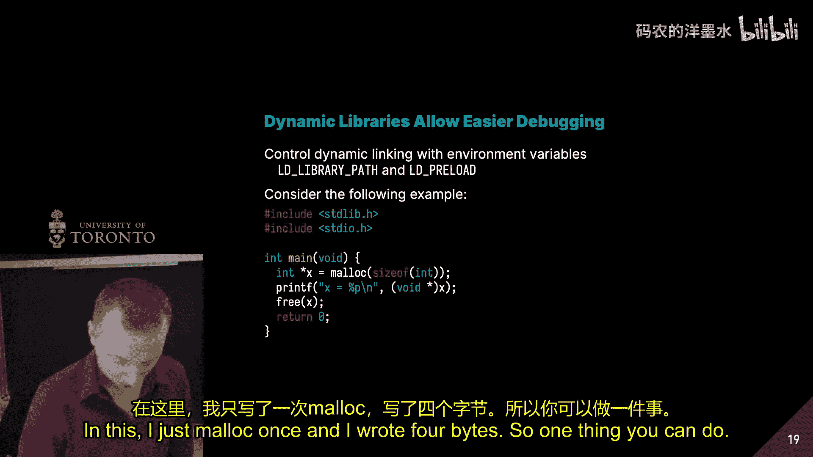

---

## 总结 📝

本节课中我们一起学习了操作系统中“库”的核心概念。

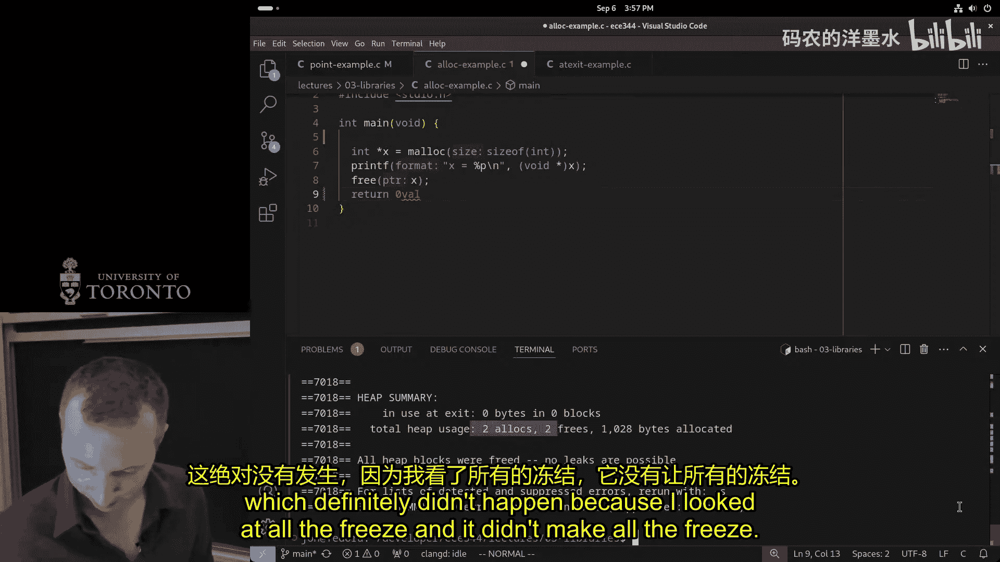

我们首先明确了操作系统是内核加上应用程序所需库的集合。然后回顾了代码编译链接的过程，并深入探讨了两种主要的库类型：
*   **静态库（.a）**：代码在编译时被复制到可执行文件中，使得程序独立但体积较大。
*   **动态库（.so）**：代码在运行时被加载和共享，节省空间但存在依赖和ABI兼容性风险。

我们通过一个结构体内存布局改变的实例，生动地展示了不谨慎的ABI更改如何通过动态库破坏现有程序。最后，我们还了解了利用动态库运行时加载特性进行调试的实用技巧。


理解库的工作原理，对于构建、维护和调试复杂的软件系统至关重要。