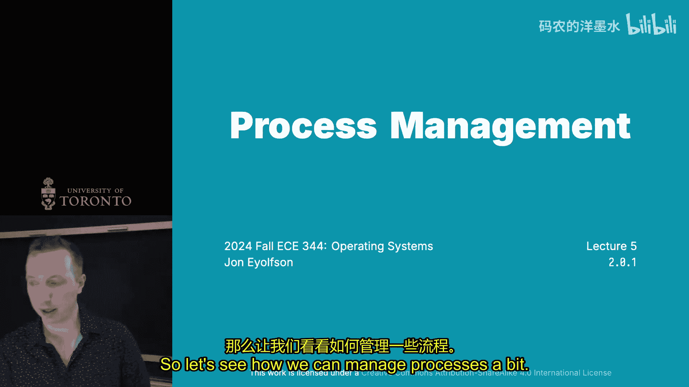
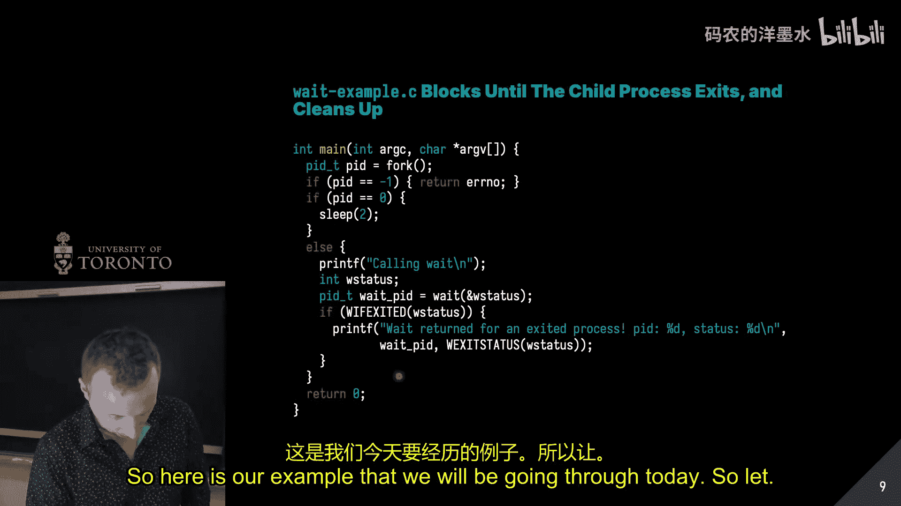
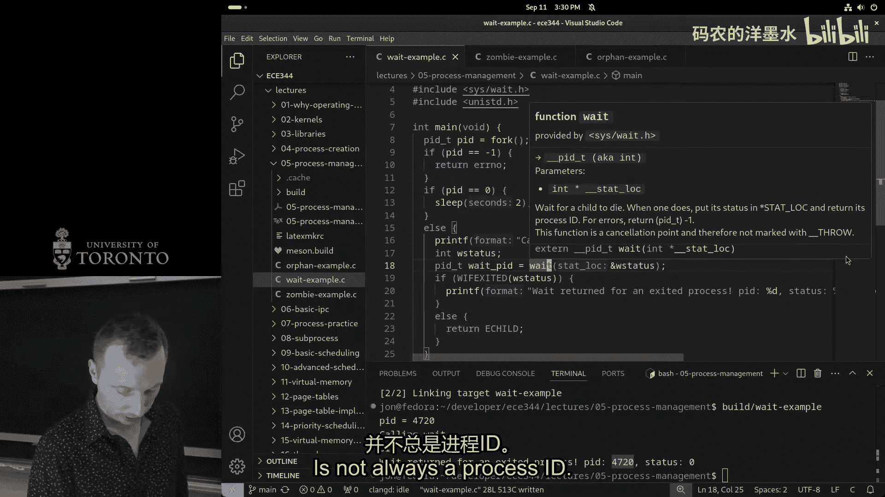
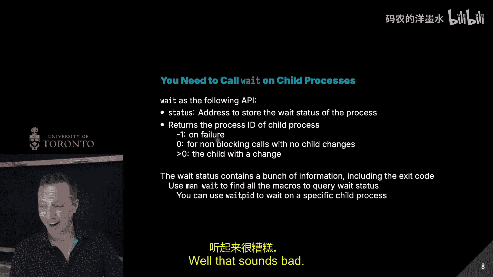
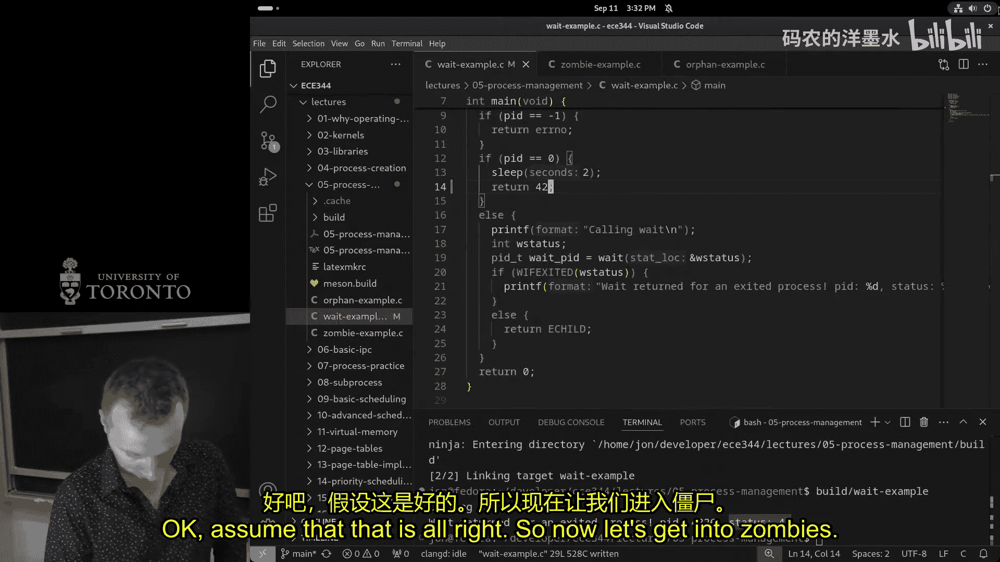
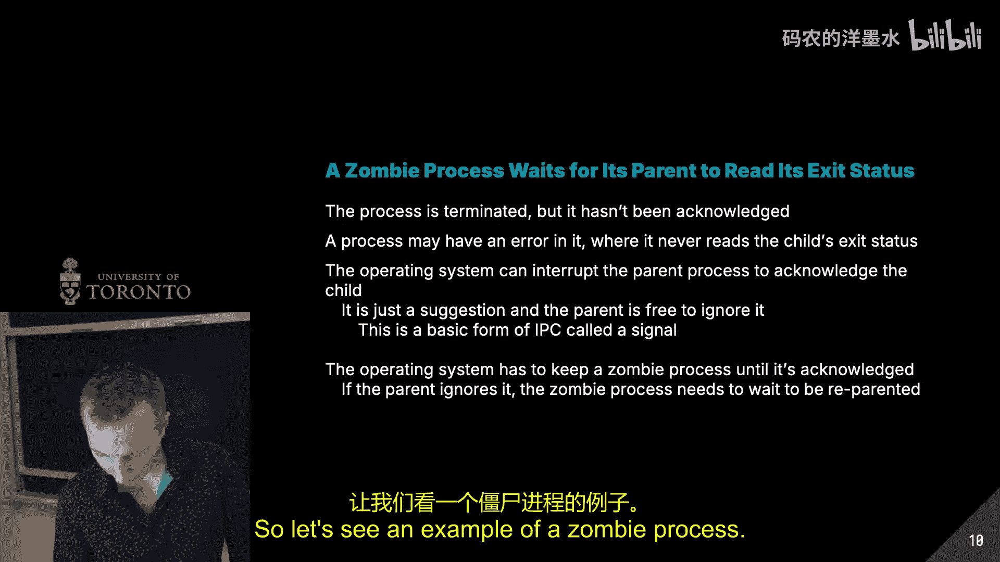
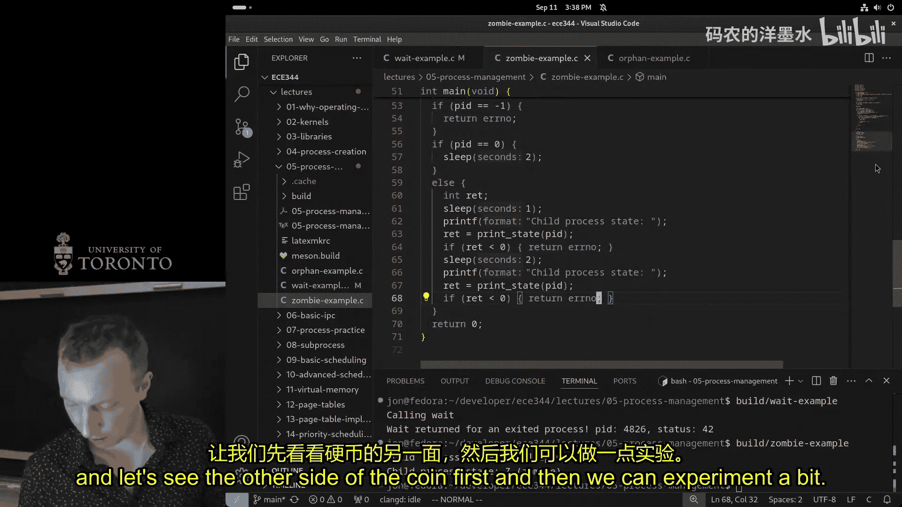
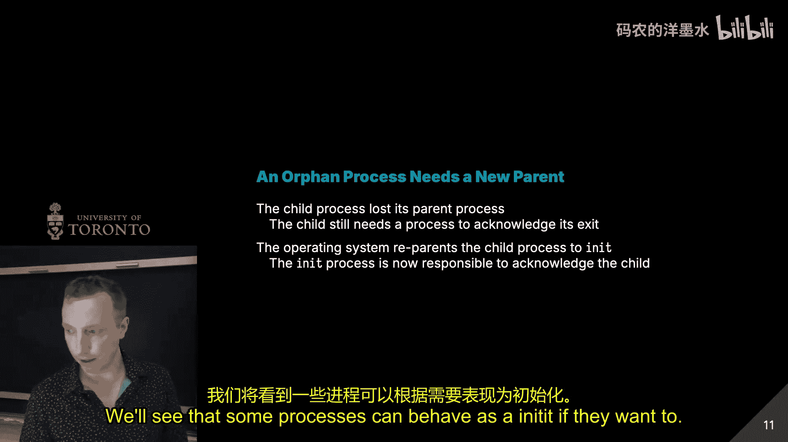
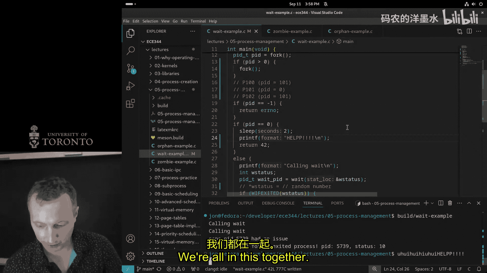

# 005：进程管理 👨‍💻



在本节课中，我们将要学习进程管理。我们将探讨进程的不同状态、父子进程关系，以及如何使用系统调用来管理进程的生命周期，特别是处理进程终止后的状态。

## 进程状态 🧭

上一节我们介绍了如何使用 `fork` 创建进程。本节中，我们来看看操作系统如何跟踪和管理进程的状态。

Linux 系统使用一套特定的术语来描述进程状态，与我们之前讨论的通用状态（就绪、运行、阻塞）略有不同。

以下是 Linux 中的主要进程状态：
*   **R (Running/Runnable)**: 进程正在运行或已就绪，可以运行。
*   **S (Interruptible Sleep)**: 进程正在睡眠（例如，等待某个事件），但这种睡眠是可中断的。
*   **D (Uninterruptible Sleep)**: 进程处于不可中断的睡眠状态，通常是在等待某些 I/O 操作完成。
*   **T (Stopped)**: 进程被显式停止（例如，通过调试器），需要其他进程来恢复它。
*   **Z (Zombie)**: 僵尸进程。进程已终止，但其退出状态尚未被父进程读取。

## 进程树与 Init 进程 🌳

在 Unix、Linux 或 Mac OS 系统中，所有进程都源自一个特殊的初始进程。内核启动后，会启动第一个用户空间进程，通常是 `init`（在现代 Linux 系统中可能是 `systemd`），其进程 ID (PID) 为 1。这个进程负责启动系统中的所有其他进程，并形成一棵进程树。

你可以使用 `htop` 命令并按 `F5` 键来查看进程的树状结构。

## 进程管理：`wait` 系统调用 ⏳



进程创建后，操作系统会为其分配一个唯一的进程 ID (PID)。每个进程都有自己独立的地址空间（虚拟内存）。进程之间存在父子关系。

当一个进程终止时，操作系统会保存其退出状态码（通常 0 表示成功，非 0 表示错误）。父进程需要读取子进程的退出状态，操作系统才能完全清理该子进程的资源。这是通过 `wait` 系统调用来完成的。

`wait` 系统调用的作用是等待子进程终止，并获取其退出状态。其函数原型如下：
```c
pid_t wait(int *status);
```
*   `status`: 一个指向整数的指针，用于存储子进程的终止状态信息。
*   **返回值**:
    *   成功时，返回被终止的子进程的 PID。
    *   失败时，返回 -1。
    *   在某些非阻塞模式下，可能返回 0（表示尚无子进程终止）。

默认情况下，`wait` 是一个阻塞调用。调用 `wait` 的进程会暂停执行，直到它的一个子进程终止。





以下是一个使用 `wait` 的代码示例及其解析：
```c
#include <stdio.h>
#include <stdlib.h>
#include <unistd.h>
#include <sys/wait.h>



int main() {
    pid_t pid = fork();

    if (pid > 0) { // 父进程
        printf("Calling wait...\n");
        int wstatus;
        pid_t wait_pid = wait(&wstatus);

        if (WIFEXITED(wstatus)) { // 检查子进程是否正常退出
            printf("Wait returned for an exited process PID %d with status %d\n",
                   wait_pid, WEXITSTATUS(wstatus));
        }
        return 0;
    } else if (pid == 0) { // 子进程
        sleep(2); // 子进程睡眠2秒
        return 42; // 子进程以状态码42退出
    } else {
        // fork 失败
        return 1;
    }
}
```
在这个例子中，父进程调用 `wait` 后会阻塞。子进程睡眠 2 秒后退出。2 秒后，父进程的 `wait` 调用返回，并打印出子进程的 PID 和退出状态码 42。宏 `WIFEXITED` 用于检查进程是否正常退出，`WEXITSTATUS` 用于提取退出状态码。



## 僵尸进程 🧟

如果子进程先于父进程终止，而父进程没有调用 `wait` 来读取其退出状态，那么这个子进程就会变成一个“僵尸进程”（Zombie）。

僵尸进程已经终止，不再运行，但内核为了保存其退出状态，不能完全释放其进程控制块（PCB）。因此，它仍然占用着一个进程 ID。如果系统中存在大量僵尸进程，可能会耗尽可用的进程 ID。





以下情况会创建僵尸进程：
1.  子进程终止。
2.  父进程尚未调用（或忽略）`wait` 来回收该子进程。

## 孤儿进程 🏠

与僵尸进程相反，如果父进程先于子进程终止，那么子进程就变成了“孤儿进程”（Orphan）。

操作系统不允许进程没有父进程。因此，当一个进程变成孤儿时，内核会将它“过继”给一个特殊的进程（通常是 PID 为 1 的 `init` 或 `systemd`）。这个新的父进程会负责在孤儿进程终止时调用 `wait` 进行清理。

以下代码演示了孤儿进程的产生：
```c
#include <stdio.h>
#include <unistd.h>
#include <sys/types.h>

int main() {
    pid_t pid = fork();

    if (pid > 0) { // 父进程
        sleep(1);
        return 0; // 父进程很快退出
    } else if (pid == 0) { // 子进程
        printf("My parent PID is: %d\n", getppid());
        sleep(2); // 此时父进程已退出
        printf("My parent PID after sleep is: %d (probably init/systemd)\n", getppid());
        return 0;
    }
    return 1;
}
```
运行此程序，你会看到子进程在睡眠前后，其父进程 ID 发生了变化，从原来的父进程 PID 变成了 1（或类似 `systemd` 的进程 PID）。

如果一个僵尸进程的父进程终止了，那么这个僵尸进程会先变成孤儿，然后被 `init` 进程收养，`init` 进程会调用 `wait` 将其清理掉，从而消除僵尸状态。

## 总结 📚

本节课中我们一起学习了进程管理的核心概念：
1.  **进程状态**：了解了 Linux 中进程的运行（R）、可中断睡眠（S）、不可中断睡眠（D）、停止（T）和僵尸（Z）状态。
2.  **进程树**：所有进程构成一棵树，根节点是 `init`（PID 为 1）进程。
3.  **`wait` 系统调用**：父进程使用 `wait` 来等待子进程结束并获取其退出状态，这是回收进程资源、避免僵尸进程的关键。
4.  **僵尸进程**：子进程终止后，若其退出状态未被父进程读取，则会成为僵尸进程，占用系统资源。
5.  **孤儿进程**：父进程先终止时，子进程成为孤儿，会被 `init` 进程收养并最终被正确清理。



理解父子进程间的生命周期管理和状态清理，对于编写健壮的多进程程序至关重要。