# 008：子进程

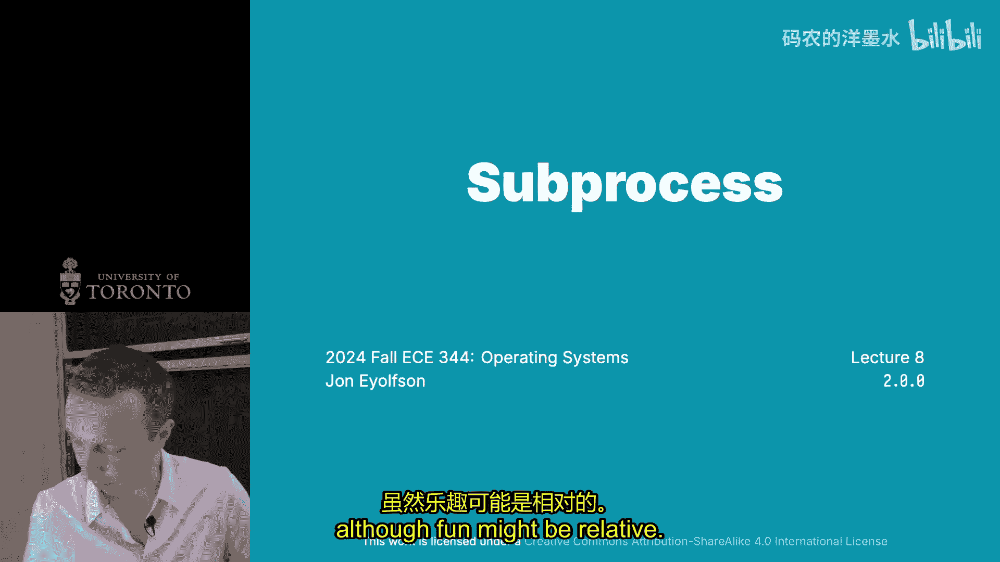

在本节课中，我们将学习如何创建和管理子进程，并通过管道与它们进行通信。我们将结合使用 `fork`、`exec`、`pipe` 和 `dup2` 等系统调用，完成一个完整的示例：创建一个子进程来运行指定的程序，向其发送数据，并读取其输出。

## 概述与目标

我们的目标是编写一个程序，它能够：
1.  创建一个新的子进程。
2.  在该子进程中运行一个通过命令行参数指定的程序。
3.  向该子进程的标准输入发送字符串 “testing”。
4.  从该子进程的标准输出读取数据，并在父进程中打印出来。

我们将使用管道作为父子进程间的通信通道。

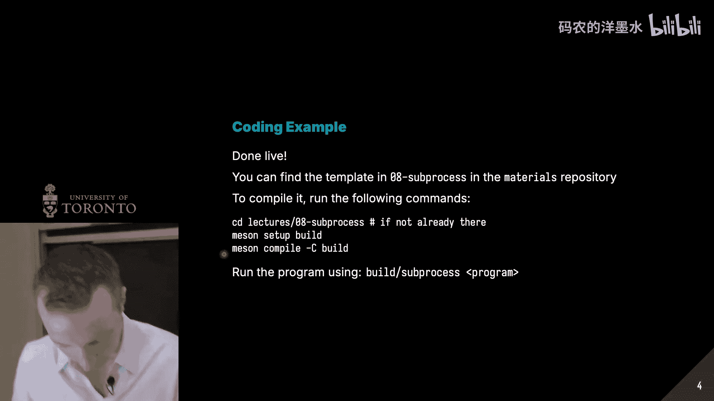

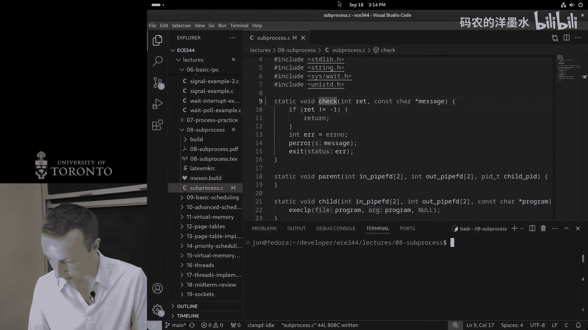

## 核心API回顾

在开始编码前，我们先回顾一下将要用到的几个关键系统调用和函数。

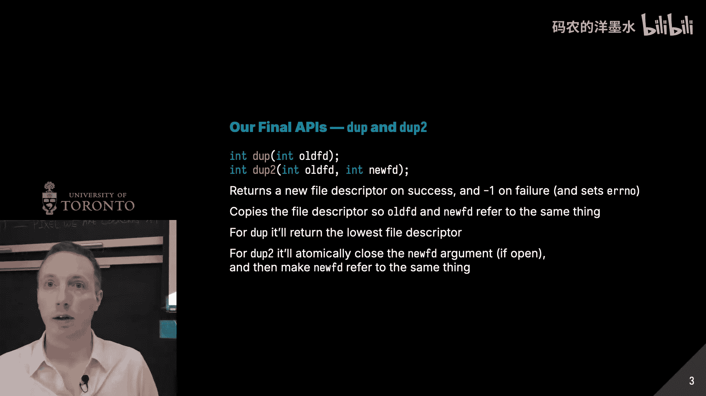

### `exec` 系列函数

`execve` 函数功能强大但使用稍显繁琐，需要手动构建参数数组并指定完整路径。C标准库提供了一个更便捷的包装函数 `execlp`。

`execlp` 函数原型如下：
```c
int execlp(const char *file, const char *arg, ... /* (char  *) NULL */);
```
*   **`file`**: 要执行的程序文件名（无需完整路径，系统会像Shell一样在 `PATH` 环境变量中查找）。
*   **`arg, ...`**: 程序的参数列表，以 `NULL` 结束。
*   **返回值**: 成功时不返回（进程被新程序替换）；失败时返回 `-1`。

与 `execve` 一样，`execlp` 成功执行后，当前进程的代码和数据将被新程序完全替换。

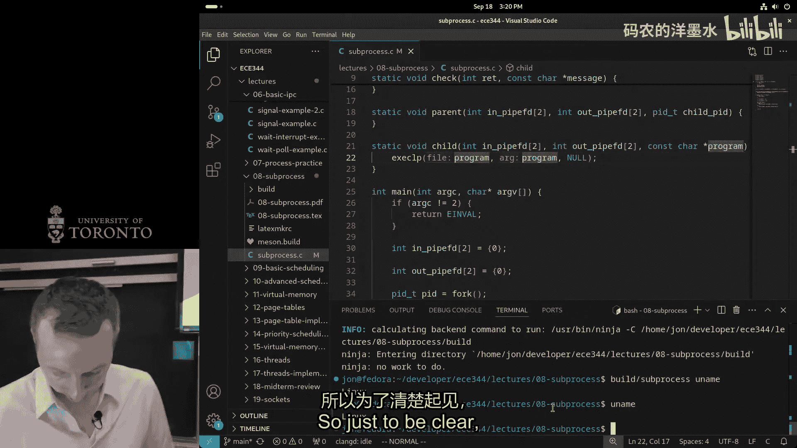

### `dup` 和 `dup2` 系统调用

这两个系统调用用于复制文件描述符。

*   **`dup`**: 复制一个已有的文件描述符，返回一个新的、指向同一文件/管道/设备等内核对象的最小可用文件描述符编号。
    ```c
    int dup(int oldfd);
    ```
*   **`dup2`**: 功能与 `dup` 类似，但可以指定新文件描述符的编号 `newfd`。如果 `newfd` 已经打开，`dup2` 会先将其关闭（这个操作是原子的，在多线程环境下更安全）。
    ```c
    int dup2(int oldfd, int newfd);
    ```

在本教程中，我们将主要使用 `dup2`，因为它能让我们精确控制文件描述符的指向。

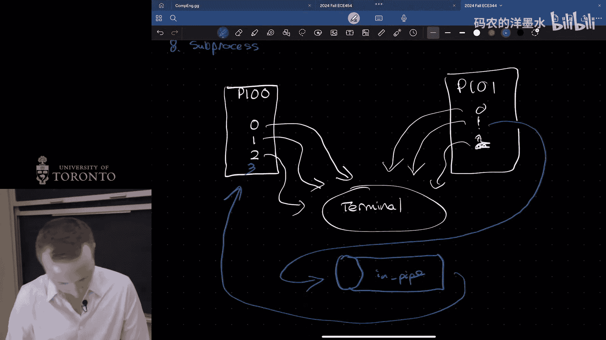

## 构建基础程序框架

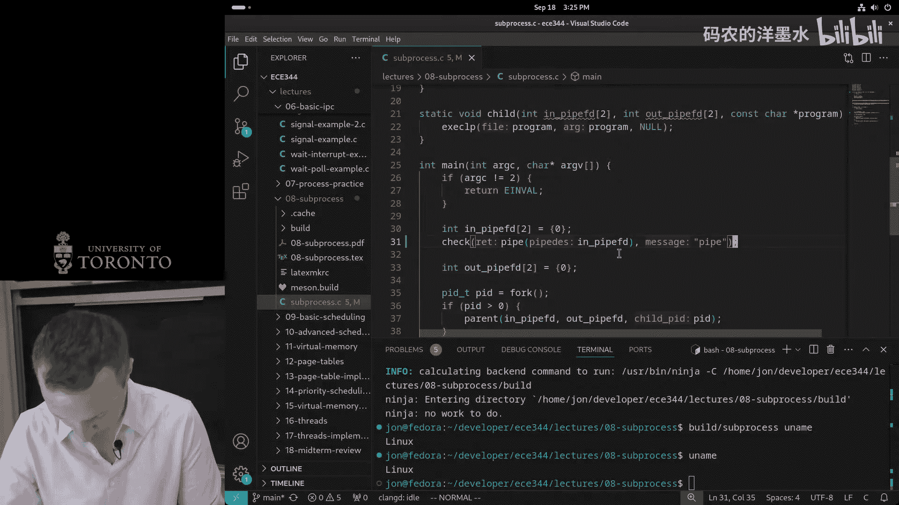

首先，我们构建一个基础程序，它能创建子进程并运行指定的命令。

以下是程序的基本结构，我们定义了一个错误检查函数 `check`，并完成了 `fork` 和 `execlp` 的调用。

```c
#include <stdio.h>
#include <stdlib.h>
#include <unistd.h>
#include <sys/wait.h>
#include <string.h>
#include <assert.h>

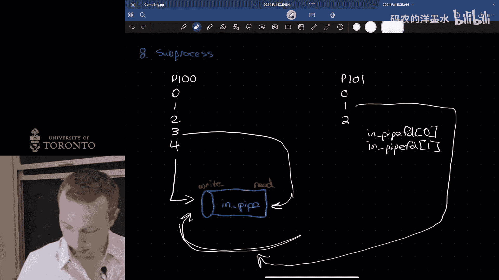

void check(int rc, const char* msg) {
    if (rc == -1) {
        perror(msg);
        exit(1);
    }
}

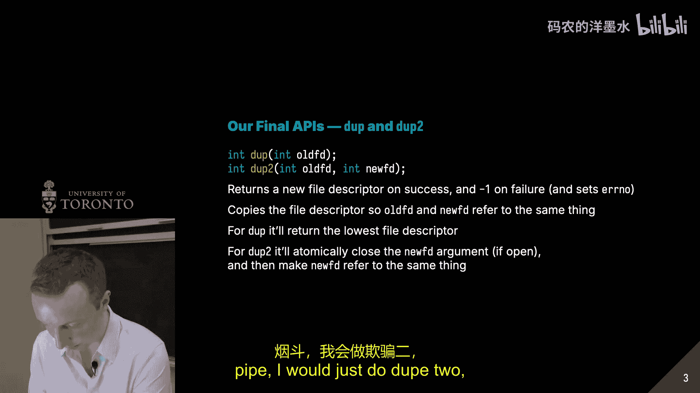

int main(int argc, char* argv[]) {
    // 检查参数数量
    if (argc != 2) {
        fprintf(stderr, "Usage: %s <command>\n", argv[0]);
        exit(1);
    }

    pid_t child_pid = fork();
    check(child_pid, "fork");

    if (child_pid == 0) {
        // 子进程：执行命令
        execlp(argv[1], argv[1], NULL);
        // 如果 execlp 失败
        perror("execlp");
        exit(1);
    } else {
        // 父进程：暂时等待子进程结束
        int wstatus;
        waitpid(child_pid, &wstatus, 0);
        assert(WIFEXITED(wstatus));
        printf("Child exited with status %d\n", WEXITSTATUS(wstatus));
    }

    return 0;
}
```
现在，这个程序可以运行诸如 `./a.out uname` 的命令，并在终端输出 “Linux”。这是因为子进程的 `stdout`（文件描述符1）默认指向终端。

## 捕获子进程的输出

上一节我们让子进程成功运行，但其输出直接显示在终端。本节中，我们将修改程序，使父进程能够读取子进程的输出。

为了实现这一点，我们需要在父子进程之间建立一个**管道**。我们的计划是：让子进程的 `stdout` 指向管道的**写端**，父进程则从管道的**读端**读取数据。

以下是实现步骤：
1.  在 `fork` **之前**创建管道（`in_pipe`），确保父子进程共享同一个管道。
2.  在子进程中，使用 `dup2` 将 `stdout`（文件描述符1）重定向到 `in_pipe` 的写端（`in_pipe_fd[1]`）。
3.  在子进程中，关闭所有不再需要的管道文件描述符。
4.  在父进程中，从 `in_pipe` 的读端（`in_pipe_fd[0]`）读取数据，并在使用后关闭管道两端。

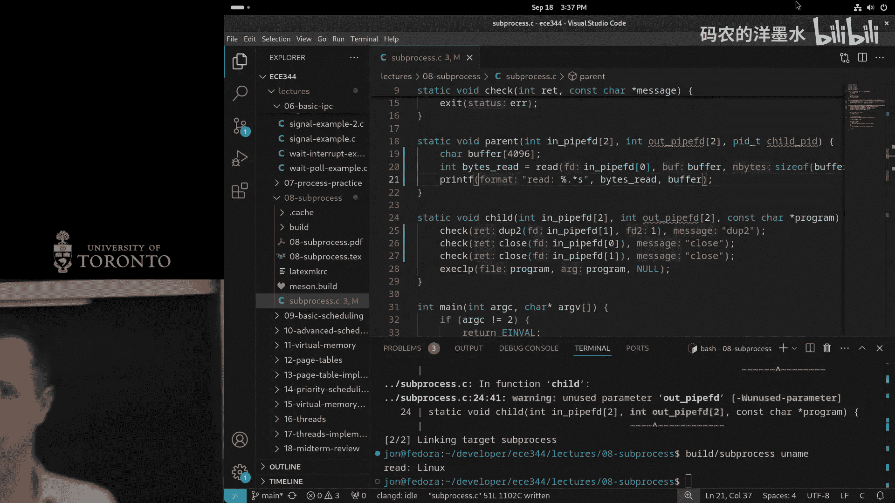

修改后的 `main` 函数和子进程部分代码如下：

```c
int main(int argc, char* argv[]) {
    // ... 参数检查同上 ...

    int in_pipe_fd[2] = {0};
    check(pipe(in_pipe_fd), "pipe in");

    pid_t child_pid = fork();
    check(child_pid, "fork");

    if (child_pid == 0) {
        // 子进程代码
        // 1. 重定向 stdout 到管道的写端
        check(dup2(in_pipe_fd[1], STDOUT_FILENO), "dup2 stdout in child");
        // 2. 关闭所有从父进程继承的、子进程不需要的管道文件描述符
        close(in_pipe_fd[0]);
        close(in_pipe_fd[1]);

        // 执行命令
        execlp(argv[1], argv[1], NULL);
        perror("execlp");
        exit(1);
    } else {
        // 父进程代码
        // 1. 关闭父进程不需要的管道写端
        close(in_pipe_fd[1]);

        // 2. 从管道读端读取子进程的输出
        char buffer[1024];
        ssize_t bytes_read = read(in_pipe_fd[0], buffer, sizeof(buffer) - 1);
        check(bytes_read, "read from child");
        buffer[bytes_read] = '\0'; // 确保字符串终止
        printf("Read from child: %s", buffer);

        // 3. 关闭管道读端
        close(in_pipe_fd[0]);

        // 等待子进程结束
        int wstatus;
        waitpid(child_pid, &wstatus, 0);
        assert(WIFEXITED(wstatus));
    }
    return 0;
}
```
运行 `./a.out uname`，现在输出将是 `Read from child: Linux`。子进程的输出被成功捕获到父进程中。

## 向子进程发送输入

我们已经学会了如何读取子进程的输出。接下来，我们看看如何向子进程发送输入。思路是创建第二个管道（`out_pipe`），让子进程的 `stdin` 指向这个管道的**读端**，父进程则向这个管道的**写端**写入数据。

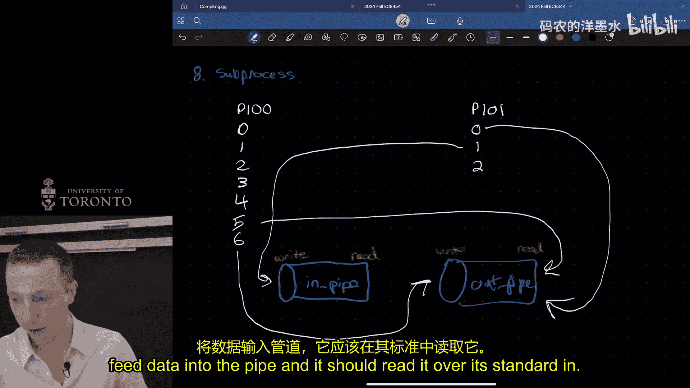


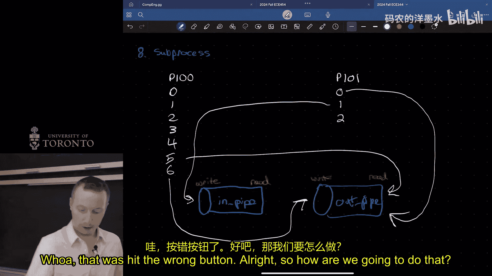

以下是需要添加的步骤：
1.  在 `fork` 前创建第二个管道 `out_pipe`。
2.  在子进程中，使用 `dup2` 将 `stdin`（文件描述符0）重定向到 `out_pipe` 的读端（`out_pipe_fd[0]`）。
3.  在子进程中，同样关闭所有不需要的管道文件描述符。
4.  在父进程中，向 `out_pipe` 的写端（`out_pipe_fd[1]`）写入字符串 “testing\n”，并在使用后关闭管道两端。

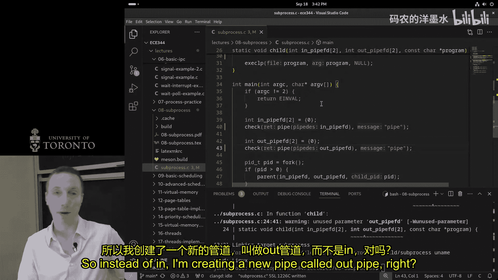

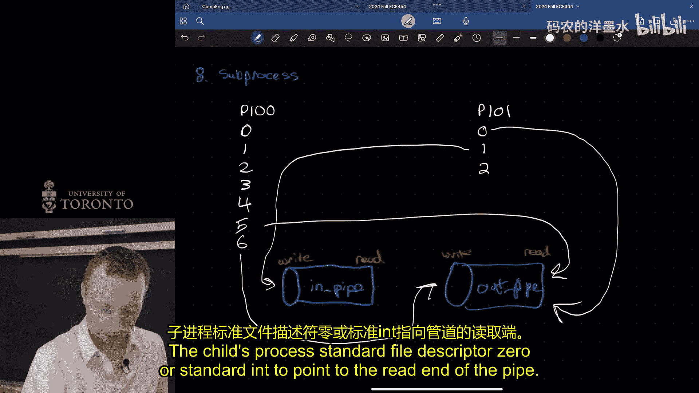

我们将修改程序，使其运行 `cat` 命令。`cat` 会从 `stdin` 读取数据并回显到 `stdout`。这样，我们就能测试完整的双向通信。

整合了双向通信的完整 `main` 函数如下：

```c
int main(int argc, char* argv[]) {
    if (argc != 2) {
        fprintf(stderr, "Usage: %s <command>\n", argv[0]);
        exit(1);
    }

    // 创建用于子进程输出的管道 (父读子写)
    int in_pipe_fd[2] = {0};
    check(pipe(in_pipe_fd), "pipe in");
    // 创建用于向子进程输入的管道 (父写子读)
    int out_pipe_fd[2] = {0};
    check(pipe(out_pipe_fd), "pipe out");

    pid_t child_pid = fork();
    check(child_pid, "fork");

    if (child_pid == 0) {
        // ---------- 子进程 ----------
        // 重定向 stdin 到 out_pipe 的读端
        check(dup2(out_pipe_fd[0], STDIN_FILENO), "dup2 stdin in child");
        // 重定向 stdout 到 in_pipe 的写端
        check(dup2(in_pipe_fd[1], STDOUT_FILENO), "dup2 stdout in child");
        // 重定向 stderr 保持不变（可选）
        // check(dup2(in_pipe_fd[1], STDERR_FILENO), "dup2 stderr in child");

        // 关闭所有从父进程继承的、子进程不需要的文件描述符
        close(in_pipe_fd[0]);
        close(in_pipe_fd[1]);
        close(out_pipe_fd[0]);
        close(out_pipe_fd[1]);

        // 执行命令
        execlp(argv[1], argv[1], NULL);
        perror("execlp");
        exit(1);

    } else {
        // ---------- 父进程 ----------
        // 关闭父进程不需要的管道端
        close(in_pipe_fd[1]); // 不需要写 in_pipe
        close(out_pipe_fd[0]); // 不需要读 out_pipe

        // 1. 向子进程发送数据
        const char* message = "testing\n";
        ssize_t bytes_written = write(out_pipe_fd[1], message, strlen(message));
        check(bytes_written, "write to child");
        // 发送完毕后，关闭写端，向子进程发送 EOF
        close(out_pipe_fd[1]);

        // 2. 读取子进程的响应
        char buffer[1024];
        ssize_t bytes_read = read(in_pipe_fd[0], buffer, sizeof(buffer) - 1);
        check(bytes_read, "read from child");
        buffer[bytes_read] = '\0';
        printf("Read from child: %s", buffer);
        // 读取完毕后，关闭读端
        close(in_pipe_fd[0]);

        // 3. 等待子进程结束
        int wstatus;
        waitpid(child_pid, &wstatus, 0);
        assert(WIFEXITED(wstatus));
        printf("Child exited normally with status %d\n", WEXITSTATUS(wstatus));
    }
    return 0;
}
```
运行 `./a.out cat`，程序将输出 `Read from child: testing`。这证明了父进程成功将数据发送给了子进程（`cat`），并接收到了它的回显。

## 总结与最佳实践

本节课中，我们一起学习了进程间通信的核心机制。我们构建了一个完整的程序，它能够：
1.  使用 `fork` 创建子进程。
2.  使用 `execlp` 在子进程中加载新程序。
3.  使用 `pipe` 创建两个单向通信通道。
4.  使用 `dup2` 重定向子进程的标准输入和输出到相应的管道端。
5.  在父进程中通过 `write` 和 `read` 与子进程交互。
6.  使用 `waitpid` 等待子进程结束，避免产生僵尸进程。

在编写此类程序时，请牢记以下最佳实践：
*   **及时关闭文件描述符**：在每个进程中，一旦确定某个文件描述符不再需要，应立即关闭它。这可以避免资源泄漏和意外的阻塞（例如，读操作因写端未关闭而无法收到EOF）。
*   **在 `fork` 前创建管道**：确保管道被需要通信的进程共享。
*   **使用 `dup2` 进行重定向**：它比 `dup` 更可控，特别是可以指定目标文件描述符编号。
*   **做负责任的父进程**：总是使用 `waitpid` 或类似函数等待子进程结束，回收其资源。

通过掌握这些概念和技巧，你就具备了完成类似 `lab2` 任务所需的所有知识。