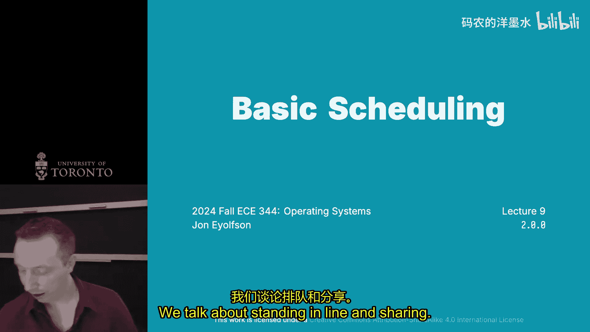
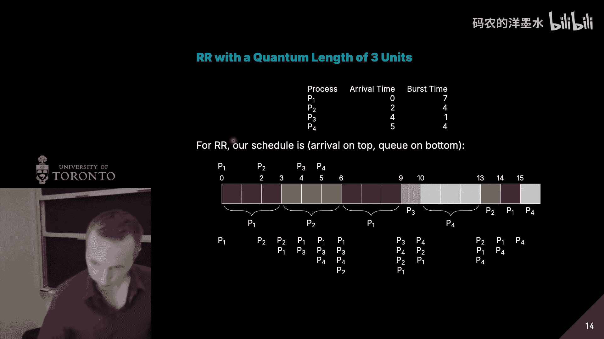
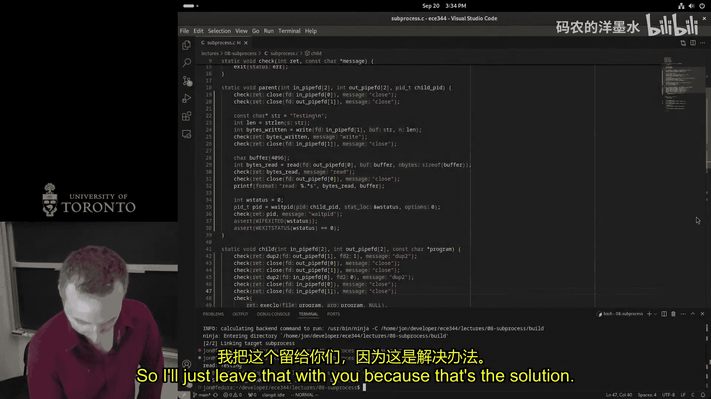
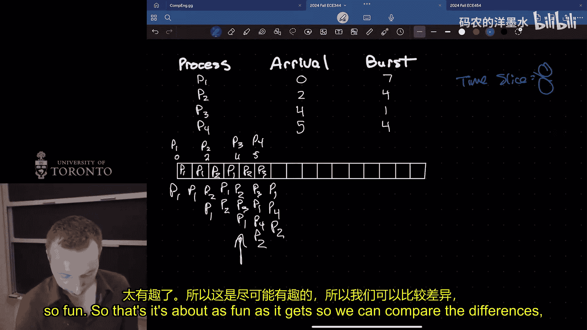
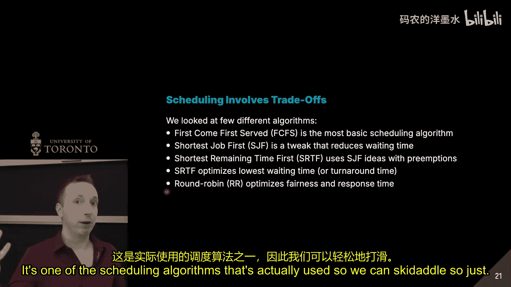

# 009：基础调度



在本节课中，我们将要学习操作系统中的基础调度概念。调度是决定哪个进程获得CPU时间的过程，类似于排队和分享资源。我们将介绍几种基本的调度算法，并通过简单的例子来理解它们如何工作以及如何评估它们的性能。

## 资源类型与调度器

在深入调度算法之前，我们需要了解操作系统管理的资源。资源主要分为两类：**可抢占资源**和**不可抢占资源**。

*   **可抢占资源**：可以在任何时候被取走并重新分配给其他进程，而不会引起问题。CPU就是一个典型的例子，操作系统可以随时中断一个进程，将CPU分配给另一个进程。
*   **不可抢占资源**：一旦分配给某个进程，在进程主动释放前不能被强行取走。内存和磁盘空间就是这类资源。

调度器负责制定高级策略，决定接下来运行哪个进程。而**分发器**则负责执行低级机制，如上下文切换，实际更换正在运行的进程。每当进程状态发生变化时，调度器就会运行。

## 调度评估指标

为了比较不同调度算法的优劣，我们使用以下几个关键指标：

*   **平均等待时间**：进程从就绪到开始执行所花费的平均时间。我们希望这个时间越短越好。
*   **平均响应时间**：进程从提交请求到第一次获得CPU响应（开始执行）所花费的平均时间。对于交互式系统，这个时间很重要。
*   **CPU利用率**：CPU忙碌时间的百分比。我们希望最大化CPU利用率，避免CPU空闲。
*   **吞吐量**：在单位时间内完成的进程数量。我们希望最大化吞吐量。
*   **公平性**：确保每个进程都能获得合理的CPU时间份额，避免“饥饿”（即某个进程永远得不到执行）。

这些指标有时是相互矛盾的，调度算法需要在它们之间做出权衡。

## 先来先服务调度

我们先从最简单的调度算法开始：**先来先服务**。这就像日常生活中的排队，第一个到达的进程第一个获得服务。

进程按照到达顺序排成一个队列（FIFO队列）。调度器总是选择队列头部的进程来执行，并且在没有抢占的情况下，该进程会一直运行直到完成。

假设我们有四个进程，它们的到达时间和所需执行时间（突发时间）如下：

| 进程 | 到达时间 | 突发时间 |
| :--- | :--- | :--- |
| P1 | 0 | 7 |
| P2 | 2 | 4 |
| P3 | 4 | 1 |
| P4 | 5 | 4 |

如果按照P1、P2、P3、P4的顺序到达，使用FCFS调度的甘特图如下：

```
时间:  0    7    11   12   16
      | P1 | P2 | P3 | P4 |
```

以下是各进程的等待时间计算：

*   P1：在时间0到达并立即执行，等待时间 = 0。
*   P2：在时间2到达，但必须等到P1在时间7结束，等待时间 = 7 - 2 = 5。
*   P3：在时间4到达，等到时间11才开始，等待时间 = 11 - 4 = 7。
*   P4：在时间5到达，等到时间12才开始，等待时间 = 12 - 5 = 7。

平均等待时间 = (0 + 5 + 7 + 7) / 4 = 4.75。

FCFS算法实现简单，但平均等待时间可能较长，特别是当一些执行时间很长的进程排在前面时，会导致后面的短进程等待很久（“护航效应”）。

## 最短作业优先调度

为了降低平均等待时间，我们可以改进算法，总是优先调度**执行时间最短的进程**，这就是**最短作业优先**调度。

使用和上面相同的一组进程。在时间0，只有P1到达，所以执行P1。当P1运行时，其他进程陆续到达。调度器会维护一个按作业长度排序的队列。

1.  时间0：执行P1（剩余7单位）。
2.  时间2：P2到达（突发时间4）。队列：P2。
3.  时间4：P3到达（突发时间1）。由于P3比队列中的P2更短，P3被插到队首。队列：P3 -> P2。
4.  时间5：P4到达（突发时间4）。队列：P3 -> P2 -> P4（P2比P4先到）。
5.  时间7：P1结束。调度器选择队列中作业最短的P3执行。
6.  时间8：P3结束。调度器选择下一个最短的P2执行。
7.  时间12：P2结束。调度器选择P4执行。
8.  时间16：P4结束。

甘特图如下：
```
时间:  0    7  8     12    16
      | P1 | P3 | P2 | P4 |
```

计算等待时间：
*   P1：0（立即执行）
*   P2：到达时间2，开始时间8，等待时间 = 8 - 2 = 6
*   P3：到达时间4，开始时间7，等待时间 = 7 - 4 = 3
*   P4：到达时间5，开始时间12，等待时间 = 12 - 5 = 7

平均等待时间 = (0 + 6 + 3 + 7) / 4 = 4.0。

可以证明，在非抢占式调度中，SJF能提供最小的平均等待时间。然而，它有两个主要缺点：1) 操作系统通常无法预知一个进程需要运行多久；2) 可能导致长作业“饥饿”，如果不断有短作业到达，长作业可能永远得不到执行。



## 最短剩余时间优先调度



我们可以为SJF添加**抢占**机制，得到**最短剩余时间优先**调度。当一个新的进程到达时，如果它的剩余执行时间比当前正在运行的进程的剩余时间更短，就抢占CPU。

使用同一组进程：
1.  时间0：执行P1（剩余7）。
2.  时间2：P2到达（剩余4）。P1剩余5，P2剩余4（更短），因此抢占P1，执行P2。
3.  时间4：P3到达（剩余1）。P2剩余2，P3剩余1（更短），抢占P2，执行P3。
4.  时间5：P4到达（剩余4）。此时队列：P1（剩5），P2（剩2），P4（剩4）。最短剩余时间是P2的2，因此执行P2。
5.  时间7：P2结束。队列：P1（剩5），P4（剩4）。最短剩余是P4的4，执行P4。
6.  时间11：P4结束。执行P1（剩5）。
7.  时间16：P1结束。

甘特图如下：
```
时间: 0  2  4  5  7    11    16
     |P1|P2|P3|P2| P4  | P1  |
```

计算等待时间（使用完成时间-到达时间-执行时间的方法）：
*   P1：完成时间16 - 到达时间0 - 执行时间7 = 9
*   P2：完成时间7 - 到达时间2 - 执行时间4 = 1
*   P3：完成时间5 - 到达时间4 - 执行时间1 = 0
*   P4：完成时间11 - 到达时间5 - 执行时间4 = 2

平均等待时间 = (9 + 1 + 0 + 2) / 4 = 3.0。

SRTF进一步优化了平均等待时间，但它仍然面临和SJF相同的实际问题（无法预知执行时间）和公平性问题（长作业可能饥饿）。

## 时间片轮转调度

为了解决公平性问题并避免饥饿，我们引入**时间片轮转**调度算法。RR算法为每个进程分配一个固定的CPU时间单元，称为**时间片**或**量子**。

算法流程如下：
1.  维护一个FIFO就绪队列。
2.  调度器从队列头部取出一个进程，允许它运行一个时间片。
3.  如果进程在时间片结束前完成，它会主动释放CPU。
4.  如果进程在时间片结束时仍未完成，它会被**抢占**，并被放回就绪队列的尾部。
5.  重复步骤2。

时间片长度的选择是一个权衡：
*   **时间片太短**：会导致频繁的上下文切换，系统开销增大，吞吐量下降。
*   **时间片太长**：RR退化成FCFS，响应时间变差。

假设时间片长度 = 3，使用同一组进程：
1.  时间0：队列[P1]。执行P1。
2.  时间2：P2到达，加入队列尾。队列[P1， P2]。
3.  时间3：P1用完第一个时间片，未完成，放回队列尾。队列[P2， P1]。执行P2。
4.  时间4：P3到达，加入队列尾。队列[P2， P1， P3]。
5.  时间5：P4到达，加入队列尾。队列[P2， P1， P3， P4]。
6.  时间6：P2用完一个时间片（已运行3，剩余1），未完成，放回队列尾。队列[P1， P3， P4， P2]。执行P1。
7.  时间9：P1用完第二个时间片（已运行6，剩余1），未完成，放回队列尾。队列[P3， P4， P2， P1]。执行P3。
8.  时间10：P3完成（只需1单位）。队列[P4， P2， P1]。执行P4。
9.  时间13：P4用完一个时间片（已运行3，剩余1），未完成，放回队列尾。队列[P2， P1， P4]。执行P2。
10. 时间14：P2完成。队列[P1， P4]。执行P1。
11. 时间15：P1完成。队列[P4]。执行P4。
12. 时间16：P4完成。

甘特图如下：
```
时间: 0    3  6    9 10   13 14 15 16
     | P1 |P2| P1 |P3| P4 |P2|P1|P4|
```

计算平均等待时间：
*   P1：完成时间15 - 到达时间0 - 执行时间7 = 8
*   P2：完成时间14 - 到达时间2 - 执行时间4 = 8
*   P3：完成时间10 - 到达时间4 - 执行时间1 = 5
*   P4：完成时间16 - 到达时间5 - 执行时间4 = 7
平均等待时间 = (8 + 8 + 5 + 7) / 4 = 7.0

计算平均响应时间（首次开始时间 - 到达时间）：
*   P1：0
*   P2：3 - 2 = 1
*   P3：9 - 4 = 5
*   P4：10 - 5 = 5
平均响应时间 = (0 + 1 + 5 + 5) / 4 = 2.75

上下文切换次数：7次（甘特图中进程切换的次数）。

如果我们把时间片改为1，平均响应时间会更好（因为进程更快地轮转），但上下文切换次数会显著增加（达到14次），系统开销变大。如果时间片远大于所有作业的长度，RR就退化成了FCFS。



## 总结

本节课中我们一起学习了操作系统的基础调度算法。我们首先了解了可抢占与不可抢占资源的区别，以及调度器与分发器的角色。接着，我们介绍了评估调度算法的关键指标，如等待时间、响应时间和公平性。

然后，我们详细探讨了四种经典调度算法：
1.  **先来先服务**：简单公平，但平均等待时间可能较差。
2.  **最短作业优先**：能提供最优的平均等待时间，但不切实际且可能导致长作业饥饿。
3.  **最短剩余时间优先**：SJF的抢占式版本，进一步优化等待时间，但存在同样的问题。
4.  **时间片轮转**：通过引入时间片来实现公平性，避免饥饿，并能提供良好的响应时间，其性能高度依赖于时间片长度的选择。



这些算法各有优劣，体现了系统设计中的典型权衡。在实际操作系统中，通常会使用更复杂的、结合了多种策略的调度算法。