# 010：虚拟内存 🧠

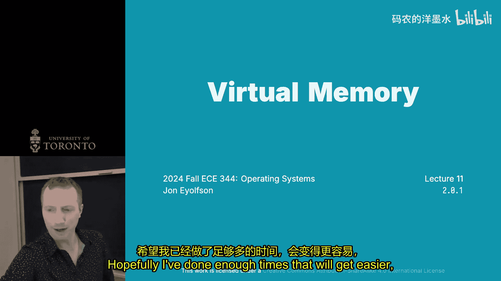


在本节课中，我们将要学习操作系统中的一个核心概念：虚拟内存。我们将探讨为什么需要虚拟内存，以及如何将虚拟地址转换为物理地址。我们会从简单的想法开始，逐步深入到现代计算机使用的分页机制，并通过例子来理解地址转换的过程。

---

## 虚拟内存的动机与目标

上一节我们介绍了进程和内存管理的基本概念，本节中我们来看看为什么需要虚拟内存以及它需要满足哪些目标。


虚拟内存的存在是为了解决多个进程安全、高效地共享物理内存的问题。为了实现这一点，我们需要一个映射机制，将进程看到的虚拟地址转换成实际的物理地址。

以下是虚拟内存系统需要满足的几个关键目标：

*   **多进程共存**：允许多个进程同时运行，互不干扰。
*   **进程隔离**：一个进程不能访问另一个进程的内存，除非显式允许，这是安全性的基础。
*   **高性能**：地址转换的开销应该尽可能小，性能应接近直接使用物理内存。
*   **低空间开销**：用于管理地址转换的数据结构本身不应占用过多内存。
*   **减少碎片**：尽量减少内存的浪费（即碎片化）。

---

## 早期思路：分段

在探讨现代方案之前，我们先看一个早期的思路：分段。分段是一种粗粒度的地址翻译方式。

它将一个程序的虚拟地址空间划分为几个大的逻辑段，例如代码段、数据段、栈段和堆段。每个段在物理内存中占据一块连续区域，并有自己的基地址、大小限制和权限（如可读、可写、可执行）。

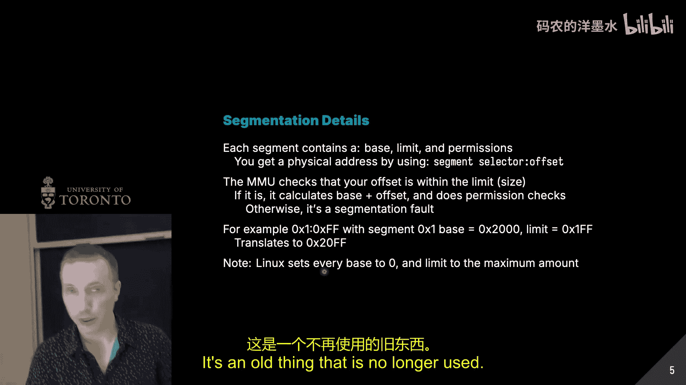

地址转换时，虚拟地址由**段选择符**和**段内偏移量**组成。硬件（内存管理单元，MMU）通过段选择符找到段的基地址，然后加上偏移量得到物理地址，同时检查权限和边界。如果访问越界或权限不足，就会触发“段错误”。

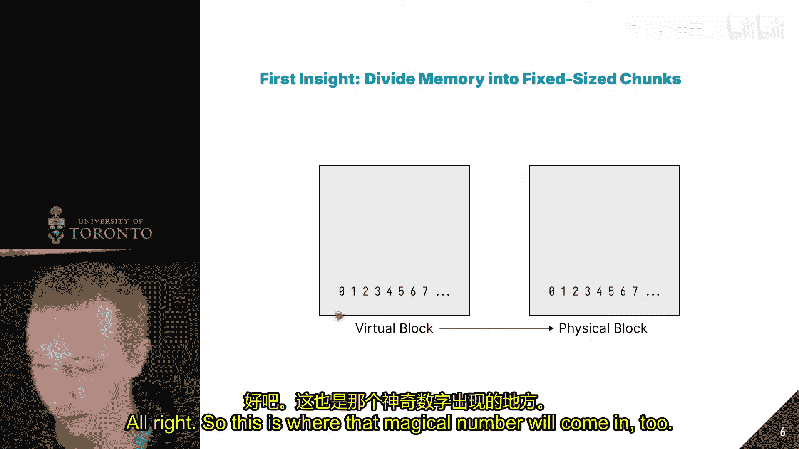

然而，分段存在一些问题：段的大小可变，可能导致内存中出现难以利用的大块空闲区域（外部碎片）；在进程间共享内存也比较复杂。因此，现代通用操作系统已不再主要使用纯分段机制。

---

## 现代方案：分页

由于按字节映射开销巨大，而分段又不够灵活，我们引入了**分页**机制。它的核心思想是将内存划分为固定大小的块来进行映射。

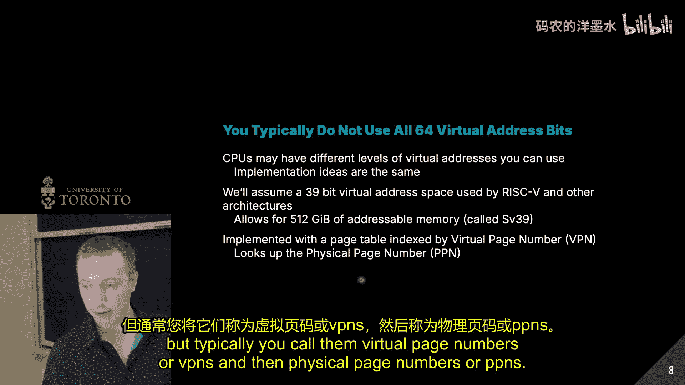

### 核心概念与术语

*   **页**：虚拟内存和物理内存都被划分为固定大小的块，称为“页”。通常大小为 **4096字节**（即 2^12 字节）。
*   **页帧**：物理内存中的页有时特称为“帧”。
*   **虚拟页号**：虚拟地址中用于标识属于哪个虚拟页的部分。
*   **物理页号**：物理地址中用于标识属于哪个物理页（帧）的部分。
*   **偏移量**：虚拟/物理地址中用于标识在页内具体哪个字节的部分。
*   **页表**：一个数组，以VPN为索引，存储着对应的PPN映射信息。
*   **内存管理单元**：CPU中负责进行虚拟地址到物理地址转换的硬件部件。

### 地址分解与转换

一个虚拟地址（例如39位）被分解为两部分：**虚拟页号** 和 **页内偏移量**。

转换过程如下：
1.  MMU从虚拟地址中提取出VPN。
2.  以VPN为索引，查询当前进程的页表，找到对应的**页表项**。
3.  从页表项中读出PPN。
4.  将PPN与虚拟地址中原有的**偏移量**拼接起来，就得到了完整的物理地址。

**公式表示**：
`物理地址 = (物理页号 << 偏移量位数) | 偏移量`
或者更直观地：用PPN替换掉虚拟地址中的VPN部分，偏移量保持不变。

### 页表项详解

每个页表项（例如8字节）不仅存储了物理页号，还包含一些控制位：

*   **有效位**：该映射是否有效。
*   **权限位**：是否可读、可写、可执行。
*   **其他位**：如访问位、脏位等，用于高级内存管理。
*   **保留位**：供操作系统或未来扩展使用。

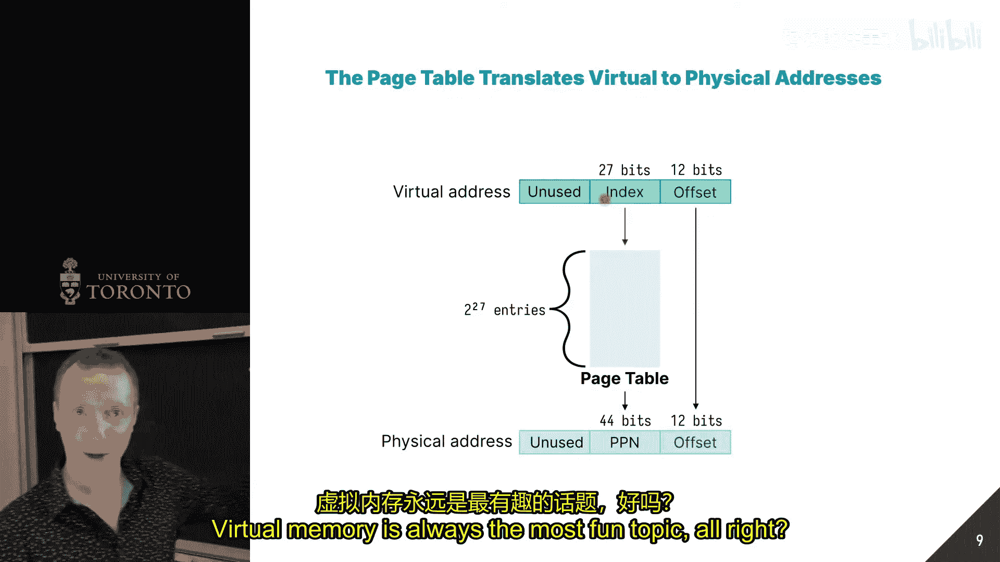

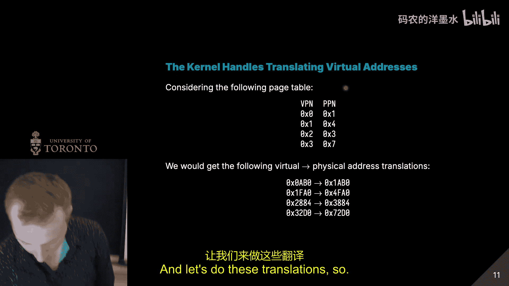

**代码描述（概念性）**：
```c
struct PageTableEntry {
    uint64_t valid : 1;
    uint64_t readable : 1;
    uint64_t writable : 1;
    uint64_t executable : 1;
    uint64_t user_access : 1;
    // ... 其他标志位
    uint64_t ppn : 44; // 物理页号
    uint64_t reserved : 10;
};
```

---

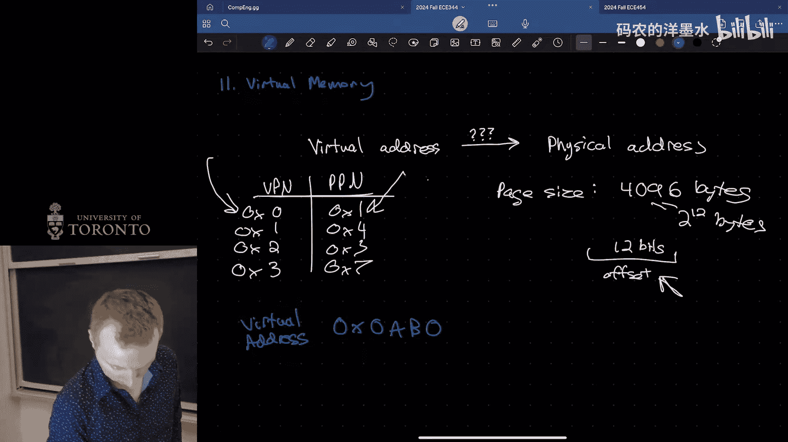

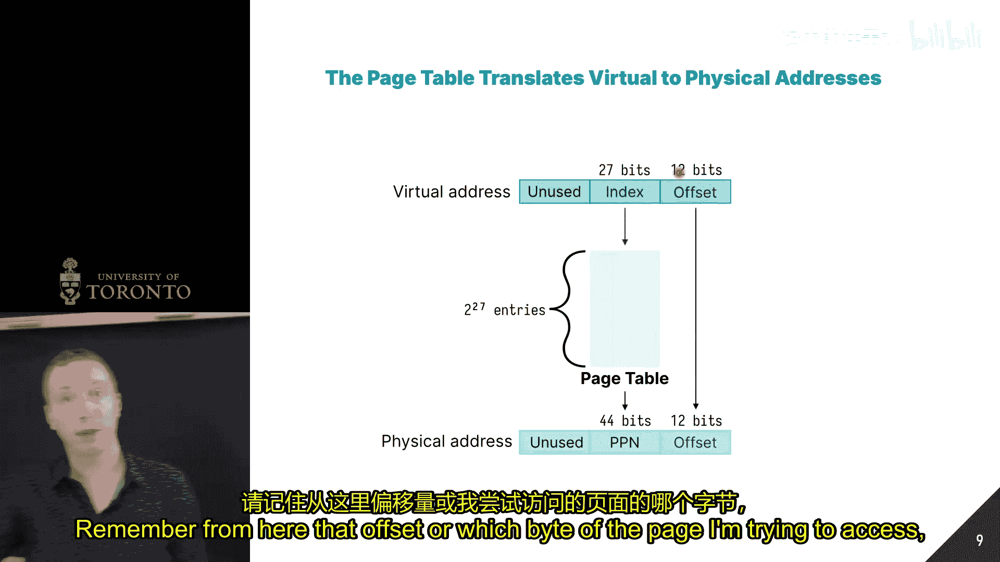

## 地址转换实例

让我们通过几个例子来巩固理解。假设页大小为4096字节（0x1000）。

**例1：已知页表**
假设一个简单的页表如下（索引为VPN，值为PPN）：
*   VPN 0 -> PPN 1
*   VPN 1 -> PPN 4
*   VPN 2 -> PPN 3
*   VPN 3 -> PPN 7

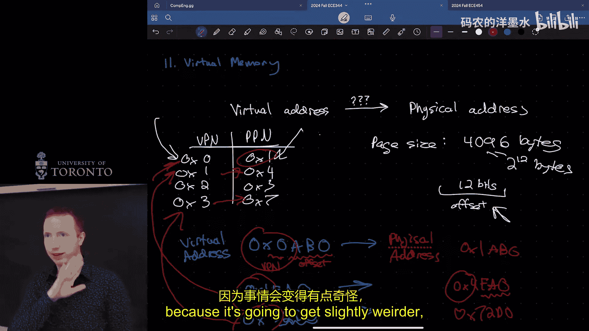

转换虚拟地址 `0x01A0`：
1.  页大小0x1000，所以偏移量是低12位（3个十六进制位）`0x1A0`，这部分不变。
2.  剩余高位是VPN：`0x01A0` / `0x1000` = 0，所以VPN=0。
3.  查页表，VPN 0 对应 PPN 1。
4.  拼接：PPN=1，偏移=0x1A0，得到物理地址 `0x11A0`。

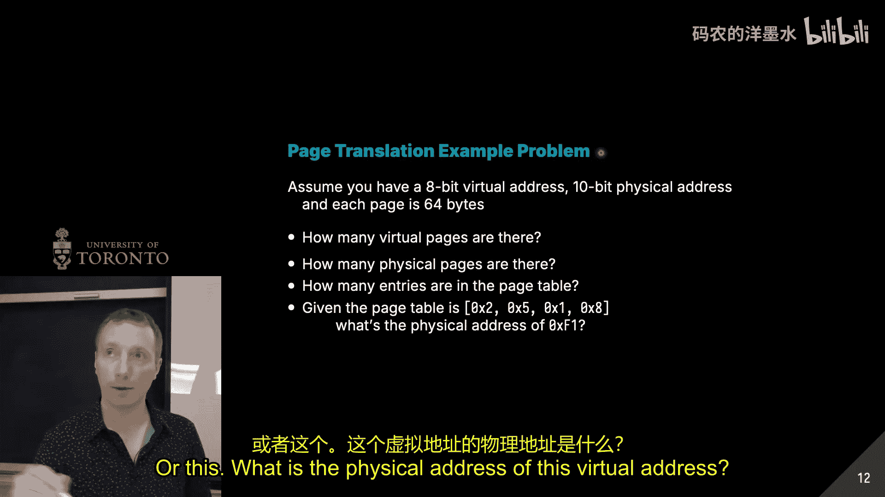

转换虚拟地址 `0x3F20`：
1.  偏移量 `0xF20` 不变。
2.  VPN = `0x3F20` / `0x1000` = 3。
3.  查表，VPN 3 对应 PPN 7。
4.  物理地址为 `0x7F20`。

**例2：综合计算**
假设系统有：
*   8位虚拟地址
*   10位物理地址
*   64字节的页大小

问题：
1.  有多少虚拟页？页大小64B=2^6，所以偏移量占6位。虚拟地址共8位，因此VPN占2位。虚拟页数量为 2^2 = **4**。
2.  有多少物理页？物理地址共10位，偏移量占6位，因此PPN占4位。物理页数量为 2^4 = **16**。
3.  页表有多少项？一项对应一个虚拟页，所以有 **4** 项。
4.  给定页表 `[2, 5, 0, 8]`，转换虚拟地址 `0xF1` (二进制 `1111 0001`)。
    *   偏移量低6位：`110001`。
    *   VPN是高2位：`11` (十进制3)。
    *   查页表，索引3的项是8（二进制`1000`）。
    *   PPN（4位）是`1000`，偏移是`110001`，拼接得物理地址二进制 `1000 110001`。
    *   分组为十六进制：`10 0011 0001` -> `0x231`。

---

## 进程与页表

每个进程都有自己独立的虚拟地址空间，因此也需要自己独立的页表。当操作系统进行进程切换时，一个重要步骤就是更新MMU中的寄存器，使其指向新进程的页表，从而实现地址空间的隔离。

---

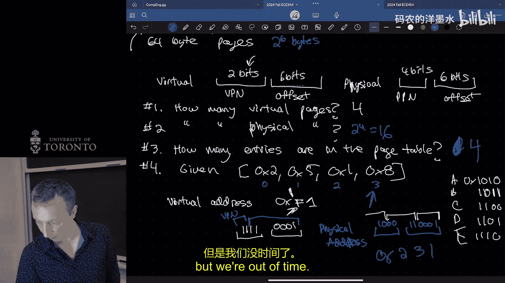

本节课中我们一起学习了虚拟内存的基本原理。我们了解了从分段到分页的发展思路，重点掌握了分页机制如何将虚拟地址通过页表转换为物理地址，并通过实例演练了转换过程。记住，分页的核心是**以固定大小的页为单位进行映射**，**偏移量直接复用**，这既减少了管理开销，又提供了灵活的地址空间布局。在接下来的课程中，我们将继续探讨页表的优化和多级页表等高级主题。