# 012：页表实现 🖥️

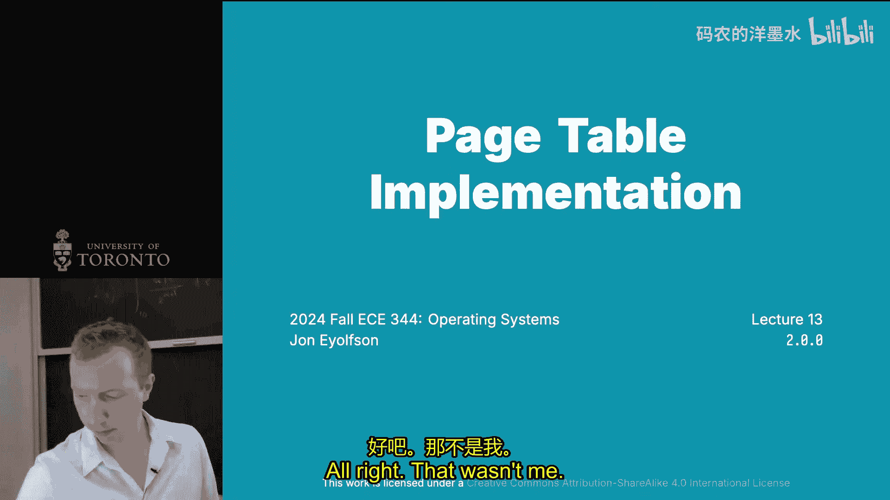

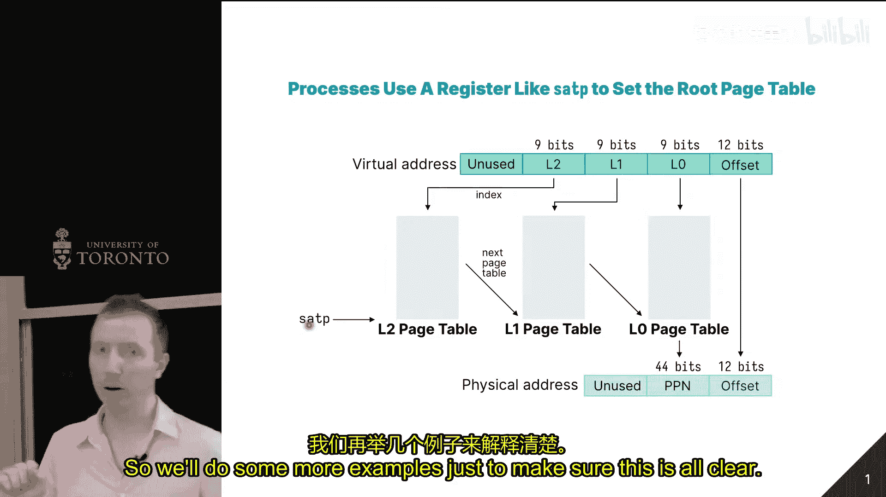

在本节课中，我们将深入学习页表的具体实现细节，包括多级页表的工作原理、地址对齐的重要性、页表数量的计算，以及如何通过TLB（转换后备缓冲区）来加速地址转换过程。

---

## 地址对齐 🔢

上一节我们介绍了虚拟地址到物理地址的转换框架。本节中，我们来看看一个重要的基础概念：**地址对齐**。

对齐意味着内存分配最终会与特定的字节边界对齐。例如，如果页面是 **4096字节对齐** 的，这意味着所有页面的起始地址都是4096的倍数。换句话说，地址的低12位始终为0。

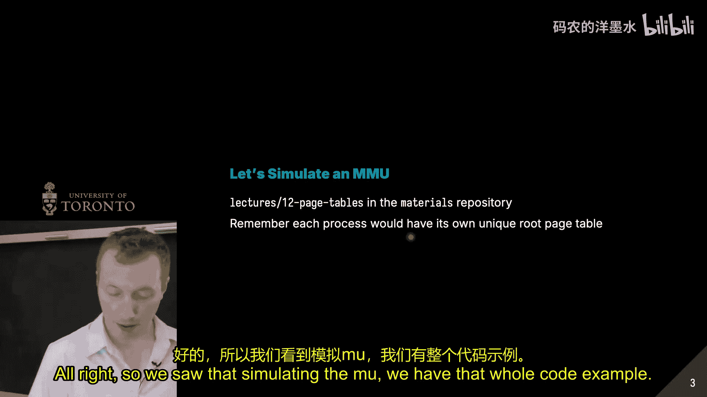

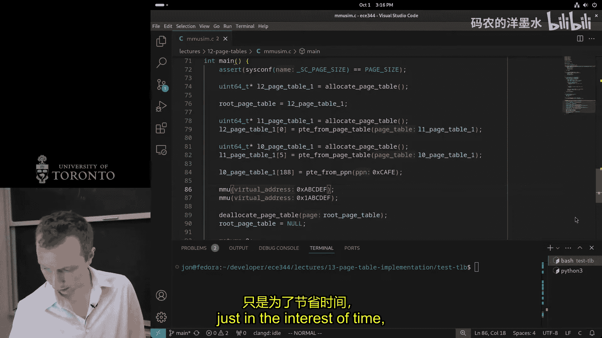


**公式**：一个地址 `addr` 是 `N` 字节对齐的，当且仅当 `addr % N == 0`。

对齐对计算机非常有利，因为它简化了计算。由于页面总是对齐的，我们无需在页表项中存储页面的确切起始地址。我们只需要虚拟页号（VPN），通过将其与页面大小相乘，就能知道页面的物理起始地址。偏移量直接来自虚拟地址的低位。


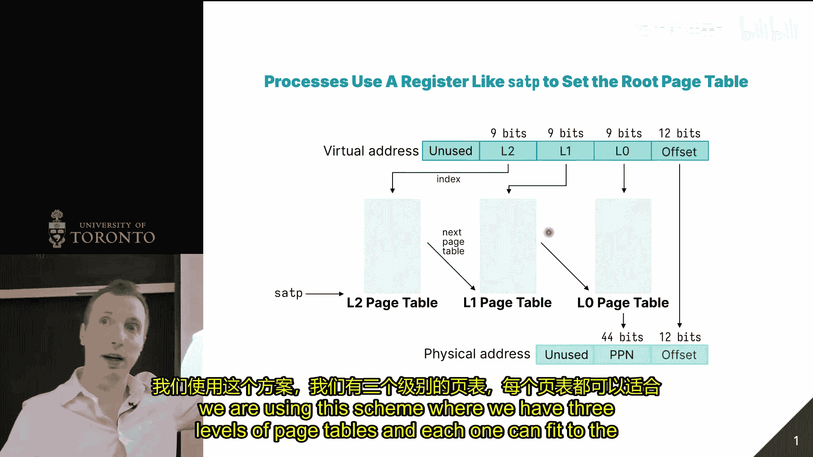

例如，判断地址 `0xEC` 是否是8字节对齐的：
- 8字节对齐意味着地址能被8整除。
- `0xEC` 的十进制是236。
- `236 % 8 = 4`，不等于0。
- 因此，`0xEC` 不是8字节对齐的。

一个快速判断方法是：对于2的幂次方的对齐方式（如8字节），只需检查地址的二进制表示的低位是否为0。对于8字节（2^3）对齐，最后3位必须为0。

---

## 多级页表示例与页表数量 📊

现在，让我们通过一个具体例子来理解多级页表需要多少资源。

假设一个进程使用了 **512个页面** 的内存。我们采用之前的三级页表方案，其中：
- 每级页表有 **512个条目**（2^9）。
- 每个页表条目（PTE）大小为 **8字节**。
- 每个页表恰好占满一个 **4KB** 的页面。

**问题**：为映射这512个页面，最少和最多分别需要多少个页表？

以下是分析过程：

**最少页表数量**：
1.  我们总是需要一个 **L2（根）页表**。
2.  这个L2页表只需要一个条目，指向一个 **L1页表**。
3.  这个L1页表也只需要一个条目，指向一个 **L0页表**。
4.  这个L0页表可以容纳512个条目，正好映射512个不同的虚拟页面。

因此，最少只需要 **3个页表**（一个L2，一个L1，一个L0）就能完成512个页面的映射。

**最多页表数量（最坏情况）**：
1.  我们总是需要一个 **L2页表**。
2.  最坏情况下，L2页表的 **512个条目** 都指向 **512个不同的L1页表**。
3.  每个L1页表在最坏情况下，也只有一个条目，指向一个L0页表。因此，我们也会有 **512个L0页表**。

因此，最多需要 `1 + 512 + 512 = 1025个页表`。

这个例子说明了**内存访问模式的重要性**。如果程序连续地访问内存（空间局部性好），虚拟页号通常连续，它们会被集中在少数几个L0页表条目中，所需页表数量接近最小值。如果程序随机地访问大量分散的页面，就可能导致接近最坏情况，浪费大量内存来存储页表本身。

---

## 计算页表级数 🧮

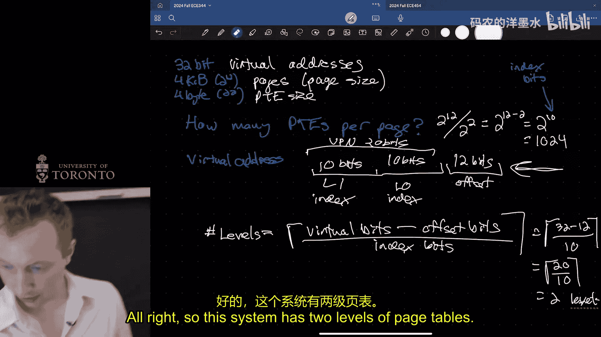

页表级数取决于地址位数、页面大小和页表条目大小。让我们以历史上的32位系统为例进行计算。

**给定参数**：
- 虚拟地址位数：**32位**
- 页面大小：**4KB**（2^12 字节）
- 页表条目（PTE）大小：**4字节**（2^2 字节）

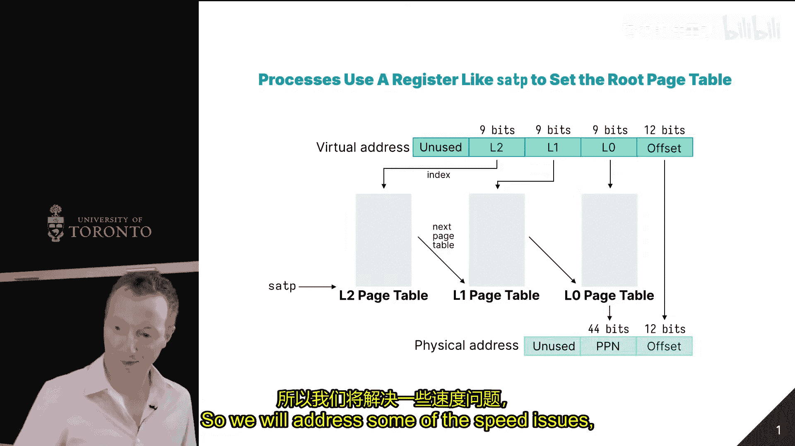

**计算步骤**：
1.  **计算偏移量位数**：页面大小决定了偏移量位数。4KB = 2^12，所以偏移量（Offset）占 **12位**。
2.  **计算虚拟页号（VPN）总位数**：`VPN位数 = 虚拟地址位数 - 偏移量位数 = 32 - 12 = 20位`。
3.  **计算单页可容纳的PTE数量**：`PTE数/页 = 页面大小 / PTE大小 = 2^12 / 2^2 = 2^10 = 1024个`。
4.  **计算单级页表索引所需位数**：可容纳1024个条目，需要 **10位** 索引来寻址（因为 2^10 = 1024）。
5.  **计算所需级数**：我们需要用多级索引来覆盖20位的VPN。
    - 第一级索引用10位。
    - 第二级索引用剩下的10位。
    - 正好用完20位。

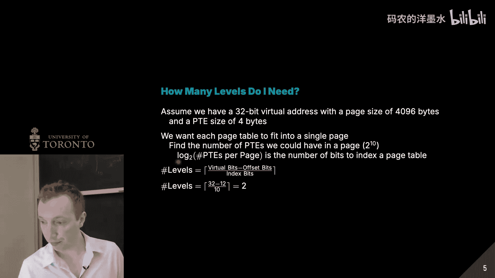

因此，这个32位系统需要 **2级页表**。

**通用公式**：
`页表级数 = ceil( (虚拟地址位数 - 偏移量位数) / 单级页表索引位数 )`

从32位升级到64位（或39位虚拟地址）后，VPN位数增加，而单页能容纳的PTE数量受限于页面大小和PTE大小（通常为8字节），索引位数增加有限（例如9位或10位），因此需要更多级页表（如3级或4级）。更多的级数意味着一次地址转换可能需要更多的内存访问，这会在一定程度上降低性能。

---

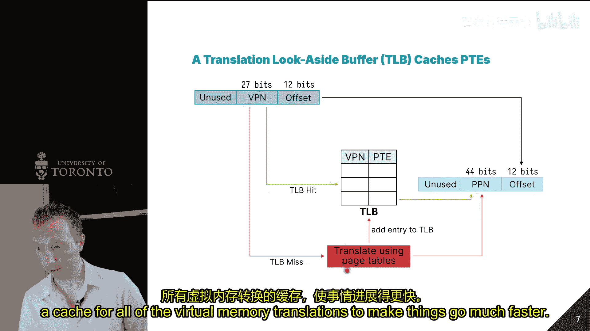

## 加速地址转换：TLB（转换后备缓冲区）⚡

我们了解到，即使只有2级页表，一次内存访问也可能需要多次额外的内存查询（查页表），这非常缓慢。为了解决这个问题，计算机系统采用了计算机科学的通用法宝：**缓存**。

专门用于缓存地址转换结果的硬件缓存称为 **TLB**。它缓存最近使用过的**虚拟页到物理页的映射关系**（即L0页表的条目）。

**工作流程**：
1.  CPU需要翻译一个虚拟地址。
2.  首先，它用虚拟页号（VPN）去 **查询TLB**。
3.  **如果TLB命中**：直接从TLB中获取物理页号（PPN），与偏移量组合成物理地址。这个过程非常快。
4.  **如果TLB未命中**：需要按照常规路径，依次查询L2、L1、L0页表（多次内存访问），完成翻译。然后将这个新的 `VPN -> PPN` 映射存入TLB，以备后续使用。

**性能影响分析**：
假设：
- TLB查找时间：10 ns
- 内存访问时间：100 ns
- TLB命中率（α）：80%
- 系统使用单级页表（因此一次未命中需要1次页表访问 + 1次数据访问）

**有效内存访问时间（EAT）计算**：
```
EAT = α * (TLB时间 + 内存访问时间) + (1 - α) * (TLB时间 + 页表访问时间 + 内存访问时间)
    = 0.8 * (10 + 100) + 0.2 * (10 + 100 + 100)
    = 0.8 * 110 + 0.2 * 210
    = 88 + 42
    = 130 ns
```
如果没有虚拟内存（直接物理访问），访问时间是100ns。使用了带TLB的虚拟内存后，平均访问时间变为130ns，只增加了30%。这远比每次都要进行多次内存访问（例如，三级页表下未命中需要400ns）要高效得多。

**TLB与上下文切换**：
每个进程有自己的页表。当操作系统进行进程上下文切换时，必须处理TLB，因为其中缓存的映射对新进程是无效的。
常见的处理方式是 **清空（刷新）TLB**。例如，在x86架构上，当内核更改了存储根页表地址的寄存器（`CR3`）后，硬件会自动清空TLB。这确保了新进程不会错误地使用旧进程的缓存映射。

---

## 实践示例：TLB的影响 💻

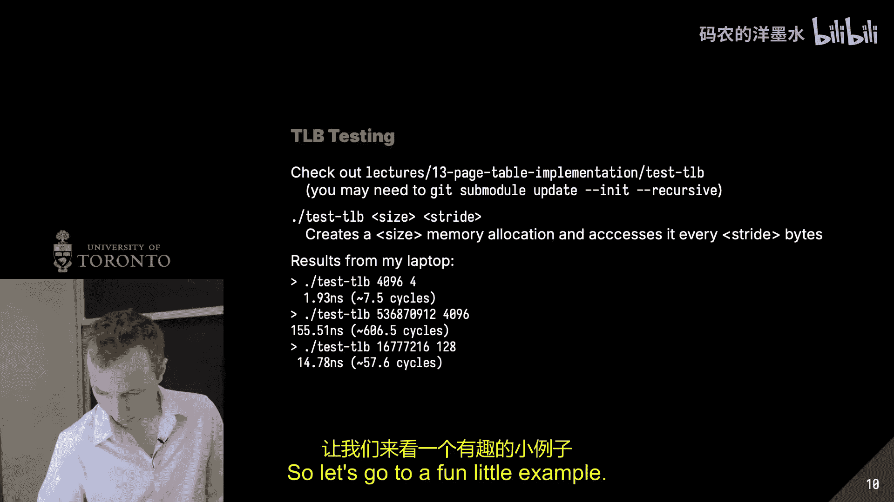

有一个著名的程序（由Linux创始人编写）可以直观演示TLB的效果。该程序分配一大块内存，然后以固定的步长（`stride`）访问其中的元素。

**场景一：高TLB命中率**
- 分配大小：4096字节（恰好一页）
- 步长：4字节（访问每个`int`）
- 访问次数：1024次
- **分析**：所有访问都在同一个页面内。第一次访问该页时，发生TLB未命中。随后的1023次访问都会**TLB命中**。因此平均访问速度很快。

**场景二：低TLB命中率**
- 分配大小：512 MB（大量页面）
- 步长：4096字节（每次访问都跨到下一个页）
- **分析**：几乎每次访问都在一个新的页面。几乎每次都会发生**TLB未命中**，需要完整的页表遍历。这将导致访问速度急剧下降（实验显示可能慢30倍以上）。

这个实验强有力地说明了为什么提倡**局部性访问**。连续访问内存（空间局部性）使得访问集中在少数页面内，TLB命中率高，程序运行快。而随机跳跃访问则会导致TLB频繁未命中，性能大幅下降。

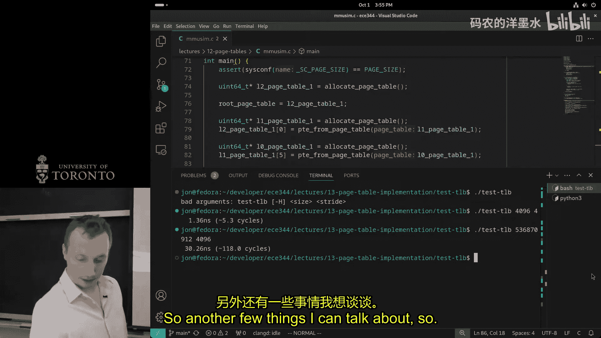

---

## 进程地址空间布局概览 🗺️

最后，我们简要了解一下内核如何为进程布局虚拟地址空间，这解释了某些编程现象。


一个典型的进程地址空间布局如下：
- **页面0**：通常被内核标记为**无效**。这就是为什么解引用`NULL`指针（地址0）会导致段错误（Segmentation Fault）。
- **代码段（Text）**：存放程序指令。
- **数据段（Data）**：存放全局变量等。
- **堆（Heap）**：通过`malloc`等函数动态增长的区域。
- **栈（Stack）**：向低地址增长，用于函数调用。
    - **守护页（Guard Page）**：内核在栈底（生长方向的末端）放置一个无效页面。如果栈溢出（Stack Overflow）恰好超过一个页面，程序会访问到这个守护页并触发一个特定的栈溢出错误。如果栈溢出非常严重，直接跳过了守护页访问到更远的无效地址，则只会触发普通的段错误。

这种布局由内核在创建进程时设置，并通过页表来强制执行内存保护和隔离。

---

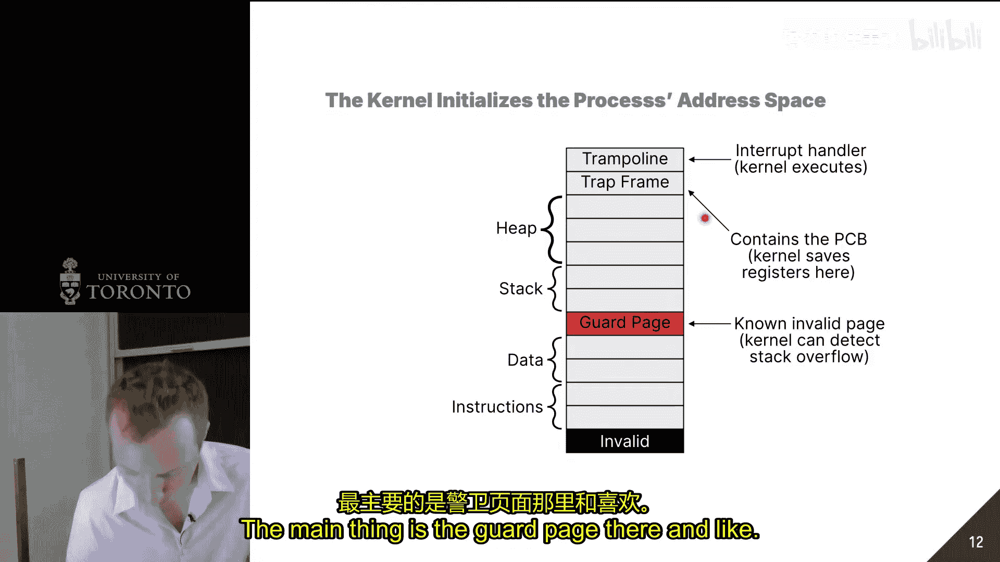

本节课中我们一起学习了页表实现的核心知识。我们理解了地址对齐的意义，掌握了计算多级页表所需资源的方法，知道了如何通过TLB来有效加速地址转换过程，并通过实例看到了TLB对程序性能的巨大影响。最后，我们对进程虚拟地址空间的布局有了一个基本的认识。这些概念是理解现代操作系统内存管理的基础。