# 013：虚拟内存实验 🧠

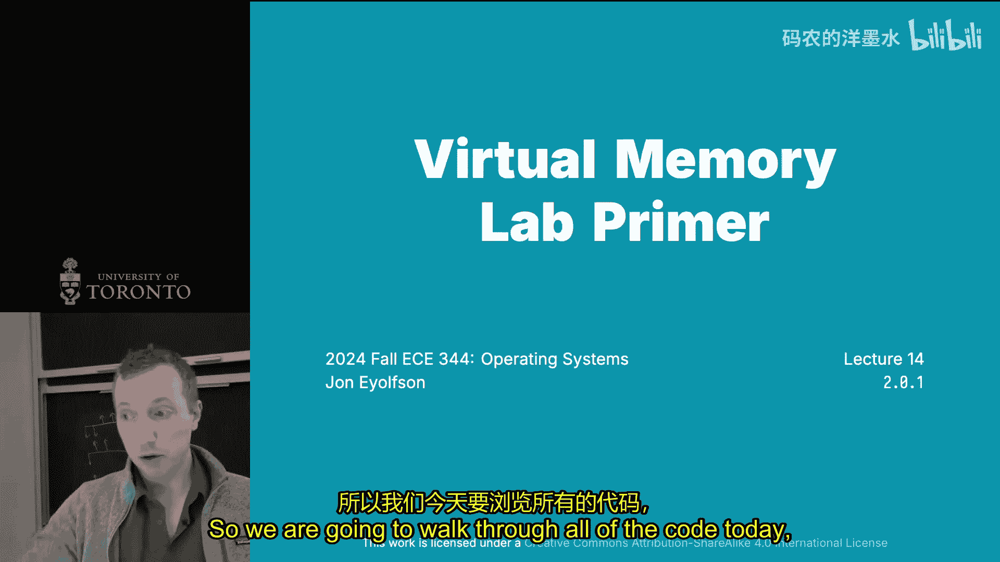


在本节课中，我们将学习如何实现虚拟内存管理中的核心操作之一：`fork`。我们将模拟创建一个新进程，使其拥有与父进程完全相同的虚拟内存布局，但在`fork`之后，两个进程的内存是独立的。我们还将探讨一种优化技术——写时复制（Copy-on-Write），它允许进程在只读状态下共享内存，直到某个进程尝试写入时才进行实际复制。

## 概述：虚拟内存与`fork`

当一个进程调用`fork`时，操作系统需要创建一个新的进程（子进程），它是父进程的副本。这意味着子进程应该拥有与父进程完全相同的虚拟地址空间和内存内容。然而，为了实现独立性，子进程需要拥有自己独立的一套页表，指向物理内存中数据的独立副本。

上一节我们介绍了虚拟内存的基本概念，本节中我们来看看如何具体实现`fork`的内存复制过程。

## 核心概念：页表与地址翻译

在开始之前，让我们回顾一下关键概念。一个虚拟地址通过多级页表翻译成物理地址。在我们的模拟中，我们使用三级页表（L2, L1, L0）。每个页表项（Page Table Entry, PTE）包含一个物理页号（PPN）和一些标志位（如有效位`valid`、读位`read`、写位`write`）。

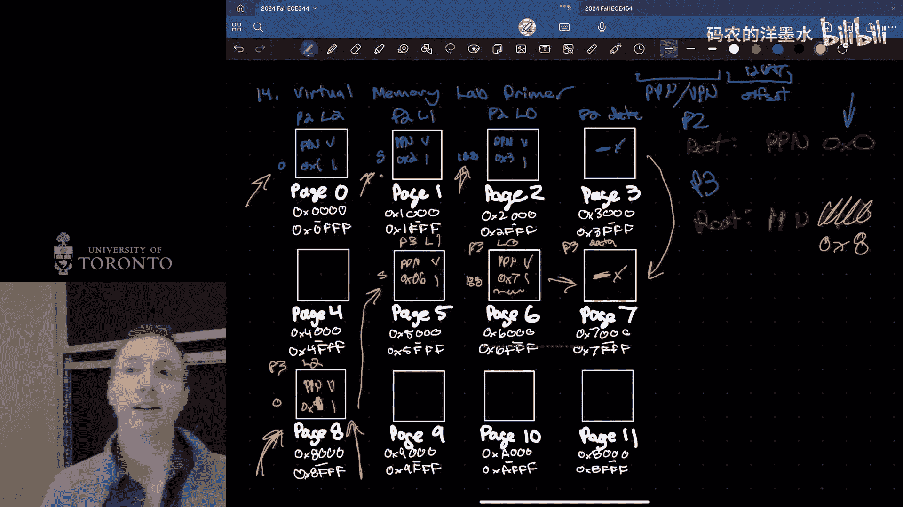

**公式**：虚拟地址翻译过程可以简化为：
`物理地址 = 页表[L2索引]->PPN + 页表[L1索引]->PPN + 页表[L0索引]->PPN + 偏移量`

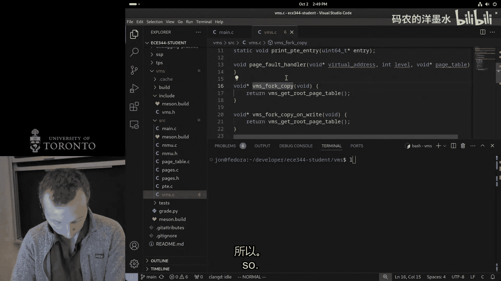

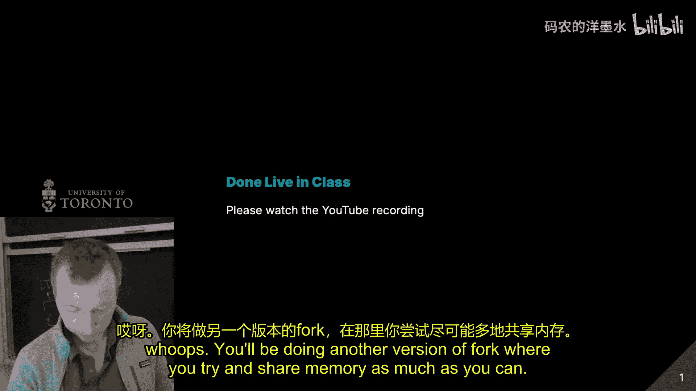

## 实验第一部分：实现`fork`的内存复制

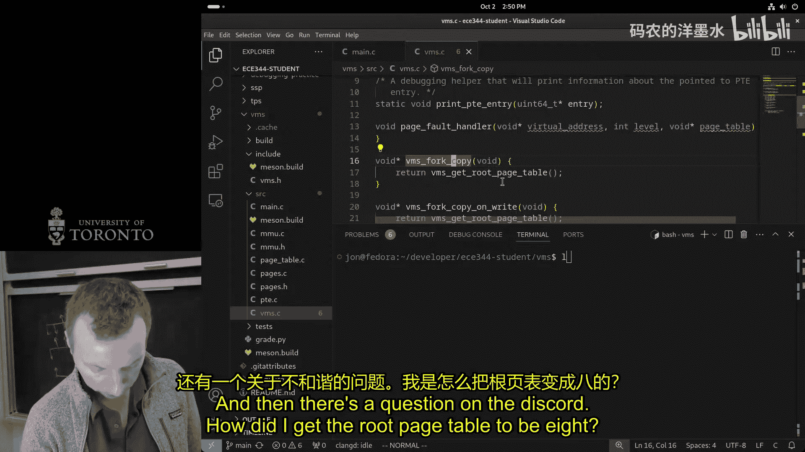


我们的目标是编写函数 `vm_fork_copy`，它接收父进程的根页表，并返回一个为子进程新创建的、独立的根页表。

### 理解内存布局

假设父进程（进程2）的页表结构如下：
*   根页表（L2）位于物理页0（PPN 0）。
*   L2页表的索引0指向一个L1页表，位于物理页1。
*   该L1页表的索引5指向一个L0页表，位于物理页2。
*   该L0页表的索引188指向存储数据的物理页3，其中有一个变量`x`。

当我们为子进程（进程3）创建独立副本时，我们需要：
1.  分配一个新的物理页（例如PPN 8）作为子进程的L2根页表。
2.  对于父进程L2页表中每一个**有效**的条目，我们都需要在子进程的L2页表中创建一个对应的有效条目，并让它指向一个**新分配**的L1页表。
3.  递归地对L1和L0页表进行同样的操作。
4.  最终，子进程的页表结构将指向一个**新分配**的数据页（例如PPN 7），这个数据页是父进程数据页的完整拷贝。

这样，两个进程的虚拟地址翻译路径看起来相同，但最终指向不同的物理数据页，实现了内存的独立性。

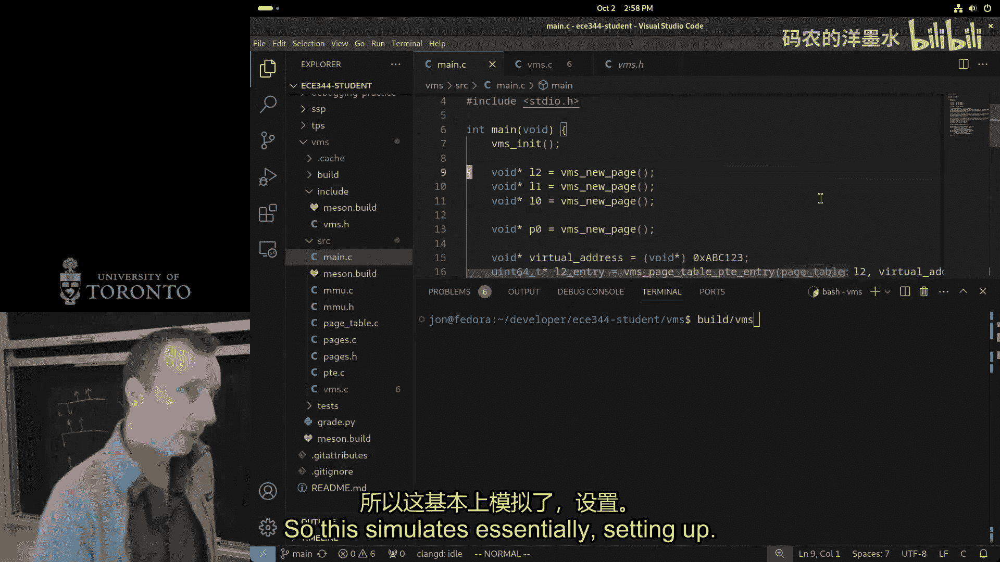

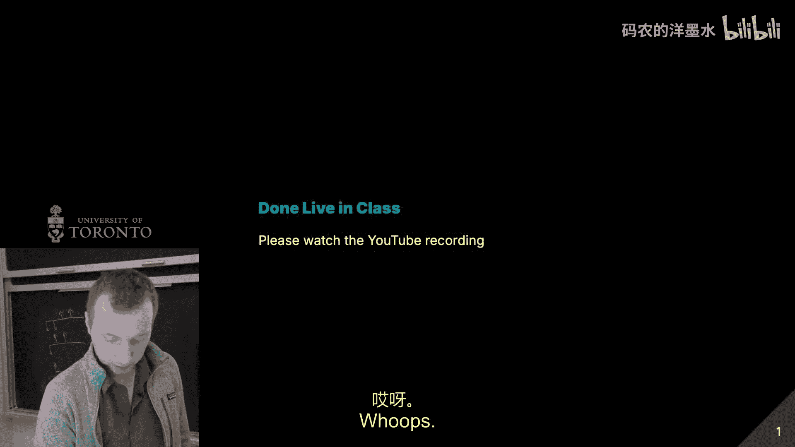

### 代码实现步骤

以下是实现`vm_fork_copy`函数的基本步骤：

1.  **获取父进程根页表**：使用 `vm_get_root_pt` 函数。
2.  **分配子进程根页表**：使用 `vm_new_page` 函数获取一个新的物理页。
3.  **遍历父进程页表**：我们需要递归地遍历父进程的整个页表树。
    *   对于每一级页表中的每一个有效条目，我们都需要在子进程的对应位置创建一个新页表或数据页。
4.  **设置页表项**：使用提供的辅助函数（如 `vm_set_pte_ppn`, `vm_set_pte_valid` 等）来正确设置子进程页表项中的PPN和标志位。
5.  **复制数据**：当到达最后一级（L0）并指向数据页时，我们需要分配一个新页，并使用 `memcpy` 将父进程数据页的内容复制过来。

**代码框架示例**：
```c
void* vm_fork_copy(void) {
    // 1. 获取父进程根页表
    void* parent_root_pt = vm_get_root_pt();

    // 2. 为子进程分配新的根页表（L2）
    void* child_root_pt = vm_new_page();

    // 3. 递归复制页表结构的函数
    copy_pt_level(parent_root_pt, child_root_pt, 2); // 从L2开始

    // 4. 返回子进程的根页表
    return child_root_pt;
}

// 辅助函数：递归复制某一级页表
void copy_pt_level(void* parent_pt, void* child_pt, int level) {
    for (int i = 0; i < NUM_PTE; i++) { // 遍历该页表所有条目
        // 获取父页表项
        uint64_t* parent_pte = vm_get_pte(parent_pt, i);

        if (vm_get_pte_valid(parent_pte)) { // 如果条目有效
            // 获取该条目指向的下一级页表或数据页
            void* parent_next_page = vm_ppn_to_page(vm_get_pte_ppn(parent_pte));

            // 为子进程分配一个新页
            void* child_next_page = vm_new_page();

            // 在子进程页表中设置对应条目，指向新页
            uint64_t* child_pte = vm_get_pte(child_pt, i);
            vm_set_pte_ppn(child_pte, vm_page_to_ppn(child_next_page));
            vm_set_pte_valid(child_pte, 1);
            // 复制其他标志位，如读、写位
            vm_set_pte_read(child_pte, vm_get_pte_read(parent_pte));
            vm_set_pte_write(child_pte, vm_get_pte_write(parent_pte));

            if (level > 0) {
                // 如果不是最后一级（L0），递归复制下一级页表
                copy_pt_level(parent_next_page, child_next_page, level - 1);
            } else {
                // 如果是最后一级（L0），这意味着parent_next_page是数据页
                // 将父进程数据页的内容复制到子进程的新数据页
                memcpy(child_next_page, parent_next_page, PAGE_SIZE);
            }
        }
        // 如果条目无效，在子页表中保持无效即可（因为新页初始化为0）
    }
}
```
*注意：以上为概念性代码，实际实现需处理更多细节，如正确获取索引的函数`vm_get_pte_index`。*

## 实验第二部分：实现写时复制（Copy-on-Write）

写时复制是一种优化技术，旨在减少`fork`时的内存拷贝开销。其核心思想是：在`fork`之后，父子进程**共享**所有的物理内存页，并将这些页标记为**只读**。当任何一个进程尝试写入这些共享页时，会触发一个页错误（Page Fault）。页错误处理程序会捕获这个错误，然后为尝试写入的进程分配一个新的物理页，复制原页内容，并修改该进程的页表项，使其指向新的副本，同时将新页标记为可写。这样，实际的复制操作被延迟到了真正需要写入的时候。

### 实现机制

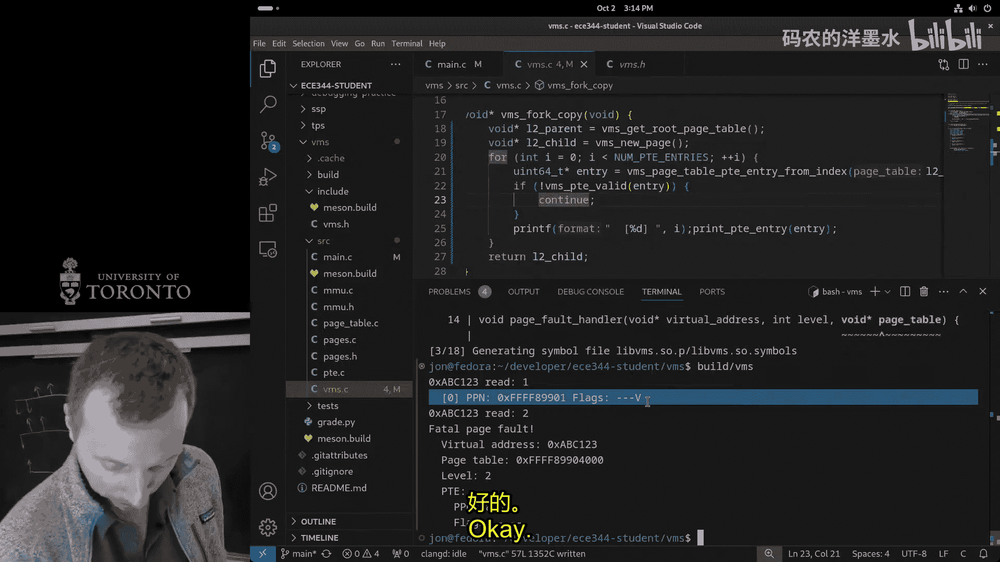

1.  **修改`vm_fork_copy`**：
    *   在复制页表时，当遇到指向数据页的L0条目时，我们**不**立即复制数据。
    *   相反，我们让子进程的页表项直接指向父进程的**同一个**物理数据页。
    *   同时，我们将父子进程中指向该数据页的页表项的**写位（write bit）清除（设为0）**，并将**自定义位（custom bit）置1**，作为“此页为写时复制共享页”的标记。

2.  **实现页错误处理程序 `vm_handle_page_fault`**：
    *   当进程因写入一个只读页而触发页错误时，此函数被调用。
    *   在函数中，我们检查出错的页表项。如果其自定义位为1，说明这是一个写时复制共享页。
    *   我们需要：
        a. 分配一个新物理页。
        b. 将原共享页的内容复制到新页。
        c. 修改当前进程的页表项，使其PPN指向新页。
        d. 将页表项的写位重新置1（因为现在它是该进程私有的可写副本），并根据情况清除自定义位。
        e. 维护一个引用计数数组，跟踪每个物理页被多少进程共享。当引用计数减为1时，意味着该页不再是共享页，可以安全地将其写位置回1（如果原页本身是可写的）。

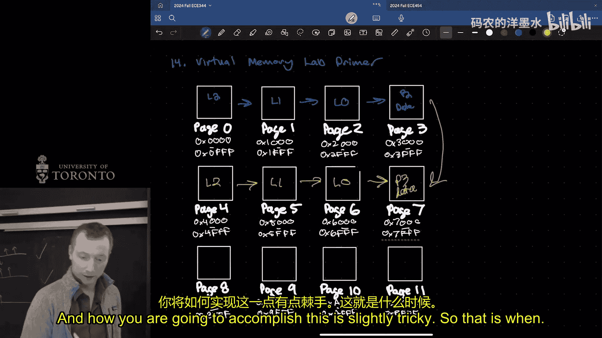

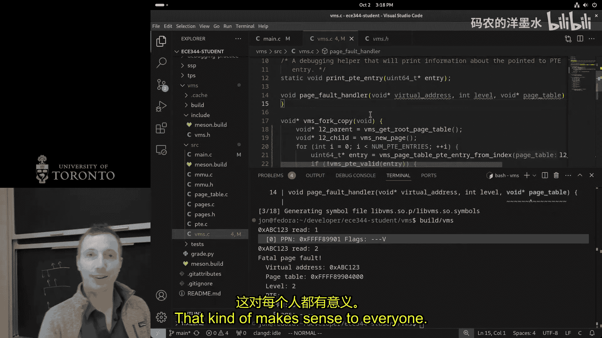

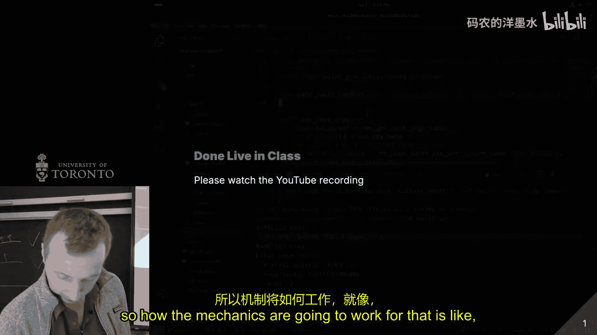


**关键逻辑代码片段**：
```c
void vm_handle_page_fault(uint64_t addr, void* pt, int level, uint64_t* pte) {
    // 检查是否是因“写”操作触发的错误，并且该页表项的自定义位为1（CoW页）
    if (/* 是写错误 */ && vm_get_pte_custom(pte)) {
        // 1. 获取共享的源物理页
        void* src_page = vm_ppn_to_page(vm_get_pte_ppn(pte));

        // 2. 分配新物理页
        void* dst_page = vm_new_page();

        // 3. 复制数据
        memcpy(dst_page, src_page, PAGE_SIZE);

        // 4. 更新当前进程的页表项，指向新页
        vm_set_pte_ppn(pte, vm_page_to_ppn(dst_page));
        vm_set_pte_write(pte, 1); // 设置为可写
        vm_set_pte_custom(pte, 0); // 清除CoW标记，现在它是私有页

        // 5. 更新引用计数
        int src_page_index = vm_page_to_index(src_page);
        ref_count[src_page_index]--; // 减少原共享页的引用
        if (ref_count[src_page_index] == 1) {
            // 如果只剩一个引用者，找到那个页表项，将其写位置回1（如果原可写）
            // 注意：这需要遍历或维护额外数据结构，是挑战点之一
        }
        // 新页的引用计数初始为1
        ref_count[vm_page_to_index(dst_page)] = 1;
    }
    // 如果不是CoW错误，可以处理其他类型的页错误或直接报错
}
```

## 总结

本节课中我们一起学习了虚拟内存管理中`fork`操作的实现。
*   我们首先实现了**完全复制**的`fork`，通过递归复制整个页表树和数据页，为子进程创建完全独立的内存空间。
*   接着，我们探讨了**写时复制**这一优化技术。通过在`fork`时共享内存页并禁用写入权限，在真正发生写入时才进行复制，显著提升了`fork`的性能并减少了内存占用。实现此功能需要巧妙利用页错误处理机制和自定义标志位。

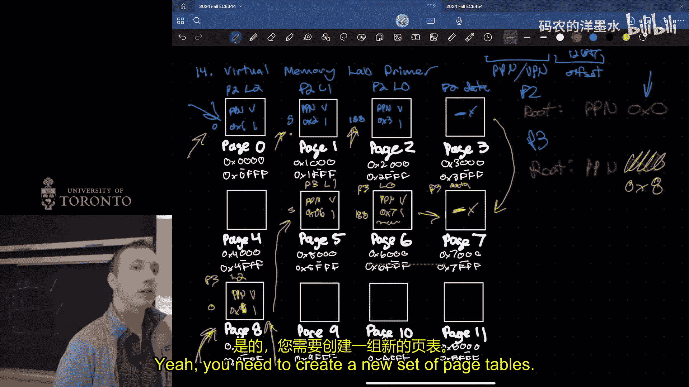

通过本实验，你将深入理解进程创建、虚拟内存隔离以及高级内存管理策略的工作原理。