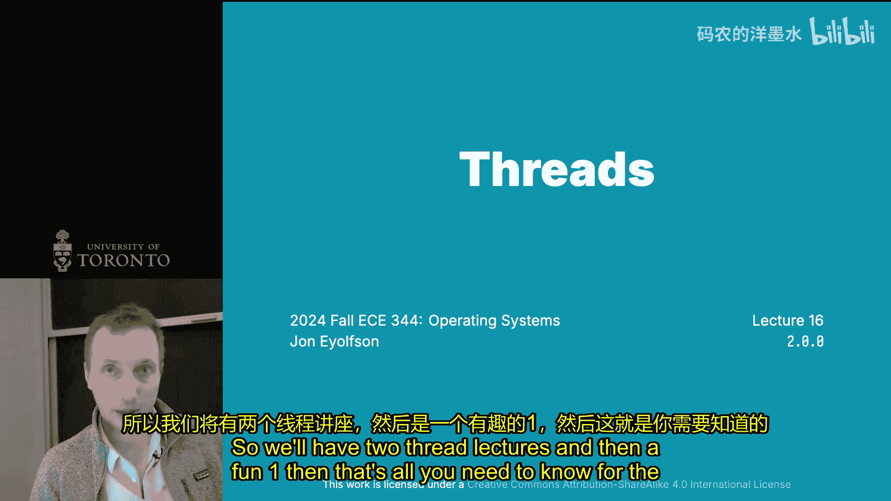
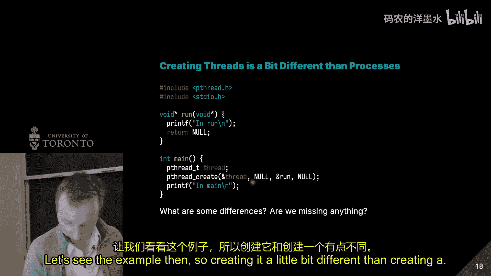
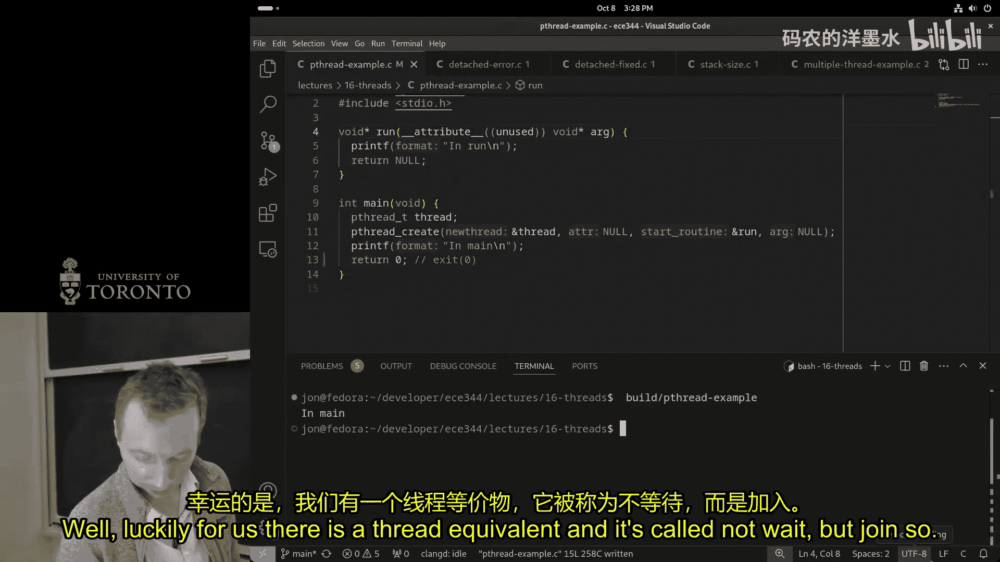
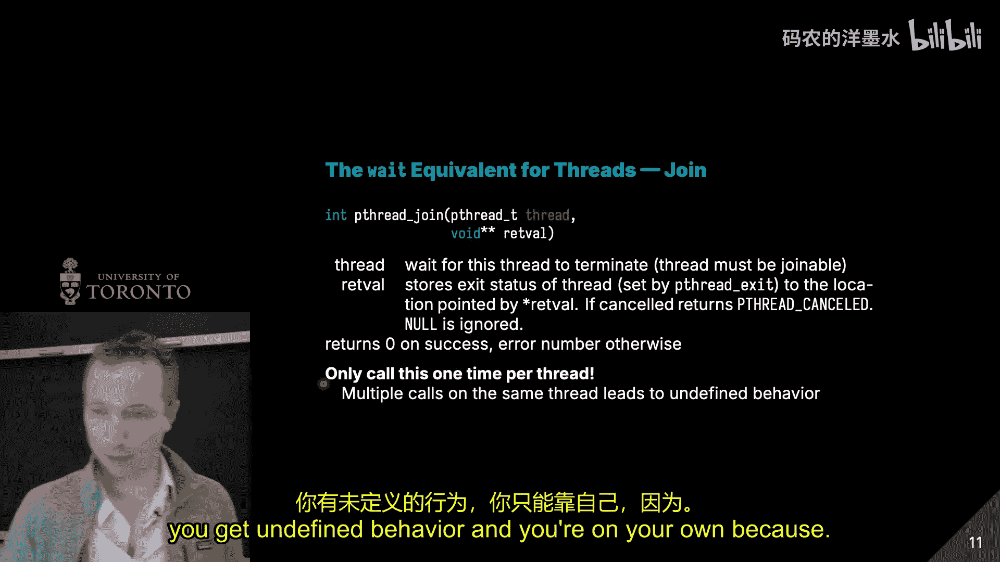
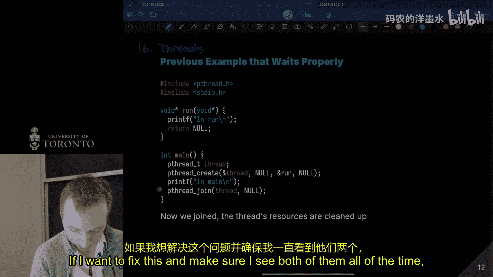
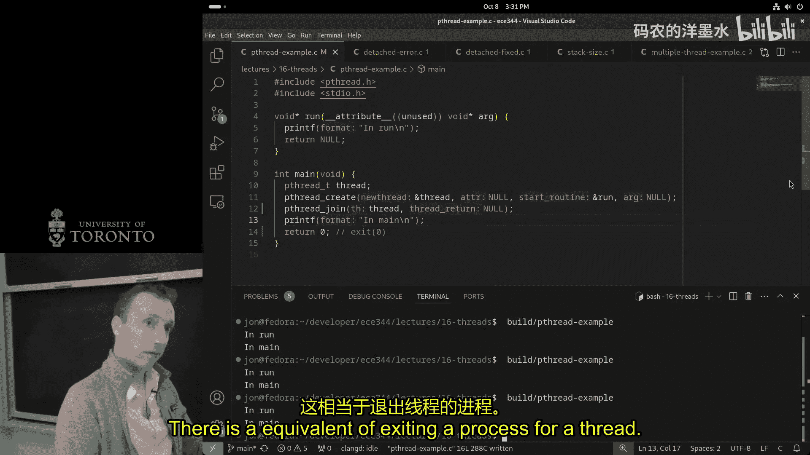
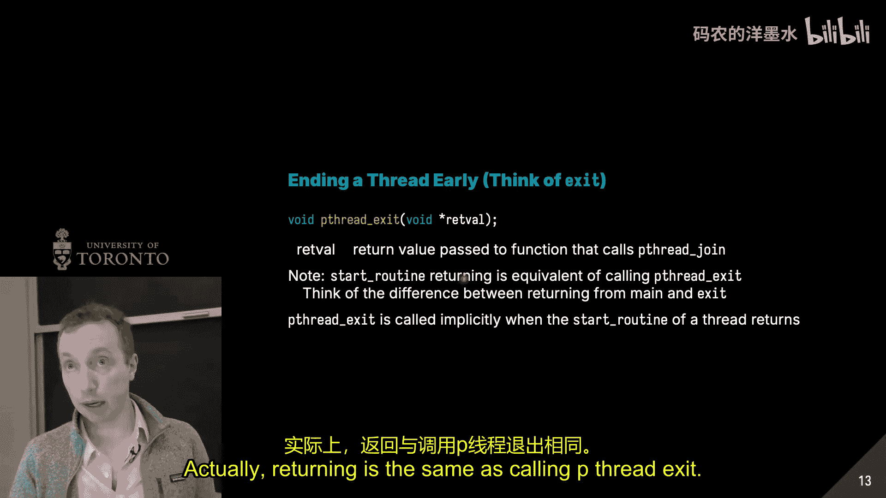
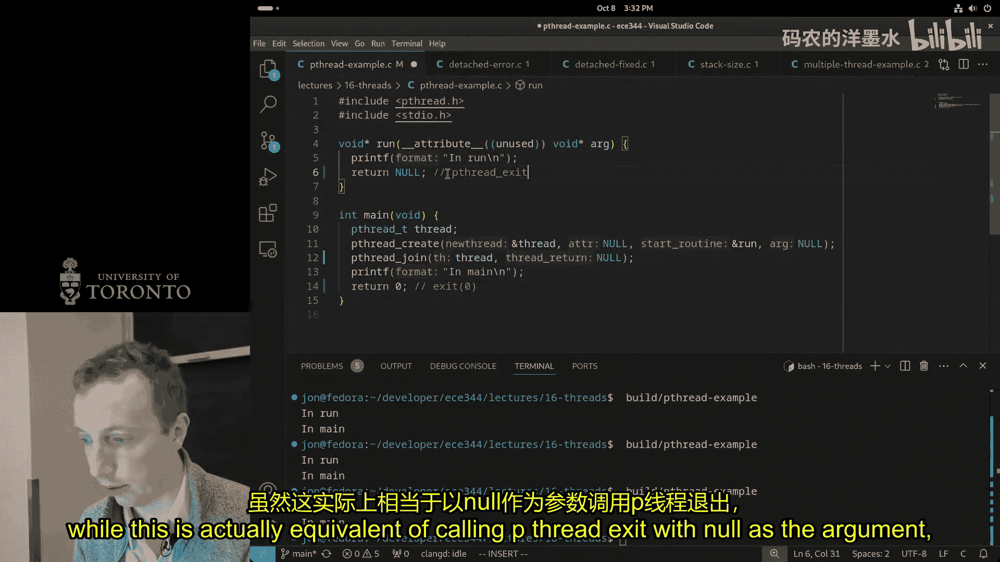
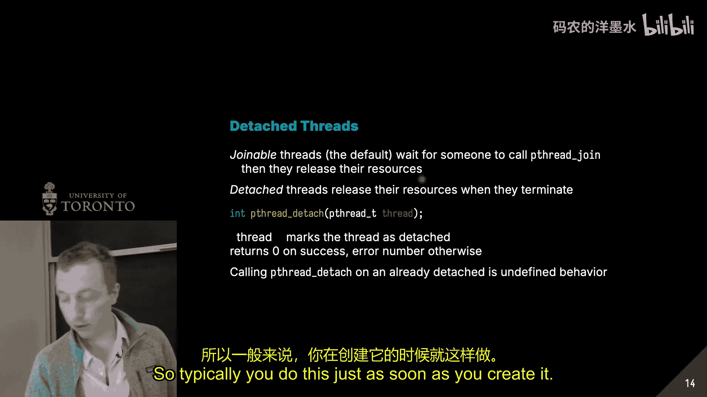
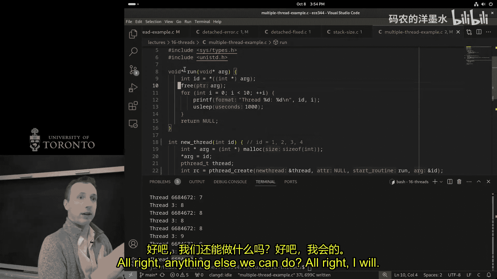

# 015：线程 🧵



在本节课中，我们将要学习操作系统中的一个核心概念——线程。我们将探讨线程与进程的区别，理解并发与并行的不同，并学习如何使用POSIX线程（Pthreads）库来创建和管理线程。

---

## 并发与并行

在开始讨论线程之前，我们需要区分两个关键概念：**并发**和**并行**。在计算机科学中，它们含义不同。

*   **并发** 是指在两个或多个任务之间进行切换，以便在一段时间内同时推进多个任务。其目标是让多个任务都能取得进展。
    *   **公式/概念**：`并发 = 在时间段T内，通过快速切换执行任务A和任务B`。
*   **并行** 是指在同一时间点同时执行两个或多个任务。其目标是利用多个计算核心，尽可能快地运行程序。
    *   **公式/概念**：`并行 = 在时间点t，同时执行任务A和任务B`。

为了更清晰地说明区别，我们来看一个生活中的例子：假设我们在用餐，可以选择**吃**、**喝**、**说话**或**打手势**，但有一个奇怪的限制：一旦开始吃，就必须吃完才能做其他事。

*   **喝**和**说话**：可以**并发**（交替进行），但不能**并行**（同一时间只能用嘴做一件事）。
*   **说话**和**打手势**：既可以**并发**，也可以**并行**。
*   **吃**和**打手势**：根据限制，不能**并发**（一旦吃就不能停），但可以**并行**（可以边吃边比划）。

这个例子说明，并发和并行是不同的，并且不一定相互包含。在单核CPU时代，通过极快的任务切换，并发可以看起来像并行。

---

## 什么是线程？

线程类似于进程，你可以初步将其理解为“共享内存的进程”。它们运行在相同的地址空间内。

*   每个线程拥有自己独立的**寄存器**、**程序计数器**和**栈空间**。
*   所有线程**共享**进程的**代码段**、**全局变量**和**堆空间**。因此，一个线程对全局变量的修改，其他线程立即可见。
*   如果希望某些内存只属于特定线程，可以使用`malloc`分配并小心管理，或者使用**线程局部存储**。

一个进程可以包含多个线程。默认情况下，进程启动时只有一个主线程。创建新线程比创建新进程开销小得多，因为它不需要复制页表、文件描述符等资源，只需分配新的栈和寄存器集合即可。

线程使得编写并发程序更容易。例如，一个Web服务器的主循环可以这样工作：

```c
while (1) {
    // 等待连接（阻塞操作）
    connection = accept_request();
    // 为每个新连接创建一个线程来处理
    pthread_create(&thread_id, NULL, handle_connection, connection);
}
```

这样，即使是单核CPU，也能通过快速切换线程，看似同时处理成百上千个请求。

---

## 线程与进程对比

上一节我们介绍了线程的基本概念，本节我们来具体对比线程与进程的异同。

以下是线程与进程的关键区别：



*   **资源与独立性**：
    *   **进程**：完全独立。拥有独立的代码、数据、堆和地址空间。
    *   **线程**：共享资源。存在于进程内部，共享进程的代码、数据和地址空间。
*   **创建与切换开销**：
    *   **进程**：创建和上下文切换开销大（需要切换页表，可能导致TLB刷新）。
    *   **线程**：创建和上下文切换开销小（在同一地址空间内切换，无需处理虚拟内存）。
*   **终止与生命周期**：
    *   **进程**：终止时释放所有资源（内存、文件描述符等）。
    *   **线程**：终止时仅释放栈等私有资源。**当进程终止时，其内部所有线程都会随之终止**。

---

## 使用Pthreads

本课程将使用POSIX线程（Pthreads）库，这是在Unix-like系统（如Linux、macOS）上使用的标准线程API。

### 创建线程



创建进程使用`fork`，而创建线程使用`pthread_create`函数。

```c
#include <pthread.h>
int pthread_create(pthread_t *thread, const pthread_attr_t *attr,
                   void *(*start_routine) (void *), void *arg);
```





*   `thread`: 指向`pthread_t`类型变量的指针，用于存储新线程的ID。
*   `attr`: 线程属性指针，通常设为`NULL`使用默认值。
*   `start_routine`: 新线程将要执行的函数指针。该函数必须具有`void* func(void* arg)`的形式。
*   `arg`: 传递给`start_routine`函数的参数。
*   **返回值**: 成功返回0，失败返回错误码。

**示例：基本创建**
```c
#include <stdio.h>
#include <pthread.h>

void* run(void* arg) {
    printf("In run\n");
    return NULL;
}





int main() {
    pthread_t thread;
    pthread_create(&thread, NULL, run, NULL);
    printf("In main\n");
    return 0; // 问题：主线程退出会终止整个进程！
}
```
运行此程序可能只看到“In main”，因为主线程先退出导致进程结束，新线程可能没机会运行。



### 等待线程：`pthread_join`

为了解决上述问题，我们需要等待线程结束，类似于进程的`wait`，线程使用`pthread_join`。



```c
int pthread_join(pthread_t thread, void **retval);
```
*   `thread`: 要等待的线程ID。
*   `retval`: 指向指针的指针，用于接收线程的返回值。可设为`NULL`表示不关心返回值。
*   **注意**：每个线程只能被`join`一次，重复调用是未定义行为。

**修复后的示例：**
```c
int main() {
    pthread_t thread;
    pthread_create(&thread, NULL, run, NULL);
    pthread_join(thread, NULL); // 等待新线程结束
    printf("In main\n");
    return 0;
}
```
现在，无论调度顺序如何，都能确保看到“In run”和“In main”两条输出。

### 线程退出：`pthread_exit`

线程可以通过以下方式终止：
1.  从`start_routine`函数返回。
2.  调用`pthread_exit`函数。
3.  被其他线程取消（本课程不涉及）。

```c
void pthread_exit(void *retval);
```
`retval`是线程的退出返回值，可以被`pthread_join`获取。

**注意**：在`main`函数中调用`pthread_exit`只会终止主线程，进程会等待所有其他线程结束后才退出。

### 分离线程

默认情况下，线程是“可连接的”（joinable）。如果一个可连接线程结束但未被`join`，它会像僵尸进程一样保留部分资源，成为“僵尸线程”。

为了避免僵尸线程，我们可以将线程标记为“分离的”（detached）。分离线程在结束时自动清理所有资源，但其他线程无法获取它的返回值，也无法`join`它。

```c
int pthread_detach(pthread_t thread);
```

**示例：使用分离线程**
```c
int main() {
    pthread_t thread;
    pthread_create(&thread, NULL, run, NULL);
    pthread_detach(thread); // 设置为分离线程
    printf("In main\n");
    pthread_exit(NULL); // 主线程退出，但进程会等待分离线程
    // return 0; // 如果用return，进程会立刻结束
}
```

---

## 线程编程实践与陷阱

上一节我们学习了线程的基本操作，本节我们通过一个更复杂的例子，来看看线程编程中常见的陷阱。

### 向线程传递数据

创建线程时，我们通过`arg`参数传递数据。一个**关键原则**是：确保传递给线程的数据在其整个执行期间都有效。通常这意味着要使用堆内存（`malloc`）而不是栈内存。

**正确示例：使用堆内存**
```c
void* new_thread(void* id_ptr) {
    int id = *((int*)id_ptr);
    free(id_ptr); // 使用完后释放
    for(int i = 0; i < 10; i++) {
        printf("Thread %d: %d\n", id, i);
    }
    return NULL;
}

int main() {
    pthread_t threads[4];
    for (int i = 0; i < 4; i++) {
        int *id = malloc(sizeof(int));
        *id = i;
        pthread_create(&threads[i], NULL, new_thread, id);
    }
    pthread_exit(NULL);
}
```
每个线程获得自己独有的堆内存块，保存其ID，运行安全。

**错误示例：传递栈地址**
```c
int main() {
    pthread_t threads[4];
    for (int i = 0; i < 4; i++) {
        // 危险！传递了局部变量`i`或某个栈上变量的地址
        pthread_create(&threads[i], NULL, new_thread, &i);
    }
    pthread_exit(NULL);
}
```
这里，所有线程都收到了主线程栈上同一个变量`i`的地址。当循环快速执行时，`i`的值不断变化，且主线程函数返回后，该栈内存可能被重用或包含垃圾数据，导致线程读到错误、重复或随机的ID值。这是**数据竞争**和**悬空指针**的典型问题，极难调试。

**核心要点**：线程间通过指针共享数据时，必须确保数据生命周期的安全性。栈内存是线程私有的，生命周期与函数调用相关，不适合跨线程传递。堆内存或全局变量是更安全的选择。

---

## 总结

本节课中我们一起学习了操作系统线程的核心知识。

1.  **概念区分**：我们明确了**并发**（任务切换）与**并行**（同时执行）的不同。
2.  **线程本质**：线程是轻量级的执行流，共享进程资源，但拥有独立的栈和寄存器。它使得并发编程更加高效。
3.  **线程操作**：我们学习了如何使用Pthreads库**创建**线程（`pthread_create`）、**等待**线程结束（`pthread_join`）、**退出**线程（`pthread_exit`）以及设置**分离**线程（`pthread_detach`）以避免资源泄漏。
4.  **关键陷阱**：我们重点探讨了向线程传递数据时的常见错误——**传递栈地址**，并强调了使用**堆内存**来保证数据生命周期安全的重要性。



线程是构建高效并发应用程序的基础，但同时也引入了数据共享和同步的复杂性。在接下来的课程中，我们将深入探讨线程同步机制，如互斥锁和条件变量。