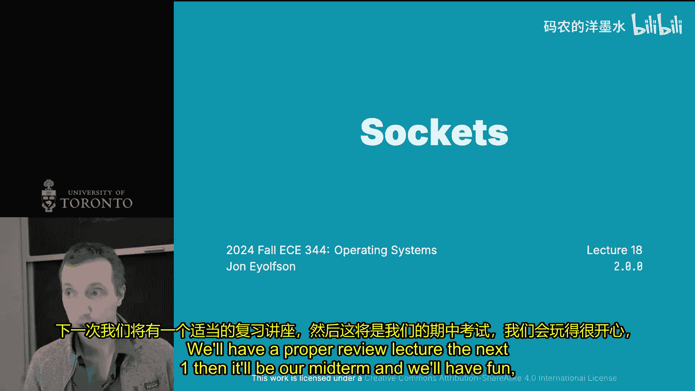
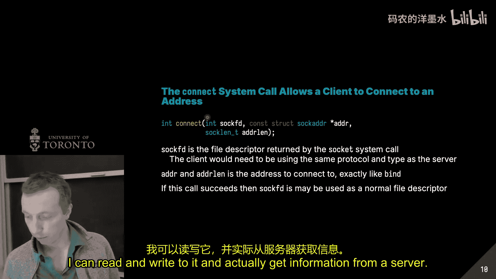
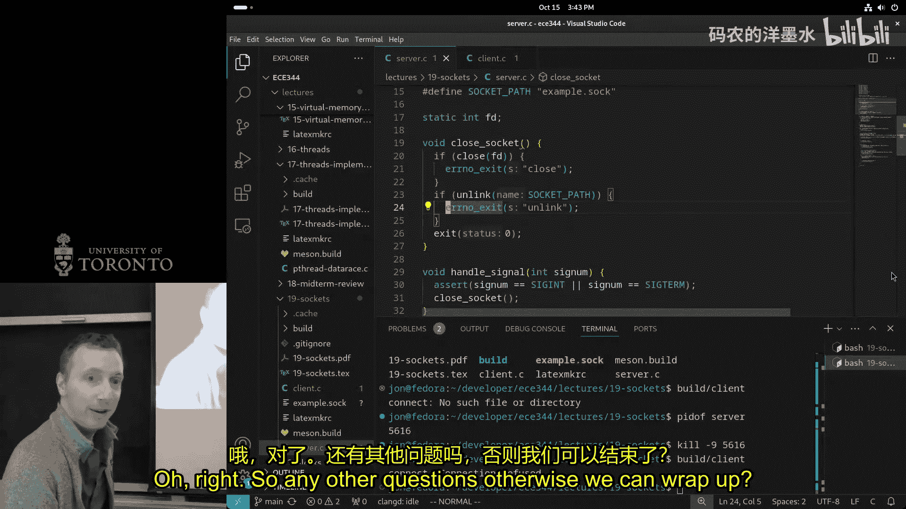
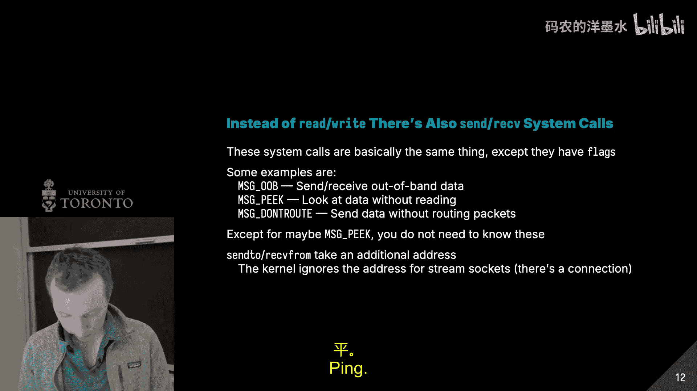
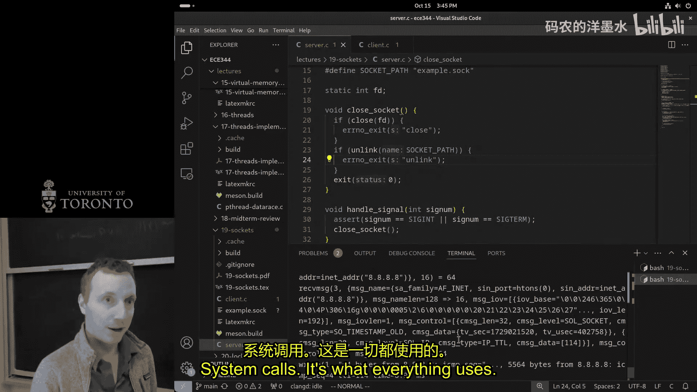
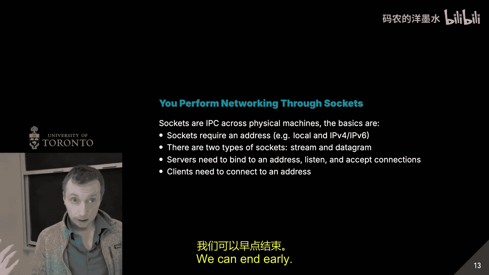

# 017：网络套接字



## 概述

在本节课中，我们将要学习网络套接字。套接字是进程间通信的另一种形式，它允许不同物理机器上的进程通过网络进行通信。我们将了解套接字的基本概念、系统调用以及如何编写简单的客户端和服务器程序。

---

## 套接字简介

上一节我们介绍了进程间通信的几种方式，如管道和信号。本节中我们来看看套接字。套接字是第四种IPC形式，其核心思想与之前相同，但关键区别在于它允许不同物理机器上的进程进行通信。例如，当你连接到 `google.com` 时，你就是在与另一台机器上的进程通信。

套接字本质上是一个文件描述符，你可以通过它进行读写操作，就像操作普通文件一样。

---

## 套接字类型与协议

套接字有两种主要类型，对应两种不同的网络协议。

**流套接字**，也称为 **TCP** 套接字。它提供可靠、有序、双向的字节流通信。TCP 会确保数据按发送顺序到达，并维护一个持久连接。这适用于需要可靠传输的场景，如网页浏览（HTTP/HTTPS）或安全外壳（SSH）。

**数据报套接字**，也称为 **UDP** 套接字。它提供无连接、不可靠的消息传输。UDP 不保证数据包顺序或送达，也没有持久连接，因此速度更快、开销更小。这适用于实时性要求高、能容忍少量数据丢失的场景，如视频流或在线游戏。

创建套接字时，使用 `socket` 系统调用，并通过参数指定类型：
```c
int sockfd = socket(AF_INET, SOCK_STREAM, 0); // 创建 TCP 套接字
int sockfd = socket(AF_INET, SOCK_DGRAM, 0);  // 创建 UDP 套接字
```

---

## 服务器端编程步骤

如果你要编写一个服务器程序，需要遵循以下四个步骤。以下是每个步骤的简要说明：

1.  **创建套接字**：使用 `socket` 系统调用创建一个套接字文件描述符。
2.  **绑定地址**：使用 `bind` 系统调用将套接字绑定到一个特定的地址（如本地文件路径或IP地址和端口号）。
3.  **监听连接**：使用 `listen` 系统调用告知内核开始监听传入的连接请求，并设置等待队列的长度。
4.  **接受连接**：使用 `accept` 系统调用。这是一个阻塞调用，它会等待直到有客户端连接，然后返回一个新的文件描述符，用于与该客户端进行通信。

服务器程序的核心通常是一个循环，不断调用 `accept` 来服务新的客户端连接。

---

## 客户端编程步骤



客户端的工作要简单得多，只需要两个步骤：

1.  **创建套接字**：同样使用 `socket` 系统调用。
2.  **连接服务器**：使用 `connect` 系统调用，指定要连接的服务器地址（如IP和端口）。

连接成功后，客户端就可以使用这个套接字文件描述符，通过 `read` 和 `write` 系统调用来与服务器交换数据。

---

## 地址结构

在绑定或连接时，需要指定地址。C语言中使用特定的结构体来表示不同类型的地址。以下是常见的地址结构：

*   **本地通信**：使用 `struct sockaddr_un`，地址是一个文件路径（如 `/tmp/example.sock`）。
*   **IPv4网络通信**：使用 `struct sockaddr_in`，地址由IP地址（如 `8.8.8.8`）和端口号组成。
*   **IPv6网络通信**：使用 `struct sockaddr_in6`，用于更长的IPv6地址。

这些结构体都需要在调用 `bind` 或 `connect` 时作为参数传入。

---

## 示例：本地套接字通信

让我们通过一个简单的例子来理解客户端和服务器如何工作。这个例子使用本地Unix域套接字进行通信。

**服务器端代码逻辑**：
1.  创建套接字 (`socket`)。
2.  绑定到本地文件路径 (`bind`)。
3.  开始监听 (`listen`)。
4.  进入循环，等待并接受连接 (`accept`)。
5.  向客户端发送“Hello there!”消息 (`write`)。
6.  关闭连接 (`close`)。

**客户端代码逻辑**：
1.  创建套接字 (`socket`)。
2.  连接到服务器指定的文件路径 (`connect`)。
3.  读取服务器发送的消息 (`read`)。
4.  打印消息并关闭套接字 (`close`)。

运行服务器后，它会创建一个文件（如 `example.sock`）并等待。运行客户端时，客户端连接到该文件，服务器接受连接并发送消息，客户端接收并显示该消息。

---

## 信号与资源清理

服务器程序通常长时间运行。为了优雅地退出并清理资源（如删除套接字文件），我们可以使用信号处理。

例如，可以捕获 `SIGTERM` 或 `SIGINT`（Ctrl+C）信号。在信号处理函数中，服务器可以：
1.  关闭监听套接字。
2.  使用 `unlink` 系统调用删除套接字文件。
3.  然后正常退出。

这样可以确保服务器退出后，不会留下无用的文件。如果服务器被强制杀死（如 `kill -9`），则无法执行清理，客户端再次连接时会收到“连接被拒绝”的错误。

---

## 高级套接字调用

除了基本的 `read` 和 `write`，套接字还有一些专用的系统调用，提供更多控制选项：



*   `send` 和 `recv`：功能与 `write`/`read` 类似，但提供额外的标志参数。
*   `sendto` 和 `recvfrom`：主要用于无连接的UDP套接字，可以在每次发送/接收时指定目标地址/来源地址。

这些调用中的标志位可以实现诸如“窥探”数据而不从缓冲区移除 (`MSG_PEEK`)，或指示数据不应由内核路由 (`MSG_DONTROUTE`) 等高级功能。对于大多数应用，基本读写已足够。

---



## 总结

本节课中我们一起学习了网络套接字。套接字是进行网络编程的基础接口，它扩展了IPC的能力，使得跨机器通信成为可能。



我们了解了：
*   套接字是另一种IPC形式，使用文件描述符。
*   两种主要类型：可靠的 **TCP/流套接字** 和快速的 **UDP/数据报套接字**。
*   服务器编程的四步曲：**socket -> bind -> listen -> accept**。
*   客户端编程的两步曲：**socket -> connect**。
*   不同的地址结构用于本地或网络通信。
*   如何通过信号处理实现服务器的优雅关闭和资源清理。
*   除了基本读写，还存在 `send`/`recv` 等更专业的套接字调用。



本质上，网络通信通过套接字这个内核提供的接口进行，其核心概念与我们之前学过的文件操作和IPC一脉相承，只是增加了地址绑定和连接建立的步骤。