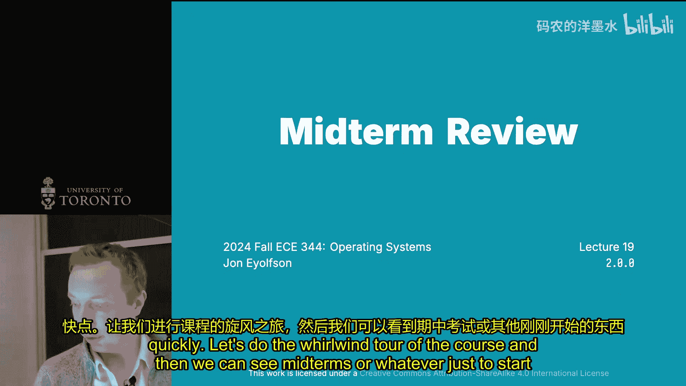

# 018：课程回顾与习题讲解



在本节课中，我们将对操作系统课程前半部分的核心概念进行一次快速回顾，并通过分析几道典型的期中考试题目，帮助大家巩固所学知识。我们将重点关注进程、线程、虚拟内存等关键主题。

## 课程核心概念回顾

上一节我们介绍了本次复习课的目标，本节中我们来看看课程前半部分的核心知识脉络。

### 内核与用户模式

操作系统内核运行在**内核模式**下，拥有直接访问硬件的权限。用户程序则运行在**用户模式**下，权限受限。用户程序通过**系统调用**（如 `fork`, `wait`, `pipe`）请求内核服务，此时CPU会从用户模式切换到内核模式。

### 进程创建与管理

在Unix系统中，创建新进程的唯一方式是使用 `fork()` 系统调用。
*   `fork()` 会创建一个当前进程的完整副本。
*   在父进程中，`fork()` 返回子进程的PID。
*   在子进程中，`fork()` 返回0。
*   创建后，两个进程的执行顺序由调度器决定。

进程管理需要理解父子关系，并能够识别和处理**僵尸进程**（已终止但未被父进程回收）与**孤儿进程**（父进程已终止）。`wait()` 系统调用用于回收子进程。

### 进程间通信与信号

我们学习了基本的IPC，如使用 `pipe()` 创建管道进行读写，以及重定向文件描述符。信号是内核发送给用户进程的异步通知，类似于中断。例如，`Ctrl+C` 会发送 `SIGINT` 信号。


### CPU调度

我们探讨了多种调度算法：
*   **先来先服务（FCFS）**
*   **最短作业优先（SJF）**
*   **最短剩余时间优先（SRT）**
*   **时间片轮转（RR）**：这是第一个实际可实现的算法，每个进程被分配一个时间片。
随后引入了优先级调度，并简要讨论了多CPU调度和实时系统（硬实时、软实时）。Linux使用的**完全公平调度器（CFS）** 旨在公平地为每个进程分配CPU时间。

### 虚拟内存与页表

内存被划分为固定大小的块，称为**页**（通常为4KB）。虚拟地址到物理地址的映射通过**页表**完成。
*   单级页表简单但可能浪费空间。
*   **多级页表**通过树状结构节省空间，但增加了查找开销。
*   **转换后备缓冲区（TLB）** 用于缓存页表项，加速地址转换。

### 线程

线程是进程内的执行单元，共享进程的地址空间等资源。
*   创建线程使用 `pthread_create()`，指定要运行的函数。
*   线程同步使用 `pthread_join()`（类似 `wait()`）和 `pthread_exit()`。
*   线程实现模型主要有：
    *   **一对一模型**：一个用户线程对应一个内核线程（如Linux的Pthreads）。
    *   **多对一模型**：多个用户线程映射到一个内核线程（如实验四）。
*   关键点：调用 `fork()` 时，只有调用该函数的线程会被复制到新进程中。

## 期中考试习题精讲

在回顾了核心概念后，我们通过几道往届考题来具体应用这些知识。

### 进程与管道习题

考虑以下代码，假设所有系统调用均成功：
```c
int main() {
    int fds[2];
    pipe(fds);
    pid_t pid = fork();
    if (pid == 0) { // 子进程
        dup2(fds[0], 0); // 标准输入重定向到管道读端
        dup2(fds[1], 1); // 标准输出重定向到管道写端
        execlp("cat", "cat", NULL);
    } else { // 父进程
        // 点A
    }
    return 0;
}
```

**问题1：编译运行后，终端似乎立即返回。为什么？**
**答案**：因为父进程在 `fork()` 后直接执行 `else` 分支（该分支为空），然后 `return 0` 退出。子进程则变成 `cat` 命令，其标准输入被重定向到管道读端，将一直阻塞等待输入。

**问题2：解释子进程中发生的情况。它可能成为僵尸进程或孤儿进程吗？**
**答案**：子进程执行 `cat`，并从其标准输入（即管道读端）读取。由于它自己也持有管道的写端，读操作永远不会收到文件结束符（EOF），因此会永远阻塞。这意味着它永远不会终止，所以**不可能成为僵尸进程**（僵尸是已终止的进程）。当父进程退出后，这个永远阻塞的子进程将被init进程接管，因此**会成为孤儿进程**。

**问题3：假设在点A插入代码 `waitpid(pid, NULL, 0)`，运行时会观察到什么？为什么？**
**答案**：程序将永远挂起（阻塞）。因为父进程会等待子进程终止，而子进程（`cat`）由于上述原因永远阻塞，不会终止，导致父进程也永远阻塞在 `waitpid` 调用上。

**问题4：假设在点A插入代码 `write(fds[1], “x”, 1)`，这对子进程的执行有何影响？如果使用 `htop` 观察，CPU使用率会有何不同？**
**答案**：子进程将陷入无限循环，导致CPU使用率接近100%。父进程向管道写端写入一个字符“x”。子进程（`cat`）从管道读端读到“x”，然后将其写入标准输出（即管道写端）。这个“x”又会被 `cat` 自己从读端读到，再次写入，如此循环往复，形成“管道反馈循环”，消耗大量CPU资源。

### 线程习题

考虑以下代码：
```c
void* even(void* p) { printf("Even %d\n", *(int*)p); free(p); return NULL; }
void* odd(void* p) { printf("Odd %d\n", *(int*)p); free(p); return NULL; }

int main() {
    pthread_t threads[4];
    for (int i = 0; i < 4; i++) {
        int* p = malloc(sizeof(int));
        *p = i;
        if (i % 2 == 0) pthread_create(&threads[i], NULL, even, p);
        else {
            pthread_create(&threads[i], NULL, odd, p);
            pthread_join(threads[i], NULL); // 等待奇数线程结束
        }
    }
    return 0;
}
```

**问题1：为何主线程必须使用 `malloc` 为传递给线程的整数指针分配内存，而不是直接传递循环变量 `i` 的地址？**
**答案**：因为循环变量 `i` 位于主线程的栈上。主线程在循环过程中会不断修改 `i` 的值。如果直接将 `&i` 传递给新线程，新线程访问该指针时，`i` 的值可能已被主线程改变，导致数据竞争和不一致的结果。通过 `malloc` 为每个线程分配独立的内存空间，可以确保每个线程访问的是自己独有的数据副本。

**问题2：奇数线程和偶数线程的打印语句执行顺序有保证吗？解释你的推理。**
**答案**：没有完全的保证，但存在部分约束。
*   `Even 0` 和 `Even 2` 的执行顺序相对自由，与任何奇数线程都没有同步点。
*   由于主线程在创建奇数线程1后立即调用 `pthread_join`，因此 `Odd 1` **必须**在 `Odd 3` 和 `Even 2` 之前打印完成（因为主线程必须等待线程1结束后才能继续循环迭代，创建线程2和线程3）。
*   `Odd 3` 必须在主线程 `return 0` 之前完成（因为主线程也 `join` 了它）。
*   因此，确定的顺序是：`Odd 1` -> (`Even 2` 和 `Odd 3` 顺序不定)。`Even 0` 可以在任何位置。

**问题3：当进程终止时，可能存在僵尸线程吗？解释僵尸线程的概念。**
**答案**：是的，可能存在。**僵尸线程**是指已经终止（执行完毕）但尚未被其他线程通过 `pthread_join` 回收其状态的线程。在本代码中，主线程只 `join` 了奇数线程（1和3），没有 `join` 偶数线程（0和2）。如果偶数线程在主进程退出前终止，它们就会成为僵尸线程。

**问题4：是否可能并非所有 `printf` 语句都被执行？解释可能发生这种情况的场景。**
**答案**：是的，有可能。如果主线程在偶数线程（0和2）执行 `printf` 之前就执行到 `return 0`，那么整个进程会终止，所有线程（包括尚未打印的偶数线程）都会被立即终止。因此，可能只看到 `Odd 1` 和 `Odd 3` 被打印。

**问题5：如何解决上述问题（僵尸线程和可能缺失打印），确保所有线程都被妥善管理且所有 `printf` 都执行，同时不改变线程的运行顺序？**
**答案**：可以采取以下组合方案：
1.  在主线程 `return 0;` 之前调用 `pthread_exit(NULL);`。这会使主线程等待所有其他线程结束后再终止整个进程，确保所有线程都有机会执行。
2.  对于我们不关心其返回状态、也不需要同步的偶数线程（0和2），可以在创建后立即调用 `pthread_detach(threads[i])`。这会将线程设置为分离状态，当其终止时，资源会自动回收，避免成为僵尸线程。

### 虚拟内存习题

假设一个实验性计算机系统：
*   虚拟地址：16位
*   物理地址：8位
*   页大小：16字节
*   页表项（PTE）大小：1字节。其布局为：最高4位是物理页号（PPN），最低4位是权限位。

物理内存内容如下表所示（每个单元格代表一个字节，地址格式为行-列）：
| 地址 | 0 | 1 | 2 | 3 | 4 | 5 | 6 | 7 | 8 | 9 | A | B | C | D | E | F |
| :--- | :--- | :--- | :--- | :--- | :--- | :--- | :--- | :--- | :--- | :--- | :--- | :--- | :--- | :--- | :--- | :--- |
| 0x0- | 10 | 20 | 30 | 40 | 50 | 60 | 70 | 80 | 90 | A0 | B0 | C0 | D0 | E0 | F0 | 00 |
| 0x1- | 11 | 21 | 31 | 41 | 51 | 61 | 71 | 81 | 91 | A1 | B1 | C1 | D1 | E1 | F1 | 01 |
| 0x2- | 12 | 22 | 32 | 42 | 52 | 62 | 72 | 82 | 92 | A2 | B2 | C2 | D2 | E2 | F2 | 02 |
| 0x3- | 13 | 23 | 33 | 43 | 53 | 63 | 73 | 83 | 93 | A3 | B3 | C3 | D3 | E3 | F3 | 03 |
| 0x4- | 14 | 24 | 34 | 44 | 54 | 64 | 74 | 84 | 94 | A4 | B4 | C4 | D4 | E4 | F4 | 04 |
| 0x5- | 15 | 25 | 35 | 45 | 55 | 65 | 75 | 85 | 95 | A5 | B5 | C5 | D5 | E5 | F5 | 05 |
| 0x6- | 16 | 26 | 36 | 46 | 56 | 66 | 76 | 86 | 96 | A6 | B6 | C6 | D6 | E6 | F6 | 06 |
| 0x7- | 17 | 27 | 37 | 47 | 57 | 67 | 77 | 87 | 97 | A7 | B7 | C7 | D7 | E7 | F7 | 07 |

**问题1：如果使用单级页表，需要多少字节来存储它？**
**答案**：虚拟地址16位，页大小16字节（2^4），因此页内偏移占4位。虚拟页号（VPN）占 16 - 4 = 12 位。单级页表需要为每个VPN提供一个页表项（PTE），共有 2^12 个VPN。每个PTE大小为1字节。所以总字节数为：**2^12 * 1 = 4096 字节**。

**问题2：假设使用多级页表，且每一级页表恰好装满一个物理页帧。该系统所需的最小页表级数是多少？**
**答案**：计算步骤如下：
1.  每页可容纳的PTE数量 = 页大小 / PTE大小 = 16 / 1 = 16 个。
2.  因此，每级页表需要用 4 位（因为 2^4 = 16）来索引其内部的PTE。
3.  VPN总位数为12位。
4.  所需级数 = ⌈VPN位数 / 每级索引位数⌉ = ⌈12 / 4⌉ = **3级**。

**问题3：对于虚拟地址 0x034C，其页偏移量（十六进制）是多少？**
**答案**：虚拟地址格式为：L2索引(4位) | L1索引(4位) | L0索引(4位) | 偏移量(4位)。0x034C 写成二进制位串更容易看清：`0000 0011 0100 1100`。最后4位是偏移量：`1100`，即十六进制 **0xC**。

**问题4：对于虚拟地址 0x034C，其最高级页表（L2）的索引（十进制）是多少？最低级页表（L0）的索引（十进制）是多少？**
**答案**：
*   最高级（L2）索引是前4位：`0000`，即十进制 **0**。
*   最低级（L0）索引是第9-12位（从0开始计数）：对于0x034C，位串 `0000 0011 0100 1100`，L0索引是 `0100`，即十进制 **4**。

**问题5：详细描述翻译虚拟地址 0x034C 的每一步过程（假设顶级页表基址PPN=0）。**
**答案**：
1.  **访问L2页表**：顶级页表位于PPN=0，即物理地址 0x00-0x0F 区域。使用L2索引=0，找到第0个PTE。根据内存表，地址0x00处字节值为 `0x10`（即 `0001 0000`）。权限位 `0000` 有效。PPN为 `0001`，即物理页1。所以L1页表位于PPN=1。
2.  **访问L1页表**：L1页表位于物理页1，即地址 0x10-0x1F 区域。使用L1索引=3（0x034C的L1索引是 `0011`），找到第3个PTE。地址 0x13 处字节值为 `0x43`（即 `0100 0011`）。权限位 `0011` 有效。PPN为 `0100`，即物理页4。所以L0页表位于PPN=4。
3.  **访问L0页表**：L0页表位于物理页4，即地址 0x40-0x4F 区域。使用L0索引=4（0x034C的L0索引是 `0100`），找到第4个PTE。地址 0x44 处字节值为 `0x54`（即 `0101 0100`）。权限位 `0100` 有效。PPN为 `0101`，即物理页5。这是最终的目标物理页。
4.  **组合物理地址**：最终物理页号（PPN）为5，页内偏移为0xC。因此，物理地址 = (PPN << 偏移位数) | 偏移 = (5 << 4) | 0xC = 0x50 | 0x0C = **0x5C**。
5.  **内存访问**：CPU最终从物理地址 0x5C 处读取数据。

## 总结


本节课中我们一起回顾了操作系统课程前半部分的核心内容，包括进程的创建与管理、线程的概念与同步、CPU调度策略以及虚拟内存与页表的工作原理。通过分析典型的期中考试题目，我们实践了如何运用这些知识解决具体问题，例如分析进程行为、推理线程执行顺序以及进行虚拟地址到物理地址的手动转换。希望这次复习能帮助大家更好地准备考试。