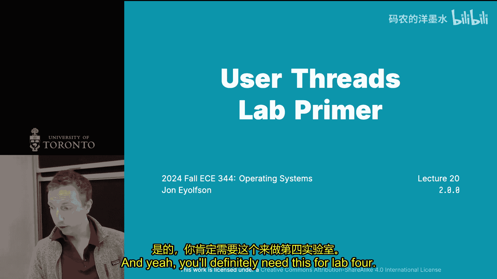
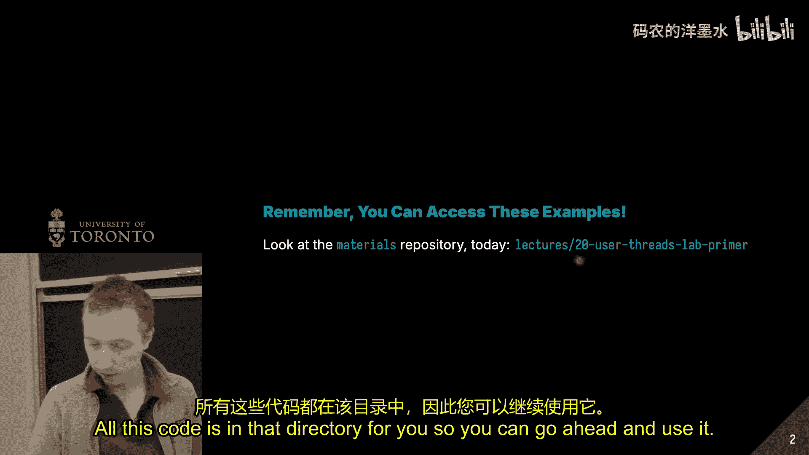
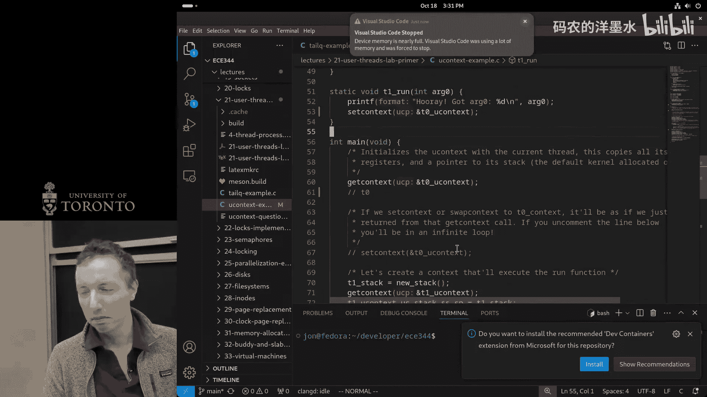
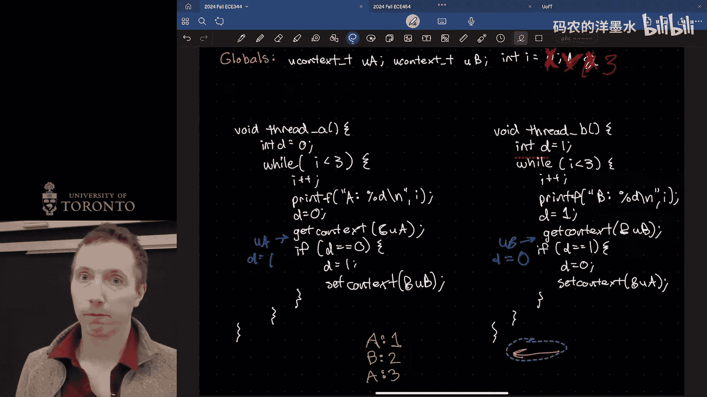
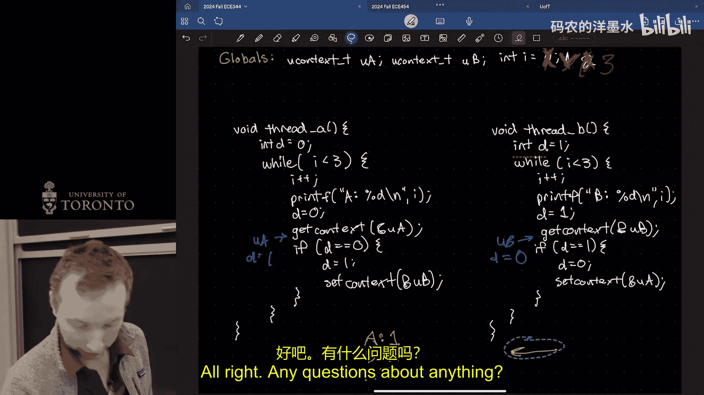
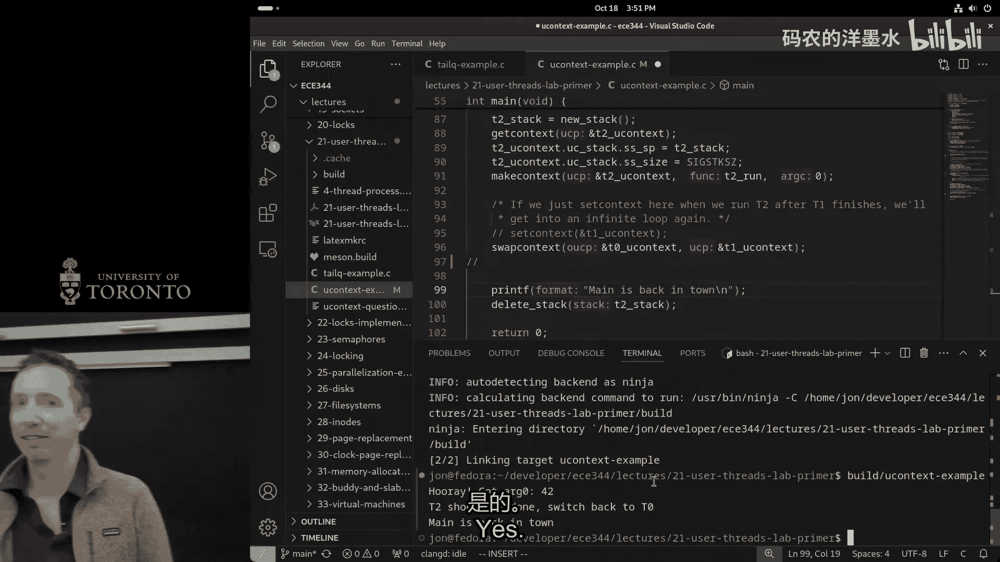

# 019：用户线程实验 🧵



在本节课中，我们将学习用户线程的实现原理。我们将回顾进程与线程的关系，并深入探讨如何使用C语言中的`ucontext`库来手动创建、管理和切换用户级线程。这对于理解操作系统如何管理并发执行至关重要。



## 进程与线程回顾 🔄

上一节我们介绍了虚拟内存和调度，本节中我们来看看进程内部的具体构成。一个进程可以包含多个线程。

一个拥有四个线程的进程可以这样理解：
*   进程拥有**打开的文件描述符**，这些是进程级别的资源。
*   进程拥有**虚拟内存空间**，其中存放着全局变量和堆。
*   每个线程拥有自己独立的**寄存器组**和**栈**。这些栈都位于进程的虚拟内存空间中。

因此，一个进程是资源（如内存、文件）的容器，而线程是在这些资源内执行的实体。

## 使用链表管理线程 📋

在实验中，你需要管理多个用户线程并按FIFO（先进先出）顺序调度它们。这意味着你可能需要一个队列数据结构。

以下是使用C标准库提供的`sys/queue.h`中的宏来简化链表操作的方法：

```c
#include <sys/queue.h>

// 1. 定义链表节点结构体
struct entry {
    int thread_id; // 你可以存储线程ID或其他信息
    // 可以在此添加更多字段
    TAILQ_ENTRY(entry) pointers; // 这个宏会为你声明前驱和后继指针
};

// 2. 定义链表头结构体
TAILQ_HEAD(listhead, entry);

// 3. 初始化链表
struct listhead head;
TAILQ_INIT(&head); // 将链表头初始化为空

// 4. 创建节点并插入链表尾部
struct entry *elem1 = malloc(sizeof(struct entry));
elem1->thread_id = 1;
TAILQ_INSERT_TAIL(&head, elem1, pointers); // 插入到尾部

struct entry *elem2 = malloc(sizeof(struct entry));
elem2->thread_id = 2;
TAILQ_INSERT_TAIL(&head, elem2, pointers); // 再次插入到尾部

// 5. 遍历链表
struct entry *e;
TAILQ_FOREACH(e, &head, pointers) {
    printf("Thread ID: %d\n", e->thread_id);
}
// 输出将是: Thread ID: 1\nThread ID: 2

// 6. 移除节点
TAILQ_REMOVE(&head, elem2, pointers); // 从链表中移除elem2
free(elem2); // 记得释放内存
```
强烈建议使用这个现成的链表实现，而不是自己从头编写，这可以节省大量的调试时间。

## 线程上下文：`ucontext_t` 🧩

核心概念是，我们需要一种方法来保存和恢复线程的执行状态（所有寄存器的值、栈指针等）。C库提供了`ucontext_t`（用户上下文）结构体和相关函数来完成这项工作。

首先，我们需要一个辅助函数来为线程分配栈空间：

```c
#include <ucontext.h>
#include <stdlib.h>
#include <sys/mman.h>



#define STACK_SIZE SIGSTKSZ // 系统定义的默认栈大小

void* new_stack() {
    void *stack = mmap(NULL, STACK_SIZE, PROT_READ | PROT_WRITE,
                       MAP_PRIVATE | MAP_ANONYMOUS, -1, 0);
    if (stack == MAP_FAILED) return NULL;
    // 以下代码用于兼容Valgrind内存检查工具，你可以直接使用这个函数
    stack_t ss = { .ss_sp = stack, .ss_size = STACK_SIZE, .ss_flags = 0 };
    sigaltstack(&ss, NULL);
    return stack;
}

void delete_stack(void *stack) {
    munmap(stack, STACK_SIZE);
}
```

## 创建与切换线程 ⚙️

现在，让我们看看如何创建和切换线程。我们将模拟一个主线程（对应内核线程）创建两个用户线程的情况。

```c
ucontext_t ctx_main, ctx_thread1, ctx_thread2;
void* stack1 = NULL;
void* stack2 = NULL;

// 线程1要执行的函数
void thread1_run() {
    printf("Thread 1 is running!\n");
    // ... 线程1的工作 ...
}

int main() {
    // 初始化主线程的上下文（可省略，这里为了演示）
    getcontext(&ctx_main);

    // 创建并设置线程1
    stack1 = new_stack();
    getcontext(&ctx_thread1); // 必须先用getcontext初始化
    ctx_thread1.uc_stack.ss_sp = stack1;
    ctx_thread1.uc_stack.ss_size = STACK_SIZE;
    // 设置“完成后的链接”，当thread1_run返回时，跳转到ctx_main
    ctx_thread1.uc_link = &ctx_main;
    // 创建上下文，使其执行thread1_run函数，并传递一个参数(42)
    makecontext(&ctx_thread1, (void (*)(void))thread1_run, 1, 42);

    // 使用swapcontext切换到线程1
    // swapcontext(&ctx_main, &ctx_thread1) 等价于：
    //   getcontext(&ctx_main); // 保存当前状态到ctx_main，并设置从本行之后恢复
    //   setcontext(&ctx_thread1); // 立即切换到线程1
    swapcontext(&ctx_main, &ctx_thread1);

    // 当线程1执行完毕并通过uc_link返回，或其它线程切换回此时，程序会从这里恢复执行
    printf("Main thread resumed.\n");

    delete_stack(stack1);
    return 0;
}
```
**关键点解释：**
*   `getcontext(&ctx)`: 将**当前**线程的寄存器状态保存到`ctx`中。如果之后`setcontext(&ctx)`，会从`getcontext`调用之后的位置恢复执行。
*   `makecontext(&ctx, func, argc, ...)`: 修改一个已初始化的上下文`ctx`，使其栈使用`ctx.uc_stack`，并设置其启动函数为`func`，可以传递整数参数。
*   `setcontext(&ctx)`: 将当前线程状态替换为`ctx`中保存的状态，实现线程切换。
*   `swapcontext(&save_ctx, &new_ctx)`: **原子操作**。先将当前状态保存到`save_ctx`（并设置好从本行之后恢复），然后立即切换到`new_ctx`。这是实现协作式调度的关键。
*   `uc_link`: 当`makecontext`创建的上下文对应的函数**返回**时，系统会自动跳转到`uc_link`指向的上下文。如果为`NULL`，则进程结束。

## 一个经典的上下文切换例题 🤔

让我们通过一个例题来巩固对上下文切换的理解。考虑以下代码：

```c
ucontext_t ua, ub;
int i = 0;

void thread_a() {
    int d = 0;
    if (i < 3) {
        i++;
        printf("A %d\n", i);
        d = 0;
        getcontext(&ua);
        if (d == 0) {
            d = 1;
            setcontext(&ub);
        }
    }
}

void thread_b() {
    int d = 1;
    if (i < 3) {
        i++;
        printf("B %d\n", i);
        d = 1;
        getcontext(&ub);
        if (d == 1) {
            d = 0;
            setcontext(&ua);
        }
    }
}
// 假设初始时切换到 ua 执行 thread_a
```
**问题：** 程序的输出是什么？

**逐步分析：**
1.  从`thread_a`开始：`d=0`, `i=0`。进入if，`i`自增为`1`，打印 `A 1`。`d`被赋值为`0`。调用`getcontext(&ua)`保存状态（假设从下一行恢复）。此时`d==0`为真，进入if块，`d`变为`1`，然后切换到`thread_b`(`ub`)。
2.  执行`thread_b`：`d=1`（**这是thread_b自己的栈变量，与thread_a的d无关**），`i=1`。进入if，`i`自增为`2`，打印 `B 2`。`d`被赋值为`1`。调用`getcontext(&ub)`保存状态。此时`d==1`为真，进入if块，`d`变为`0`，然后切换回`thread_a`(`ua`)。
3.  恢复`thread_a`：从`getcontext(&ua)`之后恢复，即检查`if (d == 0)`。**注意**：此时thread_a栈上的`d`值是步骤1中被改为的`1`，因此条件为假，跳过if块。
4.  回到`thread_a`的循环开始：检查`if (i < 3)`，此时`i=2`，条件为真。`i`自增为`3`，打印 `A 3`。`d`被赋值为`0`。调用`getcontext(&ua)`。此时`d==0`为真，`d`变为`1`，切换到`thread_b`。
5.  恢复`thread_b`：从`getcontext(&ub)`之后恢复，即检查`if (d == 1)`。此时thread_b栈上的`d`值是步骤2中被改为的`0`，条件为假，跳过if块。
6.  回到`thread_b`的循环开始：检查`if (i < 3)`，此时`i=3`，条件为假。函数`thread_b`返回。由于没有设置`uc_link`，进程结束。

**最终输出：**
```
A 1
B 2
A 3
```
这个例题巧妙地演示了如何利用局部变量和`getcontext`/`setcontext`来实现类似`swapcontext`的“从特定点恢复”的功能，是理解用户线程切换机制的绝佳示例。

## 总结 📝








本节课中我们一起学习了用户线程实验的核心内容。我们回顾了进程与线程模型，学习了如何使用`sys/queue.h`中的宏来管理线程队列，并深入探讨了`ucontext`系列函数（`getcontext`, `makecontext`, `setcontext`, `swapcontext`）来保存、创建和切换线程上下文。我们还通过一个复杂的例题分析了上下文切换的具体流程。掌握这些知识，你将能够实现一个简单的用户级线程库，从而更深刻地理解操作系统内核中线程调度的原理。