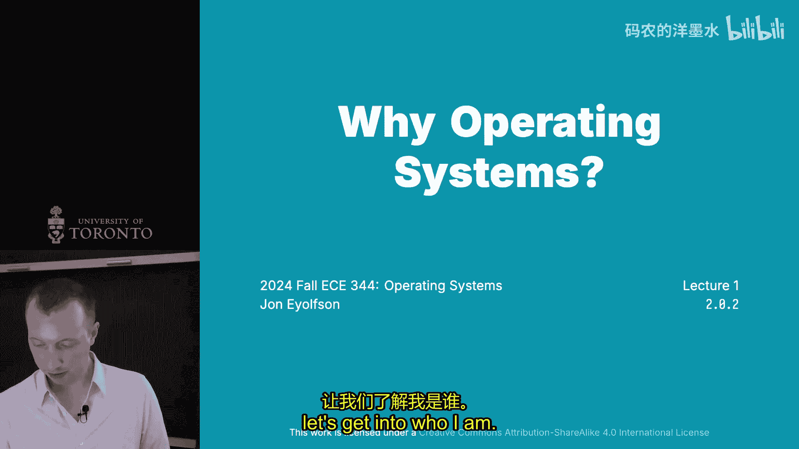
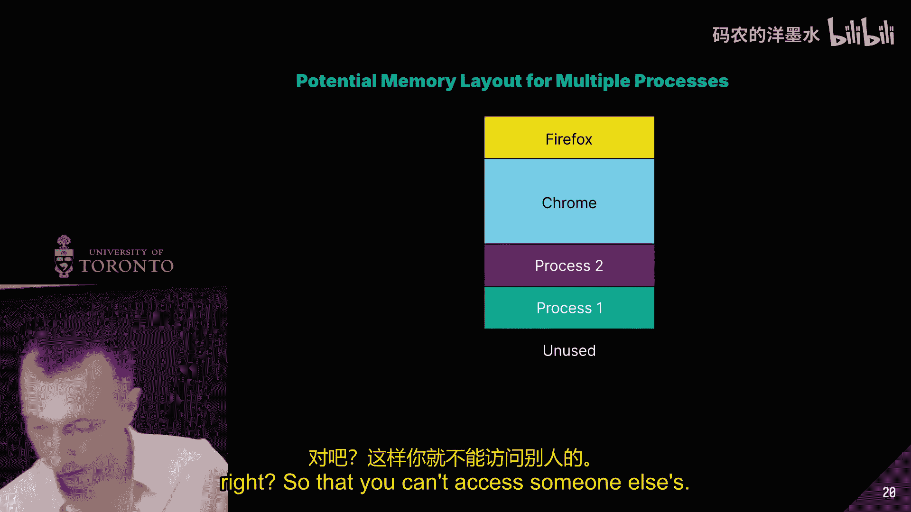
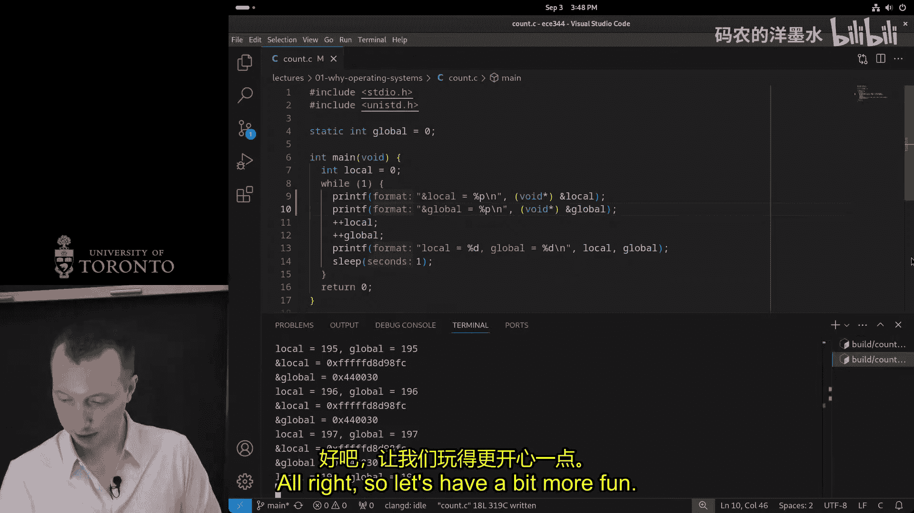
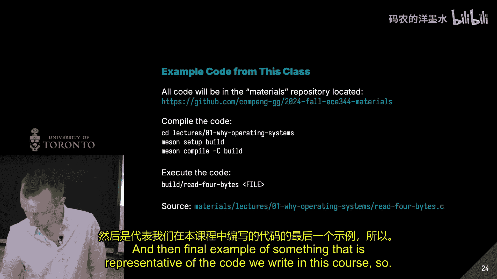
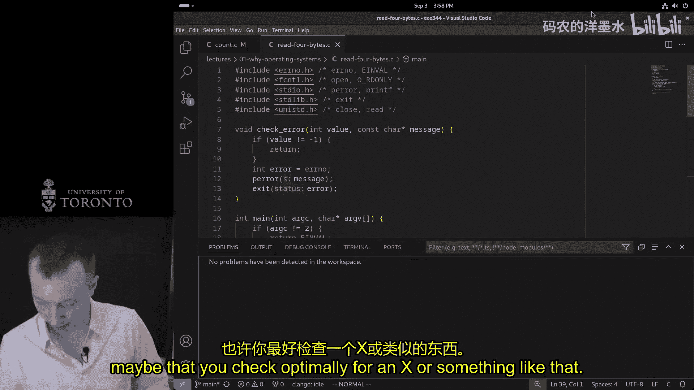
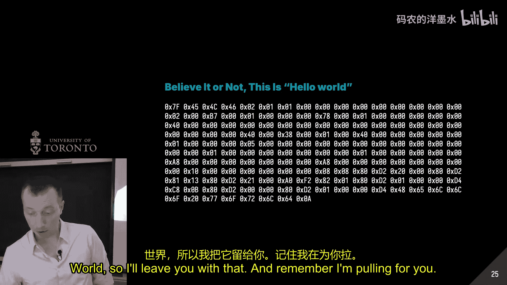

# 【全集】多伦多大学 操作系统 中英字幕 1080P p01 Lecture 1 - 课程导论 -BV1Rbk7ByERc_p1-

🎼。我我仔呢啲。Allrighty， welcome to ECE344 operating systems。

 so big question we will answer today is why on earth would you take this course。

 but first before that， let's get into who I am。

So I am John， your instructor， that mess is my last name， so if you have to pronounce it。

 I will teach you a trick because yeah that。Kind of a disaster of most people actually like。

No one's pronounced it correctly。Even myself， so I took a trip to Iceland when I was like 25 and gave my passport to the nice Icelandic man。

 they looked at my passport， looked at my name， looked at me。

 they told me to say my last name and I did， and then he just said no。So。I pronounce it just Elfson。

It's supposedposed to be a elfson。 It sounds like an A， I't know， I won't use it。

 so I will teach you the way to actually say my last name that's perfectly acceptable。 So elf。

 everyone can pronounce Elf， like Christmas is gonna come by the time this semester is done so we can get in the mood early and then sin。

 that's not bad。 Elfson， boom， he just pronounce it。 That's all you have to do。

 don't make it more complicated than that。If for some reason。You have to spell my last name。

 I will also make that easy for you just that's not hard to remember， so just take the L and the F。

 shove them to the side and then you stick a yo in the empty space boom。

 there's how to spell my last name All right Hopefully you don't have to do it。

 but that is an easy way to remember how to actually do it without going crazy so。

Let's get into it so why would we take this course so I assume you're interested in software and if you're interested in software。

 even in the least bit taking this course and understanding operating systems will make you a better programmer。

So why is that doesn't even matter what language you write then because no matter what language you write in。

 there's only two types of software you ever write in your life。

 you will either write software that is interacting with the offering system or feeling that you are now the operating system。

 so only two types of software， hey， this course is great for both of them and in the first one。

The majority of this course is in C but for interacting with the operating system and things like that doesn't matter what language you write it in。

 Python， JavaScript， rust， whatever doesn't matter。

 you'll be interacting with the operating system all the same so this course is applicable no matter what even if you don't really like C。

 you're going to have to grip your teeth and kind of bear it through this course。

 because while most core parts of the operating system are actually programmed in C。

So some important URLs for the course。 main one is that compensch do G。

 we're going use a whole bunch of modern stuff and that connects everything together。

 So if you haven't signed into that yet， please do it。

 it just uses your normal Toronto off nothing special Letures will be posted on my website without logins or anything。

 So there's less barrier to entry and the labs will be on that URL I'll post them all on corus it should all be there So you can go ahead and find everything through Corus if you are missing anything。

 the whole page on corus is just links and then your grades and any announcements And aside from that will be using more modern software that hopefully you use in your job So we'll be using Github for your labs So really important to actually connect your sign up for account if you don't have it already sign up。

 go that compensch G G Connect and everything will be using。Discord for discussion。

 because I don't like piazza and students seem to like discord。

And then all the lectures will be live streamed and recorded， and they'll have vs。

 so you'll have everything available to you， and that will be on the YouTubes。

So the only big drawback with Discord is you can't send things anonymously by default。

 So over the summer， we fix that so you can go ahead and send anonymous discord messages。

For some reason， I thought that like your Discord username would be anonymous enough and that'd be good enough。

 but apparently you guys are all friends with each other for some weird reason。

 so you're not actually anonymous， So this will help make you anonymous。

 So if you just want to send an anonymous message to the channel， just type slash an on。

 then type your message and then it will display as if the bot typed it， not you。 So。

It's anonymous to everyone， except me。 I can see it if I really want to。

 I don't really have an interface to see it。 I only record it just in case you use it very inappropriately。

 which hopefully does not happen。 But if you're just trying to use it for something terrible， don't。

 please， that's like。Yeah， that's bad。 Let's not deal with that situation， but。

Pretty much to each other， you're all anonymous and you're anonymous to me unless you really do something bad。

 And I have to look you up。 So don't make me do that。 And then we're all anonymous to everyone。

So lectures are live stream recorded， please still show up。

 It's a lot easier for you and me to get feedback and clarify if anything's unclear。

 plus you don't even have to like actively raise your hand and ask me a question if you don't want。

 I can see your faces。 So if you look confused， I know I said something kind of silly and I should probably repeat myself or say it a different way and all you have to do is sit there and look confused or look not confused。

 So we'll also have live coding during this。 So I'll do whatever you tell me to。

 you can break my computer if you really want you can even get a prize if you break it TBD maybe that's a bad idea offer prize to break my computer。

 but we will see how that goes and。We'll be able to explain。

 we should be able to explain everything any program does。

 so I'll pretty much type whatever you tell me to， we can see how that breaks and we'll be able to explain actually how things work。

So。If there's anything else I can do to make attending better experience， please let me know。

All right。Oh yeah， and also during lectures， you know。

 just in case you don' you can of course raise your hand。

 ask me a question if you don't want to and you want to be anonymous。

 I have the discord chat open right beside me too in the Section 2 lecture channel so I can see everything you type if you want to answer questions or ask questions that way。

 I can try and read them from that and answer them it's the best effort of me actually reading them。

 I'm decent at it， but I'm not terribly great at it so yeah I can see some people using the bot already。

 So boring stuff that's in the syllabus evaluation for this course。Basically。

 it's labs every two weeks。The first lab was split off into two parts， which is starting now。

 which is just a quick setup that should not take you very long。 And at the end of it。

And like do on the ninthth， I think， all you have to do is answer five little questions on crowdwork about your setup and then that's it。

 so some students have already submitted it， so it's nothing super taxing and Ts will also be around on Discord to help you if you run into any issues。

And then past that lab one is going to be really， really short because realistically。

 I plan you for like a week to actually do it。Other than that。

 I know that midterm date is already terrible。 Some of you in Section 1 have already told me you three midterms that day。

はい。Yeah， I guess they everyone dislikes you already。 That's pretty unfortunate。

 So that's why I put that tentative thing there， because I do like。

Scheduling midterms are just like a complete crab shoot here。

 You just pick a day and then see how many conflicts are。

 And that's apparently the best way to do that。 Apparently， they don't want to centralize that。

 So yeah， third area you're just kind of on your own。

 So we will change that because that seems to be the worst date available。But other than that。

 every two weeks， labs are worth 4%。Final normal thing worth 50， not terribly exciting。All right。

 academic honesty， so you can study together， discuss concepts on discord。

 post nonlab code on discord， that's fine， figuring out how to explain things， how things work。

 That's fine。 please do not cheat it's bad for you， it's bad for me。

 most of these assignments and labs are trying to get you to understand what's actually going on and be able to explain what is actually going on and help you understand what the operating system is doing。

 So if you just cheat on them， you're not going to really answer the exam questions and also。

It's pretty easy to figure out if you copy software。Especially if you， as what happened last year。

 do and just air drop your assignment to your friend and then be like， oh， yeah。

 I don't know how that happened。 That's weird。 They're exactly the same。 Yeah。

 that ends up with having a very awkward conversation with me。

 and an awkward conversation with the department。 And that's at minimum。 You might have like。

F other awkward conversations， depending on。 So please， let's not go through that process。

 unpleasant for me， unpleasant for you。If。You come up a lab deadline， they're only worth 4%。

 literally please just take the L， just take the L if you're deciding on cheating， just take the 4%。

 it's not that bad， worst case， you can email me if you need something and we can work something out。

Just don't cheap。 Just don't。 Yeah， just， we can come up with something else other than that because it's not going to help you anyways。

 And sure it's 4%， but really probably won't matter too much。

So there are recommended books that complement the lectures and know they are not required and no。

 well， the first one you don't even have to pay for， the operating system three easy pieces。

 it is freely available online， PDF versions， I think just normal web versions。

 they complement the lectures so after if you're having trouble with stuff。

 you can read the corresponding section in that book and you can have it explained another way or just another point of view。

Since this course is all in C。You might want to brush up on your C programming。

 There's a C programming language book by the authors of C。 If you need to brush up on C at all。

So on that topic， what skills should you practice again if needed DC programming and debugging。

 probably required， especially in this course， there is an optional part of the lab where it will bring you through like how to debug stuff and use GDP and set up GDP in our development environment you don't need to go that heavy if you don't want to print FDbugging is perfectly acceptable for this course。

 the skill you should know is just logically thinking about your computer。

 making sure that everything it does makes sense， thinking about logically。

 stepping through your program one line at a time， execution can't just randomly jump places even though you might think it does while you're doing this course as things get trickier and trickier but all the logic you know from like APS 105 still true program starts at Maine。

Ih。A little bit of a lie。 But for the most part， starts at Maine。

 starts executing line by line and goes on from there。

Being able to convert between like binary hex and decimal might be okay as long as you just know that those are just three different ways to represent a number。

 that's okay， being able to do it on the fly doesn't really matter。

 it might save you a few seconds once we get to that point where it's actually somewhat relevant。

 I'll show you little tricks to deal it even faster。

Knowing what the words little in and Big Indian is from your architecture Ih course is also good。

 We won't really need it， but knowing that， you know。

 there's different ways to represent multiple bitetes in a row。

Probably something you should be aware of。 And the biggest one is memory is not。

 and memory and pointers are not that special。 Memory is bitete addressable。

 And one thing you should know。Off the top of your head， how many bits are in a bite？8， there we go。

 so know that there are eight bits in a byte and then memory is byte addressable and addresses。

 memory addresses and pointers mean the same thing， so that means memory address0。Well。

 that's a perfectly good memory address， there's a bitete there。

 there's a bite at memory address one， bite at memory address2。

 and since there's a lot of memory goes up to like 4 billion or something like that。

But every memory address just represents a single byte。

 so that we'll be getting into how memory actually works， even in a little demo today。

 so just keep that in mind， memory is not terribly magical until we make it somewhat magical in this course。

Allright， and again， please provide feedback Co is challenging。

 This course starts off extremely fast and will kind of break your brains a little bit。

 so bear with me， we will get through it together， please let me know if anything is unclear you can ask interesting questions too all programs interact with the operating system so you can even if if your question is like oh。

 how does。This weird piece of software work， you can even ask on Discord。

 I'll probably be able to point you in the right direction or explain a little bit of something。

 And again， doesn't matter what language it is in。 It's all going to interact with the operating system eventually。

And if after like the midway part of the course， it chills out。

 So we'll just get through the first half together。

 and then it'll be more or less chill at the end of that。And the nice thing about that is。

 by the end of course， I guarantee you will be a better programmer， you will write better software。

 and you will be employable， yay， isn't that what we're all here for？All right。So。

 you've probably seen。This before， maybe you're aware of writing applications。

 probably did that in A 105。 So this is like you write a program and see， oh， yeahep。Yeah。

's a bit of a delay。 I don't know why there。 Is that slightly better。All right， slightly better。

 all right。Yeah， I don't know what that delay is， it's weird。Okay， sorry。 So operating system。

 basically， it's。Middle management。So your application that you wrote in 105， your C program。

 you compiled it to an executable， you ran it， that's like an application。

 you may or may not know it， but it was running for a given operating system and that operating system was managing all of the resources。

You saw the other half of it， the lower part of it， like the hardware， so in ECE 243。Well。

 you dealt with hardware， you dealt with interrupts and things like that。

 So those are all part of things the operating system has to do。

 But you didn't have a very complicated system that could run you know， Chrome， multiple Chrome tabs。

 which is like gigabytes of memory and things like that， you've had something fairly simple。

 only one single application。 So now to make our software more general。

 We have to have an operating system in between the hardware and our applications。

 So the operating system manages all the hardware force and we can write applications and run them on any type of hardware without actually changing the application。

 So whenever you got a new laptop， you didn't have to like It know。

 recompile a different version of Chrome or something like that。Specifically for your laptop。

 and itss hardware。So there's three core operating system concepts， the first one is virtualization。

 which is just a fancy way of saying you share one resource by mimicking multiple independent copies of it。

 we'll see that very shortly the second is probably where your brains will start to melt a little bit and that's concurrency and that's handling multiple things happening at the same time so like most of our cores now we have two core at least two cores even like in a wristwatch so that presents some challenges because there could be multiple things running at the same time and you have to keep everything in order。

The third is when things kind of chill is just persistence， that's retaining data。

Basically how we store files and how do we ensure data integrity， even when we lose power。

 so whenever you reboot machine or the power goes out or something you can still reboot back into Windows or Mac or whatever。

 so we'll be talking a little bit about how we actually store files and things of that nature。

Alright， so this is a quote I like that I was introduced to in fourth year that is like shockingly true。

 So I'll introduce this to you in third year。 So all problems in computer science can be solved by adding well by solved by another layer of indirection or a layer of abstraction。

 So basically if we have a really， really hard problem， we just kind of generalize it。

 make up a name for it， and then we solve that problem so。😊。

The first abstraction in this course is going to be a process so you know hopefully what a program is that's like a file containing all the instructions to actually run your program。

 all the data required to run it and everything of that nature and then we have to give a name to what happens when you actually try and run that program and a process is the name of a actual running。

Program， so why do we name it something like this， Well we can have multiple processes of the same program running at the same time。

 So you probably have you know two Chrome windows open or something like that。

 That's an example of two processes of the same program running at once。So we have to argue about。

 since we have this abstraction process， we have to argue about， well。

 what's everything we need to actually run our program， So you're probably used to registers。

 Don't worry， we don't have to do any assembly in this course。 So you don't actually have to。

Deal with the registers yourself， but you should know that they exist。

So the basic requirements for a process is it needs a set of virtual registers because whenever you run your program and you set。

 I don't know， like RAX to two， if for some reason your operating system decides to run another program。

 that probably uses registers too and you don't want to just magically change。

R A X to like 5 or something like that。 And then resume your program。

 And now like register values has randomly change。So that won't work。

 so we have to have a set of virtual registers per process so that your registers are your registers。

 remember virtual just basically means there's an independent copy of all the registers specifically for your program that is running so if you change RAX no one else is going to change it。

 it's going to stay five if you set it to five。Other things we need in a process。

We need to use memory probably， anytime we use a variable， we need memory。

 so we probably need a stack and a heap。Everyone knows what a stack and a heap is。All right。

 we have a yes， so if you don't know what stacking a heap is。Ask or。Yeah， this course might be very。

 very hard。So stack is basically the region of memory where all your local variables live。

 so like if you have a function and you say in x， while x lives on the stack。

 it's somewhere in memory， a region of memory called the stack， and then if you malloc something。

 malloc everyone's friend right， everyone loves malloc。Yeah， saw some eye rolls there， yikes。

 we'll have to deal with Maloc， so Maloc， all the memory it allocates is in another region of memory called the heap。

So here is my first question to you， so how are you able to run two different programs at the same time so if I was running hellello world that I wrote in APS 105 and another program。

 it could count up by every second could be Chrome， it could be something like that。

How is that possible？第二。Two different CPUs。Two different GPs。

 So we won't go into GPUs in this course， but all the concepts kind of match the same。

 So they could run on two different CPUs。That's true。 What about memory。

 They can't run on two different sticks of memory， right。Yeah。Maybe somehow嘅。Proces of the same。

Two parallel processes at the same time。 So for this question， just think about just the memory。Yeah。

 and it just like， we determinetermine how much。あの形通さかまず。Process。Yeah。

 so we might think of it as like the operating system while it's managing resources。

Memory is a resource。 So maybe， you know， Chrome starts， it ask for some memory。

 we give it some physical memory， and then your process starts， want some memory。

 gives it some physical memory。 That could work Everyone agree with that。 seems reasonable， yeah。

Would't that cause problem。To allocate， if we have a bunch of things open。Have。发也发说。

Like nothing's opened up the eventually will。Yeah， you might eventually run out of memory。But。

 you know， you might run out a memory。 That's fine。So， let's go with that。

 So we just have two processes。 It asks the operating system for memory。 and we just give it memory。

So let's dig a little bit deeper into that and think a little bit more， so。Yeah。

 that sounds like it could work， let's think about the stacks， so if we just think about the stacks。

 well each process they made their own stack， they could request memory from the operating system and the operating system could just give them physical address to use。

That's fine。Would there be any issues with that， the operating system just kind of gives out physical addresses。

 and that's it。Yeah。The stack needs to grow， so the stack needs to grow。

 but usually you just kind of have a maximum limit to the stack。

 so it could just allocate a bunch of memory to it if you don't use it oh well。So yeah。

 there could be like waste of memories。We cannot determine how much we save for each。MaybeYeah。

 maybe we waste a bit of memory， that's certainly something that could happen。Programming。

StSt runs sequentially。process like the programep and builds on top of each other so how can you like like。

D legs。Sp it up。Sequential。So if you have two different processes running。

 you could just say your stack is here and then other process。

 your stack is here and they don't interfere with each other。我哋拿力。Ever。Yeah， so the question is。

Might they overlap each other， oh yeah。Yeah， kind of it kind of has to do with the actual device。

 They could overlap each other。 But I think the point you're mostly getting at is that， well。

 if it just gives you physical address， like physical addresses。In C， right？

Is there any restriction as to what memory I can access， I can just write a random address right。

 So would there be anything preventing me from guessing Chromet and just starting reading it。

 maybe change it， something like that。 So in that scenario， no。

 that's like terrible for security right， you can't just kind of give out physical addresses because you can just access anything so there's probably something going on。

So。Also， we then talk about global variables because they work in a fairly strange way that you might not have thought。

 because no one at this point has told you where global variables get memory from， right？Well。

Spoiler alert， what actually happens is the compiler just picks random addresses for global variables when you compile。

How does it know what address to use for your global？If we need， if we only had physical memory。

 we'd probably need like a global registry of addresses。 So， okay， if Chrome needs a global variable。

 this is where it is in memory at this address， it should only be for Chrome and no one else should touch it。

 And， of course， thered be issues with that， too， because while one。

Any process could access that memory if it was physical。 And again。

 we would need this global registry and you'd need the whole world to agree on everything。

 So that means if you want to create a global variable。

 you need to go to the worldwide global variable foundation and ask for an unused address which is not going to be a thing because if that was a thing it would probably look like this。

 So if that was our big block of memory we could say， oh， these ones are reserved for process  one。

 these ones are reserved for process 2， but you can tell that might get out of hand because it might actually look like this。

 So like Chrome probably uses a lot of memory so it needs a lot of space and then Firefox probably needs even more And now suddenly we've ran out of global addresses and then we're done。

😊，So what could be a solution to this issue？What we could do is from the program perspective。

 it can be like it has accesss to all the memory， however the operating system uses interrupts to just randomly assign。

Space is into memory for the things to be added。If every overlap has happened。

 you also need to interrupt so avoid down。Yeah， so if you didn't hear that， that was very。

 very detailed。So much so that I won't repeat the details because we'll get into it a bit later。

 But basically， the answer was， oh， well， we probably need virtual memory for processes。

 like each process needs its own view of memory that's independent of each other。

 right so that you can't access someone else's。 So let's actually experiment with that and see if that is true。

😊。

So this is a C program， hopefully you can read this if you can't。Yeah， we'。Tall hell to climb。

 So first thing we declare a global variable called global， which is of type int。

 and then I have a static there。How good was your C teacher， does anyone know what static means？Yeah。

If it's his name and everyone else call this one will access the same barrier。So。The answer was。

 if everyone else calls it global， it accesses that same variable。Nope， not quite。

 so if it's a global variable， everyone should access it。Only initialize once。

That's one meaning of static， mostly in C plus plus not C。 Yeah。

 I think it's like a limit in global marriage。Like if we are certain。

Region like a certain file would limit to that certain file as a global bear。あさだせ。Yeah。

 so it's basically a limited global variable。 So if I have static in front of it。

 it means I can only access this global global variable from this C file。

 I can't access it from any other C file。 That's all it means。 And in this case。

 I didn't even need to put it there because I， I'm only using one C file， yeah。

I open up another C files and I don't initialize it。

 so if you have another C file and you compile two C files into your program。

 if you have global in the other C file， it won't be this one。

 this one is only accessible in this file。Which is kind of weird。

 kind of a little thing you probably won't ever use it。 I just put it there just for fun。

 I don't know， I have a warped sense of what's fun。 you will come to realize。So。We have main。

 hopefully everyone's seen main before。 Then we do int。 We have an int variable called local。

 So that should live on the stack。 We initialize it to 0。 And then we have wall 1。

 basically wall true。 So an infinite loop。All it does is increment the local variable。

 increment the global variable， and then print off their values， and then goes to sleep for a second。

 so we don't get spammed。So if we go ahead and whoops， compile whoops。And run this program。

It's just called count。We see it just count up， right， so locals one。Local， or sorry， yeah， local 7。

 Global 7， they go kind of lockstep with each other。

 So that is running in this tab here all the way to the bottom right。 I could go。On this tab。

 and I could run that program again。While the other one's running。

 So here I'll switch back to the first tab。 So this one's still running。

 It's counted all the way up to 30。 So my question to you is， if I run this program。

 what will happen， So let's see。Will it just resume？Counting from 30 or wherever it currently is。

 so it'll display like 40 and keep on going。No votes for that。Okay。

 it starts both variables at Z1 and keep on counting。Okay。

 and then final vote for the local restarts at one and the global because it's the same。

 maybe the same memory address it resumes。Okay， we got a few votes for that。 So let's see。

So this one's still running， it got all the way up to 77。So， let's run。

And now looks like it's restarted completely， and they're completely independent of each other。

So this one counting up by one each time。It's all the way at 90， this one has now made it to 14。

 it's counting up by one each time， so they're not interfering with each other。

 otherwise if it was the same physical address， then we would see that the count gets increased by maybe two sometimes so。

Just to verify it and see that virtual memory actually is a thing that exists。

 Let's play with the memory addresses so we can print off。The address of the local variable。Avoster。

All right， so that should just print off whatever the current address of the local variable is。So。

Our guest is well。They could be somewhere different in physical memory。

 So maybe the addresses are different。 And that's why。 So let's see， whoops I need to recompile。So。

The address of the local variable is。Some crap that ends with DC。Alright。

 so now let's switch back over here。It got up to， like， 14。So we'll run it again。

So now the address of the local variable is something something A C。

 which is seems to be distinctly different。 This one ends in D， C。 This one run ends in A C。

 So they could be different physical addresses。 We don't know virtual memory exists yet。

 So still T D。 We can't actually confirm anything。So let's stop them quick。

And then we'll go ahead and we'll print off the address of the global variable。

So here's where you believe me if I just said the compile just picks any old random address and then it just uses that。

So here， the address of the global variable is 4，4，0，0，3，0。

And seems to be counting up over and over again， so。It's at 14。

 We'll go back over and launch it again。 And guess what The address of the global is the exact same in both processes。

4，4，0，0，3，0。 So I can switch back。 You can see that the address is the same。 in both processes。

 but the value is clearly different， So they're accessing， if this was actually physical memory。

 this wouldn't be possible， right， So they're both accessing the same physical address and reading a different value。

 That's like some quantum physics level superposition B， S that I don't， I think is fake。 not really。

 I just don't understand it。 So。Probably should be careful of what I say， but anyways。

Here we actually have evidence that virtual memory is a thing because， well。

 now the global in this process running is 70 and that the same address in this one。

 it's all the way at or below it at like 50 something。So any questions about that？

Everyone believes that virtual memory exists， yep。So the reason why it's。

It's able to read the same memory。Incrment a different value。

Yeah so the reason why in both processes， they read the same address。

 but it's different values is because each process has its own view of memory and they're completely independent from each other。

Yeah， so how to maintain the illusion because there is physical memory on my machine， right。

 So how we do that illusion is this course。So we will get into how we actually implement virtual memory。

 how it works， and you will know everything about virtual memory by the end of this course。

 but for now， all you need to know is that it exists。Yeah， doesn't that mean that like。

If I run a process。Occupy a certain amount of memory that virtual memory can allow me to get access to the same。

Memory that that's being used。Or like something else No， so the question is， well。

 if I have virtual memory， can I just like access memory of another process No for example。

 so like these are using like certain discrete memory。Yeah， so this is all virtual memory。

These addresses。Yeah， so they exist somewhere in physical memory。But。From using your computer。

 normally you will never， ever， ever， ever see a physical address。

So this isn't actually representative of the memory that exists。

Yeah this is not physical memory it's all virtual memory yeah so they're just virtual memory addresses and the operating system creates that illusion and you're right there's physical memory on your machine。

 there's some way to map virtual memory to physical memory and you want to make sure they don't overlap unless you know you read someone else's memory like you said so that's the job of the operating system。

All right， any other quick questions about that？All right， so let's have a bit more fun。

Quick summary of what we found， the addresses of the local variable was different between two processes running the same program turns out they didn't have to be。

 it's actually a security feature that the addresses get randomized so that you can't exploit something by just knowing where and memory something is so that goes towards security a little bit。

 but the address of the global variable was the same between both the processes because the compiler just picked it whenever you compiled your program。

So。What else would we need for a process as like a spoiler for the rest of the course。

 So remember a process is represents your program running and what resources your program uses。

 So one thing that's in process is virtual register， So that kind of represents running on your CPU。

 virtual memory which represents using memory， So what else might you use when you're running a program。

Yeah。I guess it's all stack。So its own stack and heap would be covered in virtual memory。

So what other resources do your programs use？Oh yeah， I， yeah， yep。System clock。 Y， yeah。

 so uses a whole bunch of different things。IO pretty much covers all the rest of it， files， network。

 everything like that that all has to be managed by the operating system。

 which we will get to by the end of the course。But for now we can just think of a process as this。

 so it has a set of virtual registers that kind of represents a CPU， it has a stack and a heap。

 but that stack and a heap is in virtual memory， so each process has its own copy of memory that is independent of any other process。

 so probably something you did not realize before。And then final example of something that is representative of the code we will write in this course。

So。Here is some more code， so here is main that has arguments， so we have in A V as a quick C quiz。

 the type of Arg V， can someone tell me in plain English what the hell the type of Arg V is there？

Double pointer char。Yeah， that technically， but something that might mean a bit more。Yeah。

 so it's appointed to a character。Pointer to character close。 Y。

 It's like an array of sea out strings。 Yeah， yeah so。

Probably the easiest way to describe it as an array of C strings and a C string is just a pointer to the first character of that string。

 and you just keep reading that string until you hit a null bitete and that's the end of the string。

I think it's like this。呃。They're just like the argument。Yeah。

 so they'll represent the strings that I type in at the terminal。

 they will be on the stack and they're not read only， but we can get into that。So yeah， here。

I'm just writing a program called Read4 Btes， the purpose of this program is it should take a file argument and then show you what the first four bytes of the file is。

 so here there's a function called open。Don't have to know what that does yet。 Basically。

 it opens a file and then gives you a number back that represents that file so you can read information from it。

 So here it uses the second argument I type in in the terminal。As an argument to open。

 And then here it has flags。 So it opens it for reading。 So we get back an F D。

 It's short for file descriptor。 It's basically just a number that now represents that file in this process。

And then all the functions， you're going to want to check for errors in this course。

 probably write a little helper so that you don't have to write 100 different if statements。

 most of the function in this course will return negative one if there's an error， so here。

I basically just wrote a little helper function that checks the value past to it。 If it's negative。

 if it's not negative  one， it just returns because there's no error。 Otherwise。

 it saves an error no， which we'll get into what that is in a bit。 and then。

Print out a message describing that error with a message saying what actually caused it to go wrong。

 And then it just stops the process with an error number。

 So here it would give a message saying open and then the rest of it should say what that is。

 So if I try and run the program and then give some invalid file that doesn't exist。 So I slam my。

Slave my fist on the keyboard， and I try and open footage That stiff。

 That's definitely a file that doesn't exist。 So it gives me an error。Open is what I said。

 So I know that it actually came from this line。 And this is what's provided by that P error。

 So it prints no such file or directory。So。Oops， the rest of it。

All it does is declare a array of characters at size4。

 so I'm going to read information from the file into this array and this is the function that actually reads information from that file so I give it the file descriptor number basically represents that file。

 then the address to start writing or assigning values in the array to and then the maximum number of values it should assign so in this case is four。

Does the same thing。 returnsturn negative 1。 If there's an error and returns the number of bytes successfully red。

 might be shorter than 4 at most。 It will be 4。Then I have a for loop。

That just goes through every bite in the array。And then you probably have some idea what ASCI is。

 so that's how we assign numbers to represent characters on the keyboard。

 so I know if the number is greater than 31 and less than 127。

 it's something you can actually type on a keyboard so I'll print it as a character otherwise if I can't represent it I will just print it as a hex character。

 I could represent as decimal， I just felt like represent it as a hex and then that's it。

So this is where we dispel the myth of magic in this course。

General rule of thumb is the first four Btes of a file are the only way your computer actually knows what type that file is the extension doesn't matter whatsoever。

 So， for instance， if I try and read the first four Btes of the P F that represents this lecture。

 the first four bytes are percent sign PF。And the technical term and I'm not making this up is called magic。

 so if that is the first four bytes of your file， it starts with percent sign PDF it that magic means it's a PDF file and you should interpret the rest of the content as a PDF file Of course you can screw that up and that's how you get exploits and you all that fun stuff but that's basically what your computer does reads the first four bytes and goes yeah that's a PDF file or if you try and open an non- PDF file an Acrobat reader it's going to be like that's not a valid PDF file because it doesn't start with that。

We can use this to see what the magic is of。Anything so we can be。

 we can be meta about it and see what the first four Bs of the first four Bs file is。

 So the actual executable。 And that magic starts with Bte 0 is this value 7 F。 Basically。

 that means it's something I can't represent on the keyboard。 It's not ASI。

 It's the value 7 F or an otherwise in decimal1 hundred27。 Sos something I can't actually represent。

 And then the rest of it is E LF or E。 nothing to do with me。 It has a much more boring name and。

I did not invent executables。 So every executable you write on Linux。

 will start with that and PlayStation executables。 All your games also start with that oddly enough。

 So that is literally every executable。 And we can go ahead and run this on。😊，Oh， the Lib C exists。

 so we could actually see what the magic of Lib C is。 It's called Lib C。

 And Lib C starts with the same thing。 It's just 7 F， E LF。😊，And just for fun。

 we can check the contents of。The file itself， it's not a binary file or anything like that。

 So the first four B should just be like the hashtag。 then I And C。 if this works。

 And if we read the C file， yeah， we just get。Haashtag， I， N C。 So plain text files。

 But all the special files that are binary files that you can't actually look at。

 they all start with some type of magic that tells you what it is。😊，Coolhu。

 we dispelled the myth of things。 And then yeah， file types with more than three characters like Doc X。

 Yeah， so magic can be 4 bys generally， it can be longer。 It's just。😊。

The doc files probably start with doc。 So if you read that。

 maybe that you check off for an X or something like that。

All right， before while we wrap up really quick， all the code。You'll have access to it。

 it's a materials repository， you can click on it， we are all good。

 this is all the instructions to actually run everything。And as a teaser。

 I will leave you off in this。We still got a minute and a half， what the hell's noise。All right。

 quick， so for the last thing this is actually the simplest hello world you can see。

 so if we look at the first four bytes， it's 7 F and then if we go back to ASI this。

Is actually ELF and if I actually executed this binary blob it would print hellello world and this is only 168 bytes which is probably smaller than the hellello like actually typing hellelloworld。

C and then compiling it and seeing how big that is so we'll run this in the next lecture and actually see a hellello world so I'll leave you with that and remember I'm pulling for you。

