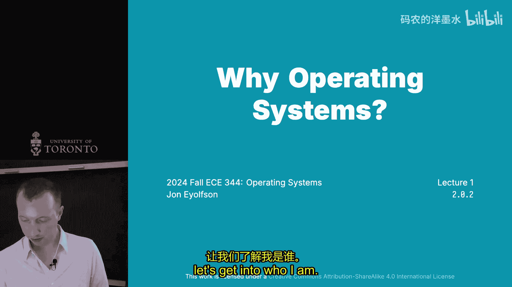
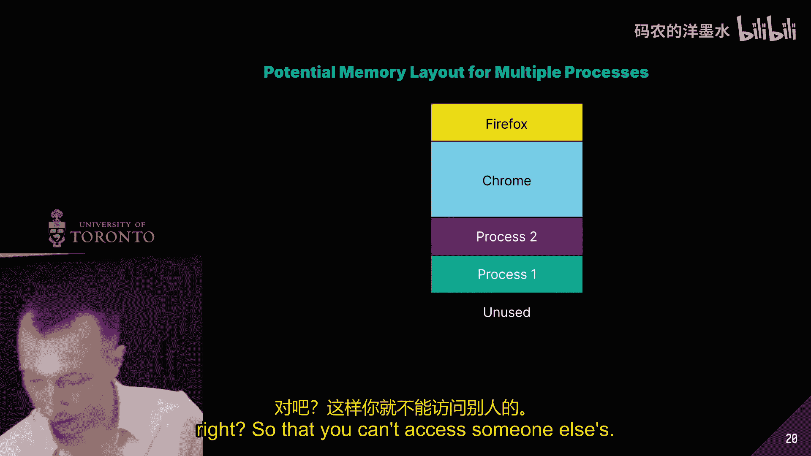
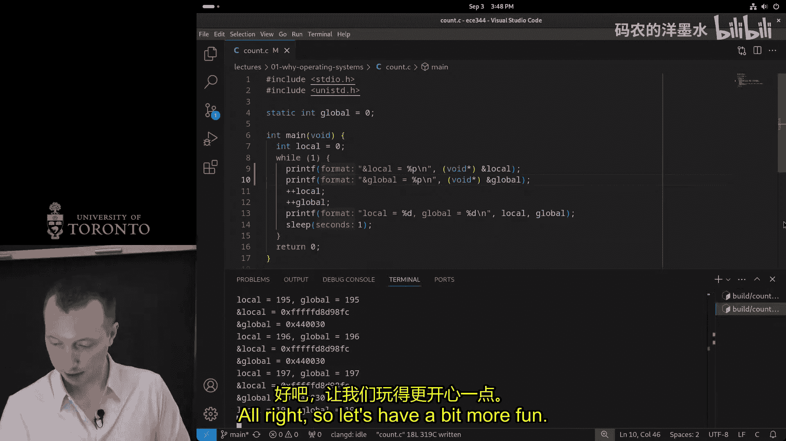
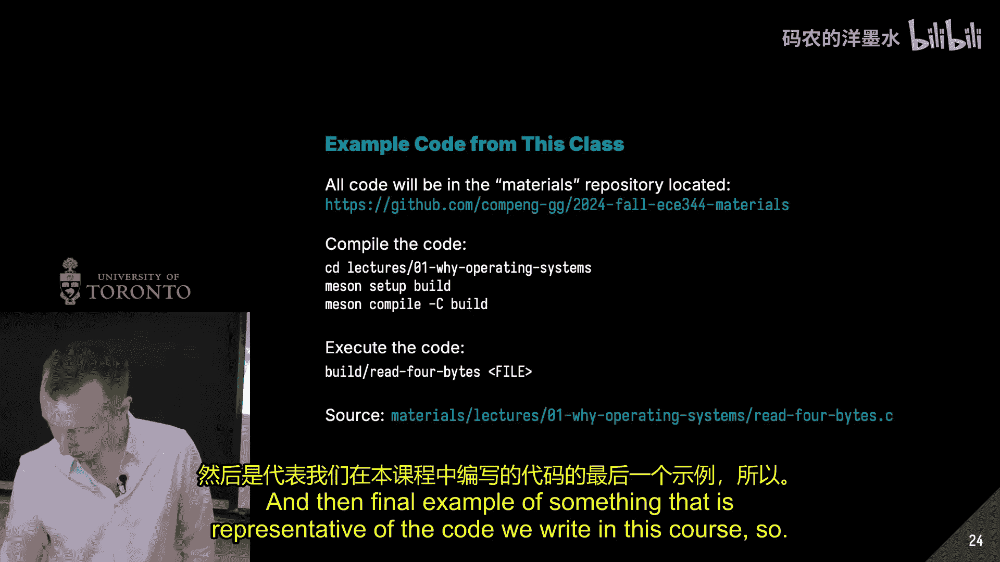
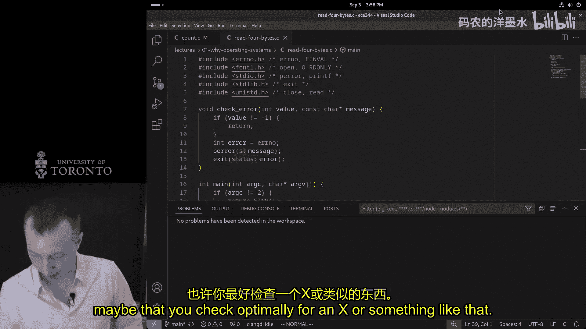
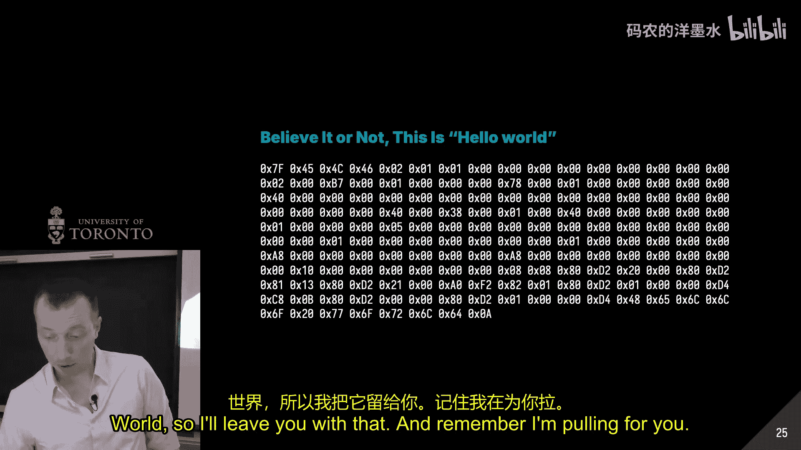

# 操作系统：第1讲：课程导论 🖥️

在本节课中，我们将要学习操作系统课程的基本介绍，包括课程目标、核心概念以及为什么学习操作系统对成为一名更好的程序员至关重要。

## 课程概述

欢迎来到ECE344操作系统课程。我们今天要回答的一个核心问题是：你究竟为什么要学习这门课程？但在回答这个问题之前，让我们先认识一下授课老师。

我是John，你们的讲师。我的姓氏拼写有些复杂，为了方便，你们可以叫我Elfson。希望你们不必经常拼写它。

## 学习操作系统的意义

我们假设你对软件感兴趣。如果你对软件有哪怕一丁点兴趣，学习并理解操作系统都会让你成为一名更好的程序员。

原因在于，无论你使用何种编程语言，你一生中编写的软件只有两种类型：
1.  与操作系统交互的软件。
2.  你正在成为操作系统本身的软件。

这门课程对这两种情况都大有裨益。课程主要使用C语言，但即使你不喜欢C语言，也必须掌握它，因为操作系统的大部分核心部分都是用C编写的。然而，对于与操作系统交互而言，无论你使用Python、JavaScript还是Rust，其原理都是相通的。

## 课程资源与工具

以下是一些重要的课程资源链接。

*   **课程主页**：`compeng.ca`。我们将使用大量现代工具，这个网站将所有内容整合在一起。请务必登录。
*   **讲义**：将发布在我的个人网站上，无需登录即可访问。
*   **实验**：将通过课程主页和Canvas发布。Canvas上主要包含链接、成绩和通知。
*   **GitHub**：我们将使用GitHub来管理实验代码。请务必注册账户并连接到课程主页。
*   **Discord**：我们将使用Discord进行讨论。你可以发送匿名消息，只需输入 `/an` 然后输入你的消息即可。
*   **课堂直播与录像**：所有讲座都将进行直播和录像，并发布在YouTube上。

## 课堂互动与期望

讲座会进行直播和录像，但仍鼓励大家出席。现场互动能获得更好的反馈，我也能通过大家的表情判断是否讲清楚了。我们会在课堂上进行实时编码演示，我会根据大家的要求编写代码，并解释程序的运行原理。

如果你不想举手提问，也可以通过Discord聊天匿名提问。我会尽力阅读并回答。

## 课程评估与学术诚信

课程评估主要包括每两周一次的实验和一次期末考试。

*   **实验**：每两周一次，占总成绩的4%。第一个实验分为两部分，主要是环境设置。
*   **期中考试**：日期暂定，可能会根据冲突情况调整。
*   **期末考试**：占总成绩的50%。

关于学术诚信，你们可以一起学习、在Discord上讨论概念、发布非实验代码。但请勿作弊。抄袭代码很容易被发现，后果严重。如果临近截止日期，实验只占4%，请直接接受扣分，而不是选择作弊。

## 预备知识与推荐阅读

这门课程主要使用C语言，因此你需要熟悉C编程和调试。逻辑思维、理解程序如何逐行执行是关键。此外，了解二进制、十六进制和十进制的转换，以及大端序和小端序的概念也会有所帮助。

最重要的概念是：**内存是按字节寻址的**。每个内存地址对应一个字节。指针和内存地址是同一回事。

推荐阅读《Operating Systems: Three Easy Pieces》，这本书可以免费在线阅读，是对讲义很好的补充。如果需要复习C语言，可以参考《The C Programming Language》。

## 提供反馈

这门课程开始时节奏会非常快，可能会让你们感到有些吃力。请随时提供反馈，如果任何内容不清楚，请告诉我。你们也可以提出有趣的问题，因为所有程序最终都会与操作系统交互。课程的后半部分会相对轻松。我保证，学完这门课程后，你们会成为更好的程序员，写出更好的软件。

## 操作系统核心概念

你可能已经编写过应用程序。在计算机系统中，操作系统扮演着“中层管理”的角色。你的应用程序运行在操作系统之上，而操作系统管理着所有硬件资源。这使得我们可以编写能在任何硬件上运行的应用程序，而无需为特定硬件重新编译。

操作系统有三个核心概念：

1.  **虚拟化**：通过模拟多个独立的副本，来共享一个资源。
2.  **并发**：处理多个同时发生的事情。现代设备通常有多个核心，这带来了挑战。
3.  **持久性**：存储数据，确保即使在断电后数据也能保留。

计算机科学中有一句名言：“所有问题都可以通过增加一个间接层（或抽象层）来解决。” 本课程的第一个抽象就是**进程**。

## 进程：运行中的程序

一个**程序**是一个包含运行所需指令和数据的文件。而一个**进程**则是一个正在运行的程序的实例。同一个程序可以同时运行多个进程（例如，打开多个Chrome窗口）。

一个进程需要哪些资源？
*   **虚拟寄存器**：每个进程都需要自己的一套寄存器副本，这样当操作系统切换到另一个进程时，你的寄存器值不会被覆盖。
*   **内存**：进程需要使用内存，主要包括**栈**（用于局部变量）和**堆**（用于动态分配的内存，如`malloc`）。

## 虚拟内存的演示

那么，操作系统如何让两个程序同时运行，并管理它们的内存呢？如果直接分配物理地址，一个程序可能会访问或修改另一个程序的内存，这会造成严重的安全问题。

让我们通过一个实验来观察。我们编写一个简单的C程序，它递增一个局部变量和一个全局变量，并打印它们的地址。然后我们同时运行这个程序的两个实例。

观察发现：
*   两个进程中，局部变量的**地址不同**。
*   两个进程中，全局变量的**地址相同**，但它们的**值却不同**。

如果这是物理内存，两个进程访问同一个地址却得到不同的值是不可能的。这证明了**虚拟内存**的存在。每个进程都有自己独立的、虚拟的内存视图。操作系统负责将虚拟地址映射到物理地址，并确保进程之间不会相互干扰。

## 进程的完整视图

综上所述，一个进程的抽象包括：
*   **虚拟寄存器**：代表对CPU的虚拟化。
*   **虚拟内存**：包含独立的栈和堆，代表对内存的虚拟化。
*   **其他资源**：如文件、网络等I/O资源，由操作系统统一管理。

## 实践：读取文件的“魔数”

最后，我们来看一个代表本课程代码风格的例子。这个程序读取任何文件的前4个字节并显示出来。

在计算机中，文件类型并非由扩展名决定，而是由文件开头的特定字节序列（称为“魔数”）来标识。例如，PDF文件的魔数是`%PDF`，Linux可执行文件的魔数是`\x7fELF`。

我们编写一个程序，使用`open`和`read`系统调用来打开文件并读取前4个字节。这个程序演示了如何与操作系统交互进行文件操作，并检查错误（系统调用常返回-1表示错误）。

通过运行这个程序，我们可以验证各种文件的魔数，揭开文件格式的“神秘面纱”。

## 代码与总结

本节课的所有代码都可以在课程材料仓库中找到。作为一个预告，最简单的“Hello World”程序实际上是一个只有168字节的二进制文件，它以`\x7fELF`开头。我们将在下一讲中运行它。

本节课中我们一起学习了操作系统的课程导论、学习意义、核心资源以及**进程**和**虚拟内存**这两个核心概念的初步介绍。记住，我支持你们。