# 【全集】多伦多大学 操作系统 中英字幕 1080P p02 Lecture 2 - 内核 -BV1Rbk7ByERc_p2-

🎼Okay。こなしこ。Alrighty welcome back to operating systems Wow that's Ey so thank you again for joining me here today this is our second lecture which will be mostly a fun lecture we don't have to learn that much today so pressures off it's mostly just exploring things playing with things breaking things there's anything you actually need to know that's relevant to the courses like two things I will point them out as we go。

😊，Otherwise sit back and enjoy the ride so kernels is what we talked today and I left you off with this。

 so I said this was a perfectly valid hellello world program that actually worked and well we'll get to try it out so let me switch over。

😊。

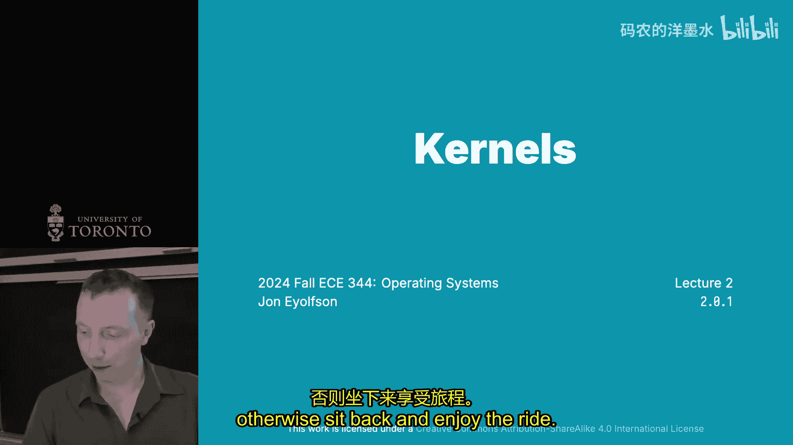

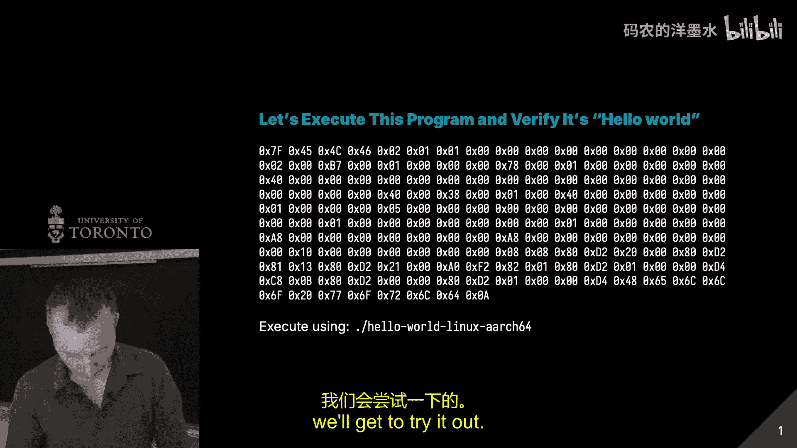

All right， so same setup。The file right here， it's called Hello World Linux A arch 64， because well。

 I'm using a Mac。 So if I go ahead and look at it。Oh world length。I look at the file size of it。

 it is indeed 168 bytes， and then if I run it， if it's actually hello world。

 it should do what hellello world does and just print out hellello world right， so if I run it。

Prince Hello world， super super， super small program。So that does actually work。

So before we get into how all this actually works， we should take a brief detour of instruction set architectures or ISAs。

 so this is just an aside， don't have to know this。

 but there's three major ISAs we use today stands for our instruction set architecture basically the machine code。

 the numbers， the CPU actually understands to execute instructions。

 everything about computers is just we make up numbers。

 and then we assign meaning to the numbers and that's how computer works at the most basic level。

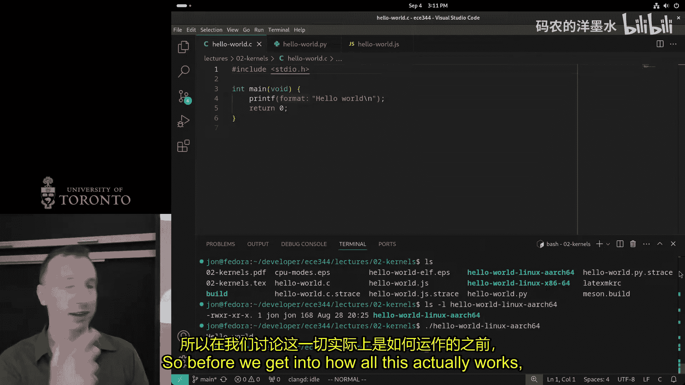

So the three sets of made up numbers people agree on are X8664 bit， that's your desktops。

 your like Windows laptops， unless you have a really really， really new one servers。

 things like that， then you have A 64， arm 64， so that is architecture for pretty much everyone's phone。

Tablets and the newer Apple laptops， so that's what mine's using。

 and then there's a newer one called Ri5 that's like an open source implementation。

 it's similar to arm has the same idea。Which one did you use for 243？Which one？Oh。

 you use something weird， okay？All right， well， you know， same idea。

 So we'll touch on all them briefly on this course， but we don't worry aside from this lecture。

 we won't look at assembly。I think that's true， so we won't really look at assembly or anything like that。

 but you should know it exists， but your time of writing assembly is pretty much over。So。

Before we explain hellello world， I have to explain our next abstraction。

 which is something called a file descriptor， so we kind of saw that at the first lecture when I opened a file。

 it gave me a number back and that kind of represented the file you can think of it as like pointing to a file if you really want。

 even though that's not kind of true。But since all of our processes are independent。

 they have virtual memory， they have virtual registers。 That means by default。

 a process can't talk to another process， which is pretty useless。

 So you need processes to talk to each other to exchange information。 You just don't want to default。

 opt in， like share all information。 You only want to share what's relevant。

 So theres something called IPC， which is a major design。That operating systems have to support。

 and that is called inter processces communication。

 which is basically just transferring data between two processes。And then a file descriptor is just。

That abstraction just means it's a resource that users may either read bytes from or write bytes to。

 and you can think of it as like you just get a number back。

 you can think of it as like an index into an array of files and that's stored on a per process basis so each process has its own files open。

So the file descriptor， even though its's name file descriptor could represent a whole bunch of different things。

 so it could represent a normal file， but it could also represent your terminal。

 so it has the same use， it doesn't really matter if you're like writing bytes to something。

 it doesn't matter whether it goes to a file or your terminal。

 so that's why we have that file descriptor abstraction。

 So you might be able to see where I'm going with this a little bit。

So in order to do like create a program that prints hellello world。

 while we need to print to our terminal and in order to print to our terminal。

 while we need to file descriptor and we need a function that will actually print to the terminal。

 so system calls are one of the main focuses of this course and that's how we make requests to the core part of an operating system so you can think of system calls as regular C functions for now they're little bits more special than that。

 you can represent them as regular C functions， but the details are a bit different。But for now。

 just think of them as normal C functions that just use a core part of the operating system， so。

In order to write hellello world， we need two system calls。 The first one is called right。

It has three arguments。 First argument is a file descriptor。

 so that is where I should write some bytes to。 The second argument is con void star buff。

 So just in case you didn't see it last time like if。ATy in C is void star。

 that's just C's way of saying it's a pointer， I don't really care what it's pointing to。

 it's just a pointer I don't care， and then conscious means you can't assign to it。

And then the third argument is count。 And that's basically how many bytes to write from the buffer。

 So you just give it a big array of characters， and you tell。The operating system。

 how many bytes of that buffer would you like to write to that file descriptor？And then。

The other function we need is something called exit group that has one argument a status。

 and that will exit the current process， so you might have learned before that hey。

 your program ends when you return from Maine， someone's told you that before right。That was a lie。

 So that's what actually happened。 So returning from Maine。

 the number you return from Maine eventually goes to this exit group system call。

 And the number you return from Maine is like the argument there。 So that's just。

And the status is just supposed to represent what happened when I actually executed your program。

 Usually0 means everything was all good。 And any nonze value means there's some type of error。

 And you should probably interpret it。In some way。So those are the two things we need for Hello world。

 We just need to write hellello world somewhere and then exit the process。

So our hypotheical hellello world in like kind of C code would look like this and by convention。

 so these are numbers that will be burned into your brain from this course。

 So you've probably heard of like standard in， standard out。

 standard error before Well we just assign numbers to them there's no such thing really as like standard error。

 standard out being。I don't know， a name that the operating system use， it only understands numbers。

 so here are numbers that will be burned into your brain in this course by convention。

 every process has three open file descriptors when it starts， file descriptor 0 is standard input。

 file descriptor 1 is standard output， file descriptor2 is standard error。And how does this work。

 Well， remember when you were writing assembly and you did function calls and the caller had to agree with the caller of like what registers。

 what values are and what registers， same idea here。

 So everyone just agrees that those file descriptors represent standard in out and error。

So the most basic Hello world program。Assuming we don't even have C， so there's no main function。

 just we define a magic function called start and then just assume that when we run our program。

 it starts executing this function。Our entire Hello world program would just be to write to file descriptor one standard out。

 the string， hellello world with a new line， and then 12 bytes， so the 12 bytes would just be H， E。

 LL O space。W， O， R， LD， and then a new line character that's 12。 and I can spell simple words。

 I can't spell more than that。 but thankfully， I work with computers。

 So I don't need to notice how to spell larger words， so。😊，Then we just。

 that's all we want to do is print hellello world。 And then we just exit group 0。

 which is you can think of it as the same thing as returning from Maine。 So our process is done。

 We're done running our program。So this is another aside。 So there are two different。

 youve probably heard the term API before。 while there's a lower level term called A BI。

 So as a reminder， an API or application programming interface。

 just abstracts the details and describes like the arguments and the return values of the function。

 So if I said this function fo takes two integer arguments or returns and integer。

That's a description of an API。And A B I is specifies the exact details。

 Like if you think back to your assembly course， specifies what goes in which register and things like that。

 So it's like the low level details to actually do a function call。 So specifically。嗯。

Most C functions use something called the C calling convention。

 so if I have that same function using the C calling convention。

 it means the arguments are passed on the stack in right to left order。

 and that's the C calling convention。So。There is a system called A。

 even though it kind of looks like a function in order to call it。When you wrote assembly。

 you did like a jump instruction or a call instruction or something like that。

You are trying to call into the operating system and you can't read the operating systems code。

 Otherwise that might be a security thing， especially if they're trying to hide the code from you。

 So like you can't read。Data from another process， you can't read data from the operating system as well。

So there's no address to actually call。 So in order to call like the core operating system functions。

 we instead have to generate and interrupt and everyone probably loves interrupts， right。Yeah。

 probably not so don't worry it's written for you。 this is just the mechanism how it works。

 that's why they taught you interrupts， but there is this instruction you can actually call and what actually does happen in your machine for arm it's specifically called the SVC instruction and that will generate and interrupt and then your operating system can go ahead and handle it and it will do the system call or function call if you want think of it that way。

So the way it defines its APII is instead of a stack， it just uses registers。In register x8。

 it's the system call number， it doesn't have an address for the function。

 so instead they just make up a number and then a certain number corresponds to a certain function you want to call。

 so for instance， the right system call might be number one or something like that。

And then the other registers up to6 are for all the arguments。

 so x0 to x5 are all the arguments to the function。

So compared to see what would be some limitations here。We could have like more than six hours。Yeah。

 so some limitations in C， I can functions with more than six arguments。

 Hopefully you haven't written one with that many arguments。 It gets a bit hairy。

 but you're not limited。 You can do whatever you want。 So any other limitations with this。So， yeah。

重外な。Yeah， so we only have a limited number of system color numbers。

 but like assuming registers are 64 bit， that's a lot of different functions。

 we probably don't have4 million functions。Hopefully， I mean you could any other。Limitations。

What about if an argument's gigantic and it doesn't fit in any register？Yeah。

 then you're also kind of screwed， then either you have to combine two registers and make sure they agree or point to some memory and give it a pointer or something like that。

 so we're limited in the number of arguments and the size because in this case。

 well they have to fit in a register。So。All you need to know from this， I was a lot of talking。

 Just know that C uses a stack。Flexible， this just uses registers。再给我再。Yeah。

 so the question is why do I need a system call and what functions am I invoking and the answer to that is we're using these functions。

 so these functions are defined in the core part of the operating system and we can only call them using function calls because when we load our program we don't know their address or anything like that。

Yeah， so we're just figuring out how to do those system calls。Or other ways。

 just calling functions in the operating system。All right， so last aside。

 the C ABI or calling convention。System calls uses registers， C uses a stack。

 That's the only real thing you need to take away from this。

 all the other details you don't really care about like here arguments being pushed from right to left order what are call save what are call save those days are hopefully behind you。

 we don't really care ignore them for the purposes of this I'm not actually sure why we put this on So the only thing you need to answer is the question at the bottom here is what advantages does this give us versus system call A and disadvantages and that is well with C。

 we can have any number of arguments we want， they can be different sizes and some cons maybe it's slow but we don't care about that So just those first two points there number of arguments and they can be different sizes。

All right， so back to stuff you don't need for an exam， so programs on Linux。

They use that elf file format to describe it， and they always start with that magical four bytes。

If if I have it all in Hex， it's 7 F4 dot dot do with asking encoding。

 it's actually the first character， which is 7F， is actually supposed to represent hitting the delete key and then ELF all in caps。

 so they were called magic and that's again。The only way the operating system knows and your computer knows what a file is。

 So just read the。Read the file signature or magic。

 And then that will tell what that file actually contains。 So they don't have to start with4 Bs。

 The L file does， but other formats can start with however main bytes they want。 So we saw P F。

 the first four bys was percent sign P F。 But if you look at it further。

 it always has a dash at the end too。 So it has the same five Btes for every file。All right。

That big blob of Hex I showed you at the beginning that actually represents an L file。

 So what it does， we can try and break it down a little bit is it tells the operating system， hey。

 load this entire file into memory starting at address was at 10，000 in Hex。

And in order to describe to the operating system what to actually do， the file header of the L file。

 which is 64 bytes。Just describes that like what architecture is this， where should it go。

 where do I need to start executing So all that information is contained in 64 bytes and the program header is 56 bytes and that tells it where to load into memory so of the 68 bytes。

 I'm using 120 just to describe to the operating system， how to actually load it into memory。

Where it should go and。Like what instruction said architecture this file is in？

So the next 36 bytes of the file are the actual machine code instructions。

 what to actually do to do the system calls， and then the last 12 bytes of the file actually represents the string hellello world with a new line。

So。How it's organized in the file is that the instructions start at 10，000。78 in Hex。

 which 78 in hex， if you don't know how to convert it just。Out of the blue， it is 120。

 so it's after we describe the file and then the string data starts at 10。

000 in hex 9c or right after the instruction， so it starts at byte 156 so you can use this readellf utility to see like all the gory details of the file。

 any file you want and see how it's described to the operating system。

So how it looks more visually is here's the same bytes。

 the file header which again describes like where to start executing your program。

 what the architecture is， the endN this， all that stuff is the first 64 bytes here in blue。

 then in Can， that is the program header saying where to load it into memory。

 and then the actual instructions only take up that green part and not that main bytes。

 and then the data is just the string hello world by itself。So still on the same page， still good。要。

まです。So the question is， what tells the operating system to load this program into a particular address。

 So that is the can part there。 So we can。Actually inspect it， so here。

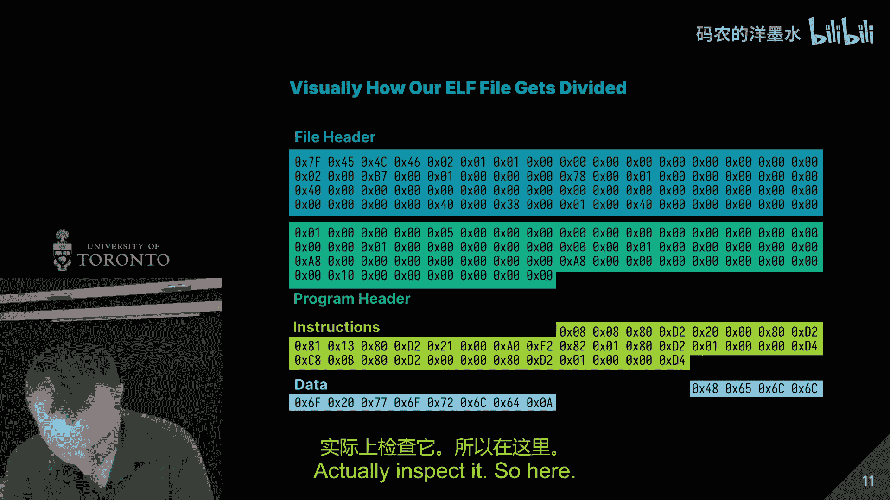

So if we do use that readellf and we get some gory details。

 we can use dash H to read the header file。And it will tell us everything that。

What all those numbers mean in。Not plain English， but English ish。So it says。

The data is little IndianN， the version is some version， it's for UniX， it's an executable file。

 it's arch 86。嗯。Yeah， it X 86。 And then here， this is an entry point。

 So this is telling it where to start executing from。 So all that file is in。

 all that information is in that mess of numbers。 again， just a computer。 So we just have to。

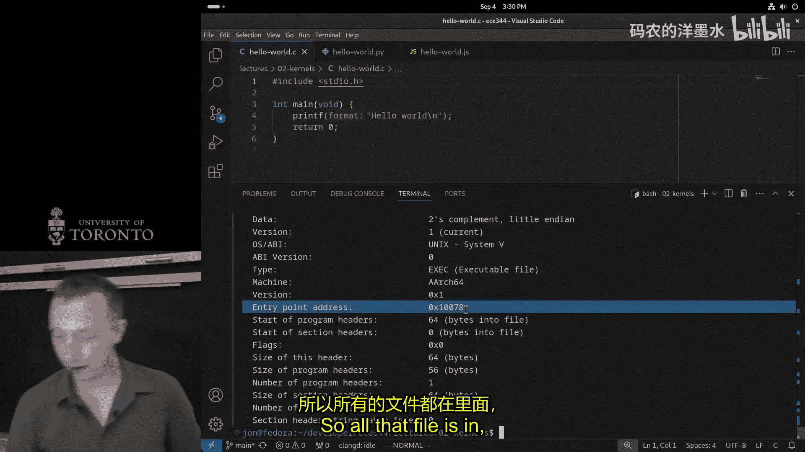

Interpret the numbers， and that's the magic of computers。All right。

Any other questions about this mess， Again， don't really need to know the details of this。 This is。

My sick idea of fun， so。That's a bit about me。Alright， so the instructions for hellello world in。

Arm assembly， if I just took those bytes and put in a disassembler。

 which you won't have to use a disassembler for this course but if you're ever interested in reverse engineering or things like that this might be a tool you use。

 but if I disassemble the instructions into assembly so I can read them。They look like this。

 so I'm moving the value 64 into register x8 so that's the system call number so if I want to do a right looks like the magic number to do call right is 64 and then the other ones are those arguments so I'm writing it to file descriptor 1。

Here these two registers because it's a reduced instruction set。

I don't have a big move to just move the value 1009 c into a register。 I have to do it in two parts。

 but basically this just makes it point to that string。

 which is that 1009 C and then the last argument is how many bytes to actually write and then after I set up my registers with everything I need。

 I execute the SVC instruction here and then the SVC instruction will actually generate and interrupt the operating system it'll do that function call if you want to think of it that way and then I should see hello world on my terminal then when it returns it just comes right back to after the SVC instruction。

We want to do the exit group so we do another system call number， turns out exit group is number 94。

 how do you know this， you look it up what the magic number is and then it only takes one argument。

 we set it to zero and then SVC and that exit group function just terminates our program and it's done。

So。The last bit of data is the 12 bytes with the hellello world so that's it ASI encoded and if you want a weird low level ASCI tip。

 bit5， how they designed it is supposed to be super efficient。

 so bit5 is either1 or zero and that indicates whether the letter is uppercase or lowercase。

 if it's zero it's uppercase， if it's one it's lowercase， the value is differ by 32。Fun little fact。

 So that accounts for every single byte of our program。

 so we can compare this to C and see what C does。 And can we actually see a difference from our program compared to C。

 So what's the difference with my string versus C string。😊，Yeah。Yeah。

 it doesn't end with a null character， right， so null characters are just Cs convention。

I had to tell the kernel like， hey， use 12 bytes from my string。

I don't use zero to indicate that hey， this is the end of my string because that right system call needs to be super general。

 you need to be able to write a zero to a file， so a C style string wouldn't work otherwise suddenly you can't have files with zeros in them so that would be pretty useless so to the operating system it doesn't care about your C strings at all it just needs to know how long it is。

 so C strings are only for C。All right。

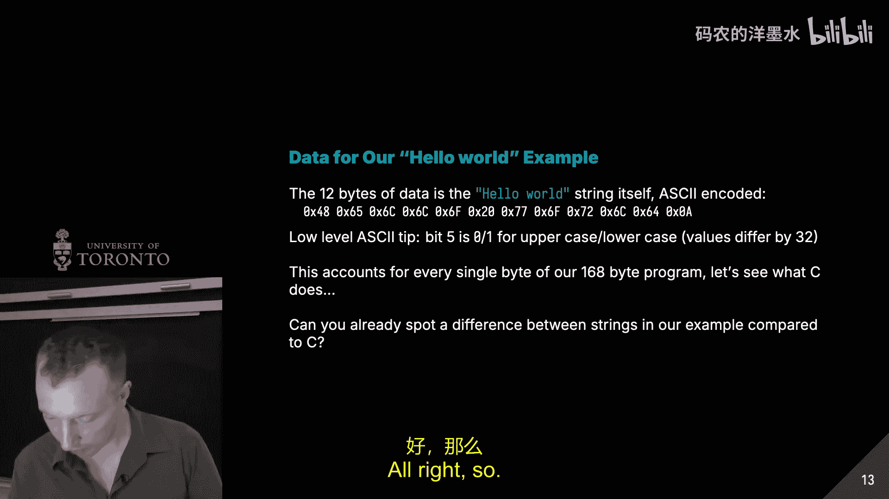

Let us go back here。All right， so my program。Hello world Lex。Allright， so my program was 168 by。

 right， Everyone think sees like a very efficient。Very efficient language， right。

 So it should produce a hello world。 And let's see， this is my hello world right here。 So first off。

 anyone disagree with that hello world。Did I write sloppy code or is that that looks like hellello world。

 right？All right， so that looks like hello world。It's compiled， so if C is really low level。

 how big should hellello world be if I write it and C and it produces an executable。

So let's have some votes。 So will Cs executable be less than 1000 bytes。

 So it's like 10 times worse than mine。All right， one vote， all right。

 a lot of us don't have confidence in C。 okay， what vote will C's file be 10，000 bytes or less？

All right， we have some sea fansin， well about 100，000。Or less。All right， oddly less than 10000。

 how that works。 But let's see。So。Hello World N C， its file size is 199，000 bytes for Hello World。

 and I did it in 168。C is efficient， right？Well， let's see。 does C's version do anything special。

Hello world。What， what about mine。Hello world。Funally equivalent， but。

So whoever told you that C is like very efficient， they lied。So。

The great thing about this course is we can discover the lies。 so we can actually see what C does。

 And I will show you how we can actually like inspect what our programs are doing。😊。

At the level of the operating system。

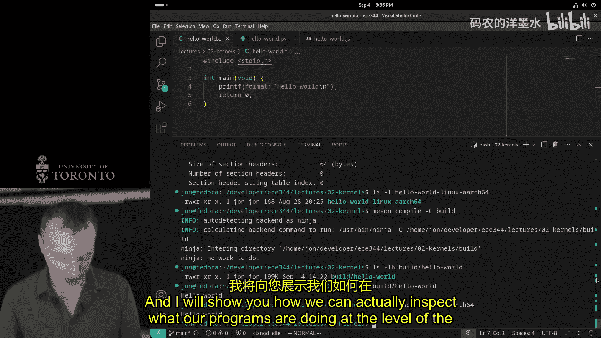

So。Before I talk about that， I just said operating system。

 there's different parts of your operating system。 So the title of this。Lecture was kernels。

 so this is the first definition you should know the kernel is the core part of your operating system on your CPU。

 there's different privileged modes that say what instructions you are currently allowed to execute kernel mode is a hardware like privilege level on your CPU that gives you access to more instructions so like the ones you used in 243 that played with interrupts and things like that you actually can't use those instructions in normal programs。

 they're too low level so you were operating at a different CPU mode。

So if you tried to do that and run it on links， it's just not going to work。So kernel mode。

 that'll let you do those types of instructions， different architectures have different names for this mode。

 so on riskk5， it's called S mode or supervisor mode， SVC is short for supervisor something。

 so that's why it's not called K something。So that's the core part of your operating system and its definition is slightly silly。

 it the kernel is the part of your operating system that runs in kernel mode。What a definition。

 but there's a distinct privilege mode on your CPU that operates at that can actually access hardware and the part。

 the software that can actually access hardware while we call that specifically the kernel。

So these instructions only allow like trusted software to interact with the hardware。

 So you writing this hello world programme or something。

 even if you knew these like machine code instruction to set an interrupt or something。

 you're not allowed to actually use it。 It would get an illegal instruction。 So， for instance。

 it allows the kernel to manage things that only it should be able to for security purposes and just functionality purposes。

 So it the kernel would manage all the interrupts and also the kernel would be managing virtual memory。

 So if there's a problem with its implementation。 well then everyone else is screwed。

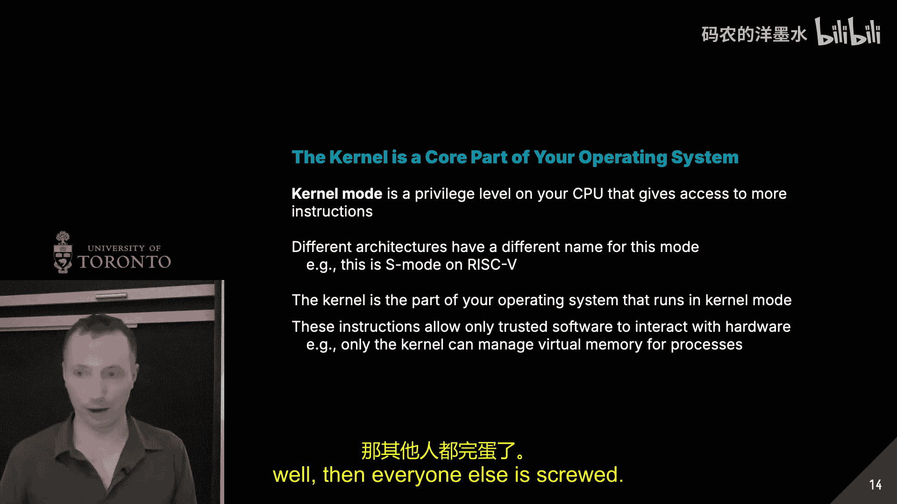

So sorry for the flashb it was hard to change the text color so there's a bunch of CPU privilege mode that can access more instructions for now we'll just live up here so user mode or U mode that's the CPU mode that your normal applications are running in all your libraries。

 the C standard library， things like that are all running in user mode and then in supervisoror mode or kernel mode。

 that's where your kernel is running so if you're running Linux。

 Linux is a kernel and it's running only in that mode and then below that is hypervisor mode and that's where your virtual machines run so if you're using Docker while there's something controlling Docker and that would be the hypervisor which Windows acts as and like modern operating systems act as。

And then below that， there's machine mode which just gives you access to everything。

 and that's usually used for like bootloaders and firmware。

 something we won't really touch on in this course。

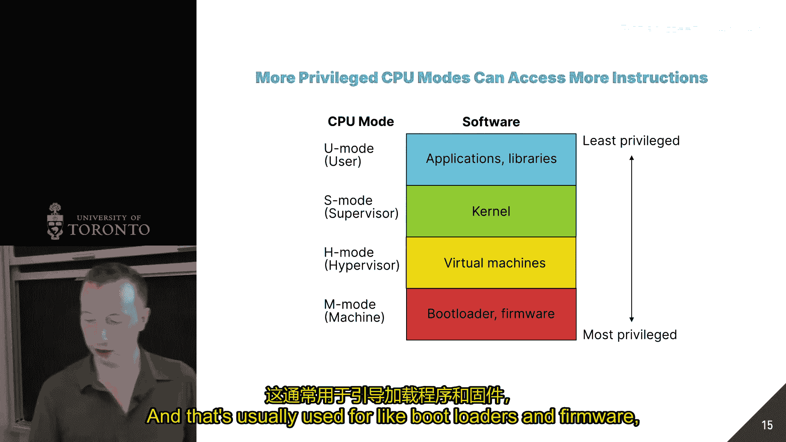

All right， back to not flash banked。 So system calls are。

The reason they're given a special name is they're only。

 they're the only way you can actually call kernel code from user mode。

 So it's the only way to transition between the core part of your operating system and your application。

 So that's the only way you can actually interact with the outside world。 So you might think that。

 hey， my computer can do a lot of things with hardware。 So I probably need a lot。

 a lot of system calls。 turns out that's not true。As of the time of this slide。

 there is only 453 system calls， and every program uses this to do literally anything on your machine。

So Chrome has to use the same 400 and whatever system calls that every other program uses。

 and these are an example of some of them that we will touch on in this course and learn what they actually do。

 so you'll see read and write so those are the first ones that。You know。

 read data from a file descriptor and write data to a file descriptor， open， close。

 and then the rest of them you will become familiar with as we go through the course。

 but the course that kind of aimed at the system call layer。

 well be using system calls and then also during the lectures willll be understanding what they actually do。

Yeah， our system calls the same for like different。You got arm in the next6。Yeah， so the question is。

 are the system calls the same for different？CPUs and architectures and the answer to that is yes。

 but they might change between different operating systems so like Linux will have the same system calls for arm or X86。

 they might have different numbers between the two， but they'll share the same ones。

 but like MacOS will have a different kernel and then Windows will have a different kernel and。

How you call those are different。But that's why we use this generally that's why we use like the C library。

 so we don't have to worry about the low level details of how to do system calls。

 especially with different operating systems。 So this is very specific to Linux。

 So details will be different for Windows and Mac。All right。

 so the nice thing about system calls and why I said this course applies to literally any program you would ever write is that you can trace them with this nice program called S tracece so that will tell you all the system calls a process makes on Linux doesn't matter what language it's written in it has to do a system called to do anything so let's go ahead and use this for fun so we can see so I can do S tracece and see what my program does。

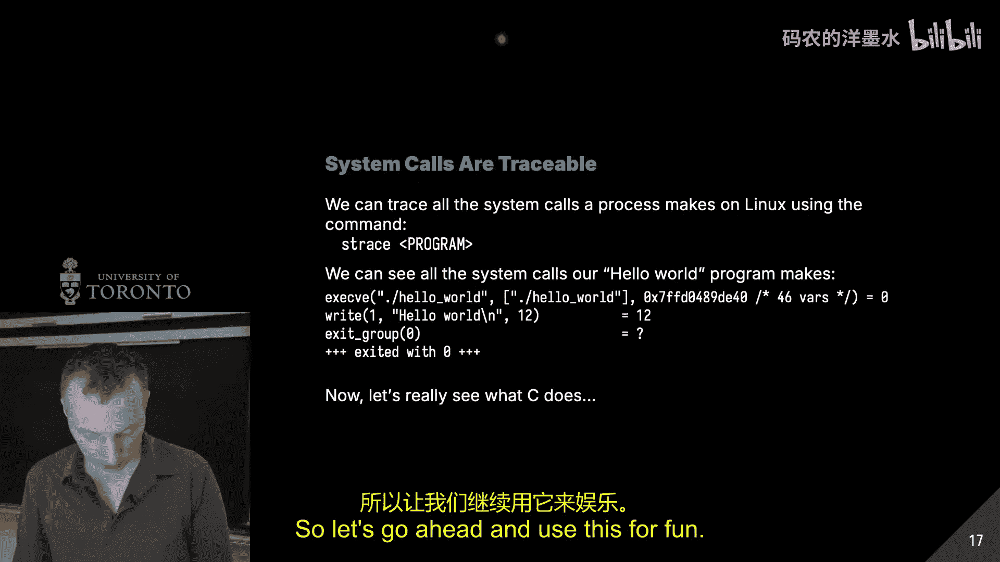

And then here， I'm just going to make sure that I can't see any output from Hello World。

 so it should just say the system calls I make。So the first line here we can ignore that。

 we'll learn what that means later but something else made this that's basically how we started our program and then the system first system call we made was the right system called to file Descriptor one。

 hellello world with a new line and we told it 12 bytes and then we did exit group and that was it right so that's hellello world。

 those are the only system calls we need for Hello world， correct。So since we have this tool now。

 we can actually see what C did。So if C is like the most efficient thing in the world。

 then it should do the same two calls and nothing else。bound hellello。

But looks like it did some extra stuff。So it ends with the last two， right， This is what I did。But。

Everything above that seems to be extra。 So let's see all the other work C did。So there we go。

 so started here。B，RK， it broke something。 that's not good。MM， so that's short for memory map。

 it means it's screwing around with virtual memory somehow。It's accessing something。

 no such file directory。 It opens some cache， I don't know caches are good and fast right。

 so that might be good。 does something plays with memory a bit， closes it。 Oh there it is。

 it opens the C standard library Oh， that's cool。 Oh。

 probably because I use print F and print F is in the C standard library So it had to load it So this is it loading the C standard library and then。

It read some information from it， here it read the first bytes。For some reason。

 the default view of this is ocal。Don't ask me why， but 177 inoctal is 7 F in Hex。Again。

 I don't know why， but it starts with 7F and then Elf， so the C standard library is an Elf file。

 then reads some information from it， reads some random things， then it does this Ftt thing。

 then it reads the same thing again for who knows what reason， get some memory， get some memory。

 plays with some memory， seems to like playing with memory。Does something Who knows what that does。

 It protecting， I don't know， protecting is good。 Mm Ftt， Iooctal。Gots an error inappropriate， oh。

 it's doing inappropriate things， that's weird。Get random。 I don't know， random's good。

 but we didn't use anything。 B R K。 So this， this is actually your heap space。

 So it's managing your heap so。Maoc is like not a core operating system function。

 It's done in user space。 The actual system called to grow the heap that everyone keeps telling you about is that BK system called there。

 So this is it growing the heap so you can actually use malloc。

 and then after it's done with all that， it finally does right。Alright， any questions with that。

 So it seemed to do some extra stuff。 But now we have a tool to actually see what it's doing。

 So with this tool， we could see， you know， more fun stuff so we can write。😊，Hello world and Python。

 This is print Hello world， right， well。Let's see what Python does。So Python whoops， if I can spell。

So at the end of the day， well， it does exit group。啊。It didn't do a right。 not They're not there。

 Okay， there's its right of hellello world。 So did something。 But let's see what Python did。

 So let's scroll up。Oh， there we go。 So that's the top。 So yeah， I heard how big is it。 So here。

 let's see。 I ran these before。 So hello world that。So C。

 you have to minus2 from that number because one is the line we didn't row and one is the line at the end。

 So C had 50 or sorry， 37 system calls。And let's see how many did Python have。So Python had 469。

All right， well， this is a cool experiment， Let's see。Let's test。 So jascript a language， right。

 So console log。Hello world， that's hello world in JavaScript。We can strace what JavaScript does。

 so helloworld。js。That scrolled a lot。Scroll up， so this is exit group。On this screen。

 does anyone see a printing Hello world there？No， all right。 So I'm going to scroll up slowly。

 tell me when you see the right to hellello world。No。False alarm。M。😊，It really needs to be advised。

Se it there。 and no， we got。Write a star to。Oh， they wrote a star to。What the hell is it doing， oh。

 there we go。So， it。So it wrote hellello World here。

 and then it decided to read a star and then write a star after I heard help。

And then what else did do， So。Alright， that's a lot。 So jascript sucks， right， Def a proof。

 Let's see how many system calls jascript made。So 920。

 So this is actually an improvement from the last time I ran this。

 It was like three times the amount of system calls in Python。 Now it's two。

 So ja is only twice as worse as Python objectively， so。Yeah， so you can actually see all the crazy。

 crazy BS that JavaScript does。Like I said， doesn't matter what language you write it in。

All at the end of the day， you figure out you know what it actually does， and you can use S trace。

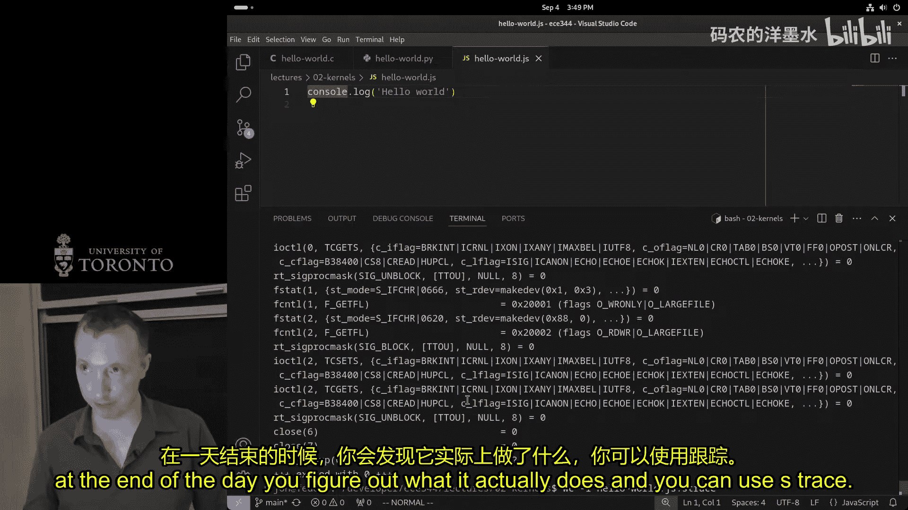

Alright， so here is just in the slides。 The first slides was like finding the standard library。

 loading it into memory。 That's basically what those system calls did。 and then set up the heap。

Did the right and the print。 So it just ends with the exact system calls we made。 And again。

 no matter what language I wrote Hello world in， at the end of the day， it all did the same thing。

 just write to file descriptor 1， Hello world and then exit to terminate the process。

So you can think of the kernel as just like a long running process。

It's otherwise independent of your process and writing kernel code is kind of more like writing library code。

 There's no main function。 It's just a whole bunch of little functions that get loaded on demand called modules。

What might happen is that when you plug in device， a module might get loaded by the into kernel space。

 and then that will know how to actually control the device and do you know。

Do all the instructions to actually manage that device。So if you were， we won't do it in this course。

 but if you do write a kernel module。You'd be executing privileged instructions。

 you can access any kernel data so you could do anything。

 you could just murder every single process on your machine， you could read Chrome's memory。

 you could do whatever so basically if you're writing in kernel mode。

 that is the code that's controlling everything， that's why you have control over everything。

 So if you hear of like kernel exploits， that's what that is that's like the worst type of exploit you can have because they have full control over literally everything on your machine。

So。There's two different ways to write a kernel， so two different main architectures。

 which is like the last thing we need to take away from this lecture。

 So the first style is called a monolithic kernel and that tries to run all like the core operating system services in that kernel mode So in that most privileged mode So that would have to do things like manage virtual memory and kernel mode。

 manage scheduling processes So what process runs on a CPU which will be a topic later in the course figuring out how to do interprocess communication maybe file systems So like how data is actually laid out on your storage device or SSD and then device drivers how to actually like run your graphics card and things like that。

 So in a monolithic kernel basically anything that touches hardware or is related to hardware。

Runs in kernel mode。The flip side of that argument of this architecture is that hey if there's a problem in any one of those components and someone can exploit it while they can access the kernel so that's bad so maybe just with the sheer quantity of code and how important it is maybe I want to move as much code out of the kernel as I can possibly do and that is the other main kernel architecture called a micro kernel。

 we're not very creative with names， so that aims to run the minimum amount of services in kernel mode and anything else that could run in user mode we try and do that so things that have to be in kernel space or like virtual memory so that provides all the security isolation from processes to another so it has to be managed by the kernel process scheduling has to be managed by the kernel it has to schedule which process to run on the CPU and it has to do some basic form。

IPC just maybe just some bytes between processes then in user space that doesn't run in kernel mode we can put file systems out here。

 we can put device drivers out there and we can put more advanced types of IPC out there but the idea here we really have to know the details the idea of a micro kernelnel is make the kernel code as small as possible so we have less code。

 the idea behind that is hopefully well there's less chance of actually getting exploited so there's a lot of different architectures that are somewhere halfway between these and these are called hybrid kernels but for the purposes of this course you should just know monolithic kernel and a micro kernel but if you're interested in like how your computer actually works。

 there's hybrid kernels that are kind of a mix between the tool so like on Windows。

In some kernels emulation stuff is done in kernel mode， in Windows。

 they have it in user mode on Mac OS。Like Apple doesn't want you touching their precious kernel。

 so if you create some hardware and you want to run on Mac while your drivers are going to use a user mode。

 so even if you screw up Apple doesn't get blame for it。

 while Windows drivers run in kernel mode so if someone writes a bad driver。

 guess what you blue screen and you blame Microsoft even though it might not be their fault。

There's also a series of like research into trying to make micro kernels even smaller。

 so they call them nano kernels and pile kernels， so they try and shove even more stuff into user mode than traditional micro kernels and there's different architectural lines you could draw with different trade offs。

So just to wrap up the important things today。The kernel， that's part of your operating system。

 there is an interface called the system call interface that operates at the boundary between user mode and kernel mode and to go through that boundary。

 that's when you have to use a system call so the kernel that's part of your operating system and that is the part of your operating system that actually interacts directly with the hardware。

We access it through system calls， and we saw the file format and instructions for a simple Hello world program。

Don't really need to know that just main things we need to know is like you know C has a flexible interface。

 the kernel interface just uses registers， not that flexible。

 but it's what we deal with and it uses interrupts。And then we have different kernel architectures。

 main ones being monolithic that shove a lot of things into kernel mode Linux is an example of a monolithic kernel so it runs all in kernel mode and then there's different lines you could draw trying to get stuff out of kernel mode so with that we can end a little bit early and just remember I'm pulling for you。

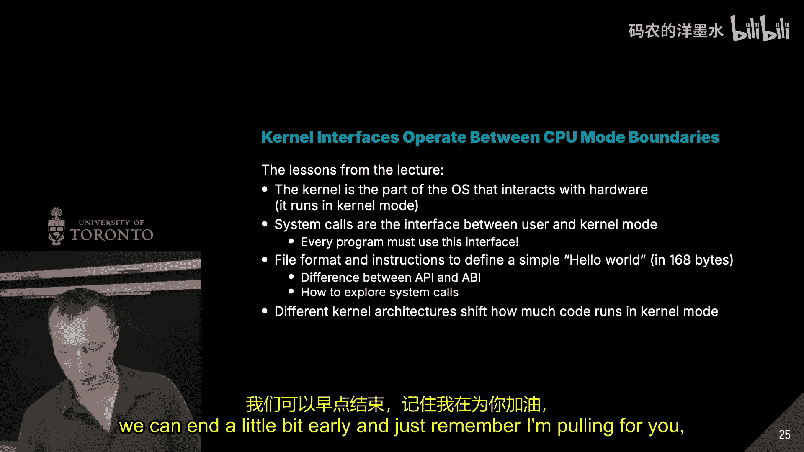