# 操作系统：第2讲：内核

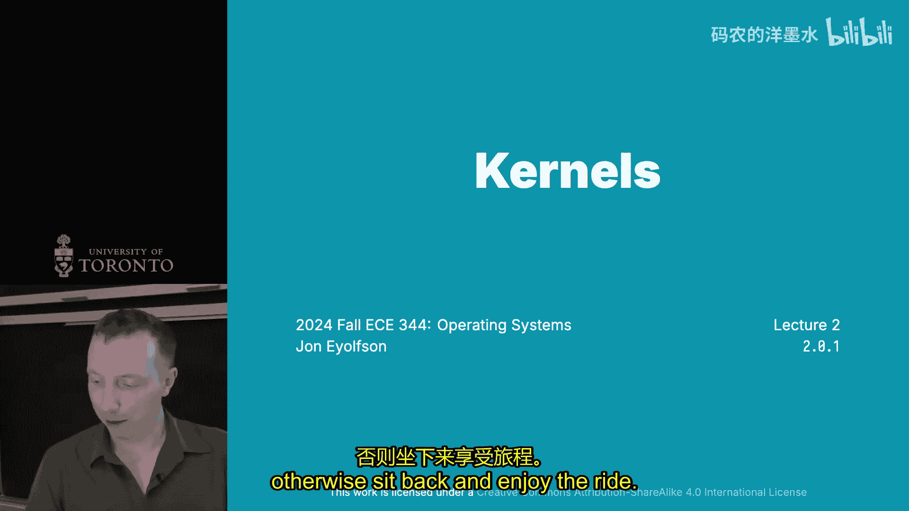

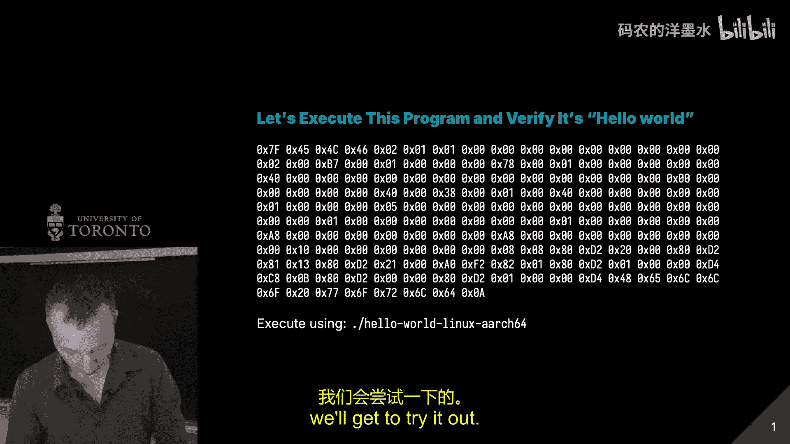

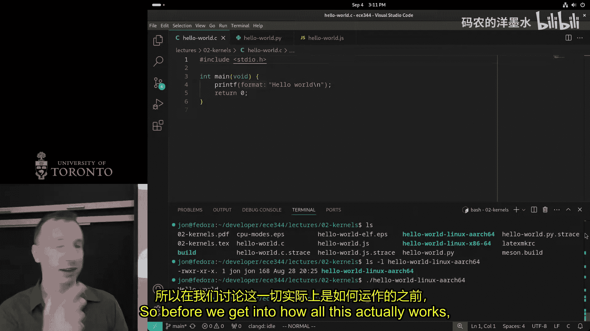

在本节课中，我们将要学习操作系统的核心部分——内核。我们将了解什么是内核、系统调用如何工作，以及不同的内核架构设计。课程将通过一个简单的“Hello World”程序作为切入点，深入探讨程序如何与操作系统核心进行交互。

---

## 系统调用与“Hello World”

上一节我们介绍了操作系统的基本概念。本节中我们来看看一个程序如何通过系统调用与内核通信，完成最简单的任务：打印“Hello World”。

为了实现打印功能，程序需要与终端（一种硬件资源）交互。操作系统通过**文件描述符**这一抽象概念来管理所有可读写的资源，例如文件、终端、网络套接字等。每个进程启动时，默认会打开三个文件描述符：
*   **0**: 标准输入
*   **1**: 标准输出
*   **2**: 标准错误

程序通过**系统调用**请求内核服务。对于“Hello World”，我们需要两个系统调用：
1.  **write**: 向一个文件描述符写入数据。
2.  **exit_group**: 结束当前进程。

`write`系统调用的C语言函数原型如下：
```c
ssize_t write(int fd, const void *buf, size_t count);
```
其中，`fd`是文件描述符，`buf`是指向要写入数据的指针，`count`是要写入的字节数。

因此，一个极简的“Hello World”程序逻辑如下：
```c
// 向标准输出（文件描述符1）写入字符串
write(1, "Hello World\n", 12);
// 以状态码0退出进程
exit_group(0);
```

---

## 指令集架构与系统调用机制

在深入程序细节前，我们需要简要了解指令集架构。ISA定义了CPU能理解的机器码格式。当前主流的ISA包括x86-64（个人电脑）、AArch64（手机、苹果电脑）和RISC-V（开源架构）。

系统调用虽然看起来像函数调用，但其底层机制不同。用户程序无法直接跳转到内核代码的地址。在ARM架构上，程序通过执行`SVC`（Supervisor Call）指令来触发一个中断，从而将控制权交给内核。内核根据约定的寄存器内容来识别具体的系统调用。

以下是系统调用与普通C函数调用约定的关键区别：
*   **C调用约定**: 参数通过栈传递，灵活支持任意数量和大小的参数。
*   **系统调用约定**: 参数通过寄存器传递。例如在ARM64上，系统调用号放在寄存器`x8`中，前六个参数放在`x0`到`x5`中。这种方式在参数数量和大小上有限制，但效率更高。

---

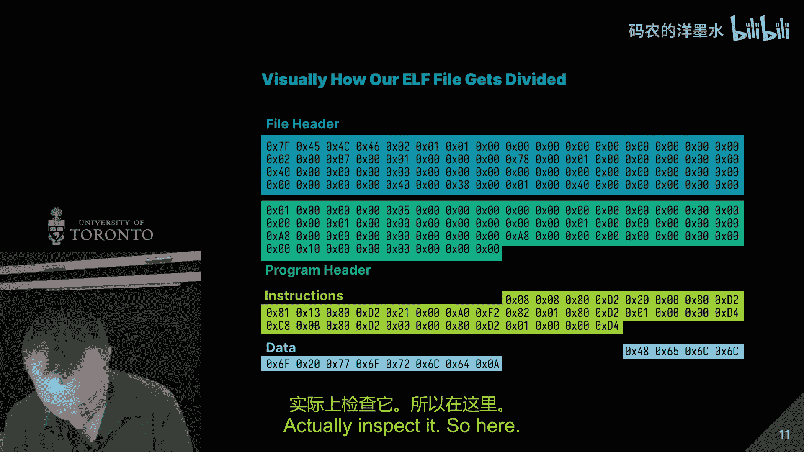

## 可执行文件格式剖析

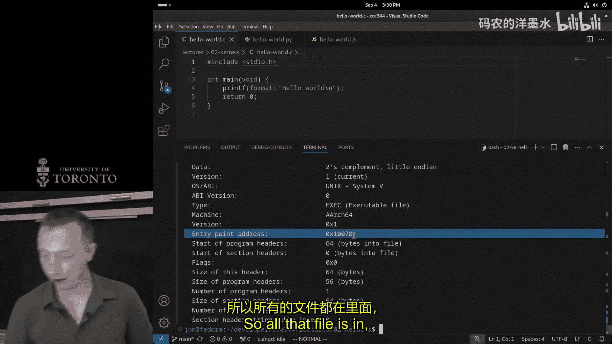

操作系统需要知道如何加载并运行一个程序。在Linux上，可执行文件通常采用**ELF**格式。文件开头有特定的“魔数”（`0x7f 0x45 0x4c 0x46`，即`\x7fELF`）来标识其类型。

我们的168字节“Hello World”程序结构如下：
1.  **文件头**：描述程序架构、入口点等信息。
2.  **程序头**：告诉操作系统将哪些部分加载到内存的什么地址。
3.  **指令代码**：包含执行`write`和`exit_group`系统调用的机器码。
4.  **数据**：字符串`"Hello World\n"`。

我们可以使用`readelf`工具查看ELF文件的详细信息：
```bash
readelf -h hello_world
```

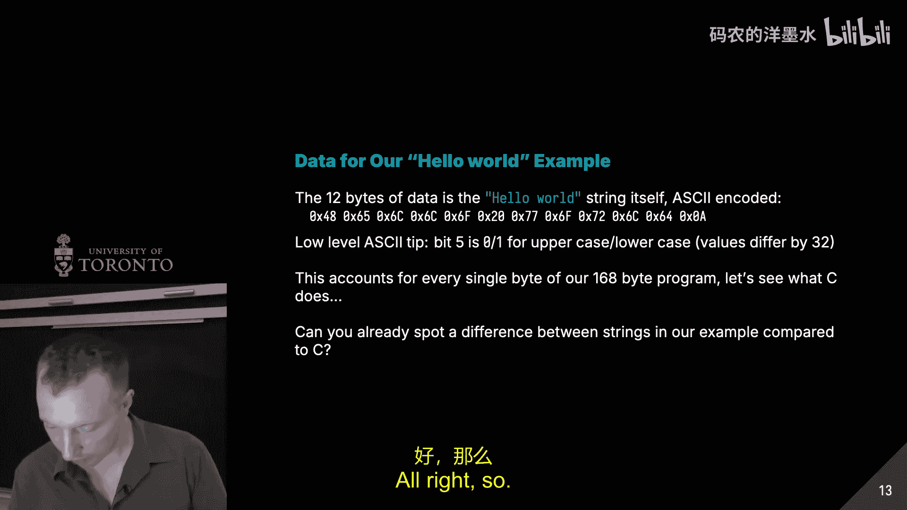

---

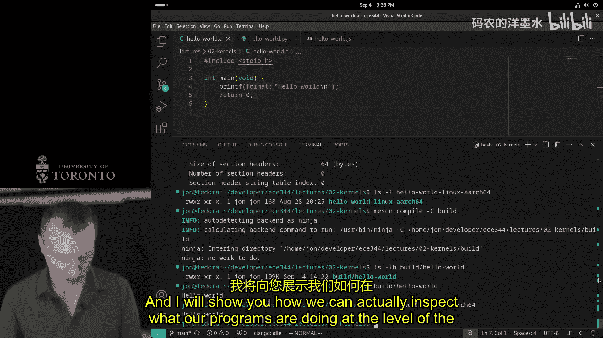

## 内核模式与用户模式

现在我们来定义**内核**。现代CPU提供了不同的特权级别（模式）。**内核模式**（或监管者模式）是最高特权级别之一，允许执行所有指令，包括直接操作硬件的指令。**用户模式**是普通应用程序运行的模式，权限受限。

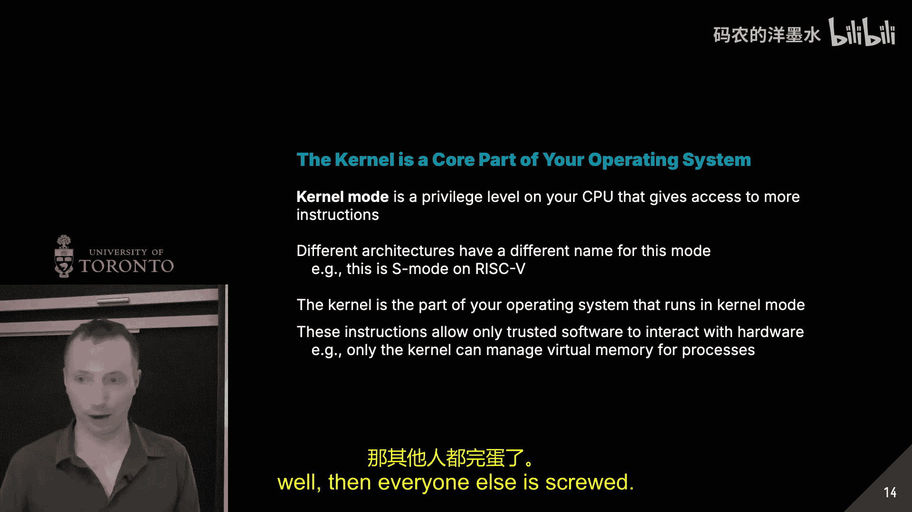

**内核**就是运行在内核模式下的那部分操作系统软件。它负责管理硬件资源，如CPU、内存和设备，并为用户程序提供安全的执行环境。

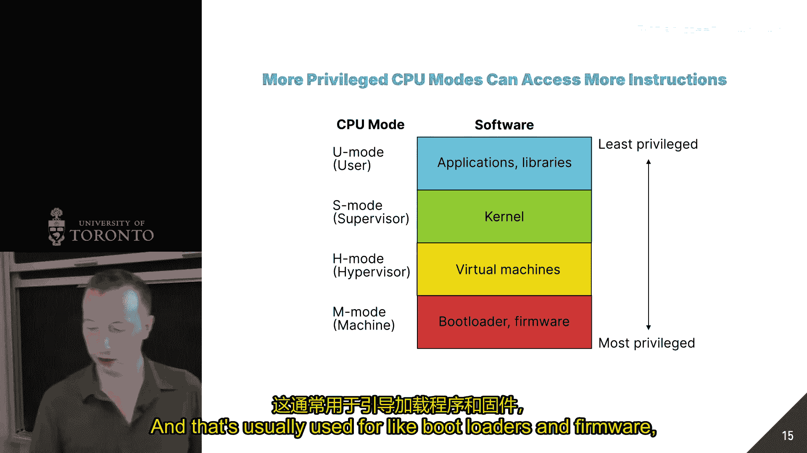

系统调用是用户模式程序进入内核模式的**唯一**途径。通过系统调用，用户程序可以请求内核代表它执行特权操作，例如读写文件、创建进程等。Linux内核目前只有大约450个系统调用，所有程序的功能都构建在这些调用之上。

---

## 追踪系统调用

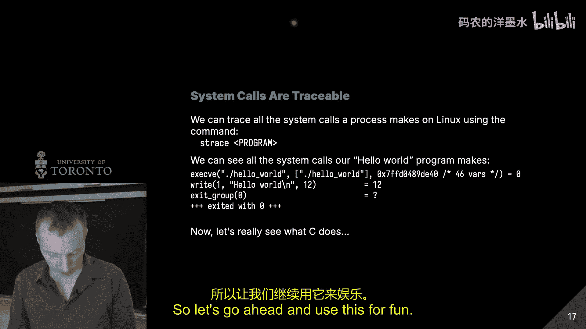

无论程序用什么语言编写，最终都要通过系统调用与内核交互。我们可以使用`strace`工具来追踪一个进程发出的所有系统调用。

例如，追踪我们手写的“Hello World”程序：
```bash
strace ./hello_world
```
输出将只显示`write`和`exit_group`两个调用。

相比之下，用C语言编写的“Hello World”程序（使用`printf`）会产生数十个系统调用，用于加载C标准库、设置堆内存等。而用Python或JavaScript编写的“Hello World”程序产生的系统调用数量则多达数百甚至上千个。这揭示了高级语言运行时环境的复杂性，但最终完成核心任务（打印）的系统调用仍然是同一个`write`。

---

## 内核架构：宏内核与微内核

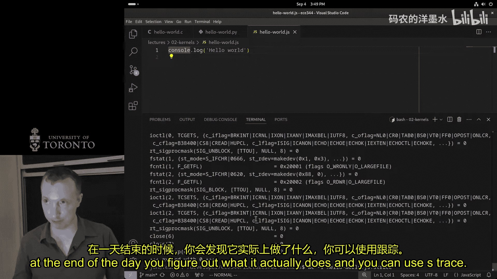

根据在内核模式中运行多少操作系统服务，内核主要有两种设计架构：

**宏内核**将所有核心服务（如进程调度、内存管理、文件系统、设备驱动）都运行在内核模式。Linux就是典型的宏内核。优点是性能高，组件间通信效率高；缺点是内核体积庞大，任何组件（如一个有漏洞的驱动程序）的崩溃或安全漏洞都可能危及整个系统。

**微内核**则追求最小化内核模式代码。它只将最基础的服务（如进程调度、最基本的进程间通信、内存管理）放在内核中。其他服务（如完整的文件系统、设备驱动、网络栈）则作为用户态进程运行。优点是安全性、稳定性更高，单个组件故障不影响内核；缺点是性能可能因频繁的进程间通信而受损。

此外，还有**混合内核**（如Windows和macOS采用），试图在两者之间取得平衡。

---

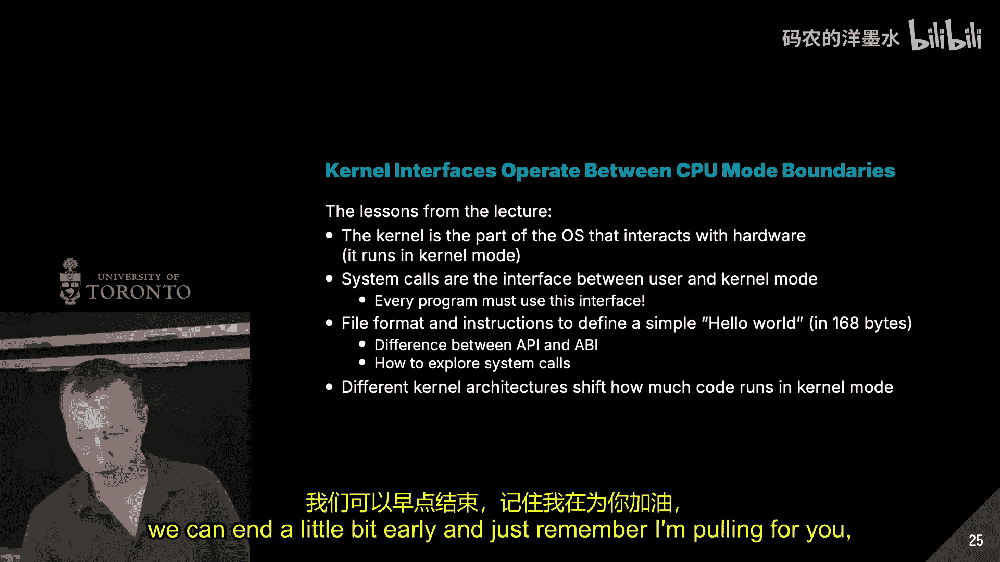

本节课中我们一起学习了操作系统的核心——内核。我们了解了系统调用是用户程序与内核交互的桥梁，并通过分析“Hello World”程序看到了其底层实现。我们还探讨了CPU的特权模式，以及宏内核与微内核这两种主要的设计哲学。理解这些概念是深入学习操作系统如何管理资源和运行程序的基础。