# 【全集】多伦多大学 操作系统 中英字幕 1080P p03 Lecture 3 - 库 -BV1Rbk7ByERc_p3-

Alrighty， welcome back to 344， let's get rid that echo a little bit。

 So today we get to talk about libraries。So oops， before we start any questions about last lecture when we talked about kernels。

 so quick recap。The software that interacts directly with hardware runs in kernel mode。

 and it is called the kernel， and in order to actually call into the kernel and actually run the code。

Your programs all have to use system calls that go from user mode。

 what your programs usually run in to kernel mode to actually interact directly with the hardware。

 and it does everything on your behalf。 So any questions about the last lecture as we continue our journey as to。

What an operating system is。Yeah。あに。So A BI application binary interface。

 It's like the low level details of how to actually make a function call or something like that。

 So you can think of that as like。When you had assembly and you had to put registers。

 like certain values in specific registers， that would be like an A BI。 For the most part。

 we don't care about it。 Just know that the system called AI uses registers。 It has some limitations。

And the C1 is very generic， it uses the stack， and it's more flexible。

 That's the only thing we have to take away from it。All right。

 any other questions as we continue our journey？All right， so。

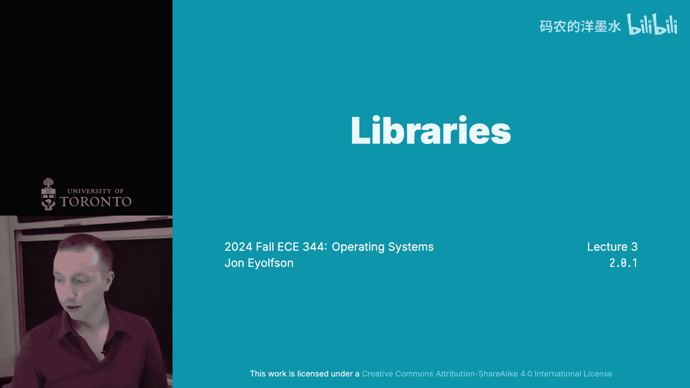

Today we're talking about libraries， but first let's get into what is an operating system because we haven't answered that question yet。

 So the kernel， that's part of the operating system。

But what else is part of the operating system and what you consider an operating system？

It's a bit fuzzy， it's not very well defined。For instance， know there's Mac OS， iOS， iPad OS。

 watch OS， TV OS， are they all really different operating systems even though 99。

9% of it is the exact same？Well， depends if you're running iPhone applications while they only run on iOS。

 so maybe you consider that a different operating system than like watchOS。

 you can't run the same things， so maybe you do consider them different operating systems。

 but all these operating systems， they're all created by Apple and they all actually use the exact same kernel。

 so part of them a large part of them is all the same。

 but still we might consider them all different operating systems。

So what we call an application kind of or what we call an operating system depends on the application。

 so we usually consider an operating system as like a kernel plus a bunch of different libraries and different applications might use different libraries so here are three different applications and the light background so like there's network manager that manages your network card and connecting to networks and things like that。

 and maybe it uses a library on your system that runs in user space called UD which is like a system demon that's supposed to。

Present all the hardware to your applications。 Maybe that uses the C standard library。

 and then it makes calls into kernel space using system calls。

Maybe you have leave office or office or something like that。 That has a nice。

User interface so maybe that uses like a GuI toolkit， something called like JDK or something else。

 maybe that runs on top of a display server so that's another different piece of code and then that uses a C standard library to make system calls on your behalf and then maybe use Firefox which might use all the different libraries and even render its own graphics so it uses a bit of everything a bit of custom code so what we consider the same application or same operating system might depend on our application so if for instance we only use like a terminal application it only use the C standard library while that exists on like all those different variations of Apple like Apple's operating systems so maybe we consider all of them the same operating system if we only care about terminal applications but we care about more complicated applications than maybe。

They actually are different operating systems。So the operating system is basically just the kernel plus any libraries your application needs。

 And that's exactly what an operating system is。 So depending on the libraries you care about。

 some things may or may not be part of the operating system。So， this is。Like I said。

 depends on the application。Another example， Android on your phones and Deian。

 like a desktop version of Linux or abutu， if you've heard of that before。

 they both used the Linux kernel， but like the different versions of Apple stuff。

The applications are very， very different between them。

 you can't just take a Linux application and run it on your phone or vice versa without it being kind of slow。

But， again。If you only care about terminal applications， they both have the C standard library。

 If you wrote hellello world and C， you could run it on desktop Linux and you could run it on your phone。

 you just don't have a good way to run it on your phone。

 but if you had like a terminal application on your phone。

 you could run the same thing on your phone and then maybe you consider Android and Deian the same operating system so。

It also gets kind of weird with Linux because Linux is specifically the kernel that is the code running and kernel mode。

 but typically when someone says hey do you have Linux on your machine。

 they're talking about a Linux distribution which is different than just the Linux kernel by itself so Linux distributions are like called Ganu s Linux sometimes because Ganu provides the C standard library and common utilities that make up like a normal desktop operating system so footnote of this is the OS consists of like a kernel and libraries required for your application。

 what you consider the same OS depends on your application。All right。

 so this is going back to first year just to review how code gets compiled in C just so we can talk about libraries。

 so normally if you have an executable that has a bunch of C files in it。

 this is how they're all kind of brought or linked together to form that application。

 say we have four different C files， we have main dot C， we have u。tC， food。C， bar。t C。

We use our C compiler to compile each one of them。 We produce the a dot O file or an object file。

 So that has all of the instructions and everything that our compiler produces from our C code。

 And then in another step called linkage。It kind of just duct taps all of these dot O files together to form our executable so we can use all the functions we defined and everything runs nice and as we expect。

 And just as a little note here， these object files are just L files and they have all the code in them for the functions you define。

 So that should be reviewed any questions about this。So every C file gets compiled to a binary file。

 and then they're all thrown together to form your executable。 So everyone， all right with that。Okay。

 so we're going to reorganize this a little bit。 So it's important that we understand this， so。

There are a thing called static libraries， because， well， maybe the functions we defined in u dot C。

 F do C and bar do C， we want to use them in more than one application。

 So we just don't want to really like。compileile them all again。

 We want to compile them once and then use them in more than one application。

 So static libraries are just a way to bundle those dot O files together all the code for your functions。

 So if I wanted to reuse them， I could take my utility do O food do O bar dot O。

 assume there's just a function defined in there with the same name。

I could link or archive them all together to create a file called Lib。t a， so Lib。

tA just contains all of the executable code。That got created when I compiled all of those C files。

And the only thing that changes is that if I want to use those in my application。

 instead of using them directly， I can instead just link together main dot0 with Lib dot a。

 Lib dot a contains all of the other functions I need。

 and that would produce my executable and then if I want to produce another executable that use the same functions。

 but with the different main， I could link together like main2 and Lib dot a and just reuse them over and over again。

So are we all okay with that， same idea if we just kind of bundle them all together， y。最で限。

So archiving and linkage。They pretty much mean the same thing， but archive。At link time。

 you usually say linking when you're creating an executable。 This is not creating an executable。

 So we call it a slightly different name， but it's the same idea as linking。

 We're just putting them all together。But we give it a slightly different name because it's not producing and executable。

Same idea， though。All， so this is just a slightly different way to organize them so that I can reuse all of those compiled files。

So if there's something called static in computer science is usually something called dynamic。

 So there are dynamic libraries， and that is also for reusable code。 same idea。

 but they behave slightly differently。 So the C standard library is actually a dynamic library。

 So it's a dot S O file。 We kind of saw that before stands for a shared object。Just one of those。

 but its shared between lots and lots of different programs。 It's basically the same idea。

 It's a collection of do o files containing all of the function definitions like before。

 and like before with static libraries。 multiple applications can use the same library So you might imagine a lot of programs need to use malloc need to use free。

 need to use print F。 So they're not defined in every executable。

 they all exist in something called Lib C and then every single application uses it And then the nice thing about this is that the operating system just loads the standard C library once and then shares it between every single other application that uses it。

 So it doesn't need to load the definition of print F into memory every single time。

 a new application wants to use print F。 So thats all right so far。So the that interesting。

It's already loaded。Yeah， so the difference between static and dynamic we'll get into that a bit more I have another slide for it。

 but the basic idea is that static， it's all compiled into the executable， and then in dynamic。

 we just load it whenever we run our program。So remember when we like S traced that program and we saw loading the C standard library and everything。

 that was when we ran it， so it looked up where Prif was and then read it and used it yep。

compile or make。Enjo execute。What happens to？So the C standard like the C standard library。

 that's a dynamic library always exists on your desk。 It just sits there。

 So when you compile your code， you don't use it at all。 you just compile it。

 And then whenever you run it like what we saw， it looks up where it is。

And then loads all the code from there。Yeah。Yeah， it's loaded upon execution。

 So here I have another slide for that。 So here's dynamic libraries。

 So looks pretty much the same as static。 So same idea。 But instead of archiving。

 I called them shared linkage。 There's some implementation details。

 but is's meant to be shared at runtime， but same idea。

 A shared library is just a collection of dot o files all linked together。😊，Same idea as linkage。

 So they're all just kind of duct tapeed together。 But the only difference now is when I linked my static library。

 I did it whenever I ran my compiler。 So it essentially like copy and pasted all the code into the executable instead of just looking it up whenever we run it。

 So in static， what we had before was they were glued together all into the executable。

 So all of the code。 So like if。Lib do a had print F。

 then the definition of print F and all printf's code would be in the executable in the static case。

 and then in the dynamic case， all of the print F code would be in this Lib dot SO and it would not be in the executable so whenever we run our program。

Part of our offering system is going to look up where print F is。

 and we're going to actually look it up whenever we run our program and just use whatever print F we find。

If you have the library， you I would say how you。Yeah。So when you do like hash include math。

 that just tells the compiler like what the types are of the functions。

And without looking at how your codes compiled， you don't know if it's compiled statically or dynamically。

So just looking at the header files doesn't help you at all。So it would behave the same。

 I need the header files because C needs to know what the types of everything are。

 but doesn't tell you if it's going to be included in your executable or not。Like for now。

 you've just been using the ST standard Library。It just so happens everyone uses a dynamic version of it。

 they could also use it as a static library， but we'll see some drawbacks of that in a little bit。

All right， any other questions so yep。Multiple applications also access data library。

So the question is， can multiple applications also add access static libraries。

 And the answer to that is。Like they can access it so this linkage is done whenever you hit compile so they can all share that so they can all share this Lib dot a。

 but as part of the linkage it basically if my main uses print F。

 it'll look up print F here and then essentially copy and paste it into the executable so they can all share。

 but whatever executable you produce， will have whatever code it needs to run it。

 So like I don't need to look anything up at runtime for this。Yeah。Oh。

 I was point out the wrong thing。 There we go。 there's the pointer。 Sorry， yeah。

Where the dynamic it says shared。For iner archival linkage it says share。Yeah。Yeah。

 so for it's just by convention， so linking。Liining things together to create a static library is called archiving and linking things together to create a dynamic library is called shared linkage。

 Yeah， just a naming convention， but easiest way to think of it is they're all just linking。

 it's just whatever you're producing。But the names aren't important。

 you won't really be tested on the names， just how they work。All right， any questions about this。

 so we'll see some weird things come up because of this。So。

There's some useful command line utilities to see what dynamic libraries your application uses so you can use LDD and then the executable。

 and that will show you everything your application is using if you want to just figure out what a program is using。

And then here， just to summarize， so static verse dynamic libraries。 So we could， like we saw before。

 statically link our code， basically， just copy and paste the dot O files directly into the executable and some drawbacks are。

 if you statically link everything。 it's like I said， it's essentially like copy and pasting。

Has anyone like copy and pasted the same thing three places and then went back and changed the original one。

 And then while all the other ones are still unmodified。 So same idea， static linking is like that。

 just whenever you compile， it essentially copies and paste in So if you want to update your code at any point。

 while you copy and paste it in if you update it， you need to recompile everything you need to have it copy and paste it into the executable again。

 So that seems like a pane。And if we have a dynamic library while whenever we run it。

 we just look it up and use it。 So it's always the freshest copy。

 So would there be some issues if we use the dynamic library and we were modifying our code。

 Can we think of anything bad that might happen， Yeah， there was an error。Libra。Yeah。

 say I updated my library and I broke something right then suddenly everything that used my library was broken。

 But if you copy and pasted the working version and someone updated it and you didn't recompile your application suddenly still works。

 So that's basically the main drawback for using dynamic libraries is since everything is sharing the same code if you update it and you break something you have broken every single application on your machine and that has happened before on Linux where they update the C standard library and they break something and then suddenly no application works until everyone recompes everything yeah。

😊，Libraries？One of thoseduct files。Yeah。The execution。Yep。Compli with all of。Yeah。Yes， so if。

You create like if for your static library， when you create your executable， it has an error in it。

 you'll have an error in it， if you update it， it won't get fixed。Right。

You have to recompile for it to update。 So has different drawbacks， but。If you update something。

 you don't recompile and the update broke something， your thing isn't broken yet， right。

 So it kind of depends what horse you want to have in that race。So those are the main issues。

 and we will actually break something today and create a very good point， so。

The main point is dynamic library， the updates， can suddenly break exeubs and break a lot of things。

 so a very， very， very subtle A change。Can actually cause a crash That doesn't actually change the API。

 That's what we're going to do today。 We're going to break our application。 So let's consider like。

 we're going to create a dynamic library。 We're going to have a struct with multiple fields in it。

 and。I don't know if you were told this in your sea course， but if you have astruct in C。

 it's laid out in memory in a specific way， so the order of the fields is actually defines how it's laid out in memory。

So you're executable。 if I have like， let's see。 Do I have the example。Yeah， so here。

 if I have a point struck with an int X or int y and in X， it means in memory。

 the y comes first and then the X。So thered be like the first four Btes would be Y。

 The next four byte would be X。So。If I access those fields， well。In my executable。

 I'm just going to be accessing memory， so it's going to access wherever y is。

 it's not going to use the name Y， it's just going to access the first byte for Y。

 and then the fourth byte for x。So if I actually change the order of the fields and recompile。

 I'm going to switch where X and Y are in memory， but I'm not going to change the APIB or API because my point still has X and a Y。

 So here I'll show the code。So， in C。There's an ABI forstructs。This is just for this course。

 you don't have to know it。 This is just like a cautionary tale。 So strs。

 they're laid out in memory in the same order that you declare the fields。

 So my struck point here in version one of my libraries。It would be 8 bys long。 Y comes before X。

 And in version 2 of my library， I decide that， well， that's weird。 Why would I write Y first and X。

 why would I write X and then Y， So I update my library such that I've changed the order of the field。

 So X comes before Y。So in version1， x is like offset by four bytes。

 so offset just means how many bytes from the beginning memory address is that value。

 so the X field would be four bytes in because each int is four bytes。So 4 bys in from the start。

 and then in version 2， X is at the beginning。 So it has a 0 byte offset。 It's at the beginning。

 So we're just， this suddenlyly changes where it is in memory， yep。Do youmic quickly clean。

Dplay what is feels again。So field is are these variables defined in thestruct。

So the structure just has two variables in it， and we just call variables defined in instruct fields。

Alright， everyone， okay with this。So this， these two things have the same API， right。

 We would describe it as there's a struck point。 It has an X， which is an int and a Y。

 which is an int。 and both of these are。Equivalent， if we're just discussing the API， what we。

 as programmers， really care about when we don't care about implementation details。

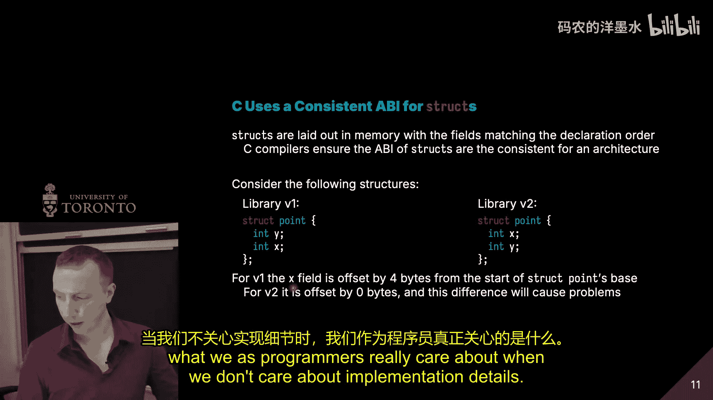

So flashbank， sorry。 So here struck point in version 1。

Both of them would be represented as like we can think of them as an array。

That just holds two values。 But in version 1， well x。

Would be like the array at index 1 and y would be the array at index 0， so it comes first。

 and then in version 2 x is like array at index0， so it comes first， and then y is array at index1。

 it comes second。So are we okay with that， So that's how it's laid out in memory。

 it's just reordered a bit different and you can think of it as an array。

So let's say we have a point API that has four functions， we can create a point。

 so we get an x and a y， we give an x and a Y， and we get a pointer to a point back。

And then we have some accessor function， so we have a function that takes a point or a point by pointer wow。

 we love pointers in this course， it's C， so you'll love pointers。

 and then it returns the value of X。 and then we have a point gi y that returns the value of y。

 and then a point destroy that's supposed to just delocate whatever memory we needed for it。

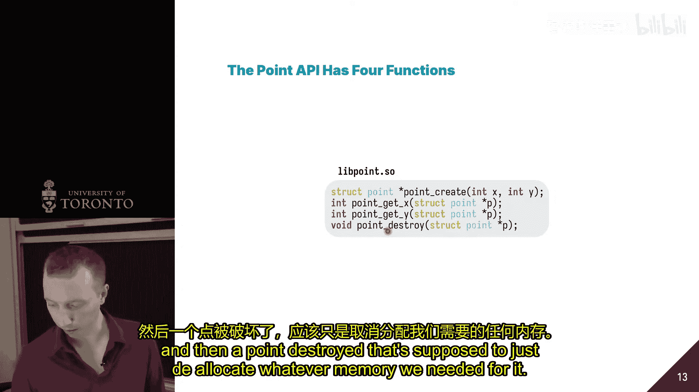

So that is our library。If we have API stable code， then we should always print 0 and1。

 So we'll write a program that just calls point create， sets x equal to 1， y equals to 2。

if we use our， so this will be defined in the library， we'll look it up whenever we run our program。

 and then we'll use the library code to get X and Y， so we'll call point git X and then point git Y。

 and then we're going to actually directly access the fields of the struct in our executable so we'll say what we think the X and the YR using the struct。

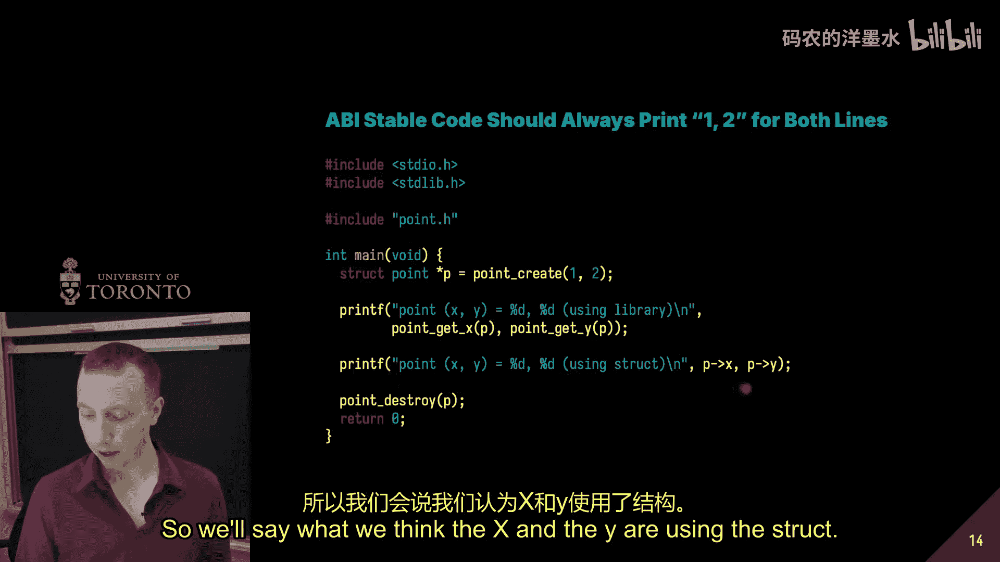

So。If we go ahead and compile this。 So any questions about the code as written， let's hide this。

So if I run this and everything works。I should see point X Y equals 1，2， right， X should always be 1。

 Y should always be 2，If I do that， oops。Build。So compile V1， link V1。

 So if I compile it using V1 and I use the library at runtime。

 So remember all these functions are going to look up the library that I link to at runtime。

 If they both agree， I get。Consistent values。 So using the struct and using the library。

 I get the same numbers every single time。 But let's simulate what happens if I do not recompile my code at all。

 So the executable itself， whenever I'm accessing the struct directly， right。

 This thinks X is the second integer and。The executable also thinks that y is the first integer or at index 0。

But if I want to simulate updating my library。 So the point create function thinks the variables are in the other order。

 same with git X and Git Y and same with destroy。What should I see if I run this？In version  two。

 all I do is I flip x and y around。What will my output be。Yeah。

 maybe two one for libr and one two for job。2，1 for library and one， two forstruct。

 So thestruct one will stay the same， and the library one will flip。All right。

 everyone agree with that。Everyone， anyone disagree with that。Everyone's confused， all right。

 let's just see what happens。😊，So using the library， it's the same and using the struct。

 it's different。HAnd this would obviously， if this was like。

 say these points were representing a game and you updated a library and then suddenly X and Y flips。

 so your game just kind of goes flips diagonally， youd probably have a lot of very angry people coming down your doorstep。

So why did this happen？Yeah。Now X to different。So you ask us to with this drug？Exs。2。Yeah， so。

To expand on that little bit more so。This point create function。 This is defined in our library。

 If I update the library to version 2， where X comes first， then。Here。

 the first value will be set to one。 The second value in that point array would be set to two because this code。

Is in the library， which is now version 2。 So it looked it up at runtime。

 It thinks the fields go X Y。 Then if I call these functions。

 these functions also agree because they are in the same library。

 they were compiled at the same time。 it thinks X comes first。

 So it would print one then it thinks y comes second so it would print 2 But here this gets compiled into the executable。

 So the executable， whatever if it's still compiled with version 1 thinks that x is the second number So this is y it prints2 because that's where it's value of y so it thinks it's two and then similarly well it thinks y was the first one but the library thinks x was the first one。

 and the library set the value So it's going to be a1。 So that's why we see this。

So if we actually simulated recompiling， so we compile our code with version 2 and then link with version 2。

 they both agree right， So if they both agree， I should see one， two for both of them。

But I would have the problem。 I could have the problem where like I downgrade libraries so I could compile with version 1 and then link with or sorry。

 compile with version 2 and then link with version1。 and then I get the same thing。

Where the library ones consistent， because， well， it's the only thing use。

 it's consistently using the struct within itself。 It was all compiled at the same time， but。

But this。If I use thestruct directly， I get the wrong answer if there's any type of mismatch。

 so if I have a mismatch between version 1 and version 2， in any combination， it's wrong。

So this is why。The spoiler alert here is basically。If you give the user the definition of astruct。

 it compiles in how it's laid out in memory， and since that's part of the API， if you change it。

Then you might completely break their code and this is basically what happened in I forget what year it was it was like 2012 or something like that。

 they updated the seat like someone changed tostruct in the C plus plus standard library and suddenly broke a whole bunch of applications because of this very issue and then the whole world was lit on fire for a few days until everyone recompiled literally every piece of software and yeah that was a fun like two days where the world was actually on fire so any questions about this。

Oops。プや。Libraries。So， okay， so still， let's go over the difference in the output。 Let's see if this。

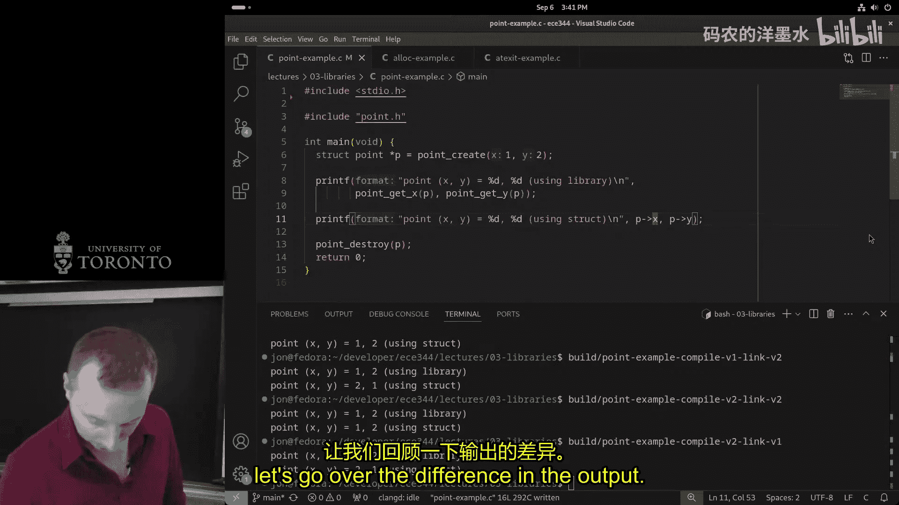

Slide works a bit better here。I broke it apart in to the different executables。

So here is the executable that I compiled with version 1， right， When I compiled it with version 1。

 it used point git X and point Git Y， which。Those were in a shared library。

 So it looks those up at runtime， right， It doesn't get compiled into the application。

 They're just function calls。 While if I used just the fields of thestruct directly。

 basically using X gets translated into using an array at one， using Y translates。

Into using array at 0。 So this would be what is in my executable if I compile it with version 1。

 right。And then if I compile my library with version 1 that has the definition of git X and Git Y。

 well， it thinks x is at array 1， and then y is at array 0。 So they both agree， right。

 if I use git X。It gives me back array1， and if I use thestruct directly， it uses array 1。

 so it's the same value，我是。ええ？Is because is it defining the as a point？Yeah， yeah， so it oops。

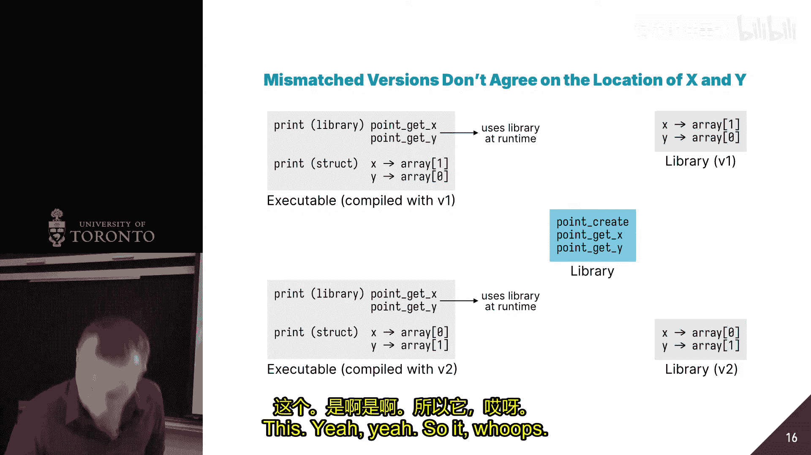

So it thinks it's at array1 because they're defined like this。So in version 1 it's just point Y X。

 and then version 2， it's x Y。And that just how C works is that decides where it is in memory。あ。Yeah。

我者信。Yeahep。It gets x as like in array0 y is in array1 if。啊。Yeah， yeah。

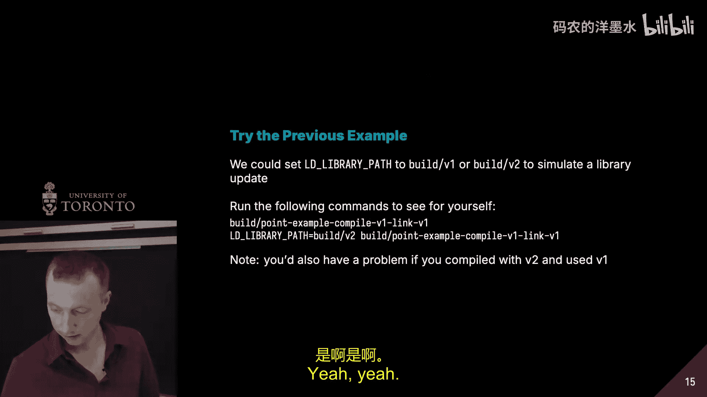

Yeah， so in my application， if I like compile with version 1 that has X， Y， if I use。喂。Parrow X。

It accesses like the array at index 1， right。And then if I use Y it accesses the array at index 0 and。

If I update my library， it may or may not agree with what you did。Okay， so then much more does it。

Yeah， so what changes of the output， so the C code is also in the library。

 so in the case where we compiled with version 1 and link with version 2。In version 2， when we set x。

 we set array 0 equal to 1， right？So， array is 0 equal to 1， Yeah， and then we set array1 equal to2。

So this was in our library the create function。 So this was equal to1， this was equal to2。

 And then when we ran our executable and it called Git X。 Well， it's using the library。

 So it thinks x is at zero。 So that would be one。 Oh， I'm doing it again。Okay， sorry。

 it thinks x is at zero， so it would print1， and then using the library again。

 it thinks y is at array index 1， so it would print 2。And then here， if we。Access thestruct directly。

 Well it would use array at index1， which the library set array at index1 equals to y， so it flipped。

ま。Oh， so the question is， why does the exeubable have version 1， Like。

 is it using the version 1 struct。On file。か。Yeah。And you access it when you。Using the。Yeah。

 so here here。

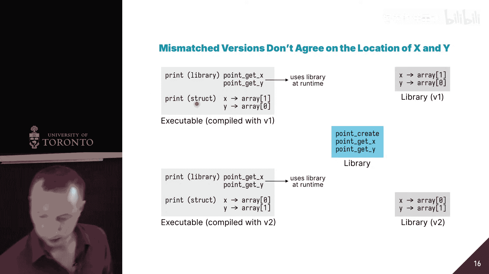

So here in my code， when I include point dot H。That point， dot H has that struct， I showed before。So。

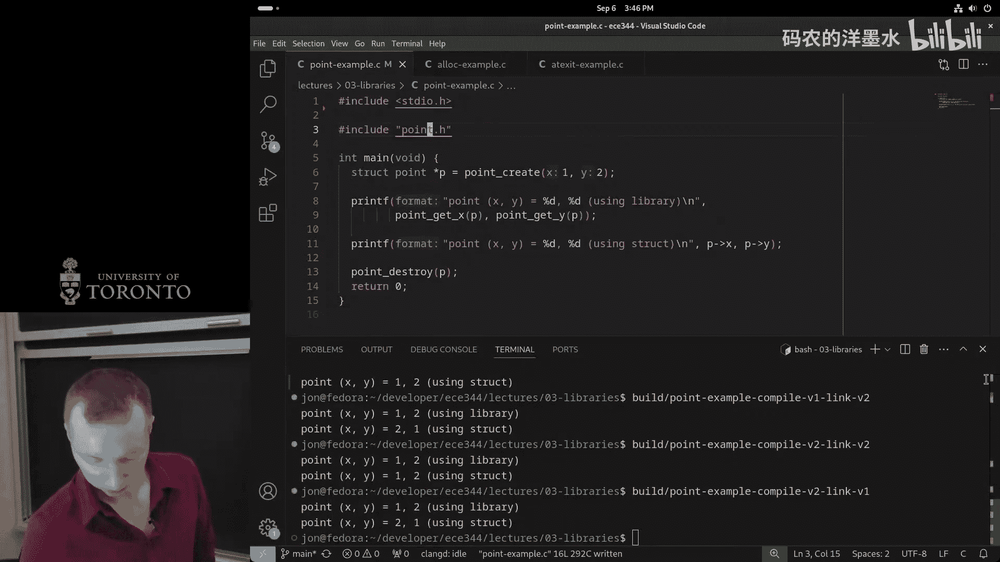

In point dot H。In version1， the point looks like that。So when I compile it with version 1。

It thinks thestructs laid out like that。 And then if I update to version 2。

 thestruct changes to the one on the right， and then it thinks the points are flipped， right。

And if I access thestruct， it's embedded into the executable。

So where it thinks x and y is is embedded into the executable。And that's just how drugs work。

Ando Library one。

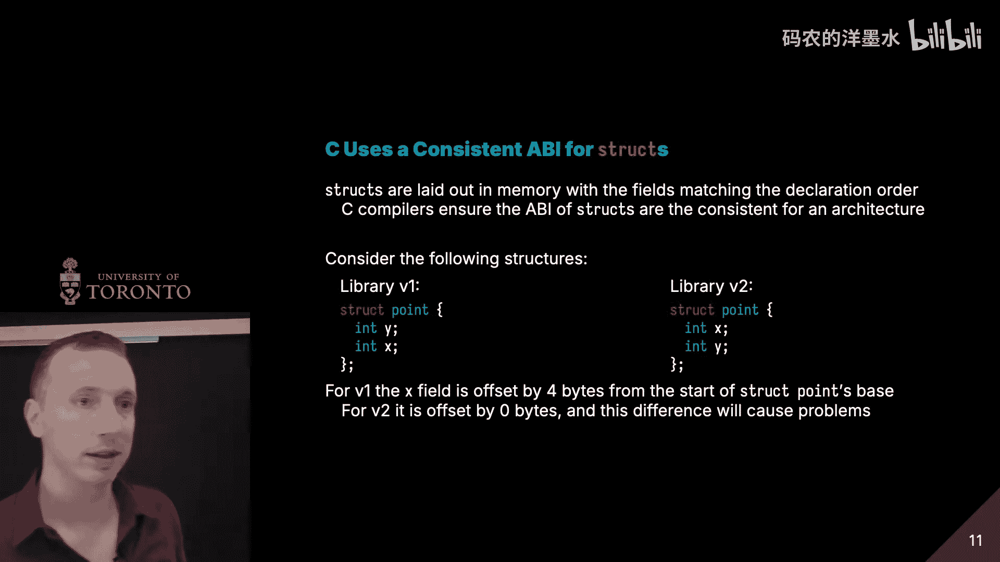

And when you access the stroke。And you should use。Yeah， so when I compile it with version 1。

 it thinks。Yhy is first， right？ So if I access the fields directly in thestruct。In the executable。

 it thinks y is at index 0。Am I executable？So if I run it with version1 of the library。

 it agrees with me。If I run it with version 2 of the library， like I don't recompile it。

It still thinks y comes first than X。 Then in the library， I switched it。

 It thinks the order was different。we some。

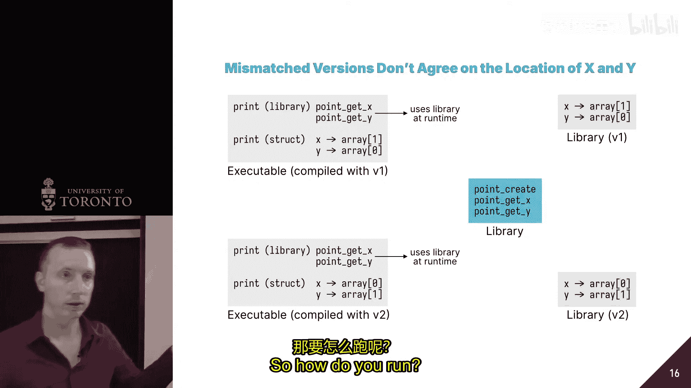

So remember here。So in this case。I compiled two versions。 So there's two lib points here。

 There's a version 1 and 2。 And because it's dynamic， I can change which one。

It actually uses whenever I run the application， so it's the same application using two different libraries。

Yeah， so executable， which would be compiled with version1 using library compiled with version 1 and then versus library compiled with version 2。

So there's， yeah， there's， there's four total things。 There's executable compiled with version 1。

 executable compiled with version 2。 and then this library compiled with version 1。

 library compiled with version 2。So there's a lot going on。Yeah， so when you recompile it。Swaping it。

Yeah， so when you recompile it， because you've changed the order of the struct。That tells C， oh。

 if I want to look up where x is in memory， that tells it where to actually look it up。Yeah。Yeah。

 if you don't recompile it。Wherever it thinks it is when you compiled it。So， yeah， the。

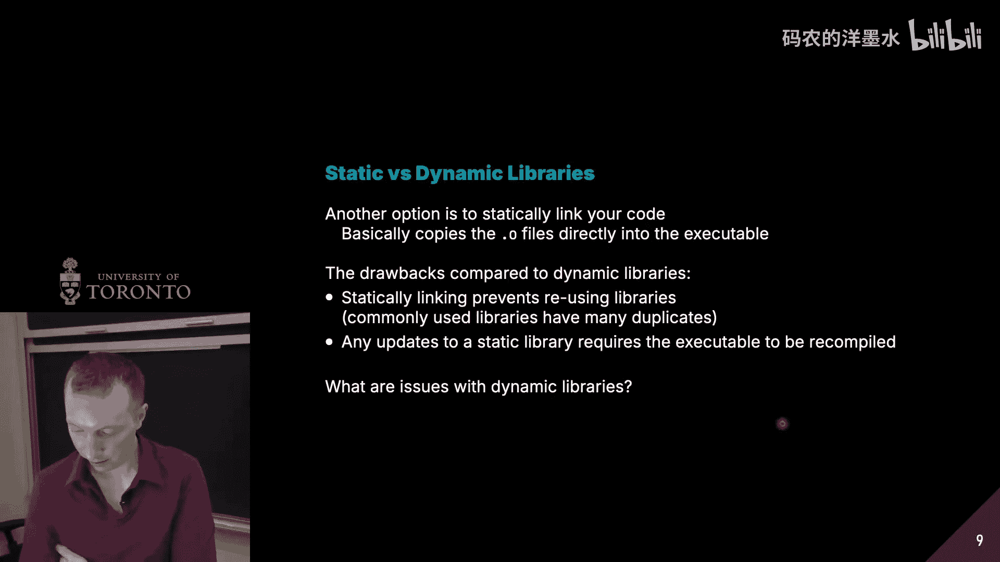

The point of this is。I would have no problems at all if I didn't give the executable like the definition of the struct。

 right， if I didn't give it the definition of the struct。

 I just gave it a pointer and I hid the actual struct from it。

 then it would never have a chance to disagree because the library would be the only thing that knows where X and Y are。

 and if I just recompile the library， I'm all good。 everything will agree within it so。The point is。

 if you define astruct as part of your library， you are no longer allowed to change it ever， ever。

 ever without breaking a bunch of code in very weird ways like this。 So basically。

 if you don't want to understand why this breaks the code。Just do not change the fields of astruct。

 if you have that as part of your library。 Otherwise， things will go very， very， very poorly for you。

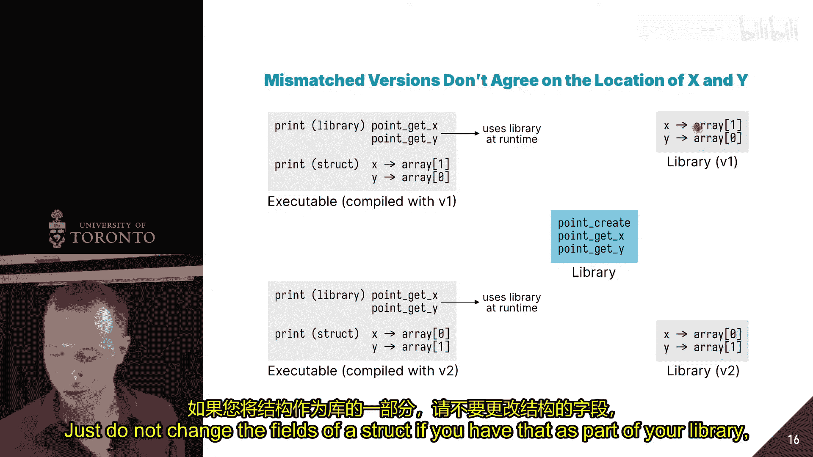

So here is all of this， so everyone more or less okay。

 there's four different things going on there like four different versions， yeah。听到啊。Yeah。

 so if in here。

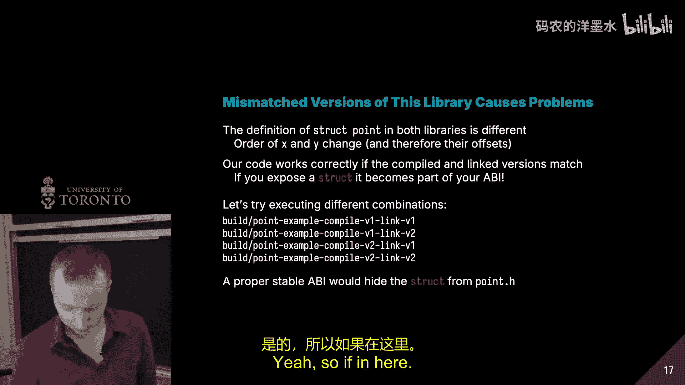

So like my big problem here essentially was this， right。

 I was accessing the fields of the struct here。So if I wanted to。

 if you've learned it in your C course， you can just like define and astruct without saying what fields are in it。

 and then you can use it by a pointer， right？Like， you can forward declare it。 So basically。

 if in point dot H， I just usedstructs by pointers and didn't。Let you access the fields。

 then I'd have no problems。Oh， no， that was a question。Yeah， I mean， just adding on to that。

 what if the user still persists to try to do that？So if the user tries to do this。

 itll get like if you don't tell them like if you don't define the struct as part of your library。

 they can't access the fields， they'll get a compilation error。

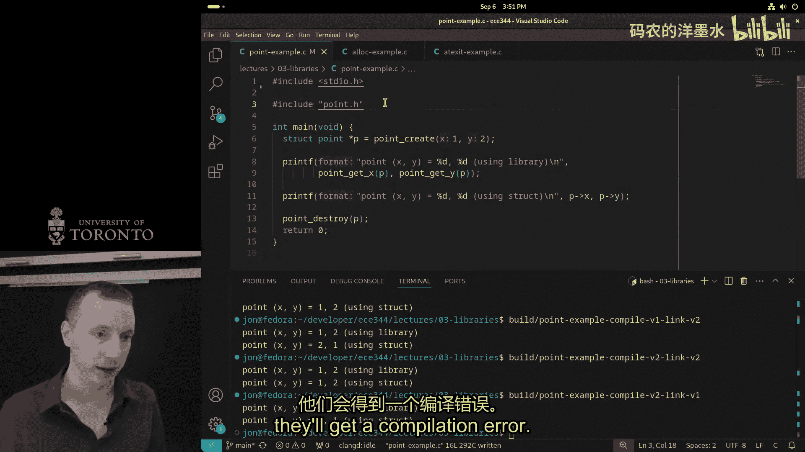

Yeah， so don't worry about this too much。 We have another quick， little fun example。

So the big point here is if you're creating a dynamic library。

 the main takeaway is you have to be really， really careful and know what's going on。

 So there's a way to version libraries call with something called semantic version that kind of meets developers expectations。

 so。It's a way to like signify through a version number whether or not you need to recompile something。

 So usually version numbers go like major dot minor dot patch where each of them is a number and the general rule。

 the same rules you follow is you increment the major version if you make like a fully incompatible API or AB change。

 A change is very difficult to sometimes know and can happen by accident。

 but that lets users know that hey， if I update my library from version1 to2。

 you need to recompile all of your code in order for it to work correctly like what we just saw And if you increment minor that means you can add。

Functionality in a backwards incompatible way。 so you can add a function in like version 1。1 and say。

 okay， well， now my application needs version 1。1 to work because I need that function。

 And then you increment the last number if you make like some bug fix that's just otherwise doesn't change anything。

You just fixed a bug。So that's generally how you should version things。

So another fun thing you can do with dynamic libraries that I will show you they allow for easier debugging so you can add you won't do this in this course。

 this is more for fun， so you don't have to pay that close attention to it。

 you can sit back and relax， but since we load libraries whenever we run our executable there's two things we can do to actually change which library loads whenever we run our executable so for instance。

 let's look at this code。 So this code。All it does， it mallocs some memory。 Everyone loves malloc。

 right， So we malloc space for an integer。 So we have an integer pointer， and then we print off just。

😊，We just print off the memory address of X。So how many times have I malloced here。Once， right。

 how many bitetes did I malloc？4， so in this。I just。In this， I just malllocked once。

 and I wrote4 bys。 So one thing you can do。

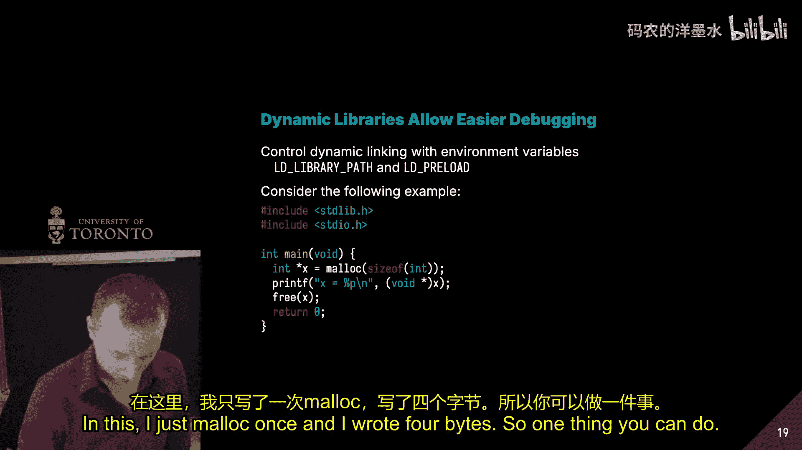

In order to debug it。 so has anyone used vgriin before or anything like that。

 So it like checks that you actually freed everything you malloced。

 So basically how that works is it checks every time you call malloc and then tracks the pointer you get back to make sure that you actually free it while what you can do and what I just did here is I wrote my own malloc that records whenever you call it and then it calls a real malloc to get memory and then same for free So I can actually print out all of the malloc calls my application makes and all the free calls to make sure that my application does what it needs to do。

 So if I go ahead and I run this let's see So here is my program。Aoc example。

 so if I run it with nothing works as I expected， just print X as just some random memory address。

Otherwise， I could do LD preload， and I wrote my own little library。Oops。

So I wrote my own library that tells me every single malloc column I make， so it says malloc4。

 so that's what I did。Who the， what the hell is at， Maloc 2024， and then it calls my X and then free。

 So that free is what I got。But。So what the hell is going on， I。 Did I call malloc twicey。I guess。

Yeah。Is it for loading your library and its？Yeah， so that's a good guess。

 like maybe my library needs memory， but if I look when it happens。Like when we S traced。

 it loaded everything in the memory before like mainine started。 So if I see here。

 this is my malloc call that happened here。 and then some mystery malloc called happened and then I saw the output of this right So something happened between them。

 So turns out through this， I can see what how the implementation details of like the C standard library right So it turns out that malloc。

 well print F needed memory。 So print F calls malloc。

 So inside the implementation they have a print F it malloced 1024 bys。

 and then use that to do malloc and then what do we always tell you to do when when you malloc memory。

Yeah， to free it。 Did they free it。No。Does that irk anyone else？Like they tell you to free memory。

 but they don't， isn't that just。In't that just seem unfair？HSo。Turns out。 And if， if I use velgri。

 if you use velgri before。Wops， not that。Oh well。Oh， I don't have it installed。 All right， cool。Sure。

So if I use that， it says two allocs and two frees。So it shows both of them。

 but it shows two freezes， which definitely didn't happen because I looked at all the fri and it didn't make all the free。

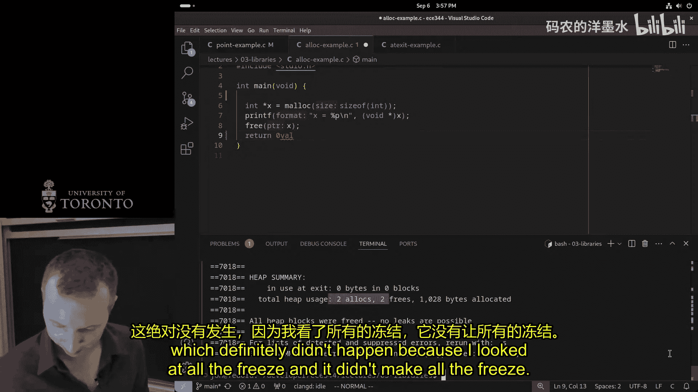

Why is that？ Well， that's mostly to keep your sanity so。Velgrind。

 good thing to use during the labs to check for memory leaks and stuff。

 But if you look at the fine print of it， it says this。 it says the Gaucy library Lib C do S O。

 which has print F in it， which is used by all programs may allocate memory for its own uses Aka what it did in print F usually it doesn't bother to free that memory when the program ends。

 there would be no point since the Linux kernel reclaims all process resource when it exits anyways。

 it would just slow things down， So their argument is while print F， the memory they use for print F。

It needs to stick around as long as you're。As long as your program is running because it can't detect whenever you last call print F。

 which would be the time you would want to free that memory。

 so they say they're allowed just to not free it because， well。

 when the process ends everything gets freed anyway so we don't bother and in Valgrind。

 they actually coded this exception so that you don't go crazy because you can't fix a free missing in the C standard library but。

Cool little fact， huh， they get to cheat and you don't。So。They have a good reason because， well yeah。

 they don't know whenever you're last going to call print F， so they're allowed to do that again。

 this does not excuse you from calling free and we'll just leave it at that for today。

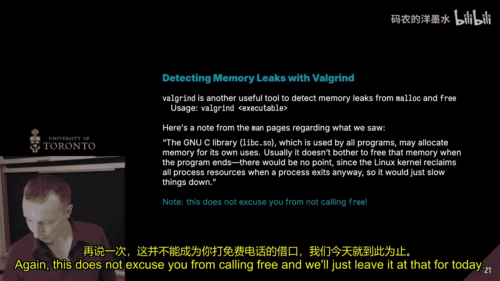