# 【全集】多伦多大学 操作系统 中英字幕 1080P p04 Lecture 4 - 进程创建 -BV1Rbk7ByERc_p4-

Alrighty， welcome back to operating Systems。We know what a process is。

 We have no idea how to create one。 So let's remedy that today。

 So this will be our first real lecture of like hardcore content。

 where we'll have to understand everything， so。😊，Talking about how to create a process。

 Don't know how to do that。 So first， let's do a quick recap of everything we know and try and tie everything we got introduced to all together。

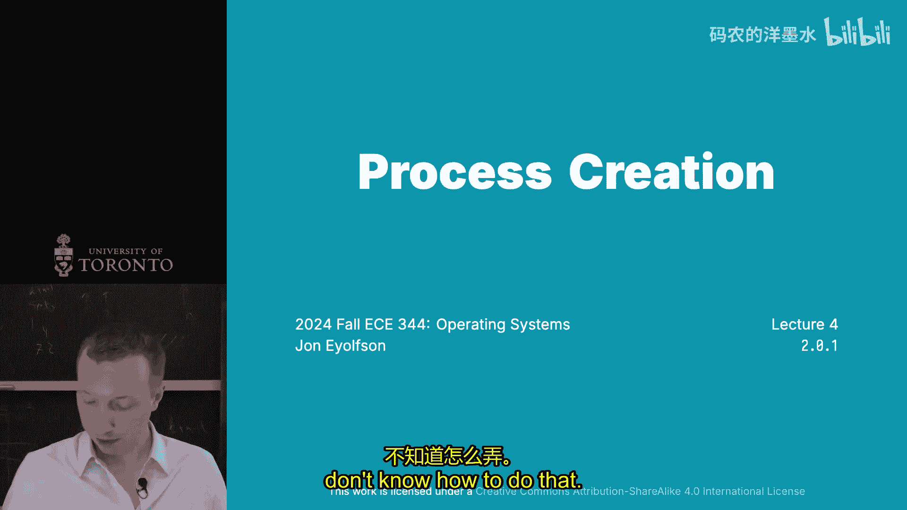

In a， well， a neat ish little package。So。Shouldn't have done that。So we have a process。

 a process is what a process is a running instance of a program， great。

 what are some things that would be in a process？Why is it doing that？All right。

 problem rejection is not working。 So things that would be in a process。

 we would have virtual registers。Because while they need to have its own independent set of registers that don't interfere with any other process running on the system。

And then it would also need some virtual memory。Palm rejection is not working today， all right。

So it would have virtual memory and that's where things like our stack， our heap。Why is it not？

Rejecting me， all right。And then like global variables， things like that。So。

Those are things that would be contained within a process that we know of so far。

 So any of the memory you've used has been， well， all virtual memory。So。

We know the core part of our operating system is called the kernel。

 that is the part that interacts directly with hardware。

 it runs in a separate CPU mode called kernel mode。

I really don't know why this palm rejections not working。So kernel mode and user mode。Not even close。

 but sure。All right， this is going to drive me insane。So your application runs in user mode， right。

 it's represented as a process and in order for us to actually ask the core part of the operating system。

 the kernel， to do stuff on our behalf， we have to use special functions called。System calls， right。

 system calls are the only way across this user mode， kernel mode boundary。

 So this is where our system calls come into play。And well。Whenever we run our application。

 our application probably uses something like a library。And that could be like the C。Standard。Wow。

 that is really bad， I have no idea what is happening。

So our application might do system calls directly， but likely what's happening is our applications using a library like the C standard library。

 And then it's doing the system calls on our behalf and then。

The processes are all managed by the kernel， and then we can ask our process to like do things。

 Another thing that might be in a process。 we can imagine that our kernel is also managing like a bunch of random files。

 So let's say we have three random files。Another part of our process is like any open。

File descriptors。Which is basically like。You can think of it as just a big old array。

Of pointers to files， so we could imagine that they point to different files all managed by the kernel。

 and that is how our process can actually write information to that file。

 it would do it through referencing its file descriptor， which is basically just a pointer to file。

So any questions about where we are at so far， hopefully this kind of like ties the first three lectures together。

有。So the application is like。Maybe a better word for is just a program， wow。Palm rejection。

 bad application， another word for it is a program。Cool。

 so not another name for this program is something we want to run。

 And then the fact that we can run it， it runs in a process so we could have。😊，Like we saw before。

 we could have multiple processes all running the same program。 So the actual executable file。

 if you want to think of it that way， too。Yeah。い回？Oh。

 the difference between static and dynamic libraries。 So that's。

Mostly just an implementation detail of like compile time versus runtime。

 I know everyone's kind of confused about that like the example we saw。

 but remember the example we saw that is an issue that the C developers made and they have like 40 years of programming experience。

 So if you don't understand that， that's okay。 just vaguely all you have to take away from that lecture is just。

Static libraries that get compiled into executable。

 they're the same every time you run it dynamicy libraries， all that code gets looked up at runtime。

 so if you change it， it runs the new code all we need to really know about that and the like two questions。

 disadvantages advantages behind having that which is if we update something we can break stuff so you don't have to know the details of our breakage that I showed you I showed you way too many goy details Sorry I'm kind of like that。

So any other questions？

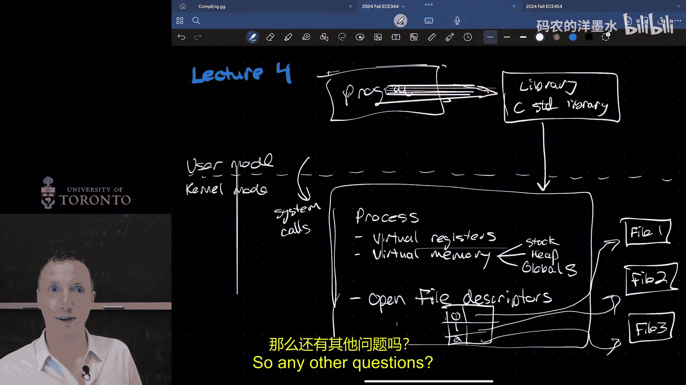

All right， so let's dive into the fun stuff。So process creation。

 how do we actually create a process because we have no idea how to actually do that？

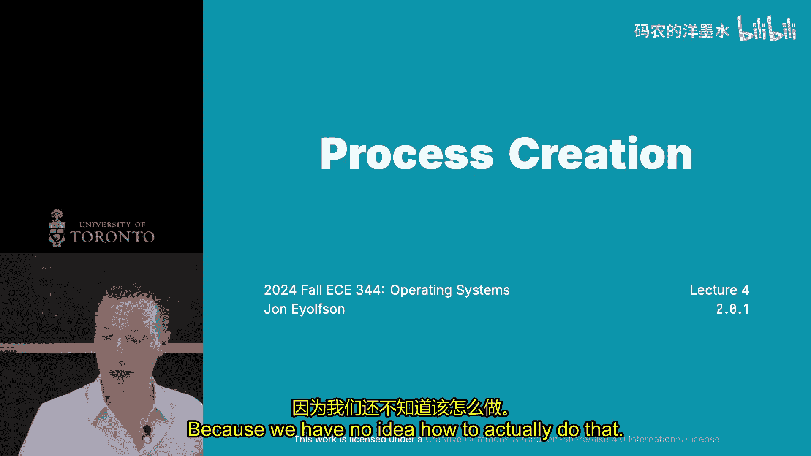

So。Here is our process before， it actually looks like this with file descriptors as part of it。

 just we just recappped it， but this is so you have it on the slides as well。So a process。

 so the kernel needs to keep track of processes and the data structure the kernel uses to keep track of a process is called a process control block or PCB。

Specifically on Linux it's just astruct， I mean the Linux kernel is written in C。

 they call it the taskstruct， you can browse everything that's in it on GitHub if you want。

 it's open source， you can read part of the kernel code。

 but as a summary some of the things that are within that process control block is like the process state which we'll get into in the next slide。

Its current values of those virtual registers or CPU registers scheduling information。

 maybe if it's running or how long it's run for， if it's due to run again， memory management。

 so that's it keeping track of the virtual memory for this process， IO status。

 so any open files it has， or any other type of accounting information you need to keep track of a process。

And each process gets a unique process ID or PID or PID。

 so they all mean the same thing to keep track of it。

 we'll be using this term throughout this course， so I'll probably shorten it to PID just though when I say PID short for process ID and that uniquely identifies a process so each process gets assigned ID。

 which is just a number， stays the same throughout the process and it's unique。

So this is the state diagram of the life of a process which we will be getting into so initially processes do not exist。

 we need to create one out of thin air， we'll figure out how to do that today。

 but this is the state of a process that the kernel cares about so when it's in this creative state。

 the kernel has to like load that program into memory set it up so that it is able to execute code。

Then whenever our process is able to execute， it doesn't actually get to execute。

 it goes into this waiting state， which we could rename ready if we wanted。

 that means our process could actually execute on our CPU。

 but the kernel has decided it is not worthy enough yet。

 it doesn't get to execute until it actually puts it on a CPU core。

Then eventually whenever it decides this program gets or this process gets to run。

 it would transition here to the running state， and then it's actually running on a CPU。

 it's doing stuff， It's calculating， hopefully it's doing something important and then maybe it takes a long time。

 your kernel might be like okay， that's enough CPU time for you。

 you get to transition back to the waiting state， you're not executing anymore。

 but you could execute。 So this is how your operating system。

 juggles like hundreds and thousands of processes， just by。Shooving them on a CPU。

 laying them run for a little bit。Having them not run and then juggling them back and forth between these two states。

Then when you're running， sometimes your process might do a system call and then it would transition to this block state。

 so this block state means the process can no longer run because it's waiting for something to happen。

 it's blocked， something's in the way it can't actually execute so this would be the state the process gets put in while the kernel is doing a system call for it that might be slow。

 maybe it's accessing a file or network or something like that。

 so it has to wait for that system call to finish so blocked basically means the kernel is doing something on behalf of this process。

 it can't execute anymore。Whenever it's done that system call。

 it would shove it back into that waiting state or ready state and then it can execute again。

 and then eventually whenever it's done executing ill transition to this terminated state。

 which means the process is now done， it served its useful life。

 we can get rid of it so everyone okay with that， we'll revisit this again a few times。

 this is just the life of a process。So some cool things。

At least in the Linux kernel you can read process state using a proc file system。

 it just looks like a bunch of files， but it's actually information the kernel' is providing about the state of our system so on Linux it's just a normal looking directory that starts with slash ProC and they aren't real files it's just the kernel makes up files and then you can look at them and that's how you can actually access information about the kernel that it wants you to see so we can actually take a look at this。

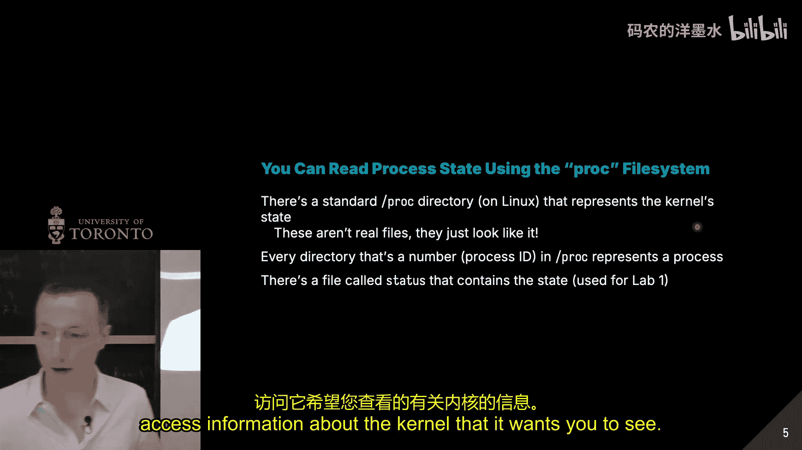

So if we look at the proc file system， it has a bunch of。Random things in it that all have names。

That all tell us different information about the kernel。

 So like there's even interrupt CPU info so I'll tell us information about our CPU and other fun ones like that。

 But the ones we're interested in today is any directory there that starts that is a number that represents a running process and then within that directory is all that information about the process。

So。The name， that number， that's the process I D。 And then we can see a whole bunch of information about that file。

 So， for instance。If I wanted to check on the information about process I D1， well。

 I can use this command called less。 That's just a command that reads a file and lets me like scroll up and down。

 So it just doesn't spit out。 I can read。A file in that directory called Sta。

 And then it will tell me all about that process。 So I can see that the name of the process。

 it's called system D。U mask， we don't know what that is yet and then it's state so this state Linux doesn't have the same names I showed you。

 The sleeping state is basically that ready state or waiting state so this process it's currently sleeping。

 soundss kind of cute ish It's waiting to execute。 It's not actually executing and then there's a whole lot of information that will make sense as we go through this course like that VM stuff that's short for virtual memory so that has something to do with virtual memory and then there's just a whole bunch of stuff。

So this is basically where lab1 is， so lab1， everyone's like looked at task manager or activity monitor or whatever and got a list of all the processes running on your machine well you're going to write a version of that specific for Linux so that's what lab1 is。

You'll be just going through this directory， looking at counting however many directories are numbers。

 that means it's a process and then you'll just be showing every single process running on your machine and you'll essentially be writing a text version of the task manager but I can't do anything special。

 but that's lab one， it's a lab one release this morning， you can do it start early。

 this lab not that difficult， but especially for future labs trust me you want to start early because。

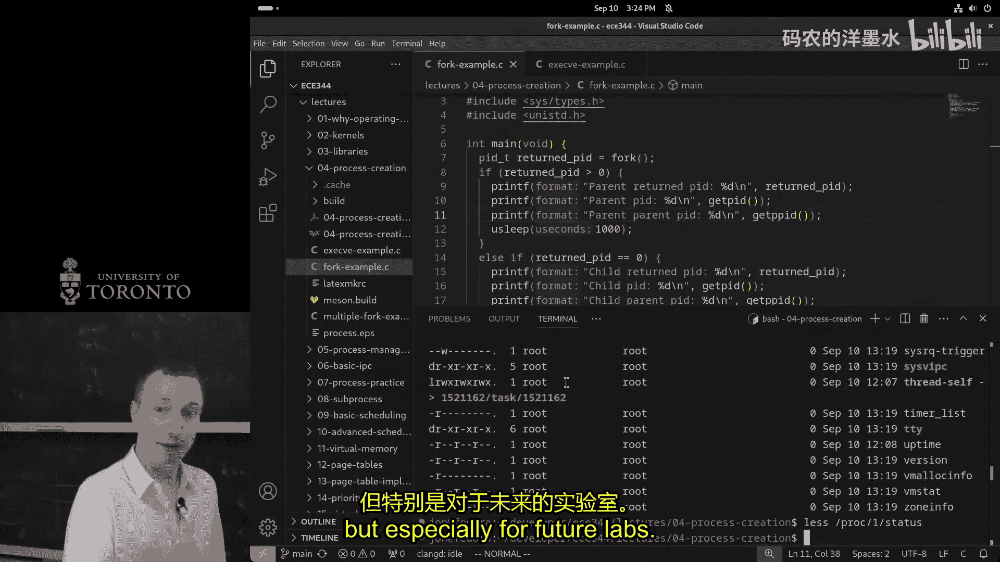

Even if they don't take that long， you will run into bugs and you will have to think about it because as I will show in a little bit。

 things will start to get weird in this course。 if they haven't already， so yeah。

 someone would disagree with me。So how do we create a process， We could create them from scratch。

 So you might think the easiest thing to do would be like。

 maybe there is a system call where I to say。Called create process。

 And I tell it what program I would like to run。 So if this existed。

 would that kernel would load that program into memory。

 create the process control block and just start running that program。 And that is， in fact。

 what Windows does。 Windows has a system called called create process。 But Unix。

 which is Linux and Macos。 They both do not do that。

 They actually break process creation into two different parts。

And we'll see why this is useful in a little bit so we can actually mimic creating a process from scratch。

By decomposing it into two parts。 So let's get into those two parts。So their idea。

 whoever decided to create Uniix and the system call interface said instead of creating a new process。

 well we could just clone the currently running process。

 so how this works is your kernel will pause the current running process so it will go into that block state it can't execute anymore and the kernel will copy its process control block into a new one。

 assign a new process ID， but that new process is going to look exactly like。

The process that wanted to create a new process。 So everything will be the same。

 including the values of all the variables， including its memory addresses and everything like that。

 But then after that， there'll be two processes that are after that point independent。

 So the sincere clones of each other。 the only way to figure out who the original one was and who is the newly created process is by something called quite。

They use this literal term the parent child relationship， so if you create a new spawn， I guess。

 whatever term you I use， that is now your child and you are more or less responsible for it and you are the parent。

 it is the child， you existed before， and you brought this new process into existence。

After that point， they're both independent， they can do whatever they want。

 they could execute different parts of the program and otherwise be completely independent。And then。

 as part of that。If you wanted to start running a new program。

 well then the child or either process could load there's a system called to load a new program and set up and like just rewrite the data in the process control block to start executing a different program and we'll see an example of that but first let's start off with the first system call fork。

 so that is the only way to create a new process on Uniix， so Linux or Mac OSOS。

If you are running a new process， this is how it was created。

 no matter what full stop only way to create a new process。It's called fork。And。

It's the start of our really weird Google searches， so yeah。Stick with me on that a little bit。

 but so Fork takes no arguments and then it returns an integer。So how it works。

 it's going to return the process ID of the newly created process as long as it works， if Fork fails。

 it returns negative 1， so it means I did not create a new process。If it is successful。

 then after this point there are two processes and the only way to distinguish between them is the return value of fork。

 so in the newly created process which is the child process。

 fork returns zero and then in the parent process it returns a value greater than zero。

 specifically the value it returns is the process ID of the child。

 so it knows the process ID of the child， but now there's two process running on your machine。

They can access the same variables， but they're completely independent。 They're completely separate。

 have their own virtual memory， have their own everything。

They just look the exact same at the time of the fork， but then they diverge。

 They're completely independent。 We'll get into how you might think this is slow because， hey。

 we'd have to copy all the memory from the process。 But turns out there's a fast way to do that。

 using something called copy on right to maximize sharing。 Turns out this is really fast。

 We'll get into how this is implemented when we actually talk about virtual memory in like two weeks。

 So don't worry about that for now。So。On any Pos system like Linuxnx Mac OS。

 you can find documentation using the Man command， which is short for manual。

 so we'll be using the following APIs if you want in your terminal。

 you can look up the documentation without going on the web and seeing examples and things like that。

So in order to do that， you just do man function so I could do like man fork。

And look up documentation about that， if it doesn't give me what I want。

 I can do man number and then function so if it gives you something weird。

 you could do like man2 fork so you actually get the proper documentation。But screw documentation。

 let's just try it。So。

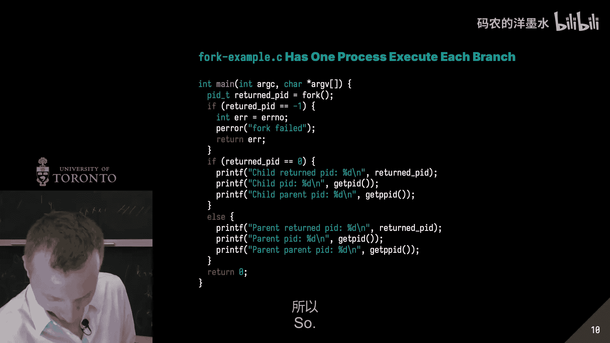

Let's try this little program here。So here is our program。 So has Ma。

 So something will create a process that starts running this program。

 We'll see if we can figure out what actually does that， but this is running as a process。

 It doesn't do anything。 The first thing it does is call fork。So now we have。

As long as there's no error， we've created a process， a new process。

 that's the exact copy of this one， so it would appear as if it has reached this line in the program。

 if it set variables， they would all be the same。So the only difference would be the return value of fork in the parent。

 it would return some value greater than0， then in that process it would create the variable called return process ID and then assign that value to it。

 and then it would go into this if statement， it would be greater than zero， print these three lines。

This sleep here is， for reasons we'll discuss in the other lecture。

 just so weird things don't happen。 But that basically just puts it to sleep for a second。

 and then it would。Go buy all the other branches because it went into the first branch。

 and then it would return 0， which returns from mainine， which exits the process。Now。

 the fun thing is that we would have another process created。Fork would return0。

 and then it would create a variable called return process Id， assign0 for it。

 and then it would execute this if statement。 But now the return process Id is 0。 So this is false。

 So it's like how programs execute。 It would go the next branch。

 check if the return process I is equal to0。 in this case， it ends and then this process would print。

These three lines and then return so when I run this it should print six lines。

 but there's two processes， one process is printing the lines from the parent。

 one is printing the lines from the child， so this is like the first mindbending thing。If I run it。

 it kind of looks like the program is in both if branches at the same time， it's not。

 there are two separate programs and they are all obeying the rules of C that you know， yeah。

a called。Yep。The Id ever be the。So the return process ID would never be the parent's ID。これにこれゼ十は。

They generate。他。Should it always be zero？So whatever we call fork， that creates a new process。

 So the original process would still be running。 That's called the parent。

 And then it gets the process I D of the child。So let's just run this。why。Iデが。

Return I D greater than0 in the parent。the job。For creates a child process。

It takes the idea of other。So Fork creates a new child。

 and then I have two processes that are returning from fork， the parent and the child。And which I。

And。In the parent， the process ID， you get the process I of the child in the child， you get zero。

So let's just run this。Just to see， see that， I'm not crazy。So。If we run this to to do。Oops。

 I need to recompile。 The other class had me doing weird stuff。 Allright， so if I run that。

 it works exactly as I described， even though that number is absolutely gigantic。 Okay。

 they made me do something silly， so。We can walk through the parent process。 So the parent process。

 the original process that was running Maine。Executed fork。

 and then fork returned a value greater than 0。 So it returned this as a process I D。

 which is some gigantic number that ends in。3，9，5。Okay， well， then it printed the parent process ID。

 so this is the process ID of whatever was originally executing Maine， so it ends in 9，4。

 and then the parent's parent， so whoever created this process has the ID 3291。Then we can see。

 like I said， in the child process， Fork returned 0， so it returned 0 and。Here。

 we're using this system called called Git P I D。 That's a system called It returnsturn your process I D。

 And then this system called Git P P I D。 Wow， that sounds bad。 That returns the parent' process Id。

So we can see that all these numbers kind of make sense in the parent。

 the return process I ended in five， which matches the child's process ID， right？

They're the same number and the child's parent is end in four。

 which makes sense because that is the parent's process ID or the original process。Yeah。

Like the who made that who is the。Oh， so the question is， who made the parent AKA， who is this？

So how would I figure out who is this？I could use that pro system， right， I could see what this is。

 so let's just try it here Win sec。So if I proc， so this process parent was 3192 and I can status and I can see information about that process。

 and he guesses as to what this is。Yeah。You don't know the shell itself， that's a good guess。

 let's see if we look name bash。So that's the shell which kind of makes sense something had to create my process and what did I type in so if you don't know what a shell or bash is。

 that's what I'm typing my commands into it's called a shell and the shell is responsible for running whatever program you type into it so that makes sense that it is running my process。

 so if fork is the only way to create process it means。

My process that is running my main was originally bash， bash forked itself。That sounds terrible。

So bash forked itself and then somehow started running my program。

 and we'll see that other step a bit later， but we can see what bash is doing。

I just want to ask when we go into both the states。So we do not go into both the of statements。Yeah。

 so here just so I can make this really clear because oh yeah。

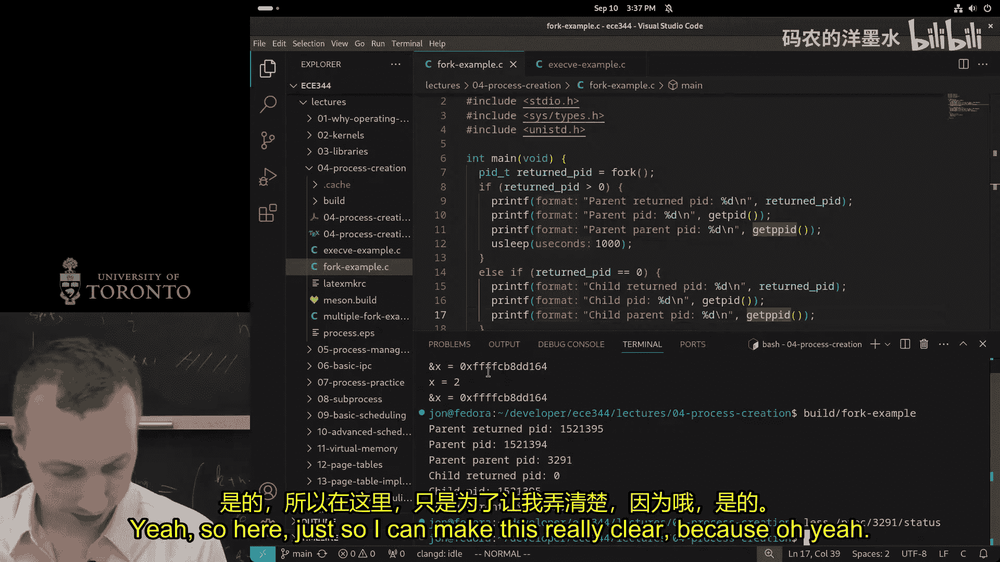

真的超。

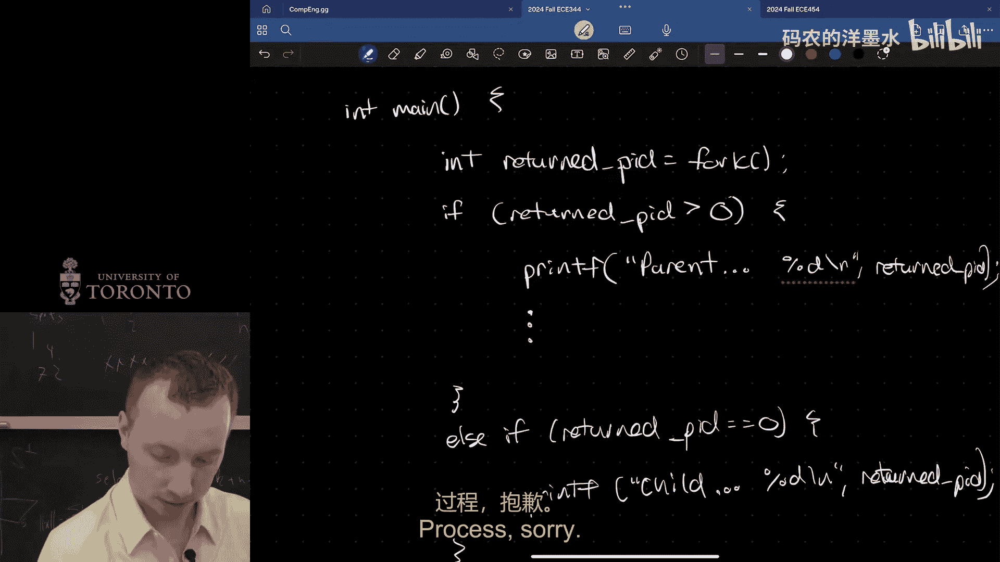

Sorry。个潮头。So， yeah， the question is， why didn't the child like fork can create another one。真的偶。

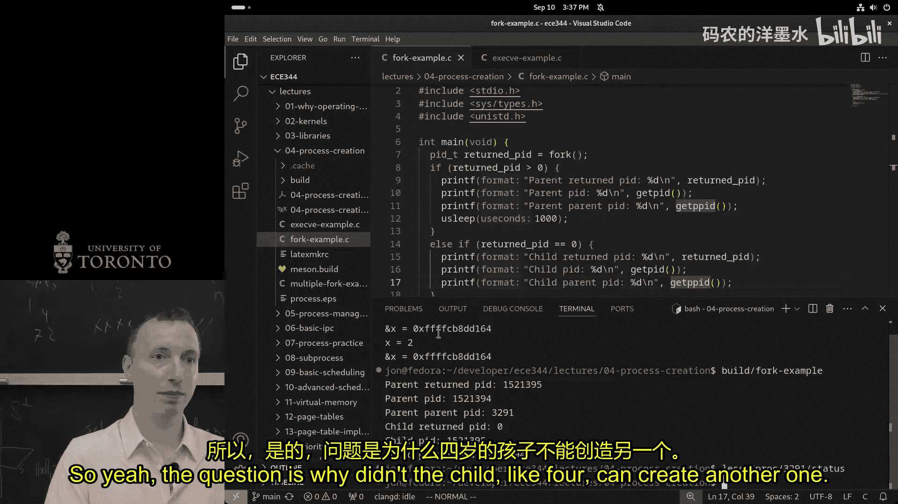

No。No， so here， let's go through it real quick and I'll draw it out。 So when we're first starting。

It's easier if you just write out the program and then in the margin。

 you keep track of what each process is doing， each process will obey all the rules of C that we know。

 So easiest thing， something what I like to do and yeah you'll be having to understand how this works and do this on exams so you might want to figure out how to do this is I always assume。

Oh， I do not like this。So I always assume we have a process that is running Ma。

 It got created by bash or something magical。 just something is running Maine。

 I will just give it a random process I。 I typically just like using the process I 100。 I don't know。

 Don't ask me why。So。Process I D will 100 will be executing this C program。How we all know and love。

 So the first thing it's going to do is call fork。 It is the only process that' called fork。Now。

 as part of fork。We will create， we'll always assume forecast successful。 Otherwise。

 your computer is dying and something bad is happening。So we'll always assume Fork is successful。

 So we're creating a new process。That is an exact copy of process 100 at the time of the fork。

Exact copy。 if it declared variables， They would all be of the same value， everything like that。

 So it looks the new process looks exactly the same。It just gets a new number。

 So we would have process 101。And it is now currently created as part of that fork system call。Now。

 at this point， the only way to differentiate between them is the return value from fork。

In process 100。Fork will return， which is the original process I existed。Fork returns 101。

 which is the process Id of the newly created child。 And it's the only thing that called fork。Then。

 so， yeah， process A00 is the only thing that calls fork。

 and it will look like two things return from fork。 The new process and the original one。

 recall call the original one the parent because it created the new one。 and it's a clone of it。

And then yeah， and then in the child process， fork whenever it returns would return zero。

 which indicates that it is the clone， it's the impotor。It's sa if you talk like that， whatever。So。

 now。If we remember a process state diagram， there's two processes。

Our colonel is actually deciding which one to run so at this point。

 we don't actually know which one is going to run。 It so happened when I actually run ran it like all the parent ran first and then the child but didn't have to be that way。

 if I run it a few different times， maybe I see a different order。

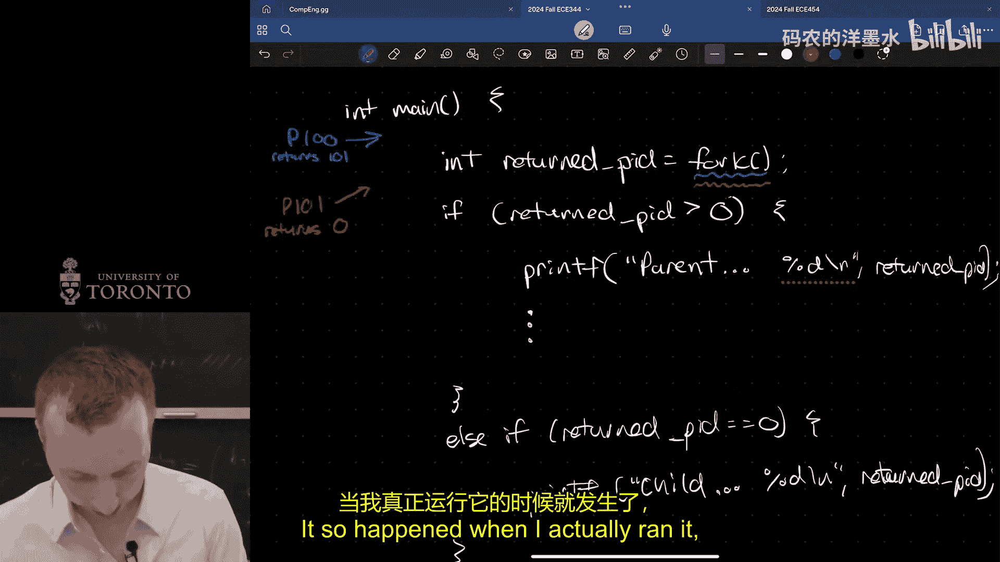

We will not be that unlucky today， it looks。Oh， there we go。

So we got unlucky in this one where we got a weird order， so it went parent return PID。

 then child return PID， then child PID， parent PID child parent So why is that happening Well。

 since there's two processes that could run at any time you don't know what's going to run the only thing you know is that within the process。

 it will obey all of the rules you know and love from C。

 So the parent will always print these lines in order。

 so it will always be parent returned parent P and then parent parent we'll always see parent1，2。

3 in that order and then in the child process will always see these three lines in that order。

 but between the two processes we're at the mercy of our operating system。We could like we saw。

 we could see parent child， parent child， parent child， we could see parent childil child， parent。

 whatever just within the process it's going to be consistent， but between we have no idea， yeah。

Yeah， so this would be like toggling between two states or I have luckyies like if I only add one CPU。

 it runs the parent one for a back for a little bit， then puts it in that ready state。

 runs the other one， puts it in the ready state and it just juggles between back and forth。

 but this is basically how your offering system juggles like you have hundreds and hundreds of processes running on your machine。

 your offering systems is juggling them constantly yeah。せきる？Yeah， so the question is， is the like？

Basically， the instructions part of the processes。And the answer to that is yes。

 they're in virtual memory， so they're loaded into memory。 So they're the exact same。 So still runs。

 Everything's all good。Okay， yeah， back to this so we can slow it down。

 So if we slow it down at this point， we have fork。 We have two processes。

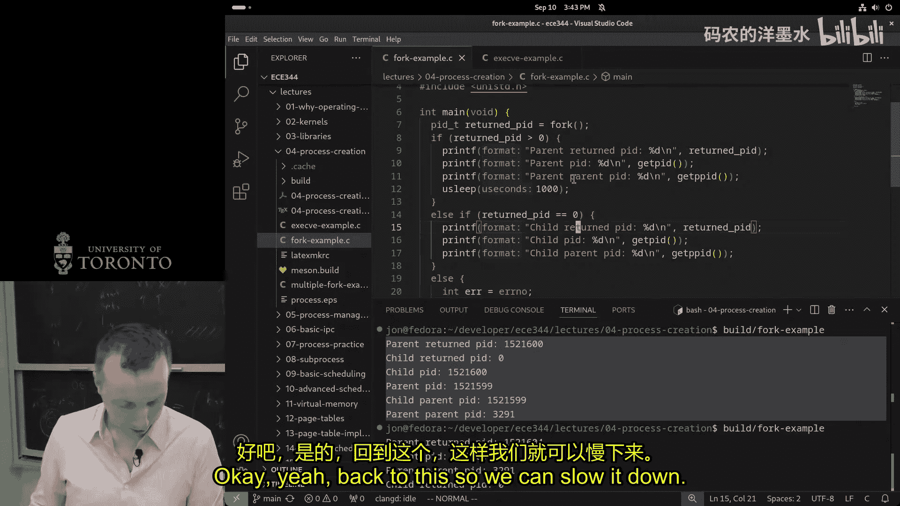

Now we don't know which one to execute， it seems whenever I ran it。This one runs。 whoops。

 I didn't want to steal that n。So this would run， create a variable called returnturn PID since Fork return 101。

 it would assign 101 to this variable， and then it would obey all the rules of C so this。

Blue thing is consistent it would check here， oh， process ideas are greater than zero in this case yes。

 it would print the parent stuff and then that is it would go into there。

 print the parent stuff and then fall out of all the branches and then exit the program。

Then whenever the kernel decides that this process runs while fork returns0。

 creates a variable called return PID that' is equal to zero。This is false。

So it would jump to this branch， check， okay， this is true， print the three child and then return。

 so now we just have two processes executing the same code。So we okay with this kind of weird。

But it's the juggling act that actually goes on with our computer。Yeah。

P101 starts to execute itself it never goes through the。Why does it。No。

 so the question is when P101 executes itself， it doesn't go through the forkline。

 and that's true because it didn't exist， right， it only exists as part of the parent calling the fork。

So it didn't exist yet， it's a copy。The parent already called fork so since it's a copy。

 it's not going to call it again。So， we could have something。呃。

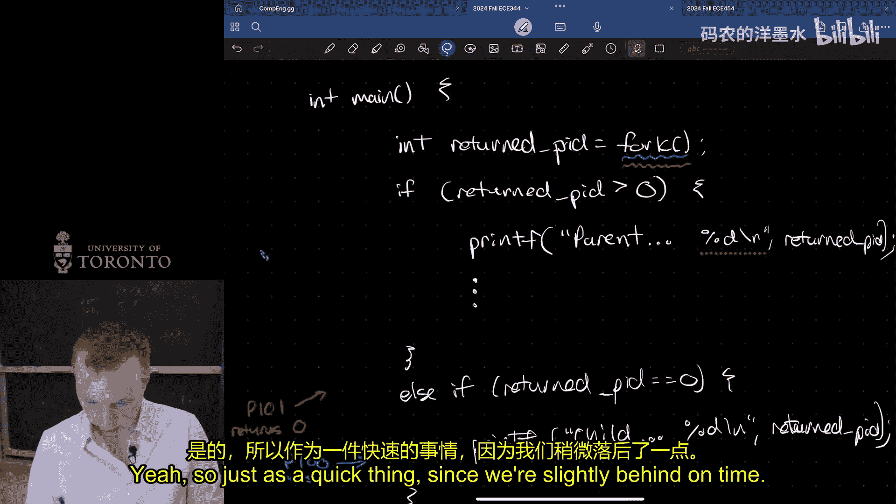

Yeah， so just as a quick thing。Since we're slightly behind on time。So quick。Pop quiz。

 it's not really a pop quiz， so whoops。If I run this program， how many times will I see high？2。Two。

 everyone agreed， two， two， two。呃。So yeah， we see two， okay？Well about now。But heard fours， a fours。

4。Well， let's see。4our。Why is that well quickly？We have our original process。That runs main。

Then after this fork， right， the processes that are going to execute this line are like process 101 and process 100。

 there's two at this point， and both of them call fork。

 so both of them create an additional child process， so 2 plus 2 is four。Okay。What about that？对。E。

 right？So now I have four each of those four calls fork， so four processes called fork。

 they all create another process， we have eight。Is that a good idea？Yeah。

 well third time through the loop， we're at eight， second time。The next time through the loop 16， 32。

 64， 128，256， 512。Should I execute this？We'll end the lecture on that because yeah。

 that will probably end the lecture。嗯。And yeah， other quick little things。If I have like in X。

And I said it equal to1 at the time the new process will also have a variable x。

 it will be equal to1， and if I change it after the fork， it will only change in that process。

 so if I do something like this，And then I print X。Then whenever I run it。

 I'll see that x is equal to1 and that came from the child because well it didn't set x to anything new。

 whenever it was cloned， it had an X， it was equal to1， so since it didn't change it。

 it was still one whenever it printed it and the parent， it changed x equal to4。

And because it has its own virtual memory， it's completely independent。

 it did not affect the trial process whatsoever。So they have different values and I'll leave this as an exercise to the reader。

 you can look at the recording for the other course because we're slightly behind。

 but the memory address in X is the exact same in both of them as well。

 So even the memory address of X is the exact same so you can play with this code。

 but like the same idea as a global variable。

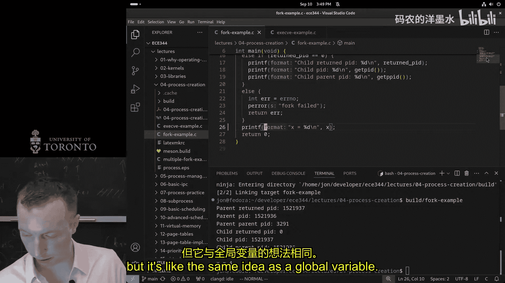

So real quickly before we break my computer。Is we need to know how to run a different program。

 So the Ex VE system call is how to。Transform the currently running process and load another program into memory and start executing that program instead。

 So Exec V E has the following API 3 arguments。 The first is the path name。

 So that is like the full path or where the file is that is the executable you want to run。

 The next argument is the array of strings， which strings are arrays of characters and their C strings。

 So they null。 they have a null byte terminator。 and then that actual array of strings is null pointer terminated。

 And that represents the arguments to the process。 So everyone seen like main like main。

In in Arg C ArgV， well， that's how it gets set， it gets set by this。

 so you're reading the same values。So how would we use that， So let's just dive into our example。

 So our example of using that is here I have main。

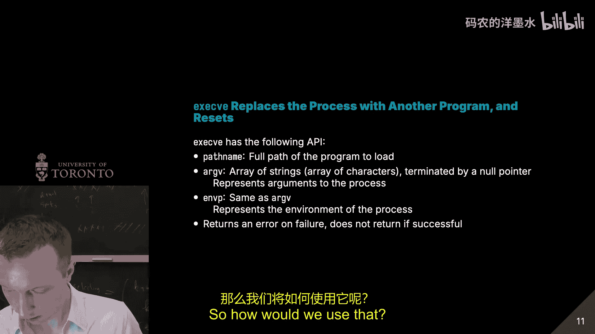

Mas just says print F I'm going to become another process then it setss up the arguments so we're just going to make our arguments LS and nothing else。

 we're going to assume we're actually executing LS。

 and then for Exec for the environment we're just going to ignore it instead equal to null means no arguments。

 then we'll call exec VE， if we want to transform this process into one that will run LS。

 the path is user bin LS， we give it the arguments， and then if the system call is successful。

This program is no longer running。 This process has now started running LSs main and doing whatever LS is going to do。

 And then whenever LS is done， that means this process is done。 So if this is successful。

 we should never return， it just executes LS， so we should never， ever， ever see this line。

If Exec V E has a problem， it should return negative one and then go into this branch。

 Well it will tell us the reason that it failed。 So if we run this。

We should see I'm going to become another process， and then it prints off。Whatever LS does。

 so just runs LS。So questions about that。Yeah， so the question is does this LS matter。

 it seems kind of redundant， so has anyone ever used like Rrg V0 in C？Probably not。

 but it's a convention everyone follows that the first argument should be the name of the program that the user typed on the command line。

 So how is it used rarely used， but usually it's used for error messages。

 So if you do LS dash dash help。You'll probably get something like this where it says like hey。

 the usage is LS and then all the options note that doesn't say user bin LS and where it gets that name from are the command line arguments so I'm running going to run the same program but I'll set that first argument as just like。

Oh know。That I can said to whatever I want， it's just a string。And then let's just say。

 I'll read the help message， so I'll just give it the extra help argument that's the same as me typing it on my terminal。

So now if I compile。And run that's the same as running this on the command line。

So I run that seems to work the exact same。 But when I scroll up。I get to the usage。

 it just says whatever I said。But that's just a convention。

 Everyone agreed upon that the first argument should be whatever the user typed in the terminal。

The program you're running like the actual executable file doesn't have to have the same name as the command you've typed。

 That's just how shells work and everyone agreed upon that。 So any questions about that kind of fun。

So a little fun story。Some of you might be like， why do I even said to anything？

Why don't I just do this？Right？I could do that。 So it turns out that that's a perfectly good thing to do。

It's not going to affect anything because L S isn't going to use that first argument。

 You've probably never used any your program。 So it's fine if you don't use it。

 if they did happen to try and use that first argument and you had an array like this。

 they would get a what。Anyone try to dereence an null pointer？Sa fault， bad things happen， right？

 So if the program tried to use it and we passed it in allll like this， which you can do this。

 if you do the system call， it would probably。Sg fault have a problem。

 so everyone's used pseudo before that like basically lets you run another command as root。

Turnned out， Sudo would read that argument。Unconditionally， even if you didn't supply anything。

 so if you gave this to pseudo， you could crash it and you could crash it in such a way you can get it to execute any code you want。

 and then you could become the root user and you could have complete control over that machine。

 so that was a real exploit because they didn't take this into account。Because well。

 usually it doesn't happen because people use a shell to run commands， wouldn't happen。

 it would always set it， but you could do a system called do something like this。

 and well you could have taken over the machine if you used an old version of pseudo and did this and you did some special crafting。

So if you want to hack stuff， yeah， this is operating system。

You play around with the operating system and try and break things。

 So this is one thing we could break。All right。And as another thing， this is also basically how。

 how your shell works。 So if we added in something like， I dont know， int P I D equals fork。

So we could say like。I'm Michelle。Then we could fork。

 and then we could say like if PID is greater than zero。

 that means we're the original process like called fork， we could just say like， hey。

 I'm the terminal or I'm the shell。We can just assume that this is waiting for the next command or something like that。

 And then。Here I'll just exit the process because it's not going to do anything。

 a real shell would wait for you to type another command。But now the child process is good。

Do all this exact stuff and start running a different program。 So now if I run this。I'll see that。

 hey， I'm going to become another process。 and then。I fork， so I create two ones。

 ones would be the shell， which is just what you're typing in。

 it would wait for you to type in the next command。

 and then it would execute this command which this is what would happen if I type LS so this is basically how your shell works there's a few other things your shell does。

 which is what we'll get into in the next lecture， but any quick questions about that before we do something silly。

Yeah。What happens if I fork before that？If I fork before the LS command。Like again， like two forks。

Yeah， so if I just forked again。Then。That child would create another child。

 and then both of them would do LS。 So if I run this， it should look like LS executes twice。Yeah。実最。

Yeah， so the EMVP1， those are environment variables。

 they're kind of like global variables for processes。

 we won't really get into them in this course so we can just ignore them。Allright。

 any other quick things before we do something silly。All right， great。Wow。😮，1。Fork。

Let's get some information， so。P I D equals 4。 Let's just see what's going on。 We'll print F。

The current process ID and see what process ID is equal to。So get PID。So。

We argued this should be bad， right， so exponentially number of processes。

 So let's execute this and see。So turns out my kernel is smart where it's failing to create another process because I created so many。

But we might notice some weird things happen if we try and use our machine。

 So this little plus button in VS code that like launches a new terminal， right。Hi。Oh no。

 there we go， new terminal。Oh哦。New terminal。The window is not responding。啊。

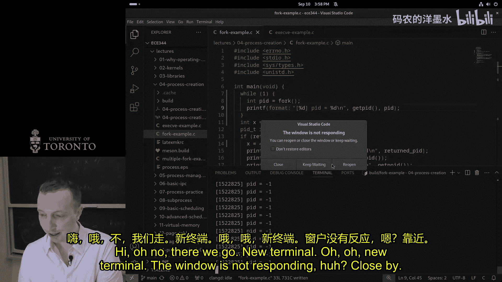

Close。Yeah。Bye。