# 操作系统课程：第4讲：进程创建 🚀

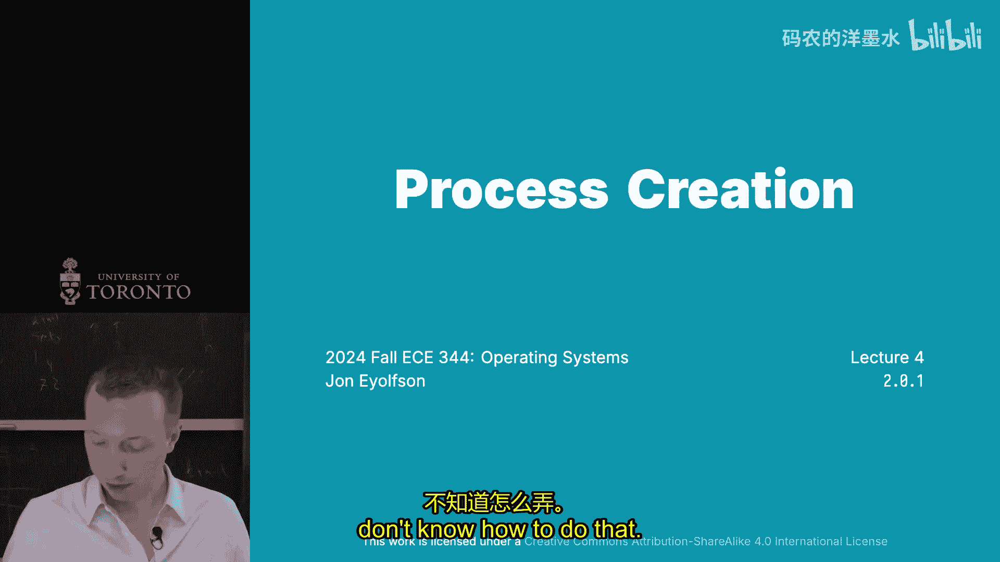

在本节课中，我们将要学习操作系统中的一个核心概念：如何创建进程。我们将从回顾进程的基本概念开始，逐步深入到创建进程的具体系统调用，并通过实例来理解其工作原理。

## 进程回顾 📝

上一节我们介绍了进程的基本概念，本节中我们来看看如何将之前的知识点串联起来。

一个进程是一个正在运行的程序实例。它包含以下核心组成部分：
*   **虚拟寄存器**：每个进程都需要自己独立的一套寄存器，以避免与系统上运行的其他进程相互干扰。
*   **虚拟内存**：这是进程的内存空间，包含了栈、堆、全局变量等。

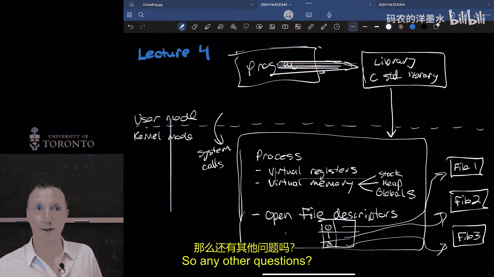

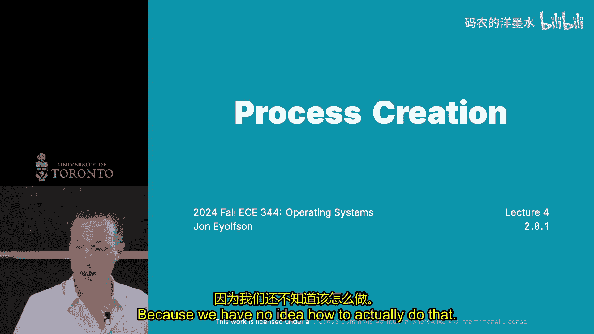

操作系统的核心部分称为**内核**，它直接与硬件交互，运行在一种特殊的CPU模式——**内核模式**下。而我们的应用程序则运行在**用户模式**下。应用程序（或程序）若想请求内核代表它执行操作，必须通过特殊的函数——**系统调用**。系统调用是跨越用户模式和内核模式边界的唯一途径。

应用程序通常通过库（如C标准库）来发起系统调用。内核管理所有的进程，并维护每个进程的信息，例如已打开的文件。进程通过**文件描述符**（可以想象成一个指向内核所管理文件的指针数组）来访问文件。

## 进程控制块与状态 📊

内核需要一个数据结构来跟踪和管理每个进程，这个结构称为**进程控制块**。在Linux中，它具体表现为一个`task_struct`结构体。

以下是PCB中通常包含的一些信息：
*   **进程状态**
*   **CPU寄存器**的当前值
*   **调度信息**
*   **内存管理**信息
*   **I/O状态**信息（如打开的文件）
*   **记账信息**
*   **唯一的进程ID**

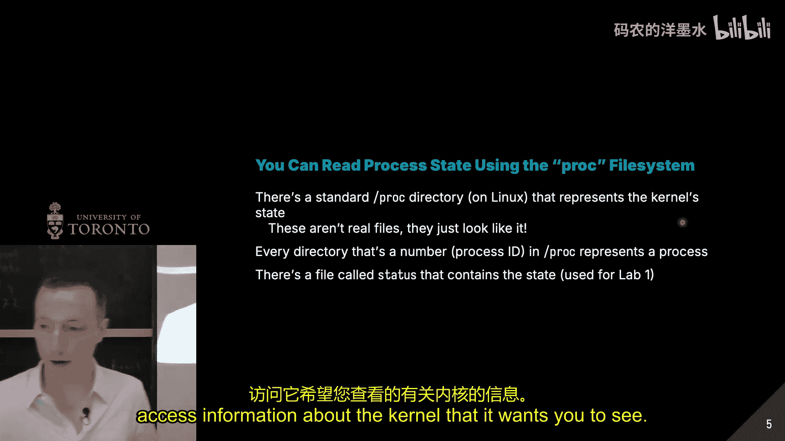

一个进程在其生命周期中会经历几种状态，内核正是通过这些状态来管理进程的。进程的状态转换图如下：

1.  **新建**：进程正在被创建，内核需要将其程序加载到内存并做好执行准备。
2.  **就绪/等待**：进程已准备好执行，但内核尚未调度它到CPU上运行。
3.  **运行**：进程正在CPU上执行指令。
4.  **阻塞**：进程因等待某个事件（如I/O操作完成）而无法继续执行，通常发生在执行系统调用期间。
5.  **终止**：进程已完成执行，将被系统回收。

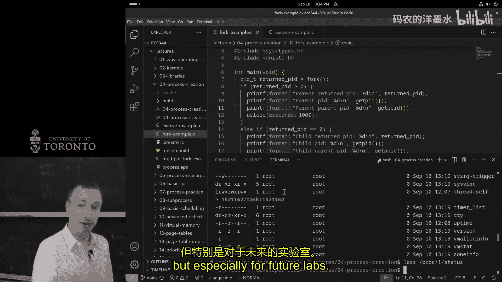

内核通过在就绪态和运行态之间来回切换进程，实现了在单个CPU上“同时”运行成百上千个进程的假象。

在Linux系统中，我们可以通过`/proc`文件系统查看进程状态。例如，查看进程ID为1的进程状态，可以使用命令：`cat /proc/1/status`。

## 创建进程：Fork系统调用 ⚙️

现在我们知道了进程是什么以及它的状态，本节中我们来看看如何实际创建一个进程。

在Unix/Linux系统中，创建新进程的唯一方式是使用`fork()`系统调用。Windows系统有`CreateProcess`，但Unix系操作系统将进程创建分解为两个步骤，这带来了更大的灵活性。

`fork()`的核心思想是**克隆**当前正在运行的进程。其工作流程如下：
1.  内核暂停当前进程（父进程）。
2.  内核复制父进程的PCB，创建一个新的PCB（子进程），并为其分配新的进程ID。
3.  此时，子进程是父进程在调用`fork()`那一刻的**完全副本**，包括内存内容、变量值等。
4.  此后，父进程和子进程成为两个独立的实体，各自执行，互不影响。

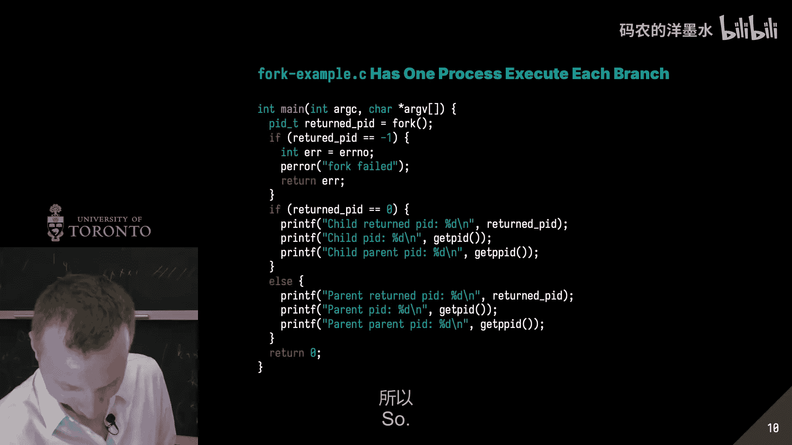

`fork()`系统调用的函数原型很简单：`pid_t fork(void);`。它没有参数，返回一个整数类型的进程ID。

理解`fork()`返回值是区分父子进程的关键：
*   如果`fork()`失败，返回 **-1**。
*   如果`fork()`成功，则**在两个进程中各返回一次**：
    *   在**父进程**中，`fork()`返回**新创建子进程的PID**（一个大于0的数）。
    *   在**子进程**中，`fork()`返回 **0**。

以下是一个简单的示例代码，演示了`fork()`的基本用法：

```c
#include <stdio.h>
#include <unistd.h>
#include <sys/types.h>

int main() {
    pid_t return_pid = fork(); // 创建新进程

    if (return_pid > 0) {
        // 父进程执行的代码
        printf("parent (pid:%d)\n", getpid());
    } else if (return_pid == 0) {
        // 子进程执行的代码
        printf("child (pid:%d)\n", getpid());
    } else {
        // fork失败
        fprintf(stderr, "fork failed\n");
    }
    return 0;
}
```

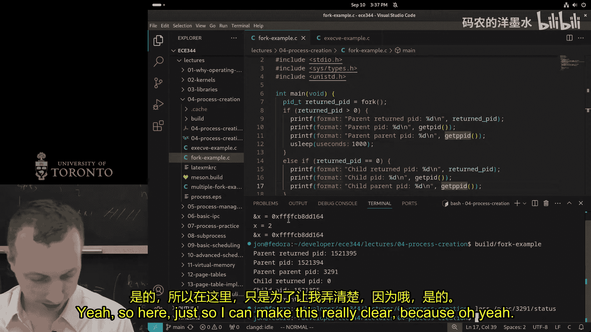

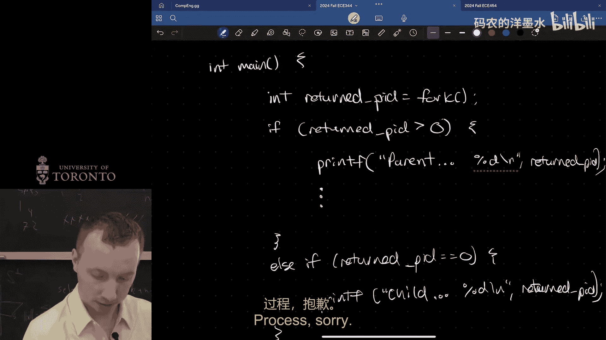

运行这段代码，你会看到来自父进程和子进程的两条输出信息。需要注意的是，由于操作系统的调度，这两条信息的打印顺序是不确定的，但在单个进程内部，代码的执行顺序是确定的。

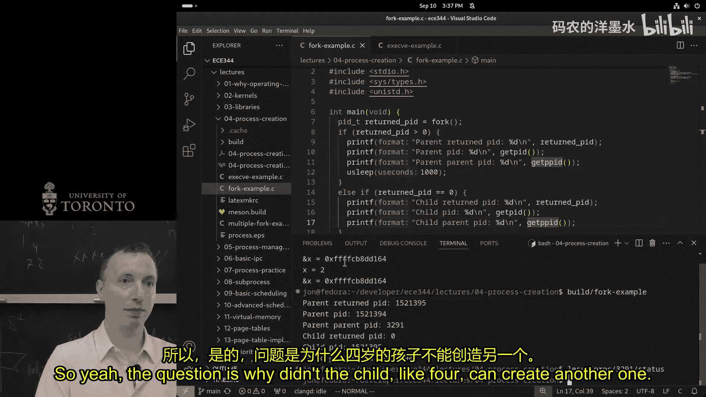

关于内存，一个常见的理解是：在`fork()`之后，父子进程拥有各自独立的虚拟内存空间。修改其中一个进程的变量，不会影响另一个进程。尽管它们变量的内存地址可能相同，但这只是虚拟地址，映射到物理内存的不同位置。

## 执行新程序：Exec系统调用 🔄

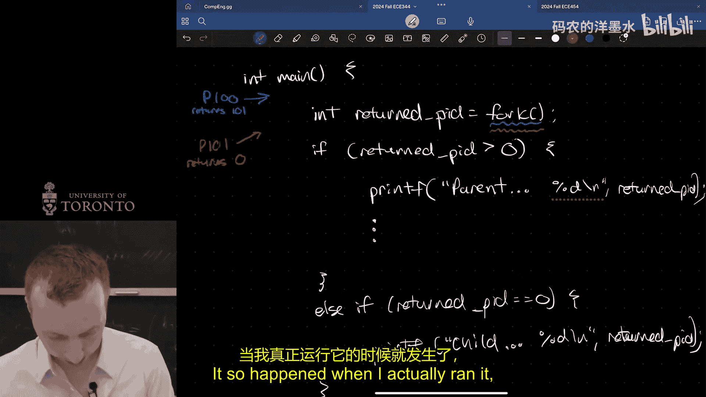

通过`fork()`我们得到了一个当前程序的副本，但如何让新进程运行一个完全不同的程序呢？这就是`exec()`系列系统调用的作用。

`exec()`会用一个新的程序映像**替换**当前进程正在运行的程序。这意味着当前进程的代码、数据、堆栈等都被新程序的内容覆盖，然后从新程序的`main()`函数开始执行。如果`exec()`调用成功，它**永远不会返回**；如果失败，则会返回-1。

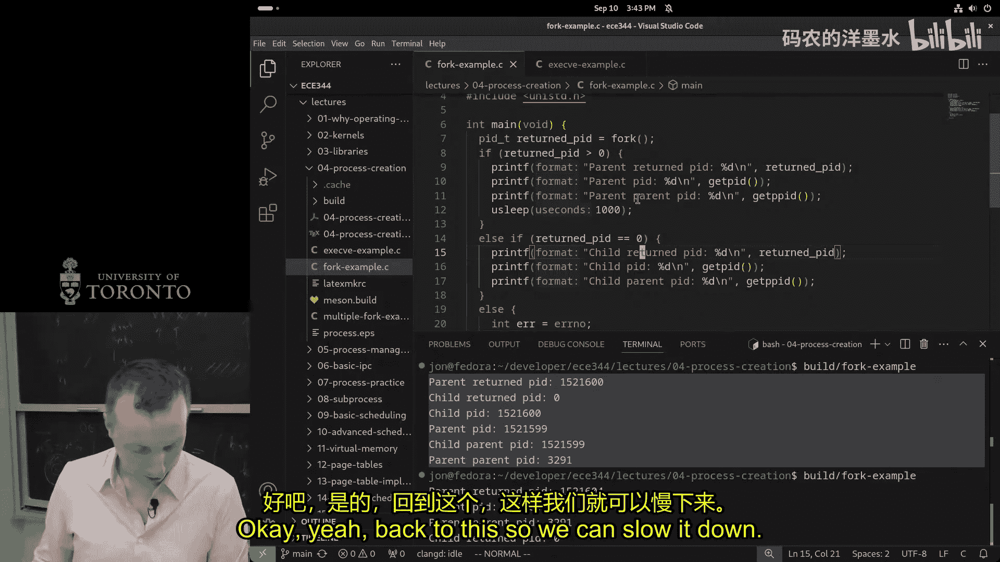

我们以`execve()`为例，其函数原型为：`int execve(const char *pathname, char *const argv[], char *const envp[]);`

参数说明：
*   `pathname`：要执行的可执行文件的完整路径。
*   `argv`：传递给新程序的参数列表（字符串数组），惯例是`argv[0]`为程序名称。
*   `envp`：环境变量列表。

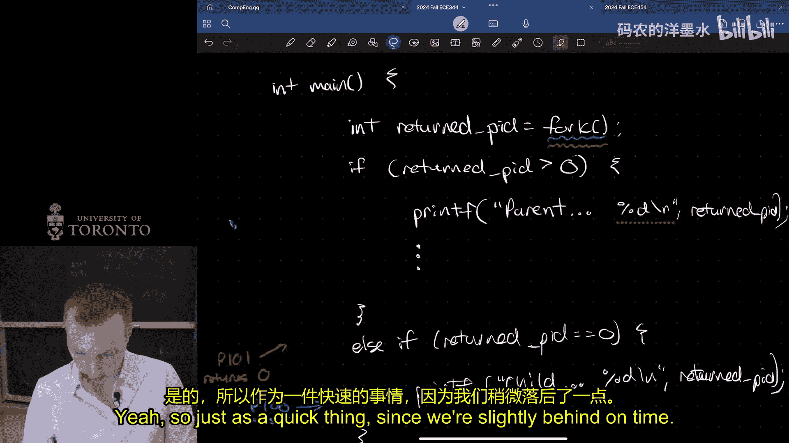

以下是一个使用`execve()`运行`ls`命令的示例：

```c
#include <stdio.h>
#include <unistd.h>

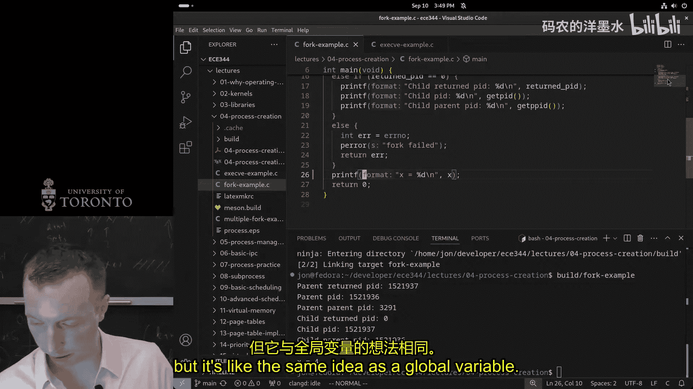

int main() {
    printf("I‘m going to become another process!\n");

    char *args[] = {"ls", "-l", NULL}; // 参数列表
    execve("/bin/ls", args, NULL); // 执行 ls -l

    // 如果execve成功，以下代码永远不会执行
    perror("execve failed");
    return 1;
}
```

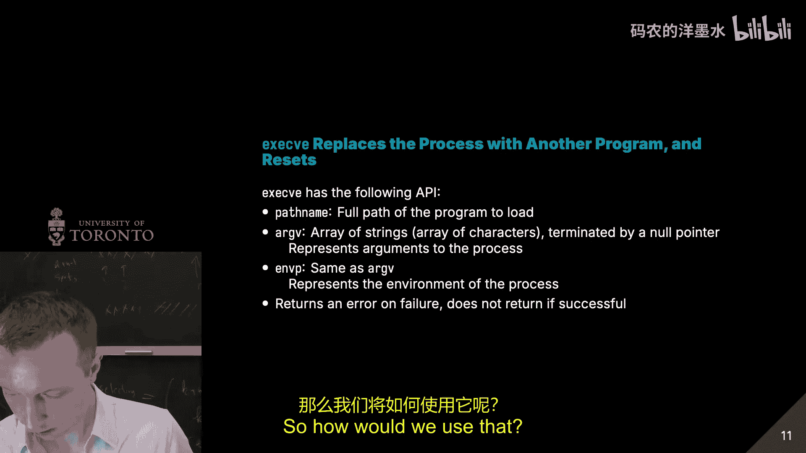

## 组合使用：Shell的工作原理 🐚

现在，我们可以将`fork()`和`exec()`组合起来，这正是一个Shell（命令行解释器）运行外部命令的基本方式。

其简化的工作流程如下：
1.  Shell进程（父进程）调用`fork()`，创建一个自身的副本（子进程）。
2.  在子进程中，调用`exec()`来加载并执行用户指定的命令（如`ls`）。
3.  在父进程（Shell）中，它通常会调用`wait()`（下节课内容）来等待子进程结束，然后准备接收下一条命令。

以下代码模拟了这个核心流程：

```c
#include <stdio.h>
#include <unistd.h>
#include <sys/types.h>
#include <sys/wait.h>

int main() {
    pid_t pid = fork();

    if (pid > 0) {
        // 父进程 (Shell)
        printf("Shell waiting...\n");
        wait(NULL); // 等待子进程结束
        printf("Shell ready for next command.\n");
    } else if (pid == 0) {
        // 子进程
        char *args[] = {"ls", NULL};
        execve("/bin/ls", args, NULL);
        perror("execve failed");
        _exit(1); // 如果execve失败，子进程退出
    } else {
        perror("fork failed");
    }
    return 0;
}
```

## 总结 🎯

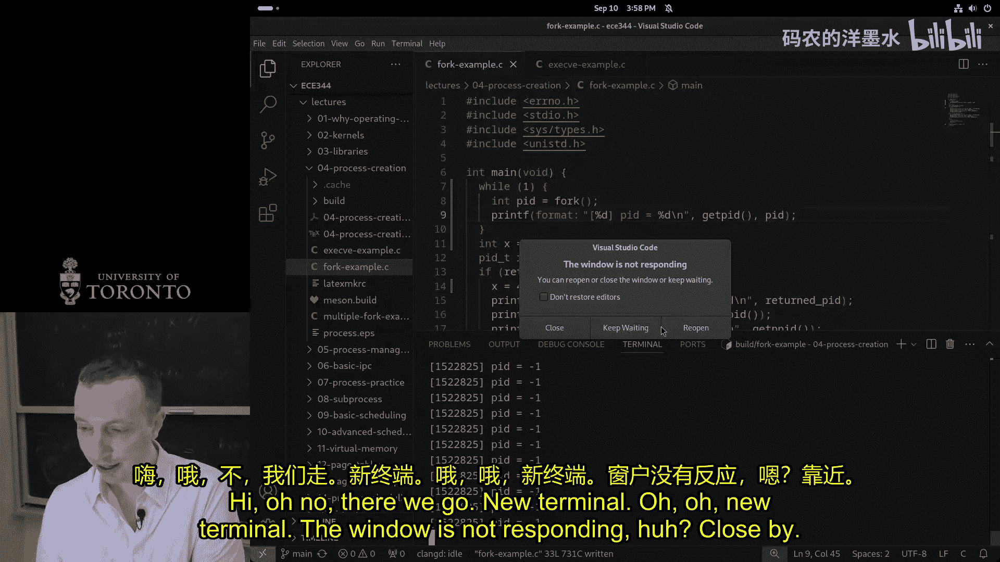

本节课中我们一起学习了进程创建的核心机制。我们首先回顾了进程的组成和状态。然后，深入探讨了Unix/Linux系统中创建进程的两个关键系统调用：`fork()`用于克隆当前进程，创建出一个独立的子进程；`exec()`用于将当前进程替换为一个全新的程序。最后，我们看到了如何将两者结合，这构成了Shell运行命令的基础。理解`fork()`和`exec()`是理解进程管理和操作系统交互的基石。