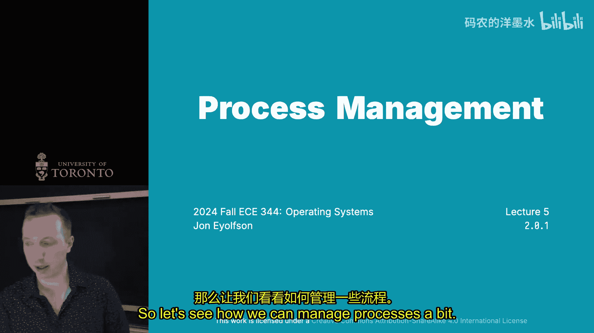
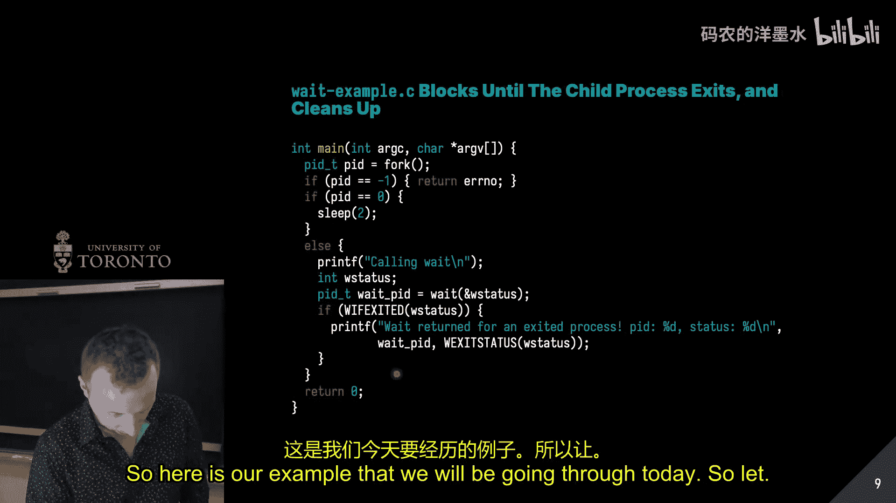
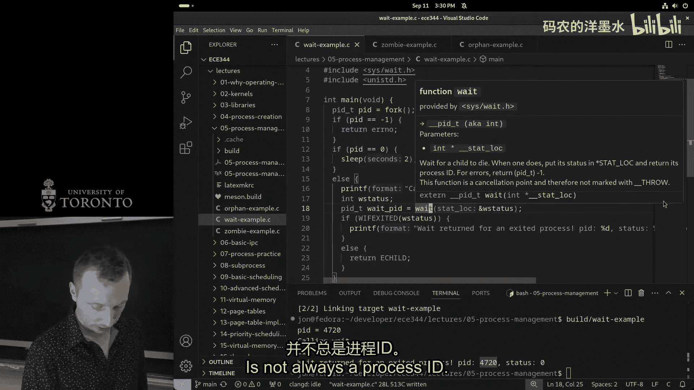
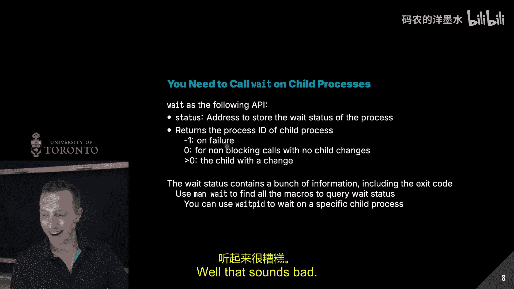
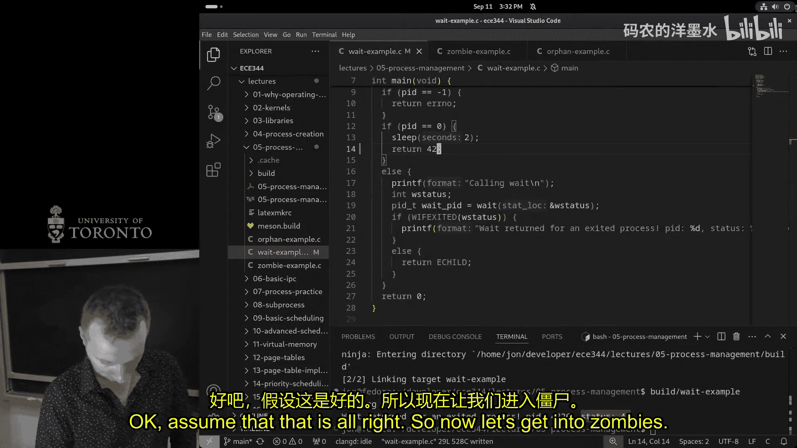
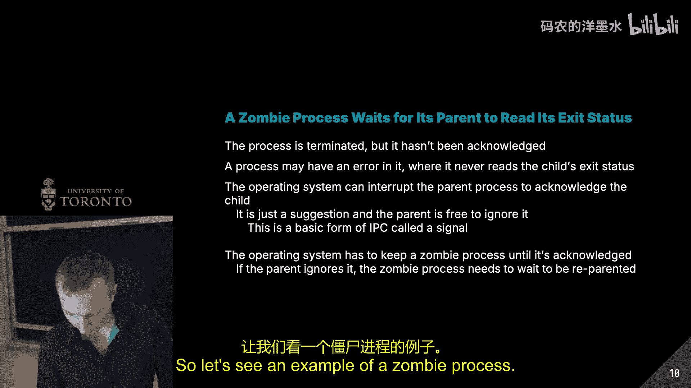
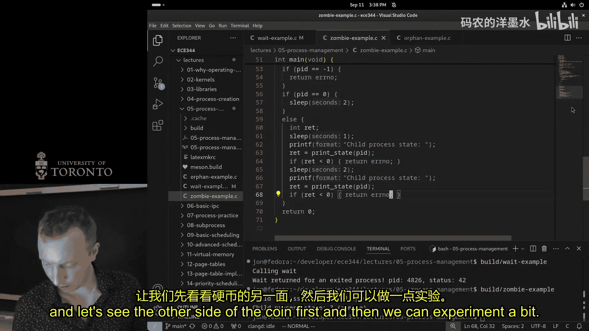
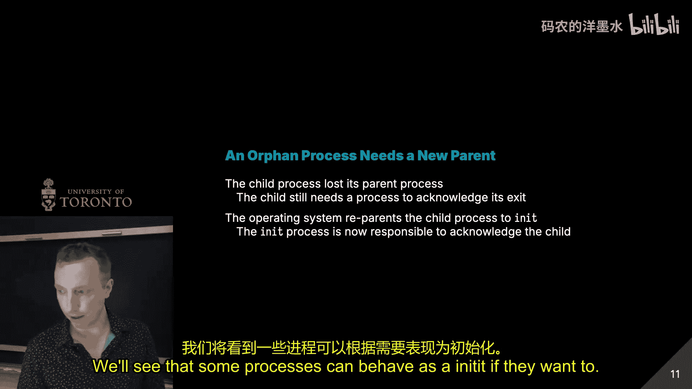
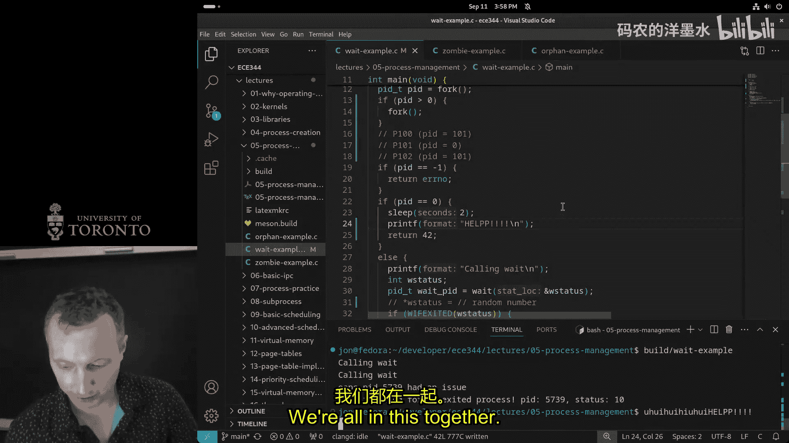

# 【全集】多伦多大学 操作系统 中英字幕 1080P p05 Lecture 5 - 进程管理 -BV1Rbk7ByERc_p5-

Alrighty， welcome back to operatinging System， so thanks for joining me today。

Today we get to talk about。Come on， let's go， we get to talk about process management today and things will get even weirder。

 let's try and turn down that echo。Al right， so things are going to get even weirder today。

 believe it or not。 So let's talk about how to manage our processes。

 So last lecture we learned how to create them。 We saw fork。Fork was a bit weird。

 It looks like one easy way to remember what fork does is one process calls it。

 and then two process return from it kind of weird， right， But that's basically how it works。

 And we'll be using it a lot in this course。 So let's see how we can manage processes a bit。

So I showed you the big state diagram earlier， the Linux terminology is slightly different。

 So like from that state diagram where we had like ready waiting， running， blocked。

 Linux is slightly different。 So if you look at the pro system and look at the status like what we did yesterday for the state。

 these are all the states on Linux。So there is a running state and running and runnable mean the same thing for them。

 so they kind of combine that running state and that waiting or ready state we saw before。

 they just lump it all together and that it could execute even if it is not currently executing and then most processes are in this interruptible sleep state so that is a system call they opt into so they give up the CPU basically put themselves to sleep but it's interruptible sleep because if the kernel really wanted to。

 it could wake them up and then have them execute some code。

 but they are like opting in to not running。Then this D state is called uninterruptible sleep and that's like truly block blocked。

 it's waiting for something to happen， some IO to happen。

 it can't actually resume execution even if it really wanted to。

 so they kind of take block and put it into two different states。

Interrupttable and uninterruptible and then there's a state called T stopped we'll see how to do that in the next lecture where you can essentially stop a process from running and then there's this cool Z1 called zombie so we will figure out what zombies are today and it's not even Halloween so lucky us so。

The stop state， the kernel lets you explicitly stop a process again， we'll see that， how to do that。

 and another process has to like continue it so it has to unblock it and let it run。So on UniX。

 Mac OS or Linux， the kernel， how it works is your entire user space。

 all the kernel does as soon as it boots up your computer and it's done initializing all your hardware。

 is it launches a single user process。And that's it。

 That other process is supposed to take care of launching any other process that's running on your machine。

 so no matter what process you're running， Chrome， Firefox， VS code。

 whatever it is going to be a descendant from the original process that started whenever we started our computer So this process is special。

 it is called ait， it gets process ID1 and whenever the kernel boots。

 it looks for a program in Spin and knit and then launches it and like I said it's responsible for executing and launching every other process on the machine。

It must always be active。 So if a knit is not active or process I D 1 is dead。

The kernel thinks you're shutting down， there's no user space。

 there's no one's actually running any programs anymore， so you want to shut down your computer。

So for Linux and it will probably be something called system D。

 We saw what one was in the last class。 its name was system D。 There's other options。

 but that's the most common one on Linux。And then some aside here。

 some operating systems will have like a fake idle process that the scheduler can run to keep track of how much your CPU is actually idle for。

 but that's kind of like an implementation detail window Walder version of Windows did that。So。

Since we have this parent childil relationship between every single process， and we know。

When we start our computer， it starts with init。 our tree might look something like this。

 So everything on top is apparent of whatever it is pointing to。

 So Enit would have started something called like journal D So that's basically a way to look at the kernel logs。

 maybe it launches something called system D user So like a process manager for my specific user。

 whatever I log in it。 maybe there's this U dev thing。

 which is a process that lets you query hardware and stuff like that。

 And then maybe I have no shellll。 So that's basically my desktop。

 and then maybe I launch Firefox away Firefox and then Firefox spawns a bunch of other processes。

 So the way Firefox is architected， is each tab runs its own process。

 So that if a tab crashes for whatever reason。Everyone's probably crashed their program and all pointers and things like that。

 It doesn't bring down Firefox。 Firefox would just say your tab is crash because each tab is a process。

 So it's independent of the main Firefox process that just kind of manages everything。

 So that is why if the tab crashes on Firefox， the entire application does not crash。

 And sometimes when you have different applications and it crashes。

All your windows crash and everything。Along with it also crashes。

Just processes completely independent。 remember。 And then we might have something like this where we have a terminal。

 and then we'd have something like our shell。 And then maybe our shell's running some other command that we will look at。

So if you want to see the processed tree， you can use something called H top and then press F 5 to see like a tree view So we can just kind of explore a little bit and see what is important on my system。

 so。This command column over here， this ASII。Line looks like a tree。 So here。

 this process would be a child of this one。 So this one has three direct children。

 It created three processes， and they're something called user work。 and they're just waiting。

 I don't know， They're waiting for something。 Who knows what they're doing。

Let's see if we can find anything interesting。 So if we go up。

We can see that this is process ID1 here， its system D user has a bunch of arguments。

But it is the parent of everything else。 So nothing else owns that one。

 It is a parent or grandparent of any other process on our machine。We can scroll down， ay。

 there's a low memory monitor that's great， probably worked overtime last lecture when you guys made me crash my laptop。

Let's see。Well else， do we have anything interesting， So there's just a bunch of stuff running here。

 We can see that。So this is my desktop。 This is V S code that I'm currently running this in。

 And then you can see V S code has a lot of different processes。 So it created this process。

 which created this。This one has a deep。Hisory， we got this one clang D。 That's my autocomp。

 I got a bunch of other things。 Oh， here I can see this is the shell。 I'm currently。

Typing commands into， and I typed H top。 So H top， it created the shell， create a process for H top。

 and it's running。 And this is the current process I'm currently running。

 And you can see in the state column， which is this S1 right here。It has an R。 That means running。So。

 and again， this is， you're writing a very， very simple version of this for lab 1。All right。

 any questions with that？Sounds fun。 Okay， so now let's get into how to manage processes。

So processes， whenever you create them， just in case I didn't say it last lecture。

 they get assigned a process Id or a P whenever they're created。

 it does not change throughout their lifetime。 Just a number unique for every active process。

 So if a process gets terminated and gets cleaned up。

 then the kernel is free to reuse that number again。 It's just as long as that process is alive for。

 most Linux systems， the maximum PD is like 32000， but on most of them。

 including your VM since you guys like to screw around。 it's a configurable limit。

 So your limit is higher than that。 So yours is like in the hundred0。嗯。Yeah， and like I said。

 eventually the kernel might recycle the process ID and every process again has its own address space。

 which is just another fancy words for each process has its own copy of virtual memory， right。

 and they're all independent。So we have that parent child relationship。And previously。

 I had like that little sleep。In my program， I didn't tell you why I had it well today I get to tell you why it's because I made sure that the parent exited last because it put itself to sleep。

 waited for the child to terminate and then it，Then finally terminated because I didn't want any weird things to happen without trying to explain them。

 so。There's two things that might happen that destroy this parent child relationship if you have a parent and a child。

 well then what happens if the parent process exits first or and no longer exists or what happens if the child process exits first and no longer exists？

So one process disappeared if there's a parent child relationship， well。

 how do you maintain that relationship if your parent is no more？And yeah。

 it kind of sounds a bit more of it than this class， you'll get weird， weird， weird Google searches。

So like real life， the parent process is responsible for its child。

 the operating system sets at least by default， the exit status when the process terminates。

 so this is like whenever they call the system call exit or if it's easier for you to think about whenever that returns from mainine。

 you return a number， the operating system keeps track of that number you return。

 so your parent can go ahead and read that number and see。

What happened to your process when it exited。 So that exit status would be stored in the process control block for the process。

Even if that process exits and terminates， the kernel can't clean up its process control block because it has to keep track of that exit code for some other process that wants to ask for it。

We have to， it just has to hold on to it and wait for an acknowledgement。

 And the minimum acknowledgecment we can do is that the parent process can be a good parent。

And read the child's exit status to see if it failed or not。

 And usually if a process exits with a number of0， that means everything's hunky Dory。

 everything's A O。 And if it's not 0， it means an error probably happen。So there's two situations。

Either a child exits first， which is called a zombie process。

 and we'll get into why that is basically。That process can no longer run， It has terminated。

 but the kernel can't clean up its process control block and completely get rid of it， so it's dead。

 but it still kind of exists hence zombie。 And then if the parent process exits first。

 then the child is an orphan process。 So its parent has disappeared。

 they use very literal terms here。So。I said acknowledgement without saying how to do that。

 So we get into our next system call。 So our next system call is called exit or sorry， called weight。

And that is how we acknowledge our child process。 So weight has the following API。

 It takes one argument， a status， which is an address to store the weight status of the process。

 It's a pointer to an int， so it will go ahead， dereference it and then update that value。

 so it just writes an integer to that memory location。 you give it。

And it returns the process ID of the child process that is now dead that has now terminated that it has cleaned up。

 So this will return negative one on failure， a lot of different reasons that it could fail。

 zero for a non blocklocking call。 so by default weight will block。 So if you call it。

 it will sit and block the process that called weight until that child has terminated。

 so it won't be able to execute or do anything else until that child is done。

 and then it will return from this system call。And then if it returns a value greater than zero。

 that is a process IDd of the child with a change AkaA， the child that has terminated。

 So that weight status that it writes contains a bunch of information， including the exit code。

 use van weight to figure out all the macros to query the weight status will' have a code example。

 pretty much right now。And I'll show you how to use it。

 And there's also a system called called weight P I D。

 if you want to wait on a specific child process， if you have multiple。

So here is our example that we will be going through today， so let us do it。

All right。So here is our main function。 So our main function immediately calls fork like it did before。

 Quick pop quiz。Which。Fork returns what for the child process？0ero， right。

 Should know that it's going。It'll be burned into your mind for this course because we'll be using fork over and over and over again。

Starts a process process called fork， creates a new one。 That's exact copy of。Whatever called fork。

 And then now two processes return from fork only difference is a return value in the parent gets a process Id greater than 0。

 That's the process I of the child。 in the child。 we get the process I D of 0。

 So let's assume the process I is greater than 0， and there's no errors。 So this won't happen。

 This won't happen。 So in the parent， the parent's going to。Print， calling， weight。

It will declare an integer called W status， and then as part of the weight system call。

 we will give the address of the W status， so it will go ahead and update that integer and write some information there that we can query。

And then we can capture the return value of weight， just a variable called weight PID。

 so that should be the process ID of the child that is now terminated。

Then this is the first macro we will assume for now。

 the only way a process can terme is by calling exit。 Again， that's not true。

 but we'll just assume that for now。 So you can use this macro called W。

If exited or you could think of it as a function if that's easier。 So W， if exited。

 and then you give it the status you got back， it wrote from weight。

 and it will be true if that process has exited normally。So in this case。

 we're just assuming it will exit normally。 Then we print off weight returned for an exited process P ID。

 And then we're going to write weight P ID， whatever we got from weight。

 And then we will also print off。If we want to see what the exit status is。

 we just can't print the integer。 It's just a whole bunch of different numbers in different places。

 so if we want the exit status， we have to use this function or macro。

 whatever you want to think of it as W exit status。

 give it it and then it should give us a number between0 and 255。So that is that。 And then。

We're assuming that。It exits normally if it doesn't， it would hit this else。

 and then the parent would return from Maine with this number E child indicating something bad has happened because its something we have not considered。

 but let's assume that never happens and then the parent would return zero so it returns from Maine。

 the parent doesn't exist anymore。Now， let's see what the child does。

 So when the child returns from fork。Fork returns a0， so PID gets assigned to zero。

 Then we would just fall into this。Wops， I probably shouldn't delete random code。

We fall into this if branch here where the child process sleeps for two seconds。

 so that just puts the child process to sleep， it doesn't execute anymore for two seconds and then whenever it wakes back up or sleep returns。

 it would skip over this else branch， and then return zero so then the child process would terminate。

So any questions about the code。Yeah。Sorry。いそいで。So wait will wait for a child process to terminate。

 sleeple will just put this process to sleep for two seconds， so it won't execute for two seconds。

用 the child。Yeah， so I'm just， I'm going use sleep here to just show that。

Weight is a blocking system call， so the child process takes two seconds to run and in the parent it's going to print off calling wait and then this weight since it's a blocking system call。

 should wait for two seconds until it returns for the child to die。Terminate。They call for choice。

Well if the parent process calls fork twice。Yeah， you could have multiple children。

 You mean what will weight return if there are multiple children。 Yeah。

 so if you have multiple children and you call weight。

 it will return whenever the first process dies。And。It's just whatever one dies first。

 so let's execute this real quick， just to show that weight's a blocking system call。

 So the main parent process says calling weight， then it waits two seconds because it's waiting for that child process to terminate。

 so it just calls sleep for two seconds， then exits。And then， we return。

And then the parent process finally returns from weight。And then prints this message。

 So it says wait， return for an exited process， P I D， this， this is what we created。

 and it got status 0。So questions about that。Yeah。Yeah， that's the child process PID。

 so I can just do a sandy check right here。If I wanted to see both return values real quick。

 P I D equals。So all the numbers should kind of line up and make sense。So if I run this。

 I can see both their PID， so this is from the parent。

 so this should be the PID of the child and you can see it does actually match up。

 so that is the process that terminated。Like the return profit I give0。

It will always wait for process。Sorry， like for the return the process I of a chosen process。

 it could be negative 10 and So so the question is， how does weight return a process I of 0。

 So it does not。 So the return value is not always a process I slides。 So the return value of weight。

 not always a process I， It's only a process I if it's greater than 0， return。

If it returns 0， it means nothing has terminated and we'll see how to use that。 But right now。

 it can't return 0。So this is like a non blocking cough。 We didn't want to wait two seconds。

 and we just wanted to poke the kernel and say， hey， is my child dead。 Wow， that sounds bad。

And then minus1 means it failed。

All right。And just to verify， it works。We can go ahead， and if。

Just to make sure we read the exit status。We could just have the child here after it wakes up from sleep。

 it could return something like 42 just to make sure that we are actually reading that value from the parent process。

 so now if I run it， it says calling wait， waits two seconds and it says weight return for an exit process process I did this。

 the status was 42 so whenever the child process exited it exited with a status of 42 because while we know that if we return from Maine it eventually calls exit。

Alright， any other question for this before we get real weird with it。Okay， Is assume that that is。

All right， so now let's get into zombies。

So。If we have a zombie process， that is a process that's waiting for its parent to read its exit status。

 So there， in that example， I waited for my child。 it took longer than me to die。

But when I eventually died， I read its to exit status。 It got cleaned up。

 That process I D would have been removed from the kernel。

 That process control block would have been gone as well。 But I could be a neglectful parent。

 So assume that the parent process kept on doing other things。

 The child just terminated and it never called weight， it was neglectful。 So the child process。

 in that scenario would be a zombie。The process might have an error in it where like it just never reads the child's exit status。

The operating system can try and。Pooke you into being a good parent。

 So we know slightly about interrupt。 So basically the operating system can interrupt your process and be like。

 hey， your child has terminated， you should probably do something about it。 but again。

 you're free to ignore that。 and that is a form of IPC。

 we'll see in the next lecture called a signal。But since we're being a neglectful parent。

 the operating system has to keep the zombie process until it's acknowledged if the parent ignores it。

The zombie process just waits around until it gets a new parent that treats it a bit better。

So let's see an example of a zombie process。

So here is another program，There's a print state function that I will gloss over。

 basically I just look at that profile system， look at that status and try and read its state just to show that there is an actual thing called a zombie process。

So here what happens in Maine， I fork again， so in the child fork returns zero in the parent it returns greater than zero。

 you get the process ID of the child here let's go through the child first so the child does the same thing as before it sleeps for two seconds so it doesn't execute anything for two seconds and then it returns zero so it just exits。

 so process is done， it's terminated。So the fun stuff is in the parent。

So the parent will sleep for one second， so it just sleeps for one second。

 and then it reads the child's process state so this is a function I wrote。

 you're free to read it if you want， I won't go over it in the lecture。

 but it just prints the state from that Pro system for the processed IDD given by this argument。

It should be in the state called sleeping because it sleeps for two seconds。

 the parent woke up after a second so the child should be one second into its sleep or halfway through it。

 so hopefully I read off that is still sleeping。I error check and then if that is fine。

 the parent sleeps for an additional two seconds so three seconds have passed whenever it comes back from this。

 my child should have terminated after two seconds。

 and then I read the state again to see what the state is。And。

We know that it should probably be a zombie， but let's be sure that I'm not just making it horrible names and that that actually exists so we can see child process state is sleeping and then wait two seconds and it says process state is Z or zombie。

 so I have not waited for it， it is currently a zombie waiting for some process to mercifully call weight on it。

So any questions about that？So you can create zombies。A bad thing。Here's a thought experiment。

 Did we create zombies last time in last lecture when you made me have an infinite loop with fork。

Yes。Yeah。So the prevailing wisdom is yes， because we didn't call weight on childil。 Oh， yet。这个な。Yeah。

 no of those exited。 So technically they were all running in an infinite loop。 They never exited。

 so we didn't actually create zombies， even if we didn't wait on them。

 they didn't actually ever terminate。 It was all in an infinite loop。 So trick question。

 I should have probably saved that one for an exam or something。Oh， well。嗯。All right。

 any question about this until we experiment a bit more and go to the other side of the coin。

 which is orphaned？We just leverage big knowledge。So what， the question is。

 what happens if we never acknowledge the zombie？ So it's wasting some memory， right。

 because it has a process Id。And that， in fact， is what happened before。

 whenever I had the infinite loop with the fork。The reason ForRC was failing is because we ran out of process IDs。

 they weren't zombies or anything， but I ran out of process IDs and a zombie also consumes a process ID even though it's not running。

 so if I don't do this， like if I don't wait properly。

 I might actually run out of process Is and we get in this situation before。

 when I try to run something and it just never worked。So that is one thing we can do。

 And let's see the other side of the coin first， and then we can experiment a bit。

So what is an orphan process。 So it is a process that needs a new parent。

 So the child process lost as parent process。 The child still needs a process to acknowledge its exit whenever it does finish。

 So the operating system is very， very strict about that parent child relationship。

 So it will repar it。Likely to in。 and the in process is now responsible for acknowledging the child。

 We'll see that some processes can behave as a knit if they want to。 So we'll see what happens。

So let us read the next example。 So here is the orphan example。 So starts off the same again。

 We start with a fork。Then， in the child。The child prints off this time what its parent's process ID is。

 so it should be whoever just called the fork。Then we sleep two seconds。

 and then we ask the colonel again to remember PP ID is the parent process ID D and see if we get a new parent。

It will check again after two seconds。 Now， if we go back to the parent。

Parent will return greater than one versus greater than 0 from the fork。

So it will go into this else where it just sleeps for a second and then exits。

 So the parent only lasts for a second。 And then in the child， it immediately says who's。Wow。

 that was almost a bad movie quote。about to say the child says who'， who's your daddy。Yeah。

 I probably should just not said that， right， O so。It asks who's your parent， not whatever I said。

 I should stop talking， sleeps for two seconds， and then asks again。So。Let's just run this。

So I get the process ID of my parent and then。I see that I can type on my terminal again。

 so my shell' is just waiting for whatever process I ran to exit。

 doesn't care about any children I made at all， so I can actually type again and then I see that print。

Child process， PID after sleep got this number。 It wasn't one。On Mac O， it will be one。

 on older versions。 it will be process I D1， but it is this number。

 and we can check whatever that is。 So if we look at 1700 status。

We can see that that is system D again， turns out that that's that system D dash user。

 so this is the kind of process manager for my user。

 so it accepts all the orphans and then this process is responsible for calling weight on them。

All right， any questions about that stuff yeah？Zombie eventually become a work。Aarranted。Yeah。

 so that is one question we can answer。We can see what happened here to in the zombie example。

 what happened to the child， so let's run it again。So。It printed， you know。

 it printed from the parent that the child was a zombie。 It never called weight on it。

 And then the parent exited。 So as soon as a parent exits。

 this zombie process does not have a parent anymore。 So technically， for a split second。

 it is a zombie orphan。So it is both a zombie and an orphan and then it would get repared to a or system D in this case。

 and then system D would wait on it and then clean it up as long as they implemented it correctly。

 which they probably did so that's why this child process does no longer exist whenever my parent exits because it gets orphaned and that zombie process gets repared to system D and then that gets cleaned up。

你疼呀。落ついて。The。Wais for the job。shall exit。Yep。WhatSo does it stay？No， so。Whenever that process。

 that child process becomes a zombie， it's still a zombie until someone calls weight on it。

And then in this case， since the parrot never calls weight on it。It just waits until it's an orphan。

 right I never called weight on it， so it's just a zombie until the parent exits and terminates。

 in which case it needs to be repared somewhere right， so that zombie gets repared。

 It doesn't resurrect or anything like that， just gets repared to a knit and then a knit waits on it and then it gets cleaned up fine。

 and then a knit doesn't really care about its exit status or anything like that。All right。

 any other questions with this？This is good， all good stuff， y。So the question is。

 is the orphan case as bad because it has to do extra work？So the orphan cases。

You might want this in some of your code that like your。Child lasts longer than you。

 That's perfectly fine， but。It might be an error if you actually expect your child to terminate and do something and finish。

So it just depends on the program。 So sometimes this is okay。

 You don't really care about the extra work it does。

 just whether or not you actually should have cared about that child。 Wow。

 that looks that sounds bad。 I hope no one from humanities drops in on this lecture。Wow。

 every context is bad。All right。Any other things we should do， things we can break。

Or things we should try。Or we all get this。 So if I just randomly give you code that has a bunch of weights and sleeps in it。

 or sorry， weights and forks， we're all fine。Yeah。Yeah， so the question is。

When a process becomes an orphan， can I pick who repars it？So the answer to that is yes。

 and you will even do that in lab too，So， by default。Here， I'll show。So， by default。

Processes get repared to a knit， right， the grandparent of everything。But my process。

 whenever it exited， got repared to。I guess this isn't organized。Well is it like 1700， yeah。

 got repared here， right？So this process was special in a way in that it accepted the orphan。

 or you can think of it as like an orphanage or something。 And basically。

 that process opted in to receive any orphans that any of its child or grandchildren make。

So you can do that。 so you can opt in to accept orphans。

And that's something you can ask the colon for。But yeah， but you'll be doing that in lab too。

Which will be fun。All right， any other。Experiments， fun things to run。Yeah。都为。Wt example y。呃。

value you。いせです。よ。The value of W status。都 we like。对家。Yep。What exactly。So this weight function。

Like it gets it as a pointer， so it will do something like this and then。

Just update it to some seemingly random number。So it assigns random values from it。

 And to get meaning from that， it like has a whole bunch of different meanings。 You use these。

Functions that start with W。So。Part of the information encoded in that number will tell me whether or not this process exited。

The process that。Coed with the weight。No， only the parent runs this weight coat this week。Yeah。

 and the process ID we get is the process ID of the child that terminated。

 and this number has all the information about it。Here太多。Yeah。

 what if the parent had multiple children， so let's have multiple children。呃。So if PID。

It's greater than zero， screw it will just fork again， right？So。Yeah， this should be a good quiz。

 so how many processes get created in total？Yeah。3。4。Three。Yeah， well。

 there's three processes in total， two get created， three in total two created。

 depends how you want to look at it。Just to。Walk through it like process Id 100。

 We just assume already exists and is running this code。 Then process I D 100 would call fork。

There would be two processes running this line， process 100。That would get。PID equal to like 101。

 and then process I。101 that would get PID loopops。PID equal to zero， right？

Then these two processes would execute this if statement。

 only this one would go into it and then call fork again， so only process 100 makes it here。

 so let's update that one。So process 100 comes in here， calls fork again。

And then we also have process here。 I'll just do it on two lines。 We also have process。

102 and the return value of fork。We just threw away。 we didn't care about。 So there were。

And then both of these eventually would reach this line， oh。And as a little quiz in process，102。

 would it have a variable called P I D。Yeah， yeah。What would the value of P I D be in process 102。

 yeah。101， right？So why is that？Did something move that just me？The copy。But yeah。

 so whatever process 100 calls fork。Remember it creates a new process that is an exact copy of whoever called fork at the time of the fork。

 so the new process process 102 would also have a variable called PID。

 it would be equal to 101 because that's what it was in the original process。

Then the only difference would be the return value of fork。 And in this case， I don't care about it。

 I throw it away。 So all the processes that would eventually reach this line。Our。These three。

With that as their process ID， so only process 101。Sorry， only process 101 makes progress。

 that sleeps。And。Oh yeah， and then this will screw up real mightily。So if we draw out our。Who's。

 whoses parent？So in this case， we had process 100。It created process 101， right？

But it also created process。102。But process 102， which is a child。iss going to call weight。

 so process 102 is going to go into this else and then see calling weight and then it's going to wait and does process 102 have a child。

 no， so it would probably return negative 1 and give us an error。And we actually don't handle that。

 We go into the else， and just do this。So we could just do oops。Just to make sure we hit it。

So some weird stuff should happen。And let's just run it。

This to make sure that our walk through the code does the insane thing we think it's going to do。

 So it says calling， wait， calling， wait。So。That happens from process。

In the numbers I gave them 1102。But this would be the output from 102 it would call weight to get an error from weight。

 One sure way to do it is to call weight when you don't have any children to wait for。

 so that would be an error it would have got negative1 went to the else called oops and then the parent says weight return for an exited process and then we got PID this so let's。

す。Yeah， which was probably this process， oops。So we can just use Git PID。So run。

So we can see that oops P I D， this number， which。In my assignment was 102。

We see that that gets the error because it' called weight without a parent。

 and then we also see that the original parent process。Weight returned immediately because my。

My silly child。 and I'll say that word。 My silly child did this and immediately exited。

 I didn't have to wait two seconds because one of my children。Terminated immediately。

It immediately returns weight on that one。 and that's all we see。

 We never see the one that gets created and that gets to the sleep and waits so。When we did this。

 did we create a zombie process？Oh， that's what you're going to ask， so I turn it around， yeah。

Because。When created。Yep。You， there's only one that。Gerinated。agree on。102。Yeah。

 so here 102 is the silly one that that called Wait immediately and gone error， right。

 that died first。 Oh， yeah，102 died first。ま、そこに。Yep。Once， once more。啊。There's no way。No。

 we did wait on it this time， right？We on both one0 one and one。你个。I did not wait on both of them。

Yeah。101' is a zombie， everyone think 101' is a zombie。Yeah。

Why is the second child I made process 100？So when I got here and processed 100 called fork。

 created a new process right， and then it was an exact clone。

 but the only difference was the return value of fork。Did I use the return value of fork？ No。

 I threw it away。 So there's no way to distinguish between them。Yeah。

 they look exactly the same except for。Like one's the child of the other。But other than that。

 they're exactly the same。Yeah。Alright， so to answer this， Oh， wow， that we got three minutes left。

 So in this particular scenario， we would， which this is a good exam question， too。

There would not be a zombie。 Why is that。So process 100 called weight。And process 1。

02 immediately terminated， and we waited on it， so。

We cleaned it up and then process 100 would have exited and it terminated， but process 10。

One was sleeping for two seconds， so in all likelihood when process 100 terminates process 101 was still in the sleep and it was still running。

 it would have just been a plain old orphan and then it would have got reparented then after two seconds it would have got cleaned up and I can verify this well I can see that you know I can print off help。

So if I'm right， what I should see is that I immediately get control over my terminal again。

 and then it screams at me from beyond the grave。So if I run this， see I immediately do that。

 I can type on my terminal and then it screams for help。

So it was obviously still running if it screamed for help after a few seconds。All right。

 only got two minutes， I'll just stick around a bit after。 so just remember pulling for you。

 we're on this together。

